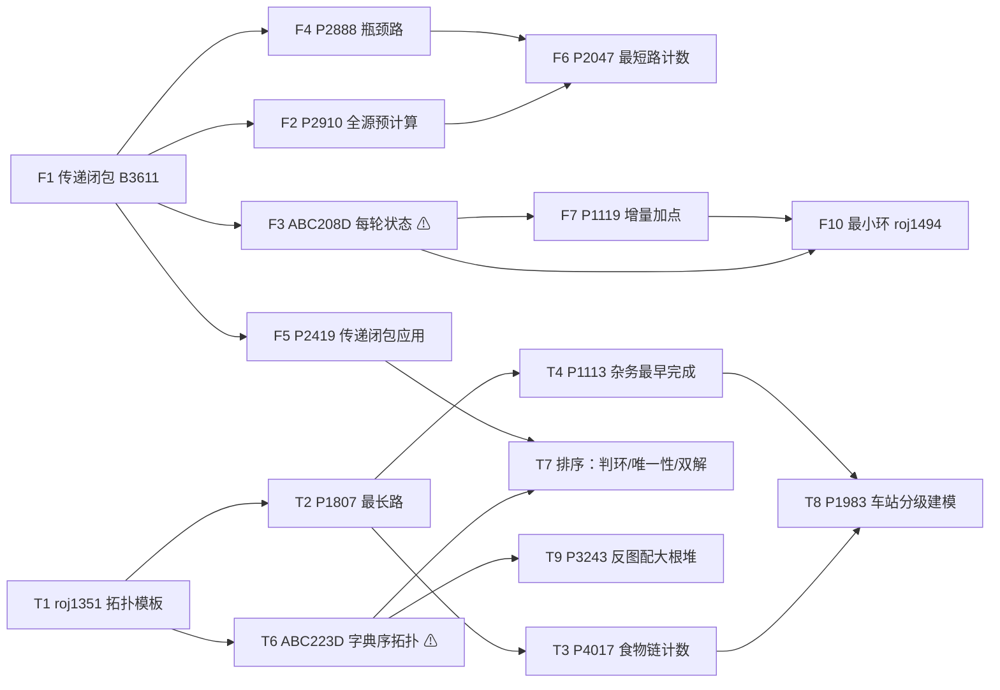

# Floyd 与拓扑排序做题顺序 DAG

这两个知识点不是并列的两条线，而是各有主干、并在「传递闭包 vs 拓扑判环」处汇合。下面先给全图，再按图的层次逐个阶段刷。

- **图的含义**：`A --> B` 表示 **做完 A 再动 B**，理由写在下文每题的「前置」里，不是按平台或难度排序。
- **主干 23 题**：全部已入库，可直接排成纸质复习卡；其中 14 题有完整题解，9 题（CF/AtCoder 新入库）暂无题解，卡上对应字段印「待补」。
- **支线 5 题**：有余力再碰，带 ⚠ 的尚未入库。

[[toc]]

## 一、主干 DAG

读法：两条入口分别是 F1（Floyd）与 T1（拓扑）。Floyd 线在第 3 层收在最小环；拓扑线在第 3 层分叉成「建模（T8）」与「贪心方向（T9）」。唯一的两线交叉点是 **T7「排序」**：同一道题既能用传递闭包（从 F5 过来）也能用拓扑排序（从 T6 过来），它就是这个 DAG 的汇合点。

## 二、Floyd 主干：先拆掉「背三段循环」

**过关标准**：能说清 `k` 代表"允许当前作为中转点的集合"，且能解释为什么最小环的统计必须写在 `k` 松弛之前。

### 阶段 1：把 `k` 的语义立起来

- [ ] [[problem: luogu,B3611]] · [F1 B3611 【模板】传递闭包](https://www.luogu.com.cn/problem/B3611)〔入口，无前置〕
  - 卡点：把「距离」换成「可达」后为什么仍是三层循环；顺手用 bitset 压常数，为 T10 铺路。
- [ ] [[problem: luogu,P2910]] · [F2 P2910 Clear And Present Danger S](https://www.luogu.com.cn/problem/P2910)〔前置 F1〕
  - 卡点：先 O(n³) 预计算全源，再沿给定序列累加；想清楚"为什么值得一次算完"。
- [ ] [[problem: atcoder,abc208_d]] · [F3 ABC208D Shortest Path Queries 2](https://atcoder.jp/contests/abc208/tasks/abc208_d)〔前置 F1〕
  - 卡点：题目要求把 **每一轮松弛后的距离和** 加起来，做完这题你会第一次真正"看见" `k` 是一个阶段而不是一次遍历。

### 阶段 2：换运算、换对象

- [ ] [[problem: luogu,P2888]] · [F4 P2888 Cow Hurdles S](https://www.luogu.com.cn/problem/P2888)〔前置 F1〕
  - 卡点：运算从 `min(+)` 换成 `min(max)`，要能证明这样得到的就是瓶颈最短路。
- [ ] [[problem: luogu,P2419]] · [F5 P2419 Cow Contest S](https://www.luogu.com.cn/problem/P2419)〔前置 F1〕
  - 卡点：布尔半环判可比性，数出每个点的可比数是否为 n-1；这是汇合题 T7 的传递闭包一侧。
- [ ] [[problem: luogu,P2047]] · [F6 P2047 [NOI2007] 社交网络](https://www.luogu.com.cn/problem/P2047)〔前置 F2、F4〕
  - 卡点：最短路与最短路条数同时维护，距离相等时的累加时机；条数会爆，用浮点/高精度。

### 阶段 3：增量视角

- [ ] [[problem: luogu,P1119]] · [F7 P1119 灾后重建](https://www.luogu.com.cn/problem/P1119)〔前置 F3〕
  - 卡点：`k` 的顺序换成"按重建时间解锁的村庄"，于是 Floyd 变成增量算法，询问必须离线排序。

### 阶段 4：Floyd 的招牌变形

- [ ] [[problem: roj,1494]] · [F10 roj1494 Sightseeing Trip 最小环](https://roj.ac.cn/problem/1494)〔前置 F3、F7〕
  - 卡点：环由"最大编号为 k 的点"拼出，所以统计答案必须写在用 `k` 松弛之前；还要恢复路径（同题：roj 3183）。

### 阶段 5：增量的两个方向（删点 / 加边）

- [ ] [[problem: codeforces,295B]] · [F8 CF295B Greg and Graph](https://codeforces.com/problemset/problem/295/B)〔前置 F7〕
  - 卡点：删点转逆序加点，每激活一个点只做一层 $O(n^2)$ 松弛；答案要按删除顺序倒着记录。
- [ ] [[problem: codeforces,25C]] · [F9 CF25C Roads in Berland](https://codeforces.com/problemset/problem/25/C)〔前置 F8〕
  - 卡点：加边后只需用新边的两个端点做中转更新，而不是重跑 Floyd；每轮查询是所有点对距离之和。
- [ ] [[problem: atcoder,abc243_e]] · [F13 ABC243E Edge Deletion](https://atcoder.jp/contests/abc243/tasks/abc243_e)〔前置 F2〕
  - 卡点：判每条边是否冗余——存在等长替代路即可删；注意「等长」不能用 `<` 判断。

## 三、拓扑排序主干：从"输出顺序"到"无后效性"

**过关标准**：每道题都能先回答三件事——顶点是什么、边表示什么依赖、DP 值表示什么。

### 阶段 1：模板与 DAG 上 DP

- [ ] [[problem: roj,1351]] · [T1 roj1351 【例4-12】家谱树](https://roj.ac.cn/problem/1351)〔入口，无前置；已会模板可跳过〕
  - 卡点：入度数组清零、多组数据；输出顺序要求从长辈到晚辈。
- [ ] [[problem: luogu,P1807]] · [T2 P1807 最长路](https://www.luogu.com.cn/problem/P1807)〔前置 T1〕
  - 卡点：边权可为负、最长路只在 DAG 上可行；不可达输出 -1 而不是 0。
- [ ] [[problem: luogu,P4017]] · [T3 P4017 最大食物链计数](https://www.luogu.com.cn/problem/P4017)〔前置 T2〕
  - 卡点：生产者（入度 0）与最高消费者（出度 0）的边界定义，沿拓扑序后推方案数。
- [ ] [[problem: luogu,P1113]] · [T4 P1113 杂务](https://www.luogu.com.cn/problem/P1113)〔前置 T2〕
  - 卡点：最早完成时间 = 到该点的最长路，注意是"任务自身耗时 + 前驱最大完成时间"。

### 阶段 2：字典序、判环与唯一性

- [ ] [[problem: atcoder,abc223_d]] · [T6 ABC223D Restricted Permutation](https://atcoder.jp/contests/abc223/tasks/abc223_d)〔前置 T1〕
  - 卡点：把 Kahn 的队列换成小根堆才能得到最小字典序；顺手证明"跑完再排序"为什么错。
- [ ] **T7「排序」：判环、判唯一，且是全单的汇合题** —— 见第四节。

### 阶段 3：两条分叉

- [ ] [[problem: luogu,P1983]] · [T8 P1983 车站分级](https://www.luogu.com.cn/problem/P1983)〔前置 T3、T4〕
  - 卡点：偏序直接连边会 O(n²) 爆空间，用虚拟节点按区间建图；答案是分层数（最长路）而不是拓扑序长度。
- [ ] [[problem: luogu,P3243]] · [T9 P3243 [HNOI2015] 菜肴制作](https://www.luogu.com.cn/problem/P3243)〔前置 T6〕
  - 卡点：正着用小根堆贪心是错的，必须反图 + 大根堆再倒序输出；做完这题才算理解拓扑序的自由度。

### 阶段 4：拓扑 + 附加维度

- [ ] [[problem: codeforces,919D]] · [T14 CF919D Substring](https://codeforces.com/problemset/problem/919/D)〔前置 T2〕
  - 卡点：拓扑序上跑 26 维 DP；有环输出 $-1$（用入队点数判断），注意是「某字符出现次数的最大值」。
- [ ] [[problem: codeforces,1385E]] · [T15 CF1385E Directing Edges](https://codeforces.com/problemset/problem/1385/E)〔前置 T2〕
  - 卡点：先对有向边拓扑排序得到时间戳，再让每条无向边从时间戳小指向大，必然无环。
- [ ] [[problem: codeforces,510C]] · [T13 CF510C Fox And Names](https://codeforces.com/problemset/problem/510/C)〔前置 T6〕
  - 卡点：从相邻两串的首个不同字符提取偏序边；「前者是后者前缀」且前者更长时直接无解。
- [ ] [[problem: atcoder,abc291_e]] · [T12 ABC291E Find Permutation](https://atcoder.jp/contests/abc291/tasks/abc291_e)〔前置 T7〕
  - 卡点：唯一拓扑序 ⟺ 每一步零入度点唯一；据此还原排列，不唯一输出 `No`。

## 四、汇合点 T7：同一道题，两种知识

T7「排序」（Sorting It All Out）是本单唯一同时挂 **传递闭包** 与 **拓扑排序** 的题，也正好是本仓库里两个解法都有题解的题：

- [ ] [[problem: luogu,P1347]] · [T7 P1347 [ECNA 2001] 排序](https://www.luogu.com.cn/problem/P1347)〔前置 F5、T6〕
  - 卡点：边加边判断「已矛盾 / 已唯一 / 还不确定」三种状态。拓扑解法：唯一性判据是"队列中同时只有一个零入度点"，矛盾判据是"入队点数 < 字母数"。闭包解法：用 Floyd/bitset 求传递闭包，全序当且仅当任意两点可比，且闭包含自环说明有环。
  - 进阶：写完拓扑版后，去读同一道题的另一个入口 [[problem: roj,3182]] · [roj3182 题解](https://roj.ac.cn/problem/3182)，对比两种写法的复杂度与「边加边判断」的实现难度。

## 五、支线（有余力再做，均未入库）

这 5 道题本仓库还没有题面，需要自己去找；它们对理解「Floyd 的 k 是阶段」和「拓扑序的自由度」各有独特价值，学有余力时值得补。

- [F11 P2966 Cow Toll Paths G](https://www.luogu.com.cn/problem/P2966)〔前置 F4、F7〕点权排序后按顺序放中转点，把「点权最大」卷进 Floyd。
- [F12 P1522 牛的旅行](https://www.luogu.com.cn/problem/P1522)〔前置 F1〕Floyd + 连通块直径 + 枚举加边，注意跨块合并的直径计算。
- [T5 P6145 Timeline G](https://www.luogu.com.cn/problem/P6145)〔前置 T4〕形如 `t_v - t_u >= w` 的约束在 DAG 上直接按拓扑序取 max，不必上差分约束。
- [T10 roj3059 可达性统计](https://roj.ac.cn/problem/3059)〔前置 T3〕按拓扑逆序合并后继 bitset，把 O(nm) 压到 O(nm/64)。
- [T16 roj3095 绿豆蛙的归宿](https://roj.ac.cn/problem/3095)〔前置 T3〕拓扑 + 期望 DP，为概率题铺路。

## 六、做完之后的自测

1. Floyd 的 `k` 能不能写进内层？最小环为什么必须在 `k` 松弛前统计？
2. 「最短路计数」和「最大食物链计数」分别在什么顺序上递推，为什么不会重复计数？
3. 拓扑序不唯一时，要求字典序最小/最大分别怎么改数据结构，什么时候必须反图？
4. 车站分级直接按偏序连边是 O(n²) 条边，虚拟节点方案省在哪里？
5. T7 里两种做法（传递闭包 / 拓扑排序）各自的复杂度是多少？"边加边判断唯一"更适合哪一种，为什么？

## 七、与其他题单的关系

- 只想先打基础：做 `problem-sets/graph-basic.md`（图论入门题单）中的「最短路」与「拓扑排序」两节，再回本单。
- 主干题中 14 道在本仓库有题解，需要纸质训练时可直接排成复习卡（`problem-print-cards` skill）；⚠ 标记的站外题不进卡片册。
