# 洛谷李煜东《算法竞赛进阶指南》题单

[洛谷李煜东《算法竞赛进阶指南》题单（洛谷）](https://www.luogu.com.cn/training/list?type=book.jinjiezhinan)

本题单共收录 **14** 个子题单、**330** 个题目条目、**327** 道不同题目。

其中有 **3** 道题出现在多个学习阶段，形成 **3** 个重复条目。这些条目按洛谷原分组保留，并共享完成进度。

题目按洛谷书籍题单的例题、习题分组顺序排列。

[[toc]]

## 怎么看小节里的图

每个小节开头有几张 `flowchart TD` 有向图，画的是**本节题目之间的做题先后关系**。

- 节点写「题号 + 简短标题」，就是本节题单里列的那几道题。
- 箭头 `A → B` 表示**硬前置**：B 会用到 A 建立起来的套路，先把 A 做完再碰 B，能省掉大量原地打转。
- 灰色虚线节点是**上一节（例题）的收尾题**，虚线箭头指向它直接支撑的本节题目。书里每章的「习题」都默认先做完同章「例题」。
- **图里只画有前置关系的题。** 没有出现在任何图里的题，在每节末尾单独列出，它们不依赖本节任何题，可以随时插进来做。
- 图只画**本小节内**关系，跨小节的依赖除虚线节点外都用文字说明。
- 同一道题出现在多个小节时，每节的图都把它完整画一次，因为它在不同小节的入边并不相同。


## 基本算法-例题（李煜东《算法竞赛进阶指南》）

[洛谷子题单](https://www.luogu.com.cn/training/505362) · 27 题

**位运算**

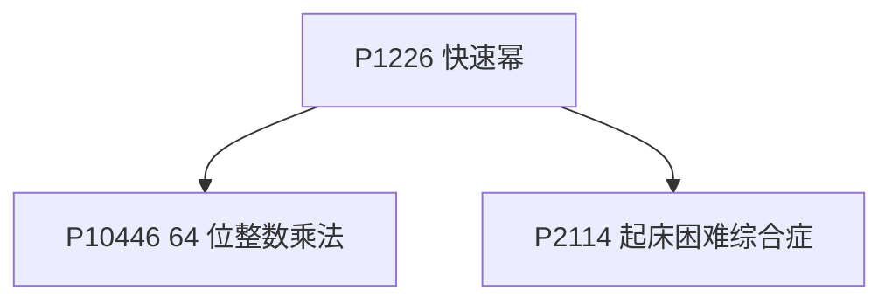

P1226 快速幂是位运算入门，P10446 是它的乘法版（防溢出），P2114 是位运算贪心。

**枚举与子集**

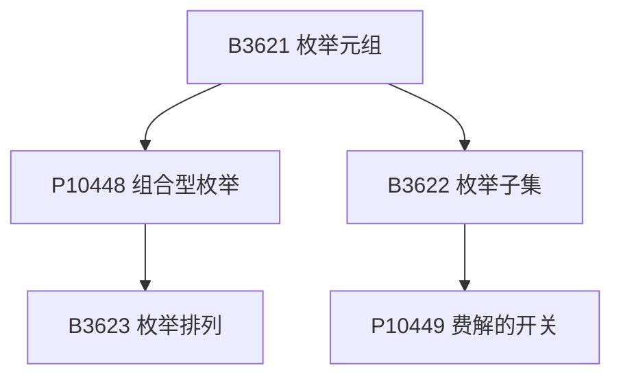

B3621 枚举元组是最外层骨架，P10448 组合型枚举与 B3623 枚举排列是它的两个变体；B3622 枚举子集是 P10449 费解的开关的前置。

**前缀和、差分与二分**

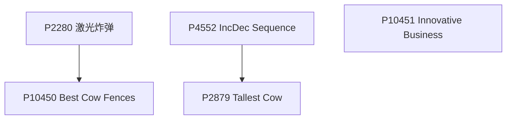

P4552 差分模板之后 P2879 是它的应用题；P2280 二维前缀和之后 P10450 把前缀和塞进二分答案的 check，P10451 是另一道二分的用法。

**中位数**

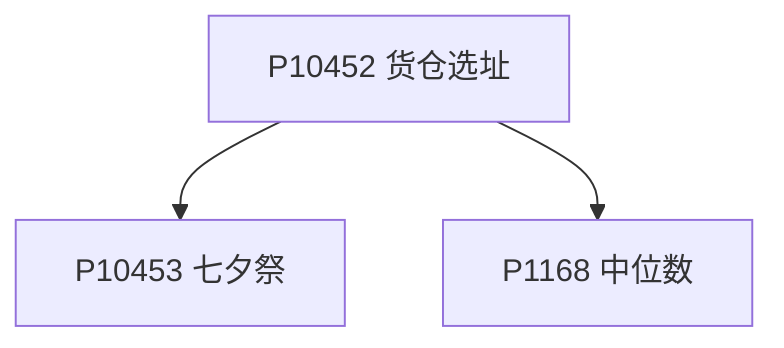

P10452 货仓选址是「中位数最优」的最小模型，P10453 七夕祭把它做成二维，P1168 中位数要动态维护。

**逆序对**

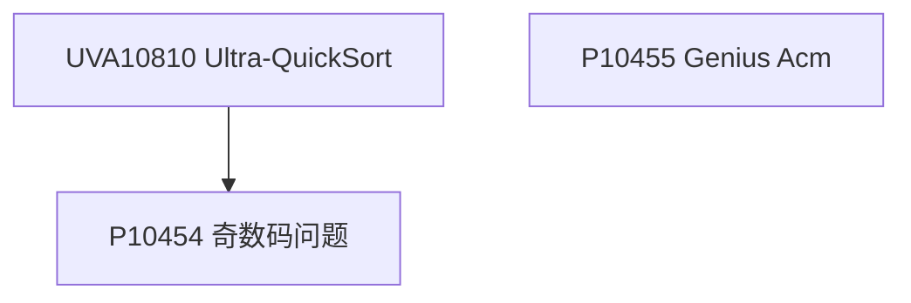

UVA10810 用归并数逆序对，P10454 奇数码问题用逆序对判可达；P10455 Genius Acm 是分治的另一种用法。

**贪心配对**

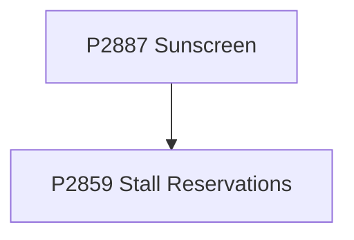

P2887 防晒霜按端点排序后匹配，P2859 Stall Reservations 是同一类的区间分配。

P10447（状压 DP 求 Hamilton 路径）、P1593（因子和）、P1080（邻项交换）、UVA1193（区间选点）、UVA1205（树上贪心）、CF670C（排序统计）与上面六张图没有前置关系。

- [ ] [[problem: luogu,P1226]] · [P1226 【模板】快速幂](https://www.luogu.com.cn/problem/P1226)
- [ ] [[problem: luogu,P10446]] · [P10446 64位整数乘法](https://www.luogu.com.cn/problem/P10446)
- [ ] [[problem: luogu,P10447]] · [P10447 最短 Hamilton 路径](https://www.luogu.com.cn/problem/P10447)
- [ ] [[problem: luogu,P2114]] · [P2114 \[NOI2014\] 起床困难综合症](https://www.luogu.com.cn/problem/P2114)
- [ ] [[problem: luogu,B3621]] · [B3621 枚举元组](https://www.luogu.com.cn/problem/B3621)
- [ ] [[problem: luogu,P10448]] · [P10448 组合型枚举](https://www.luogu.com.cn/problem/P10448)
- [ ] [[problem: luogu,B3622]] · [B3622 枚举子集（递归实现指数型枚举）](https://www.luogu.com.cn/problem/B3622)
- [ ] [[problem: luogu,B3623]] · [B3623 枚举排列（递归实现排列型枚举）](https://www.luogu.com.cn/problem/B3623)
- [ ] [[problem: luogu,P10449]] · [P10449 费解的开关](https://www.luogu.com.cn/problem/P10449)
- [ ] [[problem: luogu,P1593]] · [P1593 因子和](https://www.luogu.com.cn/problem/P1593)
- [ ] [[problem: luogu,P2280]] · [P2280 \[HNOI2003\] 激光炸弹](https://www.luogu.com.cn/problem/P2280)
- [ ] [[problem: luogu,P4552]] · [P4552 \[Poetize6\] IncDec Sequence](https://www.luogu.com.cn/problem/P4552)
- [ ] [[problem: luogu,P2879]] · [P2879 \[USACO07JAN\] Tallest Cow S](https://www.luogu.com.cn/problem/P2879)
- [ ] [[problem: luogu,P10450]] · [P10450 \[USACO03MAR\] Best Cow Fences G](https://www.luogu.com.cn/problem/P10450)
- [ ] [[problem: luogu,P10451]] · [P10451 Innovative Business](https://www.luogu.com.cn/problem/P10451)
- [ ] [[problem: luogu,CF670C]] · [CF670C Cinema](https://www.luogu.com.cn/problem/CF670C)
- [ ] [[problem: luogu,P10452]] · [P10452 货仓选址](https://www.luogu.com.cn/problem/P10452)
- [ ] [[problem: luogu,P10453]] · [P10453 七夕祭](https://www.luogu.com.cn/problem/P10453)
- [ ] [[problem: luogu,P1168]] · [P1168 中位数](https://www.luogu.com.cn/problem/P1168)
- [ ] [[problem: luogu,UVA10810]] · [UVA10810 UVA10810 - Ultra-QuickSort](https://www.luogu.com.cn/problem/UVA10810)
- [ ] [[problem: luogu,P10454]] · [P10454 奇数码问题](https://www.luogu.com.cn/problem/P10454)
- [ ] [[problem: luogu,P10455]] · [P10455 Genius Acm](https://www.luogu.com.cn/problem/P10455)
- [ ] [[problem: luogu,P2887]] · [P2887 \[USACO07NOV\] Sunscreen G](https://www.luogu.com.cn/problem/P2887)
- [ ] [[problem: luogu,P2859]] · [P2859 \[USACO06FEB\] Stall Reservations S](https://www.luogu.com.cn/problem/P2859)
- [ ] [[problem: luogu,P1080]] · [P1080 \[NOIP 2012 提高组\] 国王游戏](https://www.luogu.com.cn/problem/P1080)
- [ ] [[problem: luogu,UVA1193]] · [UVA1193 Radar Installation](https://www.luogu.com.cn/problem/UVA1193)
- [ ] [[problem: luogu,UVA1205]] · [UVA1205 Color a Tree](https://www.luogu.com.cn/problem/UVA1205)

## 基本算法-习题（李煜东《算法竞赛进阶指南》）

[洛谷子题单](https://www.luogu.com.cn/training/503750) · 12 题

**开关与翻转**

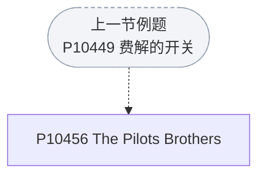

P10456 是费解的开关的二维版，先把上一节那题的翻转套路写熟。

**二分与前缀**

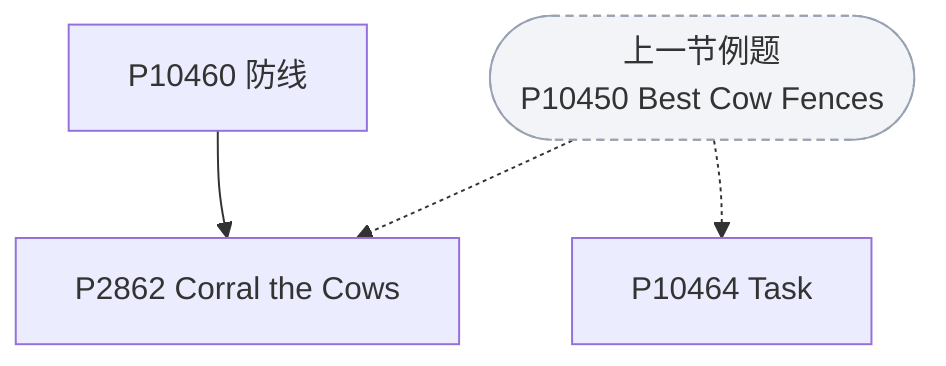

三题都是「二分答案 + 前缀和 check」：P2862 数矩形内的点数，P10464 Task 是最小化最大时间，P10460 防线要在 check 里算奇偶。

**中位数**

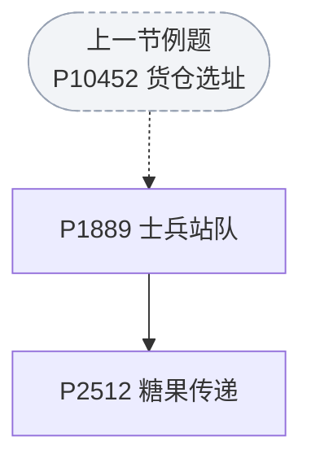

P1889 士兵站队是货仓选址的二维版，P2512 糖果传递在它之上再加环形均分。

**邻项交换贪心**

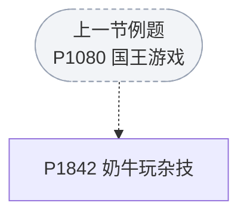

P1842 奶牛玩杂技是国王游戏的同一套邻项交换推导。

**二维前缀和**

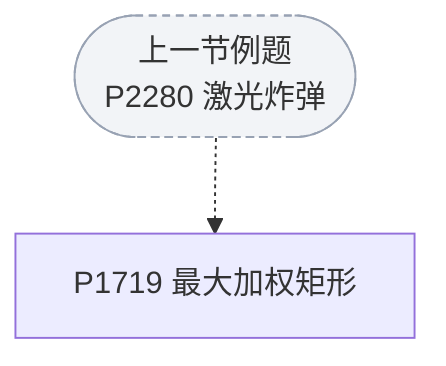

P1719 最大加权矩形在二维前缀和之上枚举上下界，先做完上一节的激光炸弹。

P10457（模拟）、P10458（分形递归）、P10459（平面最近点对）、P10462（进制转换）与本节其他题没有前置关系。

- [ ] [[problem: luogu,P10456]] · [P10456 The Pilots Brothers' refrigerator](https://www.luogu.com.cn/problem/P10456)
- [ ] [[problem: luogu,P10457]] · [P10457 占卜DIY](https://www.luogu.com.cn/problem/P10457)
- [ ] [[problem: luogu,P10458]] · [P10458 Fractal](https://www.luogu.com.cn/problem/P10458)
- [ ] [[problem: luogu,P10459]] · [P10459 Raid](https://www.luogu.com.cn/problem/P10459)
- [ ] [[problem: luogu,P10460]] · [P10460 防线](https://www.luogu.com.cn/problem/P10460)
- [ ] [[problem: luogu,P2862]] · [P2862 \[USACO06JAN\] Corral the Cows G](https://www.luogu.com.cn/problem/P2862)
- [ ] [[problem: luogu,P2512]] · [P2512 \[HAOI2008\] 糖果传递](https://www.luogu.com.cn/problem/P2512)
- [ ] [[problem: luogu,P1889]] · [P1889 \[CEOI 1998\] 士兵站队](https://www.luogu.com.cn/problem/P1889)
- [ ] [[problem: luogu,P10462]] · [P10462 Number Base Conversion](https://www.luogu.com.cn/problem/P10462)
- [ ] [[problem: luogu,P1842]] · [P1842 \[USACO05NOV\] 奶牛玩杂技](https://www.luogu.com.cn/problem/P1842)
- [ ] [[problem: luogu,P1719]] · [P1719 最大加权矩形](https://www.luogu.com.cn/problem/P1719)
- [ ] [[problem: luogu,P10464]] · [P10464 Task](https://www.luogu.com.cn/problem/P10464)

## 基本数据结构-例题（李煜东《算法竞赛进阶指南》）

[洛谷子题单](https://www.luogu.com.cn/training/506746) · 22 题

**栈与单调栈**

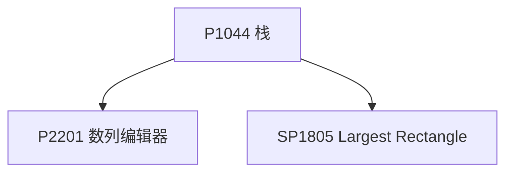

P1044 栈是栈的入门（Catalan 计数），P2201 数列编辑器用对顶栈模拟光标，SP1805 是单调栈求最大矩形。

**队列与单调队列**

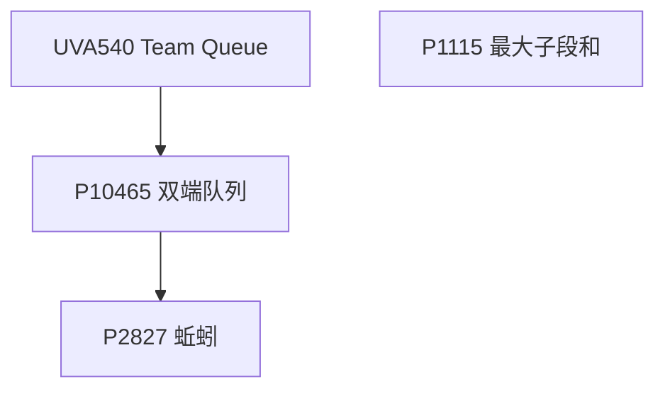

UVA540 团体队列练队列，P10465 双端队列是它的进阶，P2827 蚯蚓用单调队列把堆替换掉；P1115 是分治最大子段。

**哈希**

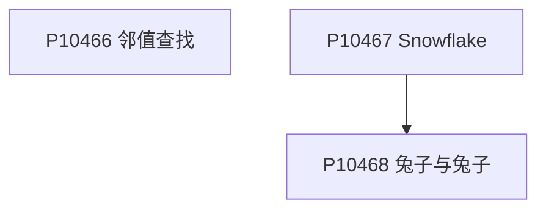

P10466 邻值查找要动态找前驱后继，P10467 Snowflake 是手写哈希判重，P10468 兔子与兔子把哈希搬到字符串前缀上。

**Trie**

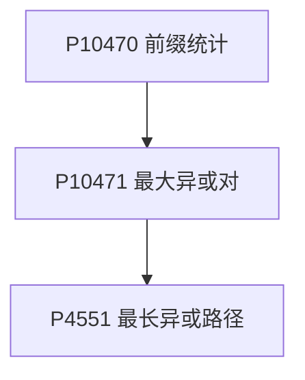

P10470 前缀统计是 Trie 模板，P10471 把字符换成二进制位（01-Trie），P4551 再把 01-Trie 搬到树上。

**堆与贪心**

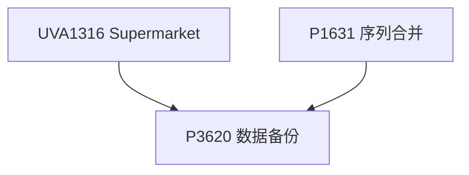

UVA1316 是堆 + 贪心的模板，P1631 序列合并是多路合并，P3620 数据备份要用「反悔贪心」把两题的手法合起来。

**哈夫曼**

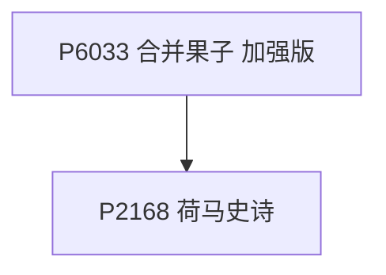

P6033 合并果子加强版要求线性做法，P2168 荷马史诗是它的 k 叉哈夫曼版。

P1168（对顶堆）、P1210（最长回文）、P10469（后缀数组）、SP263（KMP 周期）与上面六张图没有前置关系。

- [ ] [[problem: luogu,P2201]] · [P2201 数列编辑器](https://www.luogu.com.cn/problem/P2201)
- [ ] [[problem: luogu,P1044]] · [P1044 \[NOIP 2003 普及组\] 栈](https://www.luogu.com.cn/problem/P1044)
- [ ] [[problem: luogu,SP1805]] · [SP1805 HISTOGRA - Largest Rectangle in a Histogram](https://www.luogu.com.cn/problem/SP1805)
- [ ] [[problem: luogu,UVA540]] · [UVA540 团体队列 Team Queue](https://www.luogu.com.cn/problem/UVA540)
- [ ] [[problem: luogu,P2827]] · [P2827 \[NOIP 2016 提高组\] 蚯蚓](https://www.luogu.com.cn/problem/P2827)
- [ ] [[problem: luogu,P10465]] · [P10465 双端队列](https://www.luogu.com.cn/problem/P10465)
- [ ] [[problem: luogu,P1115]] · [P1115 最大子段和](https://www.luogu.com.cn/problem/P1115)
- [ ] [[problem: luogu,P10466]] · [P10466 邻值查找](https://www.luogu.com.cn/problem/P10466)
- [ ] [[problem: luogu,P1168]] · [P1168 中位数](https://www.luogu.com.cn/problem/P1168)
- [ ] [[problem: luogu,P10467]] · [P10467 \[CCC 2007\] Snowflake Snow Snowflakes](https://www.luogu.com.cn/problem/P10467)
- [ ] [[problem: luogu,P10468]] · [P10468 兔子与兔子](https://www.luogu.com.cn/problem/P10468)
- [ ] [[problem: luogu,P1210]] · [P1210 \[USACO1.3\] 最长的回文 Calf Flac](https://www.luogu.com.cn/problem/P1210)
- [ ] [[problem: luogu,P10469]] · [P10469 后缀数组](https://www.luogu.com.cn/problem/P10469)
- [ ] [[problem: luogu,SP263]] · [SP263 PERIOD - Period](https://www.luogu.com.cn/problem/SP263)
- [ ] [[problem: luogu,P10470]] · [P10470 前缀统计](https://www.luogu.com.cn/problem/P10470)
- [ ] [[problem: luogu,P10471]] · [P10471 最大异或对 The XOR Largest Pair](https://www.luogu.com.cn/problem/P10471)
- [ ] [[problem: luogu,P4551]] · [P4551 最长异或路径](https://www.luogu.com.cn/problem/P4551)
- [ ] [[problem: luogu,UVA1316]] · [UVA1316 Supermarket](https://www.luogu.com.cn/problem/UVA1316)
- [ ] [[problem: luogu,P3620]] · [P3620 \[APIO/CTSC2007\] 数据备份](https://www.luogu.com.cn/problem/P3620)
- [ ] [[problem: luogu,P1631]] · [P1631 序列合并](https://www.luogu.com.cn/problem/P1631)
- [ ] [[problem: luogu,P6033]] · [P6033 \[NOIP 2004 提高组\] 合并果子 加强版](https://www.luogu.com.cn/problem/P6033)
- [ ] [[problem: luogu,P2168]] · [P2168 \[NOI2015\] 荷马史诗](https://www.luogu.com.cn/problem/P2168)

## 基本数据结构-习题（李煜东《算法竞赛进阶指南》）

[洛谷子题单](https://www.luogu.com.cn/training/504516) · 14 题

**栈与表达式**

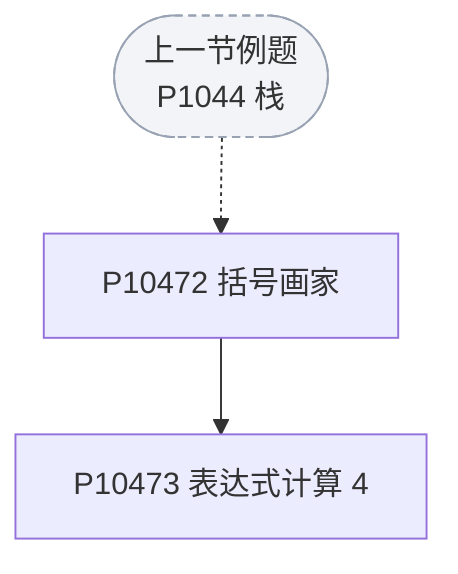

P10472 括号画家是栈判匹配，P10473 表达式计算 4 在它之上做中缀转后缀。

**单调结构与贪心**

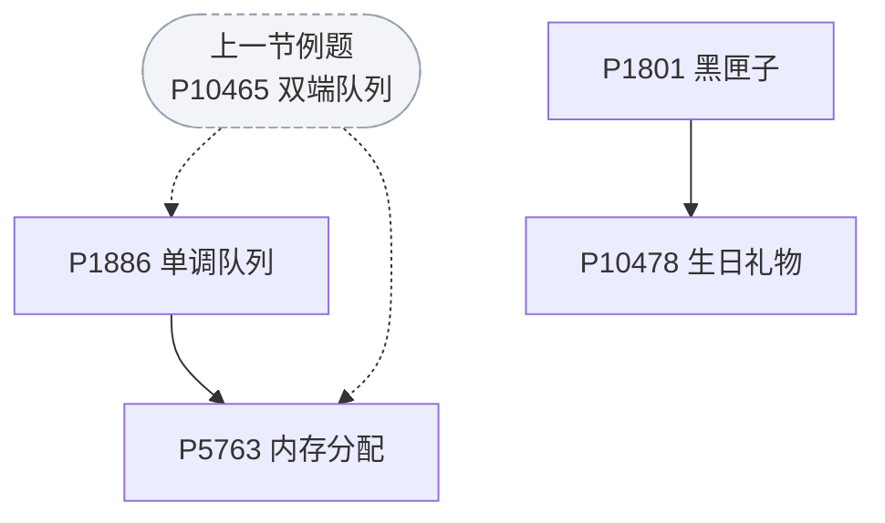

P1886 滑动窗口是单调队列模板，P5763 内存分配用它维护可用区间；P1801 黑匣子是对顶堆，P10478 生日礼物是堆 + 反悔贪心。

**哈希**

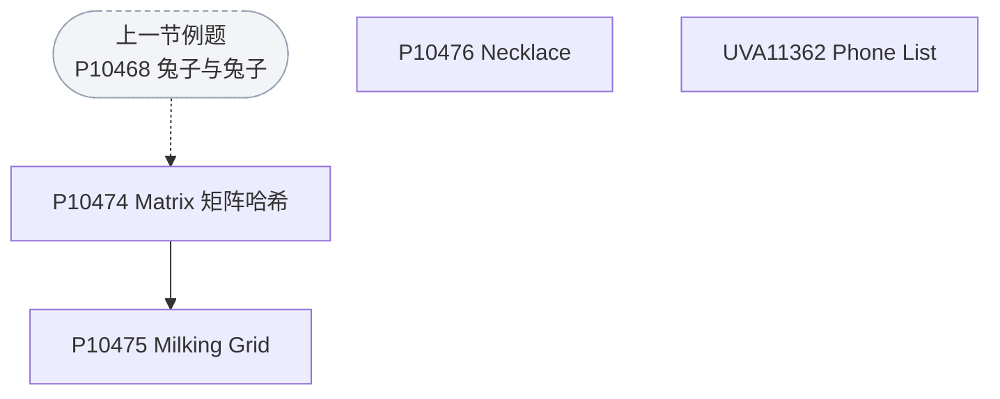

P10474 是矩阵哈希，P10475 把它用到多行匹配上，P10476 Necklace 与 UVA11362 Phone List 是另外两个哈希场景。

P1155（双栈排序）、UVA1330（最大子矩形）、P10477（树同构）、P10479（匹配统计）与上面三张图没有前置关系。

- [ ] [[problem: luogu,P10472]] · [P10472 括号画家](https://www.luogu.com.cn/problem/P10472)
- [ ] [[problem: luogu,P10473]] · [P10473 表达式计算4](https://www.luogu.com.cn/problem/P10473)
- [ ] [[problem: luogu,UVA1330]] · [UVA1330 City Game](https://www.luogu.com.cn/problem/UVA1330)
- [ ] [[problem: luogu,P1155]] · [P1155 \[NOIP 2008 提高组\] 双栈排序](https://www.luogu.com.cn/problem/P1155)
- [ ] [[problem: luogu,P1886]] · [P1886 【模板】单调队列 / 滑动窗口](https://www.luogu.com.cn/problem/P1886)
- [ ] [[problem: luogu,P5763]] · [P5763 \[NOI1999\] 内存分配](https://www.luogu.com.cn/problem/P5763)
- [ ] [[problem: luogu,P10474]] · [P10474 \[ICPC 2011 Beijing R\] Matrix 矩阵哈希](https://www.luogu.com.cn/problem/P10474)
- [ ] [[problem: luogu,P10475]] · [P10475 \[USACO03FALL\] Milking Grid（数据加强版）](https://www.luogu.com.cn/problem/P10475)
- [ ] [[problem: luogu,P10476]] · [P10476 Necklace](https://www.luogu.com.cn/problem/P10476)
- [ ] [[problem: luogu,UVA11362]] · [UVA11362 Phone List](https://www.luogu.com.cn/problem/UVA11362)
- [ ] [[problem: luogu,P10477]] · [P10477 \[NWERC 2003\] Subway tree systems](https://www.luogu.com.cn/problem/P10477)
- [ ] [[problem: luogu,P1801]] · [P1801 黑匣子](https://www.luogu.com.cn/problem/P1801)
- [ ] [[problem: luogu,P10478]] · [P10478 生日礼物](https://www.luogu.com.cn/problem/P10478)
- [ ] [[problem: luogu,P10479]] · [P10479 匹配统计](https://www.luogu.com.cn/problem/P10479)

## 搜索-例题（李煜东《算法竞赛进阶指南》）

[洛谷子题单](https://www.luogu.com.cn/training/506754) · 20 题

**DFS 与剪枝**

```mermaid
flowchart TD
  nP10483["P10483 小猫爬山"]
  nP1120["P1120 小木棍"]
  nP1731["P1731 生日蛋糕"]
  nUVA529["UVA529 Addition Chains"]

  nP1120 --> nP1731
  nUVA529 --> nP10483
```

P1120 小木棍是剪枝集大成的一题，P1731 生日蛋糕是同类的可行性剪枝；UVA529 迭代加深是 P10483 小猫爬山的前置思路。

**数独**

```mermaid
flowchart TD
  nP10481["P10481 Sudoku"]
  nP10482["P10482 Sudoku 2"]
  nUVA1309["UVA1309 Sudoku 2"]

  nP10481 --> nP10482
  nP10482 --> nUVA1309
```

三题是数独的三步：P10481 基本 DFS 加剪枝，P10482 加位运算优化，UVA1309 是同一题的英文版。

**最短路式搜索**

```mermaid
flowchart TD
  nP4667["P4667 Switch the Lamp"]
  nP10485["P10485 Bloxorz I"]
  nUVA589["UVA589 Pushing Boxes"]
  nUVA11367["UVA11367 Full Tank?"]

  nP4667 --> nP10485
  nP10485 --> nUVA589
  nP4667 --> nUVA11367
```

P4667 用 0-1 BFS 把搜索写成最短路，P10485 Bloxorz 是多状态 BFS，UVA589 要再叠一层「推箱子」状态，UVA11367 把状态加上油量。

**迭代加深与 A***

```mermaid
flowchart TD
  nP1379["P1379 八数码难题"]
  nP10488["P10488 Booksort"]
  nUVA1343["UVA1343 旋转游戏"]
  nUVA1603["UVA1603 破坏正方形"]
  nP10484["P10484 送礼物"]
  nP2901["P2901 Cow Jogging"]

  nP1379 --> nP10488
  nUVA1343 --> nUVA1603
  nP10484 --> nP2901
```

P1379 八数码是双向 BFS 与 IDA* 的经典入口，P10488 Booksort 是它的 IDA* 变体；UVA1343 → UVA1603 是估值函数逐步加强；P10484 送礼物折半搜索之后 P2901 做 k 短路。

**状态搜索**

```mermaid
flowchart TD
  nP10480["P10480 可达性统计"]
  nP1256["P1256 显示图像"]
  nP10487["P10487 Nightmare II"]

  nP10480 --> nP1256
```

P10480 可达性统计用状压记可达集合，P1256 显示图像是 BFS 连通块；P10487 Nightmare II 是双向 BFS。

- [ ] [[problem: luogu,P10480]] · [P10480 可达性统计](https://www.luogu.com.cn/problem/P10480)
- [ ] [[problem: luogu,P10481]] · [P10481 \[SEERC 2005\] Sudoku](https://www.luogu.com.cn/problem/P10481)
- [ ] [[problem: luogu,P10482]] · [P10482 Sudoku 2](https://www.luogu.com.cn/problem/P10482)
- [ ] [[problem: luogu,P10483]] · [P10483 小猫爬山](https://www.luogu.com.cn/problem/P10483)
- [ ] [[problem: luogu,P1120]] · [P1120 \[CERC 1995\] 小木棍](https://www.luogu.com.cn/problem/P1120)
- [ ] [[problem: luogu,P1731]] · [P1731 \[NOI1999\] 生日蛋糕](https://www.luogu.com.cn/problem/P1731)
- [ ] [[problem: luogu,UVA1309]] · [UVA1309 Sudoku 2](https://www.luogu.com.cn/problem/UVA1309)
- [ ] [[problem: luogu,UVA529]] · [UVA529 Addition Chains](https://www.luogu.com.cn/problem/UVA529)
- [ ] [[problem: luogu,P10484]] · [P10484 送礼物](https://www.luogu.com.cn/problem/P10484)
- [ ] [[problem: luogu,P10485]] · [P10485 Bloxorz I](https://www.luogu.com.cn/problem/P10485)
- [ ] [[problem: luogu,P1256]] · [P1256 \[POI 1999 R2\] 显示图像](https://www.luogu.com.cn/problem/P1256)
- [ ] [[problem: luogu,UVA589]] · [UVA589 Pushing Boxes](https://www.luogu.com.cn/problem/UVA589)
- [ ] [[problem: luogu,P4667]] · [P4667 \[BalticOI 2011\] Switch the Lamp On (Day1)](https://www.luogu.com.cn/problem/P4667)
- [ ] [[problem: luogu,UVA11367]] · [UVA11367 Full Tank?](https://www.luogu.com.cn/problem/UVA11367)
- [ ] [[problem: luogu,P10487]] · [P10487 Nightmare II](https://www.luogu.com.cn/problem/P10487)
- [ ] [[problem: luogu,P1379]] · [P1379 八数码难题](https://www.luogu.com.cn/problem/P1379)
- [ ] [[problem: luogu,P10488]] · [P10488 \[BAPC 2006 资格赛\] Booksort](https://www.luogu.com.cn/problem/P10488)
- [ ] [[problem: luogu,UVA1603]] · [UVA1603 破坏正方形 Square Destroyer](https://www.luogu.com.cn/problem/UVA1603)
- [ ] [[problem: luogu,UVA1343]] · [UVA1343 旋转游戏 The Rotation Game](https://www.luogu.com.cn/problem/UVA1343)
- [ ] [[problem: luogu,P2901]] · [P2901 \[USACO08MAR\] Cow Jogging G](https://www.luogu.com.cn/problem/P2901)

## 搜索-习题（李煜东《算法竞赛进阶指南》）

[洛谷子题单](https://www.luogu.com.cn/training/504581) · 13 题

**DFS 剪枝**

```mermaid
flowchart TD
  nPRE0(["上一节例题<br/>P1120 小木棍"]):::pre
  nP1074["P1074 靶形数独"]
  nP1092["P1092 虫食算"]
  nP1312["P1312 Mayan 游戏"]
  nP2324["P2324 骑士精神"]

  nPRE0 -.-> nP1074
  nPRE0 -.-> nP1312

  nP1074 --> nP1092
  nP1312 --> nP2324
  classDef pre fill:#f2f4f7,stroke:#98a2b3,stroke-dasharray:4 3;
```

P1074 靶形数独是数独 + 剪枝，P1092 虫食算是同类的字母约束搜索；P1312 Mayan 游戏是 DFS 模拟，P2324 骑士精神是 IDA*。

**迭代加深与重复搜索**

```mermaid
flowchart TD
  nPRE1(["上一节例题<br/>P1379 八数码"]):::pre
  nP10489["P10489 The Buses"]
  nP10490["P10490 Missile Defence"]
  nUVA1505["UVA1505 Flood-it!"]
  nP10493["P10493 Bloxorz II"]

  nPRE1 -.-> nP10489

  nP10489 --> nP10490
  nUVA1505 --> nP10493
  classDef pre fill:#f2f4f7,stroke:#98a2b3,stroke-dasharray:4 3;
```

P10489 与 P10490 都是「枚举深度再搜索」；UVA1505 Flood-it! 是 IDA* 的估值函数练习，P10493 Bloxorz II 是它的多状态版。

**网格 BFS**

```mermaid
flowchart TD
  nPRE2(["上一节例题<br/>P10487 Nightmare II"]):::pre
  nP2960["P2960 Milkweed"]
  nP10491["P10491 Chivalrous Cow"]
  nP10492["P10492 Weather Forecast"]

  nPRE2 -.-> nP2960

  nP2960 --> nP10491
  classDef pre fill:#f2f4f7,stroke:#98a2b3,stroke-dasharray:4 3;
```

P2960 是网格 BFS 模板，P10491 是它在八方向上的变体；P10492 Weather Forecast 要按时间维护状态。

P1032（字串变换）与 P10494（Power Hungry Cows）与上面三张图没有前置关系。

- [ ] [[problem: luogu,P1074]] · [P1074 \[NOIP 2009 提高组\] 靶形数独](https://www.luogu.com.cn/problem/P1074)
- [ ] [[problem: luogu,P1092]] · [P1092 \[NOIP 2004 提高组\] 虫食算](https://www.luogu.com.cn/problem/P1092)
- [ ] [[problem: luogu,P1312]] · [P1312 \[NOIP 2011 提高组\] Mayan 游戏](https://www.luogu.com.cn/problem/P1312)
- [ ] [[problem: luogu,P10489]] · [P10489 \[IOI 1994\] The Buses](https://www.luogu.com.cn/problem/P10489)
- [ ] [[problem: luogu,P10490]] · [P10490 Missile Defence System](https://www.luogu.com.cn/problem/P10490)
- [ ] [[problem: luogu,P10491]] · [P10491 \[USACO09NOV\] The Chivalrous Cow B](https://www.luogu.com.cn/problem/P10491)
- [ ] [[problem: luogu,P2960]] · [P2960 \[USACO09OCT\] Invasion of the Milkweed G](https://www.luogu.com.cn/problem/P2960)
- [ ] [[problem: luogu,P1032]] · [P1032 \[NOIP 2002 提高组\] 字串变换（疑似错题）](https://www.luogu.com.cn/problem/P1032)
- [ ] [[problem: luogu,P10492]] · [P10492 \[ICPC 2003 Aizu R\] Weather Forecast](https://www.luogu.com.cn/problem/P10492)
- [ ] [[problem: luogu,P10493]] · [P10493 Bloxorz II](https://www.luogu.com.cn/problem/P10493)
- [ ] [[problem: luogu,P10494]] · [P10494 \[USACO02FEB\] Power Hungry Cows](https://www.luogu.com.cn/problem/P10494)
- [ ] [[problem: luogu,UVA1505]] · [UVA1505 Flood-it!](https://www.luogu.com.cn/problem/UVA1505)
- [ ] [[problem: luogu,P2324]] · [P2324 \[SCOI2005\] 骑士精神](https://www.luogu.com.cn/problem/P2324)

## 数学知识-例题（李煜东《算法竞赛进阶指南》）

[洛谷子题单](https://www.luogu.com.cn/training/506768) · 24 题

**筛法与反素数**

```mermaid
flowchart TD
  nP3383["P3383 线性筛素数"]
  nUVA10140["UVA10140 Prime Distance"]
  nP10495["P10495 阶乘分解"]
  nP1463["P1463 反素数"]

  nP3383 --> nUVA10140
  nP10495 --> nP1463
```

P3383 线性筛是入口，UVA10140 是区间筛；P10495 阶乘分解之后 P1463 反素数要用同一套质因数视角。

**约数与中国剩余定理**

```mermaid
flowchart TD
  nP1072["P1072 Hankson 的趣味题"]
  nP1082["P1082 同余方程"]
  nP4777["P4777 扩展 CRT"]
  nP2261["P2261 余数求和"]

  nP1082 --> nP4777
```

P1072 要找约数、P2261 整除分块，两题都在 gcd 与同余的框架里；P1082 同余方程是 P4777 扩展 CRT 的前置。

**矩阵与高斯消元**

```mermaid
flowchart TD
  nP1939["P1939 矩阵加速"]
  nP10498["P10498 石头游戏"]
  nP4035["P4035 球形空间产生器"]
  nP10499["P10499 开关问题"]

  nP1939 --> nP10498
  nP1939 --> nP4035
  nP4035 --> nP10499
```

P1939 矩阵加速之后 P10498 石头游戏是矩阵套模拟；P4035 高斯消元之后 P10499 开关问题把消元搬到异或上。

**线性基与贪心**

```mermaid
flowchart TD
  nP3265["P3265 装备购买"]
  nP10500["P10500 Rainbow 的信号"]

  nP3265 --> nP10500
```

P3265 装备购买是线性基 + 贪心，P10500 Rainbow 的信号是线性基的另一种统计。

**组合与反演**

```mermaid
flowchart TD
  nP1313["P1313 计算系数"]
  nP4778["P4778 Counting swaps"]
  nP2480["P2480 古代猪文"]
  nCF451E["CF451E Devu and Flowers"]
  nP3455["P3455 ZAP-Queries"]

  nP1313 --> nP4778
  nP2480 --> nP3455
```

P1313 二项式定理之后 P4778 要数置换，P2480 古代猪文是 CRT + Lucas，P3455 是莫比乌斯反演；CF451E 是容斥 + 组合。

**概率与博弈**

```mermaid
flowchart TD
  nP4316["P4316 绿豆蛙的归宿"]
  nUVA12369["UVA12369 Cards"]
  nP10501["P10501 Cutting Game"]

  nP4316 --> nUVA12369
  nUVA12369 --> nP10501
```

P4316 是 DAG 上期望 DP，UVA12369 算期望收益，P10501 Cutting Game 是 SG 函数。

P2158 仪仗队只用到欧拉函数，P10496 The Luckiest Number 是纯推导题，两者与本节其他题都没有前置关系。

- [ ] [[problem: luogu,P3383]] · [P3383 【模板】线性筛素数](https://www.luogu.com.cn/problem/P3383)
- [ ] [[problem: luogu,UVA10140]] · [UVA10140 Prime Distance](https://www.luogu.com.cn/problem/UVA10140)
- [ ] [[problem: luogu,P10495]] · [P10495 阶乘分解](https://www.luogu.com.cn/problem/P10495)
- [ ] [[problem: luogu,P1463]] · [P1463 \[POI 2001 R1 / ZJOI2006 / HAOI2007\] 反素数](https://www.luogu.com.cn/problem/P1463)
- [ ] [[problem: luogu,P2261]] · [P2261 \[CQOI2007\] 余数求和](https://www.luogu.com.cn/problem/P2261)
- [ ] [[problem: luogu,P1072]] · [P1072 \[NOIP 2009 提高组\] Hankson 的趣味题](https://www.luogu.com.cn/problem/P1072)
- [ ] [[problem: luogu,P2158]] · [P2158 \[SDOI2008\] 仪仗队](https://www.luogu.com.cn/problem/P2158)
- [ ] [[problem: luogu,P10496]] · [P10496 \[ICPC-Hefei 2008 Online\] The Luckiest Number](https://www.luogu.com.cn/problem/P10496)
- [ ] [[problem: luogu,P1082]] · [P1082 \[NOIP 2012 提高组\] 同余方程](https://www.luogu.com.cn/problem/P1082)
- [ ] [[problem: luogu,P4777]] · [P4777 【模板】扩展中国剩余定理（EXCRT）](https://www.luogu.com.cn/problem/P4777)
- [ ] [[problem: luogu,P1939]] · [P1939 矩阵加速（数列）](https://www.luogu.com.cn/problem/P1939)
- [ ] [[problem: luogu,P10498]] · [P10498 石头游戏](https://www.luogu.com.cn/problem/P10498)
- [ ] [[problem: luogu,P4035]] · [P4035 \[JSOI2008\] 球形空间产生器](https://www.luogu.com.cn/problem/P4035)
- [ ] [[problem: luogu,P10499]] · [P10499 开关问题](https://www.luogu.com.cn/problem/P10499)
- [ ] [[problem: luogu,P3265]] · [P3265 \[JLOI2015\] 装备购买](https://www.luogu.com.cn/problem/P3265)
- [ ] [[problem: luogu,P1313]] · [P1313 \[NOIP 2011 提高组\] 计算系数](https://www.luogu.com.cn/problem/P1313)
- [ ] [[problem: luogu,P4778]] · [P4778 Counting swaps](https://www.luogu.com.cn/problem/P4778)
- [ ] [[problem: luogu,P2480]] · [P2480 \[SDOI2010\] 古代猪文](https://www.luogu.com.cn/problem/P2480)
- [ ] [[problem: luogu,CF451E]] · [CF451E Devu and Flowers](https://www.luogu.com.cn/problem/CF451E)
- [ ] [[problem: luogu,P3455]] · [P3455 \[POI 2007\] ZAP-Queries](https://www.luogu.com.cn/problem/P3455)
- [ ] [[problem: luogu,P10500]] · [P10500 Rainbow 的信号](https://www.luogu.com.cn/problem/P10500)
- [ ] [[problem: luogu,P4316]] · [P4316 绿豆蛙的归宿](https://www.luogu.com.cn/problem/P4316)
- [ ] [[problem: luogu,UVA12369]] · [UVA12369 Cards](https://www.luogu.com.cn/problem/UVA12369)
- [ ] [[problem: luogu,P10501]] · [P10501 Cutting Game](https://www.luogu.com.cn/problem/P10501)

## 数学知识-习题（李煜东《算法竞赛进阶指南》）

[洛谷子题单](https://www.luogu.com.cn/training/504623) · 17 题

**欧拉函数与同余**

```mermaid
flowchart TD
  nPRE0(["上一节例题<br/>P1082 同余方程"]):::pre
  nP2568["P2568 GCD"]
  nP2303["P2303 Longge 的问题"]
  nP1516["P1516 青蛙的约会"]
  nP1495["P1495 中国剩余定理（CRT）/"]

  nPRE0 -.-> nP1516

  nP2568 --> nP2303
  nP1495 --> nP1516
  classDef pre fill:#f2f4f7,stroke:#98a2b3,stroke-dasharray:4 3;
```

P2568 求欧拉函数之后 P2303 Longge 的问题直接用它；P1495 CRT 与 P1516 青蛙的约会都在解同余方程。

**矩阵与线性递推**

```mermaid
flowchart TD
  nPRE1(["上一节例题<br/>P1939 矩阵加速"]):::pre
  nP2485["P2485 计算器"]
  nP10502["P10502 Matrix Power Series"]
  nP10503["P10503 233 Matrix"]
  nSP2883["SP2883 Widget Factory"]

  nPRE1 -.-> nP10502

  nP10502 --> nP10503
  classDef pre fill:#f2f4f7,stroke:#98a2b3,stroke-dasharray:4 3;
```

P2485 计算器要写三种同余运算，P10502 是矩阵等比求和、P10503 233 Matrix 是同一形态，SP2883 是矩阵消元。

**线性基**

```mermaid
flowchart TD
  nP4151["P4151 最大 XOR 和路径"]
  nP4301["P4301 新 Nim 游戏"]

  nP4151 --> nP4301
```

P4151 最大 XOR 和路径先建线性基，P4301 新 Nim 游戏再叠博弈。

**计数与概率**

```mermaid
flowchart TD
  nPRE2(["上一节例题<br/>P4316 绿豆蛙的归宿"]):::pre
  nP4071["P4071 排列计数"]
  nSP4191["SP4191 天空代码"]
  nP1850["P1850 换教室"]
  nP10504["P10504 守卫者的挑战"]
  nP10506["P10506 魔法珠"]
  nP10507["P10507 Georgia and Bob"]

  nPRE2 -.-> nP10504

  nP4071 --> nSP4191
  nP10504 --> nP1850
  classDef pre fill:#f2f4f7,stroke:#98a2b3,stroke-dasharray:4 3;
```

P4071 错排之后 SP4191 是它的组合版；P10504 守卫者的挑战是概率 DP，P1850 换教室是同一套期望 DP 的更大规模。

**二分与贪心判定**

```mermaid
flowchart TD
  nP10505["P10505 Dropping Test"]

```

P10505 Dropping Test 是二分答案的判定题。

P10506（魔法珠）与 P10507（Georgia and Bob）是博弈题，与上面几张图没有前置关系。

- [ ] [[problem: luogu,P2568]] · [P2568 GCD](https://www.luogu.com.cn/problem/P2568)
- [ ] [[problem: luogu,P2303]] · [P2303 \[SDOI2012\] Longge 的问题](https://www.luogu.com.cn/problem/P2303)
- [ ] [[problem: luogu,P1516]] · [P1516 青蛙的约会](https://www.luogu.com.cn/problem/P1516)
- [ ] [[problem: luogu,P1495]] · [P1495 【模板】中国剩余定理（CRT）/ 曹冲养猪](https://www.luogu.com.cn/problem/P1495)
- [ ] [[problem: luogu,P2485]] · [P2485 \[SDOI2011\] 计算器](https://www.luogu.com.cn/problem/P2485)
- [ ] [[problem: luogu,P10502]] · [P10502 Matrix Power Series](https://www.luogu.com.cn/problem/P10502)
- [ ] [[problem: luogu,P10503]] · [P10503 233 Matrix](https://www.luogu.com.cn/problem/P10503)
- [ ] [[problem: luogu,SP2883]] · [SP2883 WIDGET - Widget Factory](https://www.luogu.com.cn/problem/SP2883)
- [ ] [[problem: luogu,P4151]] · [P4151 \[WC2011\] 最大 XOR 和路径](https://www.luogu.com.cn/problem/P4151)
- [ ] [[problem: luogu,P4301]] · [P4301 \[CQOI2013\] 新Nim游戏](https://www.luogu.com.cn/problem/P4301)
- [ ] [[problem: luogu,P4071]] · [P4071 \[SDOI2016\] 排列计数](https://www.luogu.com.cn/problem/P4071)
- [ ] [[problem: luogu,SP4191]] · [SP4191 天空代码](https://www.luogu.com.cn/problem/SP4191)
- [ ] [[problem: luogu,P10504]] · [P10504 守卫者的挑战](https://www.luogu.com.cn/problem/P10504)
- [ ] [[problem: luogu,P1850]] · [P1850 \[NOIP 2016 提高组\] 换教室](https://www.luogu.com.cn/problem/P1850)
- [ ] [[problem: luogu,P10505]] · [P10505 Dropping Test](https://www.luogu.com.cn/problem/P10505)
- [ ] [[problem: luogu,P10506]] · [P10506 魔法珠](https://www.luogu.com.cn/problem/P10506)
- [ ] [[problem: luogu,P10507]] · [P10507 Georgia and Bob](https://www.luogu.com.cn/problem/P10507)

## 数据结构进阶-例题（李煜东《算法竞赛进阶指南》）

[洛谷子题单](https://www.luogu.com.cn/training/506779) · 21 题

**并查集**

```mermaid
flowchart TD
  nP1955["P1955 程序自动分析"]
  nP1196["P1196 银河英雄传说"]
  nP5937["P5937 Parity Game"]
  nP2024["P2024 食物链"]

  nP1955 --> nP1196
  nP1196 --> nP5937
  nP5937 --> nP2024
```

P1955 是并查集 + 离散化，P1196 银河英雄传说要维护带权距离，P5937 把它变成边带权判奇偶，P2024 食物链再到种类并查集。

**树状数组与线段树**

```mermaid
flowchart TD
  nP10589["P10589 楼兰图腾"]
  nP3368["P3368 树状数组 2"]
  nP3372["P3372 线段树 1"]
  nP10497["P10497 Lost Cows"]
  nSP1716["SP1716 GSS3"]
  nP10463["P10463 Interval GCD"]

  nP3368 --> nP3372
  nP3372 --> nSP1716
  nP3372 --> nP10463
  nP3368 --> nP10589
```

P3368 树状数组 2 是区间改单点查，P3372 线段树 1 是区间改区间查，之后 SP1716 求最大子段、P10463 求区间 gcd；P10589 用树状数组数逆序对，P10497 Lost Cows 用树状数组倒推。

**扫描线与离散化**

```mermaid
flowchart TD
  nP5490["P5490 矩形面积并"]
  nP1502["P1502 窗口的星星"]

  nP5490 --> nP1502
```

P5490 扫描线求矩形面积并，P1502 窗口的星星是扫描线 + 线段树。

**分块与莫队**

```mermaid
flowchart TD
  nP4168["P4168 蒲公英"]
  nP1494["P1494 小 Z 的袜子"]
  nP10590["P10590 磁力块"]

  nP4168 --> nP1494
```

P4168 蒲公英是分块求众数，P1494 小 Z 的袜子是莫队模板；P10590 磁力块是分块 + BFS。

**点分治与平衡树**

```mermaid
flowchart TD
  nP4178["P4178 Tree"]
  nP3369["P3369 普通平衡树"]
  nP4169["P4169 天使玩偶"]
  nP2617["P2617 Dynamic Rankings"]
  nP4735["P4735 最大异或和"]

  nP4178 --> nP2617
  nP3369 --> nP4169
```

P4178 Tree 是点分治模板，P2617 带修区间第 k 小需要树套树；P3369 普通平衡树之后 P4169 用 CDQ 求动态最近点，P4735 是可持久化 Trie。

UVA1316 Supermarket 是堆加贪心的应用题，与本节其他题没有前置关系。

- [ ] [[problem: luogu,P1955]] · [P1955 \[NOI2015\] 程序自动分析](https://www.luogu.com.cn/problem/P1955)
- [ ] [[problem: luogu,UVA1316]] · [UVA1316 Supermarket](https://www.luogu.com.cn/problem/UVA1316)
- [ ] [[problem: luogu,P1196]] · [P1196 \[NOI2002\] 银河英雄传说](https://www.luogu.com.cn/problem/P1196)
- [ ] [[problem: luogu,P5937]] · [P5937 \[CEOI 1999\] Parity Game](https://www.luogu.com.cn/problem/P5937)
- [ ] [[problem: luogu,P2024]] · [P2024 \[NOI2001\] 食物链](https://www.luogu.com.cn/problem/P2024)
- [ ] [[problem: luogu,P10589]] · [P10589 楼兰图腾](https://www.luogu.com.cn/problem/P10589)
- [ ] [[problem: luogu,P3368]] · [P3368 【模板】树状数组 2](https://www.luogu.com.cn/problem/P3368)
- [ ] [[problem: luogu,P3372]] · [P3372 【模板】线段树 1](https://www.luogu.com.cn/problem/P3372)
- [ ] [[problem: luogu,P10497]] · [P10497 \[USACO03OPEN\] Lost Cows](https://www.luogu.com.cn/problem/P10497)
- [ ] [[problem: luogu,SP1716]] · [SP1716 GSS3 - Can you answer these queries III](https://www.luogu.com.cn/problem/SP1716)
- [ ] [[problem: luogu,P10463]] · [P10463 Interval GCD](https://www.luogu.com.cn/problem/P10463)
- [ ] [[problem: luogu,P5490]] · [P5490 【模板】扫描线 & 矩形面积并](https://www.luogu.com.cn/problem/P5490)
- [ ] [[problem: luogu,P1502]] · [P1502 窗口的星星](https://www.luogu.com.cn/problem/P1502)
- [ ] [[problem: luogu,P4168]] · [P4168 \[Violet\] 蒲公英](https://www.luogu.com.cn/problem/P4168)
- [ ] [[problem: luogu,P10590]] · [P10590 磁力块](https://www.luogu.com.cn/problem/P10590)
- [ ] [[problem: luogu,P1494]] · [P1494 \[国家集训队\] 小 Z 的袜子](https://www.luogu.com.cn/problem/P1494)
- [ ] [[problem: luogu,P4178]] · [P4178 Tree](https://www.luogu.com.cn/problem/P4178)
- [ ] [[problem: luogu,P3369]] · [P3369 【模板】普通平衡树](https://www.luogu.com.cn/problem/P3369)
- [ ] [[problem: luogu,P4169]] · [P4169 \[Violet\] 天使玩偶/SJY摆棋子](https://www.luogu.com.cn/problem/P4169)
- [ ] [[problem: luogu,P2617]] · [P2617 Dynamic Rankings](https://www.luogu.com.cn/problem/P2617)
- [ ] [[problem: luogu,P4735]] · [P4735 最大异或和](https://www.luogu.com.cn/problem/P4735)

## 数据结构进阶-习题（李煜东《算法竞赛进阶指南》）

[洛谷子题单](https://www.luogu.com.cn/training/504649) · 14 题

**并查集扩展**

```mermaid
flowchart TD
  nPRE0(["上一节例题<br/>P2024 食物链"]):::pre
  nP1525["P1525 关押罪犯"]
  nP10686["P10686 Rochambeau"]
  nP10687["P10687 True Liars"]
  nP3402["P3402 可持久化并查集"]

  nPRE0 -.-> nP1525
  nPRE0 -.-> nP10686

  nP1525 --> nP10686
  nP10686 --> nP10687
  classDef pre fill:#f2f4f7,stroke:#98a2b3,stroke-dasharray:4 3;
```

P1525 关押罪犯是种类并查集，P10686 与 P10687 都是它的英文版变体；P3402 是可持久化并查集。

**线段树**

```mermaid
flowchart TD
  nPRE1(["上一节例题<br/>P3372 线段树 1"]):::pre
  nP10688["P10688 Buy Tickets"]
  nP2894["P2894 Hotel G"]
  nP1856["P1856 矩形周长"]
  nSP10264["SP10264 Meteors"]
  nP4135["P4135 作诗"]

  nPRE1 -.-> nP10688
  nPRE1 -.-> nP2894

  nP10688 --> nP2894
  nP2894 --> nP1856
  classDef pre fill:#f2f4f7,stroke:#98a2b3,stroke-dasharray:4 3;
```

P10688 Buy Tickets 练单点插队，P2894 Hotel 是区间合并，P1856 矩形周长要在线段树上维护扫描线信息；SP10264 与 P4135 分别是整体二分与分块。

**点分治与 CDQ**

```mermaid
flowchart TD
  nPRE2(["上一节例题<br/>P4178 Tree"]):::pre
  nP4149["P4149 Race"]
  nP4390["P4390 Mokia"]

  nPRE2 -.-> nP4149

  nP4149 --> nP4390
  classDef pre fill:#f2f4f7,stroke:#98a2b3,stroke-dasharray:4 3;
```

P4149 Race 是点分治，P4390 Mokia 是 CDQ 分治求矩形和。

P2234（营业额统计）、P10689（SuperMemo）、P10690（Fotile 模拟赛 L）与上面三张图没有前置关系。

- [ ] [[problem: luogu,P1525]] · [P1525 \[NOIP 2010 提高组\] 关押罪犯](https://www.luogu.com.cn/problem/P1525)
- [ ] [[problem: luogu,P10686]] · [P10686 Rochambeau](https://www.luogu.com.cn/problem/P10686)
- [ ] [[problem: luogu,P10687]] · [P10687 True Liars](https://www.luogu.com.cn/problem/P10687)
- [ ] [[problem: luogu,P10688]] · [P10688 Buy Tickets](https://www.luogu.com.cn/problem/P10688)
- [ ] [[problem: luogu,P2894]] · [P2894 \[USACO08FEB\] Hotel G](https://www.luogu.com.cn/problem/P2894)
- [ ] [[problem: luogu,P1856]] · [P1856 \[IOI 1998 / USACO5.5\] 矩形周长 Picture](https://www.luogu.com.cn/problem/P1856)
- [ ] [[problem: luogu,P4135]] · [P4135 作诗](https://www.luogu.com.cn/problem/P4135)
- [ ] [[problem: luogu,P4149]] · [P4149 \[IOI 2011\] Race](https://www.luogu.com.cn/problem/P4149)
- [ ] [[problem: luogu,P2234]] · [P2234 \[HNOI2002\] 营业额统计](https://www.luogu.com.cn/problem/P2234)
- [ ] [[problem: luogu,P10689]] · [P10689 SuperMemo](https://www.luogu.com.cn/problem/P10689)
- [ ] [[problem: luogu,P4390]] · [P4390 \[BalkanOI 2007\] Mokia 摩基亚](https://www.luogu.com.cn/problem/P4390)
- [ ] [[problem: luogu,SP10264]] · [SP10264 METEORS - Meteors](https://www.luogu.com.cn/problem/SP10264)
- [ ] [[problem: luogu,P10690]] · [P10690 Fotile 模拟赛 L](https://www.luogu.com.cn/problem/P10690)
- [ ] [[problem: luogu,P3402]] · [P3402 【模板】可持久化并查集](https://www.luogu.com.cn/problem/P3402)

## 动态规划-例题（李煜东《算法竞赛进阶指南》）

[洛谷子题单](https://www.luogu.com.cn/training/506816) · 43 题

**线性 DP**

```mermaid
flowchart TD
  nSP15637["SP15637 Picture Permutations"]
  nP10954["P10954 LCIS"]
  nP2893["P2893 Making the Grade"]
  nSP703["SP703 Mobile Service"]

  nSP15637 --> nP10954
  nP10954 --> nSP703
```

SP15637 是线性 DP 的入门建模，P10954 LCIS 是 LIS 与 LCS 的结合，SP703 Mobile Service 是多维状态线性 DP；P2893 是保序 + 中位数。

**背包**

```mermaid
flowchart TD
  nP1164["P1164 小 A 点菜"]
  nP10955["P10955 正整数拆分"]
  nP10973["P10973 Coins"]

  nP1164 --> nP10955
  nP10955 --> nP10973
```

P1164 是计数背包，P10955 正整数拆分是同一形态，P10973 Coins 是多重背包的优化版。

**区间 DP**

```mermaid
flowchart TD
  nP1775["P1775 石子合并（弱化版）"]
  nP4342["P4342 Polygon"]
  nP10956["P10956 金字塔"]
  nP10957["P10957 环路运输"]
  nP6064["P6064 Naptime G"]

  nP1775 --> nP4342
  nP4342 --> nP10956
  nP1775 --> nP10957
  nP10957 --> nP6064
```

P1775 石子合并是区间 DP 模板，P4342 Polygon 要同时维护最大最小，P10956 金字塔是区间 DP 判回文；P10957 环路运输之后 P6064 Naptime 是环形 DP。

**树形 DP**

```mermaid
flowchart TD
  nP1352["P1352 没有上司的舞会"]
  nP2014["P2014 选课"]
  nP10974["P10974 Accumulation Degree"]

  nP1352 --> nP2014
  nP2014 --> nP10974
```

P1352 没有上司的舞会是树形 DP 入口，P2014 选课是树上背包，P10974 换根求最大流。

**状压 DP**

```mermaid
flowchart TD
  nP10975["P10975 蒙德里安的梦想"]
  nP2704["P2704 炮兵阵地"]
  nP3959["P3959 宝藏"]
  nP10972["P10972 I-Country"]

  nP10975 --> nP2704
  nP10975 --> nP3959
  nP10975 --> nP10972
```

P10975 蒙德里安的梦想是轮廓线状压，P2704 炮兵阵地是逐行状压，P3959 宝藏把状压当最短路，P10972 I-Country 是轮廓线状压的下一档。

**单调队列与斜率优化**

```mermaid
flowchart TD
  nP10977["P10977 Cut the Sequence"]
  nP2365["P2365 任务安排"]
  nP10979["P10979 任务安排 2"]
  nP5785["P5785 任务安排"]
  nCF311B["CF311B Cats Transport"]
  nP1912["P1912 诗人小G"]

  nP2365 --> nP10979
  nP10979 --> nP5785
  nP10979 --> nCF311B
  nP5785 --> nP1912
```

P10977 用单调队列优化，P2365 → P10979 → P5785 是任务安排三步曲（依次加斜率优化、加精度要求），CF311B 是同类的斜率优化；P1912 诗人小 G 是决策单调性。

**计数与统计**

```mermaid
flowchart TD
  nP10976["P10976 统计重复个数"]
  nP1081["P1081 开车旅行"]
  nP4644["P4644 Cleaning Shifts"]
  nUVA12983["UVA12983 Battle of Chibi"]
  nP10978["P10978 Fence"]
  nP5569["P5569 石子合并"]

  nUVA12983 --> nP10978
  nP10976 --> nP1081
```

UVA12983 求 LIS 计数，P10978 Fence 是它的变体；P10976 统计重复个数与 P1081 开车旅行都是倍增 + DP，P4644 与 P5569 分别是线段树优化与四边形不等式。

**图上计数**

```mermaid
flowchart TD
  nCF559C["CF559C Gerald and Giant Chess"]
  nP10982["P10982 Connected Graph"]
  nP6596["P6596 How Many of Them"]
  nP7690["P7690 A decorative fence"]
  nP10958["P10958 启示录"]
  nP10959["P10959 月之谜"]

  nCF559C --> nP10982
  nP10958 --> nP6596
  nP10959 --> nP7690
```

CF559C 用容斥数路径，P10982 数连通图；P10958 与 P6596 是数位 DP 的两个方向，P10959 与 P7690 是同一模板换题面。

P1006（双线程网格 DP）、P10971（排序后 DP）、CF24D（高斯消元加期望）、UVA323（背包式 DP）是四种不同建模，各自独立；P10980 与 P10981 是任务安排的 4.1 / 4.2 版（洛谷暂无数据），想挑战可以直接看题面。

- [ ] [[problem: luogu,SP15637]] · [SP15637 GNYR04H - Mr Youngs Picture Permutations](https://www.luogu.com.cn/problem/SP15637)
- [ ] [[problem: luogu,P10954]] · [P10954 LCIS](https://www.luogu.com.cn/problem/P10954)
- [ ] [[problem: luogu,P2893]] · [P2893 \[USACO08FEB\] Making the Grade G](https://www.luogu.com.cn/problem/P2893)
- [ ] [[problem: luogu,SP703]] · [SP703 SERVICE - Mobile Service](https://www.luogu.com.cn/problem/SP703)
- [ ] [[problem: luogu,P1006]] · [P1006 \[NOIP 2008 提高组\] 传纸条](https://www.luogu.com.cn/problem/P1006)
- [ ] [[problem: luogu,P10972]] · [P10972 I-Country](https://www.luogu.com.cn/problem/P10972)
- [ ] [[problem: luogu,P10971]] · [P10971 Cookies](https://www.luogu.com.cn/problem/P10971)
- [ ] [[problem: luogu,P1164]] · [P1164 小 A 点菜](https://www.luogu.com.cn/problem/P1164)
- [ ] [[problem: luogu,P10955]] · [P10955 正整数拆分](https://www.luogu.com.cn/problem/P10955)
- [ ] [[problem: luogu,P10973]] · [P10973 Coins](https://www.luogu.com.cn/problem/P10973)
- [ ] [[problem: luogu,UVA323]] · [UVA323 Jury Compromise](https://www.luogu.com.cn/problem/UVA323)
- [ ] [[problem: luogu,P1775]] · [P1775 石子合并（弱化版）](https://www.luogu.com.cn/problem/P1775)
- [ ] [[problem: luogu,P4342]] · [P4342 \[IOI 1998\] Polygon](https://www.luogu.com.cn/problem/P4342)
- [ ] [[problem: luogu,P10956]] · [P10956 金字塔](https://www.luogu.com.cn/problem/P10956)
- [ ] [[problem: luogu,P1352]] · [P1352 没有上司的舞会](https://www.luogu.com.cn/problem/P1352)
- [ ] [[problem: luogu,P2014]] · [P2014 \[CTSC1997\] 选课](https://www.luogu.com.cn/problem/P2014)
- [ ] [[problem: luogu,P10974]] · [P10974 Accumulation Degree](https://www.luogu.com.cn/problem/P10974)
- [ ] [[problem: luogu,P6064]] · [P6064 \[USACO05JAN\] Naptime G](https://www.luogu.com.cn/problem/P6064)
- [ ] [[problem: luogu,P10957]] · [P10957 环路运输](https://www.luogu.com.cn/problem/P10957)
- [ ] [[problem: luogu,CF24D]] · [CF24D Broken robot](https://www.luogu.com.cn/problem/CF24D)
- [ ] [[problem: luogu,P10975]] · [P10975 Mondriaan's Dream / 蒙德里安的梦想](https://www.luogu.com.cn/problem/P10975)
- [ ] [[problem: luogu,P2704]] · [P2704 \[NOI2001\] 炮兵阵地](https://www.luogu.com.cn/problem/P2704)
- [ ] [[problem: luogu,P3959]] · [P3959 \[NOIP 2017 提高组\] 宝藏](https://www.luogu.com.cn/problem/P3959)
- [ ] [[problem: luogu,P10976]] · [P10976 统计重复个数](https://www.luogu.com.cn/problem/P10976)
- [ ] [[problem: luogu,P1081]] · [P1081 \[NOIP 2012 提高组\] 开车旅行](https://www.luogu.com.cn/problem/P1081)
- [ ] [[problem: luogu,P4644]] · [P4644 \[USACO05DEC\] Cleaning Shifts S](https://www.luogu.com.cn/problem/P4644)
- [ ] [[problem: luogu,UVA12983]] · [UVA12983 The Battle of Chibi](https://www.luogu.com.cn/problem/UVA12983)
- [ ] [[problem: luogu,P10977]] · [P10977 Cut the Sequence](https://www.luogu.com.cn/problem/P10977)
- [ ] [[problem: luogu,P10978]] · [P10978 Fence](https://www.luogu.com.cn/problem/P10978)
- [ ] [[problem: luogu,P2365]] · [P2365 \[IOI 2002\] 任务安排](https://www.luogu.com.cn/problem/P2365)
- [ ] [[problem: luogu,P10979]] · [P10979 任务安排 2](https://www.luogu.com.cn/problem/P10979)
- [ ] [[problem: luogu,P5785]] · [P5785 \[SDOI2012\] 任务安排](https://www.luogu.com.cn/problem/P5785)
- [ ] [[problem: luogu,P10980]] · [P10980 任务安排 4.1【暂无数据】](https://www.luogu.com.cn/problem/P10980)
- [ ] [[problem: luogu,P10981]] · [P10981 任务安排 4.2【暂无数据】](https://www.luogu.com.cn/problem/P10981)
- [ ] [[problem: luogu,CF311B]] · [CF311B Cats Transport](https://www.luogu.com.cn/problem/CF311B)
- [ ] [[problem: luogu,P1912]] · [P1912 \[NOI2009\] 诗人小G](https://www.luogu.com.cn/problem/P1912)
- [ ] [[problem: luogu,P5569]] · [P5569 \[SDOI2008\] 石子合并](https://www.luogu.com.cn/problem/P5569)
- [ ] [[problem: luogu,CF559C]] · [CF559C Gerald and Giant Chess](https://www.luogu.com.cn/problem/CF559C)
- [ ] [[problem: luogu,P10982]] · [P10982 Connected Graph](https://www.luogu.com.cn/problem/P10982)
- [ ] [[problem: luogu,P6596]] · [P6596 How Many of Them](https://www.luogu.com.cn/problem/P6596)
- [ ] [[problem: luogu,P7690]] · [P7690 \[CEOI 2002\] A decorative fence](https://www.luogu.com.cn/problem/P7690)
- [ ] [[problem: luogu,P10958]] · [P10958 启示录](https://www.luogu.com.cn/problem/P10958)
- [ ] [[problem: luogu,P10959]] · [P10959 月之谜](https://www.luogu.com.cn/problem/P10959)

## 动态规划-习题（李煜东《算法竞赛进阶指南》）

[洛谷子题单](https://www.luogu.com.cn/training/505327) · 31 题

**线性与区间**

```mermaid
flowchart TD
  nPRE0(["上一节例题<br/>P1775 石子合并"]):::pre
  nP1541["P1541 乌龟棋"]
  nP1854["P1854 花店橱窗"]
  nP1063["P1063 能量项链"]
  nP5752["P5752 棋盘分割"]
  nUVA10559["UVA10559 Blocks"]
  nP10961["P10961 划分大理石"]

  nPRE0 -.-> nP1063

  nP1541 --> nP1854
  nP1063 --> nP5752
  nP5752 --> nUVA10559
  classDef pre fill:#f2f4f7,stroke:#98a2b3,stroke-dasharray:4 3;
```

P1541 乌龟棋是多维线性 DP，P1854 花店橱窗是同一形态；P1063 能量项链是环形区间 DP，P5752 棋盘分割与 UVA10559 方块消除都在它之上。

**树形与状压**

```mermaid
flowchart TD
  nPRE1(["上一节例题<br/>P1352 没有上司的舞会"]):::pre
  nUVA1292["UVA1292 Strategic game"]
  nUVA1222["UVA1222 Bribing FIPA"]
  nP1879["P1879 Corn Fields G"]
  nP7689["P7689 Bugs Integrated"]
  nP10963["P10963 Islands and Bridges"]

  nPRE1 -.-> nUVA1292

  nUVA1292 --> nUVA1222
  nP10963 --> nP7689
  classDef pre fill:#f2f4f7,stroke:#98a2b3,stroke-dasharray:4 3;
```

UVA1292 是树上最小覆盖，UVA1222 是树上背包；P1879 Corn Fields 是状压模板，P7689 Bugs 是轮廓线状压，P10963 是状压 + 路径计数。

**优化手段**

```mermaid
flowchart TD
  nPRE2(["上一节例题<br/>P10979 任务安排 2"]):::pre
  nP4954["P4954 Tower of Hay"]
  nP2569["P2569 股票交易"]
  nP3628["P3628 特别行动队"]
  nP4767["P4767 邮局 加强版"]
  nP10967["P10967 邮局（原始版）"]
  nP10966["P10966 K-Anonymous Sequence"]
  nP10964["P10964 Fence Obstacle"]

  nPRE2 -.-> nP3628
  nPRE2 -.-> nP2569

  nP4767 --> nP10967
  nP3628 --> nP4767
  nP2569 --> nP10966
  nP4954 --> nP10964
  classDef pre fill:#f2f4f7,stroke:#98a2b3,stroke-dasharray:4 3;
```

P3628 特别行动队与 P4767 邮局都是斜率优化（后者加强版），P10967 是原始版；P2569 股票交易是单调队列优化，P4954 与 P10964 是两种不同的单调性处理。

**数位与计数**

```mermaid
flowchart TD
  nPRE3(["上一节例题<br/>P10959 月之谜"]):::pre
  nP10968["P10968 扑克牌"]
  nUVA1640["UVA1640 统计问题"]
  nP6218["P6218 Round Numbers"]
  nP2687["P2687 逢低吸纳"]
  nSP33["SP33 Trip"]
  nP10960["P10960 SUBSTRACT"]

  nPRE3 -.-> nUVA1640

  nUVA1640 --> nP6218
  nP10968 --> nSP33
  classDef pre fill:#f2f4f7,stroke:#98a2b3,stroke-dasharray:4 3;
```

UVA1640 统计数字出现次数，P6218 Round Numbers 是同一模板的变体；P2687 与 SP33 是两道路径计数。

**字符串 DP**

```mermaid
flowchart TD
  nPRE4(["上一节例题<br/>P10956 金字塔"]):::pre
  nUVA1630["UVA1630 串折叠"]
  nP2400["P2400 秘密文件"]

  nPRE4 -.-> nUVA1630

  nUVA1630 --> nP2400
  classDef pre fill:#f2f4f7,stroke:#98a2b3,stroke-dasharray:4 3;
```

UVA1630 串折叠是区间 DP，P2400 秘密文件是它的加强版。

**期望与其它**

```mermaid
flowchart TD
  nP3211["P3211 XOR 和路径"]
  nSP16809["SP16809 Estimation"]

  nP3211 --> nSP16809
```

P3211 XOR 和路径是图上期望，SP16809 是同一类期望 DP。

P5694（陨石的秘密）、P10962（Computer）、P10965（Largest Submatrix）与上面六张图没有前置关系。

- [ ] [[problem: luogu,P1541]] · [P1541 \[NOIP 2010 提高组\] 乌龟棋](https://www.luogu.com.cn/problem/P1541)
- [ ] [[problem: luogu,P1854]] · [P1854 \[IOI 1999\] 花店橱窗布置](https://www.luogu.com.cn/problem/P1854)
- [ ] [[problem: luogu,P2687]] · [P2687 \[USACO4.3\] 逢低吸纳 Buy Low, Buy Lower](https://www.luogu.com.cn/problem/P2687)
- [ ] [[problem: luogu,SP33]] · [SP33 TRIP - Trip](https://www.luogu.com.cn/problem/SP33)
- [ ] [[problem: luogu,P10960]] · [P10960 SUBSTRACT](https://www.luogu.com.cn/problem/P10960)
- [ ] [[problem: luogu,P5694]] · [P5694 \[NOI2001\] 陨石的秘密](https://www.luogu.com.cn/problem/P5694)
- [ ] [[problem: luogu,P10961]] · [P10961 划分大理石](https://www.luogu.com.cn/problem/P10961)
- [ ] [[problem: luogu,UVA1630]] · [UVA1630 串折叠 Folding](https://www.luogu.com.cn/problem/UVA1630)
- [ ] [[problem: luogu,P2400]] · [P2400 秘密文件](https://www.luogu.com.cn/problem/P2400)
- [ ] [[problem: luogu,P1063]] · [P1063 \[NOIP 2006 提高组\] 能量项链](https://www.luogu.com.cn/problem/P1063)
- [ ] [[problem: luogu,P5752]] · [P5752 \[NOI1999\] 棋盘分割](https://www.luogu.com.cn/problem/P5752)
- [ ] [[problem: luogu,UVA10559]] · [UVA10559 方块消除 Blocks](https://www.luogu.com.cn/problem/UVA10559)
- [ ] [[problem: luogu,UVA1292]] · [UVA1292 Strategic game](https://www.luogu.com.cn/problem/UVA1292)
- [ ] [[problem: luogu,UVA1222]] · [UVA1222 Bribing FIPA](https://www.luogu.com.cn/problem/UVA1222)
- [ ] [[problem: luogu,P10962]] · [P10962 Computer](https://www.luogu.com.cn/problem/P10962)
- [ ] [[problem: luogu,P3211]] · [P3211 \[HNOI2011\] XOR和路径](https://www.luogu.com.cn/problem/P3211)
- [ ] [[problem: luogu,P10963]] · [P10963 \[ICPC 2004 Shanghai R\] Islands and Bridges](https://www.luogu.com.cn/problem/P10963)
- [ ] [[problem: luogu,P1879]] · [P1879 \[USACO06NOV\] Corn Fields G](https://www.luogu.com.cn/problem/P1879)
- [ ] [[problem: luogu,P7689]] · [P7689 \[CEOI 2002\] Bugs Integrated,Inc.](https://www.luogu.com.cn/problem/P7689)
- [ ] [[problem: luogu,P10964]] · [P10964 Fence Obstacle Course](https://www.luogu.com.cn/problem/P10964)
- [ ] [[problem: luogu,SP16809]] · [SP16809 EST - Estimation](https://www.luogu.com.cn/problem/SP16809)
- [ ] [[problem: luogu,P4954]] · [P4954 \[USACO09OPEN\] Tower of Hay G](https://www.luogu.com.cn/problem/P4954)
- [ ] [[problem: luogu,P2569]] · [P2569 \[SCOI2010\] 股票交易](https://www.luogu.com.cn/problem/P2569)
- [ ] [[problem: luogu,P10965]] · [P10965 Largest Submatrix](https://www.luogu.com.cn/problem/P10965)
- [ ] [[problem: luogu,P10966]] · [P10966 K-Anonymous Sequence](https://www.luogu.com.cn/problem/P10966)
- [ ] [[problem: luogu,P3628]] · [P3628 \[APIO2010\] 特别行动队](https://www.luogu.com.cn/problem/P3628)
- [ ] [[problem: luogu,P4767]] · [P4767 \[IOI 2000\] 邮局 加强版](https://www.luogu.com.cn/problem/P4767)
- [ ] [[problem: luogu,P10967]] · [P10967 \[IOI 2000\] 邮局（原始版）](https://www.luogu.com.cn/problem/P10967)
- [ ] [[problem: luogu,P10968]] · [P10968 扑克牌](https://www.luogu.com.cn/problem/P10968)
- [ ] [[problem: luogu,UVA1640]] · [UVA1640 统计问题 The Counting Problem](https://www.luogu.com.cn/problem/UVA1640)
- [ ] [[problem: luogu,P6218]] · [P6218 \[USACO06NOV\] Round Numbers S](https://www.luogu.com.cn/problem/P6218)

## 图论-例题（李煜东《算法竞赛进阶指南》）

[洛谷子题单](https://www.luogu.com.cn/training/506837) · 42 题

**最短路**

```mermaid
flowchart TD
  nP2886["P2886 Cow Relays"]
  nP10927["P10927 最小环"]
  nP1948["P1948 Telephone Lines"]
  nP1073["P1073 最优贸易"]
  nP3008["P3008 Roads and Planes"]

  nP2886 --> nP10927
  nP1948 --> nP1073
  nP1073 --> nP3008
```

P2886 Cow Relays 用矩阵快速幂做最短路，P10927 最小环同源；P1948 分层图之后 P1073 最优贸易也分层，P3008 要处理负权与连通块。

**生成树**

```mermaid
flowchart TD
  nP1073["P1073 最优贸易"]
  nP10928["P10928 走廊泼水节"]
  nP10929["P10929 黑暗城堡"]
  nP4951["P4951 Earthquake"]
  nP4180["P4180 严格次小生成树"]

  nP10928 --> nP10929
  nP10929 --> nP4951
  nP10929 --> nP4180
```

生成树一支：P10928 走廊泼水节是 MST 计数，P10929 黑暗城堡数最短路树，P4951 Earthquake 是分数规划 + MST，P4180 严格次小生成树。

**树上问题**

```mermaid
flowchart TD
  nP1600["P1600 天天爱跑步"]
  nP3629["P3629 巡逻"]
  nP10930["P10930 异象石"]
  nP1099["P1099 树网的核"]
  nP1084["P1084 疫情控制"]

  nP1600 --> nP3629
  nP3629 --> nP10930
  nP1099 --> nP1084
```

P1600 天天爱跑步是树上差分，P3629 巡逻是求直径，P10930 异象石用虚树；P1099 树网的核之后 P1084 疫情控制要二分 + 倍增。

**Tarjan 与连通性**

```mermaid
flowchart TD
  nP3469["P3469 BLO-Blockade"]
  nP2868["P2868 Sightseeing Cows"]
  nSP2878["SP2878 Knights"]
  nP6066["P6066 Watchcow"]
  nP2746["P2746 校园网"]

  nP3469 --> nP2746
  nSP2878 --> nP6066
```

P3469 割点与 P2746 缩点是 Tarjan 的两面；P2868 是 01 分数规划 + 判负环，SP2878 与 P6066 是欧拉回路。

**2-SAT 与差分约束**

```mermaid
flowchart TD
  nP10969["P10969 Katu Puzzle"]
  nP10935["P10935 银河"]

  nP10969 --> nP10935
```

P10969 Katu Puzzle 是 2-SAT 模板，P10935 银河是差分约束 + 最长路。

**二分图匹配**

```mermaid
flowchart TD
  nP5182["P5182 棋盘覆盖"]
  nP10937["P10937 車的放置"]
  nUVA1411["UVA1411 Ants"]
  nUVA1194["UVA1194 Machine Schedule"]
  nP6062["P6062 Muddy Fields"]
  nP10939["P10939 骑士放置"]

  nP5182 --> nP10937
  nP10937 --> nP10939
  nUVA1194 --> nP6062
```

P5182 棋盘覆盖是二分图匹配入口，P10937 車的放置是同一建模，P10939 骑士放置再加障碍；UVA1194 与 P6062 是 König 定理的两个用法。

**网络流**

```mermaid
flowchart TD
  nSP300["SP300 Cable TV Network"]
  nP2045["P2045 方格取数加强版"]
  nP10940["P10940 舞动的夜晚"]

  nSP300 --> nP2045
  nP2045 --> nP10940
```

SP300 求点连通度，P2045 方格取数加强版是最小费用最大流，P10940 舞动的夜晚判可行边。

**其它图论**

```mermaid
flowchart TD
  nP1347["P1347 排序"]
  nP10934["P10934 西瓜种植"]
  nP10931["P10931 闇の鎖"]

  nP1347 --> nP10934
```

P1347 排序是拓扑排序，P10934 西瓜种植要用差分约束；P10931 闇の鎖是树上差分。

P10932（Freda 的传呼机）、P10933（创世纪）、P4381（Island）、P10970（PKU 远足）、P10936（导弹防御塔）、P10938（Vani 和 Cl2 捉迷藏）、P1525（关押罪犯）、P4556（雨天的尾巴）、UVA1537（Picnic Planning）与上面七张图没有前置关系。

- [ ] [[problem: luogu,P2886]] · [P2886 \[USACO07NOV\] Cow Relays G](https://www.luogu.com.cn/problem/P2886)
- [ ] [[problem: luogu,P10927]] · [P10927 \[CEOI 1999\] Sightseeing trip](https://www.luogu.com.cn/problem/P10927)
- [ ] [[problem: luogu,P1347]] · [P1347 \[ECNA 2001\] 排序](https://www.luogu.com.cn/problem/P1347)
- [ ] [[problem: luogu,P1948]] · [P1948 \[USACO08JAN\] Telephone Lines S](https://www.luogu.com.cn/problem/P1948)
- [ ] [[problem: luogu,P1073]] · [P1073 \[NOIP 2009 提高组\] 最优贸易](https://www.luogu.com.cn/problem/P1073)
- [ ] [[problem: luogu,P3008]] · [P3008 \[USACO11JAN\] Roads and Planes G](https://www.luogu.com.cn/problem/P3008)
- [ ] [[problem: luogu,UVA1537]] · [UVA1537 Picnic Planning](https://www.luogu.com.cn/problem/UVA1537)
- [ ] [[problem: luogu,P10928]] · [P10928 走廊泼水节](https://www.luogu.com.cn/problem/P10928)
- [ ] [[problem: luogu,P10929]] · [P10929 黑暗城堡](https://www.luogu.com.cn/problem/P10929)
- [ ] [[problem: luogu,P4951]] · [P4951 \[USACO01OPEN\] Earthquake](https://www.luogu.com.cn/problem/P4951)
- [ ] [[problem: luogu,P4180]] · [P4180 \[BJWC2010\] 严格次小生成树](https://www.luogu.com.cn/problem/P4180)
- [ ] [[problem: luogu,P1600]] · [P1600 \[NOIP 2016 提高组\] 天天爱跑步](https://www.luogu.com.cn/problem/P1600)
- [ ] [[problem: luogu,P3629]] · [P3629 \[APIO2010\] 巡逻](https://www.luogu.com.cn/problem/P3629)
- [ ] [[problem: luogu,P10930]] · [P10930 异象石](https://www.luogu.com.cn/problem/P10930)
- [ ] [[problem: luogu,P1099]] · [P1099 \[NOIP 2007 提高组\] 树网的核](https://www.luogu.com.cn/problem/P1099)
- [ ] [[problem: luogu,P1084]] · [P1084 \[NOIP 2012 提高组\] 疫情控制](https://www.luogu.com.cn/problem/P1084)
- [ ] [[problem: luogu,P10931]] · [P10931 闇の連鎖](https://www.luogu.com.cn/problem/P10931)
- [ ] [[problem: luogu,P4556]] · [P4556 【模板】线段树合并 / \[Vani 有约会\] 雨天的尾巴](https://www.luogu.com.cn/problem/P4556)
- [ ] [[problem: luogu,P10932]] · [P10932 Freda的传呼机](https://www.luogu.com.cn/problem/P10932)
- [ ] [[problem: luogu,P10933]] · [P10933 创世纪](https://www.luogu.com.cn/problem/P10933)
- [ ] [[problem: luogu,P4381]] · [P4381 \[IOI 2008\] Island](https://www.luogu.com.cn/problem/P4381)
- [ ] [[problem: luogu,P10934]] · [P10934 西瓜种植](https://www.luogu.com.cn/problem/P10934)
- [ ] [[problem: luogu,P3469]] · [P3469 \[POI 2008\] BLO-Blockade](https://www.luogu.com.cn/problem/P3469)
- [ ] [[problem: luogu,P2868]] · [P2868 \[USACO07DEC\] Sightseeing Cows G](https://www.luogu.com.cn/problem/P2868)
- [ ] [[problem: luogu,SP2878]] · [SP2878 KNIGHTS - Knights of the Round Table](https://www.luogu.com.cn/problem/SP2878)
- [ ] [[problem: luogu,P6066]] · [P6066 \[USACO05JAN\] Watchcow S](https://www.luogu.com.cn/problem/P6066)
- [ ] [[problem: luogu,P10969]] · [P10969 Katu Puzzle](https://www.luogu.com.cn/problem/P10969)
- [ ] [[problem: luogu,P2746]] · [P2746 \[IOI 1996 / USACO5.3\] 校园网 Network of Schools](https://www.luogu.com.cn/problem/P2746)
- [ ] [[problem: luogu,P10970]] · [P10970 PKU ACM Team's Excursion【暂无数据】](https://www.luogu.com.cn/problem/P10970)
- [ ] [[problem: luogu,P10935]] · [P10935 银河](https://www.luogu.com.cn/problem/P10935)
- [ ] [[problem: luogu,P1525]] · [P1525 \[NOIP 2010 提高组\] 关押罪犯](https://www.luogu.com.cn/problem/P1525)
- [ ] [[problem: luogu,P10936]] · [P10936 导弹防御塔](https://www.luogu.com.cn/problem/P10936)
- [ ] [[problem: luogu,P5182]] · [P5182 棋盘覆盖](https://www.luogu.com.cn/problem/P5182)
- [ ] [[problem: luogu,P10937]] · [P10937 車的放置](https://www.luogu.com.cn/problem/P10937)
- [ ] [[problem: luogu,UVA1411]] · [UVA1411 Ants](https://www.luogu.com.cn/problem/UVA1411)
- [ ] [[problem: luogu,UVA1194]] · [UVA1194 Machine Schedule](https://www.luogu.com.cn/problem/UVA1194)
- [ ] [[problem: luogu,P6062]] · [P6062 \[USACO05JAN\] Muddy Fields G](https://www.luogu.com.cn/problem/P6062)
- [ ] [[problem: luogu,P10938]] · [P10938 Vani和Cl2捉迷藏](https://www.luogu.com.cn/problem/P10938)
- [ ] [[problem: luogu,P10939]] · [P10939 骑士放置](https://www.luogu.com.cn/problem/P10939)
- [ ] [[problem: luogu,SP300]] · [SP300 CABLETV - Cable TV Network](https://www.luogu.com.cn/problem/SP300)
- [ ] [[problem: luogu,P2045]] · [P2045 方格取数加强版](https://www.luogu.com.cn/problem/P2045)
- [ ] [[problem: luogu,P10940]] · [P10940 舞动的夜晚](https://www.luogu.com.cn/problem/P10940)

## 图论-习题（李煜东《算法竞赛进阶指南》）

[洛谷子题单](https://www.luogu.com.cn/training/505477) · 30 题

**网络流**

```mermaid
flowchart TD
  nPRE0(["上一节例题<br/>P2045 方格取数加强版"]):::pre
  nP2740["P2740 草地排水"]
  nP10944["P10944 u to v?"]
  nP10945["P10945 Place the Robots"]
  nP4819["P4819 杀人游戏"]

  nPRE0 -.-> nP2740

  nP2740 --> nP10944
  nP10944 --> nP10945
  classDef pre fill:#f2f4f7,stroke:#98a2b3,stroke-dasharray:4 3;
```

P2740 草地排水是最大流模板，P10944 是它的判定版，P10945 Place the Robots 是最大流建模；P4819 杀人游戏要用 Tarjan。

**欧拉路径与直径**

```mermaid
flowchart TD
  nPRE1(["上一节例题<br/>P6066 Watchcow S"]):::pre
  nUVA302["UVA302 John's trip"]
  nUVA1184["UVA1184 Air Raid"]
  nP3304["P3304 直径"]
  nP2860["P2860 Redundant Paths"]

  nPRE1 -.-> nUVA302

  nUVA302 --> nUVA1184
  nP3304 --> nP2860
  classDef pre fill:#f2f4f7,stroke:#98a2b3,stroke-dasharray:4 3;
```

UVA302 是欧拉路径模板，UVA1184 Air Raid 是路径覆盖；P3304 求直径，P2860 在边双之上加边。

**匹配与流建模**

```mermaid
flowchart TD
  nPRE2(["上一节例题<br/>UVA1194 Machine Schedule"]):::pre
  nUVA663["UVA663 Sorting Slides"]
  nSP741["SP741 Steady Cow"]
  nUVA11294["UVA11294 Wedding"]

  nPRE2 -.-> nUVA663

  nUVA663 --> nSP741
  classDef pre fill:#f2f4f7,stroke:#98a2b3,stroke-dasharray:4 3;
```

UVA663 排序幻灯片是二分图匹配，SP741 是它的带权版，UVA11294 Wedding 是 2-SAT。

**树上与图上计数**

```mermaid
flowchart TD
  nPRE3(["上一节例题<br/>P1600 天天爱跑步"]):::pre
  nP2047["P2047 社交网络"]
  nP4281["P4281 紧急集合"]
  nP10953["P10953 逃不掉的路"]
  nP4408["P4408 逃学的小孩"]

  nPRE3 -.-> nP2047

  nP2047 --> nP4281
  nP4281 --> nP10953
  nP10953 --> nP4408
  classDef pre fill:#f2f4f7,stroke:#98a2b3,stroke-dasharray:4 3;
```

P2047 社交网络数最短路条数，P4281 求三个点的 LCA，P10953 逃不掉的路要数必经点，P4408 逃学的小孩是直径 + 树上距离。

**其它**

```mermaid
flowchart TD
  nUVA10369["UVA10369 Arctic Network"]
  nP10941["P10941 Cashier Employment"]
  nP10942["P10942 GF和猫咪的玩具"]
  nP3533["P3533 Rendezvous"]

  nUVA10369 --> nP10942
  nP3533 --> nP10941
```

UVA10369 是 MST 第 k 大连通块，P10942 是同类的距离问题；P3533 Rendezvous 要判环 + LCA，P10941 是差分约束。

P10943 / P10946 / P10947 / P10948 / P10949 / P10950 / P10951、UVA1327 / UVA1627 / UVA1464、P3225（矿场搭建）与上面五张图没有前置关系。

- [ ] [[problem: luogu,UVA1184]] · [UVA1184 Air Raid](https://www.luogu.com.cn/problem/UVA1184)
- [ ] [[problem: luogu,UVA10369]] · [UVA10369 Arctic Network](https://www.luogu.com.cn/problem/UVA10369)
- [ ] [[problem: luogu,P10941]] · [P10941 \[ICPC 2000 Tehran R\] Cashier Employment](https://www.luogu.com.cn/problem/P10941)
- [ ] [[problem: luogu,P2740]] · [P2740 \[USACO4.2\] 草地排水 Drainage Ditches](https://www.luogu.com.cn/problem/P2740)
- [ ] [[problem: luogu,P10942]] · [P10942 GF和猫咪的玩具](https://www.luogu.com.cn/problem/P10942)
- [ ] [[problem: luogu,P10943]] · [P10943 \[PacNW 2004\] Going Home](https://www.luogu.com.cn/problem/P10943)
- [ ] [[problem: luogu,P10944]] · [P10944 Going from u to v or from v to u?](https://www.luogu.com.cn/problem/P10944)
- [ ] [[problem: luogu,UVA302]] · [UVA302 John's trip](https://www.luogu.com.cn/problem/UVA302)
- [ ] [[problem: luogu,UVA1327]] · [UVA1327 King's Quest](https://www.luogu.com.cn/problem/UVA1327)
- [ ] [[problem: luogu,P10945]] · [P10945 Place the Robots](https://www.luogu.com.cn/problem/P10945)
- [ ] [[problem: luogu,P10946]] · [P10946 \[ECNA 2003\] Pushing Boxes【征集数据】](https://www.luogu.com.cn/problem/P10946)
- [ ] [[problem: luogu,P2860]] · [P2860 \[USACO06JAN\] Redundant Paths G](https://www.luogu.com.cn/problem/P2860)
- [ ] [[problem: luogu,P3533]] · [P3533 \[POI 2012\] RAN-Rendezvous](https://www.luogu.com.cn/problem/P3533)
- [ ] [[problem: luogu,P10947]] · [P10947 \[BAPC 2006 资格赛\] Sightseeing](https://www.luogu.com.cn/problem/P10947)
- [ ] [[problem: luogu,UVA663]] · [UVA663 Sorting Slides](https://www.luogu.com.cn/problem/UVA663)
- [ ] [[problem: luogu,SP741]] · [SP741 STEAD - Steady Cow Assignment](https://www.luogu.com.cn/problem/SP741)
- [ ] [[problem: luogu,UVA1627]] · [UVA1627 Team them up!](https://www.luogu.com.cn/problem/UVA1627)
- [ ] [[problem: luogu,UVA1464]] · [UVA1464 Traffic Real Time Query System](https://www.luogu.com.cn/problem/UVA1464)
- [ ] [[problem: luogu,UVA11294]] · [UVA11294 Wedding](https://www.luogu.com.cn/problem/UVA11294)
- [ ] [[problem: luogu,P10948]] · [P10948 升降梯上](https://www.luogu.com.cn/problem/P10948)
- [ ] [[problem: luogu,P10949]] · [P10949 四叶草魔杖](https://www.luogu.com.cn/problem/P10949)
- [ ] [[problem: luogu,P10950]] · [P10950 太鼓达人](https://www.luogu.com.cn/problem/P10950)
- [ ] [[problem: luogu,P10951]] · [P10951 最优高铁环](https://www.luogu.com.cn/problem/P10951)
- [ ] [[problem: luogu,P4819]] · [P4819 \[中山市选\] 杀人游戏](https://www.luogu.com.cn/problem/P4819)
- [ ] [[problem: luogu,P3304]] · [P3304 \[SDOI2013\] 直径](https://www.luogu.com.cn/problem/P3304)
- [ ] [[problem: luogu,P3225]] · [P3225 \[HNOI2012\] 矿场搭建](https://www.luogu.com.cn/problem/P3225)
- [ ] [[problem: luogu,P2047]] · [P2047 \[NOI2007\] 社交网络](https://www.luogu.com.cn/problem/P2047)
- [ ] [[problem: luogu,P4281]] · [P4281 \[AHOI2008\] 紧急集合 / 聚会](https://www.luogu.com.cn/problem/P4281)
- [ ] [[problem: luogu,P10953]] · [P10953 逃不掉的路](https://www.luogu.com.cn/problem/P10953)
- [ ] [[problem: luogu,P4408]] · [P4408 \[NOI2003\] 逃学的小孩 / 数据生成器](https://www.luogu.com.cn/problem/P4408)
