# 洛谷罗勇军《算法竞赛》题单

[洛谷罗勇军《算法竞赛》题单（洛谷）](https://www.luogu.com.cn/training/list?type=book.luoyongjun)

本题单共收录 **10** 个子题单、**696** 个题目条目、**682** 道不同题目。

其中有 **14** 道题出现在多个学习阶段，形成 **14** 个重复条目。这些条目按洛谷原分组保留，并共享完成进度。

题目按洛谷书籍题单的子题单顺序排列。

[[toc]]

## 怎么看小节里的图

每个小节开头有若干张 `flowchart TD` 有向图，画的是**本节题目之间的做题先后关系**。

- 节点写「题号 + 简短标题」，就是本节题单里列的那几道题。
- 箭头 `A → B` 表示**硬前置**：B 会用到 A 建立起来的套路，先把 A 做完再碰 B，能省掉大量原地打转。
- **图里只画有前置关系的题。** 没有出现在任何图里的题，在每节末尾单独列出，它们不依赖本节任何题，可以随时插进来做。
- 四个大题（高级数据结构、动态规划、数论和线性代数、图论）题量上百，改用**知识点级路线图**：节点是子专题加它的起始题，箭头是子专题之间的先后；每张图下面一句话列出该子专题的其余题目。
- 图只画**节内**关系，跨小节的依赖写在每节正文里。
- 同一道题出现在多个小节时，每节的图都把它完整画一次，因为它在不同小节的入边并不相同。


## 基础数据结构 - 罗勇军《算法竞赛》

[洛谷子题单](https://www.luogu.com.cn/training/1016020) · 31 题

**栈与表达式**

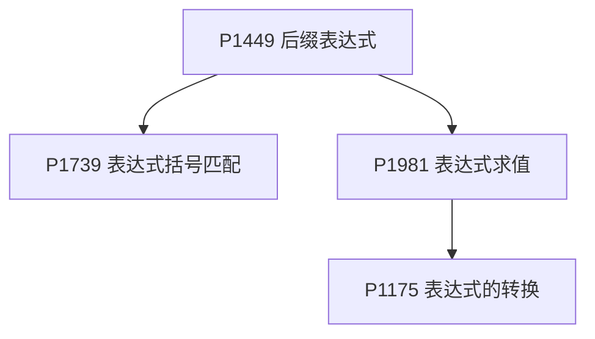

P1449 后缀表达式是栈的入口，P1739 括号匹配是它的最简版，P1981 → P1175 是中缀求值再到表达式转换。

**单调栈**

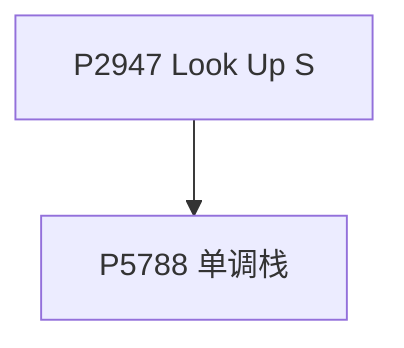

P2947 Look Up 是「找右边第一个更大值」的单调栈，P5788 是同一模板的裸题。

**队列基础**

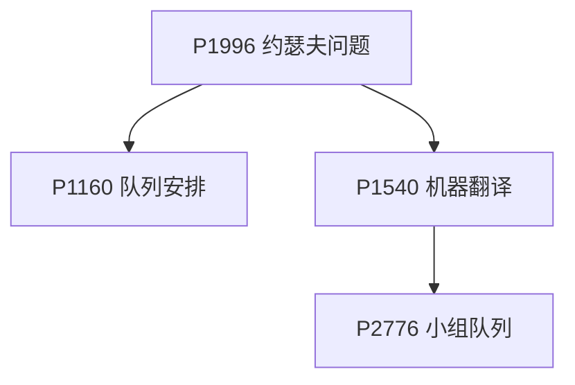

P1996 约瑟夫问题用队列模拟，P1160 队列安排改成链表，P1540 机器翻译是先进先出缓存，P2776 小组队列要同时维护两层队列。

**单调队列**

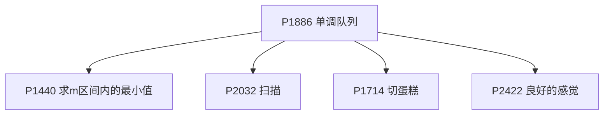

P1886 滑动窗口是模板，P1440 与 P2032 是同一模板换题面，P1714 切蛋糕把前缀和塞进队列，P2422 良好的感觉找「最小值乘区间和」。

**单调队列优化 DP**

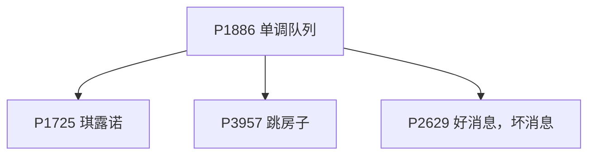

同样从 P1886 出发：P1725 琪露诺把窗口套在 DP 转移上，P3957 跳房子再叠一次二分答案，P2629 是好消息坏消息的环形前缀和处理。

**二叉树**

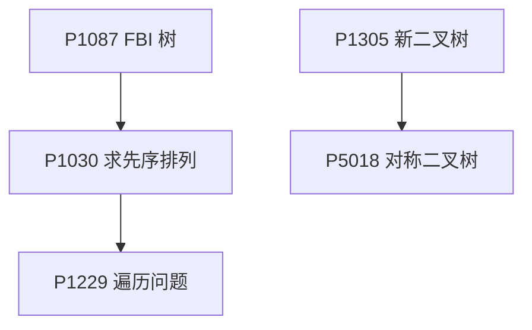

P1087 FBI 树练建树与遍历，P1030 求先序是已知两种遍历推第三种，P1229 数方案；P1305 新二叉树按描述建树，P5018 对称二叉树在它之上做匹配。

**堆与贪心**

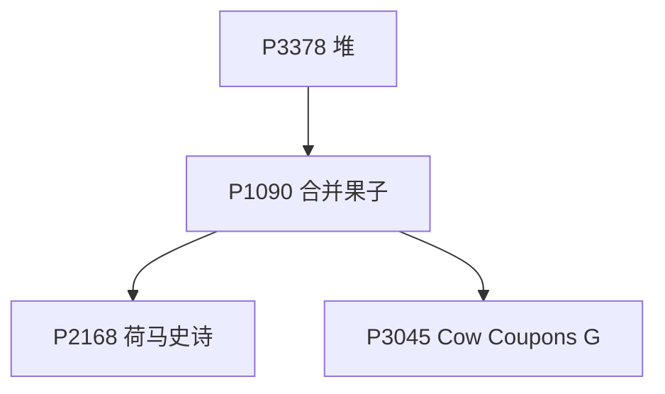

P3378 是堆模板，P1090 合并果子是堆 + 贪心，P2168 荷马史诗是它的 k 叉版，P3045 Cow Coupons 要两个堆互相反悔。

**对顶堆**

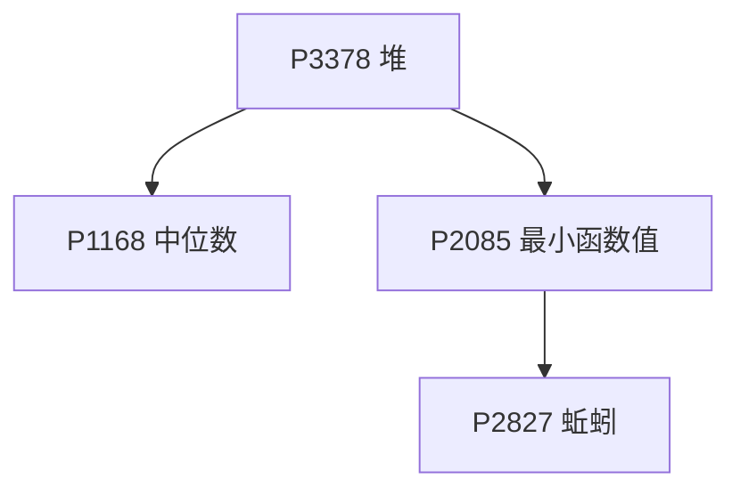

P1168 中位数是对顶堆模板，P2085 最小函数值是多路取最小，P2827 蚯蚓用单调队列把堆替换掉。

P5597 复读是树上 DP + 字符串，与本节其他题没有前置关系。

- [ ] [[problem: luogu,P1996]] · [P1996 约瑟夫问题](https://www.luogu.com.cn/problem/P1996)
- [ ] [[problem: luogu,P1160]] · [P1160 队列安排](https://www.luogu.com.cn/problem/P1160)
- [ ] [[problem: luogu,P1540]] · [P1540 \[NOIP 2010 提高组\] 机器翻译](https://www.luogu.com.cn/problem/P1540)
- [ ] [[problem: luogu,P1886]] · [P1886 【模板】单调队列 / 滑动窗口](https://www.luogu.com.cn/problem/P1886)
- [ ] [[problem: luogu,P1440]] · [P1440 求m区间内的最小值](https://www.luogu.com.cn/problem/P1440)
- [ ] [[problem: luogu,P2032]] · [P2032 扫描](https://www.luogu.com.cn/problem/P2032)
- [ ] [[problem: luogu,P1714]] · [P1714 切蛋糕](https://www.luogu.com.cn/problem/P1714)
- [ ] [[problem: luogu,P2629]] · [P2629 好消息，坏消息](https://www.luogu.com.cn/problem/P2629)
- [ ] [[problem: luogu,P2422]] · [P2422 良好的感觉](https://www.luogu.com.cn/problem/P2422)
- [ ] [[problem: luogu,P3957]] · [P3957 \[NOIP 2017 普及组\] 跳房子](https://www.luogu.com.cn/problem/P3957)
- [ ] [[problem: luogu,P1725]] · [P1725 琪露诺](https://www.luogu.com.cn/problem/P1725)
- [ ] [[problem: luogu,P2776]] · [P2776 \[SDOI2007\] 小组队列](https://www.luogu.com.cn/problem/P2776)
- [ ] [[problem: luogu,P2947]] · [P2947 \[USACO09MAR\] Look Up S](https://www.luogu.com.cn/problem/P2947)
- [ ] [[problem: luogu,P5788]] · [P5788 【模板】单调栈](https://www.luogu.com.cn/problem/P5788)
- [ ] [[problem: luogu,P1449]] · [P1449 后缀表达式](https://www.luogu.com.cn/problem/P1449)
- [ ] [[problem: luogu,P1739]] · [P1739 表达式括号匹配](https://www.luogu.com.cn/problem/P1739)
- [ ] [[problem: luogu,P1981]] · [P1981 \[NOIP 2013 普及组\] 表达式求值](https://www.luogu.com.cn/problem/P1981)
- [ ] [[problem: luogu,P1175]] · [P1175 表达式的转换](https://www.luogu.com.cn/problem/P1175)
- [ ] [[problem: luogu,P1087]] · [P1087 \[NOIP 2004 普及组\] FBI 树](https://www.luogu.com.cn/problem/P1087)
- [ ] [[problem: luogu,P1030]] · [P1030 \[NOIP 2001 普及组\] 求先序排列](https://www.luogu.com.cn/problem/P1030)
- [ ] [[problem: luogu,P1305]] · [P1305 新二叉树](https://www.luogu.com.cn/problem/P1305)
- [ ] [[problem: luogu,P1229]] · [P1229 遍历问题](https://www.luogu.com.cn/problem/P1229)
- [ ] [[problem: luogu,P5018]] · [P5018 \[NOIP 2018 普及组\] 对称二叉树](https://www.luogu.com.cn/problem/P5018)
- [ ] [[problem: luogu,P5597]] · [P5597 【XR-4】复读](https://www.luogu.com.cn/problem/P5597)
- [ ] [[problem: luogu,P2168]] · [P2168 \[NOI2015\] 荷马史诗](https://www.luogu.com.cn/problem/P2168)
- [ ] [[problem: luogu,P3378]] · [P3378 【模板】堆](https://www.luogu.com.cn/problem/P3378)
- [ ] [[problem: luogu,P1090]] · [P1090 \[NOIP 2004 提高组\] 合并果子](https://www.luogu.com.cn/problem/P1090)
- [ ] [[problem: luogu,P1168]] · [P1168 中位数](https://www.luogu.com.cn/problem/P1168)
- [ ] [[problem: luogu,P2085]] · [P2085 最小函数值](https://www.luogu.com.cn/problem/P2085)
- [ ] [[problem: luogu,P2827]] · [P2827 \[NOIP 2016 提高组\] 蚯蚓](https://www.luogu.com.cn/problem/P2827)
- [ ] [[problem: luogu,P3045]] · [P3045 \[USACO12FEB\] Cow Coupons G](https://www.luogu.com.cn/problem/P3045)

## 基本算法 - 罗勇军《算法竞赛》

[洛谷子题单](https://www.luogu.com.cn/training/1016021) · 47 题

**二分答案**

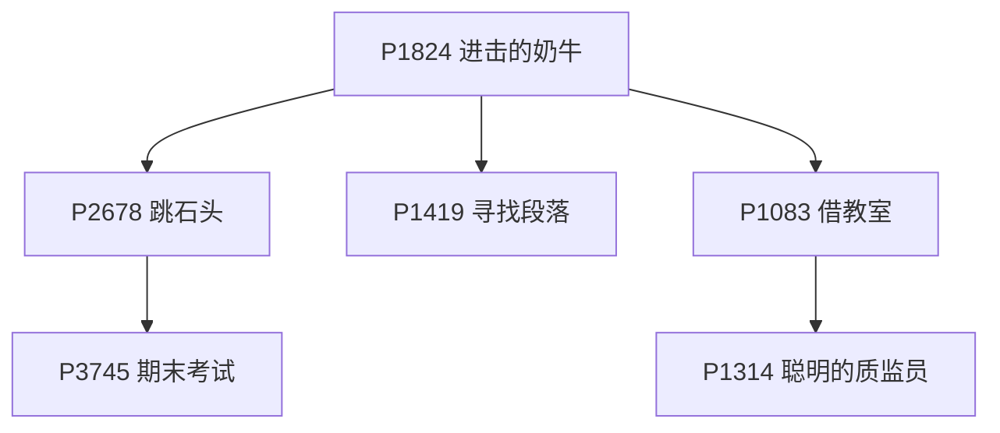

P1824 进击的奶牛是二分答案模板，之后 P2678 跳石头、P1419 寻找段落、P1083 借教室都是「二分答案加 check」；P1083 → P1314 是差分套二分，P2678 → P3745 是同一模型的更复杂版本。

**三分**

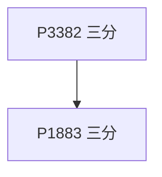

P3382 三分求单峰函数极值是模板，P1883 把多组函数取 max 之后仍然是单峰的。

**ST 表与区间最值**

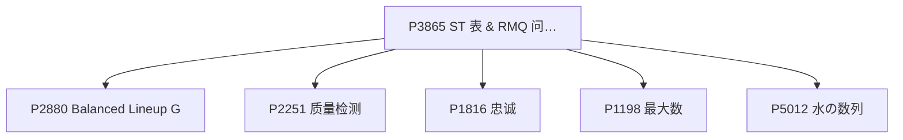

P3865 ST 表是模板，P2880 / P2251 / P1816 都是区间最值的直接套用，P1198 最大数要在线增量建表，P5012 是水の数列。

**倍增进阶**

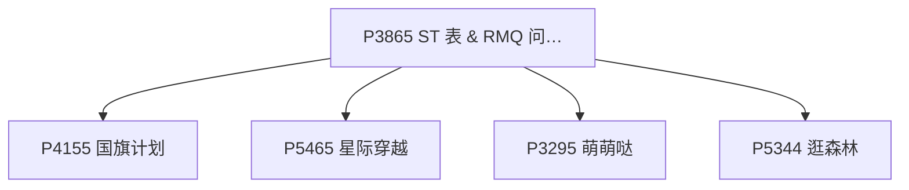

同样从 P3865 出发：P4155 国旗计划是区间覆盖上的倍增，P5465 星际穿越是树上倍增，P3295 萌萌哒用倍增合并区间，P5344 逛森林是倍增建虚点。

**前缀和与差分**

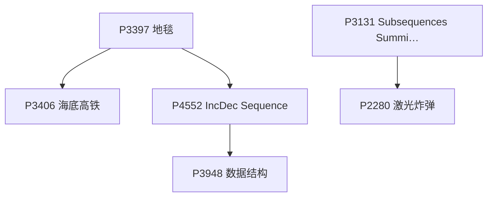

P3397 地毯是二维差分，P3406 海底高铁与 P4552 是它的一维应用，P4552 → P3948 再叠一次数据结构；P3131 用到前缀和取模，P2280 是二维前缀和。

**邻项交换与排序贪心**

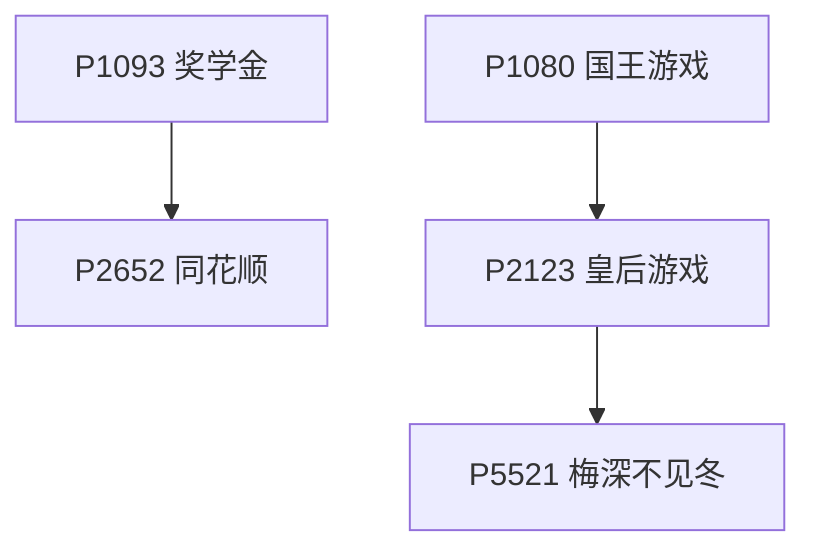

P1093 奖学金练多关键字排序，P2652 同花顺是排序加扫描；P1080 国王游戏是邻项交换的经典推导，P2123 皇后游戏是它的变体，P5521 梅深不见冬再到树上。

**双指针与排序取数**

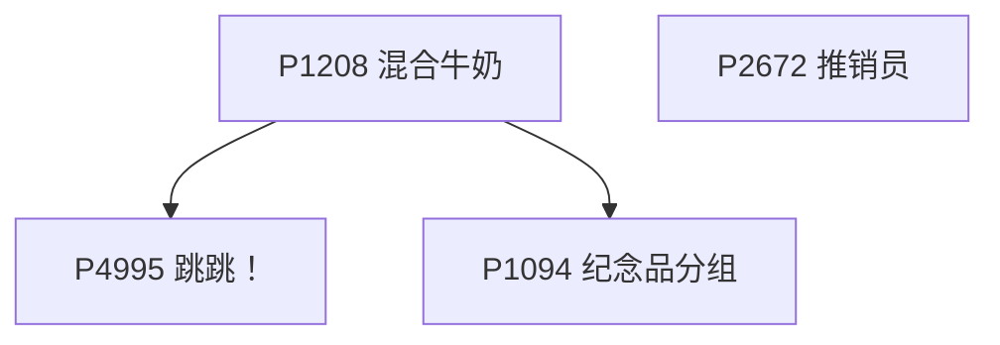

P1208 混合牛奶排序后取单价，P4995 跳跳与 P1094 纪念品分组都是排完序之后两头取。

**递归与模拟**

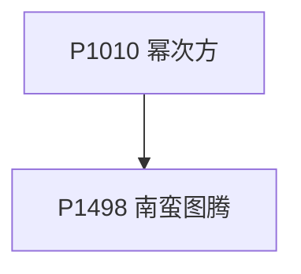

P1010 幂次方是递归分解，P1498 南蛮图腾是递归画图。

P1102（二分数对）、P1462（二分加最短路）、P1868（线性 DP）、P1493（排序加前缀）、P2048（堆加区间）、P1052（DP 加路径压缩）、P1115（最大子段和）、P1908（归并逆序对）、P1593（因子和）、P1923（第 k 小）、P2097（模拟）、P1199（博弈）与上面八张图都没有前置关系。

- [ ] [[problem: luogu,P1102]] · [P1102 A-B 数对](https://www.luogu.com.cn/problem/P1102)
- [ ] [[problem: luogu,P1462]] · [P1462 通往奥格瑞玛的道路](https://www.luogu.com.cn/problem/P1462)
- [ ] [[problem: luogu,P1824]] · [P1824 \[USACO05FEB\] 进击的奶牛 Aggressive Cows G](https://www.luogu.com.cn/problem/P1824)
- [ ] [[problem: luogu,P1419]] · [P1419 寻找段落](https://www.luogu.com.cn/problem/P1419)
- [ ] [[problem: luogu,P1083]] · [P1083 \[NOIP 2012 提高组\] 借教室](https://www.luogu.com.cn/problem/P1083)
- [ ] [[problem: luogu,P2678]] · [P2678 \[NOIP 2015 提高组\] 跳石头](https://www.luogu.com.cn/problem/P2678)
- [ ] [[problem: luogu,P1314]] · [P1314 \[NOIP 2011 提高组\] 聪明的质监员](https://www.luogu.com.cn/problem/P1314)
- [ ] [[problem: luogu,P1868]] · [P1868 饥饿的奶牛](https://www.luogu.com.cn/problem/P1868)
- [ ] [[problem: luogu,P1493]] · [P1493 分梨子](https://www.luogu.com.cn/problem/P1493)
- [ ] [[problem: luogu,P3382]] · [P3382 三分](https://www.luogu.com.cn/problem/P3382)
- [ ] [[problem: luogu,P3745]] · [P3745 \[六省联考 2017\] 期末考试](https://www.luogu.com.cn/problem/P3745)
- [ ] [[problem: luogu,P1883]] · [P1883 【模板】三分 / 函数 / \[ICPC 2010 Chengdu R\] Error Curves](https://www.luogu.com.cn/problem/P1883)
- [ ] [[problem: luogu,P4155]] · [P4155 \[SCOI2015\] 国旗计划](https://www.luogu.com.cn/problem/P4155)
- [ ] [[problem: luogu,P2880]] · [P2880 \[USACO07JAN\] Balanced Lineup G](https://www.luogu.com.cn/problem/P2880)
- [ ] [[problem: luogu,P3865]] · [P3865 【模板】ST 表 & RMQ 问题](https://www.luogu.com.cn/problem/P3865)
- [ ] [[problem: luogu,P5465]] · [P5465 \[PKUSC2018\] 星际穿越](https://www.luogu.com.cn/problem/P5465)
- [ ] [[problem: luogu,P3295]] · [P3295 \[SCOI2016\] 萌萌哒](https://www.luogu.com.cn/problem/P3295)
- [ ] [[problem: luogu,P2251]] · [P2251 质量检测](https://www.luogu.com.cn/problem/P2251)
- [ ] [[problem: luogu,P1816]] · [P1816 忠诚](https://www.luogu.com.cn/problem/P1816)
- [ ] [[problem: luogu,P1198]] · [P1198 \[JSOI2008\] 最大数](https://www.luogu.com.cn/problem/P1198)
- [ ] [[problem: luogu,P5012]] · [P5012 水の数列](https://www.luogu.com.cn/problem/P5012)
- [ ] [[problem: luogu,P5344]] · [P5344 【XR-1】逛森林](https://www.luogu.com.cn/problem/P5344)
- [ ] [[problem: luogu,P2048]] · [P2048 \[NOI2010\] 超级钢琴](https://www.luogu.com.cn/problem/P2048)
- [ ] [[problem: luogu,P3397]] · [P3397 地毯](https://www.luogu.com.cn/problem/P3397)
- [ ] [[problem: luogu,P3406]] · [P3406 海底高铁](https://www.luogu.com.cn/problem/P3406)
- [ ] [[problem: luogu,P3948]] · [P3948 数据结构](https://www.luogu.com.cn/problem/P3948)
- [ ] [[problem: luogu,P4552]] · [P4552 \[Poetize6\] IncDec Sequence](https://www.luogu.com.cn/problem/P4552)
- [ ] [[problem: luogu,P3131]] · [P3131 \[USACO16JAN\] Subsequences Summing to Sevens S](https://www.luogu.com.cn/problem/P3131)
- [ ] [[problem: luogu,P2280]] · [P2280 \[HNOI2003\] 激光炸弹](https://www.luogu.com.cn/problem/P2280)
- [ ] [[problem: luogu,P1052]] · [P1052 \[NOIP 2005 提高组\] 过河](https://www.luogu.com.cn/problem/P1052)
- [ ] [[problem: luogu,P2097]] · [P2097 资料分发 1](https://www.luogu.com.cn/problem/P2097)
- [ ] [[problem: luogu,P2652]] · [P2652 同花顺](https://www.luogu.com.cn/problem/P2652)
- [ ] [[problem: luogu,P1093]] · [P1093 \[NOIP 2007 普及组\] 奖学金](https://www.luogu.com.cn/problem/P1093)
- [ ] [[problem: luogu,P1115]] · [P1115 最大子段和](https://www.luogu.com.cn/problem/P1115)
- [ ] [[problem: luogu,P1908]] · [P1908 逆序对](https://www.luogu.com.cn/problem/P1908)
- [ ] [[problem: luogu,P1593]] · [P1593 因子和](https://www.luogu.com.cn/problem/P1593)
- [ ] [[problem: luogu,P1923]] · [P1923 【深基9.例4】求第 k 小的数](https://www.luogu.com.cn/problem/P1923)
- [ ] [[problem: luogu,P1498]] · [P1498 南蛮图腾](https://www.luogu.com.cn/problem/P1498)
- [ ] [[problem: luogu,P1010]] · [P1010 \[NOIP 1998 普及组\] 幂次方](https://www.luogu.com.cn/problem/P1010)
- [ ] [[problem: luogu,P1208]] · [P1208 \[USACO1.3\] 混合牛奶 Mixing Milk](https://www.luogu.com.cn/problem/P1208)
- [ ] [[problem: luogu,P4995]] · [P4995 跳跳！](https://www.luogu.com.cn/problem/P4995)
- [ ] [[problem: luogu,P1094]] · [P1094 \[NOIP 2007 普及组\] 纪念品分组](https://www.luogu.com.cn/problem/P1094)
- [ ] [[problem: luogu,P1199]] · [P1199 \[NOIP 2010 普及组\] 三国游戏](https://www.luogu.com.cn/problem/P1199)
- [ ] [[problem: luogu,P2672]] · [P2672 \[NOIP 2015 普及组\] 推销员](https://www.luogu.com.cn/problem/P2672)
- [ ] [[problem: luogu,P1080]] · [P1080 \[NOIP 2012 提高组\] 国王游戏](https://www.luogu.com.cn/problem/P1080)
- [ ] [[problem: luogu,P2123]] · [P2123 皇后游戏](https://www.luogu.com.cn/problem/P2123)
- [ ] [[problem: luogu,P5521]] · [P5521 \[yLOI2019\] 梅深不见冬](https://www.luogu.com.cn/problem/P5521)

## 搜索 - 罗勇军《算法竞赛》

[洛谷子题单](https://www.luogu.com.cn/training/1016022) · 28 题

**DFS 与剪枝**

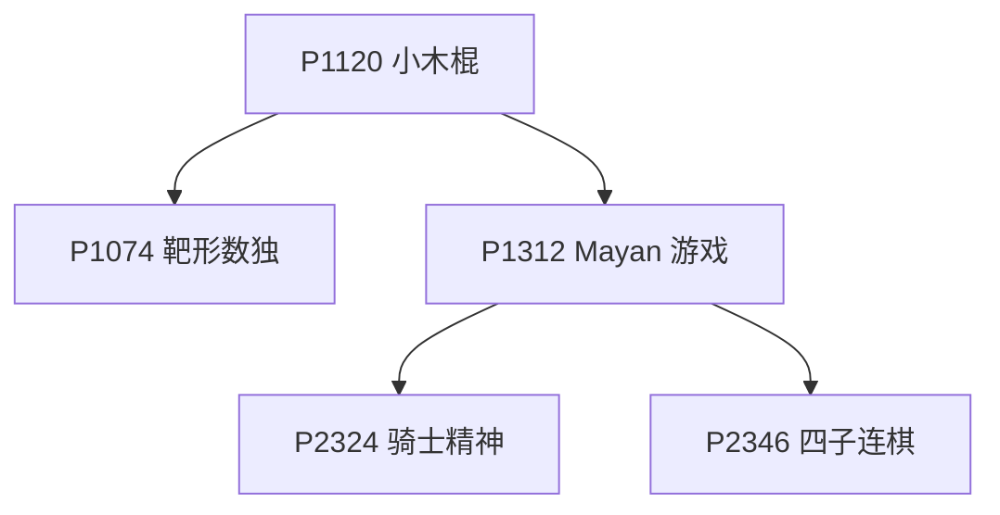

P1120 小木棍是剪枝集大成的一题，P1074 靶形数独与 P1312 Mayan 游戏都在它之上；P1312 → P2324 / P2346 是 IDA* 与模拟类搜索。

**网格连通块**

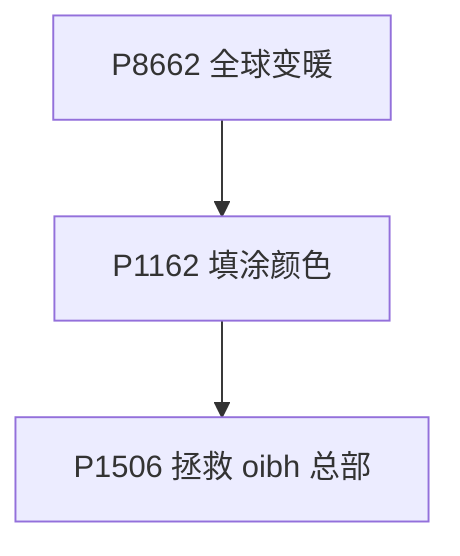

P8662 全球变暖是数被淹没的连通块，P1162 填涂颜色把外圈灌满再判断，P1506 拯救 oibh 总部是同一套边界处理。

**网格最短路**

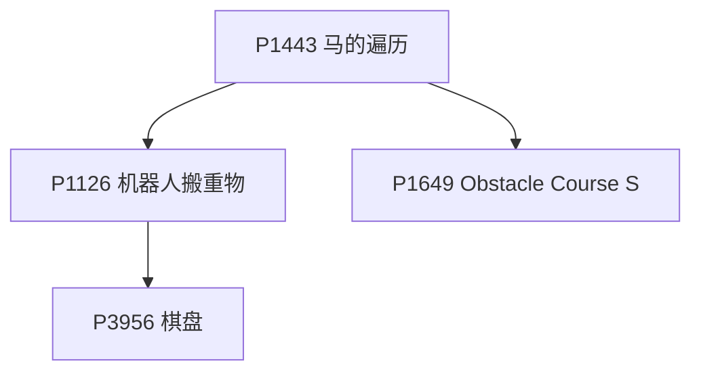

P1443 马的遍历是 BFS 求最短步数模板，P1126 机器人搬重物要加上朝向状态，P1649 加了障碍代价，P3956 棋盘是 0-1 BFS。

**折半与状压搜索**

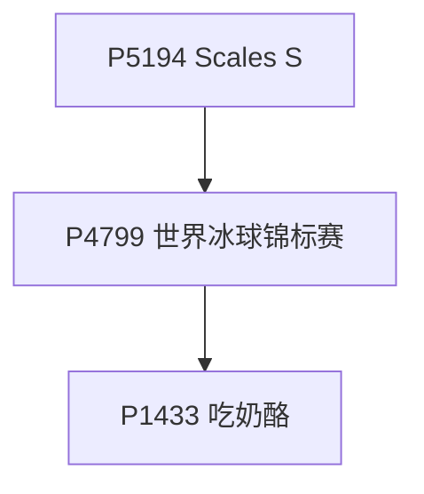

P5194 Scales S 是折半搜索入门，P4799 世界冰球锦标赛是同一模板的大规模版，P1433 吃奶酪是状压加剪枝。

**图上搜索**

```mermaid
flowchart TD
  nP4779["P4779 单源最短路径（标准版）"]
  nP4667["P4667 Switch the Lamp On"]
  nP2483["P2483 k 短路"]
  nP3047["P3047 Nearby Cows G"]

  nP4779 --> nP4667
  nP4779 --> nP2483
  nP4779 --> nP3047
```

P4779 单源最短路是入口，P4667 把 0-1 BFS 写成最短路，P2483 求 k 短路，P3047 Nearby Cows 是树上的距离统计。

P1219（八皇后）、P1019（单词接龙）、P5440（奇迹）、P1378（油滴扩展）、P1118（数字三角形搜索）、P1514（引水入城）、P5195（Knights of Ni）、P1032（字串变换）、P2534（铁盘整理）与上面五张图没有前置关系。

- [ ] [[problem: luogu,P8662]] · [P8662 \[蓝桥杯 2018 省 AB\] 全球变暖](https://www.luogu.com.cn/problem/P8662)
- [ ] [[problem: luogu,P1219]] · [P1219 \[USACO1.5\] 八皇后 Checker Challenge](https://www.luogu.com.cn/problem/P1219)
- [ ] [[problem: luogu,P1019]] · [P1019 \[NOIP 2000 提高组\] 单词接龙（疑似错题）](https://www.luogu.com.cn/problem/P1019)
- [ ] [[problem: luogu,P5194]] · [P5194 \[USACO05DEC\] Scales S](https://www.luogu.com.cn/problem/P5194)
- [ ] [[problem: luogu,P5440]] · [P5440 【XR-2】奇迹](https://www.luogu.com.cn/problem/P5440)
- [ ] [[problem: luogu,P1378]] · [P1378 油滴扩展](https://www.luogu.com.cn/problem/P1378)
- [ ] [[problem: luogu,P1162]] · [P1162 填涂颜色](https://www.luogu.com.cn/problem/P1162)
- [ ] [[problem: luogu,P1443]] · [P1443 马的遍历](https://www.luogu.com.cn/problem/P1443)
- [ ] [[problem: luogu,P3956]] · [P3956 \[NOIP 2017 普及组\] 棋盘](https://www.luogu.com.cn/problem/P3956)
- [ ] [[problem: luogu,P1032]] · [P1032 \[NOIP 2002 提高组\] 字串变换（疑似错题）](https://www.luogu.com.cn/problem/P1032)
- [ ] [[problem: luogu,P1126]] · [P1126 \[CERC1996\] 机器人搬重物](https://www.luogu.com.cn/problem/P1126)
- [ ] [[problem: luogu,P1118]] · [P1118 \[USACO06FEB\] Backward Digit Sums G/S](https://www.luogu.com.cn/problem/P1118)
- [ ] [[problem: luogu,P1433]] · [P1433 吃奶酪](https://www.luogu.com.cn/problem/P1433)
- [ ] [[problem: luogu,P1120]] · [P1120 \[CERC 1995\] 小木棍](https://www.luogu.com.cn/problem/P1120)
- [ ] [[problem: luogu,P1074]] · [P1074 \[NOIP 2009 提高组\] 靶形数独](https://www.luogu.com.cn/problem/P1074)
- [ ] [[problem: luogu,P1312]] · [P1312 \[NOIP 2011 提高组\] Mayan 游戏](https://www.luogu.com.cn/problem/P1312)
- [ ] [[problem: luogu,P1514]] · [P1514 \[NOIP 2010 提高组\] 引水入城](https://www.luogu.com.cn/problem/P1514)
- [ ] [[problem: luogu,P1506]] · [P1506 拯救 oibh 总部](https://www.luogu.com.cn/problem/P1506)
- [ ] [[problem: luogu,P1649]] · [P1649 \[USACO07OCT\] Obstacle Course S](https://www.luogu.com.cn/problem/P1649)
- [ ] [[problem: luogu,P3047]] · [P3047 \[USACO12FEB\] Nearby Cows G](https://www.luogu.com.cn/problem/P3047)
- [ ] [[problem: luogu,P4799]] · [P4799 \[CEOI 2015\] 世界冰球锦标赛 (Day2)](https://www.luogu.com.cn/problem/P4799)
- [ ] [[problem: luogu,P5195]] · [P5195 \[USACO05DEC\] Knights of Ni S](https://www.luogu.com.cn/problem/P5195)
- [ ] [[problem: luogu,P4779]] · [P4779 【模板】单源最短路径（标准版）](https://www.luogu.com.cn/problem/P4779)
- [ ] [[problem: luogu,P4667]] · [P4667 \[BalticOI 2011\] Switch the Lamp On (Day1)](https://www.luogu.com.cn/problem/P4667)
- [ ] [[problem: luogu,P2483]] · [P2483 【模板】k 短路 / \[SDOI2010\] 魔法猪学院](https://www.luogu.com.cn/problem/P2483)
- [ ] [[problem: luogu,P2346]] · [P2346 四子连棋](https://www.luogu.com.cn/problem/P2346)
- [ ] [[problem: luogu,P2324]] · [P2324 \[SCOI2005\] 骑士精神](https://www.luogu.com.cn/problem/P2324)
- [ ] [[problem: luogu,P2534]] · [P2534 \[AHOI2012\] 铁盘整理](https://www.luogu.com.cn/problem/P2534)

## 高级数据结构 - 罗勇军《算法竞赛》

[洛谷子题单](https://www.luogu.com.cn/training/1016023) · 148 题

**第一层：从并查集到线段树**

```mermaid
flowchart TD
  ndsu["并查集<br/>P2024 起"]
  nbit["树状数组<br/>P3374 起"]
  nseg["线段树<br/>P3372 起"]

  ndsu --> nbit
  nbit --> nseg
```

这三块是本节的骨架，后面的可持久化、树套树、分块都以它们为前提。

并查集（P2024 起）另有 P1111、P3958、P1525、P4185、P1197、P1196、P1955、P3402；树状数组（P3374 起）另有 P3368、P1908、P1774、P4479、P1966、P3605、P3586、P4054、P4113；线段树（P3372 起）另有 P4514、P3373、P3870、P4145、P6242、P1856、P5490、P4588、P1502、P2471、P2824、P3722、P4097、P4198、P4513、P4556、P5324、P5327、P3960、P3992。

**第二层：可持久化与分块**

```mermaid
flowchart TD
  npst["可持久化线段树<br/>P3919 起"]
  nblock["分块<br/>P2801 起"]
  nmo["莫队<br/>P2709 起"]

  npst --> nblock
  nblock --> nmo
```

可持久化线段树与分块是两条平行的进阶线，莫队建在分块之上。

可持久化线段树（P3919 起）另有 P3834、P2468、P3302、P3168、P4559、P3293、P2633、P4618；分块（P2801 起）另有 P3396、P3863、P1975、P3710、P2325；莫队（P2709 起）另有 P1972、SP10707、P4168、P4119、P1494、P1903、P5906、P4887、P3674、P3709、P4074、P5501。

**第三层：树上的结构**

```mermaid
flowchart TD
  ntree1["树的直径与 LCA<br/>B4016 起"]
  ncentroid["点分治<br/>P3806 起"]
  nhld["树链剖分<br/>P3384 起"]

  ntree1 --> ncentroid
  ntree1 --> nhld
  ncentroid --> nhld
```

先在树上拿到 LCA 与直径这两件工具，再学点分治与树链剖分；树链剖分是后面许多树上套数据结构的载体。

树的直径与 LCA（B4016 起）另有 P3629、P1099、P3128、P1967、P2680、P1600、P3379、P3938、P4281；点分治（P3806 起）另有 P4178、P6329、P2056、P3345、P4183、P5306、P2634、P2664、P3714、P4149、P3241、P4075、P4292；树链剖分（P3384 起）另有 P2146、P3178、P3038、P3313、P2590、P1505、P2486、P3258、P4069、P4211、P4592、P5305、P5354。

**第四层：平衡树与动态树**

```mermaid
flowchart TD
  nbst["平衡树与 Splay<br/>P3369 起"]
  nkdt["KD-Tree<br/>P4148 起"]
  nlct["LCT 动态树<br/>P3690 起"]

  nbst --> nlct
  nbst --> nkdt
```

平衡树是本节最后一个基础件，KD-Tree 与 LCT 都在它之后。

平衡树与 Splay（P3369 起）另有 P4008、P5055、P3835、P5854、P1377、P5044、P3793、P1440、P4567、P3391、P3850、P5338、P2042、P1110、P3644、P1486、P2710、P3224、P3285、P5321、P5499；KD-Tree（P4148 起）另有 P4169、P4357、P7883、P2479、P3769、P4390、P4475、P2093、P5471；LCT 动态树（P3690 起）另有 P3203、P4338、P1501、P3348、P3703、P4172、P4219、P5489、P2387。

- [ ] [[problem: luogu,P2024]] · [P2024 \[NOI2001\] 食物链](https://www.luogu.com.cn/problem/P2024)
- [ ] [[problem: luogu,P1111]] · [P1111 修复公路](https://www.luogu.com.cn/problem/P1111)
- [ ] [[problem: luogu,P3958]] · [P3958 \[NOIP 2017 提高组\] 奶酪](https://www.luogu.com.cn/problem/P3958)
- [ ] [[problem: luogu,P1525]] · [P1525 \[NOIP 2010 提高组\] 关押罪犯](https://www.luogu.com.cn/problem/P1525)
- [ ] [[problem: luogu,P4185]] · [P4185 \[USACO18JAN\] MooTube G](https://www.luogu.com.cn/problem/P4185)
- [ ] [[problem: luogu,P1197]] · [P1197 \[JSOI2008\] 星球大战](https://www.luogu.com.cn/problem/P1197)
- [ ] [[problem: luogu,P1196]] · [P1196 \[NOI2002\] 银河英雄传说](https://www.luogu.com.cn/problem/P1196)
- [ ] [[problem: luogu,P1955]] · [P1955 \[NOI2015\] 程序自动分析](https://www.luogu.com.cn/problem/P1955)
- [ ] [[problem: luogu,P3372]] · [P3372 【模板】线段树 1](https://www.luogu.com.cn/problem/P3372)
- [ ] [[problem: luogu,P4514]] · [P4514 上帝造题的七分钟](https://www.luogu.com.cn/problem/P4514)
- [ ] [[problem: luogu,P1908]] · [P1908 逆序对](https://www.luogu.com.cn/problem/P1908)
- [ ] [[problem: luogu,P3374]] · [P3374 【模板】树状数组 1](https://www.luogu.com.cn/problem/P3374)
- [ ] [[problem: luogu,P3368]] · [P3368 【模板】树状数组 2](https://www.luogu.com.cn/problem/P3368)
- [ ] [[problem: luogu,P1774]] · [P1774 最接近神的人](https://www.luogu.com.cn/problem/P1774)
- [ ] [[problem: luogu,P4479]] · [P4479 \[BJWC2018\] 第k大斜率](https://www.luogu.com.cn/problem/P4479)
- [ ] [[problem: luogu,P1966]] · [P1966 \[NOIP 2013 提高组\] 火柴排队](https://www.luogu.com.cn/problem/P1966)
- [ ] [[problem: luogu,P3605]] · [P3605 \[USACO17JAN\] Promotion Counting P](https://www.luogu.com.cn/problem/P3605)
- [ ] [[problem: luogu,P3586]] · [P3586 \[POI 2015 R2\] 物流 Logistics](https://www.luogu.com.cn/problem/P3586)
- [ ] [[problem: luogu,P4054]] · [P4054 \[JSOI2009\] 计数问题](https://www.luogu.com.cn/problem/P4054)
- [ ] [[problem: luogu,P4113]] · [P4113 \[HEOI2012\] 采花](https://www.luogu.com.cn/problem/P4113)
- [ ] [[problem: luogu,P3960]] · [P3960 \[NOIP 2017 提高组\] 列队](https://www.luogu.com.cn/problem/P3960)
- [ ] [[problem: luogu,P4145]] · [P4145 上帝造题的七分钟 2 / 花神游历各国](https://www.luogu.com.cn/problem/P4145)
- [ ] [[problem: luogu,P6242]] · [P6242 【模板】线段树 3（区间最值操作、区间历史最值）](https://www.luogu.com.cn/problem/P6242)
- [ ] [[problem: luogu,P1856]] · [P1856 \[IOI 1998 / USACO5.5\] 矩形周长 Picture](https://www.luogu.com.cn/problem/P1856)
- [ ] [[problem: luogu,P3373]] · [P3373 【模板】线段树 2](https://www.luogu.com.cn/problem/P3373)
- [ ] [[problem: luogu,P5490]] · [P5490 【模板】扫描线 & 矩形面积并](https://www.luogu.com.cn/problem/P5490)
- [ ] [[problem: luogu,P4588]] · [P4588 \[TJOI2018\] 数学计算](https://www.luogu.com.cn/problem/P4588)
- [ ] [[problem: luogu,P1502]] · [P1502 窗口的星星](https://www.luogu.com.cn/problem/P1502)
- [ ] [[problem: luogu,P2471]] · [P2471 \[SCOI2007\] 降雨量](https://www.luogu.com.cn/problem/P2471)
- [ ] [[problem: luogu,P2824]] · [P2824 \[HEOI2016/TJOI2016\] 排序](https://www.luogu.com.cn/problem/P2824)
- [ ] [[problem: luogu,P3722]] · [P3722 \[AHOI2017/HNOI2017\] 影魔](https://www.luogu.com.cn/problem/P3722)
- [ ] [[problem: luogu,P4097]] · [P4097 【模板】李超线段树 / \[HEOI2013\] Segment](https://www.luogu.com.cn/problem/P4097)
- [ ] [[problem: luogu,P4198]] · [P4198 楼房重建](https://www.luogu.com.cn/problem/P4198)
- [ ] [[problem: luogu,P4513]] · [P4513 小白逛公园](https://www.luogu.com.cn/problem/P4513)
- [ ] [[problem: luogu,P4556]] · [P4556 【模板】线段树合并 / \[Vani 有约会\] 雨天的尾巴](https://www.luogu.com.cn/problem/P4556)
- [ ] [[problem: luogu,P5324]] · [P5324 \[BJOI2019\] 删数](https://www.luogu.com.cn/problem/P5324)
- [ ] [[problem: luogu,P5327]] · [P5327 \[ZJOI2019\] 语言](https://www.luogu.com.cn/problem/P5327)
- [ ] [[problem: luogu,P3834]] · [P3834 【模板】可持久化线段树 2](https://www.luogu.com.cn/problem/P3834)
- [ ] [[problem: luogu,P2468]] · [P2468 \[SDOI2010\] 粟粟的书架](https://www.luogu.com.cn/problem/P2468)
- [ ] [[problem: luogu,P3302]] · [P3302 \[SDOI2013\] 森林](https://www.luogu.com.cn/problem/P3302)
- [ ] [[problem: luogu,P3168]] · [P3168 \[CQOI2015\] 任务查询系统](https://www.luogu.com.cn/problem/P3168)
- [ ] [[problem: luogu,P4559]] · [P4559 \[JSOI2018\] 列队](https://www.luogu.com.cn/problem/P4559)
- [ ] [[problem: luogu,P3293]] · [P3293 \[SCOI2016\] 美味](https://www.luogu.com.cn/problem/P3293)
- [ ] [[problem: luogu,P2633]] · [P2633 Count on a tree](https://www.luogu.com.cn/problem/P2633)
- [ ] [[problem: luogu,P4618]] · [P4618 \[SDOI2018\] 原题识别](https://www.luogu.com.cn/problem/P4618)
- [ ] [[problem: luogu,P3919]] · [P3919 【模板】可持久化线段树 1（可持久化数组）](https://www.luogu.com.cn/problem/P3919)
- [ ] [[problem: luogu,P3402]] · [P3402 【模板】可持久化并查集](https://www.luogu.com.cn/problem/P3402)
- [ ] [[problem: luogu,P2801]] · [P2801 教主的魔法](https://www.luogu.com.cn/problem/P2801)
- [ ] [[problem: luogu,P1972]] · [P1972 \[SDOI2009\] HH 的项链](https://www.luogu.com.cn/problem/P1972)
- [ ] [[problem: luogu,SP10707]] · [SP10707 COT2 - Count on a tree II](https://www.luogu.com.cn/problem/SP10707)
- [ ] [[problem: luogu,P3870]] · [P3870 \[TJOI2009\] 开关](https://www.luogu.com.cn/problem/P3870)
- [ ] [[problem: luogu,P3396]] · [P3396 哈希冲突](https://www.luogu.com.cn/problem/P3396)
- [ ] [[problem: luogu,P3863]] · [P3863 序列](https://www.luogu.com.cn/problem/P3863)
- [ ] [[problem: luogu,P1975]] · [P1975 \[国家集训队\] 排队](https://www.luogu.com.cn/problem/P1975)
- [ ] [[problem: luogu,P3710]] · [P3710 方方方的数据结构](https://www.luogu.com.cn/problem/P3710)
- [ ] [[problem: luogu,P3992]] · [P3992 \[BJOI2017\] 开车](https://www.luogu.com.cn/problem/P3992)
- [ ] [[problem: luogu,P4168]] · [P4168 \[Violet\] 蒲公英](https://www.luogu.com.cn/problem/P4168)
- [ ] [[problem: luogu,P4119]] · [P4119 \[Ynoi2018\] 未来日记](https://www.luogu.com.cn/problem/P4119)
- [ ] [[problem: luogu,P2325]] · [P2325 \[SCOI2005\] 王室联邦](https://www.luogu.com.cn/problem/P2325)
- [ ] [[problem: luogu,P1494]] · [P1494 \[国家集训队\] 小 Z 的袜子](https://www.luogu.com.cn/problem/P1494)
- [ ] [[problem: luogu,P1903]] · [P1903 【模板】带修莫队 / \[国家集训队\] 数颜色 / 维护队列](https://www.luogu.com.cn/problem/P1903)
- [ ] [[problem: luogu,P5906]] · [P5906 【模板】回滚莫队&不删除莫队](https://www.luogu.com.cn/problem/P5906)
- [ ] [[problem: luogu,P4887]] · [P4887 【模板】莫队二次离线 / 第十四分块(前体)](https://www.luogu.com.cn/problem/P4887)
- [ ] [[problem: luogu,P2709]] · [P2709 【模板】莫队 / 小 B 的询问](https://www.luogu.com.cn/problem/P2709)
- [ ] [[problem: luogu,P3674]] · [P3674 小清新人渣的本愿](https://www.luogu.com.cn/problem/P3674)
- [ ] [[problem: luogu,P3709]] · [P3709 大爷的字符串题](https://www.luogu.com.cn/problem/P3709)
- [ ] [[problem: luogu,P4074]] · [P4074 \[WC2013\] 糖果公园](https://www.luogu.com.cn/problem/P4074)
- [ ] [[problem: luogu,P5501]] · [P5501 \[LnOI2019\] 来者不拒，去者不追](https://www.luogu.com.cn/problem/P5501)
- [ ] [[problem: luogu,B4016]] · [B4016 树的直径](https://www.luogu.com.cn/problem/B4016)
- [ ] [[problem: luogu,P3629]] · [P3629 \[APIO2010\] 巡逻](https://www.luogu.com.cn/problem/P3629)
- [ ] [[problem: luogu,P1099]] · [P1099 \[NOIP 2007 提高组\] 树网的核](https://www.luogu.com.cn/problem/P1099)
- [ ] [[problem: luogu,P3128]] · [P3128 \[USACO15DEC\] Max Flow P](https://www.luogu.com.cn/problem/P3128)
- [ ] [[problem: luogu,P1967]] · [P1967 \[NOIP 2013 提高组\] 货车运输](https://www.luogu.com.cn/problem/P1967)
- [ ] [[problem: luogu,P2680]] · [P2680 \[NOIP 2015 提高组\] 运输计划](https://www.luogu.com.cn/problem/P2680)
- [ ] [[problem: luogu,P1600]] · [P1600 \[NOIP 2016 提高组\] 天天爱跑步](https://www.luogu.com.cn/problem/P1600)
- [ ] [[problem: luogu,P3379]] · [P3379 【模板】最近公共祖先（LCA）](https://www.luogu.com.cn/problem/P3379)
- [ ] [[problem: luogu,P3938]] · [P3938 斐波那契](https://www.luogu.com.cn/problem/P3938)
- [ ] [[problem: luogu,P4281]] · [P4281 \[AHOI2008\] 紧急集合 / 聚会](https://www.luogu.com.cn/problem/P4281)
- [ ] [[problem: luogu,P4178]] · [P4178 Tree](https://www.luogu.com.cn/problem/P4178)
- [ ] [[problem: luogu,P6329]] · [P6329 【模板】点分树 / 震波](https://www.luogu.com.cn/problem/P6329)
- [ ] [[problem: luogu,P2056]] · [P2056 \[ZJOI2007\] 捉迷藏](https://www.luogu.com.cn/problem/P2056)
- [ ] [[problem: luogu,P3345]] · [P3345 \[ZJOI2015\] 幻想乡战略游戏](https://www.luogu.com.cn/problem/P3345)
- [ ] [[problem: luogu,P4183]] · [P4183 \[USACO18JAN\] Cow at Large P](https://www.luogu.com.cn/problem/P4183)
- [ ] [[problem: luogu,P5306]] · [P5306 \[COCI 2018/2019 #5\] Transport](https://www.luogu.com.cn/problem/P5306)
- [ ] [[problem: luogu,P3806]] · [P3806 【模板】点分治](https://www.luogu.com.cn/problem/P3806)
- [ ] [[problem: luogu,P2634]] · [P2634 \[国家集训队\] 聪聪可可](https://www.luogu.com.cn/problem/P2634)
- [ ] [[problem: luogu,P2664]] · [P2664 树上游戏](https://www.luogu.com.cn/problem/P2664)
- [ ] [[problem: luogu,P3714]] · [P3714 \[BJOI2017\] 树的难题](https://www.luogu.com.cn/problem/P3714)
- [ ] [[problem: luogu,P4149]] · [P4149 \[IOI 2011\] Race](https://www.luogu.com.cn/problem/P4149)
- [ ] [[problem: luogu,P3241]] · [P3241 \[HNOI2015\] 开店](https://www.luogu.com.cn/problem/P3241)
- [ ] [[problem: luogu,P4075]] · [P4075 \[SDOI2016\] 模式字符串](https://www.luogu.com.cn/problem/P4075)
- [ ] [[problem: luogu,P4292]] · [P4292 \[WC2010\] 重建计划](https://www.luogu.com.cn/problem/P4292)
- [ ] [[problem: luogu,P2146]] · [P2146 \[NOI2015\] 软件包管理器](https://www.luogu.com.cn/problem/P2146)
- [ ] [[problem: luogu,P3178]] · [P3178 \[HAOI2015\] 树上操作](https://www.luogu.com.cn/problem/P3178)
- [ ] [[problem: luogu,P3038]] · [P3038 \[USACO11DEC\] Grass Planting G](https://www.luogu.com.cn/problem/P3038)
- [ ] [[problem: luogu,P3384]] · [P3384 【模板】重链剖分 / 树链剖分](https://www.luogu.com.cn/problem/P3384)
- [ ] [[problem: luogu,P3313]] · [P3313 \[SDOI2014\] 旅行](https://www.luogu.com.cn/problem/P3313)
- [ ] [[problem: luogu,P2590]] · [P2590 \[ZJOI2008\] 树的统计](https://www.luogu.com.cn/problem/P2590)
- [ ] [[problem: luogu,P1505]] · [P1505 \[国家集训队\] 旅游](https://www.luogu.com.cn/problem/P1505)
- [ ] [[problem: luogu,P2486]] · [P2486 \[SDOI2011\] 染色](https://www.luogu.com.cn/problem/P2486)
- [ ] [[problem: luogu,P3258]] · [P3258 \[JLOI2014\] 松鼠的新家](https://www.luogu.com.cn/problem/P3258)
- [ ] [[problem: luogu,P4069]] · [P4069 \[SDOI2016\] 游戏](https://www.luogu.com.cn/problem/P4069)
- [ ] [[problem: luogu,P4211]] · [P4211 \[LNOI2014\] LCA](https://www.luogu.com.cn/problem/P4211)
- [ ] [[problem: luogu,P4592]] · [P4592 \[TJOI2018\] 异或](https://www.luogu.com.cn/problem/P4592)
- [ ] [[problem: luogu,P5305]] · [P5305 \[GXOI/GZOI2019\] 旧词](https://www.luogu.com.cn/problem/P5305)
- [ ] [[problem: luogu,P5354]] · [P5354 \[Ynoi Easy Round 2017\] 由乃的 OJ](https://www.luogu.com.cn/problem/P5354)
- [ ] [[problem: luogu,P5499]] · [P5499 \[LnOI2019\] Abbi 并不想研学](https://www.luogu.com.cn/problem/P5499)
- [ ] [[problem: luogu,P3369]] · [P3369 【模板】普通平衡树](https://www.luogu.com.cn/problem/P3369)
- [ ] [[problem: luogu,P4008]] · [P4008 \[NOI2003\] 文本编辑器](https://www.luogu.com.cn/problem/P4008)
- [ ] [[problem: luogu,P5055]] · [P5055 【模板】可持久化文艺平衡树](https://www.luogu.com.cn/problem/P5055)
- [ ] [[problem: luogu,P3835]] · [P3835 【模板】可持久化平衡树](https://www.luogu.com.cn/problem/P3835)
- [ ] [[problem: luogu,P5854]] · [P5854 【模板】笛卡尔树](https://www.luogu.com.cn/problem/P5854)
- [ ] [[problem: luogu,P1377]] · [P1377 \[TJOI2011\] 树的序](https://www.luogu.com.cn/problem/P1377)
- [ ] [[problem: luogu,P5044]] · [P5044 \[IOI 2018\] meetings 会议](https://www.luogu.com.cn/problem/P5044)
- [ ] [[problem: luogu,P3793]] · [P3793 由乃救爷爷](https://www.luogu.com.cn/problem/P3793)
- [ ] [[problem: luogu,P1440]] · [P1440 求m区间内的最小值](https://www.luogu.com.cn/problem/P1440)
- [ ] [[problem: luogu,P4567]] · [P4567 \[AHOI2006\] 文本编辑器](https://www.luogu.com.cn/problem/P4567)
- [ ] [[problem: luogu,P3391]] · [P3391 【模板】文艺平衡树](https://www.luogu.com.cn/problem/P3391)
- [ ] [[problem: luogu,P3850]] · [P3850 \[TJOI2007\] 书架](https://www.luogu.com.cn/problem/P3850)
- [ ] [[problem: luogu,P5338]] · [P5338 \[TJOI2019\] 甲苯先生的滚榜](https://www.luogu.com.cn/problem/P5338)
- [ ] [[problem: luogu,P2042]] · [P2042 \[NOI2005\] 维护数列](https://www.luogu.com.cn/problem/P2042)
- [ ] [[problem: luogu,P1110]] · [P1110 \[ZJOI2007\] 报表统计](https://www.luogu.com.cn/problem/P1110)
- [ ] [[problem: luogu,P3644]] · [P3644 \[APIO2015\] 巴邻旁之桥](https://www.luogu.com.cn/problem/P3644)
- [ ] [[problem: luogu,P1486]] · [P1486 \[NOI2004\] 郁闷的出纳员](https://www.luogu.com.cn/problem/P1486)
- [ ] [[problem: luogu,P2710]] · [P2710 数列](https://www.luogu.com.cn/problem/P2710)
- [ ] [[problem: luogu,P3224]] · [P3224 \[HNOI2012\] 永无乡](https://www.luogu.com.cn/problem/P3224)
- [ ] [[problem: luogu,P3285]] · [P3285 \[SCOI2014\] 方伯伯的OJ](https://www.luogu.com.cn/problem/P3285)
- [ ] [[problem: luogu,P5321]] · [P5321 \[BJOI2019\] 送别](https://www.luogu.com.cn/problem/P5321)
- [ ] [[problem: luogu,P4148]] · [P4148 简单题](https://www.luogu.com.cn/problem/P4148)
- [ ] [[problem: luogu,P4169]] · [P4169 \[Violet\] 天使玩偶/SJY摆棋子](https://www.luogu.com.cn/problem/P4169)
- [ ] [[problem: luogu,P4357]] · [P4357 \[CQOI2016\] K 远点对](https://www.luogu.com.cn/problem/P4357)
- [ ] [[problem: luogu,P7883]] · [P7883 平面最近点对（加强加强版）](https://www.luogu.com.cn/problem/P7883)
- [ ] [[problem: luogu,P2479]] · [P2479 \[SDOI2010\] 捉迷藏](https://www.luogu.com.cn/problem/P2479)
- [ ] [[problem: luogu,P3769]] · [P3769 \[CH弱省胡策R2\] TATT](https://www.luogu.com.cn/problem/P3769)
- [ ] [[problem: luogu,P4390]] · [P4390 \[BalkanOI 2007\] Mokia 摩基亚](https://www.luogu.com.cn/problem/P4390)
- [ ] [[problem: luogu,P4475]] · [P4475 巧克力王国](https://www.luogu.com.cn/problem/P4475)
- [ ] [[problem: luogu,P2093]] · [P2093 \[国家集训队\] JZPFAR](https://www.luogu.com.cn/problem/P2093)
- [ ] [[problem: luogu,P5471]] · [P5471 \[NOI2019\] 弹跳](https://www.luogu.com.cn/problem/P5471)
- [ ] [[problem: luogu,P3690]] · [P3690 【模板】动态树（LCT）](https://www.luogu.com.cn/problem/P3690)
- [ ] [[problem: luogu,P3203]] · [P3203 \[HNOI2010\] 弹飞绵羊](https://www.luogu.com.cn/problem/P3203)
- [ ] [[problem: luogu,P4338]] · [P4338 \[ZJOI2018\] 历史](https://www.luogu.com.cn/problem/P4338)
- [ ] [[problem: luogu,P1501]] · [P1501 \[国家集训队\] Tree II](https://www.luogu.com.cn/problem/P1501)
- [ ] [[problem: luogu,P3348]] · [P3348 \[ZJOI2016\] 大森林](https://www.luogu.com.cn/problem/P3348)
- [ ] [[problem: luogu,P3703]] · [P3703 \[SDOI2017\] 树点涂色](https://www.luogu.com.cn/problem/P3703)
- [ ] [[problem: luogu,P4172]] · [P4172 \[WC2006\] 水管局长](https://www.luogu.com.cn/problem/P4172)
- [ ] [[problem: luogu,P4219]] · [P4219 \[BJOI2014\] 大融合](https://www.luogu.com.cn/problem/P4219)
- [ ] [[problem: luogu,P5489]] · [P5489 EntropyIncreaser 与 动态图](https://www.luogu.com.cn/problem/P5489)
- [ ] [[problem: luogu,P2387]] · [P2387 \[NOI2014\] 魔法森林](https://www.luogu.com.cn/problem/P2387)

## 动态规划 - 罗勇军《算法竞赛》

[洛谷子题单](https://www.luogu.com.cn/training/1016024) · 86 题

**第一层：三种基本形态**

```mermaid
flowchart TD
  nlinear["线性 DP<br/>P1216 起"]
  ninterval["区间 DP<br/>P1775 起"]
  ntree["树形 DP<br/>P1352 起"]

  nlinear --> ninterval
  nlinear --> ntree
```

线性、区间、树形是 DP 的三种基本形态，先把它们练熟再谈优化。

线性 DP（P1216 起）另有 P1048、P2758、P1020、P1091、P1095、P1541、P1868、P2679、P2501、P3336、P3558、P4158、P5301；区间 DP（P1775 起）另有 P1880、CF1198D、P3146、P1063、P1005、P4170、P4302、P2466；树形 DP（P1352 起）另有 P2015、P4322、P1040、P1122、P1273、P2014、P2585、P3047、P3698、P5658、P2607、P3177、P4395、P4516。

**第二层：状态设计**

```mermaid
flowchart TD
  nsubset["状压 DP<br/>P1896 起"]
  ndigit["数位 DP<br/>P2602 起"]

  nsubset --> ndigit
```

状压与数位是「状态怎么表示」的两类套路，难度比第一层高一档。

状压 DP（P1896 起）另有 P1433、P10975、P2831、P2704、P1879、P3092、P3694、P4925、P2157、P2167、P2396、P4363、P5005、P2150；数位 DP（P2602 起）另有 P2657、P4124、P4798、P3281、P2518、P3286、P4999。

**第三层：优化手段**

```mermaid
flowchart TD
  nmono["单调队列与斜率优化<br/>P1725 起"]
  ndecmono["决策单调性<br/>UVA10304 起"]

  nmono --> ndecmono
```

先是单调队列与斜率优化，再是决策单调性；这两块都要求先把第一层的朴素转移写出来。

单调队列与斜率优化（P1725 起）另有 P3287、P2605、P2627、P3957、P1776、P3089、P3572、P3522、P4544、P5665、P1973、P2569、P4852、P2900、P3628、P3648、P4360、P5468、P2305、P3195；决策单调性（UVA10304 起）另有 P1912、P4767、P4072。

- [ ] [[problem: luogu,P1880]] · [P1880 \[NOI1995\] 石子合并](https://www.luogu.com.cn/problem/P1880)
- [ ] [[problem: luogu,CF1198D]] · [CF1198D Rectangle Painting 1](https://www.luogu.com.cn/problem/CF1198D)
- [ ] [[problem: luogu,P3146]] · [P3146 \[USACO16OPEN\] 248 G](https://www.luogu.com.cn/problem/P3146)
- [ ] [[problem: luogu,P1063]] · [P1063 \[NOIP 2006 提高组\] 能量项链](https://www.luogu.com.cn/problem/P1063)
- [ ] [[problem: luogu,P1005]] · [P1005 \[NOIP 2007 提高组\] 矩阵取数游戏](https://www.luogu.com.cn/problem/P1005)
- [ ] [[problem: luogu,P4170]] · [P4170 \[CQOI2007\] 涂色](https://www.luogu.com.cn/problem/P4170)
- [ ] [[problem: luogu,P4302]] · [P4302 \[SCOI2003\] 字符串折叠](https://www.luogu.com.cn/problem/P4302)
- [ ] [[problem: luogu,P2466]] · [P2466 \[SDOI2008\] Sue 的小球](https://www.luogu.com.cn/problem/P2466)
- [ ] [[problem: luogu,P1775]] · [P1775 石子合并（弱化版）](https://www.luogu.com.cn/problem/P1775)
- [ ] [[problem: luogu,P1048]] · [P1048 \[NOIP 2005 普及组\] 采药](https://www.luogu.com.cn/problem/P1048)
- [ ] [[problem: luogu,P2758]] · [P2758 编辑距离](https://www.luogu.com.cn/problem/P2758)
- [ ] [[problem: luogu,P1216]] · [P1216 \[IOI 1994 / USACO1.5\] 数字三角形 Number Triangles](https://www.luogu.com.cn/problem/P1216)
- [ ] [[problem: luogu,P1020]] · [P1020 \[NOIP 1999 提高组\] 导弹拦截](https://www.luogu.com.cn/problem/P1020)
- [ ] [[problem: luogu,P1091]] · [P1091 \[NOIP 2004 提高组\] 合唱队形](https://www.luogu.com.cn/problem/P1091)
- [ ] [[problem: luogu,P1095]] · [P1095 \[NOIP 2007 普及组\] 守望者的逃离](https://www.luogu.com.cn/problem/P1095)
- [ ] [[problem: luogu,P1541]] · [P1541 \[NOIP 2010 提高组\] 乌龟棋](https://www.luogu.com.cn/problem/P1541)
- [ ] [[problem: luogu,P1868]] · [P1868 饥饿的奶牛](https://www.luogu.com.cn/problem/P1868)
- [ ] [[problem: luogu,P2679]] · [P2679 \[NOIP 2015 提高组\] 子串](https://www.luogu.com.cn/problem/P2679)
- [ ] [[problem: luogu,P2501]] · [P2501 \[HAOI2006\] 数字序列](https://www.luogu.com.cn/problem/P2501)
- [ ] [[problem: luogu,P3336]] · [P3336 \[ZJOI2013\] 话旧](https://www.luogu.com.cn/problem/P3336)
- [ ] [[problem: luogu,P3558]] · [P3558 \[POI 2013\] BAJ-Bytecomputer](https://www.luogu.com.cn/problem/P3558)
- [ ] [[problem: luogu,P4158]] · [P4158 \[SCOI2009\] 粉刷匠](https://www.luogu.com.cn/problem/P4158)
- [ ] [[problem: luogu,P5301]] · [P5301 \[GXOI/GZOI2019\] 宝牌一大堆](https://www.luogu.com.cn/problem/P5301)
- [ ] [[problem: luogu,P2602]] · [P2602 \[ZJOI2010\] 数字计数](https://www.luogu.com.cn/problem/P2602)
- [ ] [[problem: luogu,P2657]] · [P2657 \[SCOI2009\] windy 数](https://www.luogu.com.cn/problem/P2657)
- [ ] [[problem: luogu,P4124]] · [P4124 \[CQOI2016\] 手机号码](https://www.luogu.com.cn/problem/P4124)
- [ ] [[problem: luogu,P4798]] · [P4798 \[CEOI 2015\] 卡尔文球锦标赛 (Day1)](https://www.luogu.com.cn/problem/P4798)
- [ ] [[problem: luogu,P3281]] · [P3281 \[SCOI2013\] 数数](https://www.luogu.com.cn/problem/P3281)
- [ ] [[problem: luogu,P2518]] · [P2518 \[HAOI2010\] 计数](https://www.luogu.com.cn/problem/P2518)
- [ ] [[problem: luogu,P3286]] · [P3286 \[SCOI2014\] 方伯伯的商场之旅](https://www.luogu.com.cn/problem/P3286)
- [ ] [[problem: luogu,P4999]] · [P4999 烦人的数学作业](https://www.luogu.com.cn/problem/P4999)
- [ ] [[problem: luogu,P1433]] · [P1433 吃奶酪](https://www.luogu.com.cn/problem/P1433)
- [ ] [[problem: luogu,P10975]] · [P10975 Mondriaan's Dream / 蒙德里安的梦想](https://www.luogu.com.cn/problem/P10975)
- [ ] [[problem: luogu,P2831]] · [P2831 \[NOIP 2016 提高组\] 愤怒的小鸟](https://www.luogu.com.cn/problem/P2831)
- [ ] [[problem: luogu,P2704]] · [P2704 \[NOI2001\] 炮兵阵地](https://www.luogu.com.cn/problem/P2704)
- [ ] [[problem: luogu,P1879]] · [P1879 \[USACO06NOV\] Corn Fields G](https://www.luogu.com.cn/problem/P1879)
- [ ] [[problem: luogu,P1896]] · [P1896 \[SCOI2005\] 互不侵犯](https://www.luogu.com.cn/problem/P1896)
- [ ] [[problem: luogu,P3092]] · [P3092 \[USACO13NOV\] No Change G](https://www.luogu.com.cn/problem/P3092)
- [ ] [[problem: luogu,P3694]] · [P3694 邦邦的大合唱站队](https://www.luogu.com.cn/problem/P3694)
- [ ] [[problem: luogu,P4925]] · [P4925 \[1007\] Scarlet 的字符串不可能这么可爱](https://www.luogu.com.cn/problem/P4925)
- [ ] [[problem: luogu,P2157]] · [P2157 \[SDOI2009\] 学校食堂](https://www.luogu.com.cn/problem/P2157)
- [ ] [[problem: luogu,P2167]] · [P2167 \[SDOI2009\] Bill的挑战](https://www.luogu.com.cn/problem/P2167)
- [ ] [[problem: luogu,P2396]] · [P2396 yyy loves Maths VII](https://www.luogu.com.cn/problem/P2396)
- [ ] [[problem: luogu,P4363]] · [P4363 \[九省联考 2018\] 一双木棋 chess](https://www.luogu.com.cn/problem/P4363)
- [ ] [[problem: luogu,P5005]] · [P5005 中国象棋 - 摆上马](https://www.luogu.com.cn/problem/P5005)
- [ ] [[problem: luogu,P2150]] · [P2150 \[NOI2015\] 寿司晚宴](https://www.luogu.com.cn/problem/P2150)
- [ ] [[problem: luogu,P2015]] · [P2015 二叉苹果树](https://www.luogu.com.cn/problem/P2015)
- [ ] [[problem: luogu,P4322]] · [P4322 \[JSOI2016\] 最佳团体](https://www.luogu.com.cn/problem/P4322)
- [ ] [[problem: luogu,P1352]] · [P1352 没有上司的舞会](https://www.luogu.com.cn/problem/P1352)
- [ ] [[problem: luogu,P1040]] · [P1040 \[NOIP 2003 提高组\] 加分二叉树](https://www.luogu.com.cn/problem/P1040)
- [ ] [[problem: luogu,P1122]] · [P1122 最大子树和](https://www.luogu.com.cn/problem/P1122)
- [ ] [[problem: luogu,P1273]] · [P1273 \[CHCI 2002 Final Exam #2\] 有线电视网](https://www.luogu.com.cn/problem/P1273)
- [ ] [[problem: luogu,P2014]] · [P2014 \[CTSC1997\] 选课](https://www.luogu.com.cn/problem/P2014)
- [ ] [[problem: luogu,P2585]] · [P2585 \[ZJOI2006\] 三色二叉树](https://www.luogu.com.cn/problem/P2585)
- [ ] [[problem: luogu,P3047]] · [P3047 \[USACO12FEB\] Nearby Cows G](https://www.luogu.com.cn/problem/P3047)
- [ ] [[problem: luogu,P3698]] · [P3698 \[CQOI2017\] 小Q的棋盘](https://www.luogu.com.cn/problem/P3698)
- [ ] [[problem: luogu,P5658]] · [P5658 \[CSP-S 2019\] 括号树](https://www.luogu.com.cn/problem/P5658)
- [ ] [[problem: luogu,P2607]] · [P2607 \[ZJOI2008\] 骑士](https://www.luogu.com.cn/problem/P2607)
- [ ] [[problem: luogu,P3177]] · [P3177 \[HAOI2015\] 树上染色](https://www.luogu.com.cn/problem/P3177)
- [ ] [[problem: luogu,P4395]] · [P4395 \[BalticOI 2003\] Gem 气垫车 (Day 1)](https://www.luogu.com.cn/problem/P4395)
- [ ] [[problem: luogu,P4516]] · [P4516 \[JSOI2018\] 潜入行动](https://www.luogu.com.cn/problem/P4516)
- [ ] [[problem: luogu,P3287]] · [P3287 \[SCOI2014\] 方伯伯的玉米田](https://www.luogu.com.cn/problem/P3287)
- [ ] [[problem: luogu,P2605]] · [P2605 \[ZJOI2010\] 基站选址](https://www.luogu.com.cn/problem/P2605)
- [ ] [[problem: luogu,P2627]] · [P2627 \[USACO11OPEN\] Mowing the Lawn G](https://www.luogu.com.cn/problem/P2627)
- [ ] [[problem: luogu,P1725]] · [P1725 琪露诺](https://www.luogu.com.cn/problem/P1725)
- [ ] [[problem: luogu,P3957]] · [P3957 \[NOIP 2017 普及组\] 跳房子](https://www.luogu.com.cn/problem/P3957)
- [ ] [[problem: luogu,P1776]] · [P1776 宝物筛选](https://www.luogu.com.cn/problem/P1776)
- [ ] [[problem: luogu,P3089]] · [P3089 \[USACO13NOV\] Pogo-Cow S](https://www.luogu.com.cn/problem/P3089)
- [ ] [[problem: luogu,P3572]] · [P3572 \[POI 2014\] PTA-Little Bird](https://www.luogu.com.cn/problem/P3572)
- [ ] [[problem: luogu,P3522]] · [P3522 \[POI 2011\] TEM-Temperature](https://www.luogu.com.cn/problem/P3522)
- [ ] [[problem: luogu,P4544]] · [P4544 \[USACO10NOV\] Buying Feed G](https://www.luogu.com.cn/problem/P4544)
- [ ] [[problem: luogu,P5665]] · [P5665 \[CSP-S 2019\] 划分](https://www.luogu.com.cn/problem/P5665)
- [ ] [[problem: luogu,P1973]] · [P1973 \[NOI2011\] NOI 嘉年华](https://www.luogu.com.cn/problem/P1973)
- [ ] [[problem: luogu,P2569]] · [P2569 \[SCOI2010\] 股票交易](https://www.luogu.com.cn/problem/P2569)
- [ ] [[problem: luogu,P4852]] · [P4852 yyf hates choukapai](https://www.luogu.com.cn/problem/P4852)
- [ ] [[problem: luogu,P2900]] · [P2900 \[USACO08MAR\] Land Acquisition G](https://www.luogu.com.cn/problem/P2900)
- [ ] [[problem: luogu,P3628]] · [P3628 \[APIO2010\] 特别行动队](https://www.luogu.com.cn/problem/P3628)
- [ ] [[problem: luogu,P3648]] · [P3648 \[APIO2014\] 序列分割](https://www.luogu.com.cn/problem/P3648)
- [ ] [[problem: luogu,P4360]] · [P4360 \[CEOI 2004\] 锯木厂选址](https://www.luogu.com.cn/problem/P4360)
- [ ] [[problem: luogu,P5468]] · [P5468 \[NOI2019\] 回家路线](https://www.luogu.com.cn/problem/P5468)
- [ ] [[problem: luogu,P2305]] · [P2305 \[NOI2014\] 购票](https://www.luogu.com.cn/problem/P2305)
- [ ] [[problem: luogu,P3195]] · [P3195 \[HNOI2008\] 玩具装箱](https://www.luogu.com.cn/problem/P3195)
- [ ] [[problem: luogu,UVA10304]] · [UVA10304 Optimal Binary Search Tree](https://www.luogu.com.cn/problem/UVA10304)
- [ ] [[problem: luogu,P1912]] · [P1912 \[NOI2009\] 诗人小G](https://www.luogu.com.cn/problem/P1912)
- [ ] [[problem: luogu,P4767]] · [P4767 \[IOI 2000\] 邮局 加强版](https://www.luogu.com.cn/problem/P4767)
- [ ] [[problem: luogu,P4072]] · [P4072 \[SDOI2016\] 征途](https://www.luogu.com.cn/problem/P4072)

## 数论和线性代数 - 罗勇军《算法竞赛》

[洛谷子题单](https://www.luogu.com.cn/training/1016090) · 113 题

**第一层：四件基础工具**

```mermaid
flowchart TD
  ngcd["gcd 与同余基础<br/>P1029 起"]
  nmatrix["矩阵与快速幂<br/>P3390 起"]
  ngauss["高斯消元<br/>P3389 起"]
  nbasis["线性基<br/>P3812 起"]

  ngcd --> nmatrix
  nmatrix --> ngauss
  ngauss --> nbasis
```

gcd 与同余是全部数论的前提，矩阵、高斯消元、线性基是三条并列的代数工具。

gcd 与同余基础（P1029 起）另有 P2152、P1890、P5435、P5436、P1414、P1072、P4549、P1516、P1082、P2613、P3811、P5431、P3951；矩阵与快速幂（P3390 起）另有 P1226、P2886、P1349、P1939、P1306、P2044、P5175、P4783、P1962、P4000、P3758、P4967、P5343、P5337、P5303；高斯消元（P3389 起）另有 P2447、P4035、P5516、P4111、P4457；线性基（P3812 起）另有 P3857、P4570、P3292、P4151。

**第二层：进阶数论**

```mermaid
flowchart TD
  ncrt["CRT 与欧拉定理<br/>P4777 起"]
  nmobius["莫比乌斯反演与筛<br/>P2261 起"]
  nfrac["01 分数规划<br/>P4377 起"]

  ncrt --> nmobius
```

CRT 与欧拉定理建在第一层的同余之上，莫比乌斯反演再往上走一层；01 分数规划只要求会二分与最短路，和它们平行。

CRT 与欧拉定理（P4777 起）另有 P3868、P2480、P4774、P5345、P4718、P1075、P2441、P5535、P2158、P2568、P2398、P4139；莫比乌斯反演与筛（P2261 起）另有 P5221、P3935、P3172、P2522、P3455、P3327、P1829、P4619、P3704、P5518、P4213；01 分数规划（P4377 起）另有 P3199、P3288、P3705、P4322。

**第三层：多项式与概率**

```mermaid
flowchart TD
  npoly["多项式<br/>P3803 起"]
  nprob["概率与期望<br/>P2473 起"]

  npoly --> nprob
```

多项式是本节最重的一块，建议放到最后；概率与期望可以独立推进，只要求会写期望 DP。

多项式（P3803 起）另有 P1919、P4238、P4245、P4512、P4717、P4721、P4725、P4726、P4781、P5050、P5158、P5205、P5245、P5273、P5282、P5373、P5383、P5393、P5394、P3338、P3723、P5437、P5293、P5432、P5472、P5577；概率与期望（P2473 起）另有 P4525、P5104、P1850、P3830、P4564、P2221、P3239、P3750、P4284、P5249、P2081、P3343、P3600、P5326。

- [ ] [[problem: luogu,P1226]] · [P1226 【模板】快速幂](https://www.luogu.com.cn/problem/P1226)
- [ ] [[problem: luogu,P2886]] · [P2886 \[USACO07NOV\] Cow Relays G](https://www.luogu.com.cn/problem/P2886)
- [ ] [[problem: luogu,P1349]] · [P1349 广义斐波那契数列](https://www.luogu.com.cn/problem/P1349)
- [ ] [[problem: luogu,P1939]] · [P1939 矩阵加速（数列）](https://www.luogu.com.cn/problem/P1939)
- [ ] [[problem: luogu,P1306]] · [P1306 斐波那契公约数](https://www.luogu.com.cn/problem/P1306)
- [ ] [[problem: luogu,P2044]] · [P2044 \[NOI2012\] 随机数生成器](https://www.luogu.com.cn/problem/P2044)
- [ ] [[problem: luogu,P5175]] · [P5175 数列](https://www.luogu.com.cn/problem/P5175)
- [ ] [[problem: luogu,P3390]] · [P3390 【模板】矩阵快速幂](https://www.luogu.com.cn/problem/P3390)
- [ ] [[problem: luogu,P4783]] · [P4783 【模板】矩阵求逆](https://www.luogu.com.cn/problem/P4783)
- [ ] [[problem: luogu,P1962]] · [P1962 斐波那契数列](https://www.luogu.com.cn/problem/P1962)
- [ ] [[problem: luogu,P4000]] · [P4000 斐波那契数列](https://www.luogu.com.cn/problem/P4000)
- [ ] [[problem: luogu,P3758]] · [P3758 \[TJOI2017\] 可乐](https://www.luogu.com.cn/problem/P3758)
- [ ] [[problem: luogu,P4967]] · [P4967 黑暗打击](https://www.luogu.com.cn/problem/P4967)
- [ ] [[problem: luogu,P5343]] · [P5343 【XR-1】分块](https://www.luogu.com.cn/problem/P5343)
- [ ] [[problem: luogu,P5337]] · [P5337 \[TJOI2019\] 甲苯先生的字符串](https://www.luogu.com.cn/problem/P5337)
- [ ] [[problem: luogu,P5303]] · [P5303 \[GXOI/GZOI2019\] 逼死强迫症](https://www.luogu.com.cn/problem/P5303)
- [ ] [[problem: luogu,P3389]] · [P3389 【模板】高斯消元法](https://www.luogu.com.cn/problem/P3389)
- [ ] [[problem: luogu,P2447]] · [P2447 \[SDOI2010\] 外星千足虫](https://www.luogu.com.cn/problem/P2447)
- [ ] [[problem: luogu,P4035]] · [P4035 \[JSOI2008\] 球形空间产生器](https://www.luogu.com.cn/problem/P4035)
- [ ] [[problem: luogu,P5516]] · [P5516 \[MtOI2019\] 小铃的烦恼](https://www.luogu.com.cn/problem/P5516)
- [ ] [[problem: luogu,P4111]] · [P4111 \[HEOI2015\] 小 Z 的房间](https://www.luogu.com.cn/problem/P4111)
- [ ] [[problem: luogu,P4457]] · [P4457 \[BJOI2018\] 治疗之雨](https://www.luogu.com.cn/problem/P4457)
- [ ] [[problem: luogu,P3812]] · [P3812 【模板】线性基](https://www.luogu.com.cn/problem/P3812)
- [ ] [[problem: luogu,P3857]] · [P3857 \[TJOI2008\] 彩灯](https://www.luogu.com.cn/problem/P3857)
- [ ] [[problem: luogu,P4570]] · [P4570 \[BJWC2011\] 元素](https://www.luogu.com.cn/problem/P4570)
- [ ] [[problem: luogu,P3292]] · [P3292 \[SCOI2016\] 幸运数字](https://www.luogu.com.cn/problem/P3292)
- [ ] [[problem: luogu,P4151]] · [P4151 \[WC2011\] 最大 XOR 和路径](https://www.luogu.com.cn/problem/P4151)
- [ ] [[problem: luogu,P4377]] · [P4377 \[USACO18OPEN\] Talent Show G](https://www.luogu.com.cn/problem/P4377)
- [ ] [[problem: luogu,P3199]] · [P3199 \[HNOI2009\] 最小圈](https://www.luogu.com.cn/problem/P3199)
- [ ] [[problem: luogu,P3288]] · [P3288 \[SCOI2014\] 方伯伯运椰子](https://www.luogu.com.cn/problem/P3288)
- [ ] [[problem: luogu,P3705]] · [P3705 \[SDOI2017\] 新生舞会](https://www.luogu.com.cn/problem/P3705)
- [ ] [[problem: luogu,P4322]] · [P4322 \[JSOI2016\] 最佳团体](https://www.luogu.com.cn/problem/P4322)
- [ ] [[problem: luogu,P2152]] · [P2152 \[SDOI2009\] SuperGCD](https://www.luogu.com.cn/problem/P2152)
- [ ] [[problem: luogu,P1890]] · [P1890 gcd 区间](https://www.luogu.com.cn/problem/P1890)
- [ ] [[problem: luogu,P5435]] · [P5435 基于值域预处理的快速 GCD](https://www.luogu.com.cn/problem/P5435)
- [ ] [[problem: luogu,P5436]] · [P5436 【XR-2】缘分](https://www.luogu.com.cn/problem/P5436)
- [ ] [[problem: luogu,P1029]] · [P1029 \[NOIP 2001 普及组\] 最大公约数和最小公倍数问题](https://www.luogu.com.cn/problem/P1029)
- [ ] [[problem: luogu,P1414]] · [P1414 又是毕业季II](https://www.luogu.com.cn/problem/P1414)
- [ ] [[problem: luogu,P1072]] · [P1072 \[NOIP 2009 提高组\] Hankson 的趣味题](https://www.luogu.com.cn/problem/P1072)
- [ ] [[problem: luogu,P4549]] · [P4549 【模板】裴蜀定理](https://www.luogu.com.cn/problem/P4549)
- [ ] [[problem: luogu,P1516]] · [P1516 青蛙的约会](https://www.luogu.com.cn/problem/P1516)
- [ ] [[problem: luogu,P1082]] · [P1082 \[NOIP 2012 提高组\] 同余方程](https://www.luogu.com.cn/problem/P1082)
- [ ] [[problem: luogu,P2613]] · [P2613 【模板】有理数取余](https://www.luogu.com.cn/problem/P2613)
- [ ] [[problem: luogu,P3811]] · [P3811 【模板】模意义下的乘法逆元](https://www.luogu.com.cn/problem/P3811)
- [ ] [[problem: luogu,P5431]] · [P5431 【模板】模意义下的乘法逆元 2](https://www.luogu.com.cn/problem/P5431)
- [ ] [[problem: luogu,P3951]] · [P3951 \[NOIP 2017 提高组\] 小凯的疑惑](https://www.luogu.com.cn/problem/P3951)
- [ ] [[problem: luogu,P4777]] · [P4777 【模板】扩展中国剩余定理（EXCRT）](https://www.luogu.com.cn/problem/P4777)
- [ ] [[problem: luogu,P3868]] · [P3868 \[TJOI2009\] 猜数字](https://www.luogu.com.cn/problem/P3868)
- [ ] [[problem: luogu,P2480]] · [P2480 \[SDOI2010\] 古代猪文](https://www.luogu.com.cn/problem/P2480)
- [ ] [[problem: luogu,P4774]] · [P4774 \[NOI2018\] 屠龙勇士](https://www.luogu.com.cn/problem/P4774)
- [ ] [[problem: luogu,P5345]] · [P5345 【XR-1】快乐肥宅](https://www.luogu.com.cn/problem/P5345)
- [ ] [[problem: luogu,P4718]] · [P4718 【模板】Pollard-Rho](https://www.luogu.com.cn/problem/P4718)
- [ ] [[problem: luogu,P1075]] · [P1075 \[NOIP 2012 普及组\] 质因数分解](https://www.luogu.com.cn/problem/P1075)
- [ ] [[problem: luogu,P2441]] · [P2441 角色属性树](https://www.luogu.com.cn/problem/P2441)
- [ ] [[problem: luogu,P5535]] · [P5535 【XR-3】小道消息](https://www.luogu.com.cn/problem/P5535)
- [ ] [[problem: luogu,P2158]] · [P2158 \[SDOI2008\] 仪仗队](https://www.luogu.com.cn/problem/P2158)
- [ ] [[problem: luogu,P2568]] · [P2568 GCD](https://www.luogu.com.cn/problem/P2568)
- [ ] [[problem: luogu,P2398]] · [P2398 GCD SUM](https://www.luogu.com.cn/problem/P2398)
- [ ] [[problem: luogu,P4139]] · [P4139 上帝与集合的正确用法](https://www.luogu.com.cn/problem/P4139)
- [ ] [[problem: luogu,P5221]] · [P5221 Product](https://www.luogu.com.cn/problem/P5221)
- [ ] [[problem: luogu,P2261]] · [P2261 \[CQOI2007\] 余数求和](https://www.luogu.com.cn/problem/P2261)
- [ ] [[problem: luogu,P3935]] · [P3935 Calculating](https://www.luogu.com.cn/problem/P3935)
- [ ] [[problem: luogu,P3172]] · [P3172 \[CQOI2015\] 选数](https://www.luogu.com.cn/problem/P3172)
- [ ] [[problem: luogu,P2522]] · [P2522 \[HAOI2011\] Problem b](https://www.luogu.com.cn/problem/P2522)
- [ ] [[problem: luogu,P3455]] · [P3455 \[POI 2007\] ZAP-Queries](https://www.luogu.com.cn/problem/P3455)
- [ ] [[problem: luogu,P3327]] · [P3327 \[SDOI2015\] 约数个数和](https://www.luogu.com.cn/problem/P3327)
- [ ] [[problem: luogu,P1829]] · [P1829 \[集训队互测 2010\] Crash的数字表格 / JZPTAB](https://www.luogu.com.cn/problem/P1829)
- [ ] [[problem: luogu,P4619]] · [P4619 \[SDOI2018\] 旧试题](https://www.luogu.com.cn/problem/P4619)
- [ ] [[problem: luogu,P3704]] · [P3704 \[SDOI2017\] 数字表格](https://www.luogu.com.cn/problem/P3704)
- [ ] [[problem: luogu,P5518]] · [P5518 \[MtOI2019\] 幽灵乐团 / 莫比乌斯反演基础练习题](https://www.luogu.com.cn/problem/P5518)
- [ ] [[problem: luogu,P4213]] · [P4213 【模板】杜教筛](https://www.luogu.com.cn/problem/P4213)
- [ ] [[problem: luogu,P3803]] · [P3803 【模板】多项式乘法（FFT）](https://www.luogu.com.cn/problem/P3803)
- [ ] [[problem: luogu,P1919]] · [P1919 【模板】高精度乘法 / A*B Problem 升级版](https://www.luogu.com.cn/problem/P1919)
- [ ] [[problem: luogu,P4238]] · [P4238 【模板】多项式乘法逆](https://www.luogu.com.cn/problem/P4238)
- [ ] [[problem: luogu,P4245]] · [P4245 【模板】任意模数多项式乘法](https://www.luogu.com.cn/problem/P4245)
- [ ] [[problem: luogu,P4512]] · [P4512 【模板】多项式除法](https://www.luogu.com.cn/problem/P4512)
- [ ] [[problem: luogu,P4717]] · [P4717 【模板】快速莫比乌斯 / 沃尔什变换 (FMT / FWT)](https://www.luogu.com.cn/problem/P4717)
- [ ] [[problem: luogu,P4721]] · [P4721 【模板】分治 FFT](https://www.luogu.com.cn/problem/P4721)
- [ ] [[problem: luogu,P4725]] · [P4725 【模板】多项式对数函数（多项式 ln）](https://www.luogu.com.cn/problem/P4725)
- [ ] [[problem: luogu,P4726]] · [P4726 【模板】多项式指数函数（多项式 exp）](https://www.luogu.com.cn/problem/P4726)
- [ ] [[problem: luogu,P4781]] · [P4781 【模板】拉格朗日插值](https://www.luogu.com.cn/problem/P4781)
- [ ] [[problem: luogu,P5050]] · [P5050 【模板】多项式多点求值](https://www.luogu.com.cn/problem/P5050)
- [ ] [[problem: luogu,P5158]] · [P5158 【模板】多项式快速插值](https://www.luogu.com.cn/problem/P5158)
- [ ] [[problem: luogu,P5205]] · [P5205 【模板】多项式开根](https://www.luogu.com.cn/problem/P5205)
- [ ] [[problem: luogu,P5245]] · [P5245 【模板】多项式快速幂](https://www.luogu.com.cn/problem/P5245)
- [ ] [[problem: luogu,P5273]] · [P5273 【模板】多项式幂函数（加强版）](https://www.luogu.com.cn/problem/P5273)
- [ ] [[problem: luogu,P5282]] · [P5282 【模板】快速阶乘算法](https://www.luogu.com.cn/problem/P5282)
- [ ] [[problem: luogu,P5373]] · [P5373 【模板】多项式复合函数](https://www.luogu.com.cn/problem/P5373)
- [ ] [[problem: luogu,P5383]] · [P5383 普通多项式转下降幂多项式](https://www.luogu.com.cn/problem/P5383)
- [ ] [[problem: luogu,P5393]] · [P5393 下降幂多项式转普通多项式](https://www.luogu.com.cn/problem/P5393)
- [ ] [[problem: luogu,P5394]] · [P5394 【模板】下降幂多项式乘法](https://www.luogu.com.cn/problem/P5394)
- [ ] [[problem: luogu,P3338]] · [P3338 \[ZJOI2014\] 力](https://www.luogu.com.cn/problem/P3338)
- [ ] [[problem: luogu,P3723]] · [P3723 \[AHOI2017/HNOI2017\] 礼物](https://www.luogu.com.cn/problem/P3723)
- [ ] [[problem: luogu,P5437]] · [P5437 【XR-2】约定](https://www.luogu.com.cn/problem/P5437)
- [ ] [[problem: luogu,P5293]] · [P5293 \[HNOI2019\] 白兔之舞](https://www.luogu.com.cn/problem/P5293)
- [ ] [[problem: luogu,P5432]] · [P5432 A/B Problem（高精度除法Ⅱ）](https://www.luogu.com.cn/problem/P5432)
- [ ] [[problem: luogu,P5472]] · [P5472 \[NOI2019\] 斗主地](https://www.luogu.com.cn/problem/P5472)
- [ ] [[problem: luogu,P5577]] · [P5577 \[CmdOI2019\] 算力训练](https://www.luogu.com.cn/problem/P5577)
- [ ] [[problem: luogu,P4525]] · [P4525 【模板】自适应辛普森法 1](https://www.luogu.com.cn/problem/P4525)
- [ ] [[problem: luogu,P5104]] · [P5104 红包发红包](https://www.luogu.com.cn/problem/P5104)
- [ ] [[problem: luogu,P1850]] · [P1850 \[NOIP 2016 提高组\] 换教室](https://www.luogu.com.cn/problem/P1850)
- [ ] [[problem: luogu,P3830]] · [P3830 \[SHOI2012\] 随机树](https://www.luogu.com.cn/problem/P3830)
- [ ] [[problem: luogu,P4564]] · [P4564 \[CTSC2018\] 假面](https://www.luogu.com.cn/problem/P4564)
- [ ] [[problem: luogu,P2473]] · [P2473 \[SCOI2008\] 奖励关](https://www.luogu.com.cn/problem/P2473)
- [ ] [[problem: luogu,P2221]] · [P2221 \[HAOI2012\] 高速公路](https://www.luogu.com.cn/problem/P2221)
- [ ] [[problem: luogu,P3239]] · [P3239 \[HNOI2015\] 亚瑟王](https://www.luogu.com.cn/problem/P3239)
- [ ] [[problem: luogu,P3750]] · [P3750 \[六省联考 2017\] 分手是祝愿](https://www.luogu.com.cn/problem/P3750)
- [ ] [[problem: luogu,P4284]] · [P4284 \[SHOI2014\] 概率充电器](https://www.luogu.com.cn/problem/P4284)
- [ ] [[problem: luogu,P5249]] · [P5249 \[LnOI2019\] 加特林轮盘赌](https://www.luogu.com.cn/problem/P5249)
- [ ] [[problem: luogu,P2081]] · [P2081 \[NOI2012\] 迷失游乐园](https://www.luogu.com.cn/problem/P2081)
- [ ] [[problem: luogu,P3343]] · [P3343 \[ZJOI2015\] 地震后的幻想乡](https://www.luogu.com.cn/problem/P3343)
- [ ] [[problem: luogu,P3600]] · [P3600 随机数生成器](https://www.luogu.com.cn/problem/P3600)
- [ ] [[problem: luogu,P5326]] · [P5326 \[ZJOI2019\] 开关](https://www.luogu.com.cn/problem/P5326)

## 组合数学 - 罗勇军《算法竞赛》

[洛谷子题单](https://www.luogu.com.cn/training/1016091) · 59 题

**组合数与 Lucas**

```mermaid
flowchart TD
  nP2822["P2822 组合数问题"]
  nP1313["P1313 计算系数"]
  nP3807["P3807 卢卡斯定理"]
  nP4345["P4345 超能粒子炮·改"]
  nP1680["P1680 奇怪的分组"]
  nP4931["P4931 情侣？给我烧了！（加强版…"]

  nP2822 --> nP1313
  nP2822 --> nP3807
  nP3807 --> nP4345
  nP3807 --> nP1680
  nP2822 --> nP4931
```

P2822 递推组合数是入口，P1313 用二项式定理，P3807 Lucas 定理之后 P4345 与 P1680 是它的变体。

**容斥**

```mermaid
flowchart TD
  nP3197["P3197 越狱"]
  nP1450["P1450 硬币购物"]
  nP3349["P3349 小星星"]
  nP4336["P4336 黑暗前的幻想乡"]
  nP3270["P3270 成绩比较"]
  nP4491["P4491 染色"]

  nP3197 --> nP1450
  nP3197 --> nP3349
  nP3197 --> nP4336
  nP3197 --> nP3270
  nP3197 --> nP4491
```

P3197 越狱是容斥入门，P1450 硬币购物是背包型容斥，P3349 小星星是树上容斥，P4336 黑暗前的幻想乡是矩阵树加容斥。

**Catalan 与格路计数**

```mermaid
flowchart TD
  nP1044["P1044 栈"]
  nP2532["P2532 树屋阶梯"]
  nP3200["P3200 有趣的数列"]
  nP1641["P1641 生成字符串"]
  nP1722["P1722 矩阵 II"]
  nP1976["P1976 鸡蛋饼"]

  nP1044 --> nP2532
  nP2532 --> nP3200
  nP1044 --> nP1641
  nP1641 --> nP1722
  nP1641 --> nP1976
```

P1044 栈是 Catalan 的最直观模型，P2532 树屋阶梯与 P3200 有趣的数列是同一个数的两种包装；P1641 生成字符串走格路计数，P1722 与 P1976 都在它之上。

**斯特林数**

```mermaid
flowchart TD
  nP5395["P5395 第二类斯特林数·行"]
  nP5396["P5396 第二类斯特林数·列"]
  nP5408["P5408 第一类斯特林数·行"]
  nP5409["P5409 第一类斯特林数·列"]
  nP1655["P1655 小朋友的球"]

  nP5395 --> nP5396
  nP5408 --> nP5409
  nP5395 --> nP1655
```

P5395 第二类斯特林数·行与 P5396·列是一对，P5408 / P5409 是第一类的一对；P1655 小朋友的球是第二类斯特林数的应用题。

**Polya 与置换群**

```mermaid
flowchart TD
  nP4980["P4980 Pólya 定理"]
  nP2561["P2561 黑白瓷砖"]
  nP4128["P4128 有色图"]
  nP4727["P4727 图的同构计数"]
  nP1446["P1446 Cards"]

  nP4980 --> nP2561
  nP4980 --> nP4128
  nP4980 --> nP4727
  nP2561 --> nP1446
```

P4980 Polya 定理是模板，P2561 黑白瓷砖与 P4128 有色图、P4727 图的同构计数都是它的应用，P1446 Cards 是 Burnside 的另一道题。

**树的计数**

```mermaid
flowchart TD
  nP2290["P2290 树的计数"]
  nP6598["P6598 烷烃计数"]
  nP5818["P5818 同分异构体计数"]
  nP6597["P6597 烯烃计数"]

  nP2290 --> nP6598
  nP6598 --> nP6597
  nP6598 --> nP5818
```

P2290 树的计数用 prufer 序列，P6598 烷烃计数是它的生成函数版，P6597 烯烃与 P5818 同分异构体在它之上。

**博弈论**

```mermaid
flowchart TD
  nP4018["P4018 Roy&October之…"]
  nP2252["P2252 威佐夫博弈"]
  nP2953["P2953 Cow Digit Game S"]
  nP2575["P2575 高手过招"]
  nP2599["P2599 取石子游戏"]
  nP1290["P1290 欧几里德的游戏"]
  nP5675["P5675 取石子游戏"]

  nP4018 --> nP2953
  nP4018 --> nP2575
  nP2252 --> nP2599
  nP2252 --> nP1290
  nP2599 --> nP5675
```

P4018 是 SG 函数入门，P2953 与 P2575 都是 SG 的直接套用；P2252 威佐夫博弈与 P2599 取石子是另一支，P1290 欧几里德的游戏与 P5675 都在它之上。

P5520（插板法）、P5596、P3726（抛硬币）、P2480（古代猪文）、P2675、P5664（计数 DP）、P4769（冒泡排序）、P3978（概率论）、P4448、P5400、P5339（容斥加 DP）、P4827（斯特林加树形 DP）、P4708（Burnside）、P4451、P4463、P4705（生成函数）、P2000、P5652、P3210、P1288 与上面七张图没有前置关系。

- [ ] [[problem: luogu,P2822]] · [P2822 \[NOIP 2016 提高组\] 组合数问题](https://www.luogu.com.cn/problem/P2822)
- [ ] [[problem: luogu,P5520]] · [P5520 \[yLOI2019\] 青原樱](https://www.luogu.com.cn/problem/P5520)
- [ ] [[problem: luogu,P3197]] · [P3197 \[HNOI2008\] 越狱](https://www.luogu.com.cn/problem/P3197)
- [ ] [[problem: luogu,P2290]] · [P2290 \[HNOI2004\] 树的计数](https://www.luogu.com.cn/problem/P2290)
- [ ] [[problem: luogu,P4931]] · [P4931 \[MtOI2018\] 情侣？给我烧了！（加强版）](https://www.luogu.com.cn/problem/P4931)
- [ ] [[problem: luogu,P5596]] · [P5596 【XR-4】题](https://www.luogu.com.cn/problem/P5596)
- [ ] [[problem: luogu,P1313]] · [P1313 \[NOIP 2011 提高组\] 计算系数](https://www.luogu.com.cn/problem/P1313)
- [ ] [[problem: luogu,P3807]] · [P3807 【模板】卢卡斯定理 / Lucas 定理](https://www.luogu.com.cn/problem/P3807)
- [ ] [[problem: luogu,P1680]] · [P1680 奇怪的分组](https://www.luogu.com.cn/problem/P1680)
- [ ] [[problem: luogu,P3726]] · [P3726 \[AHOI2017/HNOI2017\] 抛硬币](https://www.luogu.com.cn/problem/P3726)
- [ ] [[problem: luogu,P2480]] · [P2480 \[SDOI2010\] 古代猪文](https://www.luogu.com.cn/problem/P2480)
- [ ] [[problem: luogu,P4345]] · [P4345 \[SHOI2015\] 超能粒子炮·改](https://www.luogu.com.cn/problem/P4345)
- [ ] [[problem: luogu,P2675]] · [P2675 《瞿葩的数字游戏》T3-三角圣地](https://www.luogu.com.cn/problem/P2675)
- [ ] [[problem: luogu,P1450]] · [P1450 \[HAOI2008\] 硬币购物](https://www.luogu.com.cn/problem/P1450)
- [ ] [[problem: luogu,P3349]] · [P3349 \[ZJOI2016\] 小星星](https://www.luogu.com.cn/problem/P3349)
- [ ] [[problem: luogu,P3270]] · [P3270 \[JLOI2016\] 成绩比较](https://www.luogu.com.cn/problem/P3270)
- [ ] [[problem: luogu,P4336]] · [P4336 \[SHOI2016\] 黑暗前的幻想乡](https://www.luogu.com.cn/problem/P4336)
- [ ] [[problem: luogu,P4448]] · [P4448 \[AHOI2018初中组\] 球球的排列](https://www.luogu.com.cn/problem/P4448)
- [ ] [[problem: luogu,P4491]] · [P4491 \[HAOI2018\] 染色](https://www.luogu.com.cn/problem/P4491)
- [ ] [[problem: luogu,P5339]] · [P5339 \[TJOI2019\] 唱、跳、rap和篮球](https://www.luogu.com.cn/problem/P5339)
- [ ] [[problem: luogu,P5400]] · [P5400 \[CTS2019\] 随机立方体](https://www.luogu.com.cn/problem/P5400)
- [ ] [[problem: luogu,P5664]] · [P5664 \[CSP-S 2019\] Emiya 家今天的饭](https://www.luogu.com.cn/problem/P5664)
- [ ] [[problem: luogu,P2532]] · [P2532 \[AHOI2012\] 树屋阶梯](https://www.luogu.com.cn/problem/P2532)
- [ ] [[problem: luogu,P1044]] · [P1044 \[NOIP 2003 普及组\] 栈](https://www.luogu.com.cn/problem/P1044)
- [ ] [[problem: luogu,P1641]] · [P1641 \[SCOI2010\] 生成字符串](https://www.luogu.com.cn/problem/P1641)
- [ ] [[problem: luogu,P1722]] · [P1722 矩阵 II](https://www.luogu.com.cn/problem/P1722)
- [ ] [[problem: luogu,P1976]] · [P1976 鸡蛋饼](https://www.luogu.com.cn/problem/P1976)
- [ ] [[problem: luogu,P3200]] · [P3200 \[HNOI2009\] 有趣的数列](https://www.luogu.com.cn/problem/P3200)
- [ ] [[problem: luogu,P4769]] · [P4769 \[NOI2018\] 冒泡排序](https://www.luogu.com.cn/problem/P4769)
- [ ] [[problem: luogu,P3978]] · [P3978 \[TJOI2015\] 概率论](https://www.luogu.com.cn/problem/P3978)
- [ ] [[problem: luogu,P1655]] · [P1655 小朋友的球](https://www.luogu.com.cn/problem/P1655)
- [ ] [[problem: luogu,P5395]] · [P5395 第二类斯特林数·行](https://www.luogu.com.cn/problem/P5395)
- [ ] [[problem: luogu,P5396]] · [P5396 第二类斯特林数·列](https://www.luogu.com.cn/problem/P5396)
- [ ] [[problem: luogu,P5408]] · [P5408 第一类斯特林数·行](https://www.luogu.com.cn/problem/P5408)
- [ ] [[problem: luogu,P5409]] · [P5409 第一类斯特林数·列](https://www.luogu.com.cn/problem/P5409)
- [ ] [[problem: luogu,P4827]] · [P4827 \[集训队互测 2011\] Crash 的文明世界](https://www.luogu.com.cn/problem/P4827)
- [ ] [[problem: luogu,P1446]] · [P1446 \[HNOI2008\] Cards](https://www.luogu.com.cn/problem/P1446)
- [ ] [[problem: luogu,P2561]] · [P2561 \[AHOI2002\] 黑白瓷砖](https://www.luogu.com.cn/problem/P2561)
- [ ] [[problem: luogu,P4128]] · [P4128 \[SHOI2006\] 有色图](https://www.luogu.com.cn/problem/P4128)
- [ ] [[problem: luogu,P4727]] · [P4727 \[HNOI2009\] 图的同构计数](https://www.luogu.com.cn/problem/P4727)
- [ ] [[problem: luogu,P6598]] · [P6598 烷烃计数](https://www.luogu.com.cn/problem/P6598)
- [ ] [[problem: luogu,P5818]] · [P5818 \[JSOI2011\] 同分异构体计数](https://www.luogu.com.cn/problem/P5818)
- [ ] [[problem: luogu,P6597]] · [P6597 烯烃计数](https://www.luogu.com.cn/problem/P6597)
- [ ] [[problem: luogu,P4708]] · [P4708 画画](https://www.luogu.com.cn/problem/P4708)
- [ ] [[problem: luogu,P4980]] · [P4980 【模板】Pólya 定理](https://www.luogu.com.cn/problem/P4980)
- [ ] [[problem: luogu,P4451]] · [P4451 \[国家集训队\] 整数的lqp拆分](https://www.luogu.com.cn/problem/P4451)
- [ ] [[problem: luogu,P4463]] · [P4463 \[集训队互测 2012\] calc](https://www.luogu.com.cn/problem/P4463)
- [ ] [[problem: luogu,P4705]] · [P4705 玩游戏](https://www.luogu.com.cn/problem/P4705)
- [ ] [[problem: luogu,P2000]] · [P2000 拯救世界](https://www.luogu.com.cn/problem/P2000)
- [ ] [[problem: luogu,P4018]] · [P4018 Roy&October之取石子](https://www.luogu.com.cn/problem/P4018)
- [ ] [[problem: luogu,P2252]] · [P2252 【模板】威佐夫博弈 / \[SHOI2002\] 取石子游戏](https://www.luogu.com.cn/problem/P2252)
- [ ] [[problem: luogu,P2599]] · [P2599 \[ZJOI2009\] 取石子游戏](https://www.luogu.com.cn/problem/P2599)
- [ ] [[problem: luogu,P3210]] · [P3210 \[HNOI2010\] 取石头游戏](https://www.luogu.com.cn/problem/P3210)
- [ ] [[problem: luogu,P2953]] · [P2953 \[USACO09OPEN\] Cow Digit Game S](https://www.luogu.com.cn/problem/P2953)
- [ ] [[problem: luogu,P5675]] · [P5675 \[GZOI2017\] 取石子游戏](https://www.luogu.com.cn/problem/P5675)
- [ ] [[problem: luogu,P2575]] · [P2575 高手过招](https://www.luogu.com.cn/problem/P2575)
- [ ] [[problem: luogu,P1288]] · [P1288 取数游戏 II](https://www.luogu.com.cn/problem/P1288)
- [ ] [[problem: luogu,P5652]] · [P5652 基础博弈练习题](https://www.luogu.com.cn/problem/P5652)
- [ ] [[problem: luogu,P1290]] · [P1290 欧几里德的游戏](https://www.luogu.com.cn/problem/P1290)

## 计算几何 - 罗勇军《算法竞赛》

[洛谷子题单](https://www.luogu.com.cn/training/1016092) · 16 题

**凸包**

```mermaid
flowchart TD
  nP1355["P1355 神秘大三角"]
  nP2742["P2742 二维凸包"]
  nP1452["P1452 Beauty Contest G"]
  nP3829["P3829 信用卡凸包"]
  nP3187["P3187 最小矩形覆盖"]

  nP1355 --> nP2742
  nP2742 --> nP1452
  nP2742 --> nP3829
  nP1452 --> nP3187
```

P1355 练基本向量运算，P2742 二维凸包是模板，P1452 旋转卡壳求直径、P3829 信用卡凸包是凸包的曲线版，P3187 最小矩形覆盖是旋转卡壳的进一步应用。

**最近点对与最小圆覆盖**

```mermaid
flowchart TD
  nP1257["P1257 平面上的最接近点对"]
  nP1742["P1742 最小圆覆盖"]
  nP2287["P2287 最佳包裹"]

  nP1257 --> nP1742
  nP1257 --> nP2287
```

P1257 平面最近点对是分治模板，P1742 最小圆覆盖是随机增量，P2287 最佳包裹是三维版。

**半平面交**

```mermaid
flowchart TD
  nP4196["P4196 半平面交"]
  nP4557["P4557 战争"]
  nP4250["P4250 小凸想跑步"]
  nP3297["P3297 逃考"]

  nP4196 --> nP4557
  nP4196 --> nP4250
  nP4557 --> nP3297
```

P4196 半平面交是模板，P4557 战争是半平面交判可行域，P4250 小凸想跑步是它的概率版，P3297 逃考再用一次。

P5403（田野）、P3256（赛车）、P2600（瞭望塔）、P5328（浙江省选）与上面三张图没有前置关系。

- [ ] [[problem: luogu,P1355]] · [P1355 神秘大三角](https://www.luogu.com.cn/problem/P1355)
- [ ] [[problem: luogu,P2742]] · [P2742 【模板】二维凸包 / \[USACO5.1\] 圈奶牛Fencing the Cows](https://www.luogu.com.cn/problem/P2742)
- [ ] [[problem: luogu,P1257]] · [P1257 平面上的最接近点对](https://www.luogu.com.cn/problem/P1257)
- [ ] [[problem: luogu,P1452]] · [P1452 \[USACO03FALL\] Beauty Contest G](https://www.luogu.com.cn/problem/P1452)
- [ ] [[problem: luogu,P1742]] · [P1742 最小圆覆盖](https://www.luogu.com.cn/problem/P1742)
- [ ] [[problem: luogu,P2287]] · [P2287 \[HNOI2004\] 最佳包裹](https://www.luogu.com.cn/problem/P2287)
- [ ] [[problem: luogu,P3829]] · [P3829 \[SHOI2012\] 信用卡凸包](https://www.luogu.com.cn/problem/P3829)
- [ ] [[problem: luogu,P4557]] · [P4557 \[JSOI2018\] 战争](https://www.luogu.com.cn/problem/P4557)
- [ ] [[problem: luogu,P5403]] · [P5403 \[CTS2019\] 田野](https://www.luogu.com.cn/problem/P5403)
- [ ] [[problem: luogu,P3187]] · [P3187 \[HNOI2007\] 最小矩形覆盖](https://www.luogu.com.cn/problem/P3187)
- [ ] [[problem: luogu,P3256]] · [P3256 \[JLOI2013\] 赛车](https://www.luogu.com.cn/problem/P3256)
- [ ] [[problem: luogu,P2600]] · [P2600 \[ZJOI2008\] 瞭望塔](https://www.luogu.com.cn/problem/P2600)
- [ ] [[problem: luogu,P4196]] · [P4196 【模板】半平面交 / \[CQOI2006\] 凸多边形](https://www.luogu.com.cn/problem/P4196)
- [ ] [[problem: luogu,P3297]] · [P3297 \[SDOI2013\] 逃考](https://www.luogu.com.cn/problem/P3297)
- [ ] [[problem: luogu,P4250]] · [P4250 \[SCOI2015\] 小凸想跑步](https://www.luogu.com.cn/problem/P4250)
- [ ] [[problem: luogu,P5328]] · [P5328 \[ZJOI2019\] 浙江省选](https://www.luogu.com.cn/problem/P5328)

## 字符串 - 罗勇军《算法竞赛》

[洛谷子题单](https://www.luogu.com.cn/training/1016093) · 56 题

**哈希**

```mermaid
flowchart TD
  nP3370["P3370 字符串哈希"]
  nP3501["P3501 ANT-Antisymmetry"]
  nP4391["P4391 Radio"]
  nP5270["P5270 无论怎样神树大人都会删库…"]
  nP5537["P5537 系统设计"]

  nP3370 --> nP3501
  nP3370 --> nP4391
  nP4391 --> nP5270
  nP4391 --> nP5537
```

P3370 字符串哈希是模板，P3501 判反对称、P4391 求最小循环节，P5270 与 P5537 都在它之上。

**Manacher**

```mermaid
flowchart TD
  nP3805["P3805 Manacher"]
  nP1659["P1659 拉拉队排练"]
  nP4555["P4555 最长双回文串"]

  nP3805 --> nP1659
  nP3805 --> nP4555
```

P3805 Manacher 是模板，P1659 拉拉队排练按回文长度统计，P4555 求最长双回文串。

**Trie 基础**

```mermaid
flowchart TD
  nP2580["P2580 于是他错误的点名开始了"]
  nP3879["P3879 阅读理解"]
  nP2922["P2922 Secret Message G"]
  nP2292["P2292 L 语言"]

  nP2580 --> nP3879
  nP2580 --> nP2922
  nP2580 --> nP2292
```

P2580 点名单是 Trie 模板，P3879 阅读理解建倒排表，P2922 与 P2292 都在 Trie 上数前缀。

**Trie 进阶**

```mermaid
flowchart TD
  nP2580["P2580 于是他错误的点名开始了"]
  nP3065["P3065 First! G"]
  nP3294["P3294 背单词"]
  nP4407["P4407 电子字典"]

  nP2580 --> nP3065
  nP3065 --> nP3294
  nP2580 --> nP4407
```

P3065 First! 判前缀冲突，P3294 背单词在它之上定输出顺序，P4407 判一位编辑距离。

**01-Trie 与输出控制**

```mermaid
flowchart TD
  nP2580["P2580 于是他错误的点名开始了"]
  nP4551["P4551 最长异或路径"]
  nP4683["P4683 Type Printer"]

  nP2580 --> nP4551
  nP2580 --> nP4683
```

P4551 把字符换成二进制位（01-Trie），P4683 Type Printer 用 Trie 控制打印顺序。

**KMP 与 Z 函数**

```mermaid
flowchart TD
  nP3375["P3375 KMP"]
  nP3435["P3435 OKR-Periods of Wor…"]
  nP2375["P2375 动物园"]
  nP3426["P3426 SZA-Template"]
  nP3193["P3193 GT考试"]
  nP5410["P5410 扩展 KMP"]

  nP3375 --> nP3435
  nP3435 --> nP2375
  nP3435 --> nP3426
  nP3375 --> nP3193
  nP3375 --> nP5410
```

P3375 KMP 是模板，P3435 与 P3426 都用失配树，P2375 在失配树上叠倍增；P3193 GT 考试是 KMP 加矩阵，P5410 扩展 KMP 是另一套 Z 数组。

**AC 自动机模板**

```mermaid
flowchart TD
  nP3808["P3808 AC 自动机（简单版）"]
  nP3796["P3796 AC 自动机（简单版 I…"]
  nP5357["P5357 AC 自动机"]

  nP3808 --> nP3796
  nP3808 --> nP5357
```

P3808 是 AC 自动机模板，P3796 多模式串统计、P5357 二次加强版。

**fail 树与 fail 上的 DP**

```mermaid
flowchart TD
  nP5357["P5357 AC 自动机"]
  nP2414["P2414 阿狸的打字机"]
  nP3966["P3966 单词"]
  nP3311["P3311 数数"]
  nP4052["P4052 文本生成器"]

  nP5357 --> nP2414
  nP5357 --> nP3966
  nP5357 --> nP3311
  nP3311 --> nP4052
```

P2414 阿狸的打字机与 P3966 单词要建 fail 树统计；P3311 数数在 fail 树上做数位 DP，P4052 文本生成器是同一形态。

**AC 自动机加判环**

```mermaid
flowchart TD
  nP3808["P3808 AC 自动机（简单版）"]
  nP3121["P3121 Censoring G"]
  nP2444["P2444 病毒"]

  nP3808 --> nP3121
  nP3121 --> nP2444
```

P3121 Censoring 在 AC 自动机上做栈式删除，P2444 病毒判 fail 图上的环。

**后缀排序**

```mermaid
flowchart TD
  nP3809["P3809 后缀排序"]
  nP5353["P5353 树上后缀排序"]
  nP2336["P2336 喵星球上的点名"]
  nP2463["P2463 Sandy 的卡片"]

  nP3809 --> nP5353
  nP3809 --> nP2336
  nP3809 --> nP2463
```

P3809 后缀排序是模板，P5353 把它搬到树上，P2336 与 P2463 都在 height 数组上数出现次数。

**height 数组的应用**

```mermaid
flowchart TD
  nP3809["P3809 后缀排序"]
  nP2852["P2852 Milk Patterns G"]
  nP4051["P4051 字符加密"]
  nP1117["P1117 优秀的拆分"]
  nP2178["P2178 品酒大会"]

  nP3809 --> nP2852
  nP3809 --> nP4051
  nP3809 --> nP1117
  nP1117 --> nP2178
```

P2852 找最长重复子串、P4051 处理循环串、P1117 优秀的拆分配合哈希，P2178 品酒大会是后缀数组加并查集。

**回文自动机**

```mermaid
flowchart TD
  nP5496["P5496 回文树"]
  nP3649["P3649 回文串"]
  nP4287["P4287 双倍回文"]
  nP4762["P4762 Virus synthesis"]
  nP4824["P4824 Censoring S"]

  nP5496 --> nP3649
  nP5496 --> nP4287
  nP4287 --> nP4762
  nP5496 --> nP4824
```

P5496 回文树是模板，P3649 数回文串出现次数、P4287 双倍回文、P4762 Virus synthesis 与 P4824 Censoring 都建在它之上。

**后缀自动机**

```mermaid
flowchart TD
  nP3804["P3804 后缀自动机（SAM）"]
  nP3975["P3975 弦论"]
  nP4248["P4248 差异"]
  nP5341["P5341 甲苯先生和大中锋的字符串"]
  nP4770["P4770 你的名字"]
  nP5284["P5284 字符串问题"]
  nP5319["P5319 奥术神杖"]

  nP3804 --> nP3975
  nP3804 --> nP4248
  nP3804 --> nP5341
  nP3804 --> nP4770
  nP4770 --> nP5284
  nP4770 --> nP5319
```

P3804 后缀自动机是模板，P3975 弦论求第 k 小子串、P4248 差异求两两 LCP 和、P5341 数出现次数、P4770 你的名字、P5284 与 P5319 都是 SAM 的进阶应用。

P5537（系统设计）、P3783（天才黑客）、P5599（文本编辑器）、P5346（柯南家族）、P5576（口头禅）与上面八张图没有前置关系。

- [ ] [[problem: luogu,P3370]] · [P3370 【模板】字符串哈希](https://www.luogu.com.cn/problem/P3370)
- [ ] [[problem: luogu,P3501]] · [P3501 \[POI 2010\] ANT-Antisymmetry](https://www.luogu.com.cn/problem/P3501)
- [ ] [[problem: luogu,P4391]] · [P4391 \[BalticOI 2009\] Radio Transmission 无线传输](https://www.luogu.com.cn/problem/P4391)
- [ ] [[problem: luogu,P5270]] · [P5270 无论怎样神树大人都会删库跑路](https://www.luogu.com.cn/problem/P5270)
- [ ] [[problem: luogu,P5537]] · [P5537 【XR-3】系统设计](https://www.luogu.com.cn/problem/P5537)
- [ ] [[problem: luogu,P3805]] · [P3805 【模板】Manacher](https://www.luogu.com.cn/problem/P3805)
- [ ] [[problem: luogu,P1659]] · [P1659 \[国家集训队\] 拉拉队排练](https://www.luogu.com.cn/problem/P1659)
- [ ] [[problem: luogu,P4555]] · [P4555 \[国家集训队\] 最长双回文串](https://www.luogu.com.cn/problem/P4555)
- [ ] [[problem: luogu,P2580]] · [P2580 于是他错误的点名开始了](https://www.luogu.com.cn/problem/P2580)
- [ ] [[problem: luogu,P3879]] · [P3879 \[TJOI2010\] 阅读理解](https://www.luogu.com.cn/problem/P3879)
- [ ] [[problem: luogu,P2292]] · [P2292 \[HNOI2004\] L 语言](https://www.luogu.com.cn/problem/P2292)
- [ ] [[problem: luogu,P2922]] · [P2922 \[USACO08DEC\] Secret Message G](https://www.luogu.com.cn/problem/P2922)
- [ ] [[problem: luogu,P3065]] · [P3065 \[USACO12DEC\] First! G](https://www.luogu.com.cn/problem/P3065)
- [ ] [[problem: luogu,P3294]] · [P3294 \[SCOI2016\] 背单词](https://www.luogu.com.cn/problem/P3294)
- [ ] [[problem: luogu,P4407]] · [P4407 \[JSOI2009\] 电子字典](https://www.luogu.com.cn/problem/P4407)
- [ ] [[problem: luogu,P4551]] · [P4551 最长异或路径](https://www.luogu.com.cn/problem/P4551)
- [ ] [[problem: luogu,P4683]] · [P4683 \[IOI 2008\] Type Printer](https://www.luogu.com.cn/problem/P4683)
- [ ] [[problem: luogu,P3783]] · [P3783 \[SDOI2017\] 天才黑客](https://www.luogu.com.cn/problem/P3783)
- [ ] [[problem: luogu,P5496]] · [P5496 【模板】回文树 / 回文自动机（PAM）](https://www.luogu.com.cn/problem/P5496)
- [ ] [[problem: luogu,P3649]] · [P3649 \[APIO2014\] 回文串](https://www.luogu.com.cn/problem/P3649)
- [ ] [[problem: luogu,P4287]] · [P4287 \[SHOI2011\] 双倍回文](https://www.luogu.com.cn/problem/P4287)
- [ ] [[problem: luogu,P4762]] · [P4762 \[CERC2014\] Virus synthesis](https://www.luogu.com.cn/problem/P4762)
- [ ] [[problem: luogu,P4824]] · [P4824 \[USACO15FEB\] Censoring S](https://www.luogu.com.cn/problem/P4824)
- [ ] [[problem: luogu,P5410]] · [P5410 【模板】扩展 KMP / exKMP（Z 函数）](https://www.luogu.com.cn/problem/P5410)
- [ ] [[problem: luogu,P3375]] · [P3375 【模板】KMP](https://www.luogu.com.cn/problem/P3375)
- [ ] [[problem: luogu,P3435]] · [P3435 \[POI 2006\] OKR-Periods of Words](https://www.luogu.com.cn/problem/P3435)
- [ ] [[problem: luogu,P2375]] · [P2375 \[NOI2014\] 动物园](https://www.luogu.com.cn/problem/P2375)
- [ ] [[problem: luogu,P3426]] · [P3426 \[POI 2005\] SZA-Template](https://www.luogu.com.cn/problem/P3426)
- [ ] [[problem: luogu,P3193]] · [P3193 \[HNOI2008\] GT考试](https://www.luogu.com.cn/problem/P3193)
- [ ] [[problem: luogu,P3808]] · [P3808 AC 自动机（简单版）](https://www.luogu.com.cn/problem/P3808)
- [ ] [[problem: luogu,P3796]] · [P3796 AC 自动机（简单版 II）](https://www.luogu.com.cn/problem/P3796)
- [ ] [[problem: luogu,P5357]] · [P5357 【模板】AC 自动机](https://www.luogu.com.cn/problem/P5357)
- [ ] [[problem: luogu,P2414]] · [P2414 \[NOI2011\] 阿狸的打字机](https://www.luogu.com.cn/problem/P2414)
- [ ] [[problem: luogu,P3966]] · [P3966 \[TJOI2013\] 单词](https://www.luogu.com.cn/problem/P3966)
- [ ] [[problem: luogu,P3311]] · [P3311 \[SDOI2014\] 数数](https://www.luogu.com.cn/problem/P3311)
- [ ] [[problem: luogu,P4052]] · [P4052 \[JSOI2007\] 文本生成器](https://www.luogu.com.cn/problem/P4052)
- [ ] [[problem: luogu,P5599]] · [P5599 【XR-4】文本编辑器](https://www.luogu.com.cn/problem/P5599)
- [ ] [[problem: luogu,P3121]] · [P3121 \[USACO15FEB\] Censoring G](https://www.luogu.com.cn/problem/P3121)
- [ ] [[problem: luogu,P2444]] · [P2444 \[POI 2000 R1\] 病毒](https://www.luogu.com.cn/problem/P2444)
- [ ] [[problem: luogu,P3809]] · [P3809 【模板】后缀排序](https://www.luogu.com.cn/problem/P3809)
- [ ] [[problem: luogu,P5353]] · [P5353 树上后缀排序](https://www.luogu.com.cn/problem/P5353)
- [ ] [[problem: luogu,P2336]] · [P2336 \[SCOI2012\] 喵星球上的点名](https://www.luogu.com.cn/problem/P2336)
- [ ] [[problem: luogu,P2463]] · [P2463 \[SDOI2008\] Sandy 的卡片](https://www.luogu.com.cn/problem/P2463)
- [ ] [[problem: luogu,P2852]] · [P2852 \[USACO06DEC\] Milk Patterns G](https://www.luogu.com.cn/problem/P2852)
- [ ] [[problem: luogu,P4051]] · [P4051 \[JSOI2007\] 字符加密](https://www.luogu.com.cn/problem/P4051)
- [ ] [[problem: luogu,P1117]] · [P1117 \[NOI2016\] 优秀的拆分](https://www.luogu.com.cn/problem/P1117)
- [ ] [[problem: luogu,P2178]] · [P2178 \[NOI2015\] 品酒大会](https://www.luogu.com.cn/problem/P2178)
- [ ] [[problem: luogu,P5346]] · [P5346 【XR-1】柯南家族](https://www.luogu.com.cn/problem/P5346)
- [ ] [[problem: luogu,P5576]] · [P5576 \[CmdOI2019\] 口头禅](https://www.luogu.com.cn/problem/P5576)
- [ ] [[problem: luogu,P3804]] · [P3804 【模板】后缀自动机（SAM）](https://www.luogu.com.cn/problem/P3804)
- [ ] [[problem: luogu,P3975]] · [P3975 \[TJOI2015\] 弦论](https://www.luogu.com.cn/problem/P3975)
- [ ] [[problem: luogu,P4248]] · [P4248 \[AHOI2013\] 差异](https://www.luogu.com.cn/problem/P4248)
- [ ] [[problem: luogu,P5341]] · [P5341 \[TJOI2019\] 甲苯先生和大中锋的字符串](https://www.luogu.com.cn/problem/P5341)
- [ ] [[problem: luogu,P4770]] · [P4770 \[NOI2018\] 你的名字](https://www.luogu.com.cn/problem/P4770)
- [ ] [[problem: luogu,P5284]] · [P5284 \[十二省联考 2019\] 字符串问题](https://www.luogu.com.cn/problem/P5284)
- [ ] [[problem: luogu,P5319]] · [P5319 \[BJOI2019\] 奥术神杖](https://www.luogu.com.cn/problem/P5319)

## 图论 - 罗勇军《算法竞赛》

[洛谷子题单](https://www.luogu.com.cn/training/1016094) · 112 题

**第一层：建图与遍历**

```mermaid
flowchart TD
  ntopo["拓扑排序<br/>P1113 起"]
  neuler["欧拉路径<br/>P2731 起"]
  ntarjan["Tarjan 与连通性<br/>P2863 起"]
  nsat["2-SAT<br/>P4782 起"]

  ntopo --> neuler
  ntopo --> ntarjan
  ntarjan --> nsat
```

拓扑、欧拉路、Tarjan 是三种「怎么走一张图」的基本功，2-SAT 建在 Tarjan 缩点之上。

拓扑排序（P1113 起）另有 P1347、P1685、P3243、P1983、P1038、P4934、P4017、P2597；欧拉路径（P2731 起）另有 UVA10054、P1341、P1333、P1127、P6066、P6628；Tarjan 与连通性（P2863 起）另有 P3387、P3388、P2341、P2746、P1407、P2272、P3225、P5058、P2515、P2607、P5049、P4381、P1399、P1453；2-SAT（P4782 起）另有 P4171、P3825、P5332。

**第二层：最短路与生成树**

```mermaid
flowchart TD
  nsp["最短路<br/>P3371 起"]
  nmst["最小生成树<br/>P3366 起"]

  nsp --> nmst
```

最短路与 MST 是图论的两条老主线，货车运输这类题会把它们接起来。

最短路（P3371 起）另有 B3647、P1119、P1613、P2865、P2868、P5960、P1730、P2419、P3385、P1993、P4779、P5905、P1144、P1462、P1522、P1266、P4568、P3238、P5304、P3275、P2294、P4926、P5590；最小生成树（P3366 起）另有 P2121、P4180、P4951、P2872、P1991、P1967、P4047。

**第三层：网络流**

```mermaid
flowchart TD
  nflow["网络流<br/>P3376 起"]
  nmatch["二分图匹配与最小割<br/>P3386 起"]
  ncost["最小费用最大流<br/>P3381 起"]

  nflow --> nmatch
  nmatch --> ncost
```

先在最大流上练手，再看二分图匹配与最小割怎么互相翻译，最后是最小费用流。

网络流（P3376 起）另有 P2472、P2754、P2765、P2766、P2805、P4722；二分图匹配与最小割（P3386 起）另有 P2071、P2756、P1129、P1559、P2423、P2764、P2825、P3033、P3731、P4014、P4617、P2065、P2763、P1344、P1345、P2057、P2598、P2774、P4126、P5039、P3749、P4897、P4001；最小费用最大流（P3381 起）另有 P4452、P2045、P2050、P2053、P2604、P2770、P3159、P3356、P3358、P4013、P4015、P5331、P3705。

- [ ] [[problem: luogu,P1113]] · [P1113 \[USACO02FEB\] 杂务](https://www.luogu.com.cn/problem/P1113)
- [ ] [[problem: luogu,P1347]] · [P1347 \[ECNA 2001\] 排序](https://www.luogu.com.cn/problem/P1347)
- [ ] [[problem: luogu,P1685]] · [P1685 游览](https://www.luogu.com.cn/problem/P1685)
- [ ] [[problem: luogu,P3243]] · [P3243 \[HNOI2015\] 菜肴制作](https://www.luogu.com.cn/problem/P3243)
- [ ] [[problem: luogu,P1983]] · [P1983 \[NOIP 2013 普及组\] 车站分级](https://www.luogu.com.cn/problem/P1983)
- [ ] [[problem: luogu,P1038]] · [P1038 \[NOIP 2003 提高组\] 神经网络](https://www.luogu.com.cn/problem/P1038)
- [ ] [[problem: luogu,P4934]] · [P4934 礼物](https://www.luogu.com.cn/problem/P4934)
- [ ] [[problem: luogu,P4017]] · [P4017 最大食物链计数](https://www.luogu.com.cn/problem/P4017)
- [ ] [[problem: luogu,P2597]] · [P2597 \[ZJOI2012\] 灾难](https://www.luogu.com.cn/problem/P2597)
- [ ] [[problem: luogu,UVA10054]] · [UVA10054 The Necklace](https://www.luogu.com.cn/problem/UVA10054)
- [ ] [[problem: luogu,P1341]] · [P1341 无序字母对](https://www.luogu.com.cn/problem/P1341)
- [ ] [[problem: luogu,P1333]] · [P1333 瑞瑞的木棍](https://www.luogu.com.cn/problem/P1333)
- [ ] [[problem: luogu,P2731]] · [P2731 \[USACO3.3\] 骑马修栅栏 Riding the Fences](https://www.luogu.com.cn/problem/P2731)
- [ ] [[problem: luogu,P1127]] · [P1127 词链](https://www.luogu.com.cn/problem/P1127)
- [ ] [[problem: luogu,P6066]] · [P6066 \[USACO05JAN\] Watchcow S](https://www.luogu.com.cn/problem/P6066)
- [ ] [[problem: luogu,P6628]] · [P6628 \[省选联考 2020 B 卷\] 丁香之路](https://www.luogu.com.cn/problem/P6628)
- [ ] [[problem: luogu,P3387]] · [P3387 【模板】缩点 / 强连通分量](https://www.luogu.com.cn/problem/P3387)
- [ ] [[problem: luogu,P3388]] · [P3388 【模板】割点（割顶）](https://www.luogu.com.cn/problem/P3388)
- [ ] [[problem: luogu,P2341]] · [P2341 \[USACO03FALL / HAOI2006\] 受欢迎的牛 G](https://www.luogu.com.cn/problem/P2341)
- [ ] [[problem: luogu,P2863]] · [P2863 \[USACO06JAN\] The Cow Prom S](https://www.luogu.com.cn/problem/P2863)
- [ ] [[problem: luogu,P2746]] · [P2746 \[IOI 1996 / USACO5.3\] 校园网 Network of Schools](https://www.luogu.com.cn/problem/P2746)
- [ ] [[problem: luogu,P1407]] · [P1407 \[国家集训队\] 稳定婚姻](https://www.luogu.com.cn/problem/P1407)
- [ ] [[problem: luogu,P2272]] · [P2272 \[ZJOI2007\] 最大半连通子图](https://www.luogu.com.cn/problem/P2272)
- [ ] [[problem: luogu,P3225]] · [P3225 \[HNOI2012\] 矿场搭建](https://www.luogu.com.cn/problem/P3225)
- [ ] [[problem: luogu,P5058]] · [P5058 \[ZJOI2004\] 嗅探器](https://www.luogu.com.cn/problem/P5058)
- [ ] [[problem: luogu,P2515]] · [P2515 \[HAOI2010\] 软件安装](https://www.luogu.com.cn/problem/P2515)
- [ ] [[problem: luogu,P2607]] · [P2607 \[ZJOI2008\] 骑士](https://www.luogu.com.cn/problem/P2607)
- [ ] [[problem: luogu,P5049]] · [P5049 \[NOIP 2018 提高组\] 旅行 加强版](https://www.luogu.com.cn/problem/P5049)
- [ ] [[problem: luogu,P4381]] · [P4381 \[IOI 2008\] Island](https://www.luogu.com.cn/problem/P4381)
- [ ] [[problem: luogu,P1399]] · [P1399 \[NOI2013\] 快餐店](https://www.luogu.com.cn/problem/P1399)
- [ ] [[problem: luogu,P1453]] · [P1453 城市环路](https://www.luogu.com.cn/problem/P1453)
- [ ] [[problem: luogu,P4782]] · [P4782 【模板】2-SAT](https://www.luogu.com.cn/problem/P4782)
- [ ] [[problem: luogu,P4171]] · [P4171 \[JSOI2010\] 满汉全席](https://www.luogu.com.cn/problem/P4171)
- [ ] [[problem: luogu,P3825]] · [P3825 \[NOI2017\] 游戏](https://www.luogu.com.cn/problem/P3825)
- [ ] [[problem: luogu,P5332]] · [P5332 \[JSOI2019\] 精准预测](https://www.luogu.com.cn/problem/P5332)
- [ ] [[problem: luogu,B3647]] · [B3647 【模板】Floyd](https://www.luogu.com.cn/problem/B3647)
- [ ] [[problem: luogu,P1119]] · [P1119 灾后重建](https://www.luogu.com.cn/problem/P1119)
- [ ] [[problem: luogu,P1613]] · [P1613 跑路](https://www.luogu.com.cn/problem/P1613)
- [ ] [[problem: luogu,P2865]] · [P2865 \[USACO06NOV\] Roadblocks G](https://www.luogu.com.cn/problem/P2865)
- [ ] [[problem: luogu,P2868]] · [P2868 \[USACO07DEC\] Sightseeing Cows G](https://www.luogu.com.cn/problem/P2868)
- [ ] [[problem: luogu,P5960]] · [P5960 【模板】差分约束](https://www.luogu.com.cn/problem/P5960)
- [ ] [[problem: luogu,P1730]] · [P1730 最小密度路径](https://www.luogu.com.cn/problem/P1730)
- [ ] [[problem: luogu,P2419]] · [P2419 \[USACO08JAN\] Cow Contest S](https://www.luogu.com.cn/problem/P2419)
- [ ] [[problem: luogu,P3385]] · [P3385 【模板】负环](https://www.luogu.com.cn/problem/P3385)
- [ ] [[problem: luogu,P1993]] · [P1993 小 K 的农场](https://www.luogu.com.cn/problem/P1993)
- [ ] [[problem: luogu,P3371]] · [P3371 【模板】单源最短路径（弱化版）](https://www.luogu.com.cn/problem/P3371)
- [ ] [[problem: luogu,P4779]] · [P4779 【模板】单源最短路径（标准版）](https://www.luogu.com.cn/problem/P4779)
- [ ] [[problem: luogu,P5905]] · [P5905 【模板】全源最短路（Johnson）](https://www.luogu.com.cn/problem/P5905)
- [ ] [[problem: luogu,P1144]] · [P1144 最短路计数](https://www.luogu.com.cn/problem/P1144)
- [ ] [[problem: luogu,P1462]] · [P1462 通往奥格瑞玛的道路](https://www.luogu.com.cn/problem/P1462)
- [ ] [[problem: luogu,P1522]] · [P1522 \[USACO2.4\] 牛的旅行 Cow Tours](https://www.luogu.com.cn/problem/P1522)
- [ ] [[problem: luogu,P1266]] · [P1266 \[BalticOI 2002\] 速度限制](https://www.luogu.com.cn/problem/P1266)
- [ ] [[problem: luogu,P4568]] · [P4568 \[JLOI2011\] 飞行路线](https://www.luogu.com.cn/problem/P4568)
- [ ] [[problem: luogu,P3238]] · [P3238 \[HNOI2014\] 道路堵塞](https://www.luogu.com.cn/problem/P3238)
- [ ] [[problem: luogu,P5304]] · [P5304 \[GXOI/GZOI2019\] 旅行者](https://www.luogu.com.cn/problem/P5304)
- [ ] [[problem: luogu,P3275]] · [P3275 \[SCOI2011\] 糖果](https://www.luogu.com.cn/problem/P3275)
- [ ] [[problem: luogu,P2294]] · [P2294 \[HNOI2005\] 狡猾的商人](https://www.luogu.com.cn/problem/P2294)
- [ ] [[problem: luogu,P4926]] · [P4926 \[1007\] 倍杀测量者](https://www.luogu.com.cn/problem/P4926)
- [ ] [[problem: luogu,P5590]] · [P5590 赛车游戏](https://www.luogu.com.cn/problem/P5590)
- [ ] [[problem: luogu,P3366]] · [P3366 【模板】最小生成树](https://www.luogu.com.cn/problem/P3366)
- [ ] [[problem: luogu,P2121]] · [P2121 拆地毯](https://www.luogu.com.cn/problem/P2121)
- [ ] [[problem: luogu,P4180]] · [P4180 \[BJWC2010\] 严格次小生成树](https://www.luogu.com.cn/problem/P4180)
- [ ] [[problem: luogu,P4951]] · [P4951 \[USACO01OPEN\] Earthquake](https://www.luogu.com.cn/problem/P4951)
- [ ] [[problem: luogu,P2872]] · [P2872 \[USACO07DEC\] Building Roads S](https://www.luogu.com.cn/problem/P2872)
- [ ] [[problem: luogu,P1991]] · [P1991 无线通讯网](https://www.luogu.com.cn/problem/P1991)
- [ ] [[problem: luogu,P1967]] · [P1967 \[NOIP 2013 提高组\] 货车运输](https://www.luogu.com.cn/problem/P1967)
- [ ] [[problem: luogu,P4047]] · [P4047 \[JSOI2010\] 部落划分](https://www.luogu.com.cn/problem/P4047)
- [ ] [[problem: luogu,P3376]] · [P3376 【模板】网络最大流](https://www.luogu.com.cn/problem/P3376)
- [ ] [[problem: luogu,P2472]] · [P2472 \[SCOI2007\] 蜥蜴](https://www.luogu.com.cn/problem/P2472)
- [ ] [[problem: luogu,P2754]] · [P2754 \[CTSC1999\] 家园 / 星际转移问题](https://www.luogu.com.cn/problem/P2754)
- [ ] [[problem: luogu,P2765]] · [P2765 魔术球问题](https://www.luogu.com.cn/problem/P2765)
- [ ] [[problem: luogu,P2766]] · [P2766 最长不下降子序列问题](https://www.luogu.com.cn/problem/P2766)
- [ ] [[problem: luogu,P2805]] · [P2805 \[NOI2009\] 植物大战僵尸](https://www.luogu.com.cn/problem/P2805)
- [ ] [[problem: luogu,P4722]] · [P4722 【模板】最大流 加强版 / 预流推进](https://www.luogu.com.cn/problem/P4722)
- [ ] [[problem: luogu,P3386]] · [P3386 【模板】二分图最大匹配](https://www.luogu.com.cn/problem/P3386)
- [ ] [[problem: luogu,P2071]] · [P2071 座位安排](https://www.luogu.com.cn/problem/P2071)
- [ ] [[problem: luogu,P2756]] · [P2756 飞行员配对方案问题](https://www.luogu.com.cn/problem/P2756)
- [ ] [[problem: luogu,P1129]] · [P1129 \[ZJOI2007\] 矩阵游戏](https://www.luogu.com.cn/problem/P1129)
- [ ] [[problem: luogu,P1559]] · [P1559 运动员最佳匹配问题](https://www.luogu.com.cn/problem/P1559)
- [ ] [[problem: luogu,P2423]] · [P2423 \[HEOI2012\] 朋友圈](https://www.luogu.com.cn/problem/P2423)
- [ ] [[problem: luogu,P2764]] · [P2764 最小路径覆盖问题](https://www.luogu.com.cn/problem/P2764)
- [ ] [[problem: luogu,P2825]] · [P2825 \[HEOI2016/TJOI2016\] 游戏](https://www.luogu.com.cn/problem/P2825)
- [ ] [[problem: luogu,P3033]] · [P3033 \[USACO11NOV\] Cow Steeplechase G](https://www.luogu.com.cn/problem/P3033)
- [ ] [[problem: luogu,P3731]] · [P3731 \[HAOI2017\] 新型城市化](https://www.luogu.com.cn/problem/P3731)
- [ ] [[problem: luogu,P4014]] · [P4014 分配问题](https://www.luogu.com.cn/problem/P4014)
- [ ] [[problem: luogu,P4617]] · [P4617 \[COCI 2017/2018 #5\] Planinarenje](https://www.luogu.com.cn/problem/P4617)
- [ ] [[problem: luogu,P2065]] · [P2065 \[TJOI2011\] 卡片](https://www.luogu.com.cn/problem/P2065)
- [ ] [[problem: luogu,P2763]] · [P2763 试题库问题](https://www.luogu.com.cn/problem/P2763)
- [ ] [[problem: luogu,P1344]] · [P1344 \[USACO4.4\] 追查坏牛奶 Pollutant Control](https://www.luogu.com.cn/problem/P1344)
- [ ] [[problem: luogu,P1345]] · [P1345 \[USACO5.4\] 奶牛的电信 Telecowmunication](https://www.luogu.com.cn/problem/P1345)
- [ ] [[problem: luogu,P2057]] · [P2057 \[SHOI2007\] 善意的投票 / \[JLOI2010\] 冠军调查](https://www.luogu.com.cn/problem/P2057)
- [ ] [[problem: luogu,P2598]] · [P2598 \[ZJOI2009\] 狼和羊的故事](https://www.luogu.com.cn/problem/P2598)
- [ ] [[problem: luogu,P2774]] · [P2774 方格取数问题](https://www.luogu.com.cn/problem/P2774)
- [ ] [[problem: luogu,P4126]] · [P4126 \[AHOI2009\] 最小割](https://www.luogu.com.cn/problem/P4126)
- [ ] [[problem: luogu,P5039]] · [P5039 \[SHOI2010\] 最小生成树](https://www.luogu.com.cn/problem/P5039)
- [ ] [[problem: luogu,P3749]] · [P3749 \[六省联考 2017\] 寿司餐厅](https://www.luogu.com.cn/problem/P3749)
- [ ] [[problem: luogu,P4897]] · [P4897 【模板】最小割树（Gomory-Hu Tree）](https://www.luogu.com.cn/problem/P4897)
- [ ] [[problem: luogu,P4001]] · [P4001 \[ICPC 2006 Beijing R\] 狼抓兔子](https://www.luogu.com.cn/problem/P4001)
- [ ] [[problem: luogu,P3381]] · [P3381 【模板】最小费用最大流](https://www.luogu.com.cn/problem/P3381)
- [ ] [[problem: luogu,P4452]] · [P4452 \[国家集训队\] 航班安排](https://www.luogu.com.cn/problem/P4452)
- [ ] [[problem: luogu,P2045]] · [P2045 方格取数加强版](https://www.luogu.com.cn/problem/P2045)
- [ ] [[problem: luogu,P2050]] · [P2050 \[NOI2012\] 美食节](https://www.luogu.com.cn/problem/P2050)
- [ ] [[problem: luogu,P2053]] · [P2053 \[SCOI2007\] 修车](https://www.luogu.com.cn/problem/P2053)
- [ ] [[problem: luogu,P2604]] · [P2604 \[ZJOI2010\] 网络扩容](https://www.luogu.com.cn/problem/P2604)
- [ ] [[problem: luogu,P2770]] · [P2770 航空路线问题](https://www.luogu.com.cn/problem/P2770)
- [ ] [[problem: luogu,P3159]] · [P3159 \[CQOI2012\] 交换棋子](https://www.luogu.com.cn/problem/P3159)
- [ ] [[problem: luogu,P3356]] · [P3356 火星探险问题](https://www.luogu.com.cn/problem/P3356)
- [ ] [[problem: luogu,P3358]] · [P3358 最长 k 可重区间集问题](https://www.luogu.com.cn/problem/P3358)
- [ ] [[problem: luogu,P4013]] · [P4013 数字梯形问题](https://www.luogu.com.cn/problem/P4013)
- [ ] [[problem: luogu,P4015]] · [P4015 运输问题](https://www.luogu.com.cn/problem/P4015)
- [ ] [[problem: luogu,P5331]] · [P5331 \[SNOI2019\] 通信](https://www.luogu.com.cn/problem/P5331)
- [ ] [[problem: luogu,P3705]] · [P3705 \[SDOI2017\] 新生舞会](https://www.luogu.com.cn/problem/P3705)
