# 洛谷官方深入浅出进阶篇题单

[洛谷官方题单列表](https://www.luogu.com.cn/training/list?type=srqc-jj)

本题单共收录 **22** 个官方子题单、**368** 个题目条目、**357** 道不同题目。

其中有 **9** 道题出现在多个学习阶段，形成 **11** 个重复条目。这些条目按洛谷官方分组原样保留，并共享完成进度。

[[toc]]

## 怎么看小节里的图

每个小节开头有一张 `flowchart TD` 有向图，画的是**本节题目之间的做题先后关系**：

- 节点写「题号 + 简短标题」，就是本节题单里列的那几道题。
- 箭头 `A → B` 表示**硬前置**：B 会用到 A 建立起来的套路，先把 A 做完再碰 B，能省掉大量原地打转。
- 没有进任何箭头的节点，表示它不依赖本节其他题，随时插进来做都行。
- 图只画**节内**关系。跨小节的依赖（比如树状数组要先会前缀和）写在每张图下面那句话里。
- 同一道题出现在多个小节时，每节的图都把它完整画一次，因为它在不同小节的入边并不相同。

## 【算法2-1】前缀和、差分与离散化

[洛谷官方子题单](https://www.luogu.com.cn/training/200) · 18 题

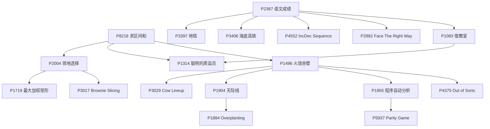

本节两条主线：前缀和从 P8218 进到二维（P2004 → P1719 / P3017），差分从 P2367 分到二维差分、翻转和「差分 + 二分」（P1083 → P1314）；离散化是第三条支线，统一从 P1496 起步，扫描线（P1904 → P1884）、带权并查集（P1955 → P5937）和 P4375 都排在它后面。


- [x] [[problem: luogu,P8218]] · [P8218 【深进1.例1】求区间和](https://www.luogu.com.cn/problem/P8218)
- [x] [[problem: luogu,P1719]] · [P1719 最大加权矩形](https://www.luogu.com.cn/problem/P1719)
- [x] [[problem: luogu,P1314]] · [P1314 \[NOIP 2011 提高组\] 聪明的质监员](https://www.luogu.com.cn/problem/P1314)
- [x] [[problem: luogu,P2367]] · [P2367 语文成绩](https://www.luogu.com.cn/problem/P2367)
- [x] [[problem: luogu,P3397]] · [P3397 地毯](https://www.luogu.com.cn/problem/P3397)
- [x] [[problem: luogu,P1496]] · [P1496 火烧赤壁](https://www.luogu.com.cn/problem/P1496)
- [x] [[problem: luogu,P1955]] · [P1955 \[NOI2015\] 程序自动分析](https://www.luogu.com.cn/problem/P1955)
- [x] [[problem: luogu,P1884]] · [P1884 \[USACO12FEB\] Overplanting S](https://www.luogu.com.cn/problem/P1884)
- [x] [[problem: luogu,P2004]] · [P2004 领地选择](https://www.luogu.com.cn/problem/P2004)
- [x] [[problem: luogu,P3017]] · [P3017 \[USACO11MAR\] Brownie Slicing G](https://www.luogu.com.cn/problem/P3017)
- [x] [[problem: luogu,P3406]] · [P3406 海底高铁](https://www.luogu.com.cn/problem/P3406)
- [x] [[problem: luogu,P1083]] · [P1083 \[NOIP 2012 提高组\] 借教室](https://www.luogu.com.cn/problem/P1083)
- [x] [[problem: luogu,P2882]] · [P2882 \[USACO07MAR\] Face The Right Way G](https://www.luogu.com.cn/problem/P2882)
- [x] [[problem: luogu,P4552]] · [P4552 \[Poetize6\] IncDec Sequence](https://www.luogu.com.cn/problem/P4552)
- [x] [[problem: luogu,P3029]] · [P3029 \[USACO11NOV\] Cow Lineup S](https://www.luogu.com.cn/problem/P3029)
- [x] [[problem: luogu,P1904]] · [P1904 天际线](https://www.luogu.com.cn/problem/P1904)
- [x] [[problem: luogu,P4375]] · [P4375 \[USACO18OPEN\] Out of Sorts G](https://www.luogu.com.cn/problem/P4375)
- [x] [[problem: luogu,P5937]] · [P5937 \[CEOI 1999\] Parity Game](https://www.luogu.com.cn/problem/P5937)

## 【算法2-2】常见优化技巧

[洛谷官方子题单](https://www.luogu.com.cn/training/201) · 20 题

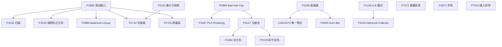

三个模板各起一条支线：单调队列从 P1886 分到窗口、二维和 DP 优化；单调栈从 P2866 长到「最大子矩形」（P4147 → P1950 / P1578）；尺取从 P1638 分到 UVA11572 和 P4653。P7072、P2671、P7910 不依赖本节任何一题，可以随时插进来做。


- [x] [[problem: luogu,P1102]] · [P1102 A-B 数对](https://www.luogu.com.cn/problem/P1102)
- [x] [[problem: luogu,P1638]] · [P1638 逛画展](https://www.luogu.com.cn/problem/P1638)
- [x] [[problem: luogu,P1115]] · [P1115 最大子段和](https://www.luogu.com.cn/problem/P1115)
- [x] [[problem: luogu,P7072]] · [P7072 \[CSP-J 2020\] 直播获奖](https://www.luogu.com.cn/problem/P7072)
- [x] [[problem: luogu,P2671]] · [P2671 \[NOIP 2015 普及组\] 求和](https://www.luogu.com.cn/problem/P2671)
- [x] [[problem: luogu,P4147]] · [P4147 玉蟾宫](https://www.luogu.com.cn/problem/P4147)
- [x] [[problem: luogu,P2866]] · [P2866 \[USACO06NOV\] Bad Hair Day S](https://www.luogu.com.cn/problem/P2866)
- [x] [[problem: luogu,P1950]] · [P1950 长方形](https://www.luogu.com.cn/problem/P1950)
- [x] [[problem: luogu,P2032]] · [P2032 扫描](https://www.luogu.com.cn/problem/P2032)
- [x] [[problem: luogu,P2216]] · [P2216 \[HAOI2007\] 理想的正方形](https://www.luogu.com.cn/problem/P2216)
- [x] [[problem: luogu,UVA11572]] · [UVA11572 唯一的雪花 Unique Snowflakes](https://www.luogu.com.cn/problem/UVA11572)
- [x] [[problem: luogu,P4653]] · [P4653 \[CEOI 2017\] Sure Bet](https://www.luogu.com.cn/problem/P4653)
- [x] [[problem: luogu,P3143]] · [P3143 \[USACO16OPEN\] Diamond Collector S](https://www.luogu.com.cn/problem/P3143)
- [x] [[problem: luogu,P7910]] · [P7910 \[CSP-J 2021\] 插入排序](https://www.luogu.com.cn/problem/P7910)
- [x] [[problem: luogu,P1578]] · [P1578 \[WC2002\] 奶牛浴场](https://www.luogu.com.cn/problem/P1578)
- [x] [[problem: luogu,P3467]] · [P3467 \[POI 2008\] PLA-Postering](https://www.luogu.com.cn/problem/P3467)
- [x] [[problem: luogu,P1886]] · [P1886 【模板】单调队列 / 滑动窗口](https://www.luogu.com.cn/problem/P1886)
- [x] [[problem: luogu,P2880]] · [P2880 \[USACO07JAN\] Balanced Lineup G](https://www.luogu.com.cn/problem/P2880)
- [x] [[problem: luogu,P1714]] · [P1714 切蛋糕](https://www.luogu.com.cn/problem/P1714)
- [x] [[problem: luogu,P1725]] · [P1725 琪露诺](https://www.luogu.com.cn/problem/P1725)

## 【算法2-3】分治与倍增

[洛谷官方子题单](https://www.luogu.com.cn/training/202) · 18 题

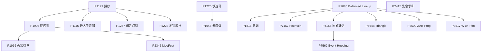

归并排序 P1177 是分治一支的总入口：逆序对 P1908 再分出 P1966 和 P2345，P1115、P1257、P1228 直接从 P1177 出发即可。倍增是另一支，统一从 ST 表 P2880 起步，其中 P4155 → P7562 是最硬的一段。P2415 独立，随时可做。


- [x] [[problem: luogu,P1177]] · [P1177 【模板】排序](https://www.luogu.com.cn/problem/P1177)
- [x] [[problem: luogu,P1908]] · [P1908 逆序对](https://www.luogu.com.cn/problem/P1908)
- [x] [[problem: luogu,P1966]] · [P1966 \[NOIP 2013 提高组\] 火柴排队](https://www.luogu.com.cn/problem/P1966)
- [x] [[problem: luogu,P1226]] · [P1226 【模板】快速幂](https://www.luogu.com.cn/problem/P1226)
- [x] [[problem: luogu,P1045]] · [P1045 \[NOIP 2003 普及组\] 麦森数](https://www.luogu.com.cn/problem/P1045)
- [x] [[problem: luogu,P1115]] · [P1115 最大子段和](https://www.luogu.com.cn/problem/P1115)
- [x] [[problem: luogu,P2880]] · [P2880 \[USACO07JAN\] Balanced Lineup G](https://www.luogu.com.cn/problem/P2880)
- [x] [[problem: luogu,P7167]] · [P7167 \[eJOI 2020\] Fountain (Day1)](https://www.luogu.com.cn/problem/P7167)
- [x] [[problem: luogu,P2415]] · [P2415 集合求和](https://www.luogu.com.cn/problem/P2415)
- [x] [[problem: luogu,P1257]] · [P1257 平面上的最接近点对](https://www.luogu.com.cn/problem/P1257)
- [x] [[problem: luogu,P1228]] · [P1228 地毯填补问题](https://www.luogu.com.cn/problem/P1228)
- [x] [[problem: luogu,P2345]] · [P2345 \[USACO04OPEN\] MooFest G](https://www.luogu.com.cn/problem/P2345)
- [x] [[problem: luogu,P3509]] · [P3509 \[POI 2010\] ZAB-Frog](https://www.luogu.com.cn/problem/P3509)
- [x] [[problem: luogu,P3517]] · [P3517 \[POI 2011\] WYK-Plot](https://www.luogu.com.cn/problem/P3517)
- [x] [[problem: luogu,P4155]] · [P4155 \[SCOI2015\] 国旗计划](https://www.luogu.com.cn/problem/P4155)
- [x] [[problem: luogu,P1816]] · [P1816 忠诚](https://www.luogu.com.cn/problem/P1816)
- [x] [[problem: luogu,P6648]] · [P6648 \[CCC 2019\] Triangle: The Data Structure](https://www.luogu.com.cn/problem/P6648)
- [x] [[problem: luogu,P7562]] · [P7562 \[JOISC 2021\] イベント巡り 2 (Event Hopping 2) (Day4)](https://www.luogu.com.cn/problem/P7562)

## 【算法2-4】字符串

[洛谷官方子题单](https://www.luogu.com.cn/training/203) · 16 题

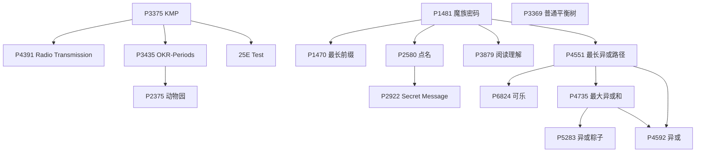

KMP 一支从 P3375 起，P3435 之后才是 P2375；Trie 一支从 P1481 起，分出 P1470 和 01-Trie 的入口 P4551，再往后是可持久化 Trie（P4735 → P5283 / P4592）。P3369 平衡树与本节其他题没有硬前置，可以单独安排。


- [x] [[problem: luogu,P3375]] · [P3375 【模板】KMP](https://www.luogu.com.cn/problem/P3375)
- [x] [[problem: luogu,P4391]] · [P4391 \[BalticOI 2009\] Radio Transmission 无线传输](https://www.luogu.com.cn/problem/P4391)
- [x] [[problem: luogu,P1481]] · [P1481 魔族密码](https://www.luogu.com.cn/problem/P1481)
- [x] [[problem: luogu,P2580]] · [P2580 于是他错误的点名开始了](https://www.luogu.com.cn/problem/P2580)
- [x] [[problem: luogu,P4551]] · [P4551 最长异或路径](https://www.luogu.com.cn/problem/P4551)
- [x] [[problem: luogu,P5283]] · [P5283 \[十二省联考 2019\] 异或粽子](https://www.luogu.com.cn/problem/P5283)
- [x] [[problem: luogu,P1470]] · [P1470 \[IOI 1996 / USACO2.3\] 最长前缀 Longest Prefix](https://www.luogu.com.cn/problem/P1470)
- [x] [[problem: codeforces,25E]] · [25E Test](https://codeforces.com/problemset/problem/25/E)
- [x] [[problem: luogu,P3435]] · [P3435 \[POI 2006\] OKR-Periods of Words](https://www.luogu.com.cn/problem/P3435)
- [x] [[problem: luogu,P2375]] · [P2375 \[NOI2014\] 动物园](https://www.luogu.com.cn/problem/P2375)
- [x] [[problem: luogu,P2922]] · [P2922 \[USACO08DEC\] Secret Message G](https://www.luogu.com.cn/problem/P2922)
- [x] [[problem: luogu,P3879]] · [P3879 \[TJOI2010\] 阅读理解](https://www.luogu.com.cn/problem/P3879)
- [x] [[problem: luogu,P4735]] · [P4735 最大异或和](https://www.luogu.com.cn/problem/P4735)
- [x] [[problem: luogu,P4592]] · [P4592 \[TJOI2018\] 异或](https://www.luogu.com.cn/problem/P4592)
- [x] [[problem: luogu,P3369]] · [P3369 【模板】普通平衡树](https://www.luogu.com.cn/problem/P3369)
- [x] [[problem: luogu,P6824]] · [P6824 「EZEC-4」可乐](https://www.luogu.com.cn/problem/P6824)

## 【算法2-5】进阶搜索

[洛谷官方子题单](https://www.luogu.com.cn/training/204) · 15 题

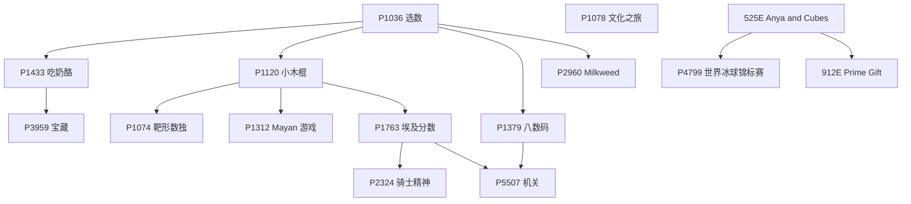

DFS 基础 P1036 分出四条线：剪枝（P1120 → P1074 / P1312）、BFS（P1379 → P2960）、IDDFS → IDA*（P1763 → P2324 / P5507）和状压式搜索（P1433 → P3959）。折半搜索从 525E 起，P4799 与 912E 可以并列做。


- [x] [[problem: luogu,P1036]] · [P1036 \[NOIP 2002 普及组\] 选数](https://www.luogu.com.cn/problem/P1036)
- [x] [[problem: luogu,P1433]] · [P1433 吃奶酪](https://www.luogu.com.cn/problem/P1433)
- [x] [[problem: luogu,P1120]] · [P1120 \[CERC 1995\] 小木棍](https://www.luogu.com.cn/problem/P1120)
- [x] [[problem: luogu,P1763]] · [P1763 埃及分数](https://www.luogu.com.cn/problem/P1763)
- [x] [[problem: codeforces,525E]] · [525E Anya and Cubes](https://codeforces.com/problemset/problem/525/E)
- [x] [[problem: luogu,P1379]] · [P1379 八数码难题](https://www.luogu.com.cn/problem/P1379)
- [x] [[problem: luogu,P5507]] · [P5507 机关](https://www.luogu.com.cn/problem/P5507)
- [x] [[problem: luogu,P2324]] · [P2324 \[SCOI2005\] 骑士精神](https://www.luogu.com.cn/problem/P2324)
- [x] [[problem: luogu,P1074]] · [P1074 \[NOIP 2009 提高组\] 靶形数独](https://www.luogu.com.cn/problem/P1074)
- [x] [[problem: luogu,P1312]] · [P1312 \[NOIP 2011 提高组\] Mayan 游戏](https://www.luogu.com.cn/problem/P1312)
- [x] [[problem: luogu,P3959]] · [P3959 \[NOIP 2017 提高组\] 宝藏](https://www.luogu.com.cn/problem/P3959)
- [x] [[problem: luogu,P2960]] · [P2960 \[USACO09OCT\] Invasion of the Milkweed G](https://www.luogu.com.cn/problem/P2960)
- [x] [[problem: codeforces,912E]] · [912E Prime Gift](https://codeforces.com/problemset/problem/912/E)
- [x] [[problem: luogu,P4799]] · [P4799 \[CEOI 2015\] 世界冰球锦标赛 (Day2)](https://www.luogu.com.cn/problem/P4799)
- [x] [[problem: luogu,P1078]] · [P1078 \[NOIP 2012 普及组\] 文化之旅（疑似错题）](https://www.luogu.com.cn/problem/P1078)

## 【数据结构2-1】二叉堆与树状数组

[洛谷官方子题单](https://www.luogu.com.cn/training/205) · 17 题

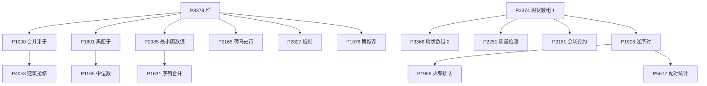

左支是堆：P3378 分出贪心（P1090 → P4053）、对顶堆（P1801 → P1168）和若干单点应用；右支是树状数组：P3374 分出差分版本 P3368，再往上是逆序对 P1908 → P1966 / P5677，P2251 和 P2161 要的区间查询同样建立在 P3374 上。


- [x] [[problem: luogu,P3378]] · [P3378 【模板】堆](https://www.luogu.com.cn/problem/P3378)
- [x] [[problem: luogu,P1801]] · [P1801 黑匣子](https://www.luogu.com.cn/problem/P1801)
- [x] [[problem: luogu,P1090]] · [P1090 \[NOIP 2004 提高组\] 合并果子](https://www.luogu.com.cn/problem/P1090)
- [x] [[problem: luogu,P2168]] · [P2168 \[NOI2015\] 荷马史诗](https://www.luogu.com.cn/problem/P2168)
- [x] [[problem: luogu,P2827]] · [P2827 \[NOIP 2016 提高组\] 蚯蚓](https://www.luogu.com.cn/problem/P2827)
- [x] [[problem: luogu,P1168]] · [P1168 中位数](https://www.luogu.com.cn/problem/P1168)
- [x] [[problem: luogu,P2085]] · [P2085 最小函数值](https://www.luogu.com.cn/problem/P2085)
- [x] [[problem: luogu,P1631]] · [P1631 序列合并](https://www.luogu.com.cn/problem/P1631)
- [x] [[problem: luogu,P4053]] · [P4053 \[JSOI2007\] 建筑抢修](https://www.luogu.com.cn/problem/P4053)
- [x] [[problem: luogu,P1878]] · [P1878 舞蹈课](https://www.luogu.com.cn/problem/P1878)
- [x] [[problem: luogu,P2251]] · [P2251 质量检测](https://www.luogu.com.cn/problem/P2251)
- [x] [[problem: luogu,P3374]] · [P3374 【模板】树状数组 1](https://www.luogu.com.cn/problem/P3374)
- [x] [[problem: luogu,P3368]] · [P3368 【模板】树状数组 2](https://www.luogu.com.cn/problem/P3368)
- [x] [[problem: luogu,P1908]] · [P1908 逆序对](https://www.luogu.com.cn/problem/P1908)
- [x] [[problem: luogu,P5677]] · [P5677 \[GZOI2017\] 配对统计](https://www.luogu.com.cn/problem/P5677)
- [x] [[problem: luogu,P1966]] · [P1966 \[NOIP 2013 提高组\] 火柴排队](https://www.luogu.com.cn/problem/P1966)
- [x] [[problem: luogu,P2161]] · [P2161 \[SHOI2009\] 会场预约](https://www.luogu.com.cn/problem/P2161)

## 【数据结构2-2】线段树

[洛谷官方子题单](https://www.luogu.com.cn/training/206) · 16 题

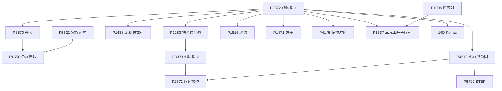

P3372 是唯一入口，之后按「懒标记类型」分三支：异或（P3870 → P1558）、赋值与加法（P1253 → P3373 → P2572）、区间信息合并（P4513 → P6492）。P4145 的势能分析和 19D 的「线段树 + 有序结构」都能直接从 P3372 出发。


- [x] [[problem: luogu,P3372]] · [P3372 【模板】线段树 1](https://www.luogu.com.cn/problem/P3372)
- [x] [[problem: luogu,P3870]] · [P3870 \[TJOI2009\] 开关](https://www.luogu.com.cn/problem/P3870)
- [x] [[problem: luogu,P1438]] · [P1438 无聊的数列](https://www.luogu.com.cn/problem/P1438)
- [x] [[problem: luogu,P1253]] · [P1253 扶苏的问题](https://www.luogu.com.cn/problem/P1253)
- [x] [[problem: luogu,P3373]] · [P3373 【模板】线段树 2](https://www.luogu.com.cn/problem/P3373)
- [x] [[problem: luogu,P4513]] · [P4513 小白逛公园](https://www.luogu.com.cn/problem/P4513)
- [x] [[problem: luogu,P1908]] · [P1908 逆序对](https://www.luogu.com.cn/problem/P1908)
- [x] [[problem: luogu,P1816]] · [P1816 忠诚](https://www.luogu.com.cn/problem/P1816)
- [x] [[problem: luogu,P1471]] · [P1471 方差](https://www.luogu.com.cn/problem/P1471)
- [x] [[problem: luogu,P6492]] · [P6492 \[COCI 2010/2011 \#6\] STEP](https://www.luogu.com.cn/problem/P6492)
- [x] [[problem: luogu,P1637]] · [P1637 三元上升子序列](https://www.luogu.com.cn/problem/P1637)
- [x] [[problem: luogu,P1558]] · [P1558 色板游戏](https://www.luogu.com.cn/problem/P1558)
- [x] [[problem: luogu,P5522]] · [P5522 \[yLOI2019\] 棠梨煎雪](https://www.luogu.com.cn/problem/P5522)
- [x] [[problem: luogu,P4145]] · [P4145 上帝造题的七分钟 2 / 花神游历各国](https://www.luogu.com.cn/problem/P4145)
- [x] [[problem: luogu,P2572]] · [P2572 \[SCOI2010\] 序列操作](https://www.luogu.com.cn/problem/P2572)
- [x] [[problem: codeforces,19D]] · [19D Points](https://codeforces.com/problemset/problem/19/D)

## 【图论2-1】树

[洛谷官方子题单](https://www.luogu.com.cn/training/207) · 22 题

```mermaid
flowchart TD
  n5908["P5908 猫猫和企鹅"]
  n1099["P1099 树网的核"]
  n5536["P5536 核心城市"]
  n4408["P4408 逃学的小孩"]
  n2052["P2052 道路修建"]
  n1395["P1395 会议"]
  n5666["P5666 树的重心"]
  n1351["P1351 联合权值"]
  n3379["P3379 LCA"]
  n5836["P5836 Milk Visits"]
  n3398["P3398 仓鼠找 sugar"]
  n5588["P5588 小猪佩奇爬树"]
  n3128["P3128 Max Flow"]
  n2680["P2680 运输计划"]
  n1600["P1600 天天爱跑步"]
  n3384["P3384 树链剖分"]
  n3038["P3038 Grass Planting"]
  n3178["P3178 树上操作"]
  n3976["P3976 旅游"]
  n4092["P4092 树"]
  n4116["P4116 Qtree3"]
  n3313["P3313 旅行"]

  n5908 --> n1099
  n1099 --> n5536
  n1099 --> n4408
  n5908 --> n2052
  n2052 --> n5666
  n1395 --> n5666
  n5908 --> n1395
  n5908 --> n1351
  n3379 --> n5836
  n3379 --> n3398
  n3379 --> n5588
  n3379 --> n3128
  n3128 --> n2680
  n3379 --> n2680
  n3128 --> n1600
  n3379 --> n1600
  n3379 --> n3384
  n3384 --> n3038
  n3128 --> n3038
  n3384 --> n3178
  n3384 --> n3976
  n3384 --> n4092
  n3384 --> n4116
  n3384 --> n3313
```

从 P5908 的 DFS 出发先拿三件基础武器：树的直径（P1099 → P5536 / P4408）、子树大小与重心（P2052 → P5666、P1395 → P5666）、LCA（P3379）。LCA 之上再叠两条进阶线：树上差分（P3128 → P2680 / P1600）和树链剖分（P3384 → P3178 / P3976 / P4092 / P4116 / P3313）。


- [x] [[problem: luogu,P5908]] · [P5908 猫猫和企鹅](https://www.luogu.com.cn/problem/P5908)
- [x] [[problem: luogu,P1099]] · [P1099 \[NOIP 2007 提高组\] 树网的核](https://www.luogu.com.cn/problem/P1099)
- [x] [[problem: luogu,P1395]] · [P1395 会议](https://www.luogu.com.cn/problem/P1395)
- [x] [[problem: luogu,P3379]] · [P3379 【模板】最近公共祖先（LCA）](https://www.luogu.com.cn/problem/P3379)
- [x] [[problem: luogu,P3128]] · [P3128 \[USACO15DEC\] Max Flow P](https://www.luogu.com.cn/problem/P3128)
- [x] [[problem: luogu,P3384]] · [P3384 【模板】重链剖分 / 树链剖分](https://www.luogu.com.cn/problem/P3384)
- [x] [[problem: luogu,P3038]] · [P3038 \[USACO11DEC\] Grass Planting G](https://www.luogu.com.cn/problem/P3038)
- [x] [[problem: luogu,P3976]] · [P3976 \[TJOI2015\] 旅游](https://www.luogu.com.cn/problem/P3976)
- [x] [[problem: luogu,P2052]] · [P2052 \[NOI2011\] 道路修建](https://www.luogu.com.cn/problem/P2052)
- [x] [[problem: luogu,P5666]] · [P5666 \[CSP-S 2019\] 树的重心](https://www.luogu.com.cn/problem/P5666)
- [x] [[problem: luogu,P5588]] · [P5588 小猪佩奇爬树](https://www.luogu.com.cn/problem/P5588)
- [x] [[problem: luogu,P5536]] · [P5536 【XR-3】核心城市](https://www.luogu.com.cn/problem/P5536)
- [x] [[problem: luogu,P5836]] · [P5836 \[USACO19DEC\] Milk Visits S](https://www.luogu.com.cn/problem/P5836)
- [x] [[problem: luogu,P1351]] · [P1351 \[NOIP 2014 提高组\] 联合权值](https://www.luogu.com.cn/problem/P1351)
- [x] [[problem: luogu,P4408]] · [P4408 \[NOI2003\] 逃学的小孩 / 数据生成器](https://www.luogu.com.cn/problem/P4408)
- [x] [[problem: luogu,P3398]] · [P3398 仓鼠找 sugar](https://www.luogu.com.cn/problem/P3398)
- [x] [[problem: luogu,P2680]] · [P2680 \[NOIP 2015 提高组\] 运输计划](https://www.luogu.com.cn/problem/P2680)
- [x] [[problem: luogu,P1600]] · [P1600 \[NOIP 2016 提高组\] 天天爱跑步](https://www.luogu.com.cn/problem/P1600)
- [x] [[problem: luogu,P3178]] · [P3178 \[HAOI2015\] 树上操作](https://www.luogu.com.cn/problem/P3178)
- [x] [[problem: luogu,P4092]] · [P4092 \[HEOI2016/TJOI2016\] 树](https://www.luogu.com.cn/problem/P4092)
- [x] [[problem: luogu,P4116]] · [P4116 Qtree3](https://www.luogu.com.cn/problem/P4116)
- [x] [[problem: luogu,P3313]] · [P3313 \[SDOI2014\] 旅行](https://www.luogu.com.cn/problem/P3313)

## 【图论2-2】最短路

[洛谷官方子题单](https://www.luogu.com.cn/training/208) · 19 题

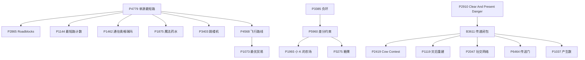

Dijkstra 模板 P4779 分出计数、次短路、分层图（P4568 → P1073）、二分答案和同余最短路；负环 P3385 → 差分约束 P5960 → P1993 / P3275 是独立的一条线；Floyd 一支从 P2910 起，传递闭包 P3611 之后才接 P2419 / P1119 / P2047。


- [x] [[problem: luogu,P4779]] · [P4779 【模板】单源最短路径（标准版）](https://www.luogu.com.cn/problem/P4779)
- [x] [[problem: luogu,P4568]] · [P4568 \[JLOI2011\] 飞行路线](https://www.luogu.com.cn/problem/P4568)
- [x] [[problem: luogu,P3385]] · [P3385 【模板】负环](https://www.luogu.com.cn/problem/P3385)
- [x] [[problem: luogu,P5960]] · [P5960 【模板】差分约束](https://www.luogu.com.cn/problem/P5960)
- [x] [[problem: luogu,P2865]] · [P2865 \[USACO06NOV\] Roadblocks G](https://www.luogu.com.cn/problem/P2865)
- [x] [[problem: luogu,P2910]] · [P2910 \[USACO08OPEN\] Clear And Present Danger S](https://www.luogu.com.cn/problem/P2910)
- [x] [[problem: luogu,B3611]] · [B3611 【模板】传递闭包](https://www.luogu.com.cn/problem/B3611)
- [x] [[problem: luogu,P1144]] · [P1144 最短路计数](https://www.luogu.com.cn/problem/P1144)
- [x] [[problem: luogu,P1875]] · [P1875 佳佳的魔法药水【数据有误】](https://www.luogu.com.cn/problem/P1875)
- [x] [[problem: luogu,P1462]] · [P1462 通往奥格瑞玛的道路](https://www.luogu.com.cn/problem/P1462)
- [x] [[problem: luogu,P1073]] · [P1073 \[NOIP 2009 提高组\] 最优贸易](https://www.luogu.com.cn/problem/P1073)
- [x] [[problem: luogu,P1993]] · [P1993 小 K 的农场](https://www.luogu.com.cn/problem/P1993)
- [x] [[problem: luogu,P3275]] · [P3275 \[SCOI2011\] 糖果](https://www.luogu.com.cn/problem/P3275)
- [x] [[problem: luogu,P6464]] · [P6464 \[传智杯 \#2 决赛\] 传送门](https://www.luogu.com.cn/problem/P6464)
- [x] [[problem: luogu,P3403]] · [P3403 跳楼机](https://www.luogu.com.cn/problem/P3403)
- [x] [[problem: luogu,P1119]] · [P1119 灾后重建](https://www.luogu.com.cn/problem/P1119)
- [x] [[problem: luogu,P1037]] · [P1037 \[NOIP 2002 普及组\] 产生数](https://www.luogu.com.cn/problem/P1037)
- [x] [[problem: luogu,P2419]] · [P2419 \[USACO08JAN\] Cow Contest S](https://www.luogu.com.cn/problem/P2419)
- [x] [[problem: luogu,P2047]] · [P2047 \[NOI2007\] 社交网络](https://www.luogu.com.cn/problem/P2047)

## 【图论2-3】最小生成树

[洛谷官方子题单](https://www.luogu.com.cn/training/209) · 11 题

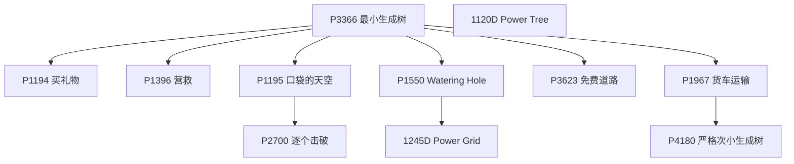

P3366 是唯一入口，MST 之后一分为二：一是「建模」（虚点 P1550 → 1245D、建图 P1194、森林 P1195 → P2700、构造 P3623），二是「MST + LCA」这条硬链（P1967 → P4180 严格次小生成树）。1120D 与本节其他题没有前置关系。


- [ ] [[problem: luogu,P3366]] · [P3366 【模板】最小生成树](https://www.luogu.com.cn/problem/P3366)
- [ ] [[problem: luogu,P1194]] · [P1194 买礼物](https://www.luogu.com.cn/problem/P1194)
- [ ] [[problem: luogu,P4180]] · [P4180 \[BJWC2010\] 严格次小生成树](https://www.luogu.com.cn/problem/P4180)
- [ ] [[problem: luogu,P1396]] · [P1396 营救](https://www.luogu.com.cn/problem/P1396)
- [ ] [[problem: luogu,P1195]] · [P1195 口袋的天空](https://www.luogu.com.cn/problem/P1195)
- [ ] [[problem: luogu,P1550]] · [P1550 \[USACO08OCT\] Watering Hole G](https://www.luogu.com.cn/problem/P1550)
- [ ] [[problem: luogu,P1967]] · [P1967 \[NOIP 2013 提高组\] 货车运输](https://www.luogu.com.cn/problem/P1967)
- [ ] [[problem: luogu,P2700]] · [P2700 逐个击破](https://www.luogu.com.cn/problem/P2700)
- [ ] [[problem: codeforces,1245D]] · [1245D Shichikuji and Power Grid](https://codeforces.com/problemset/problem/1245/D)
- [ ] [[problem: luogu,P3623]] · [P3623 \[APIO2008\] 免费道路](https://www.luogu.com.cn/problem/P3623)
- [ ] [[problem: codeforces,1120D]] · [1120D Power Tree](https://codeforces.com/problemset/problem/1120/D)

## 【图论2-4】连通性问题

[洛谷官方子题单](https://www.luogu.com.cn/training/210) · 17 题

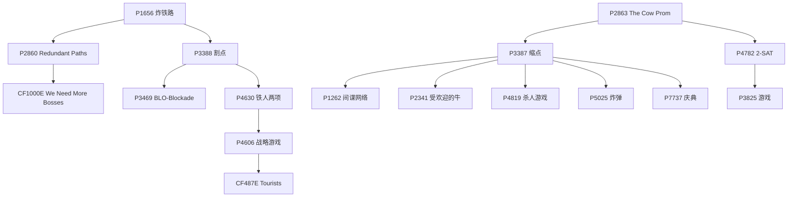

边双一支从桥 P1656 起（P2860 → CF1000E），点双一支从割点 P3388 起（P3469 → P4630 → P4606 → CF487E），SCC 一支从 P2863 起，在 P3387 缩点之后分出 P1262 / P2341 / P4819 / P5025 / P7737。2-SAT 必须先会 SCC，也就是 P2863 → P4782 → P3825。


- [ ] [[problem: luogu,P1656]] · [P1656 炸铁路](https://www.luogu.com.cn/problem/P1656)
- [ ] [[problem: luogu,P2860]] · [P2860 \[USACO06JAN\] Redundant Paths G](https://www.luogu.com.cn/problem/P2860)
- [ ] [[problem: luogu,P3388]] · [P3388 【模板】割点（割顶）](https://www.luogu.com.cn/problem/P3388)
- [ ] [[problem: luogu,P4630]] · [P4630 \[APIO2018\] 铁人两项](https://www.luogu.com.cn/problem/P4630)
- [ ] [[problem: luogu,P2863]] · [P2863 \[USACO06JAN\] The Cow Prom S](https://www.luogu.com.cn/problem/P2863)
- [ ] [[problem: luogu,P3387]] · [P3387 【模板】缩点 / 强连通分量](https://www.luogu.com.cn/problem/P3387)
- [ ] [[problem: luogu,P4782]] · [P4782 【模板】2-SAT](https://www.luogu.com.cn/problem/P4782)
- [ ] [[problem: luogu,CF1000E]] · [CF1000E We Need More Bosses](https://www.luogu.com.cn/problem/CF1000E)
- [ ] [[problem: luogu,P3469]] · [P3469 \[POI 2008\] BLO-Blockade](https://www.luogu.com.cn/problem/P3469)
- [ ] [[problem: luogu,P4606]] · [P4606 \[SDOI2018\] 战略游戏](https://www.luogu.com.cn/problem/P4606)
- [ ] [[problem: luogu,CF487E]] · [CF487E Tourists](https://www.luogu.com.cn/problem/CF487E)
- [ ] [[problem: luogu,P1262]] · [P1262 \[POI 1996 R3\] 间谍网络](https://www.luogu.com.cn/problem/P1262)
- [ ] [[problem: luogu,P2341]] · [P2341 \[USACO03FALL / HAOI2006\] 受欢迎的牛 G](https://www.luogu.com.cn/problem/P2341)
- [ ] [[problem: luogu,P5025]] · [P5025 \[SNOI2017\] 炸弹](https://www.luogu.com.cn/problem/P5025)
- [ ] [[problem: luogu,P3825]] · [P3825 \[NOI2017\] 游戏](https://www.luogu.com.cn/problem/P3825)
- [ ] [[problem: luogu,P4819]] · [P4819 \[中山市选\] 杀人游戏](https://www.luogu.com.cn/problem/P4819)
- [ ] [[problem: luogu,P7737]] · [P7737 \[NOI2021\] 庆典](https://www.luogu.com.cn/problem/P7737)

## 【动态规划1】动态规划的引入

[洛谷官方子题单](https://www.luogu.com.cn/training/211) · 18 题

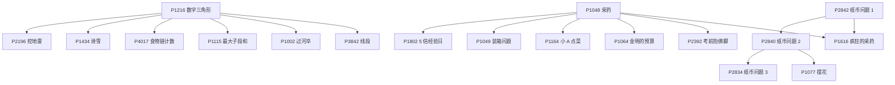

线性与网格 DP 从 P1216 起，P2196 / P1434 / P4017 / P1115 / P1002 / P3842 都可以直接接在它后面。背包一支从 01 背包 P1048 起，再分到完全背包（P2842 → P2840 → P2834、P1616）、计数背包（P1164）和分组背包 P1064。


- [ ] [[problem: luogu,P2842]] · [P2842 纸币问题 1](https://www.luogu.com.cn/problem/P2842)
- [ ] [[problem: luogu,P1216]] · [P1216 \[IOI 1994 / USACO1.5\] 数字三角形 Number Triangles](https://www.luogu.com.cn/problem/P1216)
- [ ] [[problem: luogu,P2840]] · [P2840 纸币问题 2](https://www.luogu.com.cn/problem/P2840)
- [ ] [[problem: luogu,P2834]] · [P2834 纸币问题 3](https://www.luogu.com.cn/problem/P2834)
- [ ] [[problem: luogu,P1048]] · [P1048 \[NOIP 2005 普及组\] 采药](https://www.luogu.com.cn/problem/P1048)
- [ ] [[problem: luogu,P2196]] · [P2196 \[NOIP 1996 提高组\] 挖地雷](https://www.luogu.com.cn/problem/P2196)
- [ ] [[problem: luogu,P1434]] · [P1434 \[SHOI2002\] 滑雪](https://www.luogu.com.cn/problem/P1434)
- [ ] [[problem: luogu,P4017]] · [P4017 最大食物链计数](https://www.luogu.com.cn/problem/P4017)
- [ ] [[problem: luogu,P1115]] · [P1115 最大子段和](https://www.luogu.com.cn/problem/P1115)
- [ ] [[problem: luogu,P1802]] · [P1802 5 倍经验日](https://www.luogu.com.cn/problem/P1802)
- [ ] [[problem: luogu,P1002]] · [P1002 \[NOIP 2002 普及组\] 过河卒](https://www.luogu.com.cn/problem/P1002)
- [ ] [[problem: luogu,P1049]] · [P1049 \[NOIP 2001 普及组\] 装箱问题](https://www.luogu.com.cn/problem/P1049)
- [ ] [[problem: luogu,P1616]] · [P1616 疯狂的采药](https://www.luogu.com.cn/problem/P1616)
- [ ] [[problem: luogu,P1164]] · [P1164 小 A 点菜](https://www.luogu.com.cn/problem/P1164)
- [ ] [[problem: luogu,P1077]] · [P1077 \[NOIP 2012 普及组\] 摆花](https://www.luogu.com.cn/problem/P1077)
- [ ] [[problem: luogu,P3842]] · [P3842 \[TJOI2007\] 线段](https://www.luogu.com.cn/problem/P3842)
- [ ] [[problem: luogu,P1064]] · [P1064 \[NOIP 2006 提高组\] 金明的预算方案](https://www.luogu.com.cn/problem/P1064)
- [ ] [[problem: luogu,P2392]] · [P2392 kkksc03 考前临时抱佛脚](https://www.luogu.com.cn/problem/P2392)

## 【动态规划2】线性状态动态规划

[洛谷官方子题单](https://www.luogu.com.cn/training/212) · 17 题

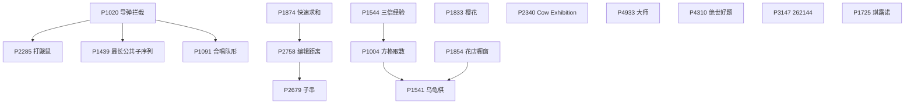

LIS 一支从 P1020 起（P2285、P1439、P1091 都在它之后），字符串 DP 从 P1874 → P2758 → P2679，网格 DP 从 P1544 → P1004 → P1541。P4933、P4310、P3147、P1725、P1833、P2340 与本节其他题互不依赖，按难度自选顺序即可。


- [ ] [[problem: luogu,P1020]] · [P1020 \[NOIP 1999 提高组\] 导弹拦截](https://www.luogu.com.cn/problem/P1020)
- [ ] [[problem: luogu,P2285]] · [P2285 \[HNOI2004\] 打鼹鼠](https://www.luogu.com.cn/problem/P2285)
- [ ] [[problem: luogu,P1725]] · [P1725 琪露诺](https://www.luogu.com.cn/problem/P1725)
- [ ] [[problem: luogu,P4933]] · [P4933 大师](https://www.luogu.com.cn/problem/P4933)
- [ ] [[problem: luogu,P1874]] · [P1874 快速求和](https://www.luogu.com.cn/problem/P1874)
- [ ] [[problem: luogu,P2758]] · [P2758 编辑距离](https://www.luogu.com.cn/problem/P2758)
- [ ] [[problem: luogu,P1439]] · [P1439 两个排列的最长公共子序列](https://www.luogu.com.cn/problem/P1439)
- [ ] [[problem: luogu,P2679]] · [P2679 \[NOIP 2015 提高组\] 子串](https://www.luogu.com.cn/problem/P2679)
- [ ] [[problem: luogu,P1544]] · [P1544 三倍经验](https://www.luogu.com.cn/problem/P1544)
- [ ] [[problem: luogu,P1004]] · [P1004 \[NOIP 2000 提高组\] 方格取数](https://www.luogu.com.cn/problem/P1004)
- [ ] [[problem: luogu,P1091]] · [P1091 \[NOIP 2004 提高组\] 合唱队形](https://www.luogu.com.cn/problem/P1091)
- [ ] [[problem: luogu,P1854]] · [P1854 \[IOI 1999\] 花店橱窗布置](https://www.luogu.com.cn/problem/P1854)
- [ ] [[problem: luogu,P1833]] · [P1833 樱花](https://www.luogu.com.cn/problem/P1833)
- [ ] [[problem: luogu,P2340]] · [P2340 \[USACO03FALL\] Cow Exhibition G](https://www.luogu.com.cn/problem/P2340)
- [ ] [[problem: luogu,P1541]] · [P1541 \[NOIP 2010 提高组\] 乌龟棋](https://www.luogu.com.cn/problem/P1541)
- [ ] [[problem: luogu,P4310]] · [P4310 绝世好题](https://www.luogu.com.cn/problem/P4310)
- [ ] [[problem: luogu,P3147]] · [P3147 \[USACO16OPEN\] 262144 P](https://www.luogu.com.cn/problem/P3147)

## 【动态规划3】区间与环形动态规划

[洛谷官方子题单](https://www.luogu.com.cn/training/213) · 12 题

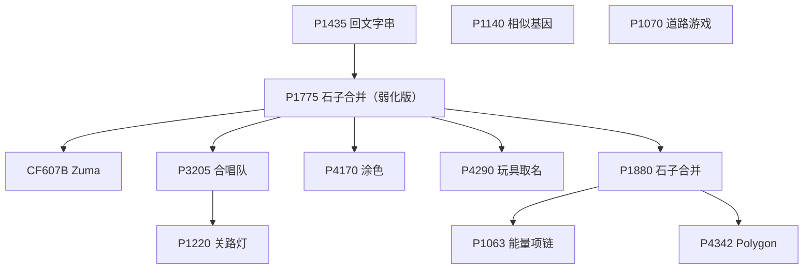

P1435 和 P1775 是两个入口，P1775 之后分到 P607B、P3205（→ P1220）、P4170、P4290。环形一支必须先会「断环成链」，也就是 P1880，它的两个后继 P1063 和 P4342 都是本节最难的一档。P1140、P1070 独立于这两条线。


- [ ] [[problem: luogu,P1435]] · [P1435 \[IOI 2000\] 回文字串](https://www.luogu.com.cn/problem/P1435)
- [ ] [[problem: luogu,P1775]] · [P1775 石子合并（弱化版）](https://www.luogu.com.cn/problem/P1775)
- [ ] [[problem: luogu,CF607B]] · [CF607B Zuma](https://www.luogu.com.cn/problem/CF607B)
- [ ] [[problem: luogu,P3205]] · [P3205 \[HNOI2010\] 合唱队](https://www.luogu.com.cn/problem/P3205)
- [ ] [[problem: luogu,P1880]] · [P1880 \[NOI1995\] 石子合并](https://www.luogu.com.cn/problem/P1880)
- [ ] [[problem: luogu,P1140]] · [P1140 \[ICPC 2001 Taejon R\] 相似基因](https://www.luogu.com.cn/problem/P1140)
- [ ] [[problem: luogu,P4170]] · [P4170 \[CQOI2007\] 涂色](https://www.luogu.com.cn/problem/P4170)
- [ ] [[problem: luogu,P4290]] · [P4290 \[HAOI2008\] 玩具取名](https://www.luogu.com.cn/problem/P4290)
- [ ] [[problem: luogu,P1063]] · [P1063 \[NOIP 2006 提高组\] 能量项链](https://www.luogu.com.cn/problem/P1063)
- [ ] [[problem: luogu,P1070]] · [P1070 \[NOIP 2009 普及组\] 道路游戏](https://www.luogu.com.cn/problem/P1070)
- [ ] [[problem: luogu,P4342]] · [P4342 \[IOI 1998\] Polygon](https://www.luogu.com.cn/problem/P4342)
- [ ] [[problem: luogu,P1220]] · [P1220 关路灯](https://www.luogu.com.cn/problem/P1220)

## 【动态规划4】树与图上的动态规划

[洛谷官方子题单](https://www.luogu.com.cn/training/214) · 17 题

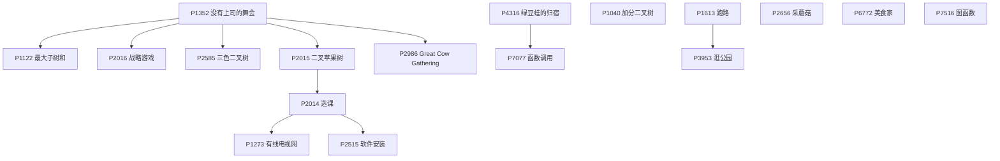

树形 DP 从 P1352 起：一支是树上背包（P2015 → P2014 → P1273，再叠 tarjan 缩点得到 P2515），一支是覆盖与计数（P2016、P2585），P2986 是换根。图上 DP 的另一支 P4316 → P7077 与树形 DP 没有前置关系，可以分开安排。


- [ ] [[problem: luogu,P1352]] · [P1352 没有上司的舞会](https://www.luogu.com.cn/problem/P1352)
- [ ] [[problem: luogu,P2015]] · [P2015 二叉苹果树](https://www.luogu.com.cn/problem/P2015)
- [ ] [[problem: luogu,P2014]] · [P2014 \[CTSC1997\] 选课](https://www.luogu.com.cn/problem/P2014)
- [ ] [[problem: luogu,P1613]] · [P1613 跑路](https://www.luogu.com.cn/problem/P1613)
- [ ] [[problem: luogu,P6772]] · [P6772 \[NOI2020\] 美食家](https://www.luogu.com.cn/problem/P6772)
- [ ] [[problem: luogu,P4316]] · [P4316 绿豆蛙的归宿](https://www.luogu.com.cn/problem/P4316)
- [ ] [[problem: luogu,P2656]] · [P2656 采蘑菇](https://www.luogu.com.cn/problem/P2656)
- [ ] [[problem: luogu,P1040]] · [P1040 \[NOIP 2003 提高组\] 加分二叉树](https://www.luogu.com.cn/problem/P1040)
- [ ] [[problem: luogu,P1122]] · [P1122 最大子树和](https://www.luogu.com.cn/problem/P1122)
- [ ] [[problem: luogu,P2016]] · [P2016 \[SEERC 2000\] 战略游戏](https://www.luogu.com.cn/problem/P2016)
- [ ] [[problem: luogu,P2585]] · [P2585 \[ZJOI2006\] 三色二叉树](https://www.luogu.com.cn/problem/P2585)
- [ ] [[problem: luogu,P1273]] · [P1273 \[CHCI 2002 Final Exam \#2\] 有线电视网](https://www.luogu.com.cn/problem/P1273)
- [ ] [[problem: luogu,P2515]] · [P2515 \[HAOI2010\] 软件安装](https://www.luogu.com.cn/problem/P2515)
- [ ] [[problem: luogu,P2986]] · [P2986 \[USACO10MAR\] Great Cow Gathering G](https://www.luogu.com.cn/problem/P2986)
- [ ] [[problem: luogu,P3953]] · [P3953 \[NOIP 2017 提高组\] 逛公园](https://www.luogu.com.cn/problem/P3953)
- [ ] [[problem: luogu,P7077]] · [P7077 \[CSP-S 2020\] 函数调用](https://www.luogu.com.cn/problem/P7077)
- [ ] [[problem: luogu,P7516]] · [P7516 \[省选联考 2021 A/B 卷\] 图函数](https://www.luogu.com.cn/problem/P7516)

## 【动态规划5】状态压缩动态规划

[洛谷官方子题单](https://www.luogu.com.cn/training/215) · 21 题

```mermaid
flowchart TD
  n1896["P1896 互不侵犯"]
  n1879["P1879 Corn Fields"]
  n2704["P2704 炮兵阵地"]
  n11D["CF11D A Simple Task"]
  n3959["P3959 宝藏"]
  n2831["P2831 愤怒的小鸟"]
  n3694["P3694 邦邦的大合唱"]
  n5369["P5369 最大前缀和"]
  n4484["P4484 最长上升子序列"]
  n4363["P4363 一双木棋"]
  n1357["P1357 花园"]
  n4045["P4045 密码"]
  n2167["P2167 Bill 的挑战"]
  n2473["P2473 奖励关"]
  n2622["P2622 关灯问题"]
  n2761["P2761 软件补丁"]
  n1209E2["CF1209E2 Rotate Columns"]
  nAGC012E["AT_agc012_e Camel and Oases"]
  n10865["P10865 Genshin Impact"]
  n1450["P1450 硬币购物"]
  n1441["P1441 砝码称重"]

  n1896 --> n1879
  n1879 --> n2704
  n1896 --> n11D
  n1896 --> n3959
  n1896 --> n2831
  n1896 --> n3694
  n1896 --> n5369
  n1896 --> n4484
  n1896 --> n4363
  n1896 --> n1357
  n1896 --> n4045
  n1896 --> n2167
  n1896 --> n2473
  n1896 --> n2622
  n2622 --> n2761
  n1896 --> n1209E2
  n1896 --> nAGC012E
  n1896 --> n10865
```

P1896 是状压的唯一入口，之后按「网格逐行」分（P1879 → P2704），按「集合枚举」分（P3959、P2831、P3694、CF11D、P5369），按「状态当图上的点跑 BFS」分（P2622 → P2761）。P1450 和 P1441 分别是容斥与枚举，独立于状压主线。


- [ ] [[problem: luogu,P1896]] · [P1896 \[SCOI2005\] 互不侵犯](https://www.luogu.com.cn/problem/P1896)
- [ ] [[problem: luogu,P2622]] · [P2622 关灯问题 II](https://www.luogu.com.cn/problem/P2622)
- [ ] [[problem: luogu,CF11D]] · [CF11D A Simple Task](https://www.luogu.com.cn/problem/CF11D)
- [ ] [[problem: luogu,P3959]] · [P3959 \[NOIP 2017 提高组\] 宝藏](https://www.luogu.com.cn/problem/P3959)
- [ ] [[problem: luogu,P4484]] · [P4484 \[BJWC2018\] 最长上升子序列](https://www.luogu.com.cn/problem/P4484)
- [ ] [[problem: luogu,P4363]] · [P4363 \[九省联考 2018\] 一双木棋 chess](https://www.luogu.com.cn/problem/P4363)
- [ ] [[problem: luogu,P1357]] · [P1357 花园](https://www.luogu.com.cn/problem/P1357)
- [ ] [[problem: luogu,P1450]] · [P1450 \[HAOI2008\] 硬币购物](https://www.luogu.com.cn/problem/P1450)
- [ ] [[problem: luogu,P3694]] · [P3694 邦邦的大合唱站队](https://www.luogu.com.cn/problem/P3694)
- [ ] [[problem: luogu,P1441]] · [P1441 砝码称重](https://www.luogu.com.cn/problem/P1441)
- [ ] [[problem: luogu,P1879]] · [P1879 \[USACO06NOV\] Corn Fields G](https://www.luogu.com.cn/problem/P1879)
- [ ] [[problem: luogu,P2704]] · [P2704 \[NOI2001\] 炮兵阵地](https://www.luogu.com.cn/problem/P2704)
- [ ] [[problem: luogu,P2831]] · [P2831 \[NOIP 2016 提高组\] 愤怒的小鸟](https://www.luogu.com.cn/problem/P2831)
- [ ] [[problem: luogu,P4045]] · [P4045 \[JSOI2009\] 密码](https://www.luogu.com.cn/problem/P4045)
- [ ] [[problem: luogu,AT_agc012_e]] · [AT\_agc012\_e \[AGC012E\] Camel and Oases](https://www.luogu.com.cn/problem/AT_agc012_e)
- [ ] [[problem: luogu,CF1209E2]] · [CF1209E2 Rotate Columns (hard version)](https://www.luogu.com.cn/problem/CF1209E2)
- [ ] [[problem: luogu,P5369]] · [P5369 \[PKUSC2018\] 最大前缀和](https://www.luogu.com.cn/problem/P5369)
- [ ] [[problem: luogu,P2761]] · [P2761 软件补丁问题](https://www.luogu.com.cn/problem/P2761)
- [ ] [[problem: luogu,P2473]] · [P2473 \[SCOI2008\] 奖励关](https://www.luogu.com.cn/problem/P2473)
- [ ] [[problem: luogu,P2167]] · [P2167 \[SDOI2009\] Bill的挑战](https://www.luogu.com.cn/problem/P2167)
- [ ] [[problem: luogu,P10865]] · [P10865 \[HBCPC2024\] Genshin Impact Startup Forbidden III](https://www.luogu.com.cn/problem/P10865)

## 【数学2-1】进阶数论

[洛谷官方子题单](https://www.luogu.com.cn/training/216) · 22 题

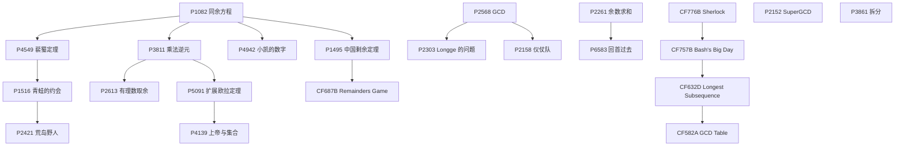

exgcd 一支 P1082 → P4549 → P1516 → P2421，逆元一支 P3811（→ P2613、P4942），扩展欧拉定理一支 P5091 → P4139；欧拉函数从 P2568 分到 P2303 / P2158，CRT 是 P1082 → P1495 → CF687B。P2152 和 P3861 与本节其他题没有前置关系。


- [ ] [[problem: luogu,P1516]] · [P1516 青蛙的约会](https://www.luogu.com.cn/problem/P1516)
- [ ] [[problem: luogu,P4942]] · [P4942 小凯的数字](https://www.luogu.com.cn/problem/P4942)
- [ ] [[problem: luogu,P3811]] · [P3811 【模板】模意义下的乘法逆元](https://www.luogu.com.cn/problem/P3811)
- [ ] [[problem: luogu,P1495]] · [P1495 【模板】中国剩余定理（CRT）/ 曹冲养猪](https://www.luogu.com.cn/problem/P1495)
- [ ] [[problem: luogu,P3861]] · [P3861 拆分](https://www.luogu.com.cn/problem/P3861)
- [ ] [[problem: luogu,P5091]] · [P5091 【模板】扩展欧拉定理](https://www.luogu.com.cn/problem/P5091)
- [ ] [[problem: luogu,P2568]] · [P2568 GCD](https://www.luogu.com.cn/problem/P2568)
- [ ] [[problem: luogu,P2303]] · [P2303 \[SDOI2012\] Longge 的问题](https://www.luogu.com.cn/problem/P2303)
- [ ] [[problem: luogu,P1082]] · [P1082 \[NOIP 2012 提高组\] 同余方程](https://www.luogu.com.cn/problem/P1082)
- [ ] [[problem: luogu,P4549]] · [P4549 【模板】裴蜀定理](https://www.luogu.com.cn/problem/P4549)
- [ ] [[problem: luogu,P2421]] · [P2421 \[NOI2002\] 荒岛野人](https://www.luogu.com.cn/problem/P2421)
- [ ] [[problem: luogu,P2613]] · [P2613 【模板】有理数取余](https://www.luogu.com.cn/problem/P2613)
- [ ] [[problem: luogu,CF757B]] · [CF757B Bash's Big Day](https://www.luogu.com.cn/problem/CF757B)
- [ ] [[problem: luogu,CF776B]] · [CF776B Sherlock and his girlfriend](https://www.luogu.com.cn/problem/CF776B)
- [ ] [[problem: luogu,P2152]] · [P2152 \[SDOI2009\] SuperGCD](https://www.luogu.com.cn/problem/P2152)
- [ ] [[problem: luogu,CF632D]] · [CF632D Longest Subsequence](https://www.luogu.com.cn/problem/CF632D)
- [ ] [[problem: luogu,CF582A]] · [CF582A GCD Table](https://www.luogu.com.cn/problem/CF582A)
- [ ] [[problem: luogu,CF687B]] · [CF687B Remainders Game](https://www.luogu.com.cn/problem/CF687B)
- [ ] [[problem: luogu,P2261]] · [P2261 \[CQOI2007\] 余数求和](https://www.luogu.com.cn/problem/P2261)
- [ ] [[problem: luogu,P2158]] · [P2158 \[SDOI2008\] 仪仗队](https://www.luogu.com.cn/problem/P2158)
- [ ] [[problem: luogu,P6583]] · [P6583 回首过去](https://www.luogu.com.cn/problem/P6583)
- [ ] [[problem: luogu,P4139]] · [P4139 上帝与集合的正确用法](https://www.luogu.com.cn/problem/P4139)

## 【数学2-2】组合数学与计数

[洛谷官方子题单](https://www.luogu.com.cn/training/217) · 19 题

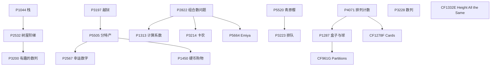

组合数恒等式一支 P2822 → P1313，Catalan 一支 P1044 → P2532 → P3200，容斥一支 P3197 → P5505 → P2567 / P1450；错排 P4071 接斯特林数（P1287 → CF961G），插板法 P5520 → P3223。P1332E、P3228 与本节其他题无硬前置。


- [ ] [[problem: luogu,P3197]] · [P3197 \[HNOI2008\] 越狱](https://www.luogu.com.cn/problem/P3197)
- [ ] [[problem: luogu,P5664]] · [P5664 \[CSP-S 2019\] Emiya 家今天的饭](https://www.luogu.com.cn/problem/P5664)
- [ ] [[problem: luogu,P1287]] · [P1287 盒子与球](https://www.luogu.com.cn/problem/P1287)
- [ ] [[problem: luogu,P1450]] · [P1450 \[HAOI2008\] 硬币购物](https://www.luogu.com.cn/problem/P1450)
- [ ] [[problem: luogu,P5520]] · [P5520 \[yLOI2019\] 青原樱](https://www.luogu.com.cn/problem/P5520)
- [ ] [[problem: luogu,P4071]] · [P4071 \[SDOI2016\] 排列计数](https://www.luogu.com.cn/problem/P4071)
- [ ] [[problem: luogu,P1313]] · [P1313 \[NOIP 2011 提高组\] 计算系数](https://www.luogu.com.cn/problem/P1313)
- [ ] [[problem: luogu,CF1332E]] · [CF1332E Height All the Same](https://www.luogu.com.cn/problem/CF1332E)
- [ ] [[problem: luogu,P1044]] · [P1044 \[NOIP 2003 普及组\] 栈](https://www.luogu.com.cn/problem/P1044)
- [ ] [[problem: luogu,P2567]] · [P2567 \[SCOI2010\] 幸运数字](https://www.luogu.com.cn/problem/P2567)
- [ ] [[problem: luogu,P5505]] · [P5505 \[JSOI2011\] 分特产](https://www.luogu.com.cn/problem/P5505)
- [ ] [[problem: luogu,P3223]] · [P3223 \[HNOI2012\] 排队](https://www.luogu.com.cn/problem/P3223)
- [ ] [[problem: luogu,P2822]] · [P2822 \[NOIP 2016 提高组\] 组合数问题](https://www.luogu.com.cn/problem/P2822)
- [ ] [[problem: luogu,P3214]] · [P3214 \[HNOI2011\] 卡农](https://www.luogu.com.cn/problem/P3214)
- [ ] [[problem: luogu,P2532]] · [P2532 \[AHOI2012\] 树屋阶梯](https://www.luogu.com.cn/problem/P2532)
- [ ] [[problem: luogu,P3200]] · [P3200 \[HNOI2009\] 有趣的数列](https://www.luogu.com.cn/problem/P3200)
- [ ] [[problem: luogu,CF1278F]] · [CF1278F Cards](https://www.luogu.com.cn/problem/CF1278F)
- [ ] [[problem: luogu,P3228]] · [P3228 \[HNOI2013\] 数列](https://www.luogu.com.cn/problem/P3228)
- [ ] [[problem: luogu,CF961G]] · [CF961G Partitions](https://www.luogu.com.cn/problem/CF961G)

## 【数学2-3】概率与统计

[洛谷官方子题单](https://www.luogu.com.cn/training/218) · 9 题

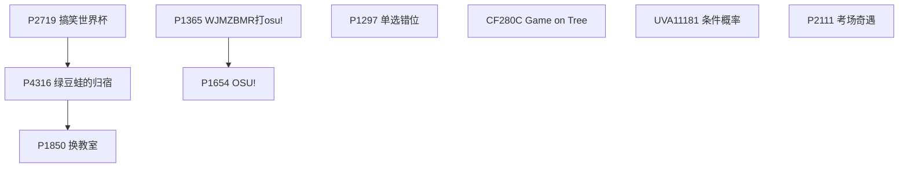

本节只有两条短链：概率与期望 DP 的主线 P2719 → P4316 → P1850，以及 osu 系列的 P1365 → P1654。P1297、CF280C、UVA11181、P2111 四题彼此独立，按难度自选顺序即可。


- [ ] [[problem: luogu,P2719]] · [P2719 搞笑世界杯](https://www.luogu.com.cn/problem/P2719)
- [ ] [[problem: luogu,P1654]] · [P1654 OSU!](https://www.luogu.com.cn/problem/P1654)
- [ ] [[problem: luogu,CF280C]] · [CF280C Game on Tree](https://www.luogu.com.cn/problem/CF280C)
- [ ] [[problem: luogu,UVA11181]] · [UVA11181 条件概率 Probability|Given](https://www.luogu.com.cn/problem/UVA11181)
- [ ] [[problem: luogu,P1365]] · [P1365 WJMZBMR打osu! / Easy](https://www.luogu.com.cn/problem/P1365)
- [ ] [[problem: luogu,P4316]] · [P4316 绿豆蛙的归宿](https://www.luogu.com.cn/problem/P4316)
- [ ] [[problem: luogu,P1297]] · [P1297 \[国家集训队\] 单选错位](https://www.luogu.com.cn/problem/P1297)
- [ ] [[problem: luogu,P2111]] · [P2111 考场奇遇](https://www.luogu.com.cn/problem/P2111)
- [ ] [[problem: luogu,P1850]] · [P1850 \[NOIP 2016 提高组\] 换教室](https://www.luogu.com.cn/problem/P1850)

## 【数学2-4】基础线性代数

[洛谷官方子题单](https://www.luogu.com.cn/training/219) · 12 题

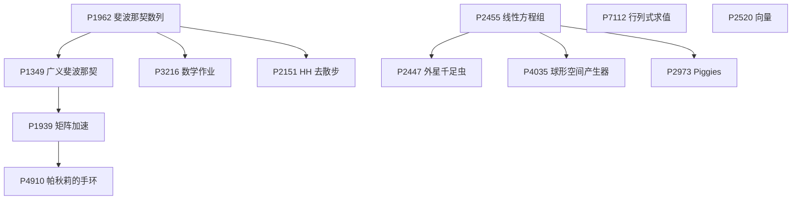

矩阵一支 P1962 → P1349 → P1939 → P4910，再分出 P3216 和 P2151；高斯消元一支 P2455 → P2447 / P4035 / P2973。P7112 行列式与 P2520 向量和本节其他题没有前置关系，可以随时插入。


- [ ] [[problem: luogu,P1962]] · [P1962 斐波那契数列](https://www.luogu.com.cn/problem/P1962)
- [ ] [[problem: luogu,P2455]] · [P2455 \[SDOI2006\] 线性方程组](https://www.luogu.com.cn/problem/P2455)
- [ ] [[problem: luogu,P2520]] · [P2520 \[HAOI2011\] 向量](https://www.luogu.com.cn/problem/P2520)
- [ ] [[problem: luogu,P1349]] · [P1349 广义斐波那契数列](https://www.luogu.com.cn/problem/P1349)
- [ ] [[problem: luogu,P1939]] · [P1939 矩阵加速（数列）](https://www.luogu.com.cn/problem/P1939)
- [ ] [[problem: luogu,P2447]] · [P2447 \[SDOI2010\] 外星千足虫](https://www.luogu.com.cn/problem/P2447)
- [ ] [[problem: luogu,P7112]] · [P7112 【模板】行列式求值](https://www.luogu.com.cn/problem/P7112)
- [ ] [[problem: luogu,P3216]] · [P3216 \[HNOI2011\] 数学作业](https://www.luogu.com.cn/problem/P3216)
- [ ] [[problem: luogu,P4910]] · [P4910 帕秋莉的手环](https://www.luogu.com.cn/problem/P4910)
- [ ] [[problem: luogu,P2151]] · [P2151 \[SDOI2009\] HH 去散步](https://www.luogu.com.cn/problem/P2151)
- [ ] [[problem: luogu,P4035]] · [P4035 \[JSOI2008\] 球形空间产生器](https://www.luogu.com.cn/problem/P4035)
- [ ] [[problem: luogu,P2973]] · [P2973 \[USACO10HOL\] Driving Out the Piggies G](https://www.luogu.com.cn/problem/P2973)

## 【数据结构2-3】线段树的进阶用法

[洛谷官方子题单](https://www.luogu.com.cn/training/221) · 13 题

```mermaid
flowchart TD
  n3834["P3834 主席树"]
  n4587["P4587 神秘数"]
  n3293["P3293 美味"]
  n2839["P2839 middle"]
  n3168["P3168 任务查询系统"]
  n4602["P4602 混合果汁"]
  n3380["P3380 树套树"]
  n2617["P2617 Dynamic Rankings"]
  n3810["P3810 三维偏序"]
  n3157["P3157 动态逆序对"]
  n4093["P4093 序列"]
  n5445["P5445 路灯"]
  n960F["CF960F Pathwalks"]

  n3834 --> n4587
  n3834 --> n3293
  n3834 --> n2839
  n3834 --> n3168
  n3834 --> n4602
  n3834 --> n3380
  n3380 --> n2617
  n3810 --> n3157
  n3157 --> n4093
```

主席树一支 P3834 → P4587 / P3293 / P2839 / P3168 / P4602，树套树一支 P3834 → P3380 → P2617，CDQ 分治一支 P3810 → P3157 → P4093。P5445 和 CF960F 与这三条主线没有硬前置。


- [ ] [[problem: luogu,P3834]] · [P3834 【模板】可持久化线段树 2](https://www.luogu.com.cn/problem/P3834)
- [ ] [[problem: luogu,P4587]] · [P4587 \[FJOI2016\] 神秘数](https://www.luogu.com.cn/problem/P4587)
- [ ] [[problem: luogu,P3380]] · [P3380 【模板】树套树](https://www.luogu.com.cn/problem/P3380)
- [ ] [[problem: luogu,P3810]] · [P3810 【模板】三维偏序 / 陌上花开](https://www.luogu.com.cn/problem/P3810)
- [ ] [[problem: luogu,P4093]] · [P4093 \[HEOI2016/TJOI2016\] 序列](https://www.luogu.com.cn/problem/P4093)
- [ ] [[problem: luogu,P3157]] · [P3157 \[CQOI2011\] 动态逆序对](https://www.luogu.com.cn/problem/P3157)
- [ ] [[problem: luogu,P3293]] · [P3293 \[SCOI2016\] 美味](https://www.luogu.com.cn/problem/P3293)
- [ ] [[problem: luogu,CF960F]] · [CF960F Pathwalks](https://www.luogu.com.cn/problem/CF960F)
- [ ] [[problem: luogu,P2617]] · [P2617 Dynamic Rankings](https://www.luogu.com.cn/problem/P2617)
- [ ] [[problem: luogu,P3168]] · [P3168 \[CQOI2015\] 任务查询系统](https://www.luogu.com.cn/problem/P3168)
- [ ] [[problem: luogu,P2839]] · [P2839 \[国家集训队\] middle](https://www.luogu.com.cn/problem/P2839)
- [ ] [[problem: luogu,P4602]] · [P4602 \[CTSC2018\] 混合果汁](https://www.luogu.com.cn/problem/P4602)
- [ ] [[problem: luogu,P5445]] · [P5445 \[APIO2019\] 路灯](https://www.luogu.com.cn/problem/P5445)

## 【动态规划6】动态规划的设计与优化

[洛谷官方子题单](https://www.luogu.com.cn/training/225) · 19 题

```mermaid
flowchart TD
  n2513["P2513 逆序对数列"]
  n708E["CF708E Student's Camp"]
  n3800["P3800 Power 收集"]
  n3572["P3572 PTA-Little Bird"]
  n2254["P2254 瑰丽华尔兹"]
  n2569["P2569 股票交易"]
  n5468["P5468 回家路线"]
  n5785["P5785 任务安排"]
  n3648["P3648 序列分割"]
  n4027["P4027 货币兑换"]
  n3195["P3195 玩具装箱"]
  n5504["P5504 柠檬"]
  n1912["P1912 诗人小G"]
  n1973["P1973 NOI 嘉年华"]
  n4099["P4099 SAO"]
  n5464["P5464 缩小社交圈"]
  n833B["CF833B The Bakery"]
  nARC081D["AT_arc081_d Flip and Rectangles"]
  nARC066D["AT_arc066_d Contest with Drinks"]

  n2513 --> n708E
  n3800 --> n3572
  n3572 --> n2254
  n3572 --> n2569
  n3572 --> n5468
  n5785 --> n3648
  n3648 --> n4027
  n3648 --> n3195
  n3648 --> n5504
  n1912 --> n1973
```

按优化手段分四块：前缀和优化 P2513 → CF708E，单调队列优化 P3800 → P3572 → P2254 / P2569 / P5468，斜率优化 P5785 → P3648 → P4027 / P3195 / P5504，决策单调性 P1912 → P1973。P4099、P5464、CF833B 和两个 AT 题与这四块没有硬前置。


- [ ] [[problem: luogu,P2513]] · [P2513 \[HAOI2009\] 逆序对数列](https://www.luogu.com.cn/problem/P2513)
- [ ] [[problem: luogu,CF708E]] · [CF708E Student's Camp](https://www.luogu.com.cn/problem/CF708E)
- [ ] [[problem: luogu,P3800]] · [P3800 Power 收集](https://www.luogu.com.cn/problem/P3800)
- [ ] [[problem: luogu,CF833B]] · [CF833B The Bakery](https://www.luogu.com.cn/problem/CF833B)
- [ ] [[problem: luogu,P5785]] · [P5785 \[SDOI2012\] 任务安排](https://www.luogu.com.cn/problem/P5785)
- [ ] [[problem: luogu,P3648]] · [P3648 \[APIO2014\] 序列分割](https://www.luogu.com.cn/problem/P3648)
- [ ] [[problem: luogu,P4027]] · [P4027 \[NOI2007\] 货币兑换](https://www.luogu.com.cn/problem/P4027)
- [ ] [[problem: luogu,AT_arc081_d]] · [AT\_arc081\_d \[ARC081F\] Flip and Rectangles](https://www.luogu.com.cn/problem/AT_arc081_d)
- [ ] [[problem: luogu,P5464]] · [P5464 缩小社交圈](https://www.luogu.com.cn/problem/P5464)
- [ ] [[problem: luogu,P4099]] · [P4099 \[HEOI2013\] SAO](https://www.luogu.com.cn/problem/P4099)
- [ ] [[problem: luogu,P3572]] · [P3572 \[POI 2014\] PTA-Little Bird](https://www.luogu.com.cn/problem/P3572)
- [ ] [[problem: luogu,P2254]] · [P2254 \[NOI2005\] 瑰丽华尔兹](https://www.luogu.com.cn/problem/P2254)
- [ ] [[problem: luogu,P2569]] · [P2569 \[SCOI2010\] 股票交易](https://www.luogu.com.cn/problem/P2569)
- [ ] [[problem: luogu,P1973]] · [P1973 \[NOI2011\] NOI 嘉年华](https://www.luogu.com.cn/problem/P1973)
- [ ] [[problem: luogu,P5504]] · [P5504 \[JSOI2011\] 柠檬](https://www.luogu.com.cn/problem/P5504)
- [ ] [[problem: luogu,P1912]] · [P1912 \[NOI2009\] 诗人小G](https://www.luogu.com.cn/problem/P1912)
- [ ] [[problem: luogu,P3195]] · [P3195 \[HNOI2008\] 玩具装箱](https://www.luogu.com.cn/problem/P3195)
- [ ] [[problem: luogu,P5468]] · [P5468 \[NOI2019\] 回家路线](https://www.luogu.com.cn/problem/P5468)
- [ ] [[problem: luogu,AT_arc066_d]] · [AT\_arc066\_d \[ARC066F\] Contest with Drinks Hard](https://www.luogu.com.cn/problem/AT_arc066_d)
