# 洛谷官方入门与基础算法题单

[洛谷官方题单列表](https://www.luogu.com.cn/training/list?type=srqc-jc)

本题单共收录 **18** 个官方子题单、**271** 个题目条目、**262** 道不同题目。

其中有 **7** 道题出现在多个学习阶段，形成 **9** 个重复条目。这些条目按洛谷官方分组原样保留，并共享完成进度。

[[toc]]

## 怎么看小节里的图

每个小节开头有几张 `flowchart TD` 有向图，画的是**本节题目之间的做题先后关系**。

- 节点写「题号 + 简短标题」，就是本节题单里列的那几道题。
- 箭头 `A → B` 表示**硬前置**：B 会用到 A 建立起来的套路，先把 A 做完再碰 B，能省掉大量原地打转。
- 题目多的小节按支线拆成几张图，每张图只画一条线。两张图之间还有依赖时，用图下面那句话说明，不跨图画箭头。
- **图里只画有前置关系的题。** 没有出现在任何图里的题，在每节末尾单独列出，它们不依赖本节任何题，可以随时插进来做。
- 图只画**节内**关系。跨小节的依赖（比如二分答案要先会写函数）写在小节正文里。
- 同一道题出现在多个小节时，每节的图都把它完整画一次，因为它在不同小节的入边并不相同。


## 【入门1】顺序结构

[洛谷官方子题单](https://www.luogu.com.cn/training/100) · 15 题

**先练输出**

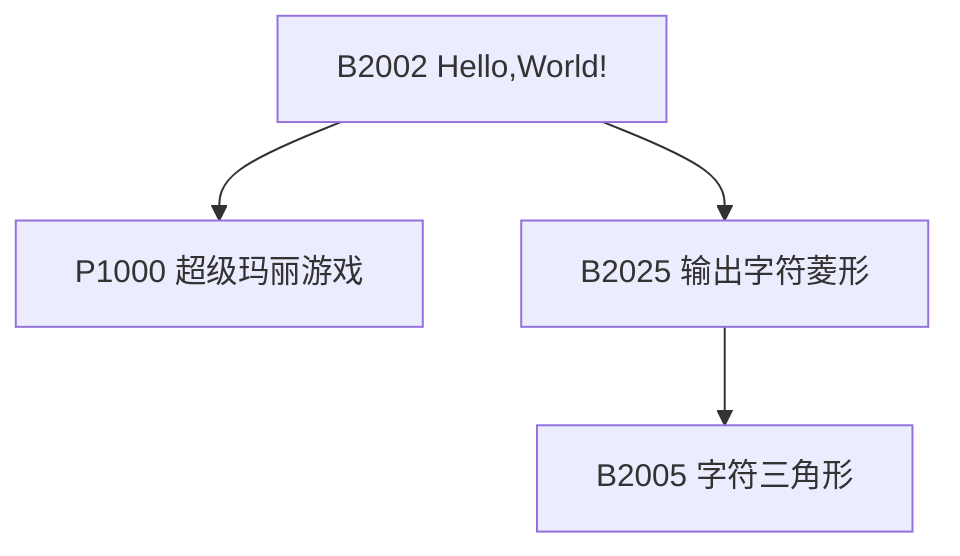

B2002 是最短的一题，照着它把输出格式写对；P1000 是多行输出，B2025 → B2005 是同一套字符图案从菱形缩到三角形。

**读入、算术与时间**

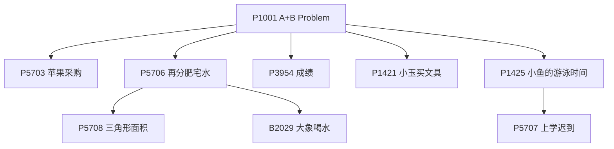

P1001 练会读入两个整数之后，其余都是「读入、算一下、输出」；P5706 是浮点除法与保留小数，它的后继 P5708 要开平方、B2029 要算体积；时间一支从 P1425 的时长差进到 P5707 的跨天与向上取整。

P5704（字母转换）和 P5705（数字反转）只跟字符处理有关，与上面两条线没有前置关系。

- [ ] [[problem: luogu,B2002]] · [B2002 Hello,World!](https://www.luogu.com.cn/problem/B2002)
- [ ] [[problem: luogu,B2025]] · [B2025 输出字符菱形](https://www.luogu.com.cn/problem/B2025) · pythonic: 多行字符串
- [ ] [[problem: luogu,P1000]] · [P1000 超级玛丽游戏](https://www.luogu.com.cn/problem/P1000)
- [ ] [[problem: luogu,P1001]] · [P1001 A+B Problem](https://www.luogu.com.cn/problem/P1001) · pythonic: sum+map
- [ ] [[problem: luogu,B2005]] · [B2005 字符三角形](https://www.luogu.com.cn/problem/B2005) · pythonic: f-string + 乘法
- [ ] [[problem: luogu,P5703]] · [P5703 【深基2.例5】苹果采购](https://www.luogu.com.cn/problem/P5703)
- [ ] [[problem: luogu,P5704]] · [P5704 【深基2.例6】字母转换](https://www.luogu.com.cn/problem/P5704) · pythonic: str.upper
- [ ] [[problem: luogu,P5705]] · [P5705 【深基2.例7】数字反转](https://www.luogu.com.cn/problem/P5705) · pythonic: 切片反转
- [ ] [[problem: luogu,P5706]] · [P5706 【深基2.例8】再分肥宅水](https://www.luogu.com.cn/problem/P5706) · pythonic: f-string
- [ ] [[problem: luogu,P5708]] · [P5708 【深基2.习2】三角形面积](https://www.luogu.com.cn/problem/P5708)
- [ ] [[problem: luogu,P5707]] · [P5707 【深基2.例12】上学迟到](https://www.luogu.com.cn/problem/P5707) · pythonic: ceil + divmod
- [ ] [[problem: luogu,B2029]] · [B2029 大象喝水](https://www.luogu.com.cn/problem/B2029) · pythonic: math.ceil
- [ ] [[problem: luogu,P1425]] · [P1425 小鱼的游泳时间](https://www.luogu.com.cn/problem/P1425) · pythonic: divmod
- [ ] [[problem: luogu,P1421]] · [P1421 小玉买文具](https://www.luogu.com.cn/problem/P1421) · pythonic: 整数运算
- [ ] [[problem: luogu,P3954]] · [P3954 \[NOIP 2017 普及组\] 成绩](https://www.luogu.com.cn/problem/P3954) · pythonic: 加权整除

## 【入门2】分支结构

[洛谷官方子题单](https://www.luogu.com.cn/training/101) · 18 题

**单分支与多分支**

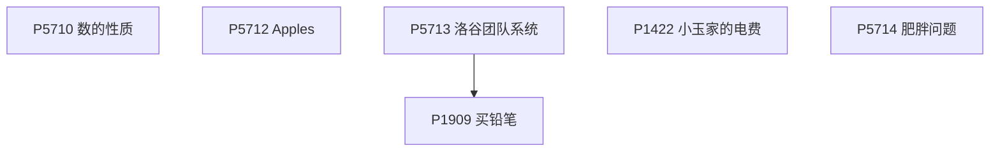

这一张都是「判断完直接输出」：P5710 练逻辑运算、P5712 与 P1422 是分段输出、P5714 要处理浮点比较；P5713 与 P1909 是同一套「几选一取最小」。

**比较、排序与取整**

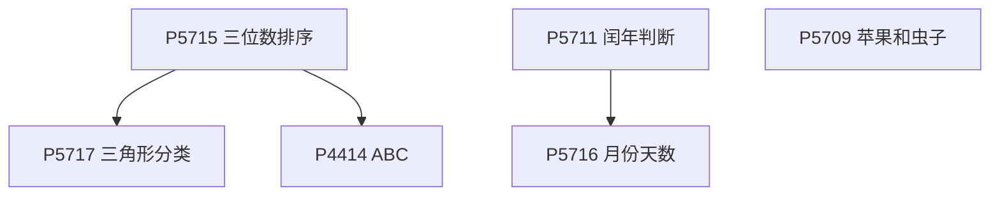

P5715 先把三个数排好序，P5717 在排序之上判三角形类型、P4414 在排序之上按字母顺序输出；P5711 闰年判断是 P5716 月份天数的前置，P5709 是向上取整。

P2433（N 合一杂烩）、P1085（循环找最值）、P1424（周期取模）、P1055（取模校验）、P1888（gcd 加浮点）、P1046（数组计数）与上面两张图都没有前置关系，可以随时穿插。

- [ ] [[problem: luogu,P2433]] · [P2433 【深基1-2】小学数学 N 合一](https://www.luogu.com.cn/problem/P2433) · match-case: match-case
- [ ] [[problem: luogu,P5709]] · [P5709 【深基2.习6】Apples Prologue / 苹果和虫子](https://www.luogu.com.cn/problem/P5709) · pythonic: ceil + 条件表达式
- [ ] [[problem: luogu,P5710]] · [P5710 【深基3.例2】数的性质](https://www.luogu.com.cn/problem/P5710) · pythonic: 布尔运算直出
- [ ] [[problem: luogu,P5711]] · [P5711 【深基3.例3】闰年判断](https://www.luogu.com.cn/problem/P5711) · match-case: match-case
- [ ] [[problem: luogu,P5712]] · [P5712 【深基3.例4】Apples](https://www.luogu.com.cn/problem/P5712) · match-case: match-case
- [ ] [[problem: luogu,P5713]] · [P5713 【深基3.例5】洛谷团队系统](https://www.luogu.com.cn/problem/P5713) · pythonic: 条件表达式
- [ ] [[problem: luogu,P5714]] · [P5714 【深基3.例7】肥胖问题](https://www.luogu.com.cn/problem/P5714) · match-case: match-case
- [ ] [[problem: luogu,P5715]] · [P5715 【深基3.例8】三位数排序](https://www.luogu.com.cn/problem/P5715) · pythonic: sorted
- [ ] [[problem: luogu,P5716]] · [P5716 【深基3.例9】月份天数](https://www.luogu.com.cn/problem/P5716) · match-case: match-case
- [ ] [[problem: luogu,P1085]] · [P1085 \[NOIP 2004 普及组\] 不高兴的津津](https://www.luogu.com.cn/problem/P1085) · pythonic: max + key
- [ ] [[problem: luogu,P1909]] · [P1909 \[NOIP 2016 普及组\] 买铅笔](https://www.luogu.com.cn/problem/P1909) · pythonic: min + ceil 推导
- [ ] [[problem: luogu,P5717]] · [P5717 【深基3.习8】三角形分类](https://www.luogu.com.cn/problem/P5717) · match-case: match-case
- [ ] [[problem: luogu,P1422]] · [P1422 小玉家的电费](https://www.luogu.com.cn/problem/P1422) · match-case: match-case
- [ ] [[problem: luogu,P1424]] · [P1424 小鱼的航程（改进版）](https://www.luogu.com.cn/problem/P1424) · pythonic: 生成器按周几
- [ ] [[problem: luogu,P1888]] · [P1888 三角函数](https://www.luogu.com.cn/problem/P1888) · pythonic: sorted + gcd
- [ ] [[problem: luogu,P1046]] · [P1046 \[NOIP 2005 普及组\] 陶陶摘苹果](https://www.luogu.com.cn/problem/P1046) · pythonic: sum 布尔计数
- [ ] [[problem: luogu,P4414]] · [P4414 \[COCI 2006/2007 \#2\] ABC](https://www.luogu.com.cn/problem/P4414) · match-case: match-case + print*
- [ ] [[problem: luogu,P1055]] · [P1055 \[NOIP 2008 普及组\] ISBN 号码](https://www.luogu.com.cn/problem/P1055) · pythonic: enumerate 加权校验

## 【入门3】循环结构

[洛谷官方子题单](https://www.luogu.com.cn/training/102) · 21 题

**单层循环：累加、最值、计数**

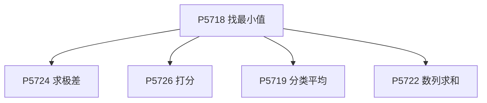

P5718 用一次循环求最小值，之后 P5724（极差）、P5726（去掉最值再平均）、P5719（分类累加）、P5722（求和）都是同一个循环骨架换个统计量。

**while 与取位**

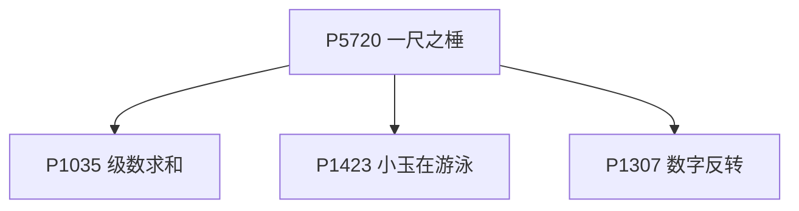

P5720 是 while 循环入门，P1035 与 P1423 是浮点累加到阈值才停，P1307 是反复取末位再拼回去。

**双层循环与素数**

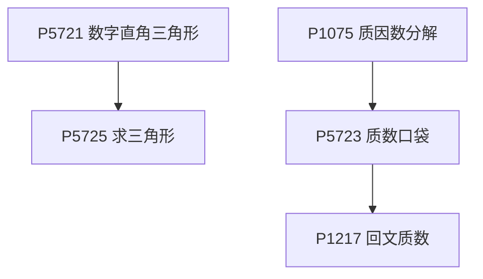

P5721 → P5725 是同一个字符三角形换方向；素数一支从 P1075 的试除起，P5723 加上累加与终止条件，P1217 再叠一步回文判定。

P1009（高精度阶乘和）、P1980（数位统计）、P2669（找规律）、P1720（斐波那契递推）、P1420（最长连号）、P4956（枚举整除）、P1089（模拟）各自独立，按难度自选顺序即可。

- [ ] [[problem: luogu,P5718]] · [P5718 【深基4.例2】找最小值](https://www.luogu.com.cn/problem/P5718) · pythonic: min
- [ ] [[problem: luogu,P5719]] · [P5719 【深基4.例3】分类平均](https://www.luogu.com.cn/problem/P5719) · pythonic: 列表推导分类
- [ ] [[problem: luogu,P5720]] · [P5720 【深基4.例4】一尺之棰](https://www.luogu.com.cn/problem/P5720) · pythonic: while 折半
- [ ] [[problem: luogu,P5721]] · [P5721 【深基4.例6】数字直角三角形](https://www.luogu.com.cn/problem/P5721) · pythonic: 格式化填三角
- [ ] [[problem: luogu,P1009]] · [P1009 \[NOIP 1998 普及组\] 阶乘之和](https://www.luogu.com.cn/problem/P1009) · pythonic: 累乘阶乘和
- [ ] [[problem: luogu,P1980]] · [P1980 \[NOIP 2013 普及组\] 计数问题](https://www.luogu.com.cn/problem/P1980) · pythonic: str.count
- [ ] [[problem: luogu,P1035]] · [P1035 \[NOIP 2002 普及组\] 级数求和](https://www.luogu.com.cn/problem/P1035) · pythonic: 调和级数
- [ ] [[problem: luogu,P2669]] · [P2669 \[NOIP 2015 普及组\] 金币](https://www.luogu.com.cn/problem/P2669) · pythonic: 按天发金币
- [ ] [[problem: luogu,P5722]] · [P5722 【深基4.例11】数列求和](https://www.luogu.com.cn/problem/P5722) · pythonic: 等差公式
- [ ] [[problem: luogu,P5723]] · [P5723 【深基4.例13】质数口袋](https://www.luogu.com.cn/problem/P5723) · pythonic: 质数筛选累加
- [ ] [[problem: luogu,P1217]] · [P1217 \[USACO1.5\] 回文质数 Prime Palindromes](https://www.luogu.com.cn/problem/P1217) · pythonic: 回文 + 质数
- [ ] [[problem: luogu,P1423]] · [P1423 小玉在游泳](https://www.luogu.com.cn/problem/P1423) · pythonic: 模拟累加
- [ ] [[problem: luogu,P1307]] · [P1307 \[NOIP 2011 普及组\] 数字反转](https://www.luogu.com.cn/problem/P1307) · pythonic: 切片反转去零
- [ ] [[problem: luogu,P1720]] · [P1720 月落乌啼算钱（斐波那契数列）](https://www.luogu.com.cn/problem/P1720) · pythonic: 斐波那契滚动
- [ ] [[problem: luogu,P5724]] · [P5724 【深基4.习5】求极差 / 最大跨度值 / 最大值和最小值的差](https://www.luogu.com.cn/problem/P5724) · pythonic: max-min
- [ ] [[problem: luogu,P1420]] · [P1420 最长连号](https://www.luogu.com.cn/problem/P1420) · pythonic: 条件表达式扫描
- [ ] [[problem: luogu,P1075]] · [P1075 \[NOIP 2012 普及组\] 质因数分解](https://www.luogu.com.cn/problem/P1075) · pythonic: 试除质因数
- [ ] [[problem: luogu,P5725]] · [P5725 【深基4.习8】求三角形](https://www.luogu.com.cn/problem/P5725)
- [ ] [[problem: luogu,P5726]] · [P5726 【深基4.习9】打分](https://www.luogu.com.cn/problem/P5726) · pythonic: 去极值平均
- [ ] [[problem: luogu,P4956]] · [P4956 \[COCI 2017/2018 \#6\] Davor](https://www.luogu.com.cn/problem/P4956)
- [ ] [[problem: luogu,P1089]] · [P1089 \[NOIP 2004 提高组\] 津津的储蓄计划](https://www.luogu.com.cn/problem/P1089)

## 【入门4】数组

[洛谷官方子题单](https://www.luogu.com.cn/training/103) · 20 题

**一维数组：统计与计数**

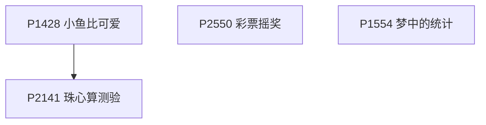

四题都在「把数按下标存下来再统计」：P1428 数前面比它小的数、P2550 做中奖计数、P1554 做数位计数；P2141 珠心算测验在它们之上判「两数之和在不在数组里」。

**标记与覆盖**

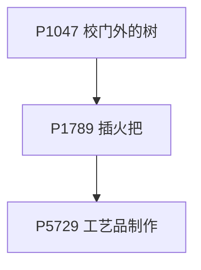

P1047 用一维标记数组把区间盖掉，P1789 升到二维带范围，P5729 再升到三维——三级台阶依次加维度。

**模拟填表**

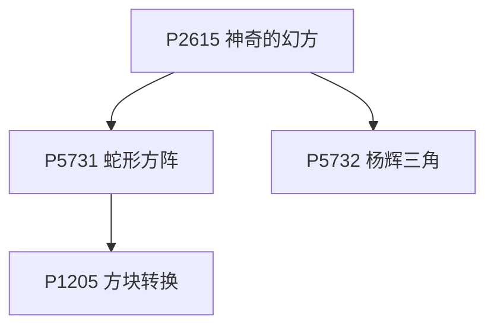

P2615 幻方是「按规则往二维数组里填数」的入门，P5731 蛇形方阵换个方向、P1205 方块转换变成矩阵旋转，P5732 杨辉三角是二维递推。

**压缩技术两连**

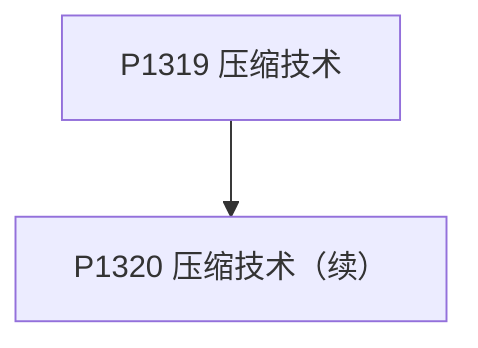

P1319 与 P1320 是同一题的续集，做完前者立刻做后者最省力。

P1427（逆序输出）、P5727（冰雹猜想存中间态）、P5728（双循环比较）、P5730（字符映射输出）、P1614（滑动窗口和）、P2911（计数取最大）、P1161（异或标记）与上面四张图都没有前置关系。

- [ ] [[problem: luogu,P1428]] · [P1428 小鱼比可爱](https://www.luogu.com.cn/problem/P1428) · pythonic: combinations + 计数
- [ ] [[problem: luogu,P1427]] · [P1427 小鱼的数字游戏](https://www.luogu.com.cn/problem/P1427) · pythonic: 切片反向
- [ ] [[problem: luogu,P5727]] · [P5727 【深基5.例3】冰雹猜想](https://www.luogu.com.cn/problem/P5727) · pythonic: 用条件表达式写奇偶变换，`sequence[::-1]` 切片反转输出
- [ ] [[problem: luogu,P1047]] · [P1047 \[NOIP 2005 普及组\] 校门外的树](https://www.luogu.com.cn/problem/P1047) · pythonic: 差分数组
- [ ] [[problem: luogu,P5728]] · [P5728 【深基5.例5】旗鼓相当的对手](https://www.luogu.com.cn/problem/P5728) · pythonic: Python 没有 Haskell 的 `$` / 管道运算符，可以用轻量 `p
- [ ] [[problem: luogu,P5729]] · [P5729 【深基5.例7】工艺品制作](https://www.luogu.com.cn/problem/P5729) · pythonic: 用 `product` 生成被切坐标集合，体积减去去重后的点数
- [ ] [[problem: luogu,P2550]] · [P2550 \[AHOI2001\] 彩票摇奖](https://www.luogu.com.cn/problem/P2550) · pythonic: set 交集
- [ ] [[problem: luogu,P2615]] · [P2615 \[NOIP 2015 提高组\] 神奇的幻方](https://www.luogu.com.cn/problem/P2615) · pythonic: 幻方模拟精简
- [ ] [[problem: luogu,P5730]] · [P5730 【深基5.例10】显示屏](https://www.luogu.com.cn/problem/P5730) · pythonic: 字典图案 + join
- [ ] [[problem: luogu,P1554]] · [P1554 \[USACO06DEC\] 梦中的统计 Dream Counting B](https://www.luogu.com.cn/problem/P1554)
- [ ] [[problem: luogu,P2141]] · [P2141 \[NOIP 2014 普及组\] 珠心算测验](https://www.luogu.com.cn/problem/P2141) · pythonic: 集合推导
- [ ] [[problem: luogu,P1614]] · [P1614 爱与愁的心痛](https://www.luogu.com.cn/problem/P1614) · pythonic: 滑动窗口
- [ ] [[problem: luogu,P2911]] · [P2911 \[USACO08OCT\] Bovine Bones G](https://www.luogu.com.cn/problem/P2911) · pythonic: 用 `product` 枚举所有点数，`Counter` 统计和的出现次数，再取
- [ ] [[problem: luogu,P1161]] · [P1161 开灯](https://www.luogu.com.cn/problem/P1161) · pythonic: 集合对称差 `on_lights ^= {light}` 一键切换开关
- [ ] [[problem: luogu,P5731]] · [P5731 【深基5.习6】蛇形方阵](https://www.luogu.com.cn/problem/P5731) · pythonic: 方向数组蛇形
- [ ] [[problem: luogu,P5732]] · [P5732 【深基5.习7】杨辉三角](https://www.luogu.com.cn/problem/P5732) · pythonic: 由上一行用列表推导生成当前行中间元素
- [ ] [[problem: luogu,P1789]] · [P1789 【Mc生存】插火把](https://www.luogu.com.cn/problem/P1789) · pythonic: 用 `product` 生成偏移，集合并入照亮坐标，答案为 `n*n - len
- [ ] [[problem: luogu,P1319]] · [P1319 压缩技术](https://www.luogu.com.cn/problem/P1319) · pythonic: 用 `cycle("01")` 与 `repeat` / `chain` 展开游
- [ ] [[problem: luogu,P1320]] · [P1320 压缩技术（续集版）](https://www.luogu.com.cn/problem/P1320) · pythonic: 用 `groupby` 做游程编码；若以 `1` 开头则先补一段长度为 `0` 
- [ ] [[problem: luogu,P1205]] · [P1205 \[USACO1.2\] 方块转换 Transformations](https://www.luogu.com.cn/problem/P1205) · pythonic: 旋转/翻转函数

## 【入门5】字符串

[洛谷官方子题单](https://www.luogu.com.cn/training/104) · 15 题

**字符处理**

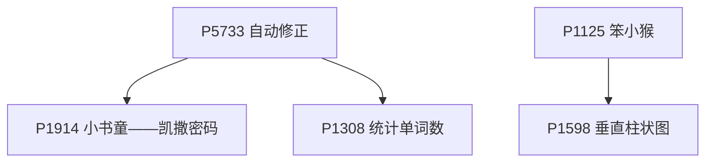

P5733 大小写转换是入口：P1914 在它之上做移位，P1308 要大小写不敏感地数单词；P1125 先统计字符出现次数，P1598 再用统计结果画柱状图。

**子串与映射表**

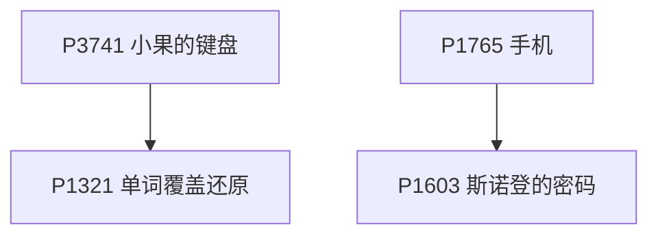

P3741 是子串替换，P1321 是它的「被覆盖之后还原」版本；P1765 建立按键到字母的映射表，P1603 用同一招把单词映射成数字再排序。

P1957（混合类型读入）、P5015（统计字符）、P5734（字符串操作综合）、P1553（分类讨论）、P1200（取模哈希）、P1597（语句解析模拟）各自独立。

- [ ] [[problem: luogu,P5733]] · [P5733 【深基6.例1】自动修正](https://www.luogu.com.cn/problem/P5733) · pythonic: 用 `str.upper()` 一行完成大小写转换
- [ ] [[problem: luogu,P1914]] · [P1914 小书童——凯撒密码](https://www.luogu.com.cn/problem/P1914) · pythonic: 用 `str.maketrans` / `translate` 做凯撒位移
- [ ] [[problem: luogu,P1125]] · [P1125 \[NOIP 2008 提高组\] 笨小猴](https://www.luogu.com.cn/problem/P1125) · pythonic: `Counter` 统计频次，`all` 判断质数
- [ ] [[problem: luogu,P1957]] · [P1957 口算练习题](https://www.luogu.com.cn/problem/P1957) · pythonic: `operator` 映射四则运算，统一生成表达式
- [ ] [[problem: luogu,P5015]] · [P5015 \[NOIP 2018 普及组\] 标题统计](https://www.luogu.com.cn/problem/P5015) · pythonic: `replace` 去掉空格后直接 `len`
- [ ] [[problem: luogu,P5734]] · [P5734 【深基6.例6】文字处理软件](https://www.luogu.com.cn/problem/P5734) · match-case: `match-case` 分发文本操作
- [ ] [[problem: luogu,P1308]] · [P1308 \[NOIP 2011 普及组\] 统计单词数](https://www.luogu.com.cn/problem/P1308) · pythonic: `re.finditer` + 单词边界统计出现次数与首位置
- [ ] [[problem: luogu,P1765]] · [P1765 手机](https://www.luogu.com.cn/problem/P1765) · pythonic: 字典推导建立按键次数表，再 `sum`
- [ ] [[problem: luogu,P3741]] · [P3741 小果的键盘](https://www.luogu.com.cn/problem/P3741) · pythonic: `itertools.pairwise` 统计相邻 `VK`
- [ ] [[problem: luogu,P1321]] · [P1321 单词覆盖还原](https://www.luogu.com.cn/problem/P1321) · pythonic: 用 `any` + 字符位置匹配覆盖计数
- [ ] [[problem: luogu,P1553]] · [P1553 数字反转（升级版）](https://www.luogu.com.cn/problem/P1553) · match-case: `match` 按小数/分数/百分号分支反转
- [ ] [[problem: luogu,P1603]] · [P1603 斯诺登的密码](https://www.luogu.com.cn/problem/P1603) · pythonic: 字典映射 + 推导式生成平方末两位后排序拼接
- [ ] [[problem: luogu,P1200]] · [P1200 \[USACO1.1\] 你的飞碟在这儿 Your Ride Is Here](https://www.luogu.com.cn/problem/P1200) · pythonic: `functools.reduce` 计算名字乘积模 47
- [ ] [[problem: luogu,P1597]] · [P1597 语句解析](https://www.luogu.com.cn/problem/P1597) · pythonic: `partition` 解析赋值语句
- [ ] [[problem: luogu,P1598]] · [P1598 \[USACO03FEB\] 垂直柱状图 Vertical Histogram](https://www.luogu.com.cn/problem/P1598) · pythonic: `Counter` 统计字母，按高度逐行输出柱状图

## 【入门6】函数与结构体

[洛谷官方子题单](https://www.luogu.com.cn/training/105) · 15 题

**先把函数写好**

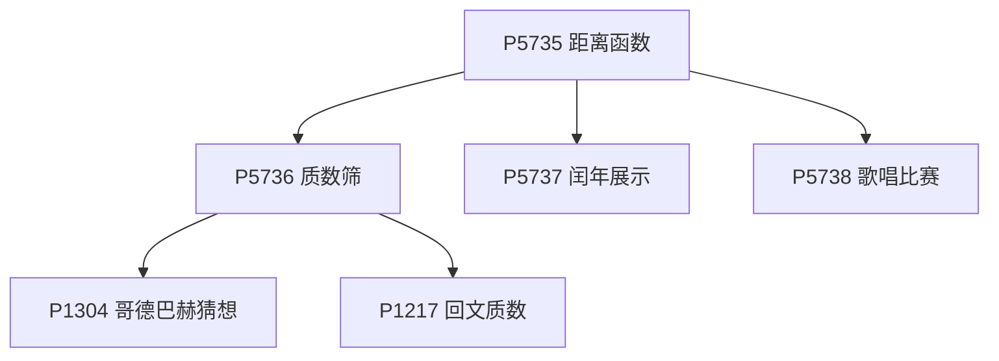

P5735 是最简单的「写一个函数」，之后 P5737、P5738 都是同一形态；P5736 把素数判断封成函数，P1304 与 P1217 都要反复调用它。

**结构体**

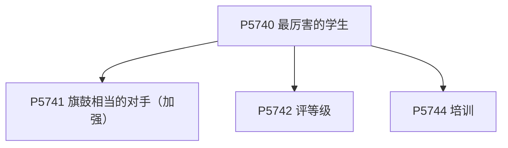

P5740 用一个结构体存学生信息，P5741 是它的加强版（两人互相比较），P5742 是结构体加条件判断，P5744 是结构体加模拟。

**递归与递推**

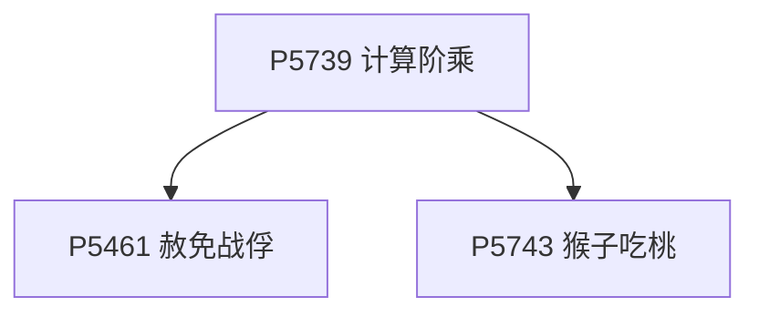

P5739 递归求阶乘是递归入门，P5461 赦免战俘把它变成分治递归，P5743 猴子吃桃是从终态往前递推。

P1075（质因数分解）与 P2415（集合求和）和本节其他题没有前置关系。

- [ ] [[problem: luogu,P5735]] · [P5735 【深基7.例1】距离函数](https://www.luogu.com.cn/problem/P5735)
- [ ] [[problem: luogu,P5736]] · [P5736 【深基7.例2】质数筛](https://www.luogu.com.cn/problem/P5736)
- [ ] [[problem: luogu,P5737]] · [P5737 【深基7.例3】闰年展示](https://www.luogu.com.cn/problem/P5737) · pythonic: 列表推导筛闰年
- [ ] [[problem: luogu,P5738]] · [P5738 【深基7.例4】歌唱比赛](https://www.luogu.com.cn/problem/P5738) · pythonic: 生成器求最高均分
- [ ] [[problem: luogu,P5739]] · [P5739 【深基7.例7】计算阶乘](https://www.luogu.com.cn/problem/P5739) · pythonic: math.factorial
- [ ] [[problem: luogu,P5461]] · [P5461 赦免战俘](https://www.luogu.com.cn/problem/P5461)
- [ ] [[problem: luogu,P5740]] · [P5740 【深基7.例9】最厉害的学生](https://www.luogu.com.cn/problem/P5740)
- [ ] [[problem: luogu,P5741]] · [P5741 【深基7.例10】旗鼓相当的对手 - 加强版](https://www.luogu.com.cn/problem/P5741)
- [ ] [[problem: luogu,P5742]] · [P5742 【深基7.例11】评等级](https://www.luogu.com.cn/problem/P5742) · pythonic: 条件表达式
- [ ] [[problem: luogu,P1075]] · [P1075 \[NOIP 2012 普及组\] 质因数分解](https://www.luogu.com.cn/problem/P1075) · pythonic: 试除质因数
- [ ] [[problem: luogu,P1304]] · [P1304 哥德巴赫猜想](https://www.luogu.com.cn/problem/P1304)
- [ ] [[problem: luogu,P1217]] · [P1217 \[USACO1.5\] 回文质数 Prime Palindromes](https://www.luogu.com.cn/problem/P1217) · pythonic: 回文 + 质数
- [ ] [[problem: luogu,P2415]] · [P2415 集合求和](https://www.luogu.com.cn/problem/P2415) · pythonic: 子集和位运算
- [ ] [[problem: luogu,P5743]] · [P5743 【深基7.习8】猴子吃桃](https://www.luogu.com.cn/problem/P5743)
- [ ] [[problem: luogu,P5744]] · [P5744 【深基7.习9】培训](https://www.luogu.com.cn/problem/P5744)

## 【算法1-1】模拟与高精度

[洛谷官方子题单](https://www.luogu.com.cn/training/106) · 16 题

**高精度**

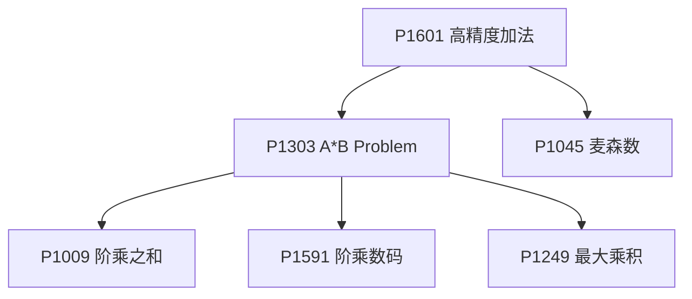

P1601 高精度加法是入口，P1303 乘法在它之上；再往后 P1009 阶乘之和与 P1591 阶乘数码都是乘法的直接应用，P1249 最大乘积要多一步数学结论，P1045 是加法配快速幂。

**二维与周期模拟**

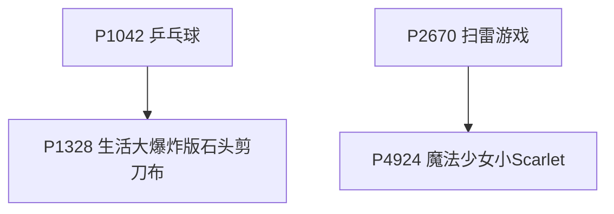

P1042 乒乓球是规则模拟，P1328 石头剪刀布也是「按周期表判胜负」；P2670 扫雷是二维格子模拟，P4924 在它之上做矩阵变换。

P1067（多项式输出）、P1098（字符串展开）、P1518（状态模拟）、P1563（环形模拟）、P1065（调度模拟）、P1786（排序模拟）都是各自独立的模拟题。

- [ ] [[problem: luogu,P1042]] · [P1042 \[NOIP 2003 普及组\] 乒乓球](https://www.luogu.com.cn/problem/P1042)
- [ ] [[problem: luogu,P2670]] · [P2670 \[NOIP 2015 普及组\] 扫雷游戏](https://www.luogu.com.cn/problem/P2670)
- [ ] [[problem: luogu,P1563]] · [P1563 \[NOIP 2016 提高组\] 玩具谜题](https://www.luogu.com.cn/problem/P1563)
- [ ] [[problem: luogu,P1601]] · [P1601 高精度加法](https://www.luogu.com.cn/problem/P1601) · pythonic: 大整数加法
- [ ] [[problem: luogu,P1303]] · [P1303 A\*B Problem](https://www.luogu.com.cn/problem/P1303) · pythonic: 大整数乘法
- [ ] [[problem: luogu,P1009]] · [P1009 \[NOIP 1998 普及组\] 阶乘之和](https://www.luogu.com.cn/problem/P1009) · pythonic: 累乘阶乘和
- [ ] [[problem: luogu,P4924]] · [P4924 \[1007\] 魔法少女小Scarlet](https://www.luogu.com.cn/problem/P4924)
- [ ] [[problem: luogu,P1328]] · [P1328 \[NOIP 2014 提高组\] 生活大爆炸版石头剪刀布](https://www.luogu.com.cn/problem/P1328)
- [ ] [[problem: luogu,P1518]] · [P1518 \[USACO2.4\] 两只塔姆沃斯牛 The Tamworth Two](https://www.luogu.com.cn/problem/P1518)
- [ ] [[problem: luogu,P1067]] · [P1067 \[NOIP 2009 普及组\] 多项式输出](https://www.luogu.com.cn/problem/P1067)
- [ ] [[problem: luogu,P1098]] · [P1098 \[NOIP 2007 提高组\] 字符串的展开](https://www.luogu.com.cn/problem/P1098)
- [ ] [[problem: luogu,P1065]] · [P1065 \[NOIP 2006 提高组\] 作业调度方案](https://www.luogu.com.cn/problem/P1065)
- [ ] [[problem: luogu,P1786]] · [P1786 帮贡排序](https://www.luogu.com.cn/problem/P1786)
- [ ] [[problem: luogu,P1591]] · [P1591 阶乘数码](https://www.luogu.com.cn/problem/P1591)
- [ ] [[problem: luogu,P1249]] · [P1249 最大乘积](https://www.luogu.com.cn/problem/P1249)
- [ ] [[problem: luogu,P1045]] · [P1045 \[NOIP 2003 普及组\] 麦森数](https://www.luogu.com.cn/problem/P1045)

## 【算法1-2】排序

[洛谷官方子题单](https://www.luogu.com.cn/training/107) · 12 题

**排序模板与基础应用**

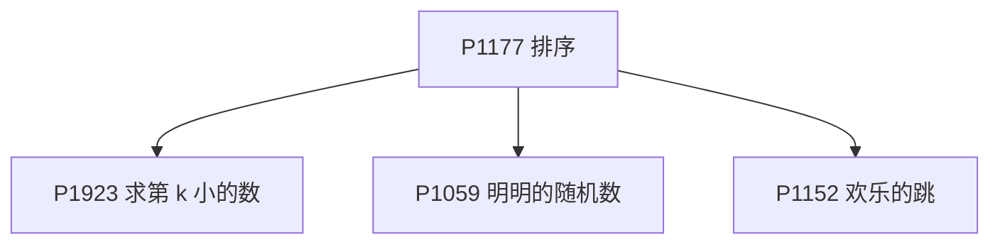

P1177 是本节唯一的入口（先会调用排序）：P1923 求第 k 小、P1059 排序去重、P1152 排序后比较相邻差。

**多关键字排序**

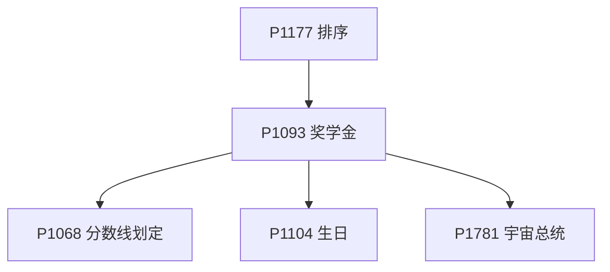

同样从 P1177 出发：P1093 练多关键字比较，P1068 在它之上加「划线截取」，P1104 与 P1781 是另外两个多关键字场景（P1781 还要比大数）。

**排序加贪心**

```mermaid
flowchart TD
  nP1177["P1177 排序"]
  nP2676["P2676 Bookshelf B"]
  nP5143["P5143 攀爬者"]
  nP1116["P1116 车厢重组"]
  nP1271["P1271 选举学生会"]

  nP1177 --> nP2676
  nP1177 --> nP5143
  nP1177 --> nP1116
  nP1177 --> nP1271
```

排序当工具的三处用法：P2676 降序后取前缀、P5143 排序后算相邻距离、P1116 数冒泡交换次数；P1271 是计数排序——值域小的时候比直接 sort 更快。

- [ ] [[problem: luogu,P1271]] · [P1271 【深基9.例1】选举学生会](https://www.luogu.com.cn/problem/P1271)
- [ ] [[problem: luogu,P1177]] · [P1177 【模板】排序](https://www.luogu.com.cn/problem/P1177) · pythonic: sorted 快读
- [ ] [[problem: luogu,P1923]] · [P1923 【深基9.例4】求第 k 小的数](https://www.luogu.com.cn/problem/P1923) · pythonic: sorted 第 k
- [ ] [[problem: luogu,P1059]] · [P1059 \[NOIP 2006 普及组\] 明明的随机数](https://www.luogu.com.cn/problem/P1059) · pythonic: set 去重 sorted
- [ ] [[problem: luogu,P1093]] · [P1093 \[NOIP 2007 普及组\] 奖学金](https://www.luogu.com.cn/problem/P1093) · pythonic: 多关键字 sort
- [ ] [[problem: luogu,P1781]] · [P1781 宇宙总统](https://www.luogu.com.cn/problem/P1781) · pythonic: 元组比较选票
- [ ] [[problem: luogu,P2676]] · [P2676 \[USACO07DEC\] Bookshelf B](https://www.luogu.com.cn/problem/P2676)
- [ ] [[problem: luogu,P1116]] · [P1116 车厢重组](https://www.luogu.com.cn/problem/P1116)
- [ ] [[problem: luogu,P1152]] · [P1152 欢乐的跳](https://www.luogu.com.cn/problem/P1152) · pythonic: 集合判定 Jolly
- [ ] [[problem: luogu,P1068]] · [P1068 \[NOIP 2009 普及组\] 分数线划定](https://www.luogu.com.cn/problem/P1068)
- [ ] [[problem: luogu,P5143]] · [P5143 攀爬者](https://www.luogu.com.cn/problem/P5143)
- [ ] [[problem: luogu,P1104]] · [P1104 生日](https://www.luogu.com.cn/problem/P1104) · pythonic: 元组排序

## 【算法1-3】暴力枚举

[洛谷官方子题单](https://www.luogu.com.cn/training/108) · 14 题

**DFS 生成组合与排列**

```mermaid
flowchart TD
  nP1157["P1157 组合的输出"]
  nP1706["P1706 全排列问题"]
  nP1088["P1088 火星人"]
  nP1036["P1036 选数"]

  nP1157 --> nP1706
  nP1706 --> nP1088
  nP1157 --> nP1036
```

P1157 用 DFS 生成组合，P1706 换成排列，P1088 直接用现成的全排列枚举；P1036 选数是组合枚举加素数判断。

**搜索剪枝**

```mermaid
flowchart TD
  nP2089["P2089 烤鸡"]
  nP2036["P2036 PERKET"]
  nP2392["P2392 考前抱佛脚"]

  nP2089 --> nP2036
  nP2036 --> nP2392
```

P2089 烤鸡是最直白的 DFS 加剪枝，P2036 PERKET 是同一形态的选择型搜索，P2392 在它之上做子集枚举。

P2241（数方形）、P1618（三连击）、P1149（火柴棒等式）、P1217（回文质数）、P3799（拼木棒）、P3392（涂条纹）、P3654（First Step）都是「枚举所有情况再加判断」，彼此独立，先挑题面最短的做。

- [ ] [[problem: luogu,P2241]] · [P2241 统计方形（数据加强版）](https://www.luogu.com.cn/problem/P2241) · pythonic: sum 推导数正方形
- [ ] [[problem: luogu,P2089]] · [P2089 烤鸡](https://www.luogu.com.cn/problem/P2089)
- [ ] [[problem: luogu,P1618]] · [P1618 三连击（升级版）](https://www.luogu.com.cn/problem/P1618)
- [ ] [[problem: luogu,P1036]] · [P1036 \[NOIP 2002 普及组\] 选数](https://www.luogu.com.cn/problem/P1036)
- [ ] [[problem: luogu,P1157]] · [P1157 组合的输出](https://www.luogu.com.cn/problem/P1157)
- [ ] [[problem: luogu,P1706]] · [P1706 全排列问题](https://www.luogu.com.cn/problem/P1706)
- [ ] [[problem: luogu,P1088]] · [P1088 \[NOIP 2004 普及组\] 火星人](https://www.luogu.com.cn/problem/P1088)
- [ ] [[problem: luogu,P3392]] · [P3392 涂条纹](https://www.luogu.com.cn/problem/P3392)
- [ ] [[problem: luogu,P3654]] · [P3654 First Step (ファーストステップ)](https://www.luogu.com.cn/problem/P3654)
- [ ] [[problem: luogu,P1217]] · [P1217 \[USACO1.5\] 回文质数 Prime Palindromes](https://www.luogu.com.cn/problem/P1217) · pythonic: 回文 + 质数
- [ ] [[problem: luogu,P1149]] · [P1149 \[NOIP 2008 提高组\] 火柴棒等式](https://www.luogu.com.cn/problem/P1149)
- [ ] [[problem: luogu,P3799]] · [P3799 小 Y 拼木棒](https://www.luogu.com.cn/problem/P3799)
- [ ] [[problem: luogu,P2392]] · [P2392 kkksc03 考前临时抱佛脚](https://www.luogu.com.cn/problem/P2392)
- [ ] [[problem: luogu,P2036]] · [P2036 \[COCI 2008/2009 \#2\] PERKET](https://www.luogu.com.cn/problem/P2036)

## 【算法1-4】递推与递归

[洛谷官方子题单](https://www.luogu.com.cn/training/109) · 15 题

**递推**

```mermaid
flowchart TD
  nP1255["P1255 数楼梯"]
  nP2437["P2437 蜜蜂路线"]
  nP1990["P1990 覆盖墙壁"]
  nP1028["P1028 数的计算"]
  nP1002["P1002 过河卒"]
  nP1164["P1164 小 A 点菜"]

  nP1255 --> nP2437
  nP1255 --> nP1990
  nP1002 --> nP1164
```

P1255 数楼梯是斐波那契递推的入口，P2437 蜜蜂路线与 P1990 覆盖墙壁都是它的一维推广；P1002 过河卒是二维网格递推，P1164 点菜在它之上做方案计数；P1028 数的计算是另一种递推。

**递归**

```mermaid
flowchart TD
  nP1464["P1464 Function"]
  nP3612["P3612 Secret Cow Code S"]
  nP1010["P1010 幂次方"]
  nP1228["P1228 地毯填补问题"]
  nP1498["P1498 南蛮图腾"]

  nP1464 --> nP3612
  nP1010 --> nP1228
  nP1010 --> nP1498
```

P1464 用记忆化把递归变快，P3612 是折半递归；P1010 幂次方是递归分解入门，P1228 地毯填补与 P1498 南蛮图腾都是它的图形版。

P1044（Catalan 递推）、P1036（组合搜索）、P1928（括号展开递归）、P1259（递归移动）各自独立。

- [ ] [[problem: luogu,P1255]] · [P1255 数楼梯](https://www.luogu.com.cn/problem/P1255) · pythonic: 滚动斐波那契
- [ ] [[problem: luogu,P1002]] · [P1002 \[NOIP 2002 普及组\] 过河卒](https://www.luogu.com.cn/problem/P1002)
- [ ] [[problem: luogu,P1044]] · [P1044 \[NOIP 2003 普及组\] 栈](https://www.luogu.com.cn/problem/P1044)
- [ ] [[problem: luogu,P1028]] · [P1028 \[NOIP 2001 普及组\] 数的计算](https://www.luogu.com.cn/problem/P1028) · pythonic: dp + sum 切片
- [ ] [[problem: luogu,P1464]] · [P1464 \[PacNW 1999\] Function](https://www.luogu.com.cn/problem/P1464)
- [ ] [[problem: luogu,P1928]] · [P1928 外星密码](https://www.luogu.com.cn/problem/P1928)
- [ ] [[problem: luogu,P2437]] · [P2437 蜜蜂路线](https://www.luogu.com.cn/problem/P2437) · pythonic: 滚动递推
- [ ] [[problem: luogu,P1164]] · [P1164 小 A 点菜](https://www.luogu.com.cn/problem/P1164)
- [ ] [[problem: luogu,P1036]] · [P1036 \[NOIP 2002 普及组\] 选数](https://www.luogu.com.cn/problem/P1036)
- [ ] [[problem: luogu,P1990]] · [P1990 覆盖墙壁](https://www.luogu.com.cn/problem/P1990)
- [ ] [[problem: luogu,P3612]] · [P3612 \[USACO17JAN\] Secret Cow Code S](https://www.luogu.com.cn/problem/P3612)
- [ ] [[problem: luogu,P1259]] · [P1259 黑白棋子的移动](https://www.luogu.com.cn/problem/P1259)
- [ ] [[problem: luogu,P1010]] · [P1010 \[NOIP 1998 普及组\] 幂次方](https://www.luogu.com.cn/problem/P1010)
- [ ] [[problem: luogu,P1228]] · [P1228 地毯填补问题](https://www.luogu.com.cn/problem/P1228)
- [ ] [[problem: luogu,P1498]] · [P1498 南蛮图腾](https://www.luogu.com.cn/problem/P1498)

## 【算法1-5】贪心

[洛谷官方子题单](https://www.luogu.com.cn/training/110) · 14 题

**排序之后贪心**

```mermaid
flowchart TD
  nP2240["P2240 部分背包问题"]
  nP1208["P1208 混合牛奶"]
  nP1478["P1478 陶陶摘苹果（升级版）"]
  nP1223["P1223 排队接水"]
  nP4995["P4995 跳跳！"]
  nP4447["P4447 分组"]

  nP2240 --> nP1208
  nP1223 --> nP4995
```

P2240 按单价排序把背包取满，P1208 是同一个模型换个背景；P1223 按接水时间排序算总等待，P4995 排序后左右横跳；P1478 与 P4447 也是排序加取数，但各自还要处理额外的约束。

**相邻与差分贪心**

```mermaid
flowchart TD
  nP3817["P3817 小 A 的糖果"]
  nP5019["P5019 铺设道路"]
  nP1803["P1803 线段覆盖"]

  nP3817 --> nP5019
```

P3817 只看相邻两个位置就能决定，P5019 铺设道路是它的差分版本；P1803 线段覆盖按右端点排序之后一路贪心。

**排序规则与高精度**

```mermaid
flowchart TD
  nP1012["P1012 拼数"]
  nP1106["P1106 删数问题"]
  nP1080["P1080 国王游戏"]

  nP1012 --> nP1106
  nP1012 --> nP1080
```

P1012 拼数要先想清楚「两个数谁排前面」的比较规则，P1106 删数与 P1080 国王游戏都建在这个规则上，并且都要高精度。

P1090（合并果子）要用堆、P1094（纪念品分组）是双指针贪心，它们与上面三张图没有前置关系。

- [ ] [[problem: luogu,P2240]] · [P2240 【深基12.例1】部分背包问题](https://www.luogu.com.cn/problem/P2240)
- [ ] [[problem: luogu,P1223]] · [P1223 排队接水](https://www.luogu.com.cn/problem/P1223)
- [ ] [[problem: luogu,P1803]] · [P1803 凌乱的yyy / 线段覆盖](https://www.luogu.com.cn/problem/P1803)
- [ ] [[problem: luogu,P1090]] · [P1090 \[NOIP 2004 提高组\] 合并果子](https://www.luogu.com.cn/problem/P1090)
- [ ] [[problem: luogu,P3817]] · [P3817 小 A 的糖果](https://www.luogu.com.cn/problem/P3817)
- [ ] [[problem: luogu,P1106]] · [P1106 删数问题](https://www.luogu.com.cn/problem/P1106)
- [ ] [[problem: luogu,P1478]] · [P1478 陶陶摘苹果（升级版）](https://www.luogu.com.cn/problem/P1478)
- [ ] [[problem: luogu,P5019]] · [P5019 \[NOIP 2018 提高组\] 铺设道路](https://www.luogu.com.cn/problem/P5019)
- [ ] [[problem: luogu,P1208]] · [P1208 \[USACO1.3\] 混合牛奶 Mixing Milk](https://www.luogu.com.cn/problem/P1208)
- [ ] [[problem: luogu,P1094]] · [P1094 \[NOIP 2007 普及组\] 纪念品分组](https://www.luogu.com.cn/problem/P1094)
- [ ] [[problem: luogu,P4995]] · [P4995 跳跳！](https://www.luogu.com.cn/problem/P4995)
- [ ] [[problem: luogu,P4447]] · [P4447 \[AHOI2018初中组\] 分组](https://www.luogu.com.cn/problem/P4447)
- [ ] [[problem: luogu,P1080]] · [P1080 \[NOIP 2012 提高组\] 国王游戏](https://www.luogu.com.cn/problem/P1080)
- [ ] [[problem: luogu,P1012]] · [P1012 \[NOIP 1998 提高组\] 拼数](https://www.luogu.com.cn/problem/P1012)

## 【算法1-6】二分查找与二分答案

[洛谷官方子题单](https://www.luogu.com.cn/training/111) · 11 题

**二分查找**

```mermaid
flowchart TD
  nP2249["P2249 查找"]
  nP1678["P1678 烦恼的高考志愿"]
  nP1102["P1102 A-B 数对"]

  nP2249 --> nP1678
  nP2249 --> nP1102
```

P2249 是 lower_bound 模板，P1678 用它找最近的分数线，P1102 用它数差值等于 k 的数对。

**二分答案**

```mermaid
flowchart TD
  nP1873["P1873 砍树"]
  nP2440["P2440 木材加工"]
  nP2678["P2678 跳石头"]
  nP3853["P3853 路标设置"]
  nP1182["P1182 数列分段"]
  nP1163["P1163 银行贷款"]
  nP3743["P3743 小鸟的设备"]

  nP1873 --> nP2440
  nP1873 --> nP2678
  nP1873 --> nP3853
  nP1873 --> nP1182
  nP1163 --> nP3743
```

P1873 砍树是二分答案的模板（整数答案加单调判定），之后 P2440、P2678、P3853、P1182 都是「把答案二分掉再写一个 check」；浮点答案从 P1163 进到 P3743。

P1024 一元三次方程求根用二分或枚举，与上面两条线没有前置关系。

- [ ] [[problem: luogu,P2249]] · [P2249 【深基13.例1】查找](https://www.luogu.com.cn/problem/P2249)
- [ ] [[problem: luogu,P1102]] · [P1102 A-B 数对](https://www.luogu.com.cn/problem/P1102)
- [ ] [[problem: luogu,P1873]] · [P1873 \[COCI 2011/2012 \#5\] EKO / 砍树](https://www.luogu.com.cn/problem/P1873)
- [ ] [[problem: luogu,P1024]] · [P1024 \[NOIP 2001 提高组\] 一元三次方程求解](https://www.luogu.com.cn/problem/P1024)
- [ ] [[problem: luogu,P1678]] · [P1678 烦恼的高考志愿](https://www.luogu.com.cn/problem/P1678)
- [ ] [[problem: luogu,P2440]] · [P2440 木材加工](https://www.luogu.com.cn/problem/P2440)
- [ ] [[problem: luogu,P2678]] · [P2678 \[NOIP 2015 提高组\] 跳石头](https://www.luogu.com.cn/problem/P2678)
- [ ] [[problem: luogu,P3853]] · [P3853 \[TJOI2007\] 路标设置](https://www.luogu.com.cn/problem/P3853)
- [ ] [[problem: luogu,P1182]] · [P1182 数列分段 Section II](https://www.luogu.com.cn/problem/P1182)
- [ ] [[problem: luogu,P1163]] · [P1163 银行贷款](https://www.luogu.com.cn/problem/P1163)
- [ ] [[problem: luogu,P3743]] · [P3743 小鸟的设备](https://www.luogu.com.cn/problem/P3743)

## 【算法1-7】搜索

[洛谷官方子题单](https://www.luogu.com.cn/training/112) · 16 题

**DFS 回溯**

```mermaid
flowchart TD
  nP1036["P1036 选数"]
  nP1219["P1219 八皇后"]
  nP2404["P2404 自然数的拆分问题"]
  nP2036["P2036 PERKET"]
  nP1433["P1433 吃奶酪"]

  nP1036 --> nP1219
  nP1036 --> nP2404
  nP1036 --> nP2036
  nP1036 --> nP1433
```

P1036 是最小的 DFS 枚举，之后 P1219 八皇后要加「冲突标记加回溯」、P2404 是拆分、P2036 是选择型、P1433 必须加剪枝才过。

**网格 DFS**

```mermaid
flowchart TD
  nP1605["P1605 迷宫"]
  nP1101["P1101 单词方阵"]
  nP1596["P1596 Lake Counting"]

  nP1605 --> nP1101
  nP1605 --> nP1596
```

P1605 迷宫是网格 DFS 模板，P1101 单词方阵要定好八个方向，P1596 Lake Counting 数四连通块。

**BFS**

```mermaid
flowchart TD
  nP1443["P1443 马的遍历"]
  nP1135["P1135 奇怪的电梯"]
  nP2895["P2895 Meteor Shower"]
  nP1825["P1825 Corn Maze"]
  nP1032["P1032 字串变换（疑似错题）"]
  nP1162["P1162 填涂颜色"]

  nP1443 --> nP1135
  nP1443 --> nP2895
  nP1443 --> nP1825
  nP1443 --> nP1032
  nP1443 --> nP1162
```

P1443 马的遍历是 BFS 求最短步数的模板，之后 P1135、P2895、P1825 都是「把状态压进队列」的变体，P1032 的状态是字符串，P1162 要先把外圈灌满再数。

P1019（单词接龙）与 P2392（子集枚举）和上面两条线没有前置关系。

- [ ] [[problem: luogu,P1219]] · [P1219 \[USACO1.5\] 八皇后 Checker Challenge](https://www.luogu.com.cn/problem/P1219)
- [ ] [[problem: luogu,P2392]] · [P2392 kkksc03 考前临时抱佛脚](https://www.luogu.com.cn/problem/P2392)
- [ ] [[problem: luogu,P1443]] · [P1443 马的遍历](https://www.luogu.com.cn/problem/P1443)
- [ ] [[problem: luogu,P1135]] · [P1135 奇怪的电梯](https://www.luogu.com.cn/problem/P1135)
- [ ] [[problem: luogu,P2895]] · [P2895 \[USACO08FEB\] Meteor Shower S](https://www.luogu.com.cn/problem/P2895)
- [ ] [[problem: luogu,P1036]] · [P1036 \[NOIP 2002 普及组\] 选数](https://www.luogu.com.cn/problem/P1036)
- [ ] [[problem: luogu,P2036]] · [P2036 \[COCI 2008/2009 \#2\] PERKET](https://www.luogu.com.cn/problem/P2036)
- [ ] [[problem: luogu,P1433]] · [P1433 吃奶酪](https://www.luogu.com.cn/problem/P1433)
- [ ] [[problem: luogu,P1605]] · [P1605 迷宫](https://www.luogu.com.cn/problem/P1605)
- [ ] [[problem: luogu,P1019]] · [P1019 \[NOIP 2000 提高组\] 单词接龙（疑似错题）](https://www.luogu.com.cn/problem/P1019)
- [ ] [[problem: luogu,P1101]] · [P1101 单词方阵](https://www.luogu.com.cn/problem/P1101)
- [ ] [[problem: luogu,P2404]] · [P2404 自然数的拆分问题](https://www.luogu.com.cn/problem/P2404)
- [ ] [[problem: luogu,P1596]] · [P1596 \[USACO10OCT\] Lake Counting S](https://www.luogu.com.cn/problem/P1596)
- [ ] [[problem: luogu,P1162]] · [P1162 填涂颜色](https://www.luogu.com.cn/problem/P1162)
- [ ] [[problem: luogu,P1032]] · [P1032 \[NOIP 2002 提高组\] 字串变换（疑似错题）](https://www.luogu.com.cn/problem/P1032)
- [ ] [[problem: luogu,P1825]] · [P1825 \[USACO11OPEN\] Corn Maze S](https://www.luogu.com.cn/problem/P1825)

## 【数据结构1-1】线性表

[洛谷官方子题单](https://www.luogu.com.cn/training/113) · 10 题

**栈**

```mermaid
flowchart TD
  nP1449["P1449 后缀表达式"]
  nP1241["P1241 括号序列"]
  nP4387["P4387 验证栈序列"]

  nP1449 --> nP1241
  nP1449 --> nP4387
```

P1449 后缀表达式是栈的模板，P1241 括号序列与 P4387 验证栈序列都在它之上做「进出栈顺序」的判定。

**队列与链表**

```mermaid
flowchart TD
  nP1996["P1996 约瑟夫问题"]
  nP1160["P1160 队列安排"]
  nP1540["P1540 机器翻译"]
  nP2058["P2058 海港"]

  nP1996 --> nP1160
  nP1540 --> nP2058
```

P1996 约瑟夫问题用队列模拟，P1160 队列安排要改成链表做插入删除；P1540 机器翻译是先进先出的缓存，P2058 海港是它的滑动窗口版。

**数组与映射**

```mermaid
flowchart TD
  nP3156["P3156 询问学号"]
  nP3613["P3613 寄包柜"]

  nP3156 --> nP3613
```

P3156 是最朴素的按下标取值，P3613 寄包柜要换成按柜号存一个 vector。

P2234 营业额统计要动态维护前驱后继，适合直接用 set 或平衡树，与本节其他题没有前置关系。

- [ ] [[problem: luogu,P3156]] · [P3156 【深基15.例1】询问学号](https://www.luogu.com.cn/problem/P3156) · pythonic: 下标查询生成器
- [ ] [[problem: luogu,P3613]] · [P3613 【深基15.例2】寄包柜](https://www.luogu.com.cn/problem/P3613)
- [ ] [[problem: luogu,P1449]] · [P1449 后缀表达式](https://www.luogu.com.cn/problem/P1449)
- [ ] [[problem: luogu,P1996]] · [P1996 约瑟夫问题](https://www.luogu.com.cn/problem/P1996)
- [ ] [[problem: luogu,P1160]] · [P1160 队列安排](https://www.luogu.com.cn/problem/P1160)
- [ ] [[problem: luogu,P1540]] · [P1540 \[NOIP 2010 提高组\] 机器翻译](https://www.luogu.com.cn/problem/P1540)
- [ ] [[problem: luogu,P2058]] · [P2058 \[NOIP 2016 普及组\] 海港](https://www.luogu.com.cn/problem/P2058)
- [ ] [[problem: luogu,P1241]] · [P1241 括号序列](https://www.luogu.com.cn/problem/P1241)
- [ ] [[problem: luogu,P4387]] · [P4387 【深基15.习9】验证栈序列](https://www.luogu.com.cn/problem/P4387)
- [ ] [[problem: luogu,P2234]] · [P2234 \[HNOI2002\] 营业额统计](https://www.luogu.com.cn/problem/P2234)

## 【数据结构1-2】二叉树

[洛谷官方子题单](https://www.luogu.com.cn/training/114) · 10 题

**建树、遍历与树上统计**

```mermaid
flowchart TD
  nP1305["P1305 新二叉树"]
  nP4913["P4913 二叉树深度"]
  nP1185["P1185 绘制二叉树"]
  nP3884["P3884 二叉树问题"]
  nP1364["P1364 医院设置"]
  nP1827["P1827 美国血统"]
  nP1030["P1030 求先序排列"]
  nP1229["P1229 遍历问题"]

  nP1305 --> nP4913
  nP1305 --> nP1185
  nP1305 --> nP3884
  nP4913 --> nP1364
  nP1827 --> nP1030
  nP1827 --> nP1229
```

P1305 新二叉树是「按描述建树」的入口，P4913 求深度、P1185 把树画出来、P3884 数深度与距离，P1364 在深度之上做带权重心；已知两种遍历推第三种从 P1827 起，P1030 求先序、P1229 数方案。

P4715（淘汰赛）与 P5076（普通二叉树）和上面这张图没有前置关系。

- [ ] [[problem: luogu,P4715]] · [P4715 【深基16.例1】淘汰赛](https://www.luogu.com.cn/problem/P4715) · pythonic: max/min + key
- [ ] [[problem: luogu,P4913]] · [P4913 【深基16.例3】二叉树深度](https://www.luogu.com.cn/problem/P4913)
- [ ] [[problem: luogu,P1827]] · [P1827 \[USACO3.4\] 美国血统 American Heritage](https://www.luogu.com.cn/problem/P1827)
- [ ] [[problem: luogu,P5076]] · [P5076 【深基16.例7】普通二叉树（简化版）](https://www.luogu.com.cn/problem/P5076)
- [ ] [[problem: luogu,P1364]] · [P1364 医院设置](https://www.luogu.com.cn/problem/P1364)
- [ ] [[problem: luogu,P1229]] · [P1229 遍历问题](https://www.luogu.com.cn/problem/P1229)
- [ ] [[problem: luogu,P1305]] · [P1305 新二叉树](https://www.luogu.com.cn/problem/P1305)
- [ ] [[problem: luogu,P1030]] · [P1030 \[NOIP 2001 普及组\] 求先序排列](https://www.luogu.com.cn/problem/P1030)
- [ ] [[problem: luogu,P3884]] · [P3884 \[JLOI2009\] 二叉树问题](https://www.luogu.com.cn/problem/P3884)
- [ ] [[problem: luogu,P1185]] · [P1185 绘制二叉树](https://www.luogu.com.cn/problem/P1185)

## 【数据结构1-3】集合

[洛谷官方子题单](https://www.luogu.com.cn/training/115) · 15 题

**并查集**

```mermaid
flowchart TD
  nP1551["P1551 亲戚"]
  nP1536["P1536 村村通"]
  nP1892["P1892 团伙"]
  nP2814["P2814 家谱"]
  nP1621["P1621 集合"]
  nP1955["P1955 程序自动分析"]

  nP1551 --> nP1536
  nP1551 --> nP1892
  nP1551 --> nP2814
  nP1551 --> nP1621
  nP1551 --> nP1955
```

P1551 亲戚是并查集模板，之后 P1536 数连通块、P1892 团伙要维护敌对关系、P2814 家谱要用 map 存名字、P1621 要先筛出素数再合并、P1955 要先离散化。

**哈希与映射**

```mermaid
flowchart TD
  nP3370["P3370 字符串哈希"]
  nP3405["P3405 Cities and States"]
  nP4305["P4305 不重复数字"]
  nP3879["P3879 阅读理解"]
  nP1102["P1102 A-B 数对"]
  nP5250["P5250 木材仓库"]
  nP5266["P5266 学籍管理"]

  nP3370 --> nP3405
  nP3370 --> nP4305
  nP3370 --> nP3879
  nP3370 --> nP1102
  nP5250 --> nP5266
```

P3370 字符串哈希是入口，P3405 把两个字符串哈希成一个键、P4305 去重、P3879 建倒排表、P1102 用哈希数数对；P5250 与 P5266 是用现成的有序容器，前者 set 后者 map。

P1525（关押罪犯）要二分图或带权并查集，P1918（保龄球）是哈希查表，它们与上面两张图没有前置关系。

- [ ] [[problem: luogu,P1551]] · [P1551 亲戚](https://www.luogu.com.cn/problem/P1551)
- [ ] [[problem: luogu,P1536]] · [P1536 村村通](https://www.luogu.com.cn/problem/P1536)
- [ ] [[problem: luogu,P3370]] · [P3370 【模板】字符串哈希](https://www.luogu.com.cn/problem/P3370)
- [ ] [[problem: luogu,P3405]] · [P3405 \[USACO16DEC\] Cities and States S](https://www.luogu.com.cn/problem/P3405)
- [ ] [[problem: luogu,P5250]] · [P5250 【深基17.例5】木材仓库](https://www.luogu.com.cn/problem/P5250)
- [ ] [[problem: luogu,P5266]] · [P5266 【深基17.例6】学籍管理](https://www.luogu.com.cn/problem/P5266)
- [ ] [[problem: luogu,P1102]] · [P1102 A-B 数对](https://www.luogu.com.cn/problem/P1102)
- [ ] [[problem: luogu,P1918]] · [P1918 保龄球](https://www.luogu.com.cn/problem/P1918)
- [ ] [[problem: luogu,P1525]] · [P1525 \[NOIP 2010 提高组\] 关押罪犯](https://www.luogu.com.cn/problem/P1525)
- [ ] [[problem: luogu,P1621]] · [P1621 集合](https://www.luogu.com.cn/problem/P1621)
- [ ] [[problem: luogu,P1892]] · [P1892 \[BalticOI 2003\] 团伙 (Day 2)](https://www.luogu.com.cn/problem/P1892)
- [ ] [[problem: luogu,P1955]] · [P1955 \[NOI2015\] 程序自动分析](https://www.luogu.com.cn/problem/P1955)
- [ ] [[problem: luogu,P4305]] · [P4305 \[JLOI2011\] 不重复数字](https://www.luogu.com.cn/problem/P4305)
- [ ] [[problem: luogu,P3879]] · [P3879 \[TJOI2010\] 阅读理解](https://www.luogu.com.cn/problem/P3879)
- [ ] [[problem: luogu,P2814]] · [P2814 家谱](https://www.luogu.com.cn/problem/P2814)

## 【数据结构1-4】图的基本应用

[洛谷官方子题单](https://www.luogu.com.cn/training/116) · 10 题

**建图与遍历**

```mermaid
flowchart TD
  nP5318["P5318 查找文献"]
  nP2853["P2853 Cow Picnic S"]
  nP3916["P3916 图的遍历"]
  nP1363["P1363 幻象迷宫"]

  nP5318 --> nP2853
  nP5318 --> nP3916
  nP5318 --> nP1363
```

P5318 查找文献是建图模板（邻接表加排序加 DFS/BFS），P2853 用 DFS 数可达的牧场、P3916 要反向建图、P1363 幻象迷宫要在 BFS 里多存一维状态。

**拓扑排序与 DAG**

```mermaid
flowchart TD
  nP1113["P1113 杂务"]
  nP1807["P1807 最长路"]
  nP4017["P4017 最大食物链计数"]
  nP1347["P1347 排序"]
  nP1983["P1983 车站分级"]

  nP1113 --> nP1807
  nP1113 --> nP4017
  nP1113 --> nP1347
  nP1113 --> nP1983
```

P1113 杂务是拓扑排序求最长链的模板，P1807 是 DAG 上最长路、P4017 是 DAG 上路径计数、P1347 用拓扑判环、P1983 在拓扑分层之上再做差分。

P1127 词链是欧拉路径，与本节其他题没有前置关系。

- [ ] [[problem: luogu,P5318]] · [P5318 【深基18.例3】查找文献](https://www.luogu.com.cn/problem/P5318)
- [ ] [[problem: luogu,P3916]] · [P3916 图的遍历](https://www.luogu.com.cn/problem/P3916)
- [ ] [[problem: luogu,P1113]] · [P1113 \[USACO02FEB\] 杂务](https://www.luogu.com.cn/problem/P1113)
- [ ] [[problem: luogu,P4017]] · [P4017 最大食物链计数](https://www.luogu.com.cn/problem/P4017)
- [ ] [[problem: luogu,P1807]] · [P1807 最长路](https://www.luogu.com.cn/problem/P1807)
- [ ] [[problem: luogu,P1127]] · [P1127 词链](https://www.luogu.com.cn/problem/P1127)
- [ ] [[problem: luogu,P2853]] · [P2853 \[USACO06DEC\] Cow Picnic S](https://www.luogu.com.cn/problem/P2853)
- [ ] [[problem: luogu,P1363]] · [P1363 幻象迷宫](https://www.luogu.com.cn/problem/P1363)
- [ ] [[problem: luogu,P1347]] · [P1347 \[ECNA 2001\] 排序](https://www.luogu.com.cn/problem/P1347)
- [ ] [[problem: luogu,P1983]] · [P1983 \[NOIP 2013 普及组\] 车站分级](https://www.luogu.com.cn/problem/P1983)

## 【数学1】基础数学问题

[洛谷官方子题单](https://www.luogu.com.cn/training/117) · 24 题

**进制与位运算**

```mermaid
flowchart TD
  nP1143["P1143 进制转换"]
  nP1017["P1017 进制转换"]
  nP1100["P1100 高低位交换"]
  nP1469["P1469 找筷子"]

  nP1143 --> nP1017
```

P1143 任意进制互转是入口，P1017 是它的负数进制版；P1100 高低位交换与 P1469 找筷子都是位运算，直接上手即可。

**组合计数**

```mermaid
flowchart TD
  nP2822["P2822 组合数问题"]
  nP1866["P1866 编号"]
  nP2638["P2638 安全系统"]
  nP3913["P3913 车的攻击"]
  nP1246["P1246 编码"]

  nP2822 --> nP1866
  nP2822 --> nP2638
  nP2822 --> nP3913
  nP2822 --> nP1246
```

P2822 递推组合数是入口：P1866 编号与 P1246 编码是「第几个排列／组合」的换算，P2638 是隔板法，P3913 车的攻击要用容斥。

**gcd 与 lcm**

```mermaid
flowchart TD
  nP1029["P1029 最大公约数与最小公倍数"]
  nP4057["P4057 晨跑"]
  nP1572["P1572 计算分数"]
  nP1072["P1072 Hankson 的趣味题"]
  nP2651["P2651 添加括号"]
  nP2660["P2660 zzc 种田"]

  nP1029 --> nP4057
  nP1029 --> nP1572
  nP1029 --> nP1072
  nP1029 --> nP2651
  nP1029 --> nP2660
```

P1029 用 gcd 与 lcm 的关系反推数对是入口，之后 P4057 求最小公倍数周期、P1572 做分数运算、P1072 枚举约数、P2651 判约分后是否为整数、P2660 用辗转相除。

**筛法与素数**

```mermaid
flowchart TD
  nP3383["P3383 线性筛素数"]
  nP1835["P1835 素数密度"]
  nP2926["P2926 Patting Heads S"]
  nP1069["P1069 细胞分裂"]

  nP3383 --> nP1835
  nP3383 --> nP2926
  nP3383 --> nP1069
```

P3383 线性筛是模板，P1835 是区间筛、P2926 按倍数枚举、P1069 要质因数分解——都建立在一张素数表上。

**约数、欧拉函数与因子和**

```mermaid
flowchart TD
  nP3383["P3383 线性筛素数"]
  nP1403["P1403 约数研究"]
  nP1414["P1414 又是毕业季II"]
  nP3601["P3601 签到题"]
  nP1593["P1593 因子和"]

  nP3383 --> nP1403
  nP3383 --> nP1414
  nP3383 --> nP3601
  nP3383 --> nP1593
```

同样从 P3383 的筛法出发：P1403 数约数个数、P1414 按约数归类、P3601 要在筛的同时算欧拉函数、P1593 求因子和。

P2789 直线交点数靠递推或枚举，与上面五张图没有前置关系。

- [ ] [[problem: luogu,P1143]] · [P1143 进制转换](https://www.luogu.com.cn/problem/P1143)
- [ ] [[problem: luogu,P1469]] · [P1469 找筷子](https://www.luogu.com.cn/problem/P1469)
- [ ] [[problem: luogu,P1100]] · [P1100 高低位交换](https://www.luogu.com.cn/problem/P1100) · pythonic: 位运算高低互换
- [ ] [[problem: luogu,P1017]] · [P1017 \[NOIP 2000 提高组\] 进制转换](https://www.luogu.com.cn/problem/P1017)
- [ ] [[problem: luogu,P1866]] · [P1866 编号](https://www.luogu.com.cn/problem/P1866)
- [ ] [[problem: luogu,P2822]] · [P2822 \[NOIP 2016 提高组\] 组合数问题](https://www.luogu.com.cn/problem/P2822)
- [ ] [[problem: luogu,P2789]] · [P2789 直线交点数](https://www.luogu.com.cn/problem/P2789)
- [ ] [[problem: luogu,P3913]] · [P3913 车的攻击](https://www.luogu.com.cn/problem/P3913)
- [ ] [[problem: luogu,P2638]] · [P2638 安全系统](https://www.luogu.com.cn/problem/P2638)
- [ ] [[problem: luogu,P1246]] · [P1246 \[ECNA 1995\] 编码](https://www.luogu.com.cn/problem/P1246)
- [ ] [[problem: luogu,P2926]] · [P2926 \[USACO08DEC\] Patting Heads S](https://www.luogu.com.cn/problem/P2926)
- [ ] [[problem: luogu,P3383]] · [P3383 【模板】线性筛素数](https://www.luogu.com.cn/problem/P3383)
- [ ] [[problem: luogu,P1835]] · [P1835 素数密度](https://www.luogu.com.cn/problem/P1835)
- [ ] [[problem: luogu,P1029]] · [P1029 \[NOIP 2001 普及组\] 最大公约数和最小公倍数问题](https://www.luogu.com.cn/problem/P1029)
- [ ] [[problem: luogu,P1072]] · [P1072 \[NOIP 2009 提高组\] Hankson 的趣味题](https://www.luogu.com.cn/problem/P1072)
- [ ] [[problem: luogu,P1069]] · [P1069 \[NOIP 2009 普及组\] 细胞分裂](https://www.luogu.com.cn/problem/P1069)
- [ ] [[problem: luogu,P1572]] · [P1572 计算分数](https://www.luogu.com.cn/problem/P1572)
- [ ] [[problem: luogu,P4057]] · [P4057 \[Code+\#1\] 晨跑](https://www.luogu.com.cn/problem/P4057)
- [ ] [[problem: luogu,P1414]] · [P1414 又是毕业季II](https://www.luogu.com.cn/problem/P1414)
- [ ] [[problem: luogu,P2651]] · [P2651 添加括号III](https://www.luogu.com.cn/problem/P2651)
- [ ] [[problem: luogu,P2660]] · [P2660 zzc 种田](https://www.luogu.com.cn/problem/P2660) · pythonic: gcd 矩形周长
- [ ] [[problem: luogu,P3601]] · [P3601 签到题](https://www.luogu.com.cn/problem/P3601)
- [ ] [[problem: luogu,P1403]] · [P1403 \[AHOI2005\] 约数研究](https://www.luogu.com.cn/problem/P1403)
- [ ] [[problem: luogu,P1593]] · [P1593 因子和](https://www.luogu.com.cn/problem/P1593)
