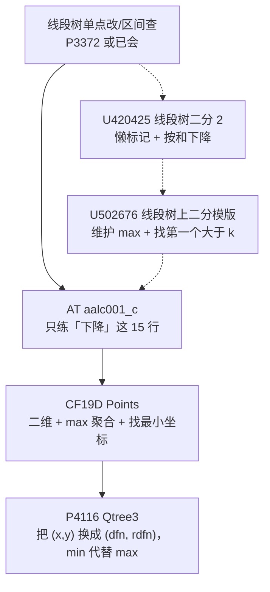

# Rainboy 个人题单

[[toc]]

## 一、线段树

本章的学习路线：主线是 P3372 → aalc001_c → 19D → P4116；U420425 与 U502676 是插在中间的补充题，可以先过主线，卡在“下降”上时再回来刷这两道。

- [ ] [[problem: luogu,P3372]]
  训练点：懒标记下传时机，左右区间边界，`long long` 防溢出。
- [ ] [[problem: luogu,U420425]]
  训练点：区间和够不够用「还差多少」表示；树上下降依赖元素非负带来的单调性。
- [ ] [[problem: luogu,U502676]]
  训练点：把聚合量从区间和换成区间最大值；判据从「够不够」换成「这段最大值是否大于 k」，`mx <= k` 就整段剪掉。
- [ ] [[problem: atcoder,aalc001_c]]
  训练点：带着余量 `rem` 下降；向右找最小 $r$、向左找最大 $l$ 两个方向的对称写法；无解用哨兵位置吸收。
- [ ] [[problem: codeforces,19D]]
  训练点：外层按 $x$ 维护区间最大 $y$；`mx <= limit` 剪枝定位最左 $x$；组内用 `std::set` 或压缩后的 Fenwick 找大于 $y$ 的最小值。
- [ ] [[problem: luogu,P4116]]
  训练点：双 dfs 序把祖先关系化成二维偏序；结点维护 min 后找第一个 `rdfn <= Y` 的位置；对照重链剖分 + 每条链 `set` 的 $O(\log^2 n)$ 写法，理解两种做法的取舍。
