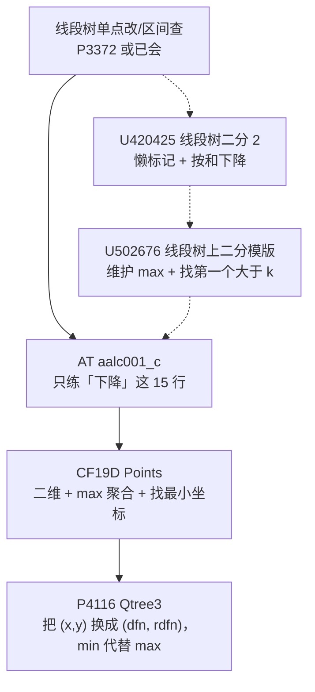
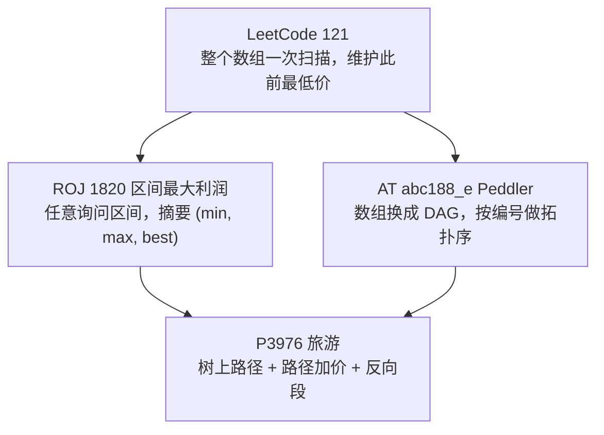

# Rainboy 个人题单

[[toc]]

## 一、线段树

本章的学习路线：主线是 P3372 → aalc001_c → 19D → P4116；U420425 与 U502676 是插在中间的补充题，可以先过主线，卡在“下降”上时再回来刷这两道。

- [ ] [[problem: luogu,P3372]]
  训练点：懒标记下传时机，左右区间边界，`long long` 防溢出。
- [ ] [[problem: luogu,U420425]]
  训练点：区间和够不够用「还差多少」表示；树上下降依赖元素非负带来的单调性。
- [ ] [[problem: luogu,U502676]]
  训练点：把聚合量从区间和换成区间最大值；判据从「够不够」换成「这段最大值是否大于 k」，`mx <= k` 就整段剪掉。
- [ ] [[problem: atcoder,aalc001_c]]
  训练点：带着余量 `rem` 下降；向右找最小 $r$、向左找最大 $l$ 两个方向的对称写法；无解用哨兵位置吸收。
- [ ] [[problem: codeforces,19D]]
  训练点：外层按 $x$ 维护区间最大 $y$；`mx <= limit` 剪枝定位最左 $x$；组内用 `std::set` 或压缩后的 Fenwick 找大于 $y$ 的最小值。
- [ ] [[problem: luogu,P4116]]
  训练点：双 dfs 序把祖先关系化成二维偏序；结点维护 min 后找第一个 `rdfn <= Y` 的位置；对照重链剖分 + 每条链 `set` 的 $O(\log^2 n)$ 写法，理解两种做法的取舍。

## 二、序列与路径上的「先买后卖」

本章的学习路线：先在一维上把观察练熟（LeetCode 121 是已经会的那一版），再依次换容器——把「整个数组」换成「任意询问区间」（ROJ 1820），把「数组」换成「图上的一条有向路径」（abc188_e），最后把「一条路径」换成「树上路径 + 整段加价」（P3976）。每换一次容器，摘要就要多带一点东西：区间版要可合并，DAG 版要拓扑序，树版要能反着用并支持懒标记。

- [x] [[problem: roj,1820]]
  训练点：把「历史最低价」压成可合并摘要 $(min, max, best)$，合并时必须带上跨段项 $max_R - min_L$；再对照倍增写法，理解「合并满足结合律」才是能上树的前提。
- [x] [[problem: atcoder,abc188_e]]
  训练点：$X_i < Y_i$ 保证编号就是拓扑序，一次扫描维护「能走到 $v$ 的最低买价」；注意答案允许为负，`0` 不能当初始化兜底。
- [x] [[problem: luogu,P3976]]
  训练点：路径拆成 $O(\log n)$ 段 dfn 区间后，$a$ 侧的 dfn 增序与旅行方向相反，所以摘要要带 `bwd`、查询要 `flip`；整段加价只平移最值，正好用懒标记。

## 三、扫描线与差分

y 方向上要的是「区间加、单点查」，所以这一章的前置是差分 + 树状数组；真正的新东西是把每个矩形拆成「进入 / 离开」两个事件，按 $x$ 排序后扫过去。

- [x] [[problem: roj,1416]]
  训练点：矩形拆成 $x=l$ 加、$x=r$ 减两个事件；同一个 $x$ 上先做事件再回答询问，半开区间的边界处理被顺序自动吸收；坐标到 $10^9$ 先离线离散化再开树状数组。
