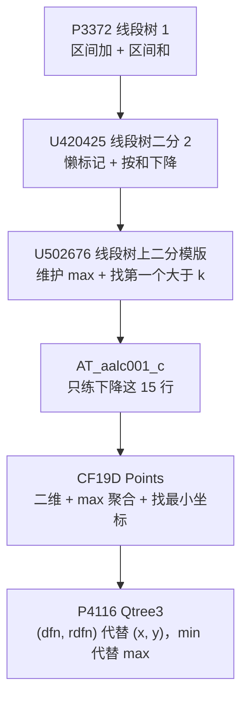

# Rainboy 个人题单

这份题单只记录我自己正在走的路径，按专题分章节。每章的题目顺序就是学习顺序：上一题补上的能力，正好是下一题复用的部件。

[[toc]]

## 一、线段树

线段树的学习从「会写模板」到「能在树上定位」分两步。第一层是把懒标记、区间加、区间和写熟；第二层也是真正的分水岭：把二分搬进树里，带着剩余量沿树下降，靠整段剪枝把 $O(\log^2 n)$ 压到 $O(\log n)$。下面这一串题目就是从模板一路推到那个「下降」骨架的完整链条。

### 1. 基础：区间加与区间和

先把懒标记线段树写熟。这一层不涉及定位，目标只有一个：`push_up` / `push_down` / `update` / `query` 四个部件写对，区间加与区间和的边界不出错。

- [ ] [[problem: luogu,P3372]]
  训练点：懒标记下传时机，左右区间边界，`long long` 防溢出。

### 2. 第一步跳跃：把二分搬进树里

模板会写之后，第一次接触到「在树上找位置」。这里的关键不是数据结构，而是发现二分里每一次判定都在重复走树，于是让下降过程自己带着「还差多少」往下走。

- [ ] [[problem: luogu,U420425]]
  训练点：区间和够不够用「还差多少」表示；树上下降依赖元素非负带来的单调性。
- [ ] [[problem: luogu,U502676]]
  训练点：把聚合量从区间和换成区间最大值；判据从「够不够」换成「这段最大值是否大于 k」，`mx <= k` 就整段剪掉。

### 3. 只练「下降」这 15 行

有了 `U502676` 的骨架，`AT_aalc001_c` 就是纯粹的重复训练：同样是从根往下走，同样靠整段剪枝决定跳过哪一棵子树，只是换了聚合量（区间和）和剩余量的含义。这一题的唯一目的是把下降那十几行写成肌肉记忆，直到不假思索也能写对。

- [ ] [[problem: atcoder,aalc001_c]]
  训练点：带着余量 `rem` 下降；向右找最小 $r$、向左找最大 $l$ 两个方向的对称写法；无解用哨兵位置吸收。

### 4. 二维：聚合量换成 max，找最小坐标

`CF19D` 把「一维找位置」推到二维：外层线段树按 $x$ 分组，结点存组内最大 $y$；查询时整段最大值够不到门槛就剪掉，单路下降定位最左可行 $x$。这就是 `P4116` 的骨架，只是第二维还是真正的坐标。

- [ ] [[problem: codeforces,19D]]
  训练点：外层按 $x$ 维护区间最大 $y$；`mx <= limit` 剪枝定位最左 $x$；组内用 `std::set` 或压缩后的 Fenwick 找大于 $y$ 的最小值。

### 5. 换坐标：`(dfn, rdfn)` 代替 `(x, y)`，min 代替 max

`P4116` 是同一副骨架的最后一步：把二维点改成 `(dfn, rdfn)`，把 max 换成 min，于是「找最左可行 $x$」变成了「找深度最小的黑点祖先」。题目换了，代码结构没换。

- [ ] [[problem: luogu,P4116]]
  训练点：双 dfs 序把祖先关系化成二维偏序；结点维护 min 后找第一个 $<= Y$ 的位置；对照重链剖分 + 每条链 `set` 的 $O(\log^2 n)$ 写法，理解两种做法的取舍。
