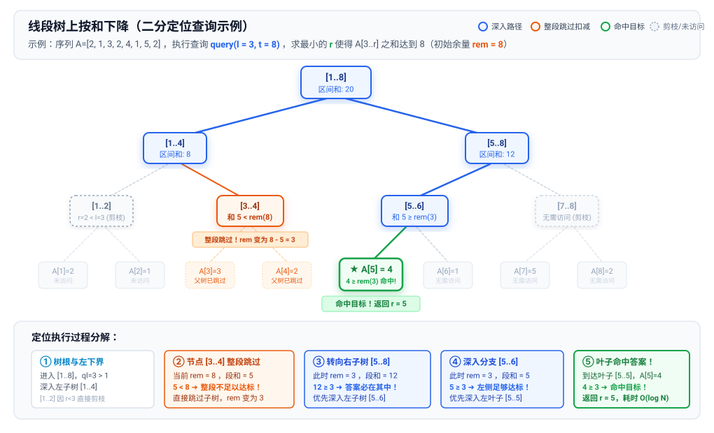

[[TOC]]

## 形式化题目

给定长度为 $N$ 的非负整数序列 $A=(A_1,A_2,\ldots,A_N)$，处理 $Q$ 个操作：

- 单点赋值：把 $A_i$ 改为 $x$。
- 向右定位：给定 $l,t$，求满足 $l\leqslant r\leqslant N$ 且 $A_l+A_{l+1}+\cdots+A_r\geqslant t$ 的最小 $r$。
- 向左定位：给定 $r,t$，求满足 $1\leqslant l\leqslant r$ 且 $A_l+\cdots+A_r\geqslant t$ 的最大 $l$。

两种定位在无解时分别返回 $N+1$ 与 $0$。

题面中有两个条件在后续分析中会反复用到：一是 $A_i\geqslant 0$，二是两种定位都只查询“和第一次达到 $t$ 的位置”，而不关心具体的和是多少。前者保证了区间和关于端点具有单调性，后者则允许我们直接在树上带着剩余目标值向下检索。

## 暴力解法

### 思路

直接照题意模拟。查询 $2$ 从 $l$ 开始向右逐项累加，一旦和达到 $t$ 便停止；查询 $3$ 对称，从 $r$ 开始向左累加。

单次定位最多扫描 $N$ 个位置，每次只做一步加法。这一做法无需任何前置处理，正确性直接来源于题意定义。

### 代码

@include-code(./brute.cpp, cpp)

### 复杂度

单次查询时间复杂度为 $O(N)$，共 $Q$ 次，总时间复杂度为 $O(NQ)$。当 $N=Q=2\times 10^5$ 时，累计加法运算达 $4\times 10^{10}$ 次，远超 2 秒的时限承受范围。

### 瓶颈

将同一次查询内的计算拆解来看，本质是在重复累加一段并未变化的前缀。

以查询 $2$ 为例，从 $l$ 扫描到 $r$ 的过程中，中间每一步计算的都是“从 $l$ 开始的某段区间和”。这些中间结果计算后即被丢弃，若后续查询覆盖相同区间，又需要从头重新累加。

加法单次开销极小，开销在于重复累加：相同的位置会被不同的查询反复计入。若能将区间和预先维护起来，单次获取便能远快于 $O(\text{长度})$。后续三种解法均以此为切入点，区别在于维护的对象不同，以及获取区间和后定位端点的方式不同。

## 解法总览

三种解法都是完整可提交的解法，时间复杂度都在 $O(\log N)$ 量级，工程取舍各不相同：

- **解法一（`main2.cpp`）**：线段树只维护 $A$ 的区间和，定位直接套 rbook 的 `first_true` 二分模板。改动最小，不需要懒标记，也不需要设计树上检索逻辑，写起来最快；代价是单次查询需要 $O(\log^2 N)$。
- **解法二（`main.cpp`，正式主解）**：沿用相同的数据结构，将二分内化到树上遍历过程中——带着“还差多少”这一剩余量沿树下降，整段不足则直接跳过整棵子树。单次查询降至 $O(\log N)$，代码反而比解法一更精简。
- **解法三（`main3.cpp`）**：更换维护对象，以前缀和序列 $P$ 代替原序列 $A$。单点修改转化为 $P$ 上的后缀区间加，定位转化为在前缀和的值域上检索下标。同样达到单次 $O(\log N)$，但需要引入懒标记下传，并处理下标 $0$ 的边界。

解法一与解法二维护同一个对象（$A$ 的区间和），区别仅在于端点是在树外二分查找，还是直接沿树结构检索定位；解法三则另辟蹊径，通过维护前缀和将区间求和化为常数次差分，代价是引入了区间加的懒标记，并将定位转化到了前缀和的值域极值检索上。

| 解法 | 核心观察 | 复杂度 | 适用场景 | 对应代码 |
| --- | --- | --- | --- | --- |
| 解法一：单点赋值 + 区间和，树外 `first_true` | $A_i\geqslant 0$ 使区间和关于端点单调，端点就能用二分模板定位；无解交给哨兵位置 | 每次 $O(\log^2 N)$，建树 $O(N)$ | 追求最快编码完成，或时限宽松；无需懒标记 | `main2.cpp`（C++） |
| 解法二：单点赋值 + 树上按和下降 | 将二分搬进树里，用余量 `rem` 沿树走，整段不够就整段跳过 | 每次 $O(\log N)$，建树 $O(N)$ | 正式提交推荐；常数小，代码精简 | `main.cpp`（C++） |
| 解法三：前缀和 + 区间加 + 极值下降 | 单点改值在前缀和上是后缀区间加；结点维护极值即可剪枝定位 | 每次 $O(\log N)$，建树 $O(N)$ | 需要兼顾前缀和区间加等扩展操作时 | `main3.cpp`（C++） |

同目录下的 `brute.cpp` 为暴力扫描实现，仅作为对拍基准，不作为正式提交解法。

## 解法一：单点赋值 + 区间和，树外 `first_true`

### 思路

线段树结点维护区间和，直接提供单点赋值与区间和查询两种基础操作，单次时间复杂度均为 $O(\log N)$。修改操作把 $A_i$ 置为 $x$，走到叶子时直接写入 `seg[p] = x`，返回途中用 `push_up` 把父结点的和重算一遍，不必再另存一份原序列。定位操作要判断区间和是否达到 $t$，直接调用区间求和。因为维护对象是原序列 $A$ 而非前缀和，树上不存在整段修改，无需引入懒标记，结构最为朴素。

解决求和后，关键在于如何定位端点。利用 $A_i\geqslant 0$ 带来的单调性，两个查询都能写成同一个形式：在一段下标里找第一个 `check` 成立的位置。这正是 rbook 二分模板 `first_true(l, r)` 的形状——左闭右闭，要求 `check` 单调为 `false … false true … true`，并要求传入的 $r$ 是真实或虚拟的可行位置。

- 查询 $2$：固定 $l$ 时 $\mathrm{sum}(l..r)$ 关于 $r$ 单调不减，令 `check(pos)` 为 $\mathrm{sum}(l..pos)\geqslant t$，第一个成立的位置就是最小的 $r$。
- 查询 $3$：固定 $r$ 时 $\mathrm{sum}(l..r)$ 关于 $l$ 单调不增，要让模板派上用场，把谓词取反：令 `check(pos)` 为 $\mathrm{sum}(pos..r)< t$，第一个成立的位置减一，就是最后一个凑够的 $l$。

两个方向的谓词由同一个 `check` 函数按 `to_left` 分派，端点与门槛 `need` 存全局，这样二分主体完全保持模板原样，不必为两个查询各写一遍二分。

**无解不用单独判，交给哨兵位置。** 手写二分时通常要先查一遍 $\mathrm{sum}(l..N)\geqslant t$ 才能保证区间里有解，否则会停在端点给出假答案。模板要求传入的右界本身就是可行位置，正好把这层检查吸收掉：

- 查询 $2$ 传 $r=N+1$ 当虚拟位置。$\mathrm{sum}(l..N)<t$ 时它必然成立，二分落在这里，直接输出 $N+1$。
- 查询 $3$ 传 $r=r+1$ 当虚拟位置，它表示空区间、和为 $0$，必然 $<t$。若连 $l=r$ 都不够，二分就停在这个虚拟位置上，减一恰为 $0$。

因此 `main2.cpp` 里没有前置的区间和校验，两个查询都只有一次 `first_true` 调用加上一次减法。

### 代码

@include-code(./main2.cpp, cpp)

### 复杂度

建树时间复杂度为 $O(N)$。单点修改为 $O(\log N)$；每次定位是一次 `first_true`，走 $O(\log N)$ 步，每步调用一次 $O(\log N)$ 的区间和查询，合计单次 $O(\log^2 N)$。总时间复杂度为 $O(Q\log^2 N)$，空间复杂度为 $O(N)$。

取 $N=Q=2\times 10^5$，$\log^2 N\approx 3\times 10^2$，总基本运算量在 $6\times 10^7$ 左右，常数较小，实测可以通过。但相较于树上直接二分，多出了一个对数因子。

## 解法二：单点赋值 + 线段树上按和下降

### 思路

解法一的性能瓶颈在于树外的二分：每向内逼近一步都要从树根重新查询一次区间和，沿途结点被重复访问。实际上，这层二分完全可以在树上单次自顶向下完成。

核心在于显式维护“当前还差多少”。以查询 $2$ 为例，从 $l$ 开始向右扫描，过程中唯一关键的状态是距目标 $t$ 还差多少。将其记作剩余量 `rem`，初值为 $t$。在树上访问一段区间时：

- 若当前子树的区间和 $\geqslant \text{rem}$：说明目标位置必在该子树内，递归深入查找；
- 若当前子树的区间和 $<\text{rem}$：说明该整段累加后仍不足，直接扣减剩余量（$\text{rem} \leftarrow \text{rem} - \text{区间和}$）并跳过该子树。

判断只需使用结点上现成的区间和信息，既不需要前缀和，也无需维护极值。遇到不足则减去并跳过、遇到充足则深入检索，整套流程本身便是一次二分定位。

两个扫描方向仅在遍历顺序上对称：查询 $2$ 要求最小的 $r$，从 $l$ 开始优先递归左子树、后递归右子树，最先命中的即为最左端点；查询 $3$ 要求最大的 $l$，从 $r$ 开始倒序遍历，优先递归右子树、后递归左子树，最先命中的即为最右端点。

无解判定在此机制下自然达成：剩余量仅在整段跳过时被扣减，若合法范围内的所有结点访问完毕后剩余量仍大于 $0$，说明总和不足，直接返回 $-1$（主调处对应输出 $N+1$ 或 $0$）。解法一中单独用于前置检查的区间和查询得以完全省去，代码更加紧凑。

单次定位时间复杂度为 $O(\log N)$：与查询边界 $l$ 或 $r$ 部分相交的结点共有 $O(\log N)$ 个；完全包含在查询范围内的子树，要么整段跳过（消耗 $O(1)$ 时间），要么深入递归，而真正向下展开的只有通往目标叶子结点的唯一路径。

值得注意的是，该算法严格依赖序列非负（$A_i\geqslant 0$）。只有在非负前提下，“区间和小于剩余量”才能保证“该区间内任意前缀和均不足”。若序列包含负数，后续位置可能出现负权，使得整段跳过的贪心策略失效。

#### 树上按和下降图示

下图以序列 $A=[2, 1, 3, 2, 4, 1, 5, 2]$ 上的向右查询 $\mathrm{query}(l=3, t=8)$ 为例，展示余量 $\mathrm{rem}$ 沿线段树下降时的实时扣减与剪枝轨迹：

图中直观展示了算法单次定位仅需 $O(\log N)$ 的原因：
- 节点 $[1, 2]$ 的右界 $r=2 < l(3)$，完全在查询范围左侧，直接以 $O(1)$ 剪枝排除；
- 节点 $[3, 4]$ 完全在查询范围内，但区间和 $5 < \mathrm{rem}(8)$，说明整段累加仍不足，直接整段跳过，无需遍历叶子，同时将余量扣减为 $\mathrm{rem} = 8 - 5 = 3$；
- 节点 $[5, 8]$ 的区间和 $12 \geqslant \mathrm{rem}(3)$，说明答案必在其中，优先深入左子树 $[5, 6]$；
- 最终在叶子 $[5, 5]$ 处由于 $A_5 = 4 \geqslant \mathrm{rem}(3)$ 命中答案，直接返回 $r = 5$。整棵树只有通往目标叶子的一条路径向下展开，其余分支均被 $O(1)$ 跳过或剪枝。

### 代码

@include-code(./main.cpp, cpp)

### 复杂度

建树时间复杂度为 $O(N)$。单点修改为 $O(\log N)$；单次定位为 $O(\log N)$。总时间复杂度为 $O((N+Q)\log N)$，空间复杂度为 $O(N)$。无需懒标记，结点仅存区间和。

## 解法三：前缀和 + 区间加，按区间极值下降

### 思路

记 $P_i=A_1+A_2+\cdots+A_i$，并规定 $P_0=0$。任意区间的区间和可转化为前缀和的差分：

$$\sum_{i=l}^{r}A_i=P_r-P_{l-1}$$

任意区间的求和转化为常数次前缀和差分。

代价在于定位条件转化到了前缀和的值域上：查询 $2$ 转化为要求 $P_r\geqslant P_{l-1}+t$；查询 $3$ 转化为要求 $P_{l-1}\leqslant P_r-t$。设阈值分别为 $S=P_{l-1}+t$ 与 $T=P_r-t$（在单次查询中均为常数），定位问题便统一为：在 $P$ 的指定下标范围内，寻找第一个 $\geqslant S$ 的位置（查询 $2$），或寻找最后一个 $\leqslant T$ 的位置（查询 $3$）。

相应地，单点修改在前缀和上的开销有所增加：将 $A_i$ 改为 $x$，增量 $d = x - A_i$ 会作用于所有包含 $A_i$ 的后续项 $P_i, P_{i+1}, \ldots, P_N$，即转化为后缀区间 $[i, N]$ 的区间加。这也是本解法需要引入懒标记的原因。

为了支持上述查询与修改，线段树需要提供四项操作：

| 需求 | 对应操作 | 实现手段 |
| --- | --- | --- |
| 区间加 | 操作 $1$ 修改 $A_i$ | 懒标记延迟更新 |
| 单点查询 | 获取 $P_{l-1}$ 或 $P_r$ | 树上单点检索 |
| 查找首个 $\geqslant S$ 的下标 | 操作 $2$ 向右定位 | 线段树上二分 |
| 查找末个 $\leqslant T$ 的下标 | 操作 $3$ 向左定位 | 线段树上二分 |

下标范围需从 $0$ 开始维护：$P_0=0$ 是合法的初始前缀和，查询 $2$ 在 $l=1$ 时需要读取 $P_0$，查询 $3$ 在 $l=1$ 时对应前缀和下标 $j=0$ 也需要能够被正确选出。因此线段树维护的区间为 $[0, N]$，共 $N+1$ 个元素。

定位通过区间极值剪枝完成。每个结点维护区间最大值 $mx$ 与最小值 $mn$。以查找第一个 $\geqslant S$ 的下标为例，从根结点出发：

- 当前结点区间完全位于 $l$ 左侧，与查询范围无交集，直接剪枝；
- 当前区间最大值 $mx < S$，说明整段内所有值均无法达到阈值，无解剪枝；
- 否则答案可能存在于当前子树中，优先递归左子树；若左子树未找到解，再递归右子树；
- 抵达叶子结点时直接返回对应下标，该下标即为范围内第一个达标的位置。

先左后右的搜索顺序保证了找到的是满足条件的最小下标。查找最后一个 $\leqslant T$ 的位置完全对称：使用 $mn > T$ 进行无解剪枝，并优先递归右子树，返回最大的下标。

该解法在检索时不依赖 $A_i\geqslant 0$ 的单调性。利用“整段最大值能否达到阈值”进行极值剪枝是纯粹的值域判断，即使前缀和序列非单调依然有效。

在实现上有两处关键的下标边界：

- 查询 $2$ 的候选答案 $r$ 至少为 $l$，递归时下界传入 $l$；若未找到返回 $-1$，主调输出 $N+1$。
- 查询 $3$ 寻找的是前缀和下标 $j=l-1$，由 $l\leqslant r$ 可得 $j\leqslant r-1$，因此递归时上界应传入 $r-1$；找到 $j$ 后答案为 $j+1$，若未找到返回 $-1$，主调输出 $0$。

这里传入 $r-1$ 源于严格的定义域匹配：$j=l-1$ 且 $l\leqslant r$，故 $j \in [0, r-1]$。虽然在 $t\geqslant 1$ 时 $P_r \leqslant P_r - t$ 恒不成立，即便误传 $r$ 也不会误选，但严格按定义域传入 $r-1$ 在逻辑上更为严密。

### 代码

@include-code(./main3.cpp, cpp)

### 复杂度

建树时间复杂度为 $O(N)$。每次修改或查询包含常数次区间加、单点查与树上二分，各耗时 $O(\log N)$。总时间复杂度为 $O((N+Q)\log N)$，空间复杂度为 $O(N)$。

定位复杂度分析：与解法二类似，整棵树上仅有通往目标解的单条链会递归至叶子，沿途被极值剪枝跳过的子树单次判定仅耗时 $O(1)$，总复杂度保持为 $O(\log N)$。

## 复杂度对比

| 解法 | 维护对象 | 懒标记 | 单次操作 | 空间复杂度 | 是否依赖 $A_i\geqslant 0$ |
| --- | --- | --- | --- | --- | --- |
| 解法一：树外 `first_true` | 原序列 $A$ 的区间和 | 不需要 | $O(\log^2 N)$ | $O(N)$ | 是，依赖单调性进行二分 |
| 解法二：树上按和下降 | 原序列 $A$ 的区间和 | 不需要 | $O(\log N)$ | $O(N)$ | 是，整段剪枝跳过依赖非负性 |
| 解法三：前缀和 + 极值下降 | 前缀和序列 $P$ | 需要 | $O(\log N)$ | $O(N)$ | 否，极值剪枝适用于任意序列 |

常数从小到大依次为解法二、解法三、解法一；代码编写量从小到大依次为解法二、解法一、解法三。

## 总结

三种解法本质上是对“求和”与“定位”两个阶段的不同设计分工：

求和阶段，既可以借助线段树的区间和维护（解法一、解法二），也可以通过前缀和差分实现（解法三）。解法三为此付出的代价是修改操作变成了区间加，必须使用懒标记。定位阶段，则分别采用了树外二分（解法一）、树上带余量向下贪心（解法二）以及前缀和值域上的极值剪枝（解法三）。

从实战和工程角度看，解法二是全题最优的折中方案：树外二分之所以偏慢，是因为每步都从树根重新进入；将“还差多少”显式维护为剩余量后，整轮二分被自然融合在单次树上自顶向下的遍历中，复杂度由 $O(\log^2 N)$ 优化至 $O(\log N)$。同时，无解判定被“叶子遍历结束仍不足”的逻辑顺带解决，省去了额外的前置区间和查询，代码量反而最少。

三处细节容易翻车。
1. **非负约束**：解法二的整段跳过严格依赖 $A_i\geqslant 0$；若存在负数，子树和不足并不代表内部无解，而解法三通过极值剪枝则不受此限制。
2. **区间更新**：解法三对 $A_i$ 的单点修改，映射到前缀和上是后缀区间加，必须使用懒标记正确下传。
3. **二分上界**：解法三在处理查询 $3$ 时，二分右边界必须传入 $r-1$ 而不是 $r$；虽然在 $t\geqslant 1$ 时传 $r$ 碰巧不会选错，但严格按定义域传 $r-1$ 逻辑才严密。

最后可以通过“去掉操作 $1$”来做一次反向思考：若没有单点赋值，序列 $A$ 静态不变，前缀和数组单调递增，整道题直接退化为静态前缀和配合两次二分（`lower_bound` / `upper_bound`），无需任何高级数据结构，时间复杂度仅为 $O(N + Q\log N)$。可见，本题的核心难点与数据结构开销全压在“单点改值”上；而非负条件则是单调性成立的基础——若包含负数，即便是静态版本也无法直接二分。
