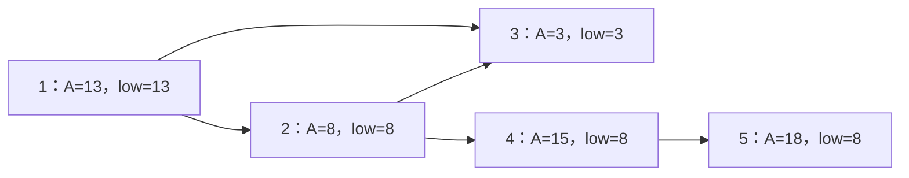

[[TOC]]

## 形式化题目

给定一张 $n$ 个点、$m$ 条有向边的图（无重边），点 $i$ 有权值 $A_i$。每条边 $X_i \to Y_i$ 满足 $X_i < Y_i$，即所有边都从小号指向大号。

要求选一条长度至少为 $1$ 的有向路径 $u \to \dots \to v$，输出 $A_v - A_u$ 的最大值；对每个点来说，权值既是路径起点的代价，也是终点的收益。

原题把点称为「城镇」、把边称为「道路」、把权值称为「金价」，下文遇到时按这些叫法理解。

## 暴力解法

### 适用范围

$n \leqslant 200$，即 `brute.cpp` 里 `MAXN = 205` 的上界。它的用途有两个：把题意写成可执行的说明书，以及作为对拍的基准。

### 思路

对每个买入城镇 $u$，从 $u$ 出发沿有向边做一次 DFS，标记所有能到达的城镇。遍历结束后扫一遍全部城镇 $v$：只要 $v$ 本轮被标记，就说明存在一条 $u \to \dots \to v$ 且至少走了一条边的路径，于是 $A_v - A_u$ 是一个合法候选，用它更新答案。

实现上有两个细节。第一，把本轮标记记成起点编号本身（判断 `visited[v] == u`），就不必每轮清空 `visited`。第二，答案初值取 $-\infty$，因为买入价高于卖出价时真实答案是负数，不能用 $0$ 垫底。

### 代码

@include-code(./brute.cpp, cpp)

### 复杂度与瓶颈

- 时间：每个起点做一次 DFS，单次 $O(N+M)$，$n$ 个起点合计 $O(N(N+M))$。$N = M = 2\times10^5$ 时是 $8\times10^{10}$ 量级，不可行。
- 空间：$O(N+M)$。

瓶颈不在一次 DFS 本身，而在于**它被重复执行了 $N$ 次**。每个起点都把能到达的城镇重新标记一遍，而不同起点的可达集合大量重叠，同一条边会被几十个起点反复走过。换个方向看更清楚：接下来真正需要的信息是「哪些城镇能走到某个 $v$」，以及这些城镇里的最低价；这份信息目前被拆成了 $N$ 次互不相干的遍历，谁都没有把它合并起来。下一步要做的就是把 $N$ 次遍历压成一次。

## 正解：按编号扫描

### 关键观察

**观察一：编号本身就是拓扑序。** 题面保证 $X_i < Y_i$，每条边都从小编号指向大编号，于是任意路径上的城镇编号严格递增，$1, 2, \dots, N$ 直接就是一个合法的拓扑序。

这条保证省掉的东西比看上去多。一般的有向图要按依赖顺序处理，得先做拓扑排序；如果图里存在环，还得先 SCC 缩点。本题用一句 $X_i < Y_i$ 就把这些步骤全部免掉了：从 $1$ 扫到 $N$，第 $v$ 个城镇需要的信息一定在前面已经算完。

**观察二：卖出点固定时，利润只取决于最低买入价。** 路径终点是 $v$ 时，候选值为 $A_v - A_u$，它随 $A_u$ 变小而变大。所以每个城镇只需要存一个数：能走到它的城镇里的最低金价。

把这个数记作 $low[v]$，含义是「能走到 $v$ 的城镇（含 $v$ 自己）里的最低金价」。转移式为

$$low[v] = \min\left(A_v,\ \min_{(u,v)\in E} low[u]\right)$$

右边第二项说的是：能走到某个入边对端 $u$ 的城镇，跨过边 $(u,v)$ 之后自然也能走到 $v$。第一项 $A_v$ 表示「就地在 $v$ 买」，先记下来供 $v$ 的后继使用。

下图是题面样例 2 的图，每个点里同时写着金价和最终算出的 $low$ 值。



读图时注意三件事：所有箭头都从小编号指向大编号，所以从左往右读就天然是拓扑序；城镇 5 的 $low = 8$ 不是它自己的金价，而是从城镇 2 一路传过来的；答案 $18 - 8 = 10$ 就是「在 2 买、在 5 卖」这一对。

### 思路

把两点观察拼起来，就得到一个 $O(N+M)$ 的扫描：

1. 只存入边，`from[v]` 记下所有满足 $u \to v$ 的 $u$。DP 只往反方向读，出边表用不上。
2. 按 $v = 1 \to N$ 处理。先算出 $buy = \min_{(u,v)} low[u]$，也就是走到 $v$ 之前能买到的最低价。
3. 如果 $v$ 有入边，用 $A_v - buy$ 更新答案（答案初值取 $-\infty$）。没有入边的城镇不能当卖出点，因为方案要求至少走一条边。
4. 最后写回 $low[v] = \min(A_v, buy)$，把「在 $v$ 买」这条路留给后继。

第 3 步是本题最容易写错的地方。顺手写成 $\max_v (A_v - low[v])$ 看着更整齐，但 $low[v] \leqslant A_v$ 恒成立，每个城镇都会贡献一个不小于 $0$ 的候选，答案必然非负。样例 3 的正确输出是 $-99$，这样写会得到 $0$。所以答案必须挂在**入边**上，而 $low[v]$ 里包含 $A_v$ 只是为了给后继提供买入价。

样例 2 的逐点过程如下。给定 $A = [13, 8, 3, 15, 18]$，边为 $2\to4$、$1\to2$、$4\to5$、$2\to3$、$1\to3$：

| $v$ | $A_v$ | 指向 $v$ 的城镇 | $buy = \min low[u]$ | $A_v - buy$ | $low[v]$ |
| --- | --- | --- | --- | --- | --- |
| 1 | 13 | 无 | — | — | 13 |
| 2 | 8 | 1 | 13 | -5 | 8 |
| 3 | 3 | 1、2 | 8 | -5 | 3 |
| 4 | 15 | 2 | 8 | 7 | 8 |
| 5 | 18 | 4 | 8 | 10 | 8 |

每一行是「在 $v$ 卖」的那一步。第 4 行可以看到，城镇 4 的入边只有 $2\to4$，而 $low[2] = 8$ 已经把「城镇 1 的金价 13 不划算、城镇 2 的 8 才划算」这件事记下来了，所以候选直接是 $15 - 8 = 7$。第 5 行的 $low[4] = 8$ 同理压掉了「在 4 买要 15」，最终 $18 - 8 = 10$ 即为答案。第 1 行没有入边，它只把 $13$ 记进 $low$ 供别人使用，自己不产生候选。

### 代码

@include-code(./main.cpp, cpp)

### 复杂度

- 时间：每个城镇扫一次，每条边只在它终点的 `from` 里被读一次，合计 $O(N+M)$。
- 空间：`from` 邻接表存 $M$ 个起点编号，加上 `price`、`low` 两个数组，合计 $O(N+M)$。

$N = M = 2\times10^5$ 的实测（`-O2`、`cin` 关闭同步、含读入，重复三次取代表值）：随机图约 125 ms、11.2 MiB，链约 84 ms、14.5 MiB。题面限制为 2 s / 1024 MiB，余量充足。

## 解法二：反向记忆化 DFS

### 思路

同一个 $low$ 定义也可以直接递归写：`get_low(v)` 先把所有入边对端递归算完，再与 $A_v$ 取最小，结果记进 `low[v]`，下次直接返回。这份实现只用「图是有向无环图」这一条性质，并不依赖 $X_i < Y_i$ 给出的编号顺序。

它和主解的关系可以用一句话概括：主解把递归展开成按编号的循环，代价是必须存在一个已知的拓扑序；解法二把「顺序」交给递归自己找，代价是栈。

代价有多大可以直接量。$N = 2\times10^5$ 的链上递归深度等于链长，`--stack 8` 时崩溃（RE，signal 11），`--stack 16` 时通过，折合每帧约 56 B；不带 `--stack` 时峰值内存 26.8 MiB，比主解多出约 12 MiB。判题器的栈默认与内存上限同样大，所以这份代码在本地判题下能过；但栈上限一旦收紧，它就会先出问题，而 `main.cpp` 没有这层约束。

还有一个前提不能忘：记忆化递归只在 DAG 上成立。题面的 $X_i < Y_i$ 保证了无环；没有这条保证时，环上的城镇会互相等待对方的 $low$，递归直接转不出来。那时必须先 SCC 缩点成 DAG，再按拓扑序做同样的 DP，编号顺序也不再是拓扑序。

### 代码

@include-code(./main2.cpp, cpp)

### 复杂度

时间与主解同阶：每个城镇、每条边各访问一次，$O(N+M)$。空间多出递归栈，$O(\text{最长链长度})$。同规模实测：随机图约 165 ms、11.4 MiB，链约 105 ms、26.8 MiB。链上多出的约 12 MiB 正是递归调用栈，与「每帧约 56 B × $2\times10^5$ 层」相符。

## 总结

本题的骨架是「在有向无环图上做一次极值传播」，三件事各自解决一个具体障碍：

- **编号即拓扑序**。$X_i < Y_i$ 是整道题的关键条件。它让拓扑排序、SCC 缩点、记忆化递归这些处理顺序的手段都变成不必要，只留下一个从 $1$ 到 $N$ 的普通循环。
- **最大差价只需要一个数**。卖出点固定时只关心最低买入价，于是暴力里那份被重复算了 $N$ 次的可达信息，被压成每个城镇一次的最小值合并。
- **答案口径有两处坑**。候选必须挂在入边上，否则 $low[v] \leqslant A_v$ 会让答案被强行抬到非负；初值必须取 $-\infty$，因为真实答案可以是负数。

把本题与同类题对照：多源最短路也是把初始值沿边传播，但它每次比较的是「距离加边权」，本题比较的只是「买入价取最小」，所以每条边读一次就够。而一旦图允许有环，同一条传播规则就必须先 SCC 缩点，题面那句 $X_i < Y_i$ 也不是可以随手去掉的条件。

## 图示解析

下面这张 ASCII 图串起两层解法，标出每层消除的瓶颈。

```text
暴力（brute.cpp）
  枚举买入城镇 u -> DFS 标记 u 能到达的所有城镇 -> 取 max(A[v] - A[u])
  每个起点都要重新遍历一遍边，总计 O(N(N + M))
        |
        | 瓶颈：每个起点都把可达集合重标一遍，N 次遍历互相重叠
        v
正解（main.cpp）
  X[i] < Y[i] -> 编号就是拓扑序，一遍 for v = 1..N 即可
  buy  = min(low[u]) over (u -> v)          // 走到 v 之前的最低价
  ans  = max(ans, A[v] - buy)               // 只在有入边的 v 上产生候选
  low[v] = min(A[v], buy)                   // 就地买入，留给后继
  总计 O(N + M)，无递归
        |
        | 同一套递推换一种实现：把「顺序」交给递归
        v
解法二（main2.cpp）
  反向记忆化 DFS，只要求图是 DAG，不依赖编号顺序
  代价：递归深度 = 最长链（2e5 链上需要 8-16 MiB 栈）
```

图中两处标注对应两次真正的跨越。第一次把 $N$ 次 DFS 合并成一次扫描，靠的是「卖出点固定时只需要最低买入价」；第二次没有换算法，只是换实现，说明主解真正的依赖是「拓扑序已知」，而编号顺序恰好提供了它。
