[[TOC]]

## 形式化题目

给定两个非负整数序列 $a_1,\dots,a_n$ 与 $b_1,\dots,b_m$。对每个 $i$ 选一个下标 $j_i$（不同的 $i$ 可重复选同一个），令 $c_i=a_i\mathbin{\&}b_{j_i}$，最小化

$$
R=c_1\mid c_2\mid\cdots\mid c_n
$$

约束为 $1\le n,m\le200$，$0\le a_i,b_j<2^9$，因此只涉及二进制位 $8$ 到 $0$。

## 解法总览

两份代码走的是同一条贪心主线：从高位到低位决定答案，某一位能否取 $0$ 等价于每一行都还能找到一个在这一位取 $0$ 的候选值 $a_i\mathbin{\&}b_j$。

它们的区别只在于「已经确定为 $0$ 的高位」怎么记下来：

- **解法一**把这些位置压成一个允许位掩码 $M$，每轮用按位子集条件重新判定一次；
- **解法二**把每行还能选择的候选值直接存进二维桶，每轮先判定、再淘汰不合规的候选。

| 解法 | 核心观察 | 复杂度 | 适用场景 | 对应代码 |
| --- | --- | --- | --- | --- |
| 一：允许位掩码 | 已确定的前缀就是一个「允许出现 1」的位集合，逐行判断 $x\mathbin{\&}(\sim M)=0$ | $O(Bnm)$ | 实现最短，状态只有一个整数 | `main.cpp`、`main.py` |
| 二：二维候选桶 | 桶里剩下的正是满足已确定 $0$ 位的候选，淘汰候选等于给掩码加限制 | $O(Bnm)$ | 把「每行还能选什么」显式画出来时更好跟踪 | `main2.cpp` |

推荐提交的是解法一（`main.cpp`），解法二用来对照理解桶的含义。两者复杂度同阶，都是 $O(Bnm)$，其中 $B$ 是扫描的位数。

## 解法一：允许位掩码

### 思路

每个 $a_i$ 有 $m$ 种选法，枚举所有组合是 $m^n$ 种，跑不动。目标只是让最终的 OR 尽量小，不必先定每行选谁，可以从最高位开始确定答案：

1. 高位的权重大于它下面所有低位之和，所以更高位不变时，当前位能取 $0$ 就必须取 $0$。
2. OR 的某一位要为 $0$，每一行都必须在这一位给出 $0$。于是每一位只需问：是不是每一行都还有候选能在这一位取 $0$。
3. 定为 $0$ 的位对所有行都是禁令；定为 $1$ 的位不限制任何行；还没处理的低位先放过。
4. 把这些禁令收进一个掩码 $M$：$M$ 为 $0$ 的位置不许出现 $1$，为 $1$ 的位置放行。
5. 判定的不是「结果等于 $M$」，而是「结果不超出 $M$」。后者能拆成逐行检查。
6. 从高位到低位，每位试着把 $M$ 的这位清 $0$ 再判一次：判得过就留下 $0$，判不过就保留 $1$。

**为什么不能每一位单独判断？** 只有一行，$a_1=(110)_2$，两个 $b_j$ 是 $(010)_2$ 和 $(100)_2$。第 $2$ 位有 $(010)_2$ 可取 $0$，第 $1$ 位有 $(100)_2$ 可取 $0$，但没有哪个候选能让这两位同时为 $0$。所以必须把已确定的位累积起来一起判。

**「不超出 $M$」是一个按位子集条件。** 把数看成位集合：$x$ 的每个 $1$ 都必须落在 $M$ 为 $1$ 的位置上，记作 $x\subseteq M$，也就是

$$
x\mathbin{\&}(\sim M)=0
$$

这里比较的是位的位置集合，不是数值大小：$(100)_2$ 比 $(1011)_2$ 小，但它的第 $2$ 位是 $1$，而 $M$ 在这一位是 $0$，所以仍然不合规。把前缀收成掩码、再用它筛候选，就是下面这张图。

图中 $M$ 为 $0$ 的两列是所有候选都不能越过的禁令，为 $1$ 的列只是放行、不要求取 $1$。

**为什么能逐行检查。** 若每行都选了合规的候选，OR 只是把这些合规位并起来，结果仍合规；反过来，结果合规时任何一个 $c_i$ 都不可能在 $M$ 之外出现 $1$，否则这个 $1$ 会被 OR 留下来。两个方向合起来就是等价，所以一次判定只需 $O(nm)$。

**判失败时这一位为什么只能是 $1$。** 试探时低位已经全部放开，这样都找不到合法选择，再收紧低位也不可能让这一位变成 $0$。反过来，判成功就说明存在一组完整选择支持这个 $0$。保留为 $1$ 的位后面也不会变 $0$，因为后续只会加限制。

样例的走势见图二。

试探 `001` 时第二行的 `010`、`100` 都不合规，这一位只能保留 $1$；试探 `010` 成功后各行可选 `000`、`010`、`000`、`000`，OR 为 $(010)_2=2$。

### 代码

下面两份实现都用 `test` 完成逐行判定，再从高位向低位尝试清零。代码将初值设为 $(1\ll10)-1$，并从第 $9$ 位扫描到第 $0$ 位；由于输入小于 $2^9$，额外的第 $9$ 位一定能清零，不影响结果。

C++ 版本：

@include-code(./main.cpp, cpp)

Python 版本：

@include-code(./main.py, python)

### 复杂度

设扫描位数为 $B$，每次判定最多看 $nm$ 个候选值，总时间 $O(Bnm)$；$B=10$、$n,m\le200$ 时约 $4\times10^5$ 次访问。除两个输入序列外只需常数辅助空间，空间 $O(n+m)$。

## 解法二：二维候选桶

### 思路

先问最高位能不能为 $0$：只要每一行都找得到一个 $b_j$，使 $a_i\mathbin{\&}b_j$ 的最高位是 $0$，就可以。

1. 定下的前缀里，$0$ 强制每行的候选在这一位为 $0$；$1$ 放行，没定的低位也放行。
2. 每行的可用范围只随前缀缩小，于是给每行一张表 `alive[i][j]`，记 $b_j$ 是否还合规。
3. 处理新的一位时先查表：每行都还有该位为 $0$ 的候选，这一位就定为 $0$，并划掉各行该位为 $1$ 的候选。
4. 只要有一行没有，这一位只能是 $1$，表不动——那些该位为 $1$ 的候选并没有违反前缀。
5. 每个候选只会被更高的位淘汰一次，逐位扫完就是最小答案。

### 代码

这份实现把判定遍和淘汰遍拆成 `row_can_zero(i, bit)`、`drop_bit_one(bit)` 两个函数，`solve` 只负责初始化桶、按位推进，并把清不掉的位记进 `ans`。桶按题面规模开成 $205\times205$，一格只存可选与不可选，用 `bool` 就够。

@include-code(./main2.cpp, cpp)

### 复杂度

每轮一次判定遍加一次淘汰遍，各最多 $nm$ 次访问，总时间复杂度仍是 $O(Bnm)$，空间 $O(nm)$。因为固定做两遍扫描，常数比解法一大一些：$n=m=200$ 的满规模随机数据上，本机评测分别约 $1.5$ ms 和 $2.5$ ms，两者都远在 $1$ 秒限制之内。

## 复杂度对比

| 解法 | 时间 | 空间 | 与另一份的取舍 |
| --- | --- | --- | --- |
| 一：允许位掩码 | $O(Bnm)$ | $O(n+m)$ | 状态只有一个整数，判定一遍扫描 |
| 二：二维候选桶 | $O(Bnm)$ | $O(nm)$ | 每轮多一遍淘汰扫描，但候选集合显式可见，便于调试和手推 |

两种写法在同一份贪心上等价，$B=10$ 时都只有 $4\times10^5$ 量级的访问。想写得短、少占内存就用解法一；想看清楚「每行此刻还能选什么」就用解法二。

## 总结

这条思考路径可以概括为：**数值最小化先看高位；OR 的某位要为 $0$，每一行就都必须避开这一位；把前缀中累积的禁用位置放进同一个掩码，就得到逐行的按位子集判定。**

真正需要记住的是限制的含义：$0$ 是所有行都必须遵守的禁令，$1$ 是单行可以使用的位置。前缀不能逐位独立检查，但可以整体压缩成一个掩码；行与行的选择则因为允许重复使用 $b_j$ 而彼此独立。区分这两种关系，才能从组合枚举走到 $O(Bnm)$ 的判定与贪心。

两种实现只是记账方式不同：掩码把「哪些位置被禁」写在答案里，二维桶把同一份信息写在每行的候选值上。判定与淘汰都只在检查一个性质，即这一行还留不留着一条不违反前缀的路。
