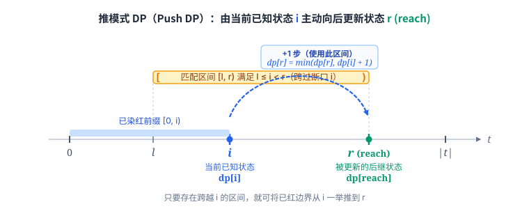

[[TOC]]

## 形式化题目

给定一个字符串 $t$ 和 $n$ 个字符串 $s_1, s_2, \dots, s_n$。下标一律从 $0$ 开始。

一次操作：选一个字符串编号 $w$ 和 $t$ 的一个起始位置 $p$，要求 $t[p \dots p+|s_w|-1] = s_w$，再把半开区间 $[p, p+|s_w|)$ 内的字符全部标红。同一个 $s_w$ 可用任意多次，不同区间是否重叠不作限制。

目标是用最少的操作次数让 $t$ 的每个位置都被标红（即覆盖整个半开区间 $[0, |t|)$），并给出每一步选的 $w$ 与 $p$。若无法覆盖全部位置，输出 $-1$。

## 解法总览

题目规模很小（$|t| \leqslant 100$，$n \leqslant 10$），难点不在算法复杂度，而在把“涂红”这件事转成正确的组合模型。两种解法建立在同一个观察上，区别只在如何推进。

把每个 $s_i$ 在 $t$ 中的每一次出现看成一个能“一步整段涂红”的半开区间 $[l, r)$（其中 $r = l + |s_i|$）。那么“把 $t$ 全涂红”等价于“用这些区间的并集盖满半开区间 $[0, |t|)$”。每个区间代价都是 $1$，问题就是经典的“最少区间覆盖整段”。采用半开区间的好处在于：子串长度就是右端点与左端点之差，覆盖状态直接对齐光标下标，不需要任何 $\pm 1$ 的换算。

| 解法 | 核心观察 | 复杂度 | 适用场景 | 对应代码 |
| --- | --- | --- | --- | --- |
| 解法一：贪心 | 从左往右推进，每步在左端点已被覆盖的区间里取能延伸最远的右端点 | $O(n\lvert t\rvert^2)$ | 只求最少步数、顺带记录方案，实现最短 | `main.cpp`、`main.py` |
| 解法二：DP | 以“已涂红前缀长度”为状态，逐层推进能到达的最远前缀 | $O(n\lvert t\rvert^2)$ | 需要最短路式建模、方案回溯更稳妥 | `main2.cpp`、`main2.py` |

两者答案必然相同。每个区间代价都是 $1$，贪心里“取最远右端点不劣”这条性质，正是 DP 中可以把较短前缀的状态直接合并到较长前缀上的依据。正式主解取贪心 `main.cpp`，它对本题最直接、代码最少。

## 解法一：贪心（最少区间覆盖整段）

!!! info 从待覆盖光标出发，每步选能延伸最远的半开区间。
把每个 $s_i$ 的每次出现变成半开区间 $[l, r)$（$r = l + |s_i|$）。维护光标 $\text{cur}$ 表示 $[0, \text{cur})$ 已全红，下一个必须被染红的位置就是 $\text{cur}$。在所有覆盖 $\text{cur}$（即 $l \leqslant \text{cur} < r$）的候选区间中，选择右开端点 $r$ 最大的那个涂上它，并将光标直接推进到 $\text{cur} \leftarrow r$，同时记录其 $w$ 与 $p$。重复直到 $\text{cur} = |t|$。若某一步没有任何区间的右端点能超过 $\text{cur}$（即断层），输出 $-1$。正确性基于贪心交换：任何可行解都必须有区间跨过当前光标，换成能延伸最远者必不劣。
!!!

### 思路

落成区间覆盖之后，问题就是选最少的区间盖住半开区间 $[0, |t|)$。

相比全闭区间 $[l, r]$，**半开区间 $[l, r)$ 在思考与实现上心智负担更低**：
- 子串从下标 $p$ 开始、长为 $|s_w|$，其半开区间右端点自然是 $r = p + |s_w|$，与字符串切片直觉一致，不需要 $-1$；
- 我们用一个光标 $\text{cur}$ 表示当前进度：前缀 $[0, \text{cur})$ 已经全红，**下一个必须被覆盖的字符下标正是 $\text{cur}$**；
- 推进时，选定右端点为 $r$ 的区间后，覆盖范围直接扩展到 $[0, r)$，下一步光标直接是 $\text{cur} \leftarrow r$，不需要 $+1$。

任何可行解都必须有一个区间覆盖当前光标 $\text{cur}$，否则该位置永远涂不红。既然必须覆盖 $\text{cur}$，那么在所有满足 $l \leqslant \text{cur} < r$ 的区间里，右端点 $r$ 最大的那个向右延伸最远，绝不会让后续决策变差。这就是贪心选择的正确性所在。

算法流程很直接：

1. 预处理找出所有子串匹配，得到半开区间集合 $(l, r, w, p)$，其中 $r = l + |s_w|$；
2. 初始化 $\text{cur} \leftarrow 0$；
3. 当 $\text{cur} < |t|$ 时，在所有满足 $l \leqslant \text{cur}$ 的区间里寻找 $r$ 最大的区间：
   - 若最大的 $r \leqslant \text{cur}$，说明当前位置无法被任何可用区间越过（出现断层），输出 $-1$；
   - 否则记录方案 $(w, p)$，并将光标更新为 $\text{cur} \leftarrow r$。

这里的候选条件是“$l \leqslant \text{cur}$”，而不是要求恰好接缝“$l = \text{cur}$”。题目允许区间重叠，一个区间完全可以从更早的已涂红区域起步，只要其右端点能跨过当前光标并向右延伸即可。

### 代码

同一算法的 C++ 与 Python 实现，逻辑一致。

C++ 版本：

@include-code(./main.cpp, cpp)

Python 版本：

@include-code(./main.py, python)

### 复杂度

区间总数 $O(n|t|)$，生成并排序 $O(n|t| \log(n|t|))$。贪心循环最多 $|t|$ 步，每步扫一遍区间 $O(n|t|)$。总时间 $O(n|t|^2)$，空间 $O(n|t|)$。$n \leqslant 10, |t| \leqslant 100$ 时量级在 $10^6$，远低于限制。

## 解法二：DP（覆盖前缀的最少步数）

!!! info 以“已涂红前缀长度”为状态，采用推模式 DP 逐层向后更新。
令 $dp[i]$ 为涂红半开前缀 $[0,i)$ 的最少步数，$dp[0]=0$。采用**推模式 DP**：以当前已知状态 $i$ 为起点，枚举每一个覆盖断口 $i$ 的可用区间 $[l, r)$（满足 $l \leqslant i < r$），将其能扩展到的新前缀终点设为 $\text{reach} = r$。主动更新后继状态 $dp[\text{reach}]=\min(dp[\text{reach}], dp[i]+1)$，并用前驱数组记下这一步转移用的 $w,p$。若 $dp[|t|]$ 仍是无穷大则无解，否则从 $|t|$ 沿前驱回溯出方案。
!!!

### 思路

贪心每步只保留“最远右端点”一个状态，这是把问题压缩后的结果。与其一开始就相信这个压缩，不如保留所有可能的前缀终点，用 DP 把方案空间完整扫一遍，答案自然浮现，方案也好回溯。

#### 状态定义

涂红过程是单调向右扩张的：一旦前缀 $[0,i)$ 全红，“红到哪”只需要一个数 $i$（即半开前缀长度）表示，内部哪些区间重叠过并不重要。

定义 $dp[i]$ 表示将半开区间 $[0, i)$ 全部涂红所需的最少步数，起点 $dp[0]=0$（尚未涂红任何字符时步数为 $0$）。

#### 转移方程：推模式 DP

本题采用**推模式 DP**（Push DP，即“刷表法”）：不是站在后继点去拉取前驱，而是**用当前已确定的前缀点 $i$ 主动去更新后面的点 $j$（即 $\text{reach}$）**。

当遍历到当前位置 $i$ 且 $dp[i]$ 可达时，任取一个覆盖了当前断点 $i$ 的半开匹配区间 $[l, r)$（要求 $l \leqslant i < r$）。该区间左侧落在已红区域内（允许重叠），右侧越过了断口 $i$，因此能将染红前缀一口气向右推进到 $\text{reach} = r$。由此产生向后推进的状态转移：

$$
dp[\text{reach}] = \min\bigl(dp[\text{reach}],\; dp[i] + 1\bigr).
$$

图示清晰展现了这一**推模式 DP** 的核心思想：
- **当前点 $i$ 作为发射源**：已知 $[0, i)$ 的最优代价为 $dp[i]$；
- **区间 $[l, r)$ 作为跳板**：只要 $l \leqslant i < r$，区间就能无缝跨过当前必须染红的位置 $i$；
- **后继点 $\text{reach} = r$ 被主动刷新**：用 $dp[i] + 1$ 的代价去松弛 $dp[\text{reach}]$，并记录转移前驱。

把 $i$ 从 $0$ 到 $|t|-1$ 顺次推进，每个可达的 $i$ 枚举所有匹配区间做转移。用 `pre[]` 记下每个后继状态是由哪个前驱 $i$ 与哪次操作推进而来的，最后从 $|t|$ 沿前驱回溯，即得到全局最优涂红方案。

用样例 $t=\texttt{bababa}$、$s_1=\texttt{ba}$、$s_2=\texttt{aba}$ 走一遍。可用半开区间为 `ba` 的 $[0,2),[2,4),[4,6)$ 与 `aba` 的 $[1,4),[3,6)$，下表给出 $dp$ 被有效更新的过程：

| 当前前缀点 $i$ | 当前 $dp[i]$ | 选用区间 $[l,r)$ | 推进到的后继点 $\text{reach}$ | 更新结果 |
| --- | --- | --- | --- | --- |
| $0$ | $0$ | $[0,2)$ | $2$ | $dp[2]=1$ |
| $2$ | $1$ | $[1,4)$ | $4$ | $dp[4]=2$ |
| $4$ | $2$ | $[3,6)$ | $6$ | $dp[6]=3$ |

最终 $dp[6]=3$，与样例的最少步数一致；沿 `pre[]` 回溯得到的三步正好对应上表的三行。

若最终 $dp[|t|]$ 仍是无穷大，说明有位置涂不到，输出 $-1$。

### 代码

同一算法的 C++ 与 Python 实现，逻辑一致。

C++ 版本：

@include-code(./main2.cpp, cpp)

Python 版本：

@include-code(./main2.py, python)

### 复杂度

状态数 $O(|t|)$，每个状态枚举区间 $O(n|t|)$，时间 $O(n|t|^2)$。额外记录映射关系，空间 $O(|t|)$（区间表 $O(n|t|)$）。与贪心同阶。

## 复杂度对比

| 解法 | 时间 | 空间 | 方案回溯 |
| --- | --- | --- | --- |
| 贪心 | $O(n\lvert t\rvert^2)$ | $O(n\lvert t\rvert)$ | 边推进边记录 |
| DP | $O(n\lvert t\rvert^2)$ | $O(\lvert t\rvert)$ | 前驱数组回溯 |

两种解法复杂度相同，因为本题规模本就很小。选贪心是因为它最短、最贴合“区间覆盖”的直觉；选 DP 是因为状态定义清晰、方案回溯不易出错。若把数据放大到 $|t|=10^5$，只要把“每步扫一遍区间”换成“按左端点预处理 + 预扫最大右端点”，贪心就能降到 $O(|t| + n|t|)$，而 DP 的思路不变。

## 总结

这题的转折是把“涂红字符”翻译成“选区间覆盖整段”：每个 $s_i$ 的每次出现都是一个代价为 $1$ 的区间，目标就是最少区间覆盖。

在此基础上两条路都成立：

- 贪心：当前位置必须被某个区间跨过，选能延伸最远的那个不会让后续变差，于是每步取最远右端点；
- DP：把“已涂红前缀长度”当状态，逐层推进到能到达的最远前缀，方案回溯更直观。

两个容易写错的地方：

- 采用半开区间 $[l, r)$ 思考与实现，状态从头到尾对齐待覆盖光标 $\text{cur}$，免除 $\pm 1$ 的差一边界；
- 允许区间重叠，所以候选区间的左端点用 $l \leqslant \text{cur}$（DP 里是 $l \leqslant i$），而不是要求恰好接缝；
- 找不到任何能越过当前位置的区间时（$r_{\max} \leqslant \text{cur}$）输出 $-1$，别漏判无解。
