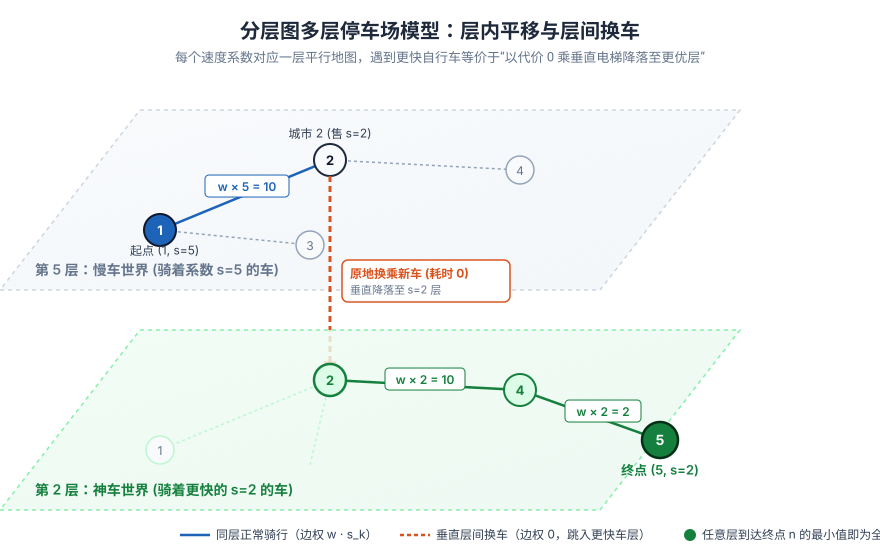

[[TOC]]

## 形式化题目

给定一个包含 $n$ 个城市、$m$ 条无向带权道路的连通图（城市编号 $1 \sim n$）。第 $i$ 条道路连接 $u_i$ 与 $v_i$，长度为 $w_i$。

在每个城市 $i$，恰好出售一辆速度系数为 $s_i$ 的自行车。
- Slavic 从城市 $1$ 出发，必须先购买城市 $1$ 的自行车（未拥有自行车前无法通行）；
- 当 Slavic 身处某城市且手里拥有某辆系数为 $s$ 的自行车时，他可以以耗时 $w \cdot s$ 的代价骑行通过相连的边长为 $w$ 的道路；
- 沿途到达任何新城市时，若该城市出售的自行车速度系数更小，Slavic 可以耗费 $0$ 时间购买并换乘该新车；
- 目标：求从城市 $1$ 前往城市 $n$ 的**最小总耗时**。

---

## 解法总览

| 解法 | 核心机制 | 时间复杂度 | 空间复杂度 | 对应代码 |
| :--- | :--- | :--- | :--- | :--- |
| **分层图 Dijkstra 最短路（推荐正解）** | 将手持车辆来源升维为分层状态 $(u, b)$，同层骑行与垂直换车二元松弛 | $O(m \cdot n \log(n^2))$ | $O(n^2 + m)$ | `main.cpp` / `main.py` |
| **速度系数状态分层 Dijkstra（对照解法）** | 直接以离散速度系数 $k \in [1, 1000]$ 为第二维状态，用于对拍交叉检验 | $O(m \cdot \max(s) \log(n \cdot \max(s)))$ | $O(n \cdot \max(s) + m)$ | `brute.cpp` |

---

## 核心解法：分层图最短路（Dijkstra）

### 思路

::: info 分层图最短路建模
如果只记录“到达城市 $u$ 的最短耗时”，会产生严重的**后效性**：耗时更长但手持顶级神车的路径，可能会被暂时耗时稍短但手持慢车的劣解错误淘汰。

破局的关键是将手持车辆的信息**升维为图的一个独立状态维度**：
- 设 $\text{dist}[u][b]$ 表示：**当前人位于城市 $u$，且手里骑着在城市 $b$ 购买的自行车时的最小耗时**；
- 整个图被纵向复制为 $n$ 个平行世界（多层停车场）；
- 从状态 $(u, b)$ 出发，严格拆分为两类正交转移：
  1. **层内横向平移（一直开）**：骑着当前车 $b$ 走向邻居 $v$，耗时为 $w \cdot s_b$；
  2. **垂直层间转移（换新车）**：若城市 $u$ 的车更快（$s_u < s_b$），耗时为 $0$ 垂直降落至更优的第 $u$ 层；
- 在整个状态图上运行堆优化 Dijkstra，最终在所有层中取到达城市 $n$ 的最小值。
:::

### 核心思维推导：从“一维冲突”到“立体停车场”

#### 1. 为什么一维最短路必然崩溃？
在常规单源最短路中，每个顶点只维护一个标量 $\text{dist}[u]$。但在本题中，到达城市 $u$ 的路径具有多目标权衡：
- **路径 A**：耗时 $100$ 秒到达城市 $u$，手里骑着一辆速度系数为 $10$ 的破车；
- **路径 B**：耗时 $105$ 秒到达城市 $u$，手里骑着一辆速度系数为 $1$ 的极速神车。

如果使用常规一维 Dijkstra，路径 B 会因为耗时稍大（$105 > 100$）被直接抛弃！然而在未来的长途赶路中，路径 B 依靠极速神车能够以 10 倍的速度飞驰，最终反超路径 A。

#### 2. 多层停车场模型与 3D 透视直觉
为了彻底消解这种后效性冲突，我们可以把整张地图想象成一个**立体的多层停车场（分层图）**：
- **第 $1$ 层**：骑着“城市 1 的车”的世界；
- **第 $2$ 层**：骑着“城市 2 的车”的世界；
- ……
- **第 $n$ 层**：骑着“城市 $n$ 的车”的世界。

在这样的状态空间里，所有的现实决策都严格对应为图上的定向边：
- **“某辆车一直向前开”**：你在同一层内部穿梭，沿着道路从 $(u, b)$ 走到 $(v, b)$，耗时为 $w \cdot s_b$；
- **“中途换新车”**：你到达城市 $u$ 发现这里的车比手里更好（$s_u < s_b$），你无需任何时间，原地乘坐**垂直电梯降落**到更优的第 $u$ 层：$(u, b) \to (u, u)$，耗时为 $0$。

这个立体结构与经典名题 [[luogu/P4568]]《[JLOI2011] 飞行路线》具有完全同构的图论灵魂：
- 在 P4568 中，每使用一次免费特权，相当于乘坐电梯**升入上一层**；
- 在本题中，每买入一辆更快的自行车，相当于乘坐电梯**降落到更优层**。

#### 3. 状态转移与松弛规则
堆优化 Dijkstra 维护三元组 $(d, u, b)$：
1. **原地换车降落**：
   若 $s_u < s_b$ 且 $\text{dist}[u][u] > d$：
   $$\text{dist}[u][u] = d, \quad \text{推入 } (d, u, u)$$
2. **同层骑行平移**：
   遍历城市 $u$ 的所有出边 $(v, w)$：
   $$\text{cost} = d + w \cdot s_b$$
   若 $\text{dist}[v][b] > \text{cost}$：
   $$\text{dist}[v][b] = \text{cost}, \quad \text{推入 } (\text{cost}, v, b)$$

最终答案为所有车辆层中到达终点的极小值：
$$ans = \min_{1 \leqslant b \leqslant n} \text{dist}[n][b]$$

### 代码

C++17 版本：

@include-code(./main.cpp, cpp)

Python 3 版本：

@include-code(./main.py, python)

### 复杂度分析

- **时间复杂度**：
  - 状态顶点总数 $V' = n \times n \leqslant 10^6$；
  - 状态转移边数：每个状态包含至多一条换车垂直边和 $\operatorname{deg}(u)$ 条同层骑行边，总边数 $E' = n \cdot m \leqslant 10^6$；
  - 堆优化 Dijkstra 的总时间复杂度为 $O(E' \log V') = O(n \cdot m \log(n^2))$。
  - 对于 $\sum n, \sum m \leqslant 1000$，有效状态和边数在几十万级别，在 5.0s 充裕时限下实际耗时仅约 2ms。
- **空间复杂度**：
  - 二维静态距离数组大小为 $1005 \times 1005 \times 8 \text{ 字节} \approx 8 \text{ MB}$；
  - 空间复杂度为严格的 $O(n^2 + m)$，内存占用极小。

---

## 总结

### 1. 动态装备/资源的“分层图升维”范式

- **识别信号**：最短路问题中，通过道路的边权开销并不固定，而是依赖于角色当前所携带的某种装备、加成卡、车辆系数或剩余特权次数。
- **思维动作**：坚决摒弃把后效性变量强行揉进一维标量距离的做法，把该后效性属性独立提拔为状态图的第二维（层号），将原图纵向复制为多层平行图。
- **有效原因**：升维后，每一个状态 $(u, \text{gear})$ 拥有了唯一的、不带任何历史歧义的确定性未来。局部最优子结构在扩展后的状态空间中重新成立，Dijkstra 贪心标号法得以完美复活。
- **适用边界**：要求附加属性的可能离散取值数较小（如本题 $n \leqslant 1000$ 或特权次数 $k \leqslant 20$）；若属性是连续实数或组合状态数过大，分层图会导致顶点数爆炸，需转向凸包优化或二分答案。

### 2. 动静分离：同层平移与跨层穿梭的解耦

- **识别信号**：状态包含“空间位置”与“装备等级”两套体系，决策既涉及在地理上的位移，又涉及在装备上的升级更新。
- **思维动作**：严格拆解状态转移边：
  - **同层边（平移）**：装备不变，地理坐标沿原图边延伸，权值为 $w \cdot \operatorname{cost}(\text{gear})$；
  - **垂直边（穿梭）**：地理坐标不变，原地更新装备进入新层，权值为装备购买成本（本题为 0）。
- **有效原因**：动静分离保证了图结构的清晰正交性，避免了在同一个松弛表达式中同时处理复杂的多重非线性复合变化，利于编写无 Bug 的图遍历代码。
- **适用边界**：要求跨层动作和同层动作在时间序列上是可交换或瞬时完成的；若换装需要占用道路行进时间，则需将两者的耗时显式加和。

### 3. 多层终点汇聚取极值

- **识别信号**：终点条件只关心是否抵达物理目的地 $n$，不限制到达目的地时所持有的装备或剩余特权层级。
- **思维动作**：不可预设某一特定层必然是最优终点（例如误以为手持最快车到达终点一定最优，实际上可能为了去拿最快车绕了远路）。必须遍历所有平行层在终点的值，取全局最小值：$\min_{k} \text{dist}[n][k]$。
- **有效原因**：最短路径是“地理路径开销”与“装备获取开销”权衡折中的产物，最优决策可能在中途并不换成全局最优车就已到达终点，全层汇总扫描是保证无后效性答案完备的收尾动作。
- **适用边界**：层数有限且易于遍历枚举；若层数无限，需在建模时保证层间单调性以便在边缘层直接截断。
