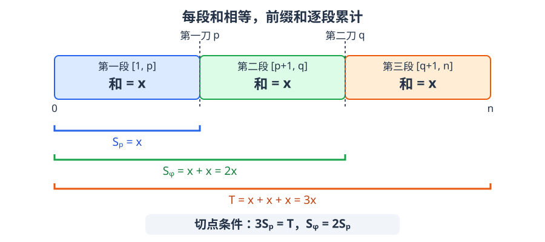

[[TOC]]

## 形式化题目

给定长度为 $n$ 的整数数组，选择两个切点 $1\le p<q\le n-1$，将数组分成三个非空连续段，统计三段和相等的切法数量。

其中 $1\le n\le 5\times10^5$，$|a_i|\le10^9$，元素允许为负数。

## 正解

### 思路

!!! info 将两个切点的联合判断变成右侧前缀和的计数查询。
记前缀和为 $S_k$，总和为 $T$。合法切点必须满足 $3S_p=T$ 和 $S_q=2S_p$。从右往左扫描切点，用哈希表记录右侧各前缀和的出现次数；当前点满足第一个条件时，累加表中 $2S_p$ 的次数，再将当前前缀和入表。扫描方向和先查后插的顺序保证 $p<q$，每对合法切点恰好计数一次。
!!!

枚举两个切点需要 $O(n^2)$ 次判断，无法处理 $5\times10^5$ 个元素。要省掉一层枚举，可以先固定第一刀，看看它需要怎样的第二刀。

记 $S_k=a_1+\cdots+a_k$，$T=S_n$。这里用的就是前缀和最基础的用途：把任意一段的和写成两个前缀状态相减，即 $a_{l+1}+\cdots+a_r=S_r-S_l$（见 rbook 的[前缀和](https://rbook.roj.ac.cn/base/presum/)）。三段相等于是可以写成只含 $S_p,S_q,T$ 的等式：如果三段相等，每段只能是总和的三分之一，因此第一刀必须满足 $3S_p=T$；前两段合起来是第一段的两倍，因此第二刀必须满足 $S_q=2S_p$。

下图用跨段横线标出每个前缀和覆盖的范围，区分“一段的和”和“从开头累计的和”。

两刀分别在第一格和第二格之后，即位置 $p$、$q$。第二刀处的前缀和包含前两段，所以 $S_q=2S_p$；总和包含三段，所以 $T=3S_p$。

反过来，若这两个条件成立，三段和分别是 $S_p$、$2S_p-S_p$ 和 $3S_p-2S_p$，确实相等。于是固定合法的第一刀后，只需要统计右侧有多少个前缀和等于 $2S_p$，不必逐一枚举第二刀。

从右往左扫描 $n-1,n-2,\ldots,1$，用 `bucket` 记录已经扫描过的前缀和次数。处理位置 $p$ 时，表中恰好是 $p+1$ 到 $n-1$ 的切点：

1. 若 `3 * pre[p] == total`，把 `bucket[2 * pre[p]]` 加入答案。
2. 执行 `bucket[pre[p]]++`，供更左侧的第一刀查询。

**先查询，再插入**保证不会把同一个位置同时当成两刀。尤其当总和为零时，两种切点要求的前缀和都是零，更不能反过来操作。例如三个零只有一种切法，若先插入就会额外数到自己与自己的配对。

这里用的是 rbook 里[黑白气球](https://rbook.roj.ac.cn/enumeration_permutaion_combination/pair_number/)讲的点对计数模板，只是本题要多走一步。那篇的框架是：答案是点对的集合，按右端点切成互不相交的 $b_i$，于是 $ans=\sum s(i)$；$s(i)$ 只需知道“历史上有多少点能配它”，就用桶维护，因此查询必须写在入桶之前，桶里只放已处理的点。

本题对应关系：

| 黑白气球 | 本题 |
| --- | --- |
| 点对 $(j,i)$，两个元素 | 点对 $(p,q)$，两个切点 |
| 桶里直接放元素值 | 先换成前缀和状态 $S_p$，再进桶 |
| 合法性天生只涉及一侧（颜色不同） | 三段相等经引理拆成只含 $p$ 的闸门 $3S_p=T$ 与只含 $q$ 的查键 $S_q=2S_p$ |
| 从左扫，桶里是 $i<j$ 的左侧点 | 从右扫，桶里是 $p<q$ 的右侧点 |

最后一行的好处是位置关系由扫描方向自动保证，不用再比较下标；而“当前点不能和自己配对”没有捷径，仍然只能靠把累加写在入表之前。桶的语义反过来了，这条顺序不变量却没变。

扫描不包含 $0$ 和 $n$，保证首尾两段非空；表中位置严格在当前点右侧，保证中间段非空。每对合法切点只在处理其第一刀时计数一次，因此既不会遗漏，也不会重复。$n<3$ 时没有可配对的两个切点，答案自然为零。

判断使用乘法 `3 * pre[p] == total`，避免总和不能被三整除时被整数除法取整误导。负数不会影响前缀和等式或哈希计数，无需假设前缀和单调。

### 样例说明

样例一的数组为 $[1,2,3,0,3]$。下表只列允许切开的位置，行中给出前缀和及其用途。

| 切点位置 | 1 | 2 | 3 | 4 |
| --- | --- | --- | --- | --- |
| 前缀和 | 1 | 3 | 6 | 6 |
| 用途 | 不满足条件 | 第一刀 | 第二刀 | 第二刀 |

总和为 $9$，第一刀只能在位置 $2$，其右侧有两个前缀和为 $6$ 的切点，所以答案为 $2$。倒序扫描到位置 $2$ 时，哈希表中的 `bucket[6]` 正好为 $2$。

### 代码

C++ 与 Python 使用相同的倒序计数方法，C++ 中 `pre[p]` 对应 Python 的 `p[p-1]`。

C++ 给出两份等价实现：`main.cpp` 用 `map`（红黑树，稳定 $O(n\log n)$），`main2.cpp` 用 `unordered_map`（期望 $O(n)$，带 `reserve`）。两者都直接写 `bucket[key]`，利用“键不存在时默认取值为 $0$”省掉存在性判断。

@include-code(./main.cpp, cpp)

@include-code(./main2.cpp, cpp)

@include-code(./main.py, python)

### 复杂度

哈希表单次操作期望 $O(1)$，总时间期望 $O(n)$，空间 $O(n)$；若用 `map` 实现则为 $O(n\log n)$。前缀和绝对值最多为 $5\times10^{14}$，答案最多为 $\binom{n-1}{2}$，C++ 的前缀和、查询键和答案均使用 `long long`。

## 总结

固定一刀后，把另一刀需要满足的前缀和条件转化为次数查询。倒序扫描负责维护位置关系，先查后插负责排除同一位置，哈希表负责合并值相同的候选切点。
