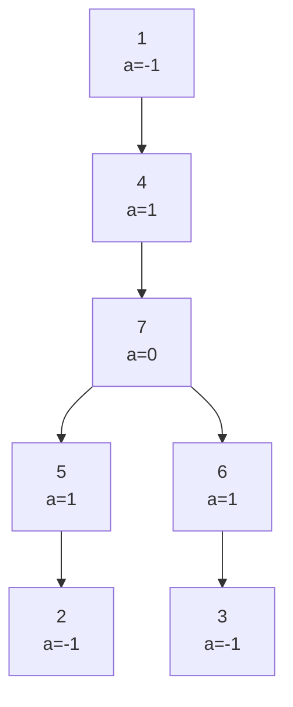

[[TOC]]

## 形式化题目

给定一棵包含 $n$ 个结点的无向树，结点编号为 $1$ 到 $n$。每个结点 $u$ 拥有整数权值 $a_u$（可能为负数）。

通过删除若干条边并保留其中一个连通分量，相当于在树上选择一个非空连通点子集 $S \subseteq \{1, 2, \dots, n\}$。定义该连通块的点权和为：

$$
\sum_{u \in S} a_u
$$

求所有合法非空连通块中点权和的最大值。

## 暴力解法

### 思路

对于较小的 $n$，可以直接状态压缩枚举所有非空点子集 $S$。

对于每一个子集：
1. 选取其中任意一个点作为起点进行广度优先搜索（BFS），只在子集 $S$ 内部的相邻点之间拓展；
2. 检查子集中的所有点是否全部被访问到。若是，则该子集在原树上构成连通块；
3. 计算该连通块的点权和，并更新全局最大值。

### 代码

@include-code(./brute.cpp, cpp)

### 复杂度

- 时间复杂度：共有 $2^n - 1$ 个非空子集，每次通过 BFS 判定连通性需要遍历点与边，时间复杂度为 $O(n \cdot 2^n)$。
- 空间复杂度：存储邻接关系与访问标记数组，空间复杂度为 $O(n^2)$。

### 瓶颈

当 $n \le 16000$ 时，$2^n$ 的指数级状态数量会导致严重超时，因此无法使用状态枚举。必须利用树的无环与子树独立性质进行转移。

## 正解

### 思路

选定任意一个结点为根（例如 $1$ 号结点），将无向树转化为有根树。

任何一个非空连通块 $S$ 在树中都必定存在唯一的“深度最浅”的结点，记为根结点 $u$。此时，该连通块完全包含在以 $u$ 为根的子树中，且必须包含结点 $u$。

据此设计树形动态规划状态：
定义 $dp[u]$ 表示**必须包含结点 $u$，且所有结点均选自以 $u$ 为根的子树内时的最大连通块权值和**。

考虑结点 $u$ 的各个子结点 $v$：
- 各个子树之间仅通过 $u$ 相连，它们在子树内的选择决策互相独立；
- 若以子结点 $v$ 为顶端的最大连通块贡献 $dp[v] > 0$，则将该部分连通块接在 $u$ 上能使得总权值增大；
- 若 $dp[v] \le 0$，接上该子树只会使点权和减少或不变，因此修剪掉与 $v$ 相连的边更为优异。

状态转移方程为：

$$
dp[u] = a_u + \sum_{v \in \mathrm{children}(u)} \max(0, dp[v])
$$

由于任意合法的非空连通块都会在其最浅结点 $u$ 处被 $dp[u]$ 统计，最终答案即为所有结点 DP 值的最大值：

$$
\mathrm{Ans} = \max_{1 \le u \le n} dp[u]
$$

#### 转移演算: 样例树上的逐层结果

以样例 $n = 7$、$a = [-1,-1,-1,1,1,1,0]$、边集 $\{(1,4),(2,5),(3,6),(4,7),(5,7),(6,7)\}$ 为例, 以 $1$ 为根后树形如下:

后序遍历顺序是 $2,5,3,6,7,4,1$. 下表每一行是处理完该结点后得到的 $dp$ 值, "保留的子树" 一列说明哪些儿子的贡献被接了进来:

| 处理顺序 | 结点 | $a_u$ | 各儿子 $dp$ | 保留的子树 | $dp[u]$ |
| --- | --- | --- | --- | --- | --- |
| 1 | 2 | $-1$ | 无(叶子) | 无 | $-1$ |
| 2 | 5 | $1$ | $dp[2]=-1$ | 剪掉 $2$ | $1$ |
| 3 | 3 | $-1$ | 无(叶子) | 无 | $-1$ |
| 4 | 6 | $1$ | $dp[3]=-1$ | 剪掉 $3$ | $1$ |
| 5 | 7 | $0$ | $dp[5]=1,\ dp[6]=1$ | 都保留 | $0+1+1=2$ |
| 6 | 4 | $1$ | $dp[7]=2$ | 保留 $7$ | $1+2=3$ |
| 7 | 1 | $-1$ | $dp[4]=3$ | 保留 $4$ | $-1+3=2$ |

读表时注意第 2、4 行: 儿子 $2$、$3$ 的 $dp$ 是负数, 按 $\max(0, dp[v])$ 被剪掉, 所以 $dp[5]$、$dp[6]$ 只等于自身的 $a_u$. 第 5 行两个儿子都为正, 于是 $dp[7] = 0 + 1 + 1$.

最终 $\max_u dp[u] = \max\{-1,1,-1,1,2,3,2\} = 3$, 即样例输出. 答案落在结点 $4$ 处, 对应连通块 $\{4,7,5,6\}$, 权值 $1+0+1+1 = 3$.

#### 为什么可以直接取 $\max$

下表对比"最优连通块由哪个结点当最浅点", 说明 $\max$ 不会重复统计或漏解:

| 连通块 | 最浅结点 | 被哪个 $dp$ 统计 | 权值 |
| --- | --- | --- | --- |
| $\{4,7,5,6\}$ | $4$ | $dp[4]=3$ | $3$ |
| $\{7,5,6\}$ | $7$ | $dp[7]=2$ | $2$ |
| $\{5\}$ | $5$ | $dp[5]=1$ | $1$ |
| $\{6\}$ | $6$ | $dp[6]=1$ | $1$ |
| $\{1,4,7,5,6\}$ | $1$ | $dp[1]=2$ | $2$ |

每个连通块恰好有一个最浅结点, 因此恰好被一个 $dp$ 统计一次; 而 $dp[u]$ 又只统计以 $u$ 为最浅点的那些块, 两者一一对应.

### 代码

@include-code(./main.cpp, cpp)

### 复杂度

- 时间复杂度：树上后序遍历（DFS）每个结点和每条边恰好访问常数次，时间复杂度为 $O(n)$。
- 空间复杂度：使用邻接表存图以及递归调用栈，空间复杂度为 $O(n)$。

## 总结

树上连通块最值问题的关键切入点是**确定连通块在树上的最高结点（浅层根）**。一旦最高点确定，向各个子结点的拓展决策彼此解耦，每个子树只需要判断贡献是否大于零，正贡献保留、负贡献剪除即可。
