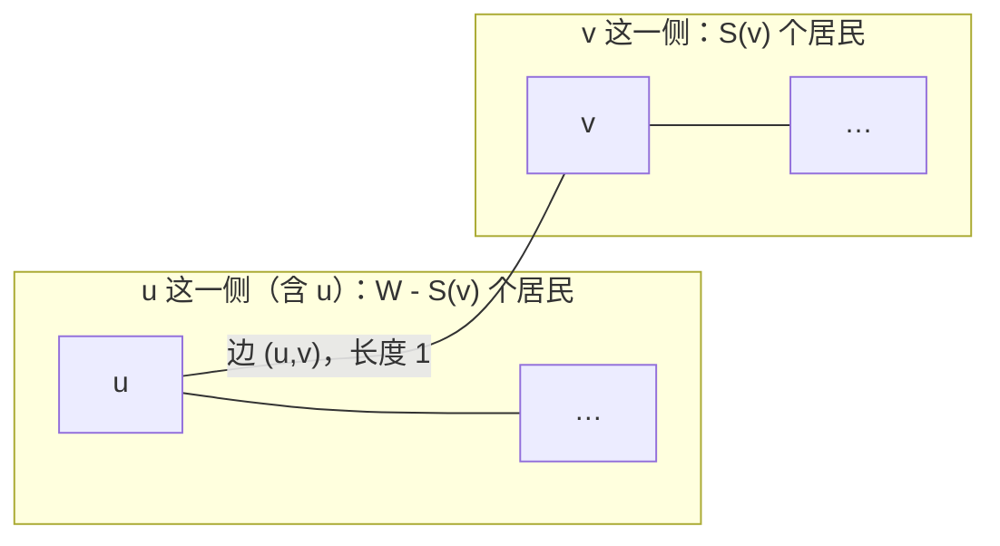

[[TOC]]

## 形式化题目

给定一棵 $n$ 个节点的二叉树，节点 $u$ 上住着 $w_u$ 个居民，每条边的长度都是 $1$。选一个节点 $x$ 建医院，令

$$C(x) = \sum_{u=1}^{n} w_u \cdot \mathrm{dist}(u, x)$$

其中 $\mathrm{dist}(u,x)$ 是树上 $u$ 到 $x$ 的边数。求 $\min_{x} C(x)$。

## 解法总览

题面 $n \le 100$，所以“每个点都试一遍”本身就是合法正解，不必为了过题额外优化。第二个解法把每个候选点的那一整趟遍历换成一笔增量递推，服务于规模放大后的情形。

| 解法 | 核心观察 | 复杂度 | 适用场景 | 对应代码 |
| --- | --- | --- | --- | --- |
| 解法一：枚举 + BFS | 树中两点路径唯一，BFS 的层数就是距离 | $O(n^2)$ | $n$ 小（本题 $n \le 100$）；代码最短、最好写 | `main.cpp`、`main.py` |
| 解法二：加权换根 DP | 医院沿一条边挪动时，代价变化只由那一侧的居民数决定 | $O(n)$ | $n$ 放大到 $10^5$ 级也得跑得动 | `main-reroot.cpp` |

正式主解是**解法一**：它直接对应“把 $n$ 个候选点都算一遍”的定义，题面规模下没有任何超时风险。解法二不改变答案的定义，只是把“每次都从零算”换成“在父亲算好的结果上改一笔”，两份实现的输出在同一批随机数据上完全一致。

## 解法一：枚举医院 + BFS

### 思路

把 $1 \sim n$ 每个点都当成候选医院，对每个候选点做一次 BFS：

- 起点距离为 $0$；
- 每扩展一层，距离加 $1$，这就是树上到起点的边数；
- 出队一个点就把它那层的居民数乘上距离加进总和。

$n$ 个候选点各扫一遍全树，答案取其中最小值。

### 代码

@include-code(./main.cpp, cpp)

Python 版是同一个算法：邻接表用列表推导式建好，`total_distance` 是单源 BFS 返回加权和，`min(map(total_distance, range(1, n + 1)))` 直接聚合出答案。

@include-code(./main.py, python)

拿样例自己对一遍：医院放在 1 号是 $4+12+2\times20+2\times40=136$，放在 3 号是 $4\times2+13+20+40=81$，把五个候选都试完，得到 81。

两点 Python 笔记：`deque` 加距离列表做单源 BFS（`/home/rainboy/mycode/hugo-blog/content/program_language/python/bfs_shortest.md`），把树当成无权图；命名函数与 `map` / `min` 的组合（`/home/rainboy/mycode/hugo-blog/content/program_language/python/map_reduce_filter.md`）。

### 复杂度

- 时间：每个候选点 BFS 一遍 $O(n)$，共 $n$ 个候选，总 $O(n^2)$。本题 $n \le 100$，量级是 $10^4$ 次操作。
- 空间：邻接表、距离数组、队列都是 $O(n)$。

## 解法二：加权换根 DP

### 思路

枚举法的浪费在于：算出“医院在 $u$”的代价之后，算“医院在隔壁 $v$”的代价时又把全树走了一遍。实际上两者只差一笔账。

把树以 $1$ 为根，记：

- $S(v)$：以 $v$ 为根的子树里居民总数；
- $W = \sum w_u$：全树居民总数；
- $D(v) = C(v)$：医院在 $v$ 时的总路程。

**先算根。** 一次 DFS 求出每个点的深度，根的代价就是所有人走到根的路程：

$$D(1) = \sum_{u} w_u \cdot \mathrm{dep}(u)$$

**再看父子之间怎么挪。** 设 $v$ 是 $u$ 的儿子。医院从 $u$ 搬到 $v$，只会沿边 $(u,v)$ 发生一次“多走一步 / 少走一步”。拿这条边把树切成两半，两半的人走向完全相反：

- 住在 $v$ 子树里的 $S(v)$ 个居民，原来要绕到 $u$ 再回 $v$，现在少走一步，共省 $S(v)$；
- 其余 $W - S(v)$ 个居民，原来到 $u$ 就停了，现在要多跨一条边，共多花 $W - S(v)$。

两边相抵：

$$D(v) = D(u) - S(v) + \big(W - S(v)\big) = D(u) + W - 2S(v)$$

于是第二遍 DFS 从根往下，把每个点的 $D$ 都推出来，取最小值即可。和“树的重心”那套完全对称：把 $w_u$ 全看成 $1$ 时，$W = n$、$S(v) = \mathrm{subtree\_size}(v)$，公式就退化成 $\mathrm{dist\_sum}(v) = \mathrm{dist\_sum}(u) + n - 2\,\mathrm{subtree\_size}(v)$。

公式还顺带说明了一件事：只要某个方向的居民超过总人口的一半（$2S(v) > W$），把医院挪过去一定更省。所以最优位置必须满足“每个方向的居民都不超过总人口的一半”，这就是加权重心。不过这份代码不依赖这条性质，它把每个点的代价都算出来再取最小，少一步证明也能得到答案。

### 代码

代码里的名字与上面的记号一一对应：`subtree_pop` 是 $S$，`total_pop` 是 $W$，`dist_sum` 是 $D$。

@include-code(./main-reroot.cpp, cpp)

### 复杂度

- 时间：第一次 DFS 求 $S$ 与 $D(1)$ 共 $O(n)$，第二次 DFS 递推全部 $D$ 也是 $O(n)$，扫描取最小 $O(n)$，总 $O(n)$。
- 空间：邻接表加三个 $O(n)$ 数组。

## 复杂度对比

| | 解法一（枚举 + BFS） | 解法二（加权换根 DP） |
| --- | --- | --- |
| 时间复杂度 | $O(n^2)$ | $O(n)$ |
| 空间复杂度 | $O(n)$ | $O(n)$ |
| 树的遍历次数 | $n$ 遍 | 2 遍 |
| 代码长度 | 更短，只有 BFS 一个套路 | 稍长，要写两遍 DFS 和一个公式 |
| 何时选它 | $n$ 小、追求写得快、验证用的暴力 | $n$ 大，或者题目改成求全部点的代价 |

## 总结

这题的答案定义很简单，关键在于“从相邻两个位置的差别里找规律”：$D(v) - D(u) = W - 2S(v)$ 只用一次子树统计就换来了整棵树的信息，把 $n$ 遍遍历压成 2 遍。

实现上有两点容易踩：

- 总路程用 64 位整数。$w \le 10^5$、$n \le 100$，把医院放在链端点这种最坏情形下中间结果约 $5\times10^8$，`int` 眼看着就要到头，没必要赌。
- 输入给的是“左链接 / 右链接”，存图时两端都要加边；0 表示没有这条链接，要跳过，不能当成节点 0。

如果题目把 $n$ 放大，或者改问“哪个点最优”“所有点的代价分别多少”，换根 DP 的框架可以直接照搬；而 $n \le 100$ 时，先写枚举把答案拿到手，再用换根版对拍，是更稳的做题顺序。同目录的 `brute.cpp` 就是干这个的：它用递归 DFS 做与解法一同样的枚举，专门给换根 DP 当对照基准。
