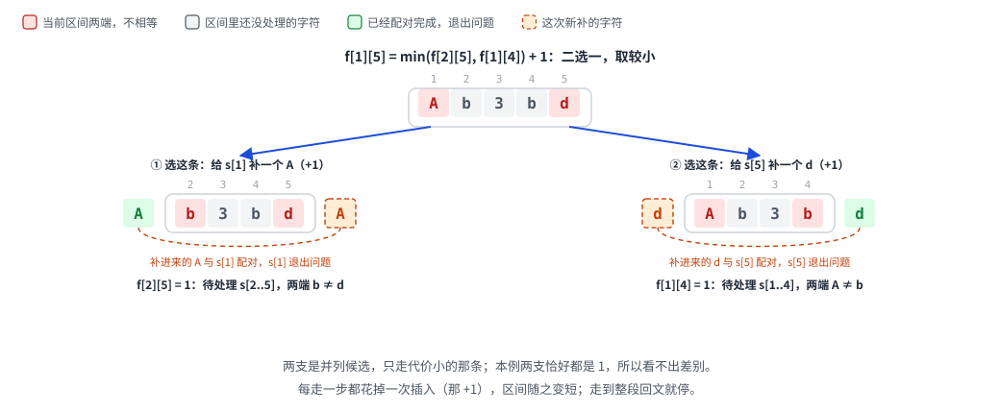
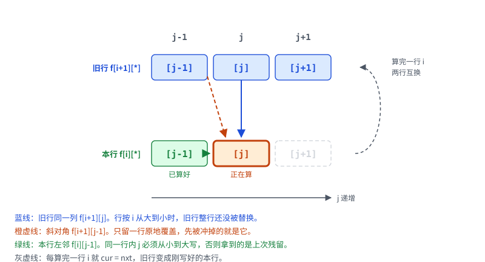

[[TOC]]

## 形式化题目

给定字符串 $s$，长度 $l$。一次操作可以选择任意位置插入任意一个字符，操作可以进行任意多次。求把 $s$ 变成回文串（正读反读相同的串）所需的最少操作次数。本题区分大小写。

## 暴力解法

### 思路

最直接的做法是模拟插入过程：当前串不是回文时，枚举在每个空隙插入每个可能出现的字符，递归搜索，直到得到回文串，取最少的插入次数。

这个搜索是指数级的：长度 $l$ 的串有 $l+1$ 个空隙，每层分支乘上字符数，深度还可能达到 $l$。但搜索过程里有个现象值得记下来：**不同的插入顺序会反复求解同一段内层区间**。把 `Ab3bd` 外层 `A…d` 处理完之后，剩下的工作只取决于内层 `b3b` 这一段；换一条插入路径，问题还是落到同一个内层子串上。

「剩余内层区间」才是有信息量的状态。朴素搜索没有记住它，做了大量重复计算；正解要消除的就是这部分。

写这段搜索时有两处会让它稍微能跑一点。一是候选字符只取原串里出现过的：最优解里新补的字符总和一个原串字符配对（若两个新补的字符互相配对，把这一对删掉照样是回文），所以补原串没有的字符没有意义。二是插入次数从 $0$ 开始逐层加深，第一次搜到回文就停——纯深搜会一头扎进又深又没希望的分支，先耗光时间。

> 对拍说明：`brute.cpp` 就是这个指数搜索，`brute2.cpp` 是另一个独立模型（$l - \mathrm{LCS}(s, \mathrm{reverse}(s))$，见「等价模型」一节）。真正跑对拍用的是后者：指数版到 $6$ 个字符就开始拖，撑不完几百组；LCS 版既快，又和正解没有共用思路。两者在长度 $\leqslant 5$、字符集 $\{a,b,c\}$ 上互相验证了 $100$ 组。

### 代码

@include-code(./brute.cpp, cpp)

### 复杂度与瓶颈

时间复杂度指数级：每层最多 $(|\Sigma| \cdot (l + d))$ 个分支，深度最多 $l$。实测（`-O2`）样例 `Ab3bd` 是 $3$ ms，$6$ 个互不相同字符的串要 $0.26$ s，$7$ 个就 $12$ s 内出不来结果。

瓶颈：同一个内层子串被不同插入路径重复求解。子问题的结果只由「剩余区间」决定，与到达它的插入顺序无关。

## 正解

### 关键观察

把问题看成「从外向内配对」：回文串的最外侧两个字符互相配对，去掉它们后剩下的部分仍是回文。反过来看原串 $s[i..j]$：

- 若 $s[i] = s[j]$，这两个字符可以直接配对，问题变成内层 $[i+1, j-1]$；
- 若 $s[i] \ne s[j]$，它们最终无法互配，各需要与一个插入字符配对。最优方案中只需现在处理其中一个（同时补两侧必然不如保留原字符更划算），也就是在左端外侧补一个 $s[j]$ 去消化右端，或右端外侧补一个 $s[i]$ 去消化左端，各花一次插入。

于是「剩余未配对的区间」$[i, j]$ 就是完整状态。朴素搜索反复算的就是它，存进表就成了区间 DP。

样例 `Ab3bd` 上取 $i=1,\ j=5$，两端不相等，下图画的就是这一步该怎么走：

格子上方的灰色小数字是原串下标，$f[i][j]$ 里的 $i$、$j$ 就指这两个位置。红格是当前待处理区间的两端：$s[1]=$`A` 与 $s[5]=$`d` 不相等，只能先处理其中一端。左支补一个 `A`，橙色虚线弧把它和 $s[1]$ 连成一对，这一对随即退出问题（绿格），剩下待处理的是 $s[2..5]$，也就是 $f[2][5]$；右支对称，补一个 `d` 让 $s[5]$ 退出，剩下 $f[1][4]$。两支各花掉一次插入，就是公式里的 $+1$；两支是并列候选，取较小的那个——本例两边都还要 $1$ 次，所以看不出差别。再往下展开，左支会先让 $d$ 找伙伴、右支会先让 `A` 找伙伴，两支最后都落到 `b3b`，而 `b3b` 自己就是回文（$f[2][4]=0$）。

### 思路

定义 $f[i][j]$ = 把 $s[i..j]$ 补成回文所需的最少插入字符数。

转移：

$$
f[i][j] = \begin{cases}
f[i+1][j-1], & s[i] = s[j] \\
\min(f[i+1][j],\ f[i][j-1]) + 1, & s[i] \ne s[j]
\end{cases}
$$

初始化：单字符区间 $f[i][i] = 0$（本身是回文）；空区间视为 $0$（全局数组初始为 $0$，转移时 $j = i+1$ 且两端相等的情形会取到 $f[i+1][i]$，恰好覆盖）。

遍历顺序：区间长度从 $2$ 到 $l$，长度从小到大，保证计算 $f[i][j]$ 时所有更短的区间已算好。答案为 $f[1][l]$。

正确性依据：最优方案中 $s[i]$ 与 $s[j]$ 的归属只有三类——互配（需 $s[i]=s[j]$，代价 $f[i+1][j-1]$）、$s[i]$ 配新字符（等价右端补 $s[i]$，代价 $f[i+1][j]+1$）、$s[j]$ 配新字符（等价左端补 $s[j]$，代价 $f[i][j-1]+1$）。二者都配新字符时，直接保留 $s[i], s[j]$ 原地配对（若相等）或转归后两类（若不等）不会更差，故三类取最小即为最优。

样例 `Ab3bd` 的 DP 表（行是左端点 $i$，列是右端点 $j$，`—` 表示 $i > j$ 的空区间）：

| i\j | A | b | 3 | b | d |
| --- | --- | --- | --- | --- | --- |
| 1 (A) | 0 | 1 | 2 | 1 | 2 |
| 2 (b) | — | 0 | 1 | 0 | 1 |
| 3 (3) | — | — | 0 | 1 | 2 |
| 4 (b) | — | — | — | 0 | 1 |
| 5 (d) | — | — | — | — | 0 |

读法示例：$f[1][5] = 2$。先看 $s[1]=A$ 与 $s[5]=d$ 不等，$\min(f[2][5], f[1][4]) + 1 = \min(1, 1) + 1 = 2$；其中 $f[2][5]$ 对应「右端补 d 配对」后剩 `b3b`，而 $f[2][4]=0$（`b3b` 已是回文）。

这张表还能换个说法：答案等于 $l - \mathrm{LCS}(s, \mathrm{reverse}(s))$，也等于 $l$ 减去最长回文子序列的长度。两个说法都和上面这张表逐格相等，下一节给出证明。

### 代码

@include-code(./main.cpp, cpp)

### 复杂度

- 时间：状态 $O(l^2)$ 个，每个转移 $O(1)$，总计 $O(l^2)$。$l = 1000$ 时约 $10^6$ 次转移，实测 CPU 约 $10$ ms。
- 空间：$f$ 为 $(l+1)^2$ 个 `long long`，约 $8$ MB，定义为全局数组避免爆栈。

## 等价模型：最长回文子序列，以及正串与反串的 LCS

### 直觉

「$s$ 里能被正反两读同时用到的字符」就是回文骨架。把 $s$ 和它的反串排在一起从两头往中间对，能对上的位置本来就是对镜的；对不上的字符各自缺一个伙伴，得补一个。于是

$$
\text{答案} = l - \text{回文骨架的长度}.
$$

骨架有两种等价叫法：$\mathrm{LCS}(s, \mathrm{reverse}(s))$，或者 $s$ 的最长回文子序列（不必连续）。以 `Ab3bd` 为例，反串是 `db3bA`，公共部分是 `b3b`（长度 $3$），$5 - 3 = 2$。

### 两种叫法为什么等价

设 $m = \mathrm{LCS}(s, \mathrm{rev}\,s)$。取一组最长公共子序列的匹配，它在 $s$ 中用的是下标 $i_1 < i_2 < \dots < i_m$，在 $\mathrm{rev}\,s$ 中用的是 $j_1 < \dots < j_m$；而 $\mathrm{rev}\,s$ 的第 $j$ 个字符就是 $s$ 的第 $l + 1 - j$ 个字符，所以第 $k$ 对匹配就是 $s[i_k] = s[l + 1 - j_k]$。$i_k$ 递增、$l + 1 - j_k$ 递减，这 $m$ 对位置从外向内层层嵌套，按 $s$ 的下标顺序取出就是一个长度 $m$ 的回文子序列，故 $\mathrm{LPS} \geqslant m$。

反过来，若 $p_1 < \dots < p_t$ 是一个回文子序列，那就只看 $\mathrm{rev}\,s$ 的下标 $l + 1 - p_t < \dots < l + 1 - p_1$：第 $k$ 个位置上装的是 $s[p_{t+1-k}]$，而回文性保证 $s[p_k] = s[p_{t+1-k}]$，于是两边逐字符相等，得到一个长度 $t$ 的公共子序列，故 $m \geqslant \mathrm{LPS}$。两边夹住，$m = \mathrm{LPS}$。

两种叫法问的是同一件事：找一个正反两读都认的骨架，它有多长。

### 为什么答案恰好是 $l - \mathrm{LPS}$

**上界（想少补做不到）**：假设补成的是长度 $l + c$ 的回文串 $T$，$s$ 的 $l$ 个字符落在 $T$ 的 $l$ 个位置上。$T$ 是回文，位置 $p$ 与 $l + c + 1 - p$ 上的字符必然相同；把 $s$ 占的位置按这条镜像轴两两配对，凡是配不上镜像的位置，它的镜像位置只能落在 $T$ 中那 $c$ 个新补的字符上。所以最多有 $c$ 个 $s$ 的位置「缺伙伴」，至少 $l - c$ 个位置能两两镜像成对；这些位置按顺序取出就是 $s$ 的回文子序列，于是 $\mathrm{LPS} \geqslant l - c$，即 $c \geqslant l - \mathrm{LPS}$。

**下界（用 $l - \mathrm{LPS}$ 次真的够）**：把「插入数」那张表和「回文子序列长度」那张表并排放，记 $g[i][j]$ 为 $s[i..j]$ 的最长回文子序列长度，长度 $\mathrm{len} = j - i + 1$，逐格验证两者满足 $f[i][j] = \mathrm{len} - g[i][j]$：

- 长度 $1$：$f = 0$，$\mathrm{len} - g = 1 - 1 = 0$，成立。
- $s[i] = s[j]$：$f[i][j] = f[i+1][j-1]$，而 $g[i][j] = g[i+1][j-1] + 2$，由归纳假设 $f[i+1][j-1] = (\mathrm{len} - 2) - g[i+1][j-1]$，两边相等。
- $s[i] \ne s[j]$：$f[i][j] = \min(f[i+1][j], f[i][j-1]) + 1$，而 $g[i][j] = \max(g[i+1][j], g[i][j-1])$，把 $\min$ 换成 $\max$ 再取补，同样相等。

由归纳法 $f[1][l] = l - g[1][l] = l - \mathrm{LPS}$，而 $f$ 的每次转移都对应一次真实插入（上一节已证最优），所以这个值一定能达到。

### 最长回文子序列怎么求

$g[i][j]$ 的转移就是上面第二条：两端相等时把它们同时收进回文骨架，否则至少扔掉一端。

$$
g[i][j] = \begin{cases}
\max(g[i+1][j],\ g[i][j-1],\ g[i+1][j-1] + 2), & s[i] = s[j] \\
\max(g[i+1][j],\ g[i][j-1]), & s[i] \ne s[j]
\end{cases}
$$

以 `abca` 为例（行是左端点，列是右端点，`—` 表示空区间）：

| i\j | a | b | c | a |
| --- | --- | --- | --- | --- |
| 1 (a) | 1 | 1 | 1 | 3 |
| 2 (b) | — | 1 | 1 | 1 |
| 3 (c) | — | — | 1 | 1 |
| 4 (a) | — | — | — | 1 |

$g[1][4] = 3$（骨架 `aca`），答案 $4 - 3 = 1$：补一个 `b` 得 `abcba`。顺带一个反例：`abca` 的最长**回文子串**只有 $1$ 个字符，按「连续」去算会得出 $3$，见下一节易错点。

### 代码

这一模型的实现是同目录的 `brute2.cpp`，它按 $\mathrm{LCS}(s, \mathrm{rev}\,s)$ 求骨架，输出 $l - \mathrm{LCS}$，与 `main.cpp` 的区间 DP 没有共用思路。

@include-code(./brute2.cpp, cpp)

### 复杂度

- 时间：$\mathrm{LCS}$ 与 $\mathrm{LPS}$ 都是 $O(l^2)$ 个状态、$O(1)$ 转移，与区间 DP 同阶。
- 空间：$O(l^2)$，压维后可做到 $O(l)$。三种模型的复杂度瓶颈一样，选哪个只看哪种更好写、更好调。

## 空间优化：两行滚动

### 为什么要压

主解把整张 $(l+1) \times (l+1)$ 表都存下来，$l = 1000$ 时是 $10^6$ 个 `long long`，约 $8$ MB，本题完全够用。但这份转移本身并不需要整张表：

$$
f[i][j] \leftarrow f[i+1][j-1],\quad f[i+1][j],\quad f[i][j-1]
$$

只涉及「下一行」和「本行左邻」。若把同一份代码用到 $l = 5000$ 的数据上，$8$ 字节一格就是约 $190$ MB，很容易 MLE；而两行只要 $8$ KB。

### 关键约束

- $f[i][j-1]$ 是本行刚算好的值，所以同一行内 $j$ 必须从小到大扫。
- $f[i+1][j]$ 与 $f[i+1][j-1]$ 在旧行里。按行号 $i$ 从大到小扫，旧行整行完整、不会提前被覆盖，这是最省心的写法；也可以按区间长度递增、按 $i$ 的奇偶分配两行。
- 只留**一行**原地覆盖是不够的：$f[i+1][j-1]$ 是斜对角，覆盖到这一格时它已经被同行的新值挤掉，得额外暂存一个变量。两行写法避开这个坑。
- 单字符区间 $f[i][i] = 0$：本行写到 $j = i+1$ 时才会读 $f[i][i]$，那个格子从不被写，保持数组初值 $0$ 正好。

三条约束对应到格子上就是下图：

本行正在算的 $f[i][j]$ 只从三格取值：蓝线是旧行同一列 $f[i+1][j]$，橙虚线是斜对角的 $f[i+1][j-1]$，绿线是本行刚算好的左邻 $f[i][j-1]$。行按 $i$ 从大到小扫，两条跨行依赖都还能读到旧行；同一行内 $j$ 从小往大写，绿线才拿到新值。右侧那条灰虚线弧是这一轮结束时 `cur = nxt`，旧行换成刚写好的本行。

### 代码

@include-code(./main2.cpp, cpp)

### 复杂度

- 时间：$O(l^2)$，与主解相同（常数略小，缓存更友好）。
- 空间：$O(l)$，$2 \times 1005$ 个 `int`，约 $8$ KB。

## 易错点

1. **把「子序列」当成「子串」。** 回文骨架可以不连续，最长回文**子串**是完全不同的问题。反例 `abca`：最长回文子串只有 $1$ 个字符，按它会算出 $4 - 1 = 3$，而正确答案是 $1$（补成 `abcba`）。
2. **输入里没有长度。** 本题输入只有一行字符串，$l$ 要自己用 `strlen`／`s.size()` 得到。见过按「先读 $n$ 再读串」写的代码，在别的 OJ 上能过，搬到洛谷会直接读错。
3. **数组开太大。** `int f[10001][10001]` 是 $400$ MB，`int f[5001][5001]` 也有 $100$ MB。本题 $l \leqslant 1000$，开 `[1005][1005]` 足够；内存给得紧就压成两行。
4. **调试图忘了删。** 写完总想打一张 DP 表出来核对转移，但交之前得删：答案前面多出一片数字，直接 WA 在格式上。
5. **大小写敏感。** 题目写明区分大小写，不要顺手 `tolower`。

## 总结

- 状态取「还没配对的区间」；这样一来，指数搜索里重复计算的那些内层串只算一次。
- 区间 DP 套路：按区间长度从小到大递推，两端相等继承内层、不等则枚举消掉哪一端。
- 同一答案的独立模型（$l$ 减最长回文子序列，即正串与反串的 LCS）可用于交叉验证；本地已用 300 组随机数据对拍通过（见 `problem-analysis-workspace/duipai-report.md`）。
- 「补几个字符」和「最长回文子序列多长」记的是同一张表：$f[i][j] + g[i][j] = j - i + 1$，所以两个看起来不同的 DP 能用一次归纳对上。
- 只依赖上一行和本行左邻的区间 DP，行按 $i$ 递减扫就能压成两行；斜对角依赖是唯一的坑。

## 参考与致谢

下列洛谷题解用于交叉核查和对照视角；标「主要参考」的几篇在讲法或写法上影响过本文。

| 作者（uid） | 题解 | 赞 | 主要参考的内容 |
| --- | --- | --- | --- |
| gyf12138（48717） | [题解 P1435](https://www.luogu.com.cn/article/g1ljgqzr) | 376 | 主要参考：$\mathrm{LCS}$ 模型、一维滚动数组版 LCS，以及「内存限制收紧后怎么办」的动机 |
| wisdom_grass（23842） | [题解 P1435](https://www.luogu.com.cn/article/94vs4ey0) | 180 | 主要参考：$f[i][j]$ = 最小插入数 的状态定义与两种转移 |
| AlexanderPitt（138088） | [题解 P1435](https://www.luogu.com.cn/article/9j57mv9d) | 34 | 按「以谁为回文中心」枚举插入方案的直观；记忆化写法求的是最长回文子序列（原文误称子串） |
| d3ac（164319） | [题解 P1435](https://www.luogu.com.cn/article/fimpxfah) | 29 | 按 $i \bmod 2$ 分配两行的压维写法 |
| hovny（83564） | [题解 P1435](https://www.luogu.com.cn/article/p51ohizz) | 19 | 把问题转成 $\mathrm{LCS}(s, \mathrm{rev}\,s)$ 的理由 |
| Parabola（55537） | [题解 P1435](https://www.luogu.com.cn/article/t011hdcd) | 10 | 超长串与短串求 LCS 的 `next` 数组技巧（本题 $l \leqslant 1000$ 用不到） |
| 梅川丘库（22233） | [题解 P1435](https://www.luogu.com.cn/article/19cmg404) | 8 | $2 \times n$ 压维实现（其代码先读 $n$，在本题输入格式下需改写） |
| Jelly_Goat（122927） | [题解 P1435](https://www.luogu.com.cn/article/pjekvqau) | 7 | 最长回文子序列的区间 DP 转移与 $l - \mathrm{LPS}$ 结论 |
| lqx_bnu（84837） | [题解 P1435](https://www.luogu.com.cn/article/a14cqn5i) | 7 | 拼接反串、删掉公共部分来构造回文的直观演示 |
| 张佳（7869） | [题解 P1435](https://www.luogu.com.cn/article/zuhi2u9w) | 6 | 用「已消耗前缀 $i$ + 后缀 $j$」而不是「剩余区间」描述状态，是区间 DP 与 LCS 之间的桥 |
