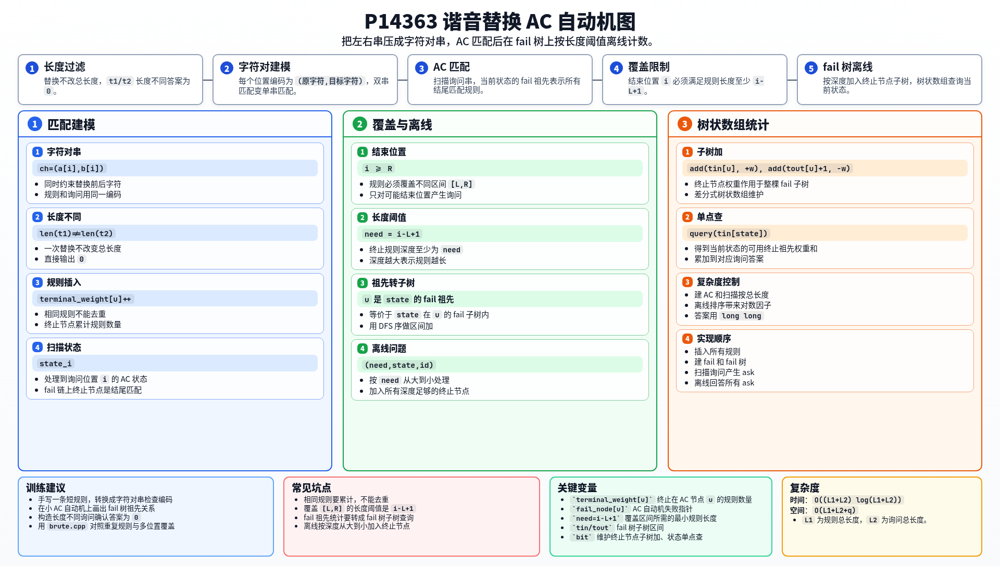

[[TOC]]

## 形式化题目

给定 $n$ 条替换规则 $(s_{i,1},s_{i,2})$，每条规则的两个字符串等长。每次询问给出两个不同的字符串 $(t_1,t_2)$，统计有多少个「规则编号、替换起点」，使得在 $t_1$ 中使用该规则**恰好替换一次**后得到 $t_2$。

相同的字符串二元组如果编号不同，仍然是不同规则。替换区间外的字符保持不变，不能连续使用多条规则。

## 交互学习

两门单文件交互教程都先预测、再单步演示，内置原题样例与反例案例，支持回看与本地进度保存；下载 HTML 文件即可离线使用。

- [解法一 · 双 Trie 交互课](./ac-lesson-main1.html)：七关走通主解 `main.cpp`，从差异对齐、前后缀分解、map 核心分组，到双 Trie 反转、DFS 激活与撤销、右祖先链求和。与解法路线的建议一致，**先学这一门**。
- [解法二 · AC 交互课](./ac-lesson.html)：八关走通 `main2.cpp`，从合法替换、字符对匹配，走到 fail 树、DFS 序和离线计数。

## 解法路线

沿用题面的定义：$L_1$ 是所有规则的左右串总长度，$L_2$ 是所有询问的两串总长度。它们都包含二元组中的**两个**字符串。下文的位置统一从 $0$ 开始。

题面中的子任务分为小数据、单询问、特殊字符串和一般大数据，适合按下面的顺序学习。

| 层次 | 对应测试点与约束 | 做法 | 时间复杂度 |
| :-- | :-- | :-- | :-- |
| 第一层 | $1,2$：$n,q\leqslant100$，$L_1,L_2\leqslant200$ | 枚举规则和起点，逐位检查 | $O(L_1+L_2+n\sum_j m_j^2)$ |
| 第二层 | $3\sim5$：$n,q\leqslant1000$，$L_1,L_2\leqslant2000$ | 用首个差异确定唯一替换起点 | $O(L_1+L_2+qL_1)$ |
| 第三层 | 性质 A：$q=1$；覆盖 $6,7,8,13,14$ | 继续使用第二层，逐条规则检查一次 | $O(L_1+L_2)$ |
| 第四层 | 性质 B：每个串恰好有一个 `b`，其余为 `a`；覆盖 $6,9,10,15,16$ | 按 `b` 的位移分组，二维偏序计数 | $O(L_1+L_2+(n+q)\log(n+q))$ |
| 第五层，解法一（主解） | 一般数据：$n,q\leqslant2\times10^5$，$L_1,L_2\leqslant5\times10^6$ | map 精确分组 + 每组普通双 Trie + DFS 激活与祖先链求和 | $O((L_1+L_2)\log(n+1))$，字母表固定 |
| 第五层，解法二 | 同上，适用于全部数据 | 字符对 AC 自动机 + fail 树 + 离线树状数组 | $O((L_1+L_2)\log(L_1+L_2))$ |
| 第五层，解法三 | 同上，适用于全部数据 | 差异核心分组 + 左右 Trie + 二维扫描线 | $O((L_1+L_2)\log(L_1+L_2))$ |
| 第五层，解法四 | 同上，适用于全部数据 | 离线分桶建 Trie + DFS 激活 + 祖先链求和 | $O(L_1+L_2)$，字母表固定 |

表中 $m_j=|t_{j,1}|$；长度不等的询问直接回答 $0$。测试点 $11,12$ 已经没有特殊性质，虽然总长度上限只有 $2\times10^6$，仍需要一般数据的做法。

性质 A 和性质 B 是从第二层分出的两条支路。第五层有四种完整解法：解法一作为主解，使用 `map` 精确分组和每组双 Trie 的 DFS 计数，代码为 `main.cpp`；AC、二维扫描线、线性分桶做法分别作为解法二、三、四，对应 `main2.cpp`、`main3.cpp`、`main4.cpp`。建议先掌握解法一，再按需要学习其他实现。

## 暴力解法

### 适用范围

测试点 $1,2$，字符串总长度很小。

### 思路

每次询问枚举规则 $i$，再枚举替换起点 $p$。设规则长度为 $k$，检查：

1. $t_1[p\ldots p+k-1]=s_{i,1}$；
2. 区间内替换成 $s_{i,2}$，区间外保持 $t_1$ 的原字符，得到的整个字符串是否等于 $t_2$。

每通过一次检查，答案加 $1$。这个做法直接对应题目定义，可以作为后面所有算法的小数据验证基准。

### 代码

`brute.cpp` 逐位检查替换后的字符，不需要真正构造新字符串。

@include-code(./brute.cpp, cpp)

### 复杂度与瓶颈

对于长度为 $m$ 的询问，每条规则最多枚举 $m$ 个起点，每个起点还要花 $O(m)$ 检查，所以单次询问最坏为 $O(nm^2)$。

总时间为 $O(L_1+L_2+n\sum_j m_j^2)$，可粗略上界为 $O(L_1+L_2+nL_2^2)$；空间为 $O(L_1+\max_j m_j)$。

这里有两重浪费：枚举了许多根本不可能的起点，又在每个起点重新检查整个目标串。下一层先把起点确定下来。

## 子任务解法：$L_1,L_2\leqslant2000$

### 适用范围

测试点 $3\sim5$。这个算法本身对任意合法输入都正确，只是在大数据下可能超时。

### 思路

**先找出询问中真正需要改变的部分。**

若 $|t_1|\neq|t_2|$，答案为 $0$。否则，设 $L$ 是第一个不同位置，$R$ 是最后一个不同位置。任何合法替换区间都必须覆盖 $[L,R]$：区间外不能改变，因此不能把某个不同位置留在外面。

注意，合法区间可以比 $[L,R]$ 更长。规则中允许出现左右字符相同的位置，所以不能只匹配恰好等于 $[L,R]$ 的规则。

**再利用规则自己的第一个差异。**

对规则 $i$，预处理它左右串的第一个不同位置 $d_i$。若左右串完全相同，这条规则不能把 $t_1$ 变成不同的 $t_2$，直接忽略。

假设从 $p$ 开始替换。规则在 $d_i$ 之前不改变任何字符，在 $d_i$ 处第一次改变字符；区间外也不改变。因此，替换后整个字符串的第一个不同位置一定是 $p+d_i$。

它必须等于询问的 $L$，于是：

$$
p=L-d_i.
$$

**一条规则只有一个可能的起点，不需要枚举位置。** 因此，同一规则在原串中即使出现多次，对于给定的不同目标串也至多贡献一个方案。

确定 $p$ 后，设规则长度为 $k$，依次检查：

- $p\geqslant0$ 且 $p+k\leqslant|t_1|$，替换区间没有越界；
- $p+k-1\geqslant R$，覆盖最后一个不同位置；
- 区间中的每一位同时满足 $t_1[p+h]=s_{i,1}[h]$、$t_2[p+h]=s_{i,2}[h]$。

因为 $d_i\geqslant0$，已经有 $p\leqslant L$。再结合覆盖 $R$，区间外必然没有不同字符；区间内的双串比较保证替换完全吻合。因此上述条件既必要又充分，不必再次检查整串。

下面用样例 1 的询问 `xabcx → xadex` 看唯一对齐的结果。这里 $L=2,R=3$。

| 规则 | 首个差异 $d_i$ | 唯一起点 $p=L-d_i$ | 替换区间 | 是否可行 |
| :-- | :--: | :--: | :--: | :-- |
| `xabcx → xadex` | $2$ | $0$ | $[0,4]$ | 可行，整串替换 |
| `ab → cd` | $0$ | $2$ | $[2,3]$ | 不可行，原串这里是 `bc` |
| `bc → de` | $0$ | $2$ | $[2,3]$ | 可行 |
| `aa → bb` | $0$ | $2$ | $[2,3]$ | 不可行，原串这里是 `bc` |

每行只检查一个起点。整串规则虽然包含两端不变的 `x`，仍然合法；这也说明只检查最短差异区间会漏算。两条可行规则给出答案 $2$。

### 代码

`anchor.cpp` 预处理每条规则的 `first_diff`，每次询问只比较该规则唯一对齐的区间。

@include-code(./anchor.cpp, cpp)

### 复杂度与瓶颈

预处理所有规则耗时 $O(L_1)$，找出所有询问的 $L,R$ 共耗时 $O(L_2)$。一个询问逐条检查规则，比较次数不超过所有规则的单侧总长度，即 $O(L_1)$。

总时间为：

$$
O(L_1+L_2+qL_1).
$$

空间为 $O(L_1+\max_j m_j)$。在 $L_1\leqslant2000,q\leqslant1000$ 时，$qL_1$ 只有约 $2\times10^6$ 的量级。

起点枚举已经消失，但每个询问仍要重新扫描所有规则。下一层先看看，题面给出的特殊性质能否消除这项乘积。

## 子任务解法：特殊性质 A，$q=1$

### 适用范围

测试点 $6,7,8,13,14$。其中 $6$ 同时具有性质 B，但仅凭 $q=1$ 就能使用本层做法。

### 思路

无需设计新算法，把第二层的复杂度代入 $q=1$：

$$
O(L_1+L_2+qL_1)=O(L_1+L_2).
$$

虽然规则可能很多、字符串可能很长，但所有规则的长度加起来有上界。逐条规则检查唯一候选区间，每个规则字符最多比较一次，总工作量仍然是线性的。

这就是性质 A 的作用：它允许我们花一次 $O(L_1)$ 的时间扫描规则。它没有限制规则的内容，也没有限制差异区间长度。

### 代码

同上一层的 `anchor.cpp`，直接输入 $q=1$ 即可，不单独给出重复代码。

### 复杂度与瓶颈

时间 $O(L_1+L_2)$，空间 $O(L_1+L_2)$，可以处理总长度达到 $5\times10^6$ 的性质 A 数据。

当询问很多时，$qL_1$ 又会出现。因此，「总长度很大」本身不是瓶颈，「同一批规则被反复扫描」才是后面需要解决的问题。

## 子任务解法：特殊性质 B，每个串恰好有一个 `b`

### 适用范围

测试点 $6,9,10,15,16$，规则串和询问串都只含 `a,b`，且各自恰好有一个 `b`。

### 思路

**把字符串压缩成长度和 `b` 的位置。**

一条规则用 $(k,x,y)$ 表示：长度为 $k$，替换前的 `b` 在 $x$，替换后的 `b` 在 $y$。一个等长询问用 $(m,p,r)$ 表示：长度为 $m$，原串的 `b` 在 $p$，目标串的 `b` 在 $r$。

若询问长度不同，答案为 $0$。等长且两串不同，必有 $p\neq r$；$x=y$ 的规则不改变字符串，可以忽略。

**`b` 的位置决定了唯一的替换起点。**

若替换区间不包含原串的 `b`，原来的 `b` 会留在外面，而规则输出又带有一个 `b`，不可能得到目标串。因此规则中的原 `b` 必须对齐询问的原 `b`，替换起点为：

$$
a=p-x.
$$

替换后的 `b` 位于 $a+y$，所以还必须满足：

$$
a+y=r\quad\Longleftrightarrow\quad y-x=r-p.
$$

记这个位移为 $\Delta$。只有位移相同的规则和询问才能配对，先按 $\Delta$ 分组。

**剩余条件只是左右空间够不够。**

规则中原 `b` 左侧有 $x$ 个 `a`，右侧有 $k-1-x$ 个 `a`；询问的原 `b` 两侧分别有 $p$ 和 $m-1-p$ 个 `a`。区间不越界恰好要求：

$$
x\leqslant p,\qquad k-1-x\leqslant m-1-p.
$$

位移条件已经保证新的 `b` 在目标位置；其余所有位置都是 `a`。所以这些条件满足后，无需再逐字符比较。

于是，一条规则是二维点 $(x,k-1-x)$，一个询问是上界 $(p,m-1-p)$。在同一个 $\Delta$ 组内，统计有多少个规则点在询问的左下矩形中。这就是二维偏序计数。

**排序消掉一维，树状数组处理另一维。**

把规则和询问都按 $\Delta$、第一维从小到大排序，同一第一维上先处理规则。扫描时：

1. 遇到规则，把它的第二维在树状数组中加 $1$；
2. 遇到询问，查询第二维不超过其上界的前缀和；
3. 切换 $\Delta$ 组前，撤销本组加入的规则。

第一维条件由扫描顺序保证，第二维条件由前缀和保证。第二维先离散化，重复规则作为多个点加入，不去重。

例如规则 `abaa → aaba` 有 $k=4,x=1,y=2$，位移为 $1$，对应点 $(1,2)$。询问 `aabaaa → aaabaa` 有 $m=6,p=2,r=3$，同样位移为 $1$，对应上界 $(2,3)$。因为 $1\leqslant2$ 且 $2\leqslant3$，规则可以从 $a=2-1=1$ 开始替换。

### 代码

`special_b.cpp` 只适用于性质 B。代码用 `id=0` 表示规则事件，用正数表示询问编号，并在每组结束后撤销树状数组的更新。

@include-code(./special_b.cpp, cpp)

### 复杂度与瓶颈

读入并定位 `b` 共 $O(L_1+L_2)$；规则和询问各生成至多一个事件，排序、离散化、树状数组处理共 $O((n+q)\log(n+q))$。

总时间：

$$
O(L_1+L_2+(n+q)\log(n+q)).
$$

空间为 $O(n+q+\max|s|)$，其中 $\max|s|$ 表示读入时最长的单个字符串。

当一个串有多个不同字母时，长度和一个位置不再能描述全部内容。一般数据必须同时验证整段替换前串、替换后串，还要让众多询问复用同一份规则索引。

## 正解：解法一，map 分组与双 Trie DFS（主解）

### 关键观察

前面的首个差异对齐还可以推进一步：**规则的最后一个差异，也必须对齐询问的最后一个差异。**

设规则的首尾差异位置为 $l,r$，询问的首尾差异位置为 $L,R$，合法替换起点为 $p$，则：

$$
p+l=L,\qquad p+r=R.
$$

所以两者的差异跨度相同，且首尾差异之间的双串内容必须逐位一致。我们可以先固定这段**差异核心**，再分别处理不变前缀、不变后缀的匹配。

### 思路

**第一步：用前后缀分解，写出规则可用的充要条件。**

将一条非恒等规则拆成：

$$
s_1=P+A+S,\qquad s_2=P+B+S.
$$

$(A,B)$ 是从首个差异到最后一个差异的子串对，即差异核心；$P$ 为不变前缀，$S$ 为不变后缀。核心中间即使有相同字符，也必须保留，否则会丢失字符内容与差异之间的距离。

将一个等长询问同样拆成：

$$
t_1=X+C+Y,\qquad t_2=X+D+Y.
$$

规则可用，当且仅当：

1. $(A,B)=(C,D)$，差异核心完全相同；
2. $P$ 是 $X$ 的后缀，即不变前缀紧贴核心向左匹配；
3. $S$ 是 $Y$ 的前缀，即不变后缀紧贴核心向右匹配。

必要性来自首尾差异对齐与区间内的双串匹配。充分性也很直接：若 $X=X_0+P$、$Y=S+Y_0$，则询问可以写成：

$$
t_1=X_0+(P+A+S)+Y_0,\qquad
t_2=X_0+(P+B+S)+Y_0.
$$

在中间使用一次规则，就恰好得到目标串。后缀、前缀条件也保证了不越界，替换起点唯一，为 $|X|-|P|$。

**第二步：用 map 精确分组，先消除核心条件。**

使用 `map<pair<string,string>,int>` 为不同的规则差异核心编号。保存的是两条实际字符串，比较结果确定，不依赖字符串哈希。

询问找不到对应的规则核心，答案就是 $0$；找到后，只与同组规则比较。长度不同的询问直接回答 $0$；规则左右串相同则忽略，因为它不能得到题目要求的不同目标串。

同组的每条规则、每个询问都保留为一条记录。内容相同而编号不同的规则仍然保留多条，后面分别加权。

**第三步：每组普通插入，建立左右两棵 Trie。**

把组内规则的 $P$、询问的 $X$ **反转**后插入左 Trie；把规则的 $S$、询问的 $Y$ 正向插入右 Trie。空串对应根。

反转后，$P$ 是 $X$ 的后缀，就变成 $\operatorname{rev}(P)$ 是 $\operatorname{rev}(X)$ 的前缀。于是，设规则的左右终点为 $(a,b)$，询问的左右终点为 $(u,v)$，两个条件变成：

$$
a\text{ 是左 Trie 中 }u\text{ 的祖先},\qquad
b\text{ 是右 Trie 中 }v\text{ 的祖先}.
$$

祖先关系包含节点本身。这里规则和询问都插入，因此每条记录都有完整终点；插入询问只会增加路径，不会改变规则与询问之间的前缀关系。

建 Trie 使用普通的逐字符插入：有对应孩子就走过去，没有就新建。只有 $26$ 种小写字母，用稀疏孩子链表查找即可，不需要为每个节点开 $26$ 个转移，也不需要离线分桶技巧。

**第四步：DFS 左 Trie，自动筛出第一个祖先条件。**

在右 Trie 每个节点上维护权值 $w$，初始为 $0$。对左 Trie 做 DFS：

1. 进入左节点 $u$，激活所有左终点在这里的规则：它们的右终点权值加 $1$；
2. 回答左终点在这里的所有询问；
3. 访问孩子子树；
4. 离开 $u$，撤销这里的规则：对应右终点权值减 $1$。

回答询问时，当前激活的规则恰好满足「左终点在当前节点的祖先链上」。因此第一个条件已经成立。

同节点上的规则要**先全部激活，再回答询问**。否则结果会错误地依赖记录存放顺序。离开时的撤销也不可省略，否则规则会泄漏到兄弟分支。

**第五步：直接沿右祖先链求和，筛出第二个条件。**

设询问右终点为 $v$。从 $v$ 出发，沿父指针走到右根，累加：

$$
\operatorname{answer}=\sum_{b\text{ 为 }v\text{ 的祖先}} w[b].
$$

$w[b]$ 只记录右终点**恰好为 $b$** 的已激活规则。沿祖先链求和，就把满足右前缀条件的规则全部计入。根代表空不变后缀，也必须参与求和。

为什么直接走链不会太慢？询问 $j$ 的右终点深度就是 $|Y_j|$，一次查询访问 $|Y_j|+1$ 个节点。所有查询的总成本为：

$$
O\left(\sum_j |Y_j|+q\right)=O(L_2).
$$

**输入已经为这些长链付出了字符串长度，不能再用“询问数乘最长链长”估计实际总成本。** 这也是本解法可以直接求和、不必再维护树状数组的原因。

下面用样例 1 的询问 `xabcx → xadex` 看完整计数。它的不变前缀是 `xa`，差异核心为 `(bc,de)`，不变后缀为 `x`。同核心规则有整串规则和 `bc → de`；左 Trie 是「根 → `a` → `ax`」，右 Trie 是「根 → `x`」。

| 左 Trie 的操作 | 右根权值 | 右 `x` 权值 | 含义 |
| :-- | :--: | :--: | :-- |
| 进入左根 | $1$ | $0$ | 激活 `bc → de`，它的两侧都为空 |
| 进入左 `ax` | $1$ | $1$ | 激活整串规则 |
| 回答左 `ax` 上的询问 | $1$ | $1$ | 沿右 `x` → 根求和，答案为 $2$ |
| 离开左 `ax` | $1$ | $0$ | 撤销整串规则 |
| 离开左根 | $0$ | $0$ | 撤销短规则 |

左路径保证不变前缀匹配，右路径保证不变后缀匹配；核心分组保证变化内容相同。三部分合起来，得到原题要求的两个方案。

**正确性。**

前后缀分解已经证明三个匹配条件充要。核心分组先保证第一个条件；左 DFS 的激活与撤销保证查询时恰好保留左祖先规则；右祖先链求和再准确筛出右祖先条件。因此统计的每条规则都合法，所有合法规则也都会被统计。

每条规则对一个询问只有一个可能起点，且只在自己的右终点增加一次权重，所以不会重复统计。重复编号的规则分别激活，符合题目计数要求。

### 代码

`main.cpp` 是正式主解。`read_item()` 完成拆分与 `map` 分组；`build_group()` 普通插入两棵 Trie；`enter_node()` 先激活再求和，`leave_node()` 撤销。

DFS 使用显式栈保留进入、访问孩子、退出的顺序，避免长前缀造成递归爆栈。核心字典在读入分组完成后释放；各组复用节点池，只初始化实际用到的节点。组内记录链表 `next` 与左终点挂载链表 `left_next` 分开，避免互相破坏。

@include-code(./main.cpp, cpp)

### 复杂度

设 $T=L_1+L_2$。核心总种类至多 $n$。一个长度为 $k$ 的核心做一次 `map` 查询或插入，需要 $O(\log(n+1))$ 次比较，每次比较最坏 $O(k)$。累加所有输入核心的长度，分组总成本为 $O(T\log(n+1))$。

普通 Trie 插入每个字符时，最多检查 $26$ 个孩子，所有插入共 $O(26T)$。每条规则只激活、撤销一次，所有左树遍历共 $O(T)$，所有右祖先链查询共 $O(L_2+q)$。

因此总时间为：

$$
O(T\log(n+1)+26T).
$$

固定字母表下写为 $O(T\log(n+1))$。空间为 $O(T+n+q)$，也可简写为 $O(T)$。

这份实现以常见的 `map`、普通 Trie 和 DFS 为主线，保留了直接的前后缀分解与计数过程。进一步追求严格线性时，再看解法四如何替换核心分组与建树方式。

## 正解：解法二，AC 自动机与 fail 树离线计数

### 关键观察

第二层已经得到两个能用于一般数据的结论：

- 替换区间必须覆盖第一个到最后一个不同位置 $[L,R]$；
- 区间内必须同时匹配规则的替换前串和替换后串。

我们希望把逐询问、逐规则的检查，改成一次扫描就同时匹配所有规则。

### 思路

**第一步：把两条串合成一条字符对串。**

把同一位置上的两个字符 $(a,b)$ 看作一个新字符，用

$$
\operatorname{code}(a,b)=26(a-\texttt{'a'})+(b-\texttt{'a'})
$$

编码为 $0\sim675$。规则 $(s_{i,1},s_{i,2})$ 和询问 $(t_1,t_2)$ 都按这个方式编码。

规则字符对串在询问中出现，等价于替换前子串和替换后子串**同时匹配**。不过这还不是合法替换，必须再检查出现区间是否覆盖 $[L,R]$。

为什么不能直接统计所有字符对匹配？例如规则 `a → a` 会匹配到询问 `ab → ac` 的位置 $0$，但它没有覆盖位置 $1$ 的差异，替换后仍然是 `ab`。

**第二步：把覆盖条件改成结束位置和长度条件。**

设一次匹配结束于位置 $e$，长度为 $k$，其区间为 $[e-k+1,e]$。覆盖 $[L,R]$ 等价于：

$$
e\geqslant R,\qquad e-k+1\leqslant L.
$$

整理第二个不等式，得到：

$$
k\geqslant e-L+1.
$$

因此，扫描到每个 $e\geqslant R$ 的位置，只需统计「以这里结尾、长度至少为 $e-L+1$」的规则匹配。

**第三步：AC 自动机给出所有以当前位置结尾的规则。**

将规则字符对串全部插入 Trie，再建立 AC 自动机。扫描询问至位置 $e$，设当前状态为 $v$。从 $v$ 本身开始沿 fail 指针到根，链上的终止节点恰好对应所有以 $e$ 结尾的规则。

这里的长度是节点在**原 Trie 中的深度** `node_depth[u]`，不是它在 fail 树中的层数。终止权重 `terminal_weight[u]` 表示有多少个规则编号在这个节点结束。

不能每次遍历整条 fail 链，否则大量后缀匹配仍会让时间膨胀。我们把每个扫描位置记录为离线子问题：

$$
(\text{need}=e-L+1,\ \text{state}=v,\ \text{id}=j).
$$

它要求：统计 $v$ 本身及其 fail 祖先中，Trie 深度至少为 `need` 的终止节点权重和。

下面继续看样例 1。字符对串是 `(x,x),(a,a),(b,d),(c,e),(x,x)`，仍有 $L=2,R=3$。

| 结束位置 $e$ | 长度下界 $e-L+1$ | 以此处结尾的终止规则 | 本位置贡献 |
| :--: | :--: | :-- | :--: |
| $0,1,2$ | 不生成子问题 | 尚未覆盖最后一个差异 | $0$ |
| $3$ | $2$ | `bc → de`，长度 $2$ | $1$ |
| $4$ | $3$ | `xabcx → xadex`，长度 $5$ | $1$ |

在 $e=3$ 时，当前状态可以是整串规则的长度 $4$ 前缀，该前缀本身并非终止节点；`bc → de` 对应的终止节点在它的 fail 链上。因此只看当前状态是否终止会漏算。把两个位置的贡献相加，就得到答案 $2$。

**第四步：把祖先查询转成子树加。**

把每个非根节点的 fail 指针作为父指针，得到 fail 树。规则终止节点 $u$ 在 $v$ 的 fail 链上，当且仅当 $v$ 在 $u$ 的 fail 子树中，包含 $u=v$ 的情况。

所以，激活一条规则时，可以给其终止节点 $u$ 的**整棵 fail 子树**增加权重。查询状态 $v$ 的值，就得到所有已激活规则中，以该状态结尾的匹配数量。

求出 fail 树的 DFS 序后，$u$ 的子树是连续区间 $[\operatorname{tin}[u],\operatorname{tout}[u]]$。使用差分树状数组实现：

- 激活 $u$：区间加 `terminal_weight[u]`；
- 查询 $v$：单点查询 `tin[v]`。

区间加 $w$ 只需在差分数组的左端加 $w$、右端后一位减 $w$，单点值就是差分前缀和。

**第五步：按长度下界从大到小离线。**

把终止节点按 Trie 深度降序排序，子问题按 `need` 降序排序。处理一个子问题前，把所有满足

$$
\operatorname{node\_depth}[u]\geqslant\text{need}
$$

的终止节点激活。随着 `need` 变小，只会新增合格规则，不需要删除。

此时 `tin[state]` 的值，正好是「既为当前状态的 fail 祖先，又满足长度下界」的规则数。将它累加到原询问的答案中。

**正确性。**

每个合法替换，都对应一个字符对匹配，且区间覆盖 $[L,R]$，所以它必然在结束位置 $e$ 对应的子问题中被统计。反过来，子问题统计到的终止节点保证区间内双串匹配，长度下界和 $e\geqslant R$ 保证区间覆盖所有差异，区间外又本来相同，因此一定是合法替换。

每次出现只归属于一个结束位置；同节点上的多个规则编号通过权重分别计数。所以不会漏算，也不会把同一个方案算两次。

### 代码

`main2.cpp` 使用稀疏出边保存字符对 Trie，避免给每个节点开 $676$ 个转移。节点出边排序后用二分查找，fail 树 DFS 使用显式栈，避免长链递归爆栈。

`process_query()` 对应前三步，生成 `(need,state,id)`；`build_fail_tree()` 和 `answer_offline_asks()` 对应后两步，完成子树加与离线查询。

@include-code(./main2.cpp, cpp)

### 复杂度

设 Trie 节点数为 $N$，离线子问题数为 $M$。有：

$$
N\leqslant1+L_1/2,\qquad M\leqslant L_2/2.
$$

节点数不超过规则单侧总长度加根；每个等长询问位置最多生成一个子问题。不同长度询问不会生成子问题。

字母对种类数 $\sigma=676$ 固定。若把这一常数视为固定，建自动机及扫描的总时间为 $O(L_1+L_2)$。具体到当前稀疏实现，插入会线性查找出边，最坏带 $\sigma$ 因子；排序出边及二分转移带 $\log\sigma$ 因子。扫描时的 fail 回跳按深度升降均摊，构建 fail 时也可沿每条输入规则的 Trie 路径均摊，总回跳次数受规则总长度控制。

终止节点至多 $n$ 个，其排序为 $O(n\log n)$；子问题排序为 $O(M\log M)$；树状数组处理为 $O((n+M)\log N)$，DFS 序为 $O(N)$。固定字母表下，总时间为：

$$
O((L_1+L_2)\log(L_1+L_2)),
$$

空间为 $O(L_1+L_2+q)$。

实现时还要注意：相同规则不能去重；长度下界必须是 $e-L+1$；树状数组应当对子树区间加、对状态单点查。题目保证 $t_1\neq t_2$，各实现中对相等字符串返回 $0$ 的分支只是题目范围外的保护，不是在求「不改变字符串」的替换数。

## 正解：解法三，双 Trie 的二维扫描线计数

### 关键观察

第二层已经证明首个差异必须对齐；**最后一个差异也必须对齐**。设规则的首尾差异位置是 $l,r$，询问的是 $L,R$，替换起点为 $p$，则：

$$
p+l=L,\qquad p+r=R.
$$

所以规则的差异跨度 $r-l+1$ 必须等于询问的 $R-L+1$。首尾差异之间的整段内容也必须匹配，而两端不变的内容只需要向外延伸匹配。

这使得我们可以先把变化部分固定下来，再分别处理左右两侧，不必在询问的所有位置搜索规则。

### 思路

**第一步：把规则和询问拆成三段。**

将一条非恒等规则写成：

$$
s_1=P+A+S,\qquad s_2=P+B+S.
$$

$A,B$ 是从规则第一个不同位置到最后一个不同位置的子串，称二元组 $(A,B)$ 为**差异核心**。$P$ 是不变前缀，$S$ 是不变后缀；它们都可以为空。核心中间可以含相同字符，不能把这些位置删掉，否则会丢失差异之间的距离和字符内容。

同样，将一个等长询问拆成：

$$
t_1=X+C+Y,\qquad t_2=X+D+Y.
$$

其差异核心是 $(C,D)$。首尾差异对齐后，规则合法当且仅当：

1. $(A,B)=(C,D)$，两段核心逐字符完全相同；
2. $P$ 是 $X$ 的后缀，规则左侧能紧贴核心向左匹配；
3. $S$ 是 $Y$ 的前缀，规则右侧能紧贴核心向右匹配。

条件 2、3 已经包含不越界的要求：比 $X$ 更长的 $P$ 不可能是其后缀，比 $Y$ 更长的 $S$ 不可能是其前缀。若条件满足，唯一起点是 $p=|X|-|P|$。

**第二步：按差异核心精确分组。**

只有核心相同的规则和询问才能配对。用 `map<pair<string,string>,int>` 给每种规则核心编号，询问通过 `find()` 查找编号。找不到对应核心就回答 $0$。

这里保存并比较的是两条实际字符串，不存在哈希碰撞；它们一起描述的内容，与字符对核心完全相同。左右串相同的规则直接忽略，因为它无法得到题目要求的不同目标串。

**第三步：两棵普通 Trie 处理两侧匹配。**

把规则的 $P$ 反转后插入左 Trie，把 $S$ 正向插入右 Trie。空串对应根。

对于询问，在左 Trie 中从根读取 $\operatorname{rev}(X)$，在右 Trie 中从根读取 $Y$。分别记最终状态为 $v_L,v_R$。规则的两个终点记为 $u_L,u_R$，则侧边匹配等价于：

$$
u_L\text{ 是 }v_L\text{ 的祖先},\qquad
u_R\text{ 是 }v_R\text{ 的祖先}.
$$

祖先关系包含节点本身。这里使用的是**普通 Trie 的父子关系**，没有 fail 树，也没有 fail 指针。

如果读取询问时遇到缺边，就停止在最后一个匹配节点。已经匹配的短前缀仍然有效；所有更长的规则前缀都无法匹配。不能失败后直接把状态重置成根，也不需要把询问插入 Trie。

例如 Trie 中有 `a` 和 `ab`，询问侧边为 `ac`。读到 `c` 时虽然缺边，但规则侧边 `a` 仍然是合法前缀，应保留停在 `a` 的状态。

**第四步：把两个祖先条件变成矩形覆盖。**

分别求两棵 Trie 的 DFS 序。左 Trie 的一个节点 $u_L$ 是 $v_L$ 的祖先，等价于：

$$
\operatorname{tin}_L[v_L]\in
[\operatorname{tin}_L[u_L],\operatorname{tout}_L[u_L]].
$$

右 Trie 同理。于是每条规则对应一个矩形：

$$
[\operatorname{tin}_L[u_L],\operatorname{tout}_L[u_L]]
\times
[\operatorname{tin}_R[u_R],\operatorname{tout}_R[u_R]],
$$

每个询问对应一个点：

$$
(\operatorname{tin}_L[v_L],\operatorname{tin}_R[v_R]).
$$

答案就是**同一核心组内，有多少个规则矩形覆盖询问点**。规则编号不同就生成不同矩形，哪怕矩形和核心都相同，也分别计数。

样例 1 的询问 `xabcx → xadex` 拆成 $X=\texttt{xa}$、核心 $(\texttt{bc},\texttt{de})$、$Y=\texttt{x}$。左侧反转后是 `ax`，右侧是 `x`。下表展示规则如何参与同一个询问。

| 规则 | 核心 | 不变前缀 $P$ | 不变后缀 $S$ | 对本询问的贡献 |
| :-- | :-- | :-- | :-- | :--: |
| `xabcx → xadex` | `(bc,de)` | `xa` | `x` | $1$ |
| `bc → de` | `(bc,de)` | 空 | 空 | $1$ |
| `ab → cd` | `(ab,cd)` | 空 | 空 | $0$ |
| `aa → bb` | `(aa,bb)` | 空 | 空 | $0$ |

只有前两行与询问属于同一核心组。两棵 Trie 中，整串规则分别结束在 `ax` 和 `x`，短规则结束在两个根；询问点同时位于这两条规则的子树矩形中，所以答案为 $2$。

这个样例的左 Trie 是「根 → `a` → `x`」，DFS 序依次为 $1,2,3$；右 Trie 是「根 → `x`」，DFS 序为 $1,2$。询问点为 $(3,2)$，整串规则的矩形是 $[3,3]\times[2,2]$，短规则的矩形是 $[1,3]\times[1,2]$。两个矩形都覆盖这个点，分别贡献 $1$。

**第五步：扫描线与差分树状数组。**

对于规则矩形 $[x_1,x_2]\times[y_1,y_2]$，生成两个事件：

- 横坐标 $x_1$：将纵坐标区间 $[y_1,y_2]$ 加 $1$；
- 横坐标 $x_2+1$：将同一区间减 $1$。

询问点 $(x,y)$ 生成一个横坐标为 $x$ 的单点查询事件。把全部事件按「核心编号、横坐标」排序，同一横坐标先处理更新，再回答询问。

扫描时，横坐标条件由矩形的进入、退出事件保证；纵坐标条件由差分树状数组的区间加、单点查保证。每个有效询问只查一次，每条非恒等规则只产生两个事件。

一个核心组的所有进入、退出事件成对出现，处理完整组后，每个更新都已被撤销，树状数组自然恢复为 $0$。因此可以共用一棵树状数组，但**必须处理最后一个询问之后的退出事件**，不能提前跳到下一组。

**正确性。**

若一次替换合法，规则的首尾差异必然分别对齐询问的首尾差异，因此核心相同，左右不变部分分别匹配询问的后缀、前缀。反过来，若核心相同且两侧匹配，从 $|X|-|P|$ 开始放置规则，区间内的左右串分别吻合，区间外又本来相同，所以替换必然得到目标串。

Trie 的祖先关系准确表达两侧前缀条件，DFS 序矩形准确表达两个祖先条件，扫描线统计的就是同组内所有覆盖点的规则。每条规则只对应一个候选起点和一个矩形，所以不存在同一方案重复统计。

### 代码

`main3.cpp` 用结构体数组和 `new_node()` 分配两棵 Trie 的节点，稀疏边表保存出边；DFS 使用显式栈。

`read_rules()` 完成三段拆分、核心分组及两侧插入，`make_rectangles()` 为规则生成更新事件，`read_queries()` 生成点查询，`solve_events()` 统一完成扫描线统计。

@include-code(./main3.cpp, cpp)

### 复杂度

设两棵 Trie 的总节点数为 $N$，核心种类数为 $g\leqslant n$。规则的两侧长度之和不超过规则单侧总长度，因此：

$$
N\leqslant L_1/2+2.
$$

一个核心的查询或插入需要 $O(\log(g+1))$ 次字符串比较。比较成本也要计入：长度为 $k$ 的核心，单次比较最坏为 $O(k)$。累加所有核心长度后，精确分组总时间为 $O((L_1+L_2)\log(n+1))$。

两棵 Trie 只使用 $26$ 种小写字母。当前稀疏出边每次查找最多检查 $26$ 条边，插入及匹配总时间为 $O(26(L_1+L_2))$，DFS 序为 $O(N)$。

事件数不超过 $2n+q$：排序为 $O((n+q)\log(n+q))$，树状数组处理为 $O((n+q)\log(N+1))$。固定字母表下，总时间仍然是：

$$
O((L_1+L_2)\log(L_1+L_2)).
$$

空间为 $O(L_1+n+q+\max_j m_j)$：两棵 Trie 与树状数组受 $L_1$ 控制，核心字典保存的字符串总长度不超过 $L_1$，事件数受 $n+q$ 控制，询问字符串只需逐个读入。

与解法二相比，解法三每个询问至多生成一个事件，不必为每个可能结束位置生成子问题；代价是用有序字典精确比较核心字符串。两种解法复杂度同阶，解法三可以直接从首尾差异对齐推导出来。

## 正解：解法四，离线分桶建 Trie 与线性计数

### 关键观察

沿用解法一的前后缀分解与左右 Trie DFS 计数。计数本来就是线性的：每条规则激活、撤销一次，所有右祖先链长度之和为 $O(L_2)$。

剩余开销来自核心分组中的字符串比较，以及普通插入时对孩子的查找。若要得到与字母表大小无乘法关系的严格线性做法，可以将这两部分统一换成**离线分桶建 Trie**。

### 思路

**第一步：核心按 Trie 终点分组。**

将所有有效规则和询问的差异核心编码为字符对串，一起离线建 Trie。两条核心相同，当且仅当在同一个节点结束，该终点上的记录就是一个核心组。

串的结束位置必须记录：短核心与它的更长扩展串虽然路径相交，仍然属于不同组。只有规则或只有询问的组可以跳过侧边建树。

**第二步：每个节点一次收集所有串的下一个字符。**

一个建树任务为 $(u,H,d)$：当前节点 $u$、经过这里的记录集合 $H$、下一字符下标 $d$。遍历 $H$，把已经结束的记录挂在 $u$，其余按下一个字符分桶；每个非空桶创建一个孩子任务。

例如普通串 `a、ab、ac、abx` 经过前缀 `a` 时，`a` 在当前节点结束，`ab、abx` 进入 `b` 桶，`ac` 进入 `c` 桶。无须逐串搜索当前节点的出边，因为桶编号直接给出了对应字符。

每条串的每个字符只参与一次分桶，终点再处理一次，所以总工作量与所有串的长度和线性相关。

**第三步：复用字符桶，而不是每个节点清空整个字母表。**

只开一份桶，记录当前节点实际使用的桶编号。先取走所有非空桶的记录并清空它们，再处理任何孩子。这样每条边只付出一次取桶、清桶的成本。

不能每个节点或每个核心组都扫完整个字母表，也不能在父节点还有未取走的桶时开始处理孩子。`main4.cpp` 用显式任务栈安排处理顺序，桶中的集合用记录编号链表保存，移动一组记录只需保存链表头。

核心字母表大小为 $26^2$，两侧字母表大小为 $26$，整份实现共用 $676$ 个桶。

**第四步：每个核心组用同样方式建立左右 Trie。**

规则和询问的不变前缀反转后建左 Trie，不变后缀正向建右 Trie，直接记录各自的终点。左终点挂载记录的链表使用独立字段，避免右树建树时改坏它。

随后完全复用解法一的计数：左 DFS 进入时先激活所有规则，再回答询问，右侧沿父指针求和，退出时撤销。样例中的激活过程可以直接对照解法一的表格。

这里不需要二维扫描线、DFS 序或树状数组。与解法一的区别集中在“怎样分组和建树”，没有改变匹配条件或计数对象。

**正确性。**

核心 Trie 的同终点关系准确表示核心相等；离线分桶构造的左右 Trie，与普通逐字符插入构造的前缀关系相同。计数沿用解法一已经证明的左激活、右祖先链求和，因此结果不变。

### 代码

`main4.cpp` 保留原串与首尾差异位置，`next_char()` 按建树模式直接读取核心、反转不变前缀、正向不变后缀，不复制三段子串。

`build_trie()` 是共用的离线分桶过程；核心分组保存记录链表头，侧边建树时可以安全复用节点池。每组只重置节点分配计数器，实际新建节点由 `new_node()` 初始化，避免逐组清空大数组。`enter_node()`、`leave_node()` 和 `dfs_left()` 对应与解法一相同的激活计数。

@include-code(./main4.cpp, cpp)

### 复杂度

设 $L=L_1+L_2$。每条有效记录的「不变前缀 + 差异核心 + 不变后缀」长度恰好等于单侧串长，累加不超过 $L/2$。核心及两侧的离线分桶、各组节点遍历与记录处理共 $O(L)$；右祖先链查询共 $O(L_2+q)$。

固定字母表下，总时间为 $O(L)$。若把 $|\Sigma|$ 作为变量，一次桶初始化额外需要 $O(|\Sigma|)$，严格写为：

$$
O(L+|\Sigma|)\text{ 时间},\qquad O(L+|\Sigma|)\text{ 空间}.
$$

这里没有逐节点或逐组的 $|\Sigma|$ 因子。待处理任务的记录集合互不相交，任务栈空间也受记录数限制。离线分桶和节点池复用是本实现新增的技巧；学习时可以在掌握解法一后单独理解这部分。

## 总结

按数据范围推进，本题的思考路线是：

1. 小数据枚举规则与位置，把一次替换的条件写清楚。
2. 首个差异必须对齐，确定每条规则唯一的替换起点，把单询问降到 $O(L_1)$；$q=1$ 时直接得到线性做法。
3. 性质 B 将完整匹配压缩成 `b` 的位移相等和左右空间上界，转成二维偏序计数。
4. 一般数据优先学习解法一：固定差异核心，再将不变前后缀匹配转成双 Trie 祖先条件，左 DFS 激活、右祖先链求和。
5. 解法二展示 AC 多模式匹配路线；解法三保留同样的核心分解，但用矩形扫描线处理两个祖先条件。
6. 解法四继续优化解法一的核心分组与建树，使用离线分桶得到确定性线性时间。

正式主解采用解法一：分组、建树和计数各自清楚，代码以常见的 `map`、普通 Trie 和 DFS 为主。它还展示了一个值得迁移的复杂度观察：单次查询可以走长链，只要所有查询链长之和受输入总长度限制。

### 其他解法速览与对比

洛谷题解区对本题有大量独立解法。调研热度最高的若干篇后可以看到：多数做法可以归入差异核心的前后缀分解与多模式匹配两条主线，另有几条值得了解的替代路线。下表按路线归类，$L=L_1+L_2$。

| 路线 | 核心算法 | 时间复杂度 | 空间复杂度 |
| :-- | :-- | :-- | :-- |
| 分隔符编码多模匹配 | 把规则编成模式 $A?BD?C$、询问编成文本 $A'?B'D'?C'$（$A,C$ 为最长公共前后缀，$B,D$ 为核心，`?` 为分隔符），AC 自动机数出现次数 | $O(L\cdot\lvert\Sigma\rvert)$ | $O(L_1)$ |
| 核心分组 + 双 Trie + 二维数点 | 同解法三的建模，分组与匹配多用字符串哈希 | $O(L\log L)$ | $O(L+n+q)$ |
| 左 DFS 激活 + 右 Trie 树状数组 | 同解法一、四的 DFS 计数框架，右侧用 DFS 序区间加、单点查 | $O(L+(n+q)\log L)$ | $O(L+n+q)$ |
| fail 树主席树（在线） | AC 自动机匹配 $s_1$，把左右串的哈希差作为权值，在 fail 树根路径上用主席树计数，右端相等用后缀哈希判断 | $O(L\log \mathrm{mod})$ | $O(L\log \mathrm{mod})$ |
| 字典序栈扫描 | 组内按反转前缀排序，栈维护前缀合法集合，Trie 维护后缀计数 | $O(L\log L)$ | $O(L)$ |
| 单 Trie + 路径哈希二分 | 核心交错编码进一棵 Trie，路径哈希记根路径规则数，查询二分最长存在前缀 | $O(L\log L)$ | $O(L)$ |
| 长度种类数枚举 | 不同规则长度至多 $\sqrt{2L_1}$ 种，枚举起点与长度种类后哈希校验 | 最坏 $O(L_2\sqrt{L_1})$ | $O(L)$ |
| 后缀数组 + 分块 | 字符对字母表上把子串相等转成排名区间，扫描线 + 三层分块 | $O(nL^{1/3}+L)$ | $O(L)$ |

几点对比结论：

1. **建模收敛**。「差异核心相等 + 左侧后缀 + 右侧前缀」被多篇题解独立推出，对应解法一、三、四的模型；多模式匹配路线则对应解法二。四份实现展示了这些模型下不同的分组、建树与计数选择。
2. **确定性是本题解的差异化优势**。社区多数做法用字符串哈希做核心分组或匹配，理论上存在碰撞风险；解法一、三用 `map` 精确比较核心，解法四用 Trie 终点分组，全程不依赖哈希。
3. **分隔符编码是解法二的简化方向**。它把「覆盖全部差异位置」编码进模式串本身，匹配即合法，因而不需要长度阈值离线计数；代价是把字符对字母表换成了带分隔符的单字符字母表。
4. **在线与离线的取舍**。需要逐询问在线回答时，主席树或单 Trie 二分更自然；解法一、三、四为离线批量，但换来更少的随机化依赖。
5. **实现教训**。高频调用中按值传 `string` 足以造成超时；前缀和数组与循环分支不同步会静默丢分。各实现的计数撤销、退出事件等对称操作值得对照检查。

### 参考与致谢

下列题解用于思路对照与正确性交叉验证。本文的叙述、证明与代码均为独立撰写，未复制任何原文；每条列出其核心算法与复杂度声明。

- [题解：P14363 谐音替换（暂无数据）](https://www.luogu.com.cn/article/5n06yvwp) —— Register_int (uid 406941)：分隔符编码多模匹配 + AC 自动机；时间 $O(L\cdot\lvert\Sigma\rvert)$，空间 $O(L_1)$。
- [P14363 谐音替换 / replace 题解](https://www.luogu.com.cn/article/c4psrz0b) —— tcqwq (uid 532560)：核心哈希分组 + 左 Trie + 右侧哈希前缀拆分与 DFS 桶；时间 $O(L\log L+26L)$，空间 $O(L)$。
- [论如何用六级算法爆切 [CSP-S 2025] 谐音替换](https://www.luogu.com.cn/article/x64fow6f) —— pumpkin_pie_ (uid 538131)：单 Trie 核心交错编码 + 路径哈希 + 二分最长存在前缀；时间 $O(L\log L)$，空间 $O(L)$。
- [谐音替换新做法！](https://www.luogu.com.cn/article/7v72wc6c) —— Moya_Rao (uid 814130)：核心分组 + 字典序扫描 + 栈与 Trie；时间 $O(L\log L)$，空间 $O(L)$。
- [题解：P14363 谐音替换（暂无数据）](https://www.luogu.com.cn/article/fo3qy4vg) —— nsp (uid 1007758)：核心哈希分组 + 双 Trie DFS 序矩形 + BIT 二维数点；时间 $O(L+(n+q)\log(n+q))$，空间 $O(L+n+q)$。
- [P14363 谐音替换](https://www.luogu.com.cn/article/5m3rqd74) —— zhlzt (uid 571147)：左 DFS 激活 + 右 Trie 树状数组；时间 $O(L+(n+q)\log L)$，空间 $O(L+n+q)$。
- [题解：P14363 谐音替换（挑战最短代码）](https://www.luogu.com.cn/article/3psb82gi) —— kevinZ99 (uid 1117080)：长度种类数至多 $\sqrt{2L_1}$，枚举起点与长度后哈希校验；最坏时间 $O(L_2\sqrt{L_1})$，空间 $O(L)$。
- [题解：P14363 谐音替换](https://www.luogu.com.cn/article/1gnkva7g) —— cff_0102 (uid 542457)：本质分组 + 双 Trie，指出朴素标记合并的退化风险，主张 DFS 序 + BIT 离线；时间 $O(L\log L)$，空间 $O(L+n+q)$。
- [SA 爬了。](https://www.luogu.com.cn/article/iq6nysib) —— lzyqwq (uid 539211)：后缀数组排名区间 + 长度扫描线 + 三层分块（未完成实现）；理论时间 $O(nL^{1/3}+L)$，空间 $O(L)$。
- [神秘猎奇跑不满做法爆踩 ACAM](https://www.luogu.com.cn/article/vop2fqp4) —— 时之虫 (uid 368204)：按前缀哈希分组，枚举左端点 + Trie 哈希表二分最长后缀；时间 $O(L\log L)$ 到 $O(L\log^2 L)$，空间 $O(L)$。
- [谐音替换 时空严格线性 题解](https://www.luogu.com.cn/article/imhcbbq6) —— its_mygo (uid 384596)：离线分桶建 Trie + 左 DFS 激活 + 右侧祖先链求和，与解法四同型；时间 $O(L)$，空间 $O(\lvert\Sigma\rvert+L)$。
- [题解：P14363 谐音替换（暂无数据）](https://www.luogu.com.cn/article/tukobf4k) —— dayz_break404 (uid 688596)：极小差异区间 + 双 Trie 二维数点；时间 $O(L\log L)$，空间 $O(L+n+q)$。

## 图示解析

下面保留的一图流对应第五层的解法二，可用于复盘字符对、覆盖条件和 fail 树计数之间的关系。

阅读时对照正文中的 $e$（图中的 `i`）、$L,R$ 和 `need`：长度阈值筛选规则，fail 子树筛选能在当前状态匹配的规则。这张图解释解法二；解法一、四使用 DFS 激活模型，解法三使用矩形覆盖模型，前面各层的适用范围以解法路线表为准。
