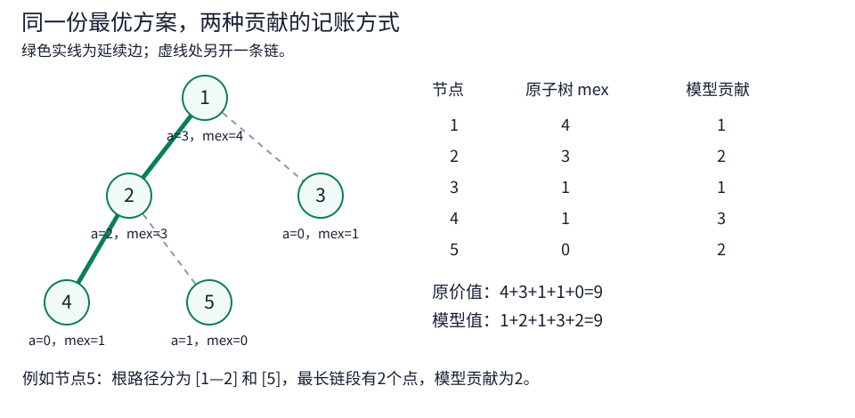
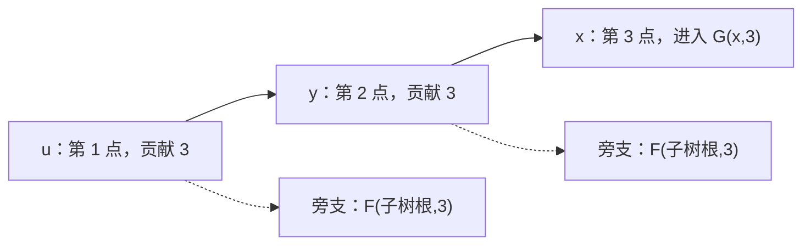

[[TOC]]

## 形式化题目

给定一棵以 $1$ 为根的有根树。根的深度为 $0$，树高不超过 $m$，即 $\max_u\operatorname{depth}(u)\leqslant m$。

- 给每个节点 $u$ 设置一个非负整数权值，即 $a_u\in\mathbb Z_{\geqslant 0}$。
- 对每个节点，收集其子树内的权值，即 $S_u=\{a_x\mid x\in T_u\}$。这里 $T_u$ **包含节点 $u$ 自身**。
- 最大化所有子树的 mex 之和，即求 $\max\sum_{u=1}^n\operatorname{mex}(S_u)$。

其中，$\operatorname{mex}(S)$ 是集合中没有出现的最小非负整数。例如，叶子赋值为 $0$ 时，它的子树集合为 $\{0\}$，mex 为 $1$，不是 $0$。

## 暴力解法

### 思路

按节点编号依次枚举权值，填完一份赋值后，再计算所有子树的 mex。

权值只需枚举 $0\sim n-1$，不同节点可以取相同的值。每棵子树的 mex 都不超过 $n$；把所有大于等于 $n$ 的权值改成 $n-1$，不会删掉原先出现的任何一个 $0\sim n-1$，所以不会降低任何子树的 mex。

代码用位集合记录出现过的权值。题面保证父亲编号小于儿子编号，倒序把集合并给父亲，就能得到每个子树的集合。

### 代码

这是独立的直接赋值枚举，不依赖后面的链模型。数组按 $n<10$ 设置，只用于小树对拍和题面样例验证。

@include-code(./brute.cpp, cpp)

### 复杂度

共有 $n^n$ 份赋值，每份计算全部 mex 可以用 $O(n^2)$ 作上界，因此时间复杂度的安全上界为 $O(n^{n+2})$，空间复杂度为 $O(n)$。

### 瓶颈

直接枚举同时决定了每个数放在哪里，组合数太多。要摆脱赋值枚举，需要换一种记账方式：一个节点提供的数，究竟给哪些祖先的 mex 作了贡献？

## 正解

### 思路

子树的 mex 达到 $r$，意味着它已经提供了连续的 $0\sim r-1$。向上合并时，可以沿用一个儿子的连续前缀，再用其余节点补上缺少的数。

这里不能急着给每个节点填当前缺少的数。样例第一棵树若所有叶子填 $0$、节点 $2$ 填 $1$、根填 $2$，各子树 mex 为 $[3,2,1,1,1]$，总和只有 $8$。题面的方案让节点 $5$ 填 $1$，牺牲它自己的一分，换来节点 $2$ 和根各多一分，总和变成 $9$。

先把“填了什么数”暂时放下，考虑每个节点留到根路径上的哪个位置填数，也允许就在自身使用。若它在祖先 $u$ 处补上一个数，就可能让 $u$ 以及一段连续祖先的 mex 各增加 $1$。最大的已有连续前缀由一个儿子提供，其余补上的数另计。因此，我们给每个节点至多选择一个儿子来继承前缀，称为**延续儿子**。选中的边把树分成若干条向下链，也允许单点链。

固定一种链划分后，对每个节点 $x$，把根到 $x$ 的路径在未选中的边处切开。记最长链段的点数为 $L_x$。新的目标是最大化 $\sum_x L_x$。

下面这张图展示样例第一棵树的一种最优链划分，以及它与原赋值的两种记账结果。

绿色实线选择了 $1\to2\to4$，节点 $3$、$5$ 各自成链。节点 $5$ 的根路径被切成 $[1,2]$ 和 $[5]$，所以 $L_5=2$；原赋值下，它的子树 mex 却为 $0$。图中两列分别是 $[4,3,1,1,0]$ 和 $[1,2,1,3,2]$，总和都为 $9$，**不是同一节点的两项贡献相等**。

### 为什么两个最优值相等

下面分别说明：任意赋值都能被某个链划分的分数覆盖，而任意链划分的分数又都能由某个赋值达到。

**必要性方向：任意赋值 $\Rightarrow$ 存在分数不小于它的链划分。**

记原赋值下 $M_u=\operatorname{mex}(S_u)$。每个非叶子选择 $M_v$ 最大的儿子 $v$ 延续，并记 $r=M_v$；叶子取 $r=0$。

- 子树包含儿子子树，所以 $M_u\geqslant r$。由 mex 的定义，$0\sim M_u-1$ 都在 $S_u$ 中。因此，对每个 $c\in[r,M_u-1]$，都能从 $u$ 子树里选一个原权值为 $c$ 的节点，称它为“在 $u$ 使用”的节点。
- 不同位置不会重复使用同一节点。不相交子树之间无需考虑；若 $w$ 是 $u$ 的真后代，则 $M_w\leqslant r$，在 $w$ 使用的颜色小于 $M_w$，在 $u$ 使用的颜色却大于等于 $r$，两者不重叠。
- $M_u$ 等于延续儿子的 $M_v$，加上在 $u$ 使用的节点数。沿延续边展开，一个在 $u$ 使用的节点，会给 $u$ 到这条链链顶的每个节点各贡献 $1$。
- 这整段链都在该节点到根的路径上，长度不超过它的 $L_x$。把所有使用次数求和，就得到原价值不超过该链划分的 $\sum_xL_x$；没有被使用的节点只会让这个上界更宽。

这一方向给出了原题最优值的上界，但还需要说明链模型没有多算。

**充分性方向：任意链划分 $\Rightarrow$ 存在价值不小于它的赋值。**

对每个节点 $x$，在根到 $x$ 的路径上选一个位置 $u$，**允许 $u=x$**，使“该位置所属链的链顶到 $u$”有恰好 $L_x$ 个点。这样的 $u$ 可以取这条路径上某个最长链段的末端。规定 $x$ 只在这个 $u$ 处使用，暂不赋值。

- 后序处理节点 $u$。设延续儿子的子树已经保证包含 $0\sim r-1$；没有延续儿子时取 $r=0$。这里的 $r$ 只是保证值，不必等于真实 mex。
- 若有 $k$ 个节点留给 $u$ 使用，就把这些尚未赋值的节点依次填成 $r,r+1,\ldots,r+k-1$。它们都在 $u$ 子树内，于是该子树保证包含 $0\sim r+k-1$。以后祖先只会填其他空位，不会破坏已经出现的数。
- 这样，每个节点恰好被赋值一次。若把每棵子树保证的连续前缀长度记为 $q_u$，就有“$q_u$ 等于延续儿子的保证值，加上在 $u$ 使用的节点数”。
- 因此，一个在 $u$ 使用的节点，在 $\sum_uq_u$ 中恰好贡献链顶到 $u$ 的点数，也就是为它选定的 $L_x$。真实 mex 不小于保证值，所以真实总价值至少为 $\sum_xL_x$。

两个方向合起来，原题与链模型的**最优总和相等**。后面的 DP 只优化链模型，不再维护各子树的真实 mex。

### 状态里需要记住两种长度

从根往下考虑链划分。来到节点 $u$ 时，不能只记“目前最长的链有多长”，还得知道“正在走的这条链已经有多长”。后一项决定了下一步延续能否刷新纪录。

先设完整状态 $H(u,b,k)$ 表示 $u$ 子树内的最大贡献，其中：

- $b$ 是到达 $u$ 时，根路径上最长链段的点数纪录。
- $k$ 是当前链从链顶到 $u$ 的前缀点数，满足 $1\leqslant k\leqslant b$。

节点 $u$ 贡献 $b$。若选择儿子 $v$ 延续，进入 $H(v,\max(b,k+1),k+1)$；其余儿子另开链，进入 $H(w,b,1)$。也可以不选延续儿子。这个状态有 $O(nm^2)$ 的量级，能说明问题，却还不够快。

真正实现只保留两种边界状态：

- $F(u,b)=H(u,b,1)$：父边断开，从 $u$ 另开一条链，历史纪录为 $b$。
- $G(u,b)=H(u,b,b)$：当前链到 $u$ 时恰好追平纪录 $b$，再延续一步就会刷新纪录。

这里的 $b$ 是祖先路径上的链长纪录，**不是子树 mex，也不是节点权值的下界**。接下来说明为什么只用这两种状态就够了。

### 两类状态的转移

记 $\operatorname{sz}_u$ 为子树大小。固定 $b$ 后，用 $s_v$ 表示儿子 $v$ 的所有兄弟的 $F(w,b)$ 之和，对应代码中的 `side_sum[v]`。

**先看 $G$：下一条边就能刷新纪录。**

不再产生新纪录时，整棵子树的贡献都是 $b$，得到基准 $b\operatorname{sz}_u$。若向儿子 $v$ 延续，当前点贡献 $b$，该儿子进入 $G(v,b+1)$，其余儿子分别进入 $F(w,b)$。因此有

$$
G(u,b)=\max\left\{b\operatorname{sz}_u,\ \max_{v\text{ 为 }u\text{ 的儿子}}\bigl(b+G(v,b+1)+s_v\bigr)\right\}.
$$

这就是“选一个儿子接着走，其余儿子独立重开”的枚举。

还存在“在 $u$ 停止，所有儿子都重开”的选择，其值为 $b+\sum_vF(v,b)$，但它不会更优。只要有儿子，就可以选任意一个延续：对同一种子树划分，把它的初始链长和历史纪录都提高到 $b+1$，各点贡献不会减少，所以 $G(v,b+1)\geqslant F(v,b)$。叶子则直接由基准覆盖。

**再看 $F$：新链要先凑够 $b$ 个点。**

若子树中没有链打破纪录，仍取基准 $b\operatorname{sz}_u$。否则，可以把一种最优划分调整成：从 $u$ 开始的链至少有 $b$ 个点，且总贡献不减。调整理由放在本小节末尾。

设这条链的第 $b$ 个点为 $x$。前 $b-1$ 个点都没有打破纪录，每个贡献 $b$；到 $x$ 时，当前链恰好追平纪录，进入 $G(x,b)$。沿途岔出去的子树都断开父边，分别用 $F(\cdot,b)$ 处理。

下面以 $b=3$ 画出这段前缀，实线表示当前链，虚线表示另开链的旁支。

图中先计入的 $3\times2$，是前两个点各贡献 $3$；$x$ 自己的贡献已经算在 $G(x,3)$ 中。一般情形的这部分就是 $b(b-1)$，不是当前点 $u$ 单独贡献了这么多。若 $b=1$，则 $x=u$，直接有 $F(u,1)=G(u,1)$。

**为什么能让新链先凑够 $b$ 个点？**

取原划分中 $u$ 子树内一条长度超过 $b$ 的链，沿 $u$ 到它末端的路径，尝试把从 $u$ 开始的链接过去。

- 每次改接另一个儿子时，旧链在这个儿子处从 $1$ 开始，新链的前缀至少为 $1$；沿原延续边继续走时，两者同步加一。因此，新链到当前位置的前缀始终不短于原来的前缀。
- 准备改接另一个儿子前，先检查：若继续沿原延续边走，能不能让从 $u$ 开始的链凑满 $b$ 个点？能的话，就保留这条旧分支，结束调整，不必再追最初选定的目标。
- 只有不能凑满时才改接。此时连“新的前缀加原分支的剩余部分”都不足 $b$，原来那整条链的长度也小于 $b$。截断它不会丢掉一个超过 $b$ 的纪录，受影响的旁支仍有历史纪录 $b$，贡献不会下降。
- 若没有提前结束，就会接入最初那条长链，最终一定凑够 $b$ 个点。连接路径上的链前缀没有缩短，路径外只截断了不足 $b$ 的旧链，因此总贡献不减。

不能不加判断地切断旧的延续分支。若它本来已经足够长，继续保留即可；盲目改接反而可能让其他分支失去原有纪录。

### 把找终点改成同深度候选

$F(u,b)$ 要枚举距离 $u$ 为 $b-1$ 的终点 $x$。每个候选由两部分组成：$G(x,b)$，以及 $u$ 到 $x$ 路径上所有旁支的贡献。

为此，固定本轮 $b$，用 $S(u,d)$ 记录相对位置为第 $d$ 个点的最优候选，也就是

$$
S(u,d)=\max_{\operatorname{dist}(u,x)=d-1}\left(G(x,b)+\sum_{v\in(u\rightsquigarrow x]}s_v\right).
$$

这里求和经过路径上除 $u$ 外的节点 $v$，每个 $s_v$ 都是在它父亲处岔出去的兄弟子树之和。路径至少有两个点时，$u$ 的旁支已经计入第一个路径儿子的 $s_v$，不会漏算。这个式子只合并“终点状态与沿途旁支”，还没有计入路径前缀各点自己的贡献。

候选在儿子间逐项取最大值：$S(u,1)=G(u,b)$；对每个儿子 $v$，用 $S(v,d)+s_v$ 更新 $S(u,d+1)$。选好相对位置 $b$ 后，补上前 $b-1$ 个点的贡献，就得到

$$
F(u,b)=\max\left\{b\operatorname{sz}_u,\ b(b-1)+S(u,b)\right\}.
$$

若从 $u$ 出发的最长向下链不足 $b$ 个点，就没有这样的终点，只取基准。注意 $S$ 的第二维是相对深度加一，与外层的历史纪录 $b$ 不是同一个含义。

### 倒序计算与小例子

$G(u,b)$ 依赖下一层的 $G(v,b+1)$，以及本层孩子的 $F(v,b)$。所以让 $b$ 从 $m+1$ 递减到 $1$，每轮做一次后序 DFS：先处理孩子，再算 $G(u,b)$，合并 $S$，最后算 $F(u,b)$。

代码的循环变量 `level` 就是本轮的 $b$。`next_chain` 保存上一轮的 $G(\cdot,b+1)$，`chain_dp`、`free_dp` 分别保存本轮的 $G$、$F$。根没有外部祖先，根本身使当前链长和纪录都为 $1$，答案为 $G(1,1)$。

仍用图中的五点树，下面按转移手算最后两轮的关键状态。每行给出本轮位置、读入的已知状态及算出的结果，只列取得最大值的延续选择。

| 本轮位置 | 已知状态 | 转移结果 |
| --- | --- | --- |
| $b=2$，叶子 $3,4,5$ | 无儿子 | $F(u,2)=G(u,2)=2$ |
| $b=2$，节点 $2$ | $G(4,3)=3$，$F(4,2)=F(5,2)=2$ | $G(2,2)=2+3+2=7$，$F(2,2)=2+(2+2)=6$ |
| $b=1$，叶子 $3,4,5$ | 无儿子 | $F(u,1)=G(u,1)=1$ |
| $b=1$，节点 $2$ | $G(4,2)=2$，$F(5,1)=1$ | $F(2,1)=G(2,1)=1+2+1=4$ |
| $b=1$，根 $1$ | $G(2,2)=7$，$F(3,1)=1$ | $F(1,1)=G(1,1)=1+7+1=9$ |

先在 $b=2$ 算出并保存 $G(2,2)=7$，再在 $b=1$ 的根转移中读取它。表中叶子状态里的 $2$ 或 $3$ 来自外部路径的链长纪录，不能解释成叶子的真实 mex。

统一循环也会计算一些不能出现在原树祖先路径上的大 $b$ 状态。代码初始化 $G(u,m+2)=(m+2)\operatorname{sz}_u$，只是为了统一边界。从根答案沿依赖访问到的 $G(u,b)$，始终满足 $b\leqslant\operatorname{depth}(u)+1$：延续到儿子时，两边都加一；从 $F$ 转入的终点距离起点为 $b-1$，也满足这个不等式。因此，第 $m+2$ 层需要节点深度至少为 $m+1$，树中不存在这样的点，根答案不会读取这一层。

### 长链剖分怎样对应代码

现在要维护的是每个 $u$ 的整段 $S(u,d)$。直接复制最高儿子的数组仍然太慢，因此按**向下高度**选重儿子，而不是按子树大小选。

代码的 `height[u]` 是从 $u$ 出发的最长向下链的点数，`heavy[u]` 是选出的最高儿子，`subtree_size[u]` 对应 $\operatorname{sz}_u$。每轮维护的不变量是

$$
\texttt{best[u][d]}+\texttt{offset[u]}=S(u,d).
$$

也就是说，数组存的是减去统一偏移后的同深度候选，`best` 本身不是 mex。

- 对重儿子 $v$，直接令 `best[v] = best[u] + 1`。儿子的第 $d$ 项正好占据父亲的第 $d+1$ 项，不搬动数组。
- 重儿子的每一项都要加 $s_v$。令 `offset[u] = offset[v] + side_sum[v]`，就把这次整段加法放到偏移中。
- 对轻儿子 $w$，逐项把候选还原成 $S(w,d)$，加上 $s_w$，再减去父亲的偏移，和 `best[u][d+1]` 取最大值。
- 最后写入 `best[u][1] = chain_dp[u] - offset[u]`，对应 $S(u,1)=G(u,b)$。若 `height[u] >= level`，读取第 $b$ 项并补上 $b(b-1)$，得到 $F$ 的非基准候选。

这样，指针平移负责相对深度变化，`offset` 负责整段旁支加法，轻儿子循环负责同深度取最大值。

### 代码

以下为 C++17 主解。已有本地记录中，当前主解在题目限制 $2000\text{ ms}/512\text{ MiB}$ 下通过 $39/39$ 份测试，包含样例、深度上限和满规模构造；还通过了小树枚举与独立赋值暴力的交叉核验。这些是本地验证，不是官方提交 AC。

@include-code(./main.cpp, cpp)

### 复杂度

每轮后序遍历本身为 $O(n)$。重儿子只平移指针，只有轻儿子 $v$ 会逐项合并 `height[v]` 个候选。

沿高度最大的儿子向下延伸，每个轻儿子都是一条新长链的链顶。这些长链互不相交，长度恰好是对应的 `height[v]`；再加上根所在长链，就把所有节点分完。因此

$$
\sum_{v\text{ 为轻儿子}}\operatorname{height}[v]=n-\operatorname{height}[1].
$$

所有轻儿子的合并长度之和为 $O(n)$，所以每轮为 $O(n)$。共有 $m+1$ 轮，总时间复杂度为 $O(nm)$。

数组池也按这些互不相交的长链分配，总共只需 $n$ 个有效位置。其余数组、邻接表与递归栈均为 $O(n)$，总空间复杂度为 $O(n)$。

## 总结

本题先把“哪个节点填什么数”改成“哪个节点在某个祖先处使用”，再把使用次数转成根路径上最长链段的点数。这个转换保证的是最优总和相等，不是逐点 mex 相等。

在链模型上，历史纪录与当前链长原本是两个维度。利用安全的链调整，只保留“另开链”的 $F$ 和“恰好追平纪录”的 $G$；寻找第 $b$ 个点交给同深度候选，最后用按高度划分的长链复用数组。

## 来源与致谢

链模型与长链 DP 参考了以下题解，并结合现有仓库实现重新组织了双向证明、状态定义和实现说明：

- tiger2005（uid60864）：[《题解：P14637 ［NOIP2025］树的价值／tree（官方数据）》](https://www.luogu.com.cn/article/pm7c9dmt)。
- Felix72（uid553659）：[P14637 题解](https://www.luogu.com.cn/article/0gur8cs2)。
