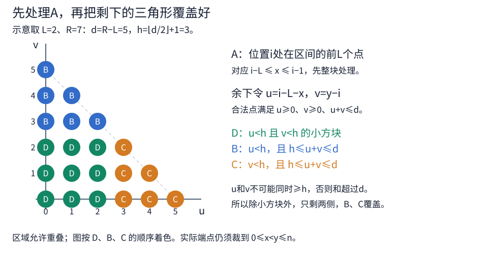

[[TOC]]

## 形式化题目

给定整数序列 $a_1,a_2,\ldots,a_n$。每次询问给出长度范围 $[L,R]$，其中 $1\leqslant L\leqslant R\leqslant n$。

对每个位置 $i$，在所有包含它、长度位于 $[L,R]$ 的非空子区间中取最大区间和，记为

$$
k_i=\max_{\substack{1\leqslant l\leqslant i\leqslant r\leqslant n\\L\leqslant r-l+1\leqslant R}}\sum_{t=l}^r a_t.
$$

这里求的是每个位置各自的最优值，不是整个序列的一个最大子段和。

将每个 $k_i$ 乘以下标，模 $2^{64}$ 后按位异或，输出该询问的校验值

$$
\bigoplus_{i=1}^n\bigl((i\times k_i)\bmod 2^{64}\bigr).
$$

取模结果始终在 $[0,2^{64}-1]$ 内，负数也按这条规则处理。

原样例序列为 $[2,4,-5,1]$。三次询问的逐位置答案与校验值如下。

| 长度范围 | $(k_1,k_2,k_3,k_4)$ | 校验值 |
| --- | --- | --- |
| $[1,2]$ | $(6,6,-1,1)$ | $18446744073709551603$ |
| $[3,4]$ | $(2,2,2,2)$ | $8$ |
| $[1,4]$ | $(6,6,2,2)$ | $4$ |

第一行第三项的乘积为 $3\times(-1)=-3$，模 $2^{64}$ 后是 $18446744073709551613$。因此校验值可能远大于有符号整数范围，不能只把异或结果当作有符号数输出。

## 暴力解法

### 思路

记前缀和 $s[0]=0$、$s[t]=\sum_{j=1}^t a_j$，区间 $[l,r]$ 的和就是 $s[r]-s[l-1]$。

直接对每个位置 $i$ 枚举左右端点，单次询问需要 $O(n^3)$。固定左端点 $l$ 后，可以倒序扫描 $i$，复用已经看过的右端点，把单次询问降到二次。

合法右端点的范围是 $[l+L-1,\min(n,l+R-1)]$。令 $i$ 从这个范围的最右端倒着扫到 $l$，用 `best` 保存其中满足 $r\geqslant i$ 的最大区间和。

- 当 $i\geqslant l+L-1$ 时，右端点 $r=i$ 合法，将 $s[i]-s[l-1]$ 加入 `best` 的比较。
- 当 $i<l+L-1$ 时，没有新的合法右端点，保留 `best`。
- 用 `best` 更新当前位置的答案，再继续向左扫描。

倒序扫描时，原来满足 $r\geqslant i$ 的右端点始终可用。加入新的 $r=i$ 后，`best` 恰好覆盖当前允许的全部右端点。再枚举所有可行的 $l$，就考虑了每个位置的所有合法区间。

### 代码

`brute.cpp` 是固定左端点、倒序扫描位置的独立小数据基线。

@include-code(./brute.cpp, cpp)

### 复杂度

每个左端点最多扫描 $O(n)$ 个位置，单次询问 $O(n^2)$，总时间 $O(qn^2)$。前缀和与答案数组占用 $O(n)$ 空间。

### 瓶颈

不同左端点仍各自扫描了一遍位置。若能先求出固定端点时的最优区间和，再让所有位置通过滑动窗口选取候选，就能省掉这一重枚举。困难在于：包含位置 $i$ 的条件，会改变另一个端点的合法范围。

本题 $n\leqslant5\times10^4$、$q\leqslant1024$，逐次询问做二次扫描不适合满规模。后面将每次询问压到 $O(n)$。

## 正解

### 思路

把区间 $[l,r]$ 写成前缀坐标 $x=l-1$、$y=r$，权值为 $s[y]-s[x]$。由定义展开，合法端点满足

$$
0\leqslant x<i\leqslant y\leqslant n,\qquad L\leqslant y-x\leqslant R.
$$

第一组条件保证区间包含 $i$，第二组限制长度。左右端点仍受长度牵制，不能直接独立取最大的 $s[y]$ 和最小的 $s[x]$。

先利用最短长度 $L$，找出一批不必再检查 $y\geqslant i$ 的候选；剩下的部分，再按左右两侧能伸出的长度处理。下文所有端点范围均与 $[0,n]$ 相交，只保留数组内的前缀坐标。

### A 块：位置在区间的前 L 个点

若 $i$ 位于区间的前 $L$ 个位置，左前缀坐标满足 $i-L\leqslant x\leqslant i-1$。即使取最短长度，右端点也有 $y\geqslant x+L\geqslant i$，已经包含当前位置。

因此 A 块的精确范围是

$$
x\in[i-L,i-1],\qquad y\in[x+L,x+R].
$$

固定 $x$ 后，先在右端点范围内取最大的区间和。这个最优值不再依赖 $i$，而 $i$ 只负责从一段连续的 $x$ 中选最大候选，正好对应滑动窗口。

当 $L=R$ 时，每个合法区间恰有 $L$ 个位置，A 块已经覆盖它的全部位置。代码处理完 A 后直接返回。

### 剩余端点：把额外长度分给两侧

以下讨论 $L<R$。A 块之外必有 $x<i-L$；为了让边界整齐，把 $x=i-L$ 也纳入剩余部分。这只会与 A 重叠，不影响取最大值。

此时 $x\leqslant i-L$、$y\geqslant i$，最小长度已经满足。将比长度 $L$ 多出来的部分分为左右两侧：记 $u=i-L-x$、$v=y-i$，总余量为 $d=R-L$，于是

$$
u\geqslant0,\qquad v\geqslant0,\qquad u+v\leqslant d.
$$

区间长度就是 $L+u+v$。问题变成：在这个整数三角形中，怎样选几块容易求最大值的区域来覆盖所有端点？

取 $h=\lfloor d/2\rfloor+1$，有 $2h-2\leqslant d<2h$。这个取法同时保证两件事：

- $u$、$v$ 不可能都至少为 $h$，否则两侧额外长度之和超过 $d$。
- 若 $u<h$ 且 $v<h$，任意配对都有 $u+v\leqslant2h-2\leqslant d$，可以独立选择两侧端点。

前者说明至少有一侧短，后者给出一个可以直接取两端极值的方块。这两条也确定了 $h$：再取小会漏掉两侧都长的点，再取大则方块中的配对可能超长。

### B、C、D 块的精确边界

令 $K=L+h$，也就是两侧额外长度之和达到 $h$ 时的区间长度。由于 $L<R$，有 $K\leqslant R$。在 $u,v\geqslant0$ 的前提下，使用下面三块。

- **D 块：两侧都短。** 条件为 $0\leqslant u<h$、$0\leqslant v<h$。换回端点就是 $x\in[i-L-h+1,i-L]$、$y\in[i,i+h-1]$。任意一对端点都合法，所以可以分别取最大的右前缀和与最小的左前缀和。
- **B 块：左侧短，总额外长度至少为 $h$。** 条件为 $0\leqslant u<h$、$h\leqslant u+v\leqslant d$。对应 $x\in[i-L-h+1,i-L]$、$y\in[x+K,x+R]$，适合固定 $x$ 求候选。
- **C 块：右侧短，总额外长度至少为 $h$。** 条件为 $0\leqslant v<h$、$h\leqslant u+v\leqslant d$。对应 $y\in[i,i+h-1]$、$x\in[y-R,y-K]$，适合固定 $y$ 求候选。

下面的示意取 $L=2$、$R=7$，即 $d=5$、$h=3$，展示处理 A 后的 $21$ 个可行偏移点。它不是原题样例，也没有展示数组边缘对端点的裁剪。

颜色按 D、B、C 的顺序优先标注，每个点只涂一种颜色，但块本身允许交叠，例如 $(u,v)=(1,2)$ 同时属于三块。算法做的是覆盖，重复取最大值没有影响。

### 为什么四块覆盖恰好全部合法区间

固定位置 $i$，分别检查两个方向。所有端点仍须落在 $[0,n]$ 内。

**充分性（落在某块 $\Rightarrow$ 区间合法）**

- A 块的长度由右端点范围保证在 $[L,R]$，且 $x<i$、$y\geqslant x+L\geqslant i$。
- D 块有 $x\leqslant i-L<i$、$y\geqslant i$，长度在 $[L,L+2h-2]$ 内，不会超过 $R$。
- B 块中，$u<h$ 且 $u+v\geqslant h$，所以 $v\geqslant1$，右端点在 $i$ 的右侧；左端点满足 $x\leqslant i-L<i$。长度由 $h\leqslant u+v\leqslant d$ 保证在 $[K,R]$ 内。
- C 块中，$v<h$ 且 $u+v\geqslant h$，所以 $u\geqslant1$，即 $x=i-L-u<i$；同时 $y\geqslant i$，区间包含 $i$，长度同样在 $[K,R]$ 内。

**必要性（区间合法 $\Rightarrow$ 至少落在一块）**

- 若 $x\geqslant i-L$，结合 $x<i$ 得到 A 的左端点范围；再由 $L\leqslant y-x\leqslant R$ 得到 $y\in[x+L,x+R]$，所以它落在 A 块。
- 否则 $x<i-L$，转成 $u>0$、$v\geqslant0$、$u+v\leqslant d$。若两侧都小于 $h$，落在 D 块。
- 若 $v\geqslant h$，由 $u+v\leqslant d<2h$ 可知 $u<h$，且 $u+v\geqslant h$，落在 B 块。
- 若 $u\geqslant h$，同理有 $v<h$，落在 C 块。

每块没有引入非法区间，而所有合法区间至少被覆盖一次。因此分别求四块的最大值再取最大，得到的就是 $k_i$；这里不要求四块互不相交。

### 三类候选与三个滑动窗口

A、B 都固定左前缀坐标 $x$。对最短长度 $T$，定义从 $x$ 出发的最优候选

$$
\operatorname{start}_T[x]=\max_{y\in[x+T,x+R]}\{s[y]-s[x]\}.
$$

只需一次前缀和区间最大值查询，就能得到这个候选。A 使用 $T=L$，B 使用 $T=K$。

C 固定右端点 $y$，相应地定义以 $y$ 结尾的最优候选

$$
\operatorname{end}_T[y]=\max_{x\in[y-R,y-T]}\{s[y]-s[x]\}.
$$

它由 $s[y]$ 减去左前缀和的区间最小值得到，C 使用 $T=K$。两张 ST 表都建在 $s[0],\ldots,s[n]$ 上，单个候选的查询为 $O(1)$。

三个候选数组依次复用代码中的 `candidate`。对每个位置 $i$，取最大候选的窗口与代码调用如下，窗口仍须裁到 $[0,n]$。

| 块 | 写入 `candidate` 的值 | 当前位置的候选下标窗口 | `merge_window` 参数 |
| --- | --- | --- | --- |
| A | $\operatorname{start}_L[x]$ | $[i-L,i-1]$ | `(-L, -1)` |
| B | $\operatorname{start}_K[x]$ | $[i-L-h+1,i-L]$ | `(-L-h+1, -L)` |
| C | $\operatorname{end}_K[y]$ | $[i,i+h-1]$ | `(0, h-1)` |

每行的窗口正是前面对应块的固定端点范围。`merge_window(left_shift, right_shift)` 求的就是 `candidate[i+left_shift .. i+right_shift]` 的最大值，并合入 `answer[i]`。

窗口两端随 $i$ 同速右移，用单调队列即可线性扫描。函数中的 `next` 记录下一个尚未入队的候选，`while` 会补齐当前右边界前的所有下标；C 的初始右边界可能大于零，也会一次加入多个候选，不需要另行预装窗口。每个下标至多入队、出队各一次。

D 块不用候选数组，直接在两段端点范围中查询

$$
\max_{y\in[i,i+h-1]}s[y]-\min_{x\in[i-L-h+1,i-L]}s[x].
$$

只有 D 块保证任意左右配对都合法，才能这样把最大值与最小值分开求。若 $i<L$，左端点范围裁剪后为空，所以代码只从 $i=L$ 开始处理 D。

### 边界与输出

- 候选不存在时设为负无穷，而不是零，否则全负序列会出错。生成 `start` 时只遍历 $x+T\leqslant n$ 的下标，生成 C 的 `end` 时只遍历 $y\geqslant K$；裁剪后非空才查询 ST 表，代码从不查询空区间。
- $L=R$ 已由 A 单独处理，其余情况按上述三个剩余块更新。每个位置总能被某个长度为 $L$ 的区间覆盖，因此最终答案一定是有限值。
- 前缀和、候选和 $k_i$ 均使用 `long long`，按有符号大小比较。只有计算校验值时，才像 `checksum()` 一样先转为 `unsigned long long` 再相乘、异或；无符号转换与运算按模 $2^{64}$ 处理，不能在求最大值前转换。

### 代码

`prefix_sum` 对应正文的 $s$，`long_length` 对应 $K$。`compute_answers()` 按 A、B、C、D 更新全部 $k_i$，最后由 `checksum()` 聚合；三个 `merge_window` 调用与上表逐项对应。

@include-code(./main.cpp, cpp)

已有本地验证中，主解在 $3000\text{ ms}$、$512\text{ MiB}$ 限制下通过 $16/16$ 组固定数据，暴力通过 $11/11$ 组小数据。主解与正式暴力、正式暴力与旧暴力各完成了 $300$ 份随机对拍，另有满规模随机交叉核验及逐位置穷举核对。这些都是本地结果，不代表官方提交通过。

### 复杂度

两张 ST 表共需 $O(n\log n)$ 预处理。每次询问生成三类候选、扫描三个窗口并查询 D 块，均为常数次线性遍历，耗时 $O(n)$。

因此总时间复杂度为 $O(n\log n+nq)$，空间复杂度为 $O(n\log n)$。

## 总结

最短长度 $L$ 先让一部分区间自动满足包含条件；剩下的区间只需分配总量不超过 $R-L$ 的左右额外长度。把余量对半后，至少一侧短，便能用两侧候选和一个独立方块覆盖所有选择。

真正需要证明的是每块合法、所有合法候选都被覆盖，而不是块之间没有交叠。范围确定后，ST 表负责固定端点的最优值，单调队列负责把这些候选同时交给所有位置。
