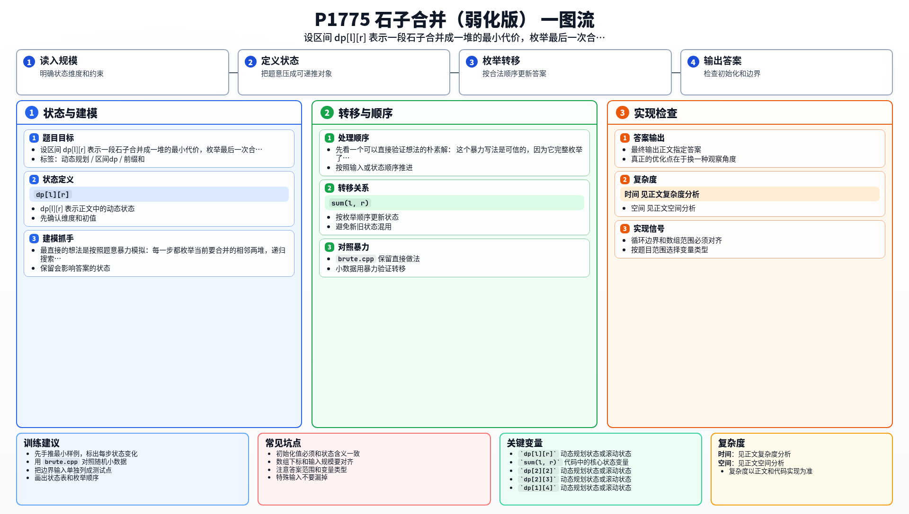

[[TOC]]

## 形式化题目

给定一排 $N$（$N \le 300$）堆石子，第 $i$ 堆质量为 $m_i$（$m_i \le 1000$）。每次操作选择相邻的两堆合并成一堆，新堆质量为两堆之和，代价也为两堆之和；新堆与原来两侧的堆保持相邻。把所有石子合并成一堆所需的总代价由合并顺序决定，求所有合法合并顺序中总代价的最小值。

## 暴力解法

### 思路

最直接的做法完全按题意模拟：每一轮枚举当前序列中所有相邻的位置，尝试把这一对合并掉，然后递归处理剩下的序列，直到只剩一堆为止。递归到边界时统计一路上付出的代价和，在所有分支里取最小值。

设 `dfs(stones)` 表示把当前序列 `stones` 合并成一堆的最小总代价。每一层枚举 $|stones|-1$ 个合并位置，序列长度每层减一，总状态是所有可能的「中间序列」，数量是指数级。

```text
dfs(stones):
    若 stones 只剩一堆，返回 0
    对每个相邻位置 i：
        合并 stones[i] 与 stones[i+1]，代价为二者之和
        递归 dfs(合并后的序列)
    返回所有分支中「本次代价 + 后续代价」的最小值
```

这个写法覆盖了每一种合法的合并顺序，因此结果一定正确；但指数级的搜索规模决定了它只能处理很小的 $N$，正式提交会超时。它的价值是给出一个可信的基线，用来检验后面的优化。

### 代码

@include-code(./brute.cpp, cpp)

### 复杂度

每一层分支数约为当前堆数，递归深度为 $N$，总状态数是卡特兰数量级，时间复杂度是指数级；$N$ 到十几就会明显跑不动。

### 瓶颈

暴力在每一步都关心「当前每堆的质量分布」，也就是整个序列现在的形态。但真正决定答案的结构被藏在了形态背后：无论中间过程如何，**每一步合并的都是原序列某段连续区间，最终某次合并一定是把某段连续区间的左边半段和右边半段各合成一堆，再合并这两堆**。

也就是说，同一个区间 $[l, r]$ 被多少种不同顺序合并成一堆，对上层来说都只需要知道一个数：合并它的最小代价。暴力把大量「顺序不同但子区间相同」的搜索分支重复展开，这就是被消除的瓶颈。

## 正解

### 思路

把观察写成状态：设 `dp[l][r]` 表示把原序列中区间 $[l, r]$ 内的石子合并成一堆的最小代价。区间 $[l, r]$ 的最后一次合并，一定是把 $[l, k]$ 和 $[k+1, r]$（$l \le k < r$）各自合并成的两堆再合并一次，代价为区间总和 $sum(l, r)$。于是：

$$
dp_{l,r}=\min_{l\leqslant k<r}\left(dp_{l,k}+dp_{k+1,r}\right)+sum(l,r)
$$

注意 $sum(l, r)$ 是定值，与断点 $k$ 无关，可以移出 $\min$。长度为 1 的区间不需要合并，$dp_{i,i}=0$。答案就是 $dp_{1,n}$。

下面用样例 $m = [2, 5, 3, 1]$（前缀和为 $0,2,7,10,11$）列出几个区间的计算过程，行是区间，最后一列是答案：

| 区间 $[l,r]$ | 区间和 | 枚举的断点 $k$ 与取值 | $dp_{l,r}$ |
| --- | --- | --- | --- |
| $[2,3]$ | $8$ | $k=2$：$dp_{2,2}+dp_{3,3}=0$ | $8$ |
| $[3,4]$ | $4$ | $k=3$：$dp_{3,3}+dp_{4,4}=0$ | $4$ |
| $[2,4]$ | $9$ | $k=2$：$8+0=8$；$k=3$：$0+4=4$ | $13$ |
| $[1,4]$ | $11$ | $k=1$：$0+dp_{2,4}=13$；$k=2$：$dp_{1,2}+dp_{3,4}=7+4=11$；$k=3$：$dp_{1,3}+0=15$ | $22$ |

读表时注意两点。第一，区间和 $sum(l,r)$ 是「最后一次合并」付出的代价，这一步把区间内所有石子重新压成一堆，所以每个 $dp_{l,r}$ 都要完整加上它一次。第二，短区间的 $dp$ 值是长区间枚举断点时的原材料，所以三重循环必须**按区间长度从短到长**递推，保证算 $dp_{l,r}$ 时所有更短的子区间已经算好——这也是区间 DP 的通用遍历顺序。

区间和用前缀和 $O(1)$ 求出：$sum(l,r) = sum_r - sum_{l-1}$，这里直接复用了前缀和这一基础技巧。

### 代码

@include-code(./main.cpp, cpp)

### 复杂度

三重循环分别枚举区间长度、左端点和断点，时间复杂度 $O(n^3)$；$dp$ 表是二维的，空间复杂度 $O(n^2)$。本题 $n \le 300$，$O(n^3) \approx 2.7 \times 10^7$ 次转移，轻松通过。

## 总结

这题的核心不是「怎么模拟合并」，而是识别出「只能合并相邻两堆」意味着每堆石子在任意时刻都对应原序列的一段连续区间。把视角从「枚举每一步操作」换成「枚举最后一次合并的断点」后，指数级的搜索就被折叠成了 $O(n^2)$ 个区间子问题，配合前缀和得到 $O(n^3)$ 的区间 DP。暴力解法虽然上不了评测机，但它给出了可信的答案来源：用随机小数据与正解对拍，是区间 DP 实现出错时最直接的排错手段。

## 图示解析

一图流解析把本题的建模、关键转移、实现检查和训练方法压缩到一页，适合读完正文后复盘。


