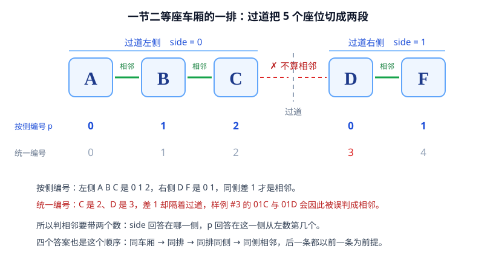

[[TOC]]

## 形式化题目

一个座位由四元组 $(c, r, s, p)$ 描述：$c$ 是车厢号，$r$ 是排号，$s$ 是所在过道侧，$p$ 是该座位在这一侧序列中的下标。原题把座位写成“两位排号 + 一个字母”（如 `03C`），字母决定过道侧 $s$，字母在该侧序列中的位置决定下标 $p$。

同一节二等座车厢的每一排固定排成两段，两个过道侧之间隔着走道。下图就是一排的排布，以及两种编号方式的差别：

看图时注意三件事：一是 A、B、C 与 D、F 各自连成一段，中间那条虚线是过道，不是座位；二是同侧相邻的三组（A 与 B、B 与 C、D 与 F）在图上用绿线标出，而 C 与 D 中间没画绿线；三是两条编号行——按侧编号时 C 是 2、D 是 0，统一编号时它们是 2 和 3，只差 1。

给定两个座位 $u = (c_1, r_1, s_1, p_1)$、$v = (c_2, r_2, s_2, p_2)$，要求对下面四个命题依次给出真值：

1. 同车厢：$c_1 = c_2$；
2. 同排：$c_1 = c_2$ 且 $r_1 = r_2$；
3. 同排同侧：$c_1 = c_2$、$r_1 = r_2$ 且 $s_1 = s_2$；
4. 相邻：第 3 条成立且 $|p_1 - p_2| = 1$。

四个答案按顺序拼成一个长度为 4 的 `01` 串。

## 正解

### 思路

一句话本质：把“座位字母在字母表上的顺序”换成“在哪一侧 + 在这一侧从左数第几个”，相邻就退化成两个整数相差 1。

**要输出的这四个 0/1 是并列的吗？**

不是。第 1 问只看车厢号；第 2 问是“车厢相同并且排号相同”；第 3 问是“同一排并且在过道同一边”；第 4 问是“同一边并且在这一侧的序列里挨着”。后一问都以前一问为前提。样例 #5 的 `02 01A` 与 `03 01A` 输出 `0000` 就是证据：两张票的排号都是 01，可车厢不同，第 2 个答案照样是 0。

所以四个答案是一条合取链，前三问只是把字符串拿来比较，真正要想的只有最后一问。

**那“相邻”到底该怎么判？**

看上面的图：一排是 A B C | D F，过道把这一排切成左右两段。同一段里座位有先后，跨过道两边就没有“挨着”这回事。

**为什么不能把五个字母排成一条直线，用下标差 1 判相邻？**

因为过道不是座位，却结结实实占了 C 和 D 之间的位置。如果按 `A=0, B=1, C=2, D=3, F=4` 编号，C 与 D 只差 1，就会被判成相邻；而样例 #3 给出 `01C` 与 `01D` 的正确答案是 `1100`，第 4 位是 0。一条直线的下标把过道那段距离抹平了，判据就不再等价于题面定义。

**按侧分开编号之后，判据写成什么？**

每个座位记两个数：`side` 说在哪一侧（左 0、右 1），`p` 说在这一侧从左数第几个（`A B C` 是 0 1 2，`D F` 是 0 1）。相邻就是四个条件同时成立：同车厢、同排、同侧、$p$ 相差 1。

这个等价直接由题面定义展开，两个方向都不需额外论证：题面写“两个座位相邻，当且仅当在同一节车厢的同一排，位于过道的同一侧，且在该侧的座位序列中相邻”，前三个就是 `same_car`、`same_row`、`same_side`，而“在一维序列中相邻”就是下标相差 1。

顺带一个容易被问到的点：并不需要把整节车厢的座位表存下来。一排的排布对所有二等座车厢都一样，座位和“车厢 + 排 + 侧 + 序号”一一对应，车票又保证两人都在二等座车厢里，所以四个数对上，物理位置就唯一确定。

排号和车厢号都以字符串形式给出（`03`、`02` 这种带前导零的写法），本题只需判断是否相等，直接按字符串比就行，不必转成整数。

代码里就两个小函数：`seat_side` 回答“在过道哪一边”，`seat_pos` 回答“在这一边从左数是第几个”，剩下部分照着四个条件依次写，最后四个 `if` 依次输出 1 或 0。

### 代码

@include-code(./main.cpp, cpp)

### 复杂度

四个判断都是常数次字符比较，时间复杂度 $O(1)$，空间复杂度 $O(1)$。

## 总结

这道题答案只值几十行代码，值得带走的是两次换视角：

- **先分清哪一问需要新想法**：四个答案是一条合取链，前三问只是把字符串拿来比，唯一需要动脑的是“相邻”。先把前面几问照定义写完，只留最后一问去想，比一上来就盯着四行输出去设计要省力。
- **判据要跟着结构走**：座位是一条被过道切断的线。切断之后，“离得多近”不再是全局坐标的差，而是“先看在哪一段，再看段内第几个”。换成这种二元描述，判据就是同段且组内下标差 1。

这条经验可以直接搬：车厢两侧、棋盘的黑白格分组、环上被断点切开的位置，只要结构里存在“不属于任何点的间隙”，用全局一维序号量距离就会在间隙处出错，正确做法是先分组再比组内位置。

造对拍数据时，“跨过道”“跨排”“同排号但不同车厢”这几类必须显式覆盖。如果只随机座位，很容易一直抽不到 `01C` 与 `01D`，而这恰好是统一序号写法的唯一失效点。
