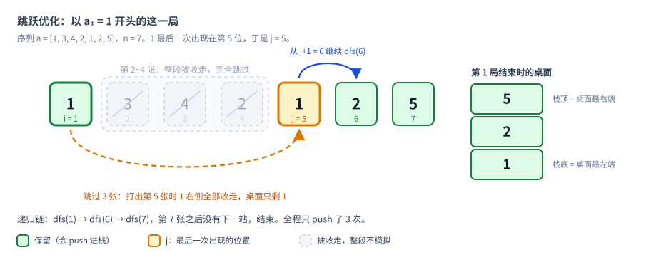
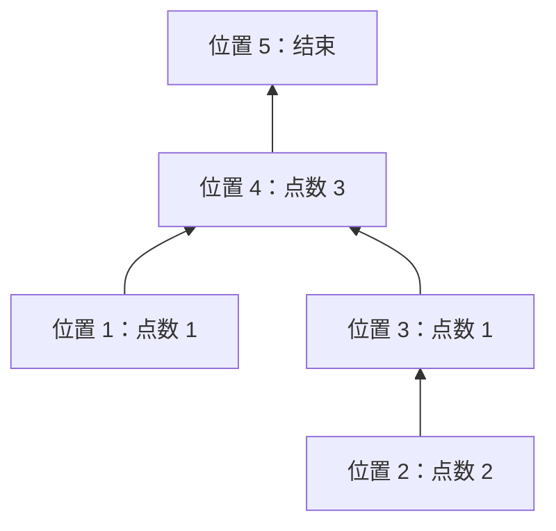

[[TOC]]

## 形式化题目

给定长度为 $n$ 的序列 $a_1, a_2, \ldots, a_n$，取值都在 $1$ 到 $m$ 之间，且每个取值至少出现一次。

一个“桌面”是一串两两不同的点数，记作 $P$。向桌面处理一个点数 $k$ 的规则是：

1. 若 $k$ 不在 $P$ 中，把 $k$ 接到 $P$ 的右端，即 $P \leftarrow P \cdot k$；
2. 若 $k$ 在 $P$ 中且位置为 $q$，先删掉 $P$ 从第 $q$ 个到末尾的全部元素，再接上 $k$，即 $P \leftarrow P_{1..q-1} \cdot k$。

第 $i$ 局从空桌面开始，依次处理 $a_i,a_{i+1},\ldots,a_n$。求对每种点数，有多少局结束时桌面上留有这种牌。

## 暴力解法

### 思路

最直接的做法是照题面模拟：对每个起点 $i$，用一个 `stack<int>` 表示桌面（栈底是桌面最左端，栈顶是最右端），再用 `bool in_stack[v]` 这个桶记录“点数 $v$ 是否在桌上”，一路处理到第 $n$ 张牌，最后把栈里剩下的点数都计入答案。

打出一张点数为 $k$ 的牌时：

- 若 `in_stack[k]` 为假，直接 `push(k)`；
- 否则从栈顶一直弹，边弹边把 `in_stack` 清掉，直到弹出 $k$（含 $k$ 及其右侧全部收走），再 `push(k)`。

因为任意时刻同一种点数在桌上至多一张，`in_stack` 用布尔桶就够了，不需要记录位置。

### 代码

@include-code(./brute.cpp, cpp)

### 复杂度

单局最多处理 $n$ 张牌，每张牌的收牌操作虽然可能腾掉很多元素，但每个元素最多被收走一次，所以单局是 $O(n)$。加上 $n$ 个起点，总时间 $O(n^2)$。$n \leqslant 5000$ 的测试点可以过，$n = 5 \times 10^5$ 时需要 $2.5 \times 10^{11}$ 次操作。

### 瓶颈

每局都从头模拟，会把相同的后缀反复处理。需要找到可以跳过的部分，把一局转成一个更小的子问题。

## 暴力解法（跳跃优化）

### 思路

先试着把上一条「瓶颈」直接消掉，但还不动最终统计方式。

以 $a_i$ 开头的这一局，最左端那张点数 $a_i$ 的牌会一直留着。设 $j$ 是 $a_i$ 在序列中最后一次出现的位置：打出第 $j$ 张牌时，$a_i$ 右侧的牌全部被收走，所以 $i+1 \sim j-1$ 这一段对最终桌面没有任何贡献，可以整段跳过。之后序列里不再出现 $a_i$，它永久留下，右侧的局面与「从 $j+1$ 开始打一局」完全相同。

图中序列为 $a = [1,3,4,2,1,2,5]$。第 1 局以 $a_1 = 1$ 开头，它最后一次出现在第 5 位，所以 $j = 5$：第 $2\sim4$ 张（$3,4,2$）在打出第 5 张时会和那张 $1$ 一起被收走，对最终桌面没有影响，整段跳过；第 5 张之后从第 6 位接着递归，最后栈里是 $[1,2,5]$，正好就是第 1 局结束时的桌面。

于是定义 $\mathrm{dfs}(i)$：从位置 $i$ 开始一局，把这一局最终留在桌面上的点数压进栈：

$$
\mathrm{dfs}(i):\quad \text{st.push}(a_i);\quad \text{找到 } j = \max\{t \ge i : a_t = a_i\};\quad \text{若 } j+1 \le n,\ \mathrm{dfs}(j+1)
$$

对每个起点 $i$ 调用一次 $\mathrm{dfs}(i)$，结束后栈里的内容就是第 $i$ 局的最终桌面，逐个计入答案。

先照这个公式直写：$j$ 就用一个 `for` 循环从 $i+1$ 一直找到 $n$，逐个比较，遇到相等的就更新 $j$。这样思路和公式一一对应，最好理解。

### 代码

下面这份实现里，$j$ 是用 `for` 循环现找的。

@include-code(./brute-dfs-optimize-0.cpp, cpp)

### 优化：预处理好 j

上面每次 DFS 都要再扫一遍后缀找 $j$，多花 $O(n)$。把「点数 $v$ 最后一次出现的位置」提前一遍扫描预处理成 `last[v]`，再令 `nxt[i] = last[a[i]] + 1`，DFS 里就直接拿到下一站，不用再循环找：

@include-code(./brute-dfs-optimize.cpp, cpp)

### 复杂度

- 时间：预处理 $O(n)$；每局沿跳转链走到底，链长 $O(n)$，共 $n$ 局，最坏 $O(n^2)$。随机数据下链很短，实测比逐张模拟快很多，但最坏情况（序列两两不同）没有改善，仍只适用于小数据。`brute-dfs-optimize-0.cpp` 不预处理，每次 DFS 额外 $O(n)$ 找 $j$，量级相同但常数更大。
- 空间：$a$、`last`、`nxt`、`ans` 与栈，$O(n+m)$。

### 还能再省什么

栈只是用来「枚举这一局留下了哪些点数」，而每局最后还要把这些点数一个个加到 `ans` 上。如果直接统计「每个位置被多少局经过」，就可以完全去掉 $n$ 次 DFS，这就是正解要用的思路。

## 正解

### 关键观察

第 $i$ 局的首牌点数是 $a_i$，设它最后一次出现的位置为 $j$。

最左端始终留着点数 $a_i$，其他点数的收牌不会碰到它。因此，打出第 $j$ 张牌后，桌面只剩一张点数为 $a_i$ 的牌，$[i,j]$ 中间的过程都可以跳过。

后面不再有点数 $a_i$，它会一直保留；右侧的变化，就是从第 $j+1$ 张牌开始的那一局。

设 $f(i)$ 表示第 $i$ 局最终留下的各点数的计数。那么 **$f(i)$ 就是在 $f(j+1)$ 的基础上，把点数 $a_i$ 的计数加 1**。若 $j=n$，子问题为空，只留下点数 $a_i$。

### 思路

**这些子问题的指向，会形成什么？**

不用真的为每个 $f(i)$ 保存一张计数表，只记它指向哪个子问题。令 `last[v]` 为点数 $v$ 最后出现的位置，则位置 $i$ 指向

$$
nxt[i]=last[a_i]+1.
$$

也就是把 $nxt[i]$ 当作 $i$ 的父亲。父亲的编号一定更大，每个位置最终都会走到 $n+1$，所以这些指向形成一棵以 $n+1$ 为根的树。根表示游戏结束，不贡献点数。

拿样例 $a=(1,2,1,3)$ 在纸上画出这棵树，箭头从孩子指向父亲：

第 $i$ 局就是从位置 $i$ 一路走向根，沿途每个位置贡献自己的点数。例如第 2 局走 $2\to3\to4\to5$，留下的点数就是 $2,1,3$。

**树上究竟要数什么？**

以位置 3 为例：从位置 2、3 开始的两局都会经过它，所以它给点数 1 贡献两次。位置 4 则被四局经过，给点数 3 贡献四次。

一般地，一个位置的所有子孙以及它自己，走向根时都会经过它；其他位置不会经过它。因此，**位置 $i$ 的贡献次数，就是以 $i$ 为根的子树大小**。

不能从每个起点分别走到根：树退化成链时，这样仍是 $O(n^2)$。只需要把子树大小算出来。

**在纸上怎样把这些次数加起来？**

[打开交互演示：单步看次数向父亲累加](./count-lesson.html)。可以回退、重播，再看按点数汇总。

每个位置自己对应一局，先给位置 $1\sim n$ 各记 1，存入 `cnt`。根不对应一局，初始为 0。再试着让每个位置把累计次数交给父亲：

| 处理位置 | 此时的次数 | 交给父亲 | 累加结果 |
| --- | --- | --- | --- |
| 1 | 1 | 4 | `cnt[4] = 2` |
| 2 | 1 | 3 | `cnt[3] = 2` |
| 3 | 2 | 4 | `cnt[4] = 4` |
| 4 | 4 | 5 | `cnt[5] = 4` |

位置 3 把自己和位置 2 的两局一起交给位置 4，无须让这两局分别往上走。最后位置 $1\sim4$ 的次数是 $(1,1,2,4)$。

从这个过程就能得到做法：**每个位置只向父亲累加一次，执行 `cnt[nxt[i]] += cnt[i]`。** 父亲编号总比孩子大，所以按下标从小到大处理即可；轮到位置 $i$ 时，它的孩子都已把次数交过来了。

最后按点数汇总 `ans[a[i]] += cnt[i]`。样例中，点数 1 的答案为 $1+2=3$，点数 2 为 1，点数 3 为 4，得到 `3 1 4`。

这里不会把同一局的同一种点数重复计算：每次跳转都越过了当前点数的最后出现位置，往上走就不会再遇到它。代码直接用 `last[a[i]] + 1` 求父亲，不必显式建树，也不需要 DFS。

### 代码

@include-code(./main.cpp, cpp)

### 复杂度

- 时间：求最后一次出现位置一次扫描，$cnt$ 递推一次扫描，汇总答案一次扫描，总 $O(n + m)$。
- 空间：序列、最后一次出现位置与 $cnt$ 数组，$O(n + m)$。

## 测试点覆盖情况

正解 $O(n+m)$ 直接覆盖全部测试点。暴力 $O(n^2)$ 仅覆盖前 12 个测试点（$n\le 5000$）。下表列出各测试点组的约束与覆盖情况：

| 测试点 | $n\le$ | $m\le$ | 特殊性质 | 暴力可过 | 正解可过 |
| :---: | :---: | :---: | :---: | :---: | :---: |
| 1~3 | 5 | 2 | 无 | 是 | 是 |
| 4~6 | 500 | 200 | 无 | 是 | 是 |
| 7~9 | 5000 | 3000 | A（单调不降） | 是 | 是 |
| 10~12 | 5000 | 3000 | 无 | 是 | 是 |
| 13,14 | $2\times10^5$ | 2 | 无 | 否 | 是 |
| 15~17 | $2\times10^5$ | 3000 | B（块数极少） | 否 | 是 |
| 18,19 | $2\times10^5$ | 3000 | 无 | 否 | 是 |
| 20 | $2\times10^5$ | $10^5$ | A（单调不降） | 否 | 是 |
| 21,22 | $2\times10^5$ | $10^5$ | 无 | 否 | 是 |
| 23~25 | $5\times10^5$ | $3\times10^5$ | 无 | 否 | 是 |

正解对所有约束（含特殊性质 A、B）均采用同一套跳转链 + $cnt$ 递推，没有针对特定性质的中间层算法。特殊性质 A、B 仅影响评测机分组，不改变算法的适用范围。

## 总结

先跳过首牌到它最后一次出现之间的过程，把每局拆成“贡献一个点数，再转向后缀子问题”。这些子问题的指向构成一棵树，每个位置贡献多少次，就看它的子树里有多少个起点。

在纸上模拟次数向父亲累加，就能发现：每个起点初始记 1，按下标从小到大把次数交给父亲，最后按点数汇总即可。

这一步的完整过程可以[打开交互演示：单步看次数向父亲累加](./count-lesson.html)自己走一遍。

## 相关 rbook 文章

做这题用到的知识点在 [rbook 算法书](https://rbook2.roj.ac.cn/) 上有专门章节：

| 知识点 | 对应文章 | 用在哪 |
| --- | --- | --- |
| 缩小放大、归纳 | [《算法思维方法论》](https://rbook2.roj.ac.cn/mind_theory/index.html) | 先跟踪首牌点数，再看它最后一次出现后的确定状态，把一局拆成当前贡献与后缀问题 |
| 栈 | [《栈》](https://rbook2.roj.ac.cn/data_structure/stack/index.html) | 桌面的收牌动作就是“弹出 $k$ 和它右边的牌，再把 $k$ 压回去”，先有栈的直觉再谈跳转链 |
