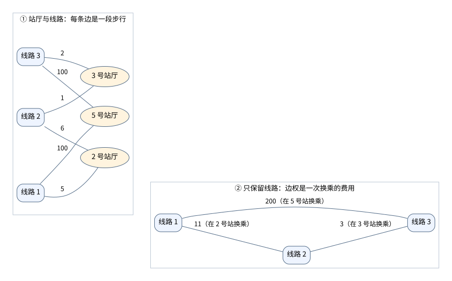

[[TOC]]

## 形式化题目

有 $m$ 个站点和 $n$ 条线路，线路 $i$ 包含一组站点。每个站点最多属于 $d$ 条线路。网络连通，所有步行费用均为正数。

记 $w_v$ 为站点 $v$ 的地铁口到站厅的费用，$t_{i,v}$ 为站厅到线路 $i$ 站台的费用。这里用站点编号 $v$ 写下标，原输入按线路内的次序给出这些费用。

每次询问从 $x$ 到 $y$，只计算步行费用：

- 进入第一条线路 $i$：支付 $w_x+t_{i,x}$。
- 沿同一条线路乘车：不增加步行费用，可以到达这条线路上的任意站。
- 在公共站 $v$ 从线路 $i$ 换到线路 $j$：支付 $t_{i,v}+t_{j,v}$。
- 从最后一条线路 $j$ 离开：支付 $t_{j,y}+w_y$。

求每次出行的最小总步行费用。

## 解法路线

站点最多有 $5\times10^5$ 个，线路却只有 $500$ 条。要减少最短路的计算量，可以先把“当前在哪一站”换成“当前在哪条线路上”。

下面用 $K=\sum k_i$ 表示所有线路经过的站点数之和，$E$ 表示合并重边后线路图的边数。

| 层次 | 适用约束 | 做法 | 复杂度 | 相对前层的推进 |
| --- | --- | --- | --- | --- |
| 暴力解法 | 站点和询问都少，如测试点 $1\sim6$ | 站厅、线路都建点，每次跑 Dijkstra | $O(q(m+n+K)\log(m+n))$ | 基线 |
| 线路图 | 询问较少且换乘图不太稠密，如测试点 $1\sim8$ | 只保留线路点，每次跑多源 Dijkstra | $O(Kd+n^2+q(n+E)\log(n+1))$ | 点数从 $m+n$ 降到 $n$ |
| 正解 | 全部数据 | Floyd 预处理线路间距离，再枚举起终点线路 | $O(Kd+n^3+qd^2)$ | 所有询问共用一次最短路预处理 |

前两层用来解释建图和优化的来由，正式主解是 `main.cpp`。最后一层不需要把询问存下来排序，读到一个就能回答一个。

## 暴力解法

### 适用范围

测试点 $1\sim6$ 中，$n\leqslant50$、$K\leqslant300$、$q\leqslant200$，可以每次询问重新跑最短路。

### 思路

先按实际走路的过程建图。每个站厅建一个点，每条线路也建一个点。如果线路 $i$ 经过站点 $v$，就把站厅 $v$ 和线路 $i$ 连起来，边权为 $t_{i,v}$，两个方向都能走。

线路点表示“已经上了这条线”。**题目不计乘车时间，所以只要在线路上，就能坐到它经过的任意站，不必再记录当前是哪一站。** 从线路点走到某个站厅，才需要付下车后走出站台的费用。下一节的图左侧就是这种建法。

例如，从线路 $1$ 经站厅 $v$ 换到线路 $2$，图上走的就是“线路 $1$ → 站厅 $v$ → 线路 $2$”，正好支付两段步行费用。

每次从站厅 $x$ 跑 Dijkstra 到站厅 $y$，最后加上 $w_x+w_y$。中间换乘只到站厅，不走出地铁口，所以不加中间站的 $w_v$。

### 代码

@include-code(./brute.cpp, cpp)

### 复杂度与瓶颈

图有 $m+n$ 个点、$K$ 条无向边。每次最短路花 $O((m+n+K)\log(m+n))$ 时间，总时间乘上询问数 $q$。空间为 $O(m+n+K)$。

大数据有十万次询问，这样重复搜索整张图太贵。接下来先把站厅点从中间换乘过程里去掉。

## 子任务解法：线路换乘网络

### 适用范围

这是减少图大小后的中间做法。测试点 $1\sim8$ 的询问不超过 $200$，关联数 $K$ 不超过 $400$，可以使用。

询问更多时，还要看线路图有多稠密，不能只凭“$q\leqslant2000$”就断定一定能过。

### 思路

从线路 $i$ 换到线路 $j$，只需要找一个两条线都经过的站 $v$，走回站厅，再走到另一条线的站台，费用是 $t_{i,v}+t_{j,v}$。

于是，每条线路建一个点。枚举每个站经过的线路，两两连边，边权就是这次换乘的费用。两条线可能在多个站相交，留下最便宜的换乘费用即可。

下面只画样例二中与换乘有关的站。左图保留站厅，右图把“两段步行”合成一条换乘边。

比如线路 $1$ 和线路 $2$ 在 $2$ 号站换乘，费用为 $5+6=11$。线路 $2$ 和线路 $3$ 在 $3$ 号站换乘，费用为 $1+2=3$。线路 $1$ 和线路 $3$ 虽然能在 $5$ 号站直接换乘，但要花 $100+100=200$，还不如经线路 $2$ 换两次，只花 $14$。所以不能贪心地追求换乘次数最少。

**这样省掉站厅，会不会把本来走不了的路线也算进来？** 需要把两个方向都核对一遍。

**实际行程 → 线路图上的路径。** 按先后顺序记录乘过的线路。每次换乘都在公共站发生，所以在线路图上有对应的边。图上保留的是最便宜的公共站，费用不会比这次实际换乘更贵，因此图上的最优值不会比实际最优值大。

**线路图上的路径 → 实际行程。** 每条边都来自一个真实的公共站，按建边时的站点换乘，就能付出这条边的费用。连续两条边即使对应不同的站，也可以坐当前线路从前一个站到后一个站，不增加步行费用。因此图上算出的方案确实能走出来，实际最优值也不会比图上最优值大。

两个方向合起来，线路图算出的最小换乘费用就是我们要的。起终点还需要单独接上：

- 从 $x$ 站厅出发，可以选择它经过的任意线路。把这些线路都作为 Dijkstra 的初始点，初始距离分别是各自的 $t_{i,x}$，不能都设成零。
- 最后枚举经过 $y$ 的线路 $j$，用到达线路 $j$ 的距离加上 $t_{j,y}$，取最小值。
- 再加 $w_x+w_y$，就是从地铁口到地铁口的答案。

### 代码

@include-code(./main2.cpp, cpp)

### 复杂度与瓶颈

记站点 $v$ 经过 $d_v$ 条线路。每站枚举线路对要花 $O(d_v^2)$，而 $d_v\leqslant d$、$\sum d_v=K$，所以总建边量为 $O(Kd)$。代码还用 $O(n^2)$ 扫描矩阵，把最小换乘边存进邻接表。

每次堆优化 Dijkstra 为 $O((n+E)\log(n+1))$，因此总时间为 $O(Kd+n^2+q(n+E)\log(n+1))$，空间为 $O(m+K+n^2)$。

图变小了，但每次还在重复求同一张图的最短路。线路之间的换乘费用根本不随询问变化，可以提前全部算好。

## 正解

### 关键观察

线路只有 $n\leqslant500$ 条，直接用 Floyd 求任意两条线路之间的最短路即可。记 `dist[i][j]` 为已经在线路 $i$ 上，到达线路 $j$ 所需的最少换乘步行时间。它不包含起点上站台和终点出站台的费用。

对一次询问，只剩下两个选择：第一条坐哪条线，最后一条坐哪条线。中间怎么换乘，查 `dist` 就行。

每站最多经过 $d\leqslant20$ 条线，所以两边搭配至多 $400$ 种，不需要再跑最短路。

### 思路

设 $L(x)$、$L(y)$ 分别是经过起点和终点的线路集合。选定第一条线路 $i$、最后一条线路 $j$ 后，整个过程的费用分成五段：

$$
w_x+t_{i,x}+\operatorname{dist}[i][j]+t_{j,y}+w_y.
$$

从左到右分别是进站厅、上第一条线、中间换乘、离开最后一条线、出站。枚举 $i\in L(x)$ 和 $j\in L(y)$，取这个和的最小值即可。

`main.cpp` 按这几个动作拆开写：

- `read_input()`：读入线路，把“站点能上哪些线、要走多久”存进 `station_lines[v]`。
- `build_transfer_graph()`：枚举同一站的线路对，记录直接换乘的最小费用。不同线路先设为 `INF`，同一条线到自己的费用设为零。
- `floyd()`：预处理任意两条线路间的最短路。
- `query(x, y)`：枚举第一条和最后一条线，用上面的式子算答案。

仍看样例二，从 $1$ 号站到 $6$ 号站。第一条只能选线路 $1$，最后一条只能选线路 $3$，中间经线路 $2$ 换乘花 $11+3=14$。再补上两端，总费用是 $8+4+14+7+2=35$。

这里有几个容易漏掉的地方：

- **不换乘也要付两端费用。** 当第一条和最后一条是同一条线时，`dist[i][i]=0`，但上下站台的费用仍然要加。
- **起点上哪条线，要和后面的路一起比较。** 不能只选起点上站台最便宜的线路，然后固定它。
- **换乘费用只加两个 `t`。** 中间站的 `w` 不在行程里，同一对线路的多个公共站则要取最小费用。
- **答案用 `long long`。** 换乘边都是正权，最短路不必重复经过某条线路，至多换乘 $n-1$ 次。每次不超过 $2\times10^9$，加上两端后总费用不超过 $1.002\times10^{12}$。代码用 `1LL << 60` 表示无穷大，两个这样的值相加也不会溢出。

### 代码

@include-code(./main.cpp, cpp)

### 复杂度

建换乘图为 $O(Kd)$，Floyd 为 $O(n^3)$，所有询问为 $O(qd^2)$。总时间为 $O(Kd+n^3+qd^2)$，空间为 $O(m+K+n^2)$。

满规模时，Floyd 最多有 $500^3=1.25\times10^8$ 次转移，询问最多枚举 $10^5\times20^2=4\times10^7$ 对端点线路。

## 总结

这题只算步行时间，上了同一条线以后，坐到哪一站都不增加代价，所以可以把整条线当成一个点。公共站提供换乘边，Floyd 提前算好线路之间怎么走最省。每次询问再枚举从哪条线上车、从哪条线下来，接上两端的步行费用就行。
