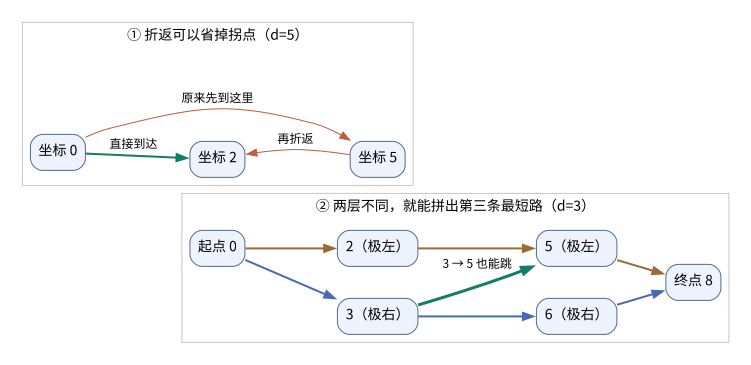
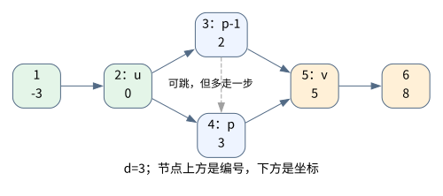

[[TOC]]

## 形式化题目

给定严格递增的坐标 $x_1<x_2<\cdots<x_n$。两点距离不超过 $d$ 就能直接到达，即 $|x_i-x_j|\leqslant d$ 时连一条无向边。

统计满足 $u<v$、且从 $u$ 到 $v$ **恰好有两条最短路**的点对。路径长度按边数计算，两条路径经过的点序列不同就算不同。这里要求的是最短路的条数为二，不是最短路长度为二；不连通的点对不计入答案。

## 解法路线

先从 BFS 计数出发，再找出“恰好两条”在这张有序图里是什么结构。记 $N$ 为一份输入中各组 $n$ 的总和。

| 层次 | 适用约束 | 做法 | 复杂度 | 相对前层的推进 |
| --- | --- | --- | --- | --- |
| 暴力解法 | $N\leqslant300$，测试点 $1\sim6$ | 每个起点跑 BFS，统计最短路条数 | $O(n^3)$ | 按定义计数 |
| 中等规模 | $N\leqslant5000$，测试点 $7\sim10$ | 找出唯一分叉，枚举分叉两端，再接唯一前后缀 | $O(n^2)$ | 用路径结构代替整张图上的搜索 |
| 正解 | 全部数据 | 把可选接点写成连续区间，直接计算个数 | $O(n)$ | 消掉区间内的逐点枚举 |

表中复杂度针对一组数据；对多组求和即可。三层使用同一份题意，主解是 `main.cpp`。

## 暴力解法

### 适用范围

$N\leqslant300$ 时，直接从每个点出发跑一次 BFS。

### 思路

BFS 时维护最短距离 `dist[v]` 和最短路条数 `ways[v]`。第一次到达 $v$ 时继承前驱的条数；再次用同样步数到达时，把条数加上去。最后只统计终点编号大于起点、且 `ways[v]==2` 的点对。

路径条数可能非常大，但我们只关心它是零、一、二，还是至少三。所以每次相加后都取 `min(3, ways[v])`，用三代表“太多了”。这样既不会溢出，也不会影响判断是否恰好为二。

### 代码

@include-code(./brute.cpp, cpp)

### 复杂度与瓶颈

这份代码每弹出一个点，都扫描全部 $n$ 个点判断能不能直接到达。单次 BFS 为 $O(n^2)$，所有起点共 $O(n^3)$，空间为 $O(n)$。

它还没用上坐标有序这一条件。下面先看看，最短路到底能长成什么样。

## 子任务解法：中等规模

### 适用范围

$N\leqslant5000$。先把结构想明白，暂时用循环枚举候选接点。

### 思路

#### 最短路不会折返

假设路径中连续经过 $a\to b\to c$，在 $b$ 处折返。此时 $a,c$ 在 $b$ 的同一侧，而且到 $b$ 的距离都不超过 $d$，所以 $a,c$ 之间的距离也不超过 $d$。直接走 $a\to c$ 就能省一步。

因此，从左边的 $u$ 到右边的 $v$，最短路一定一直向右走。只要有向左的步子，途中就必然出现一次这样的折返。

记 $R[i]$、$L[i]$ 为点 $i$ 一步能到达的最右、最左下标，包含自己。它们对应代码里的 `rightmost[i]`、`leftmost[i]`，都可以用双指针预处理。

#### 用两条极值路径夹住所有最短路

从起点出发，每步尽量往右跳，最后一步到终点就停，得到路径 $A$。反过来，从终点每步尽量往左跳，到起点就停，再把顺序倒过来，得到路径 $B$。

为什么贪心走出来的也是最短路？因为 $R[i]$ 随 $i$ 不减：这一跳站得更靠右，下一跳就不会落后。逐步比较可知，走相同步数，向右贪心至少和任何走法一样远；向左同理。

设最短距离为 $h$。按走过的步数分层，任意最短路在第 $j$ 层经过的点 $P_j$ 都满足 $B_j\leqslant P_j\leqslant A_j$。也就是说，$B$ 给出每层最靠左的选择，$A$ 给出最靠右的选择。

相邻两层还有 $A_j<B_{j+1}$。否则，前 $j$ 步已经走到了 $B_{j+1}$ 或它右边，再接上后半段就能少走一步，因为从更靠右的位置出发，不会更难到达终点。这与最短距离为 $h$ 矛盾。

下面两幅小图分别展示折返如何省步，以及两层都有不同选择时怎样拼出第三条路。第二幅图中的数字都是坐标，只画了参与最短路的边。

第二幅图里，极左路径是 $0\to2\to5\to8$，极右路径是 $0\to3\to6\to8$。由于 $2\to5$ 能跳，站得更近的 $3$ 也能跳到 $5$，于是又有 $0\to3\to5\to8$。三条路长度相同，所以这个点对不能计入答案。

#### 恰好两条，必须只分叉一层

**必要性：恰好两条最短路，就只能在一层选两个相邻点。**

- 极右路径的前缀，总能接上极左路径的后缀。因为 $B_j\leqslant A_j<B_{j+1}$，而 $B_j$ 能跳到 $B_{j+1}$，所以 $A_j$ 也能跳到 $B_{j+1}$。
- 如果两条极值路径有至少两层不同，在第一处分歧后接上极左后缀，就得到第三条路：它在第一处不同于极左路径，在后面的分歧处又不同于极右路径。因此只能有一层不同。
- 如果这一层的两个下标之间还夹着其他点，也能把中间点换上去。前一跳和后一跳都不会超过 $d$，又会多出一条最短路。因此两个下标必须相邻。

**充分性：只有一层不同，且两个点相邻，就恰好有两条最短路。**

所有最短路都夹在 $A,B$ 之间。其他层只能经过共同的那个点，分歧层只有两个可选点；而 $A,B$ 已经分别实现了这两种选择，所以条数正好是二。

样例一的四个点坐标为 $1,2,3,4$，$d=2$。点对 $(1,4)$ 的两条极值路径是 $1\to2\to4$ 和 $1\to3\to4$，只差中间一层。加上第五个点后，又多出 $(2,5)$；但 $(1,5)$ 的两条极值路径都为 $1\to3\to5$，只有一条最短路，不计入答案。

#### 找到分叉，再数两边怎么接

设分叉前的共同点是 $u$，分叉后的共同点是 $v$，两个可选点是 $p-1,p$。因为它们分别来自最左和最右路径，所以必须满足：

$$
R[u]=p,\qquad L[v]=p-1,\qquad u<p-1<p<v.
$$

这说明，从 $u$ 到 $v$ 的两条最短路就是 $u\to(p-1)\to v$ 和 $u\to p\to v$。接下来可以在左边加一段唯一前缀、右边加一段唯一后缀，但不能让其他层也出现分歧。

用下面六个点作例子，坐标为 $[-3,0,2,3,5,8]$，$d=3$。分叉前后的共同点是 $u=2$、$v=5$，中间选编号 $3$ 或 $4$。

绿色的两个点都可以当起点，黄色的两个点都可以当终点，所以这里得到 $2\times2=4$ 个双径点对。灰色虚线也是合法的一跳，但走它会多用一步，不属于最短路。

左右并不是随便接一条唯一路径就行，还要让两条极值路径仍然在 $u,v$ 处重合：

- **往左接**：反向最左路径从 $p-1$ 再跳一步，必须恰好落在 $u$，即 $L[p-1]=u$。若它跳到了 $u$ 左边，就会在原分叉以外再次与正向路径不一致，此时只能让 $u$ 自己当起点。
- **往右接**：正向最右路径从 $p$ 再跳一步，必须恰好落在 $v$，即 $R[p]=v$。若它越过了 $v$，就只能把 $v$ 自己当终点。

这里的“只能自己当端点”很重要。真正的起终点可以让最后一步提前停下，但内部的共同点必须让极值跳跃准确落在上面。

#### 前后缀 DP 到底数什么

`prefix_count[i]` 统计能接到 $i$ 的起点数：前缀不分叉，而且正向最右贪心必须恰好落到 $i$。`suffix_count[i]` 统计能从 $i$ 接出的终点数：后缀不分叉，而且反向最左贪心必须恰好回到 $i$。两者都包含“不延伸，直接用 $i$ 当端点”这一种。

以 `suffix_count[i]` 为例，令 $r=R[i]$：

- 不再延伸，贡献一。
- 终点 $j$ 在 $i<j<r$ 内，正向直接到它就停。但反向必须准确回到 $i$，所以只有 $L[j]=i$ 才能贡献一。
- 第一跳走满，到达 $r$。只有 $L[r]=i$ 时才能原路回来；这时可以接上 `suffix_count[r]` 的任意方案，包含直接在 $r$ 结束。

所以 `suffix_count` 从右往左算，`prefix_count` 对称地从左往右算。如果一步也走不出去，就只有“不延伸”这一种，不能递推到自己。

下面列出六点例子的状态。每行的两项计数分别表示，以这个点为接点时能选多少个起点和终点。

| 编号 $i$ | 坐标 $x_i$ | $L[i]$ | $R[i]$ | `prefix_count[i]` | `suffix_count[i]` |
| --- | --- | --- | --- | --- | --- |
| $1$ | $-3$ | $1$ | $2$ | $1$ | $4$ |
| $2$ | $0$ | $1$ | $4$ | $2$ | $3$ |
| $3$ | $2$ | $2$ | $5$ | $1$ | $3$ |
| $4$ | $3$ | $2$ | $5$ | $3$ | $1$ |
| $5$ | $5$ | $3$ | $6$ | $3$ | $2$ |
| $6$ | $8$ | $5$ | $6$ | $4$ | $1$ |

例如，`suffix_count[6]=1`；点 $5$ 能跳到 $6$，且 $L[6]=5$，所以 `suffix_count[5]=1+1=2`。分叉核心使用的正是 `prefix_count[2]=2` 和 `suffix_count[5]=2`。

注意，编号 $3\to4$ 虽然是唯一的直达路，却不计入 `suffix_count[3]`：因为 $L[4]=2$，反向最左一步会越过 $3$。这就是这里的 DP 和“普通唯一路径数量”的区别。

有了 DP，就能枚举 $u$ 和 $v$。令 $p=R[u]$，检查 $L[v]=p-1$，按上面的条件分别取得左右接法数，再相乘。每个双径点对只有一个分叉位置，因此只会被它自己的核心 $(u,v)$ 统计一次。

这些接法也不会产生假的双径点对：拼好以后，正向极右路径和反向极左路径仍只在 $p-1,p$ 这一层不同，前面已经证明了这种情况恰好有两条最短路。

### 代码

@include-code(./main2.cpp, cpp)

### 复杂度与瓶颈

预处理 $L,R$ 为 $O(n)$。前后缀 DP 逐点枚举候选接点，分叉计数逐点枚举汇合点，最坏都是 $O(n^2)$。空间为 $O(n)$。

剩下的慢处很明确：我们总在循环检查“哪些点的 $L$ 或 $R$ 恰好等于某个下标”。这些点能不能一口气数完？

## 正解

### 关键观察

先看 $L[v]=k$，并且 $v>k$ 的情况。按定义，它表示 $v$ 能到达 $k$，但够不着 $k-1$。对应到向右的边界，就是 $v\leqslant R[k]$，且 $v>R[k-1]$；反过来，满足这两个条件，最左能到的点也正好是 $k$。

因此，满足条件的下标是一个连续区间：

$$
v\in[R[k-1]+1,\ R[k]].
$$

这让逐点判断变成了求区间交集的长度。对于 $k=1$，约定 $R[0]=0$，就不必单独写一个分支。

### 思路

#### 把 DP 里的枚举换成区间长度

计算 `suffix_count[i]` 时，没跳满的终点满足 $i<j<R[i]$，同时还要有 $L[j]=i$。把刚才的区间与这些限制取交集，可选终点为：

$$
[\max(i+1,R[i-1]+1),\ R[i]-1].
$$

区间里的每个点贡献一，用右端减左端加一即可；空区间贡献零。“走满后接 `suffix_count[R[i]]`”这一项保持不变。

左侧完全对称。满足 $R[j]=i$ 的起点在 $[L[i],L[i+1]-1]$ 内，再限制 $L[i]<j<i$，就得到：

$$
[L[i]+1,\ \min(i-1,L[i+1]-1)].
$$

它的长度就是 `prefix_count[i]` 中没跳满的那一部分。约定 $L[n+1]=n+1$，末尾也能使用同一套写法。这样两个 DP 都变成每个点 $O(1)$。

#### 一次枚举数完所有分叉

固定共同点 $u$，令 $p=R[u]$。如果 $p\leqslant u+1$，右边连两个分叉点都放不下，直接跳过。

汇合点 $v$ 要满足 $v>p$、$L[v]=p-1$。代入刚才的区间，所有合法汇合点为：

$$
[\max(p+1,R[p-2]+1),\ R[p-1]].
$$

代码把两端记为 `first_meet`、`last_meet`。区间为空就没有贡献；非空时，左右接法分别这样数：

- 左边只看 $u$。若 $L[p-1]=u$，有 `prefix_count[u]` 种起点；否则只能从 $u$ 出发。
- 右边先把每个汇合点都当作最终终点，因此先计入区间长度。
- 只有 $v=R[p]$ 的那个汇合点可以继续接后缀。由于 $R[p-1]\leqslant R[p]$，它若在区间内，一定就是最右端。因此检查 `last_meet==R[p]`，再加上 `suffix_count[last_meet]-1`。减一是因为“不再延伸”已经算过。

最后用左边的起点数乘上右边的终点接法总数，加进答案。这样把原来按左右能否延伸分开的四种情况合在了一次循环里，也不用保存所有分叉段。

#### 边界与数值范围

- 相邻点间隔超过 $d$ 时，两个方向的边界都不会跨过去，所以不同连通块不会被拼在一起。
- 孤立点的前后缀计数都为一，但它右侧放不下两个分叉点，不会贡献答案。
- 多组数据都重新计算当前范围内的边界和 DP，并重设 $R[0]$、$L[n+1]$ 两个哨兵。
- 坐标差最多为 $2\times10^{18}$，仍在 `long long` 范围内。答案最多为 $n(n-1)/2$，可能超过 `int`；乘法和答案都必须用 `long long`。

### 代码

@include-code(./main.cpp, cpp)

### 复杂度

双指针预处理、两遍 DP、枚举分叉前共同点，都是 $O(n)$。所有测试数据合计 $O(N)$，空间为 $O(n)$。

代码使用五个 `long long` 数组，容量为 $2\times10^6+5$，数组本身约占 $76.3\text{ MiB}$。

## 总结

恰好两条最短路，意味着两条极值路径只能在一层分开，而且只能选两个相邻点。找到这一次分叉后，分别数左右还能接哪些唯一前后缀。最后利用坐标有序，把“哪些点恰好跳到这里”写成连续区间，就能用区间长度代替枚举。
