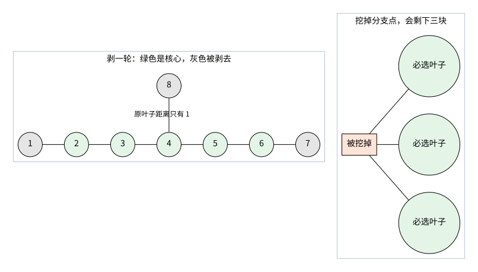
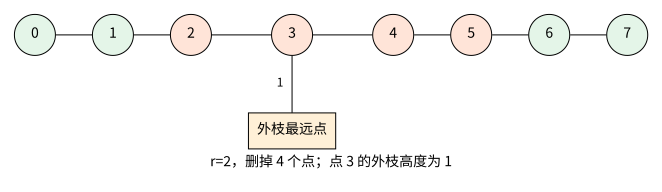

[[TOC]]

## 形式化题目

给定一棵 $n$ 个点的树。选出恰好 $k$ 个点组成集合 $S$，要求选中点的诱导子图至多有两个连通块。

每个点走到最近选中点的距离为 $d(u,S)=\min_{v\in S}\operatorname{dist}(u,v)$。求最小的覆盖半径，也就是让 $\max_u d(u,S)$ 尽量小。

## 解法路线

先二分半径 $r$，问能不能用恰好 $k$ 个点覆盖全树。半径越大越容易满足，因此可以二分。

难点在判定：选中的点只能有两块，这个限制到底能帮我们省掉哪些选择？下面先找出必须保留的部分，再把剩余选择压到一条链上。

| 层次 | 适用约束 | 做法 | 复杂度 | 相对前层的推进 |
| --- | --- | --- | --- | --- |
| 暴力解法 | $n\leqslant10$，测试点 $1\sim3$ | 枚举选点集合，多源 BFS 求半径 | $O(\binom nk n)$ | 按定义找最优方案 |
| 显式判定版 | 代码数组支持 $n\leqslant4000$，覆盖测试点 $1\sim10$ | 剥叶确定核心，逐次扫描邻居，再在线性链上做差分 | $O(n\log n)$ | 把选集合变成删一段链 |
| 主解 | 全部数据 | 预处理邻居剥叶时间的前三大值，复用同一套链判定 | $O(n\log n)$ | 每次判定不用再扫全部邻接表 |

后两版用的是同一个算法，只是判定的实现方式不同。主解为 `main.cpp`；显式版 `main2.cpp` 便于先对照定义理解，没有必要为了两份代码强行发明不同的解法。

## 暴力解法

### 适用范围

$n\leqslant10$ 时直接枚举。代码还可用于稍大的小规模对拍。

### 思路

枚举每个大小为 $k$ 的点集。树的任意诱导子图都是森林，所以连通块数就是“选中点数减去内部边数”。只保留不超过两块的方案。

然后把所有选中点一起放入队列，做多源 BFS，最远距离就是这次方案的半径。取所有合法方案中的最小值。

### 代码

@include-code(./brute.cpp, cpp)

### 复杂度与瓶颈

共 $\binom nk$ 个集合，每个集合用 $O(n)$ 判断和 BFS，总时间为 $O(\binom nk n)$，空间为 $O(n)$。大数据不能继续枚举集合，需要利用树的结构。

## 子任务解法：显式核心树判定

### 适用范围

本版数组支持 $n\leqslant4000$。它与主解同阶，区别在于每次二分判定都直接扫描邻居，求核心中的度数与外枝高度。

### 思路

#### 先把半径以内的外壳剥掉

固定半径 $r$，每一轮同时删掉当前所有度数不超过一的点。剥去 $r$ 轮后，剩下的树记为 $C$，下文称为核心树。它可能为空。

这不是“删除所有离原树叶子不超过 $r$ 的点”。短枝上的叶子不会让分支点跟着立即消失：分支点还要等其他方向也被剥掉。

下图左边是一条七点链，再向点 $4$ 挂一个叶子 $8$。剥一轮只去掉 $1,7,8$，点 $4$ 仍然留下；右边展示删掉分支点为什么会留下三块。

点 $4$ 到原叶子 $8$ 的距离只有一，但它还有左右两条路，第一轮并不是叶子。后面所有“核心度数”和“外枝”都以实际剥叶结果为准。

#### 为什么可以只在核心里选点

核心非空时，剥掉的部分都是挂在核心上的枝条，每个枝条从连接点往外的高度至多为 $r$。否则它还有未被剥完的部分，不会已经全部消失。

把一个外部基地移到它所属枝条与核心的连接点：

- 对这个连接点外面挂着的点，连接点本身就能在 $r$ 步内覆盖它们。
- 对其他点，原来去这个基地的路要先经过连接点，移到连接点后只会更近。
- 同一个连通基地块投影到核心后仍连通；不同基地可能合并，选点数和连通块数都不会增加。

因此，任意可行方案都能投影成核心里的一个方案，最多用 $k$ 个点。若还没用满，就沿着已有基地块的边界补点，覆盖只会更好，也不会增加连通块数。

若 $|C|\leqslant k$，直接选完整个核心，再向外补到 $k$ 个点即可。核心为空时，树的中心到最远点的距离已不超过 $r$：若直径超过 $2r$，剥去两端各 $r$ 个点后仍会有点留下，核心不可能为空。因此选中心再补点也能满足要求。这两种情况直接判可行。

#### 核心里的叶子必须选

下面只看 $|C|>k$ 的情况。

核心的每个叶子 $v$，外面都挂着一条长度恰好为 $r$ 的枝条：更长就不会剥完，更短则 $v$ 自己也会在前 $r$ 轮内被剥掉。

那条枝条最外端的点，离 $v$ 已有 $r$ 步。基地现在都在核心里，如果不选 $v$，它到任何基地都要多走至少一步。因此，**核心的所有叶子必须保留**。

于是可以把任务改成：从核心中删去恰好 $D=|C|-k$ 个点，核心叶子不能删，剩下至多两块。

#### 为什么只能挖掉一段度二链

看删掉的每个连通块。它不含核心叶子，所以至少有两条边通向保留的部分；否则这个删掉的块会自己形成树的一端，里面就该有一个核心叶子。

把每个保留块和每个删除块都缩成一个点，仍是一棵树。保留块至多两个，而每个删除块至少连接两个保留块，所以只能有一个删除块，而且它恰好把两个保留块隔开。

这个删除块里也不能有分支点。若有三条路分出去，每条路最终都通向一个必选叶子，就会隔出至少三个保留块。所以上图右边的挖法不合法。

因此，删掉的点必须是**一条连续路径，且路径上每个点在核心中的度数都是二**。反过来，删去这样一段内部链，剩下的核心正好分成两块，连通块限制就满足了。之后只需检查覆盖距离。

#### 缺口中的点要连同外枝一起覆盖

枚举一条极大的度二链，内部点编号为 $1,2,\ldots,m$，两端外面的保留点编号为 $0,m+1$。这里是链上的局部编号。

设点 $j$ 挂着的最长外枝高度为 $h_j$，没有外枝就取零。删除 $D$ 个连续点时，以左边最后一个保留点 $s$ 为起点，删掉的区间是 $[s+1,s+D]$。

点 $j$ 到左右保留点的距离分别为 $j-s$、$s+D+1-j$，所以它和整条外枝能被覆盖的条件是：

$$
h_j+\min(j-s,\ s+D+1-j)\leqslant r.
$$

就是先从外枝最远点走回链上，再走向缺口较近的一端。这个条件对每个被删点都要成立；其他保留的核心点会直接覆盖自己外面的枝条。

下图删掉橙色的四个点，$r=2$。点 $3$ 的外枝高度为一，而它到最近的保留点 $1$ 还有两步，因此外枝最远点要走三步，这个缺口不合法。

只看链上点时，这个缺口似乎够短；加上外枝高度，才会发现真正的最远点。所以不能只找一条足够长的链，还必须检查每个点的 $h_j$。

#### 让每个点标出它禁止的起点

令 $b=r-h_j$，表示回到链上之后还剩多少步。核心外枝高度至多为 $r$，所以 $b\geqslant0$。

一个起点 $s$ 不合法，意味着点 $j$ 到左右两边都超过 $b$ 步：$j-s>b$，并且 $s+D+1-j>b$。整理整数端点后，得到点 $j$ 禁止的起点区间：

$$
s\in[j+b-D,\ j-b).
$$

右端不包含。再与所有合法起点 $[0,m-D+1)$ 取交集，用差分数组给这段加一即可。所有点处理完后，若某个起点的禁止次数为零，就找到了可行的缺口。

例如 $m=6$、$D=4$，点 $j=3$ 的 $h_j=1$、$r=2$，所以 $b=1$，禁止起点为 $[0,2)$。下面只检查这个点带来的限制。

| 起点 $s$ | 删除区间 | 点 $3$ 到最近保留点 | 加上外枝后的距离 | 该点是否满足 |
| --- | --- | --- | --- | --- |
| $0$ | $[1,4]$ | $2$ | $3$ | 否 |
| $1$ | $[2,5]$ | $2$ | $3$ | 否 |
| $2$ | $[3,6]$ | $1$ | $2$ | 是 |

差分把前两个起点标为禁止，留下第三个。把链上每个点的限制都叠上去，才得到整条链的判定结果。由于 $b\geqslant0$，一个点只会禁止那些确实把它删进缺口的起点，不会影响缺口外的方案。

#### 判定的两个方向

**必要性：原树存在可行选点，就一定能通过上述判定。** 投影和补点后，可在核心中选出恰好 $k$ 个点；核心叶子必须保留，因此删集只能是一段度二链。原方案覆盖了外枝最远点，对应起点就不会被差分标记。

**充分性：找到未被禁止的起点，就能构造原树的可行选点。** 保留核心中缺口以外的全部点，数量恰好为 $k$，形成两块。保留点直接覆盖自己外面的枝条；被删点及其外枝满足上面的距离式，也能在 $r$ 步内到达基地。因此全树被覆盖。

### 代码

`main2.cpp` 直接扫描邻居，找出当前核心中的度数、两个链邻居和最大外枝高度，再调用 `scan_chains()`、`check_chain()` 完成判定。

@include-code(./main2.cpp, cpp)

### 复杂度与瓶颈

每次判定扫过所有邻居和所有度二链。树的边数、各链长度的总和都是 $O(n)$，差分处理也为 $O(n)$，所以总时间为 $O(n\log n)$，空间为 $O(n)$。

这已经是正确的完整算法。主解再利用预处理，减少每次重新扫描邻接表的工作。

## 正解

### 关键观察

给每个点记录剥叶轮数 `peel_time[u]`，初始叶子为一。点 $u$ 在剥去 $r$ 轮后还存在，按定义就是 `peel_time[u]>r`。

核心中的度数，则是剥叶时间大于 $r$ 的邻居数。若提前找出邻居剥叶时间的第一大、第二大、第三大值，就能直接判断这个点是不是度二链上的点：

- 点 $u$ 自己仍在核心。
- 第二大值大于 $r$，说明至少有两个核心邻居。
- 第三大值不超过 $r$，说明没有第三个核心邻居。

此时最大的两个邻居就是链上的左右邻居，第三大值就是最大外枝高度。不足三个邻居时，第三大值按零处理。

为什么外枝高度能直接用剥叶时间？因为核心点 $u$ 尚未被删除，外枝只能从末端一层层向 $u$ 剥过来。叶子邻居第一轮删除，对应高度一；更长的枝条每多一层就晚一轮删除。因此，一个非核心邻居的删除轮数，恰好是从 $u$ 沿这个方向走到最远点的距离。

### 思路

主解按下面几个动作实现：

- `prepare_peeling()`：队列剥叶，计算删除轮数，同时预处理 `core_size[r]`，表示剥去 $r$ 轮后剩下多少点。
- `prepare_neighbors()`：一次扫描邻接表，保存剥叶时间最大的两个邻居和第三大时间。
- `check(radius)`：求要删的点数 $D$，标记当前核心里的度二点及其外枝高度。
- `scan_chains()`：从一条度二链的端头走到另一端，保存链上的点，处理完就取消标记，避免重复扫描。
- `check_chain()`：清空当前起点范围的差分数组，叠加禁止区间，再找覆盖次数为零的起点。
- **闭区间二分记账**：在闭区间 $[0, n]$ 上二分通勤半径 `radius`，采用标准 `while (left <= right)`。一旦 `check(mid)` 成立立即记账 `ans = mid` 并向左收缩试探更优解 `right = mid - 1`，否则向右扩大搜索范围 `left = mid + 1`，彻底杜绝死循环隐患。

每次判定先处理两个边界：$D\leqslant0$ 时可行；$D>2r$ 时不可行。后者是因为长度为 $D$ 的缺口，中点到较近保留端的距离为 $\lceil D/2\rceil$，即使没有外枝也已经超过 $r$。

链上的后继直接从两个核心邻居中选出“不是刚才那个点”的一个。收集整条链后再做差分，数组清空和扫描的范围都能直接看出来。

样例第一组是五点链，$k=2$。半径一时剥去两端，核心为 $\{2,3,4\}$，删掉中间点 $3$，保留 $\{2,4\}$ 即可覆盖全树；半径零则必须把所有点都选上，所以答案为一。第二组可以选 $\{2,7,9\}$，得到题面给出的半径二方案。

代码中的点号、轮数、距离、点数和差分覆盖次数都不超过 $10^6$，使用 `int` 足够。每组重新计算当前范围内的数组，核心大小的后缀计数也会清空，不依赖上一组数据。

### 代码

@include-code(./main.cpp, cpp)

### 复杂度

预处理为 $O(n)$，每次二分判定为 $O(n)$，共 $O(\log n)$ 次。单组时间为 $O(n\log n)$，多组累加不超过 $O(N\log n_{\max})$；空间为 $O(n_{\max})$，其中 $n_{\max}$ 是数组支持的最大单组规模。

## 总结

先剥掉半径以内的外壳，把基地移到核心里。核心叶子必须选，而基地至多分成两块，所以多余的点只能从一条度二链上连续挖掉。每个被挖点带着自己的外枝，对缺口位置提出一个区间限制；把这些限制做差分，就能在线性时间内完成一次二分判定。
