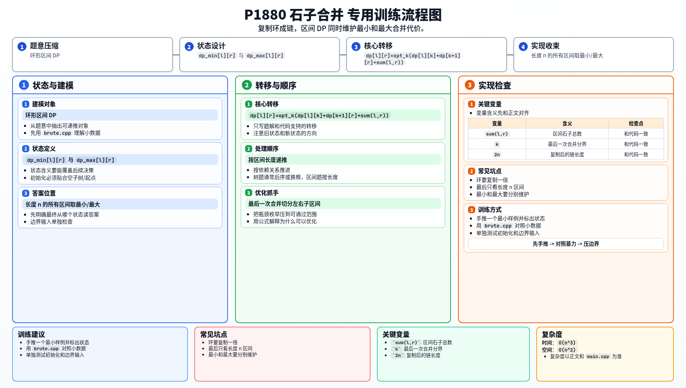

[[TOC]]

## 形式化题目

给定一个长度为 $n$ 的环形序列 $a_1, a_2, \dots, a_n$（首尾相邻）。

一次操作：从环上选出相邻的两堆，把它们合并成一堆，得分等于这两堆石子数之和。

连续操作 $n-1$ 次后只剩一堆。求所有合法操作顺序中，总得分的最小值与最大值。

约束：$1 \leqslant n \leqslant 100$，$0 \leqslant a_i \leqslant 20$。

## 解法路线

朴素模拟把「每一步合并哪一对」当作决策，搜索树是 $2^{n}$ 量级，只能做 $n \leqslant 8$ 的规模；正确的切入点是**只看最后一次合并**，它把问题切成了两个独立的、规模更小的同类问题——这正是区间 DP 的形态。环形则通过复制数组变成 $2n$ 长度的链来处理。

| 层次 | 适用约束 | 做法 | 复杂度 | 相对前层的推进 |
| --- | --- | --- | --- | --- |
| 暴力模拟 | $n \leqslant 8$ | 递归枚举「合并环上哪一对相邻石子」，记忆化记录剩余环 | $O(\text{状态数})$，指数级 | 基线，只用来验证小数据 |
| 正解：区间 DP | $n \leqslant 100$ | 复制成 $2n$ 链，按区间长度递增递推 `dp[l][r] = opt_k dp[l][k] + dp[k+1][r] + sum(l,r)`，再枚举长度为 $n$ 的起点 | $O(n^3)$ | 用「最后一次合并的断点」取代逐步模拟，把指数搜索压成多项式 |

表后说明：暴力层不是对外的正式解，它存在的意义是**让「枚举合并顺序」这个最直白的想法落地**，从而能直接看到它为什么爆炸；正解只把决策点从「每一步」换成「最后一次」，其余不变。

## 暴力解法

### 思路

最直接的想法就是照着题意模拟：当前环上还剩 $m$ 堆，枚举把哪一对相邻的合并，递归下去，返回剩余环的最优值，再加上本步得分。

环没有固定起点，所以同一个环可能以不同旋转出现。暴力里用 `canonical()` 把状态旋转到「最小元素开头」再记忆化，避免重复计算。

因为每步的得分只依赖本步合并的两堆（它们的和），所以递归返回时可以简单地把 `merged` 累加给子问题结果。

### 代码

@include-code(./brute.cpp, cpp)

### 复杂度

状态数是「环上元素的多重集排列」级别，实际增长远快于 $2^n$，$n = 8$ 时已经接近极限。因此它只能做很小的数据，适合作为对拍基准。

### 瓶颈

每个状态都要枚举「合并哪一对」，而合并顺序的总数是组合爆炸的。**我们并不需要知道中间每一步长什么样**——只要知道某个区间被合成一堆的总代价，就可以把它整体当作一次「大合并」的零件。

## 正解

### 关键观察

考虑区间 $[l, r]$ 的最后一次合并：它一定把 $[l, r]$ 拆成相邻的两段 $[l, k]$ 与 $[k+1, r]$，其中两段各自都已经先合成了一堆。

这次合并的得分是 $[l, r]$ 全部石子之和 $S(l, r)$，与 $k$ 怎么选无关。

于是 $[l, r]$ 的答案只依赖两个**更短**区间的答案，加上一个固定的 $S(l, r)$。这就是区间 DP 的转移。

### 思路

先解决**链上**的版本。设

- `dp_min[l][r]`：把链上区间 $[l, r]$ 合成一堆的最小总代价；
- `dp_max[l][r]`：对应的最大总代价。

转移枚举断点 $k$（$l \leqslant k < r$）：

$$
dp_{\min}[l][r] = \min_{l \leqslant k < r}\left(dp_{\min}[l][k] + dp_{\min}[k+1][r]\right) + S(l,r)
$$

$$
dp_{\max}[l][r] = \max_{l \leqslant k < r}\left(dp_{\max}[l][k] + dp_{\max}[k+1][r]\right) + S(l,r)
$$

初值 `dp[l][l] = 0`（一堆石子不需要合并，代价为 0）。由于转移只用到比 $[l, r]$ 短的区间，按**区间长度从小到大**递推即可保证子问题已算好。

**破环成链**：把数组复制一遍得到长度 $2n$ 的序列 $a_1, \dots, a_n, a_1, \dots, a_n$。环上任意一种「从第 $i$ 堆之后切开」的方案，在复制后的数组里都对应一个长度为 $n$ 的连续区间 $[i, i+n-1]$。所以答案就是

$$
\min_{1 \leqslant i \leqslant n} dp_{\min}[i][i+n-1], \qquad \max_{1 \leqslant i \leqslant n} dp_{\max}[i][i+n-1]
$$

#### 一个小规模推演

以样例 `4 5 9 4` 为例。复制后数组是 `4 5 9 4 | 4 5 9 4`。长度 2 的区间（只有一种合并方式）最低代价如下表：

| 区间 | 石子 | 合并得分 |
| --- | --- | --- |
| [1,2] | 4, 5 | 9 |
| [2,3] | 5, 9 | 14 |
| [3,4] | 9, 4 | 13 |
| [4,5] | 4, 4 | 8 |

再往上是长度 3、4 的区间，每个都枚举断点取最优。最终四个长度为 4 的起点给出：

| 起点 $i$ | 区间 | 最小代价 | 最大代价 |
| --- | --- | --- | --- |
| 1 | [1,4] | 44 | 54 |
| 2 | [2,5] | 44 | 54 |
| 3 | [3,6] | **43** | 52 |
| 4 | [4,7] | 43 | **54** |

取所有起点的最小者的最小值 $43$、最大者的最大值 $54$，正是样例答案。注意最小值和最大值**没有出现在同一个起点上**——这也是本题容易错的地方：两个答案必须分别扫描所有起点，不能只在一个起点上同时取 min 和 max。

### 代码

@include-code(./main.cpp, cpp)

### 复杂度

区间 DP 的区间数是 $O((2n)^2) = O(n^2)$，每个区间枚举一个断点 $k$，所以时间 $O(n^3)$（常数上界按 $2n$ 计算），空间 $O(n^2)$。

在 $n = 100$ 时，$2n = 200$，三重循环约 $1.3 \times 10^6$ 次转移，远低于时限；实测 $n=100$ 的数据 CPU 时间约 $1.1$ ms。

## 总结

这题是「环形区间 DP」的模板：关键只有两步。

1. **找对决策点**：不看中间每一步合并谁，只看最后一步把区间劈在哪里——这一步把指数搜索变成多项式 DP。
2. **破环成链**：复制数组，把所有长度为 $n$ 的连续区间都当成一次「切环」，最后在它们之间取 min / max。

两个答案要分别维护两张表、分别扫描所有起点，因为取到最小值的切法和取到最大值的切法一般不重合。

## 图示解析

这张图把本题的建模、关键转移、实现检查和训练方法压缩到一页，适合读完正文后复盘。

