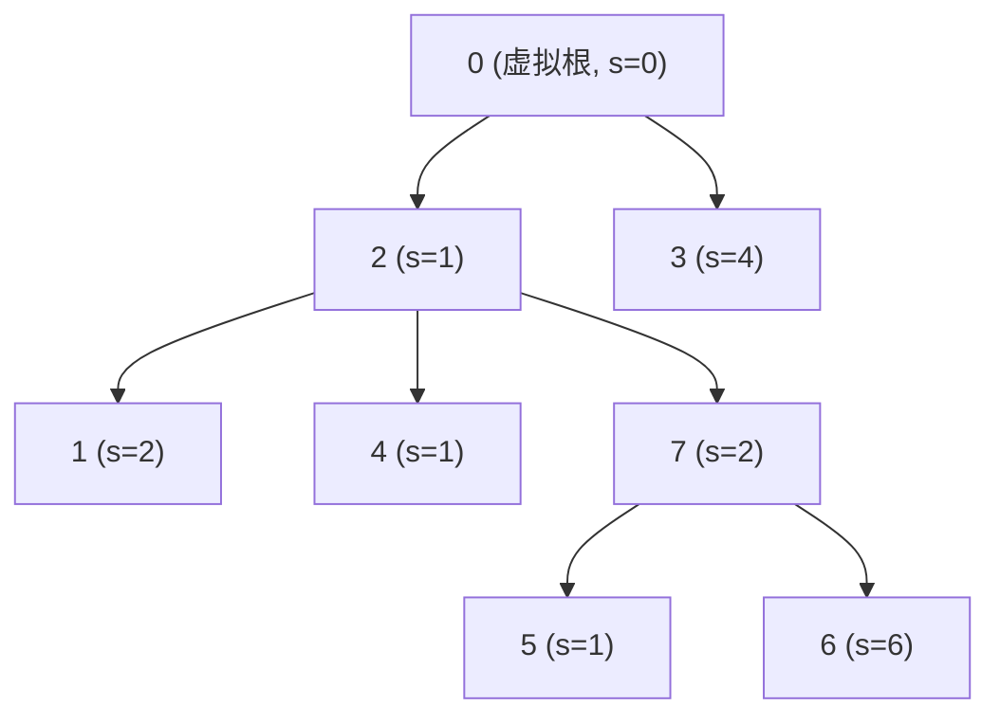

[[TOC]]

## 形式化题目

给定 $N$ 门课程与计划选择的课程门数 $M$（$1 \leq M \leq N \leq 300$）。

每门课程 $i \in \{1, 2, \dots, N\}$ 具有学分 $s_i \geq 0$，且至多有一门直接先修课 $k_i \in \{0, 1, \dots, N\}$：
- 若 $k_i = 0$，表示该课程无直接先修课；
- 若 $k_i > 0$，则必须先选修课程 $k_i$ 才能选修课程 $i$。

保证依赖关系无环（依赖图为森林，至少存在一门课无先修课）。要求选择恰好 $M$ 门课程，满足先修闭包条件（若课程 $i$ 被选，其所有先修课必须同时被选），使得所选课程的总学分最大：

$$\max_{S \subseteq \{1, \dots, N\}, |S| = M, \text{valid}(S)} \sum_{i \in S} s_i$$

## 暴力解法

### 思路

通过 DFS 递归枚举全部 $N$ 门课程的 0/1 选择（选或不选）。当递归到叶子节点时：
1. 检查选中的课程总数是否恰好为 $M$；
2. 检查选中的每门课程 $i$ 的直接先修课 $k_i$ 是否同样被选中（先修约束）；
3. 若合法，则累加所选课程的总学分并更新全局最大值。

### 代码

@include-code(./brute.cpp, cpp)

### 复杂度

- 时间复杂度：$O(2^N \cdot N)$。每次生成一个状态需 $O(N)$ 校验依赖和统计答案。
- 空间复杂度：$O(N)$。递归栈深度及选择标记数组占用线性空间。

### 瓶颈

状态空间随着课程数指数级暴涨。对于 $N \le 300$，$2^{300}$ 远超计算极限。实际上，选课依赖构成森林结构，子树之间的名额分配具有最优子结构，子问题重叠，应当使用动态规划。

## 正解

### 思路

#### 1. 建立虚拟根统一森林

由于原问题的依赖关系可能包含多棵互不连通的树（森林），引入一个编号为 $0$ 的虚拟根节点：
- 虚拟根学分设为 $0$（$s_0 = 0$）；
- 所有没有直接先修课（$k_i = 0$）的课程均以 $0$ 为父节点。

这样所有节点连接成一棵以 $0$ 为根的树。在原森林中选择 $M$ 门合法的课，等价于在以 $0$ 为根的树中选择包含根节点 $0$ 在内的恰好 $M+1$ 个节点。

#### 2. 状态定义

定义 $dp[u][j]$ 为：在以节点 $u$ 为根的子树中选择 $j$ 个节点（**且必须选择根节点 $u$**）所能获得的最大学分。

- 若不选 $u$，则根据先修规则，$u$ 的任何子树节点都不可选，学分为 $0$ 或不参与子树贡献；强制选 $u$ 可使状态转移具有清晰的连通性递推关系。
- 基础边界：对任意节点 $u$，选 $1$ 个节点（即仅选 $u$ 本身）时，$dp[u][1] = s_u$；其余不可达状态初始化为极小值 $-\infty$。

#### 3. 树上分组背包转移

遍历节点 $u$ 的每一个子节点 $v$：
- 子节点 $v$ 的整棵子树相当于一个“物品组”。
- 我们需要将分配给以 $u$ 为根的剩余总名额 $j$ 中，分出 $k$ 个名额给子树 $v$。
- 为了保证每组物品只转移一次（标准的 0/1 背包 / 分组背包思想），名额 $j$ 必须从大到小倒序枚举：

$$dp[u][j] = \max_{1 \leq k < j} \left( dp[u][j] , dp[u][j - k] + dp[v][k] \right)$$

其中：
- $j$ 从 $M+1$ 倒序枚举至 $1$；
- $k$ 从 $1$ 枚举至 $j-1$（因为节点 $u$ 本身至少占用 $1$ 个名额，分给子树 $v$ 的名额至多为 $j-1$）；
- 转移前需保证 $dp[u][j-k]$ 与 $dp[v][k]$ 均为有效可达状态。

#### 4. 目标答案

最终答案即为在以虚拟根 $0$ 为根的树中选择 $M+1$ 个节点的最大学分：

$$\text{Ans} = dp[0][M+1]$$

#### 转移演算: 样例上的虚拟根与背包合并

样例 `7 4` 的先修关系与学分是

| 课程 $i$ | 1 | 2 | 3 | 4 | 5 | 6 | 7 |
| --- | --- | --- | --- | --- | --- | --- | --- |
| 先修 $k_i$ | 2 | 0 | 0 | 2 | 7 | 7 | 2 |
| 学分 $s_i$ | 2 | 1 | 4 | 1 | 1 | 6 | 2 |

加上虚拟根 $0$ 后, 森林变成一棵树. 下图中 $2$ 是整棵真实树的根, $1,4,7$ 是 $2$ 的直接儿子:

$0$ 的直接儿子只有 $2$、$3$(它们的 $k_i = 0$), 其余课程挂在 $2$ 或 $7$ 下面. $1,4,7$ 都以 $2$ 为先修, $5,6$ 以 $7$ 为先修.

下表列出各结点最终的 $dp[u][j]$, 行列含义是"在 $u$ 子树里选 $j$ 个结点且必选 $u$"; 空位表示不可达($-\infty$):

| 结点 $u$ | $j=1$ | $j=2$ | $j=3$ | $j=4$ | $j=5$ |
| --- | --- | --- | --- | --- | --- |
| $0$ (虚拟根) | $0$ | $4$ | $5$ | $9$ | $13$ |
| $2$ | $1$ | $3$ | $9$ | $11$ | $12$ |
| $7$ | $2$ | $8$ | $9$ | — | — |
| $3$ | $4$ | — | — | — | — |
| $1$ | $2$ | — | — | — | — |
| $4$ | $1$ | — | — | — | — |
| $6$ | $6$ | — | — | — | — |
| $5$ | $1$ | — | — | — | — |

读表注意三处. 第一, 叶子结点($1,3,4,5,6$)只有 $j=1$ 可达, 因为选不了第二个结点; 第二, $dp[7][3] = 9$ 比 $dp[7][2] = 8$ 只多 $1$, 多出来的正是学分较小的 $5$; 第三, $dp[0][5] = 13$ 是答案, 它对应选 $\{0,2,7,6,5\}$(学分 $0+1+2+6+1 = 10$) 还是别的组合? 逐项核对: 取 $dp[0][5] = dp[0][2] + dp[2][3] = 4 + 9 = 13$, 而 $dp[0][2] = 4$ 来自只选 $3$($s_3 = 4$), $dp[2][3] = 9$ 来自选 $\{2,7,6\}$($1+2+6 = 9$). 合计 $\{0,3,2,7,6\}$, 学分 $4+1+2+6 = 13$.

这说明 $M = 4$ 门课里选了 $3,2,7,6$ 四门, 与输出 $13$ 一致.

#### 为什么名额要倒序枚举

正序枚举 $j$ 会让同一个儿子 $v$ 被重复使用. 以 $dp[7]$ 合并两个儿子 $5$、$6$ 为例:

| 阶段 | $dp[7][1]$ | $dp[7][2]$ | $dp[7][3]$ |
| --- | --- | --- | --- |
| 初始化(只有 $7$) | $2$ | $-$ | $-$ |
| 合并 $5$ | $2$ | $2+1=3$ | $-$ |
| 合并 $6$ | $2$ | $\max(3,\ 2+6)=8$ | $3+6=9$ |

合并 $6$ 时, $dp[7][3]$ 用到的是"已含 $5$ 的 $dp[7][2] = 3$", 再加 $6$ 的学分, 这正是允许的效果(不同儿子可以同时选). 而倒序枚举 $j$ 保证的是**同一个儿子**不会被算两次: 因为 $j$ 从大到小, 读取 $dp[u][j-k]$ 时它还没被本轮 $v$ 更新过.

### 代码

@include-code(./main.cpp, cpp)

### 复杂度

- 时间复杂度：$O(N \cdot M^2)$（使用子树大小上下界精细剪枝可达 $O(NM)$，但当前代码枚举上限为 $M$，在 $N, M \le 300$ 下常数极小，可通过所有测试点）。
- 空间复杂度：$O(N \cdot M)$，即 DP 状态数组占用的内存空间。

## 总结

1. **虚拟根建树技巧**：面对多根树或森林结构上的依赖决策时，添加学分/代价为 0 的虚拟超根统一入口，将全局选 $M$ 转化为新树强制选根且容量为 $M+1$ 的标准树形背包。
2. **强制选根化简状态**：在树形背包中，“选子节点必选父节点”的依赖使得定义状态包含根 $u$ 变得非常自然且避免了冗余分支分类讨论。
3. **分组背包倒序枚举**：将每个子树视为一组互斥容量选择，倒序枚举总名额 $j$，确保每个子树组只对当前阶段贡献一次。
