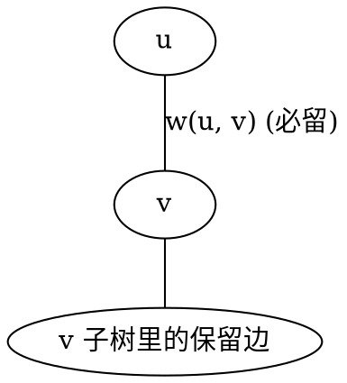
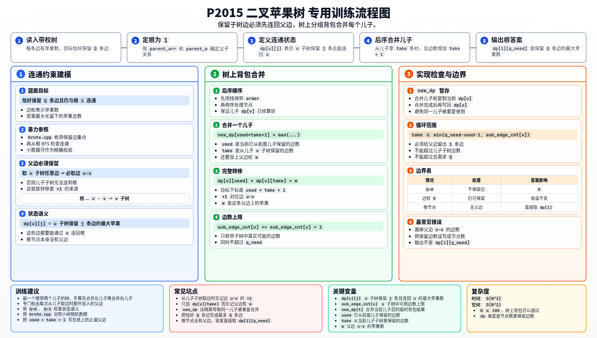

[[TOC]]

## 形式化题目

给定一棵包含 $N$ 个结点的带权无向树，结点编号为 $1 \sim N$，以 $1$ 号结点为根。每条边连接两个结点，并带有非负权值（表示枝条上的苹果数）。

要求在树中保留恰好 $Q$ 条边，使得：
1. 所有被保留的边构成的子图与根结点 $1$ 连通（即任意保留边均可沿保留边到达根结点）；
2. 被保留边的权值之和最大。

求所能获得的最大权值和。

## 暴力解法

### 思路

树上共有 $N-1$ 条边。最直接的朴素做法是通过深度优先搜索枚举所有边的选择状态：
- 每条边有两种决策：保留（$1$）或不保留（$0$）；
- 递归到底后，统计已选边的数量是否恰好为 $Q$；
- 若恰好为 $Q$ 条边，从根结点 $1$ 出发进行广度优先搜索（BFS），检查是否恰好可以访问到所有的 $Q$ 条边（确保连通性）；
- 连通性校验通过后，累计所有连通保留边的权值之和，并更新全局最大值。

### 代码

@include-code(./brute.cpp, cpp)

### 复杂度

- **时间复杂度**：共有 $N-1$ 条边，枚举子集的状态空间为 $O(2^{N-1})$。每个叶子节点进行一次 BFS 连通性检查与权值求和，耗时 $O(N)$。总时间复杂度为 $O(N \cdot 2^N)$。
- **空间复杂度**：存储邻接表与搜索栈深度均为 $O(N)$。

### 瓶颈

当 $N$ 增大时（例如本题 $N \le 100$），$2^{N-1}$ 的搜索规模会导致指数级爆炸。暴力做法没有利用树的无环与子树独立性：子树中哪些边能连通到根，完全取决于连向该子树的父边是否被保留；子树内部的边数分配只依赖于分配给它的配额，具有明显的最优子结构和无后效性。

## 正解

### 思路

将树以 $1$ 号节点为根进行有向化。

#### 1. 状态定义

定义 $dp[u][j]$ 表示：在以 $u$ 为根的子树中保留 $j$ 条边，且这 $j$ 条边均能通过 $u$ 连回根节点时，能获得的最大苹果数。

#### 2. 状态转移与树上分组背包

对于节点 $u$ 的某个儿子节点 $v$（边权为 $w(u, v)$）：
- 若不在 $v$ 的子树中保留任何边，则无需保留边 $(u, v)$；
- 若在 $v$ 的子树中保留 $take$ 条边（$take \ge 0$），由于这 $take$ 条边必须连通到根，**边 $(u, v)$ 必须被同时保留**。因此，消耗的总边数增加 $take + 1$，收益增加 $dp[v][take] + w(u, v)$。

我们将节点 $u$ 的每一个子节点 $v$ 视作一个分组背包中的「组」，在子树 $v$ 中保留的边数 $take$ 视作该组内的互斥物品选项：

$$
dp[u][used + take + 1] = \max\Big(dp[u][used + take + 1],\, dp[u][used] + dp[v][take] + w(u, v)\Big)
$$

其中：
- $used$ 为合并当前儿子之前，在节点 $u$ 的前面若干子树中已保留的边数；
- $take$ 为在当前儿子 $v$ 的子树中保留的边数；
- 转移前先将旧状态拷贝至临时数组，保证每组只选一个选项，避免同组内重复累加。

#### 3. 转移关系示意

若想要保留 $X$ 中的任意枝条，边 $U-V$ 必须保留，这正是转移中 $+1$ 条边与 $+w(u, v)$ 的来源。

### 代码

@include-code(./main.cpp, cpp)

### 复杂度

- **时间复杂度**：合并子树大小时，两重循环的枚举上限分别为子树当前的边数。树上背包的枚举复杂度严格受限于树上节点对数，结合子树大小优化后总时间复杂度为 $O(N \cdot Q) \le O(N^2)$（最坏无剪枝上界为 $O(N \cdot Q^2)$）。在 $N, Q \le 100$ 的约束下，计算量不超过 $10^5$ 次操作，耗时 $< 5\text{ ms}$。
- **空间复杂度**：动态规划数组 $dp[N][Q]$ 的大小为 $O(N \cdot Q)$，邻接表与树遍历栈的空间为 $O(N)$，总空间复杂度为 $O(N \cdot Q)$，约占几十 KB 内存。

## 总结

本题的关键在于通过树的层次结构拆解连通性约束：
1. **父边制约**：子树内的保留边必须经由父边导通至根节点，因此选儿子子树的任何非空方案都必须捆绑购买父边；
2. **分组背包转化**：每个儿子的子树构成相互独立的候选组，组内按分配边数展开为互斥候选项，通过树的后序遍历自底向上逐层合并即可高效求解。

## 图示解析

这张图把本题的建模、关键转移、实现检查和训练方法压缩到一页，适合读完正文后复盘。

