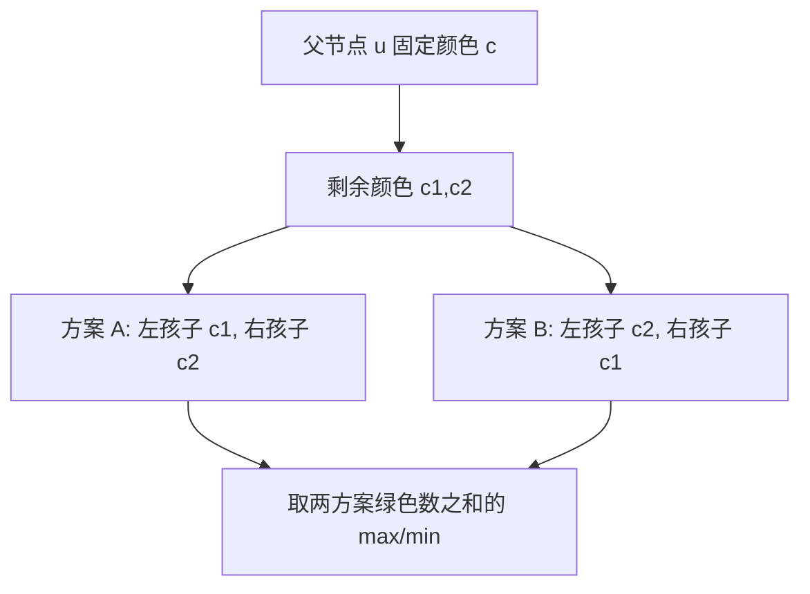

[[TOC]]

## 形式化题目

给定一棵二叉树的先序遍历结构描述（每个字符表示对应节点的子节点数量：`0` 表示叶节点，`1` 表示单子节点，`2` 表示双子节点）。

需要给二叉树的每个节点分配三种颜色之一（红、绿、蓝），使得：
1. 任意相连的父子节点颜色不同；
2. 任意具有相同父节点的两兄弟节点颜色不同。

求所有合法染色方案中，被染成绿色的节点数的最大值与最小值。

## 暴力解法

### 思路

对于规模较小的数据，可以通过 DFS 递归枚举每个节点染红、绿、蓝三种颜色之一的所有组合。枚举完成后，遍历整棵树检验是否同时满足“父子不同色”和“兄弟不同色”的约束；若合法，则统计其中绿色节点的个数，并更新全局的最大值与最小值。

### 代码

@include-code(./brute.cpp, cpp)

### 复杂度

整棵树共有 $n$ 个节点，每个节点有 $3$ 种颜色选择，染色方案总数为 $3^n$；检验单次方案合法性耗时 $O(n)$。因此总时间复杂度为 $O(3^n \cdot n)$，空间复杂度为 $O(n)$。

### 瓶颈

指数级别的枚举量使得暴力解法只能处理 $n \le 15$ 左右的小规模数据。但观察染色约束可以发现：子树内部的染色合法性及绿色节点数量，仅与该子树根节点自身的颜色相关，子树与子树之间在根节点颜色确定的情况下相互独立，具有明显的**最优子结构**与**无后效性**。

## 正解

### 思路

根据题意，我们可以分两步解决问题：先序递归建树与树形动态规划。

#### 1. 递归建树
输入字符串给出了二叉树的先序遍历序列：
- 字符 `'0'`：叶子节点，无左右子节点；
- 字符 `'1'`：只有一个子节点，递归构造其左子树；
- 字符 `'2'`：有两个子节点，依次递归构造其左子树与右子树。

#### 2. 状态设计
用 $0$ 表示绿色，$1$ 表示红色，$2$ 表示蓝色。
定义状态：
- $dp_{\max}[u][c]$：以 $u$ 为根的子树中，当 $u$ 染成颜色 $c$ 时，子树内最多能包含的绿色节点数；
- $dp_{\min}[u][c]$：以 $u$ 为根的子树中，当 $u$ 染成颜色 $c$ 时，子树内最少能包含的绿色节点数。

设指示函数 $\text{val}(c) = [c == 0]$（当且仅当染绿色时值为 $1$，否则为 $0$）。

#### 3. 状态转移
针对节点 $u$ 的子节点情况讨论：
- **若 $u$ 为叶子节点**：
  $$dp_{\max}[u][c] = dp_{\min}[u][c] = \text{val}(c)$$
- **若 $u$ 只有一个子节点 $l$**：
  子节点 $l$ 不能与 $u$ 同色，即 $c_l \in \{0, 1, 2\} \setminus \{c\}$：
  $$dp_{\max}[u][c] = \text{val}(c) + \max_{c_l \neq c} dp_{\max}[l][c_l]$$
  $$dp_{\min}[u][c] = \text{val}(c) + \min_{c_l \neq c} dp_{\min}[l][c_l]$$
- **若 $u$ 有两个子节点 $l$ 和 $r$**：
  因为 $u, l, r$ 三者必须两两不同色，当 $u$ 的颜色 $c$ 确定后，剩下的两个颜色 $\{c_1, c_2\} = \{0, 1, 2\} \setminus \{c\}$ 必须恰好分配给 $l$ 和 $r$。只有两种可能的分配方案：
  1. $l$ 染 $c_1$，$r$ 染 $c_2$；
  2. $l$ 染 $c_2$，$r$ 染 $c_1$。
  
  因此转移方程为：
  $$dp_{\max}[u][c] = \text{val}(c) + \max\big(dp_{\max}[l][c_1] + dp_{\max}[r][c_2],\; dp_{\max}[l][c_2] + dp_{\max}[r][c_1]\big)$$
  $$dp_{\min}[u][c] = \text{val}(c) + \min\big(dp_{\min}[l][c_1] + dp_{\min}[r][c_2],\; dp_{\min}[l][c_2] + dp_{\min}[r][c_1]\big)$$

最后，在根节点的所有颜色取值中分别求最大值和最小值即为答案。

样例串 `1122002010` 解析出的树共 10 个节点. 表中 RGB 依次表示节点染成绿、红、蓝时的状态值; `max` / `min` 是该子树里绿色节点数的最大 / 最小值. 节点按自底向上的顺序列出, 便于看孩子状态如何汇合到父节点.

| 节点 | 子节点 | `dp_max[u][绿,红,蓝]` | `dp_min[u][绿,红,蓝]` |
| --- | --- | --- | --- |
| 5 | 无 | `[1,0,0]` | `[1,0,0]` |
| 6 | 无 | `[1,0,0]` | `[1,0,0]` |
| 4 | 5, 6 | `[1,1,1]` | `[1,1,1]` |
| 8 | 无 | `[1,0,0]` | `[1,0,0]` |
| 10 | 无 | `[1,0,0]` | `[1,0,0]` |
| 9 | 左 10 | `[1,1,1]` | `[1,0,0]` |
| 7 | 8, 9 | `[2,2,2]` | `[1,1,1]` |
| 3 | 4, 7 | `[4,3,3]` | `[3,2,2]` |
| 2 | 左 3 | `[4,4,4]` | `[3,2,2]` |
| 1 | 左 2 | `[5,4,4]` | `[3,2,2]` |

节点 4 的两个叶子孩子必须与它及彼此不同色, 因此无论节点 4 选哪种颜色, 子树里都恰有 1 个绿点. 节点 7 同样是双孩子节点, 但右孩子 9 还有一个叶子; 其状态因此为 `max=[2,2,2]`、`min=[1,1,1]`. 节点 3 固定为绿色时, 孩子 4、7 必须分染红和蓝, 最多可得 `1+1+2=4` 个绿点, 最少为 `1+1+1=3`. 这些状态再沿单孩子节点 2、1 向根汇总, 根的最大值为 5、最小值为 2.

下图展示双孩子节点的转移: 固定父节点颜色后, 左右孩子必须拿到剩余两种颜色, 只有交换左右两色的两种分配.

这也说明兄弟约束不是两个孩子各自独立取最优: 它们必须分配不同颜色. 实现对两个排列分别计算, 再取最大或最小, 正对应图中的两条分支.

### 代码

@include-code(./main.cpp, cpp)

### 复杂度

- **时间复杂度**：建树过程扫描字符串一次，耗时 $O(n)$；树形 DP 遍历每个节点常数次状态计算，耗时 $O(n)$。总时间复杂度为 $O(n)$，可以轻松通过 $|s| \le 5 \times 10^5$ 的全部测试数据。
- **空间复杂度**：存储树结构及 DP 数组占用 $O(n)$ 空间，递归调用栈深度最坏情况下为 $O(n)$。总空间复杂度为 $O(n)$。

## 总结

本题是先序遍历建树与树形 DP 的经典结合。关键点在于：
1. 识别出三色约束在二叉树结构下的局部确定性：父子、兄弟两两不同色意味着当父节点颜色固定时，两个子节点的颜色集合被唯一确定，仅剩左右分配顺序的两种可能。
2. 将绿色的最大与最小计数问题统一在同一套状态定义下，同步进行自底向上的转移。
