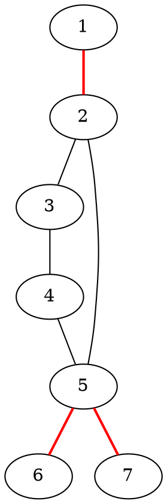
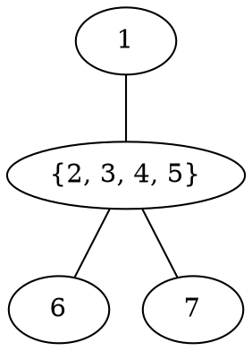

[[TOC]]

## 形式化题目

给定一张 $F$ 个点、$R$ 条边的**无向连通图**（同一对点之间可能有多条边）。可以任意新增无向边，新增边的两个端点可以是任意两点，也可以和已有的边重合。

求最小的 $k$，使得加入 $k$ 条新边后，图中**任意两点之间都有两条边不相交的路线**。

「两条路线边不相交」等价于「删掉任意一条边，图仍然连通」，也就是**整张图没有桥**。所以本题可以重新表述为：

> 加最少的边，让一张无向连通图没有桥。

## 暴力解法

### 思路

既然目标只是「加完没有桥」，最直接的办法把「加哪些边」当作要枚举的东西：

1. 从 $k = 0$ 开始，依次尝试 $k = 1, 2, \dots$
2. 对每个 $k$，枚举 $k$ 条新边的端点对（按非降序挑选去重，但**允许同一端点对重复**——重复的边不会让最小答案变小，不影响正确性）
3. 对每个方案，把新边接在原边后面，然后**逐条边试删**：删掉某条边后用并查集看还有没有连通，若断开就说明它是桥，方案不成立
4. 第一个「所有边都不是桥」的 $k$ 就是答案

这个做法显然正确：它把全部加边方案按条数从小到大完整枚举了一遍，第一个成功的必然最小。

### 代码

@include-code(./brute.cpp, cpp)

### 复杂度

设端点对总数为 $P = \binom{F}{2}$。允许重复挑选，枚举量是 $\sum_{k} \binom{P+k-1}{k}$ 量级，每次检查要 $R + k$ 次并查集，因此时间是指数级的；空间 $O(F + R)$。

实测 $F \leqslant 11$ 还能勉强跑（星形图 $n=11$ 约 0.7 秒），$F = 13$ 就已经超时，所以它只能用来对拍和帮助理解题意。

### 瓶颈

瓶颈非常清楚：暴力是在**点对**上做指数搜索，完全没有利用图的结构。

而且思路本身也有点别扭——题目问「最少加几条边」，暴力却在回答「哪些边组合可行」。要真正降下来，必须换一个问题：

> 哪些边才是真正的障碍？加边到底在「修」什么？

## 正解

### 关键观察

**观察一：桥才是障碍。**

删掉一条桥，图就分成两半，两半之间的任何路线都必须经过它，边不相交的两条路线根本不存在。反过来，如果全图没有桥，每条边都落在某个环里，任意两点就有两条边不相交的路线。**所以加边的作用，就是让每座桥都进入某个环。**

**观察二：桥切出来的每一块，内部已经不需要管。**

把桥全部删掉，图裂成若干块，每一块内部没有桥（否则那条桥在原图里也是桥），这些块叫**边双连通分量**，简称「边双」。块内的点已经满足要求，剩下的矛盾只存在于块与块之间。

**观察三：把边双缩成一个点，得到的是一棵树。**

桥的两个端点必然属于不同的边双。把每个边双缩成一个点、桥作为边，得到新图 $T$。$T$ 连通（原图连通），而且 $T$ 里每条边都是原图的桥——如果 $T$ 里有环，环上的边就不可能还是桥，矛盾。所以 **$T$ 是一棵树**，一般叫「桥树」。

新边可以接在任意两个点上，等价于在 $T$ 里给对应的两个边双之间加一条边（同一块内的两点之间加边没有意义，因为它覆盖不了任何桥）。于是原问题变成了一道纯树上的题：

> 给一棵树加最少的边，使它没有桥。

**观察四：树上的答案只取决于叶子个数。**

$T$ 上度数为 1 的点（叶子）只靠一座桥与外界相连，那座桥必须进入一个新的环，所以**加的新边必须有一端落在这个叶子上**。一条新边只有两个端点，最多救两个叶子，于是

$$k \geqslant \left\lceil \frac{L}{2} \right\rceil$$

其中 $L$ 是桥树的叶子数。这个下界可以达到：把叶子按 DFS 序排成一个**环** $v_0, v_1, \dots, v_{L-1}$，令 $m = \lceil L/2 \rceil$，为 $i = 0, 1, \dots, m-1$ 添加新边 $(v_i, v_{(i+m) \bmod L})$，正好 $\lceil L/2 \rceil$ 条，而且每个叶子都至少当一次端点（$L$ 为奇数时 $v_0$ 当两次，不影响）。

为什么这样就够了？任取一座桥，它把桥树切成两半，叶子也被分成两段；取**较短**的一段 $S$，于是 $|S| \leqslant \lfloor L/2 \rfloor \leqslant m$。

这两段在环上都是连续的一段：桥的一侧正好对应桥树里的**一棵子树**，而一棵子树的叶子在 DFS 序里天生连续，所以这一段是连续弧。

把这段写成 $v_a, v_{a+1}, \dots, v_{a+|S|-1}$（下标模 $L$）。那么 $v_a$ 的搭档 $v_{a+m}$ 一定落在段外：因为 $m \geqslant |S|$，从 $v_a$ 沿环往后走 $m$ 步已经走出了这一段。于是这一对叶子分居桥的两侧，它们之间的新边跨越了这座桥。

所有桥都被覆盖，所以 $\lceil L/2 \rceil$ 条足够。

于是

$$\text{answer} = \left\lceil \frac{L}{2} \right\rceil$$

$T$ 只有一个点时 $L = 0$，公式给 0，正好表示原图已经是边双连通。

### 思路

整体只有三步：

1. **Tarjan 判桥**：对 DFS 树上的边 $u \to v$，若 $low[v] > dfn[u]$，说明 $v$ 的子树回不到 $u$ 或 $u$ 的祖先，$u$–$v$ 是桥。
2. **忽略桥染色**：第二遍 DFS 时跳过所有桥，搜到的每个连通块就是一个边双，给块编号。
3. **统计桥树度数**：每条桥给两端边双的度数各加 1；度数恰好为 1 的边双就是叶子，答案是 $\lceil \text{leaf}/2 \rceil$，代码里写成 `(leaf + 1) / 2`（整数除法自动向上取整，叶子数为 0 时结果仍是 0）。

还有一个坑必须提：题面明确说同一对田地之间可能已经有不止一条路径，**所以判父边不能写成 `v != fa`**，那样会把重边当成父边跳过，漏掉桥。正确写法是记录「进入当前点的是哪条边」，遍历时只跳过它的反向边 `in_edge ^ 1`。

举个最小的反例：$1$ 与 $2$ 之间有两条重边，$3$ 与 $4$ 之间也有两条重边，另外连一条 $1-3$。正确做法看到重边本身构成环，$1$ 和 $3$ 都不会是孤立小块，可以只用一条新边 $2-4$ 解决问题，答案是 $1$；而用 `v != fa` 的写法会把另一条 $1-2$ 当成父边丢掉，桥的判定全乱，实测这个反例上它输出了 $0$。

以样例为例，红色是桥：

删掉三条红边后，剩下 $\{2,3,4,5\}$ 一块，加上孤立的 $1$、$6$、$7$，共 4 个边双。把每个边双缩成一个点、桥作为边，就得到桥树：

桥树是「三爪星形」，叶子 $L = 3$，答案 $\lceil 3/2 \rceil = 2$，与题面给出的方案（新建 $1\text{-}6$ 与 $4\text{-}7$）一致。

### 代码

@include-code(./main.cpp, cpp)

### 复杂度

Tarjan 判桥、忽略桥染色、统计度数各扫一遍图，总时间复杂度 $O(F + R)$，空间复杂度 $O(F + R)$。

题目给定 $F \leqslant 5\times 10^3$、$R \leqslant 10^4$，所以线性做法绰绰有余；Tarjan 的递归深度最多 $F = 5000$ 层，实测在 8 MiB 栈限制下仍然通过，不需要改写成显式栈。

## 总结

这题的思维路线是一句口诀：

> **桥把图切成边双；边双缩成桥树；桥树的叶子两两配对。**

具体结论可以记成三条：

1. 「任意两点有两条边不相交路线」$\iff$「没有桥」，所以任务就是消灭所有桥；
2. 桥的位置由 Tarjan 的 $low[v] > dfn[u]$ 判出，删桥染色得到边双；
3. 缩点后是树，答案只和叶子数有关，为 $\lceil L/2 \rceil$。

实现上只有一个容易踩的坑：**有重边时判父边必须用进入边的编号，不能用父节点编号**。
