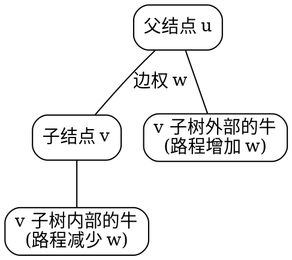
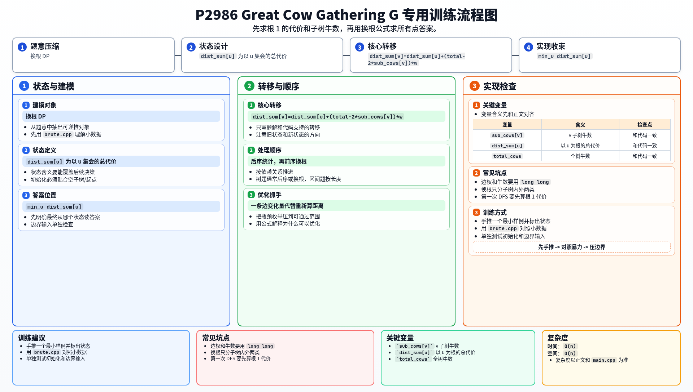

[[TOC]]

## 形式化题目

给定一棵包含 $N$ 个结点的带权树，结点编号为 $1 \sim N$。每条边 $i$ 连接农场 $A_i$ 和 $B_i$，长度为 $L_i$。每个结点 $i$ 上居住着 $C_i$ 头奶牛。

选择任意一个结点 $X$ 作为集会地点，其不方便程度定义为所有奶牛到结点 $X$ 的路程之和：

$$
\mathrm{Cost}(X) = \sum_{i=1}^N C_i \times \mathrm{dist}(i, X)
$$

其中 $\mathrm{dist}(i, X)$ 表示树上结点 $i$ 到结点 $X$ 的简单路径权值和。要求找出最方便的地点，使总不方便程度最小，并输出该最小值。

## 暴力解法

### 思路

最直接的做法是枚举每个结点 $X \in [1, N]$ 作为候选集会点。对于确定的候选点 $X$：

1. 以 $X$ 为起点进行一次广度优先搜索（BFS）或深度优先搜索（DFS），计算整棵树上每个结点 $i$ 到 $X$ 的距离 $\mathrm{dist}(i, X)$。
2. 累加计算当前集会点的总代价 $\mathrm{Cost}(X) = \sum_{i=1}^N C_i \times \mathrm{dist}(i, X)$。
3. 对所有 $1 \leqslant X \leqslant N$ 取最小值。

### 代码

@include-code(./brute.cpp, cpp)

### 复杂度

- **时间复杂度**：对每个候选集会点做一次树的遍历需要 $O(N)$，共枚举 $N$ 个点，总时间复杂度为 $O(N^2)$。
- **空间复杂度**：存储邻接表和距离数组需要 $O(N)$ 空间。

### 瓶颈

在 $N \leqslant 10^5$ 的约束下，$O(N^2)$ 计算量达到 $10^{10}$ 级别，必然超时。

瓶颈在于：相邻两个结点作为集会点时，绝大多数奶牛走过的路径具有极大的重叠。如果每次都从头做一次全树遍历，完全忽略了相邻点之间代价的递推关联。

## 正解

### 思路

这是一道经典的树上换根动态规划（Re-rooting DP）问题。

我们可以先任选一个点（通常固定为结点 $1$）作为根结点，将无根树转化为有根树。

#### 1. 第一次遍历：自底向上统计子树贡献

以结点 $1$ 为根进行后序遍历（或自底向上的拓扑顺序），计算两个数组：
- $\mathrm{sub}[u]$：以 $u$ 为根的子树内的奶牛总数。
  $$
  \mathrm{sub}[u] = C_u + \sum_{v \in \mathrm{children}(u)} \mathrm{sub}[v]
  $$
- $\mathrm{dist}[1]$：若将集会地点选在结点 $1$ 时的全树总代价。
  在自底向上合并时，子树 $v$ 内的所有奶牛跨过边 $(u, v)$ 前往 $u$，每头牛都要多走边权 $w(u, v)$ 的距离，因此：
  $$
  \mathrm{dist}[u] = \sum_{v \in \mathrm{children}(u)} \Big(\mathrm{dist}[v] + \mathrm{sub}[v] \times w(u, v)\Big)
  $$
  全树总奶牛数即为 $\mathrm{total} = \mathrm{sub}[1]$。

#### 2. 第二次遍历：自顶向下换根转移

假设当前已经求出以结点 $u$ 为集会地点时的总代价 $\mathrm{dist}[u]$。现在考虑将集会地点沿边 $(u, v)$ 从父结点 $u$ 移动到子结点 $v$，边长为 $w$。

此时整棵树上的所有奶牛可以分为互斥的两部分：
1. **位于 $v$ 的子树内部的奶牛**：共 $\mathrm{sub}[v]$ 头。集会点移到 $v$ 后，它们前往集会点的路程都整体减少了 $w$，总代价减少 $\mathrm{sub}[v] \times w$。
2. **位于 $v$ 的子树外部的其余奶牛**：共 $\mathrm{total} - \mathrm{sub}[v]$ 头。它们要到达新集会点 $v$，必须先走到 $u$ 再跨过边 $(u, v)$ 到达 $v$，路程都整体增加了 $w$，总代价增加 $(\mathrm{total} - \mathrm{sub}[v]) \times w$。

两部分变化量合并整理，即可得到换根转移公式：

$$
\begin{aligned}
\mathrm{dist}[v] &= \mathrm{dist}[u] - \mathrm{sub}[v] \times w + (\mathrm{total} - \mathrm{sub}[v]) \times w \\
&= \mathrm{dist}[u] + (\mathrm{total} - 2 \times \mathrm{sub}[v]) \times w
\end{aligned}
$$

通过自顶向下的前序遍历，利用父结点的答案即可在 $O(1)$ 时间递推出子结点的答案。

两类奶牛在换根时的距离变化关系如下所示：

遍历完成后，取所有 $\mathrm{dist}[i]$（$1 \leqslant i \leqslant N$）的最小值即为答案。

### 代码

@include-code(./main.cpp, cpp)

### 复杂度

- **时间复杂度**：非递归遍历求拓扑序、自底向上后序 DP 和自顶向下换根转移均遍历树上的每条边常数次，总时间复杂度为 $O(N)$，可在规定时间内轻松通过。
- **空间复杂度**：邻接表、遍历顺序栈以及各个状态数组均占用线性空间，总空间复杂度为 $O(N)$。

## 总结

解决树上最佳聚会点/带权重心问题的核心是**换根思想**：
1. 先任意定根，通过一次后序遍历求出基准根结点的答案及各子树权值和；
2. 观察集会点移动一步时，整棵树权值的划分——跨过树边后，子树内的点距离全部 $-w$，子树外的点距离全部 $+w$；
3. 将 $O(N^2)$ 的全树重新遍历压缩为 $O(1)$ 的状态递推，从而在 $O(N)$ 时间内求出所有顶点的聚会代价。

## 图示解析

下图完整展示了本题的题目模型、换根推导推演、关键实现与复盘思考：

