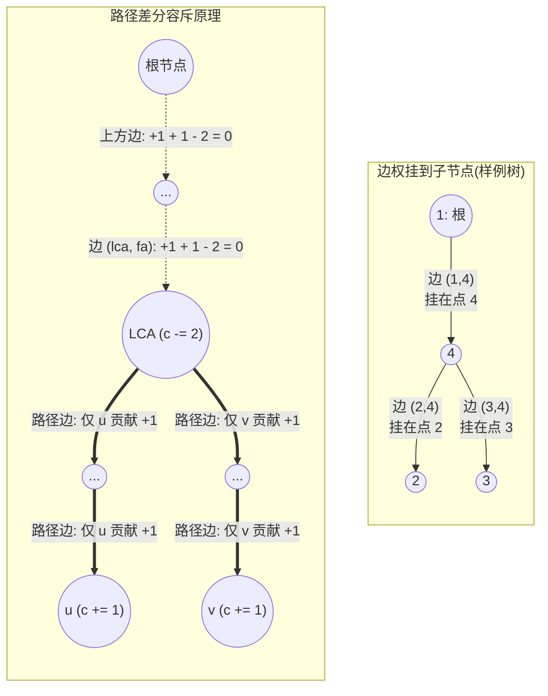

[[TOC]]

## 形式化题目

给定一棵 $n$ 个节点的树, 每条边初始覆盖次数为 $0$. 按顺序处理 $m$ 次操作: 

1. `P u v`: 把 $u$ 到 $v$ 简单路径上的每条边覆盖次数加一; 
2. `Q u v`: $u$、$v$ 是一条边的两个端点, 回答这条边当前的覆盖次数. 

要求在线回答所有查询(更新与询问交错出现). 

## 思路

先看一个可以直接验证想法的朴素解: 

@include-code(./brute.cpp, cpp)

`brute.cpp` 把每条边 $(x, parent[x])$ 的值挂在深端点 $x$ 上: `P` 从 $u$、$v$ 分别沿父链爬到 `lca`, 逐边 `+1`; `Q` 直接输出深端点的值. 单次操作 $O(\text{路径长})$, 最坏 $O(n)$, $10^5$ 数据不可行. 

解决本题的关键观察有三步: 

1. **边权挂到深端点**: 每条边 $(x, parent[x])$ 用较深的子节点 $x$ 代表, 回答 `Q u v` 就是查 $w(deep(u,v))$. 
2. **路径拆成三条根路径**: $u$ 到 $v$ 的路径边集等于"根到 $u$ 路径 + 根到 $v$ 路径 − $2 \times$ 根到 $lca(u,v)$ 路径"(根到 LCA 的边出现两次, 必须全部扣除). 
3. **根路径加一对应单点差分**: 给"根到 $x$ 路径上的每条边加一", 只需要在差分数组上做 `c[x] += 1`. 因为边 $(t, parent[t])$ 位于根到 $x$ 的路径上当且仅当 $x \in subtree(t)$, 所以一条边的实际权值等于其子节点子树内差分值的总和. 

#### 图解：边权映射与路径差分容斥

下面的图展示了样例树上边权映射到子节点的结构, 以及路径边差分在 LCA 处消除多余影响的原理: 



观察「边权挂到子节点」那幅图, 每条树边唯一对应深度更深的那个子节点, 查询边 $(u,v)$ 时只需定位深度较大的端点. 
观察「路径差分容斥原理」那幅图, $c[u] \mathrel{+}= 1$ 和 $c[v] \mathrel{+}= 1$ 分别使从根到 $u$ 与从根到 $v$ 上的所有边增量为 1. 但 LCA 上方的祖先边不属于 $u \to v$ 的路径, 却被两端同时覆盖了两次; 因此在 $lca$ 处执行 $c[lca] \mathrel{-}= 2$, 恰好使所有 LCA 及上方边的子树和净增量变为 $1 + 1 - 2 = 0$, 从而仅保留了 $u \to v$ 简单路径上的修改. 

把这三点合起来, 一次 `P u v` 操作完全退化为三个单点修改: 

$$c[u] += 1,\quad c[v] += 1,\quad c[lca(u,v)] -= 2$$

该公式表示给 $u$ 和 $v$ 的祖先链增加一次计数, 并通过在 $lca$ 处扣除两次计数来精确截断对 LCA 及其上方祖先边的影响. 

下面的表格演示样例中每次 `P` 之后差分数组 $c[]$ 的变化(树以 1 为根: 1-4、2-4、3-4, 节点 4 比 1 深), 以及 `Q` 如何用子树和回答: 

| 操作 | $c[1]$ | $c[2]$ | $c[3]$ | $c[4]$ | 输出 |
| --- | --- | --- | --- | --- | --- |
| 初始 | 0 | 0 | 0 | 0 | |
| P 2 3 | 0 | 1 | 1 | -2 | |
| P 1 3 | -1 | 1 | 2 | -2 | |
| Q 3 4 | | | | | 2(= $c[3]$) |
| P 1 4 | -2 | 1 | 2 | -1 | |
| Q 2 4 | | | | | 1(= $c[2]$) |
| Q 1 4 | | | | | 2(= $c[2]+c[3]+c[4]$) |

观察第二行: `P 2 3` 的 LCA 是 4, 所以 $c[4]$ 变成 $-2$. `Q 3 4` 回答边 $(3,4)$, 就是子树 $\{3\}$ 的差分和 $c[3] = 2$; `Q 1 4` 回答边 $(1,4)$, 即子树 $\{2,3,4\}$ 的和 $1+2-1 = 2$. 这与样例输出 $2,1,2$ 完全一致. 

于是最终做法是: 倍增 LCA 预处理 + DFS 序 + 树状数组(Fenwick). `P` 只做三次单点加; `Q` 的"子树和"在 DFS 序上对应连续区间和 $\text{sum}(dfn[t], dfn[t]+sz[t]-1)$, 由树状数组高效回答. 

### 边差分与点差分

同样是"树上路径加一", 点差分与边差分的系数有着本质不同: 

| | 点差分(路径上点的覆盖次数) | 边差分(路径上边的覆盖次数) |
| --- | --- | --- |
| 单次 `P u v` | $c[u]{+}{+},\ c[v]{+}{+},\ c[lca]{-}{-},\ c[parent(lca)]{-}{-}$ | $c[u]{+}{+},\ c[v]{+}{+},\ c[lca] -= 2$ |
| 恢复方式 | 点 $t$ 的值 = $subtree(t)$ 的差分和 | 边 $(t, parent[t])$ 的值 = $subtree(t)$ 的差分和 |

原因在于: 根路径 $u$ 与根路径 $v$ 的点集里 LCA 出现了两次, 路径点集本身**需要包含** LCA, 因此减一次 LCA、再减一次 $parent(lca)$, 使 LCA 处的净贡献保留为 $2 - 1 = 1$; 而路径边集**完全不包含**边 $(lca, parent(lca))$, 所以在 LCA 处两次多余的贡献必须全部扣除, 即执行 `c[lca] -= 2`. 

### 线性叠加原理

为什么多次路径修改后依然可以用子树和还原答案: 

- **子树求和满足加法线性**: 子树和 $S(t) = \sum_{y \in subtree(t)} c[y]$ 具有完全的可加性, 每个单点差分值的修改对所有祖先的子树和贡献互相独立. 
- **单点差分等价于祖先链前缀更新**: 在差分数组中执行 `c[x] += v`, 会使得所有包含 $x$ 的子树(即 $x$ 的所有祖先节点 $t$)的子树和 $S(t)$ 恰好增加 $v$. 这正好对应将根到 $x$ 路径上的所有边权增加 $v$. 
- **路径操作由根路径线性组合得到**: 简单路径 $path(u,v) = rootpath(u) + rootpath(v) - 2 \cdot rootpath(lca)$, 这一线性组合使得每次路径修改只需常数次单点更新即可准确表达. 

## 代码

@include-code(./main.cpp, cpp)

## 复杂度

- 预处理: BFS 与 DFS 序为 $O(n)$, 倍增表为 $O(n \log n)$. 
- 单次操作: `P` 操作为一次 LCA 查询加三次单点加, `Q` 操作为两次前缀和求区间和, 均为 $O(\log n)$. 
- 总时空复杂度: 时间为 $O((n+m) \log n)$, 空间为 $O(n \log n)$(倍增表). 

## 总结

"树上路径加一、单边点查"的标准模式是**树上边差分**: 
1. 将无向边权映射到深度较深的子节点点权; 
2. 将路径修改拆解为两条到根路径与一条 LCA 路径的容斥, 从而转化为三个单点的差分修改; 
3. 利用 DFS 序将子树在空间上展开为连续区间, 配合树状数组实现在线动态修改与单点(单边)子树和查询. 

与点差分相比, 边差分仅在 LCA 处差一个系数($-2$ 对比 $-1$ 与 $parent(lca)$ 处的 $-1$). 

## 图示解析

下面用 ASCII 流程图总结整道题从暴力模拟到边差分的推导路线: 

```text
朴素模拟(brute.cpp)
  边 (x, parent[x]) 挂在深端点 x 上, P 沿父链逐边 +1       O(路径长) 每次
        |
        | 瓶颈: 更新与查询都按"路径"发生, 最坏 O(n)
        v
关键观察
  1. 路径 u..v = 根路径 u + 根路径 v - 2 * 根路径 lca
  2. "根路径 x 每条边加 1" = 差分数组 c[x] += 1(子树和恢复边值)
  3. DFS 序把子树变成连续区间
        |
        v
LCA + 边差分 + 树状数组(main.cpp)
  P u v: 三次单点加 c[u]+1、c[v]+1、c[lca]-2
  Q u v: 子树区间和 sum(dfn[child], dfn[child]+sz[child]-1)
        |
        v
复杂度 O((n + m) log n), 空间 O(n log n)
```

图中三条主线对应"暴力瓶颈在哪"、"路径如何拆成根路径的线性组合"以及"差分配合 DFS 序如何将二维路径操作降维成一维区间求和". 核心在于将树上路径的二维拓扑更新映射为一维数组上的单点差分与连续区间和查询. 
