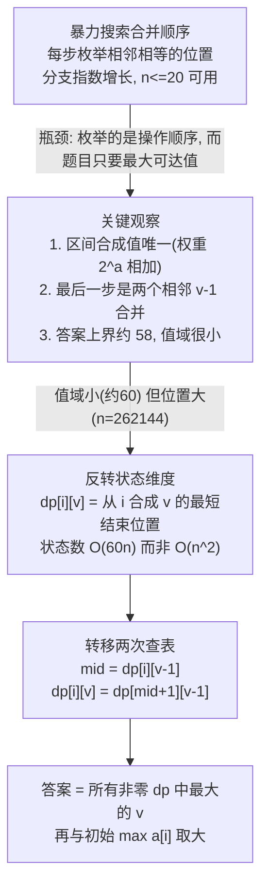

[[TOC]]

## 形式化题目

给定长度为 $n$ 的正整数序列 $a_1, a_2, \dots, a_n$, 其中 $1 \leqslant a_i \leqslant 40$, $2 \leqslant n \leqslant 262144$.

一次操作可以选一对**相邻且相等**的数, 把它们替换成一个比原值大 $1$ 的数, 即 $x, x \to x+1$. 序列因此每次缩短一格.

求经过若干次操作后, 序列中能出现的最大数值.

## 暴力解法

### 思路

最直接的做法是按题意搜索: 每一步枚举所有"相邻且相等"的位置, 合并它俩, 然后继续递归, 在所有分支里取最大值.

每一步的分支数是当前可合并位置的数量, 最多 $O(n)$ 个; 合并会让序列变短, 但分支不断累积. 这条搜索树的规模随 $n$ 指数增长, 而题目要求 $n \leqslant 262144$.

用全 $1$ 的输入实测暴力的增长(全 $1$ 是分支最多的情况):

| $n$ | 10 | 12 | 13 | 14 | 15 | 16 |
| --- | --- | --- | --- | --- | --- | --- |
| 耗时 | 0.004s | 0.008s | 0.016s | 0.11s | 0.41s | 4.3s |

平均每多一个元素, 耗时约乘 $5$ 到 $10$ 倍. 照这个速度, $n$ 到 $20$ 已经是几十秒量级, 离 $262144$ 差得极远.

暴力解的价值在于两个用途: 确认自己理解了操作规则, 以及在正解写完后作为小数据对拍的标准答案.

### 代码

@include-code(./brute.cpp, cpp)

### 复杂度与瓶颈

时间随合并顺序的数量指数增长, 空间 $O(n)$ 的递归深度乘以每层的序列拷贝.

瓶颈是**枚举了操作顺序**. 而题目只问"最大能到多少", 不关心怎么合并, 所以应该去找"某个值能不能被做出来"的条件, 而不是模拟过程.

## 正解

### 关键观察

先把区间能不能合成一个数说清楚. 若区间 $[l, r]$ 能整段合成一个数, 那么这个数是唯一的.

- 把每个 $a_i$ 换成权重 $2^{a_i}$, 合并 $x, x \to x+1$ 在权重上正好是 $2^x + 2^x = 2^{x+1}$, 即相加.
- 整段合并不改变权重总和, 所以总和恒为 $W = \sum_{i=l}^{r} 2^{a_i}$.
- 若整段合成值 $v$, 则 $W = 2^v$; 而 $W$ 是定值, 满足它的 $v$ 唯一.

这个性质很重要: 它说明"能合成的值"不需要再当状态维度, 它由区间唯一决定.

再看最后一步. 若 $[i, j]$ 合成 $v$ 且长度大于 $1$, 最后那次操作必然是把两个相邻的 $v-1$ 合并: 合并 $x, x$ 得到 $x+1 = v$, 所以 $x = v-1$. 这两段分别来自某个切分点 $m$ 左右两侧.

于是可以只问一个问题: 从左端 $i$ 出发, **最短**到哪里能合成出值 $v$.

先说明为什么盯住"最短"不会丢解. 这里有个比"最短"更强的性质: 对固定的起点 $i$ 和目标值 $v$, 能合成 $v$ 的结束位置**本来就是唯一的**.

- 反设存在两个不同的结束位置 $e_1 < e_2$, 即 $[i, e_1]$ 与 $[i, e_2]$ 都能合成 $v$.
- 对 $[i, e_2]$ 用"最后一步是两个相邻 $v-1$ 合并", 存在切分 $m$ 使 $[i, m]$ 与 $[m+1, e_2]$ 都合成 $v-1$.
- 比较 $[i, m]$ 与 $[i, e_1]$ 的长度: 两者都从 $i$ 开始, 所以只有包含关系.
- 若 $m \geqslant e_1$, 则 $[i, e_1]$ 整段落在 $[i, m]$ 里. 区间 $[i, e_1]$ 的权重和是 $2^v$, 它不超过 $[i, m]$ 的权重和 $2^{v-1}$, 矛盾(因为 $2^v > 2^{v-1}$).
- 若 $m < e_1$, 左段这一侧确实不矛盾($2^{v-1} \leqslant 2^v$), 但改看右段: $[m+1, e_2]$ 的权重和是 $2^{v-1}$, 而它包含 $[m+1, e_1]$ 整段, 后者权重和是 $2^v > 2^{v-1}$, 已经超过整段的权重和, 矛盾.
- 两支都矛盾, 所以 $e_1 = e_2$, 结束位置唯一.

既然唯一, "最短结束位置"就是那个唯一的位置, 不存在"取短会漏掉更长方案"的风险. 这使状态定义变得干净: 对每个 $(i, v)$ 只存一个数.

约定 $dp[i][v]$ 为这个唯一的结束位置(不能合成时记 $0$), 则转移就是把两次查表接起来:

- 先把 $[i, mid]$ 合成一个 $v-1$, 其中 $mid = dp[i][v-1]$;
- 再从 $mid+1$ 开始合成第二个 $v-1$, 即要求 $dp[mid+1][v-1] \neq 0$.
- 拼起来后, $[i, dp[mid+1][v-1]]$ 就是合成 $v$ 的区间, 故 $dp[i][v] = dp[mid+1][v-1]$.

也就是

$$
dp[i][v] = dp[\,dp[i][v-1] + 1\,][v-1] \qquad (\text{两次查表都非 } 0 \text{ 时})
$$

注意下标那一项是 $dp[i][v-1] + 1$: 第一段结束在 $dp[i][v-1]$, 第二段必须从它的**下一个**位置开始. 这也是代码里写 `dp[mid + 1][v - 1]` 的原因.

(结束位置唯一、切分点唯一这两条, 已对 $n \leqslant 8$、值域 $1..4$ 的全部 87376 个序列穷举核对, 0 例外.)

### 思路

朴素区间 DP 设 $f[l][r]$ 为区间 $[l,r]$ 能合成的值. 状态数是 $n^2 \approx 6.9 \times 10^{10}$($n = 262144$), 时间和空间都无法接受.

但两个观察指向同一个方向: 值域很小, 位置很多.

- 答案上界很小: 要合成比初始最大值 $M$ 大 $k$ 的值, 至少需要 $2^k$ 个元素参与($k=1$ 要 $2$ 个, 每升一级数量翻倍), 所以答案不超过 $M + \lfloor \log_2 n \rfloor$. 代入 $a_i \leqslant 40$、$n \leqslant 2^{18}$ 得答案 $\leqslant 40 + 18 = 58$.
- 位置的取值范围很大: 从 $1$ 到 $262144$.

所以把两者的角色对调: 用**值**当状态维度(只有约 $60$ 档), 用**位置**当存下来的结果.

定义

$$
dp[i][v] = \text{从位置 } i \text{ 开始, 能整段合成值 } v \text{ 时的结束位置(已证唯一, 不能合成时记 0)}
$$

这样状态数从 $O(n^2)$ 降到 $O(60n)$.

下表是样例 1($a = [1,1,1,2]$)的完整 $dp$ 表, 行是起点 $i$, 列是目标值 $v$, 单元格是结束位置:

| 起点 $i$ | $v=1$ | $v=2$ | $v=3$ |
| --- | --- | --- | --- |
| 1 | 1 | 2 | 0 |
| 2 | 2 | 3 | 4 |
| 3 | 3 | 0 | 0 |
| 4 | 0 | 4 | 0 |

读表时注意初始化是 $dp[i][a_i] = i$, 而不是 $dp[i][1] = i$: 因为 $a_1 = a_2 = a_3 = 1$, 所以 $v=1$ 这一列的前三行等于起点 $i$; 而 $a_4 = 2$, 于是值 $2$ 在位置 $4$ 的格子是 $dp[4][2] = 4$、$dp[4][1]$ 反而是 $0$. 另外 $dp[2][3] = 4$ 表示从位置 $2$ 起、区间 $[2,4]$ 能合成值 $3$, 这正是样例要达到的答案.

转移只有两步查表. 要合成 $v$, 先从 $i$ 合出第一个 $v-1$, 结束在 $mid = dp[i][v-1]$; 再要求从 $mid+1$ 能合出第二个 $v-1$:

$$
dp[i][v] =
\begin{cases}
dp[\,mid+1\,][v-1], & mid = dp[i][v-1] \neq 0 \text{ 且 } dp[mid+1][v-1] \neq 0 \\
0, & \text{否则}
\end{cases}
$$

下图画出这个转移是怎么由两个相邻的 $v-1$ 拼出 $v$ 的, 用的是样例里 $dp[2][3] = 4$ 这条链:

第一段只用了位置 $2,3$(合成一个 $2$), 第二段是位置 $4$ 本身的 $2$. 两段相邻且相等, 合并得到 $3$, 结束位置继承第二段的 $4$. 要点是 $dp$ 里存的始终是**结束位置**, 不是值本身, 所以转移就是把两次查表的结束位置接起来.

按 $v$ 从小到大递推即可, 因为 $dp[i][v]$ 只依赖 $v-1$ 那一层. 初始化时 $dp[i][a_i] = i$; 答案是所有满足 $dp[i][v] \neq 0$ 的最大 $v$, 再与初始最大值取大.

### 代码

@include-code(./main.cpp, cpp)

### 复杂度

时间 $O(60n)$: 外层 $v$ 枚举到常数上界(代码里 `MAXV = 62`, 覆盖到 $58$ 的答案上界并留余量), 内层扫 $n$ 个起点, 每次 $O(1)$ 查表. $n = 262144$ 时约 $1.6 \times 10^7$ 次基本操作.

空间 $O(60n)$: $dp$ 数组是 $262149 \times 62$ 个 `int`, 约 $62$ MB, 与实测峰值 $63$ MB 吻合.

实测 $n = 262144$(判题环境, 限制 2s / 512MB): 全为 $40$ 时 $199$ms / $63$MB(答案 $58$), 全为 $1$ 时 $214$ms / $63$MB(答案 $19$), 随机 $1..40$ 时 $188$ms / $63$MB(答案 $41$). 三组都只用掉约十分之一的时间预算.

## 总结

这题的转折点不是优化转移, 而是**换掉状态维度**. 区间 DP 的 $O(n^2)$ 状态来自"用两个端点描述区间"; 一旦发现"区间能合成的值唯一"且"值的范围只有约 $60$ 档", 就可以把值升格成状态维度、把位置降格成结果, 状态数立刻降到 $O(60n)$.

判断这类题时, 一个通用信号是: **答案的取值范围能估出一个小上界, 且它远小于下标的取值范围**. 这时就该考虑"值当状态、下标当答案"的反转. 本题的上界 $58$ 来自"合成值每升一级至少要点数翻倍", 这比"初始值域只有 $40$"更本质: 值域小只是它的表现, 真正让状态数可控的是答案上界可算.

## 图示解析

下图把整条思路从暴力到正解压缩成一条主线, 重点是标注出"为什么必须换维度".

图中第一层是暴力, 第二层是三个关键观察, 第三层是维度反转, 后两层是转移与输出. 真正决定复杂度的是第三层: 前两层只说明"状态该怎么定义", 而 $O(n^2) \to O(60n)$ 完全来自把"答案上界只有 $58$"这个事实用上 —— 正因为上界可估且只有约 $60$ 档, 值这一维才配当状态; 若答案上界本身是 $O(n)$ 量级, 反转维度并不会带来任何收益.
