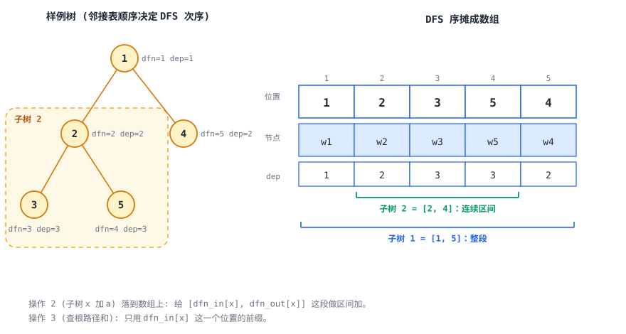
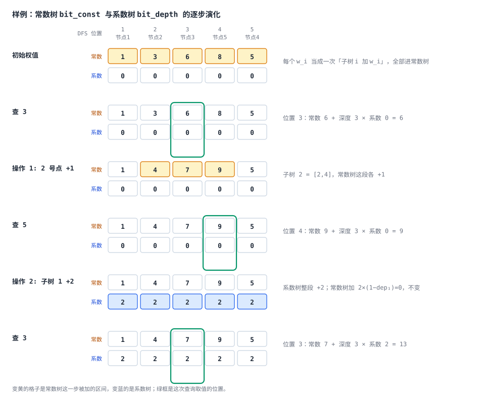
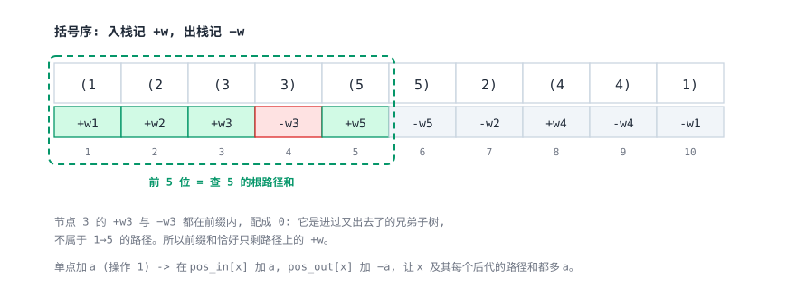

[[TOC]]

## 形式化题目

有一棵以 $1$ 为根、带点权的树，点权记为 $w_u$，深度 $\mathrm{dep}_1 = 1$。按顺序处理 $m$ 次操作：

1. `1 x a`：$w_x \leftarrow w_x + a$；
2. `2 x a`：对子树 $x$ 内每个节点 $u$ 令 $w_u \leftarrow w_u + a$；
3. `3 x`：输出 $\sum_{u \in \mathrm{path}(1, x)} w_u$，其中 $\mathrm{path}(1,x)$ 是 $x$ 到根的路径上的点集。

每次询问按顺序输出一行答案。

## 解法总览

三个操作分别作用在「单点」「子树」「根路径」上，而询问只有一种：根路径和。下面四种做法的区别在于**选择哪一侧做等价变换**：可以像树链剖分那样把路径拆成区间（维护点权），也可以反过来把「路径和」看成「修改对询问的贡献」（维护答案）。

| 解法 | 核心观察 | 复杂度 | 适用场景 | 对应代码 |
| --- | --- | --- | --- | --- |
| 暴力解法 | 直接按题意模拟，子树加逐点递归、路径和逐点上跳 | $O(nm)$ | 只适合 $n, m \leqslant 10^3$ 的小数据与对拍 | `brute.cpp` |
| 解法一（正式主解） | 每条修改只影响一棵子树内的询问；子树加的影响按 $\mathrm{dep}$ 拆成两项 | $O(n\log n + m\log n)$ | 求和类询问；只需「子树是 DFS 序区间」这一个性质 | `main.cpp`、`main.py` |
| 解法二 | 括号序上「入栈加、出栈减」，前缀和天然等于根路径和 | $O(n\log n + m\log n)$ | 同上，但需要长度为 $2n$ 的序列 | `main2.cpp` |
| 解法三 | 树链剖分把子树与根路径都变成 $O(\log n)$ 段连续区间 | $O(n\log n + m\log^2 n)$ | 询问换成 max/min 等不可差分的量时仍可用 | `main3.cpp` |

正式主解取**解法一**（`main.cpp`，Python 版 `main.py`）。三条正确解法里它与解法二同阶，取舍点在「少一层概念」而不是「少几行代码」：解法一唯一依赖的性质是「子树是 DFS 序上的连续区间」，直接由题面的「子树加」读出来；解法二额外引入「括号序前缀和 = 根路径和」这层带符号的对应关系，代码反而少几行（见「复杂度对比」的行数一列），但数组要开到 $2n$。解法三则是本题最通行的模板解，保留下来对照「为何求和题可以不用剖分」。

## 暴力解法

### 思路

`brute.cpp` 忠实按题意模拟：数组 `w[]` 存当前点权，操作 1 直接改一个点；操作 2 从 $x$ 递归走完整棵子树，把每个点的权值都加上 $a$；操作 3 从 $x$ 沿 `parent` 一路走到根累加。

### 代码

@include-code(./brute.cpp, cpp)

### 复杂度与瓶颈

- 时间：操作 1 是 $O(1)$，操作 2 是 $O(\text{子树大小})$，操作 3 是 $O(\text{路径长度})$，最坏都到 $O(n)$，总计 $O(nm)$；链状树上 $m$ 次叶子询问就让总代价达到 $10^{10}$ 量级。
- 空间：$O(n)$。

瓶颈很明确：**每次操作都要把一整棵子树或整条路径走一遍**。要让单次操作降到对数级，必须让「子树」和「根路径」都不用逐个节点访问，只留下少数几段连续区间去处理。

## 解法一：DFS 序 + 贡献法（正式主解）

### 思路

先做一件不改变答案的事：把视角从「查询时去树上数路径」换成「修改时就结算它对未来询问的贡献」。查询点在 DFS 序上是个单点，而修改的作用范围是整棵子树——一次 DFS 就够，不需要剖分。

**准备工作**：一次 DFS 求出每个节点的进入时间戳 `dfn_in[x]`、子树右端点 `dfn_out[x]` 与深度 `dep[x]`。子树 $x$ 恰好对应连续区间 $[\texttt{dfn\_in}[x], \texttt{dfn\_out}[x]]$，且「$u$ 是 $x$ 的祖先」等价于「$x$ 落在 $u$ 的子树区间内」。

**操作 1 的贡献**：$w_u$ 加 $a$，只会影响那些根路径经过 $u$ 的询问，也就是 $x$ 在子树 $u$ 内的询问；对这些询问，答案各自恰好增加 $a$。于是在子树区间上做一次**区间加 $a$**，查询时**单点查** `dfn_in[x]` 处的累计值。

**操作 2 的贡献**：子树 $u$ 内每点加 $a$。若 $x$ 在子树 $u$ 内，则 $x$ 到根路径上被加权的点正是从 $u$ 到 $x$ 的那一段，共 $\mathrm{dep}_x - \mathrm{dep}_u + 1$ 个，于是

$$
\text{增量} = a\,(\mathrm{dep}_x - \mathrm{dep}_u + 1) = \underbrace{a}_{\text{深度系数}}\cdot \mathrm{dep}_x + \underbrace{a\,(1 - \mathrm{dep}_u)}_{\text{常数项}} .
$$

第一项只和查询点深度有关，第二项对子树内所有 $x$ 是同一个常数。两者都作用在同一段子树区间上，所以在两棵树上各做一次**区间加**即可。

**操作 3 的答案**：先把两棵树的含义定死，后面的公式才不会糊。

| 树 | 代码里的名字 | 每个位置记什么 | 查询时怎么用 | 谁往里写 |
| --- | --- | --- | --- | --- |
| 常数树 | `bit_const` | 每次修改里**与深度无关**的那部分 | 直接取前缀和 | 操作 1、操作 2 的常数项、初始权值 |
| 系数树 | `bit_depth` | 每次修改里**要乘深度**的那部分系数 | 取前缀和后再乘 $\mathrm{dep}_x$ | 操作 2 |

记 $C(i)$ 为常数树在位置 $i$ 的前缀和（所有覆盖位置 $i$ 的「常数」贡献累加），$D(i)$ 为系数树在同一位置的前缀和（所有覆盖位置 $i$ 的「系数」贡献累加）。查询点 $x$ 只在自身位置 `dfn_in[x]` 上取值，所以答案是

$$
\text{ans}(x) = \underbrace{C(\texttt{dfn\_in}[x])}_{\text{常数部分，直接加}} + \underbrace{\mathrm{dep}_x \cdot D(\texttt{dfn\_in}[x])}_{\text{系数部分，乘上查询点深度}} .
$$

公式只是把上表两棵树的结果拼起来：凡是加在 $x$ 所在子树区间上的修改，都会出现在这两个前缀和里——常数项照抄，系数项再乘一次 $\mathrm{dep}_x$。初始权值 $w_i$ 等价于在子树 $i$ 上做一次操作 1，所以全部进常数树。

把操作 2 代进去验一遍：子树 $u$ 加 $a$ 时，系数树在 $u$ 的区间上加 $a$、常数树加 $a(1-\mathrm{dep}_u)$；查询子树内的 $x$，两笔都落在它的前缀和里，于是

$$
\Delta\text{ans}(x) = a(1-\mathrm{dep}_u) + \mathrm{dep}_x \cdot a = a\,(\mathrm{dep}_x - \mathrm{dep}_u + 1),
$$

正是「$u \to x$ 这一段有几个被加权的点」。记号上 $C$ 取 constant 的首字母、$D$ 取 depth 的首字母，正好对应代码里的 `bit_const` 与 `bit_depth` 两个树状数组：一个只存常数，一个只存深度系数。

**需要的工具恰好是最基础的那一套**：区间加、单点查。把差分数组 $d$ 交给树状数组维护，区间 $[l,r]$ 加 $v$ 就是 $d_l \mathrel{+}= v$、$d_{r+1} \mathrel{-}= v$ 两个单点改，单点查 $i$ 的值就是 $d$ 的前缀和 $O(\log n)$。这正是「[【模板】树状数组 2](https://www.luogu.com.cn/problem/P3368)」的内容，本题只是在树上用一次 DFS 把子树折算成区间。

以题面样例的树（边 $1\text{-}2,\ 1\text{-}4,\ 2\text{-}3,\ 2\text{-}5$）为例，DFS 序与深度如下：

| 节点 $x$ | 1 | 2 | 3 | 5 | 4 |
| --- | --- | --- | --- | --- | --- |
| `dfn_in[x]` | 1 | 2 | 3 | 4 | 5 |
| 子树区间 | [1,5] | [2,4] | [3,3] | [4,4] | [5,5] |
| $\mathrm{dep}_x$ | 1 | 2 | 3 | 3 | 2 |

表格里节点的排列顺序就是 DFS 序：节点 2 的子树 $\{2,3,5\}$ 正好占住 $[2,4]$。



下面直接在树上把这六个步骤画出来：每个节点圈里的下行两个数，就是它此刻攒到的「常数 / 系数」。DFS 序只是把树映射成数组的手段，两棵树真正作用的对象是节点，所以演示不必绕到数组上去看。样例一共三次查询、两次修改，每次修改只动一棵树的若干节点，查询时把绿圈那个节点的两个数按 `常数 + 深度 × 系数` 合成答案。



上面是静态版的六步。想自己一步步走，可以打开 [交互演示：点一步看一步，先猜后揭示](./code-lesson.html)：每步先让你猜「这次哪些节点的常数会变」或「答案是多少」，选完再揭示，支持键盘左右键切换与自动播放。页面的数值由题面样例在浏览器里实时算出，不是手写的。

同一过程的紧凑表格如下（常数树、系数树的前缀都取在 `dfn_in[x]` 这一处）：

| 操作 | 转成的区间操作 | 常数树前缀 / 系数树前缀（在 `dfn_in[x]` 处） | 输出 |
| --- | --- | --- | --- |
| 初始权值 | 每个点 $i$ 各做一次「操作 1」 | 每个点 $i$：子树区间加 $w_i$ | — |
| `3 3` | — | $x=3$：$1+2+3 = 6$ / $0$ | $6$ |
| `1 2 1` | 子树 $2 = [2,4]$，常数树 $+1$ | — | — |
| `3 5` | — | $x=5$：$1+2+1+5 = 9$ / $0$ | $9$ |
| `2 1 2` | 子树 $1 = [1,5]$：系数树 $+2$，常数树 $+2\cdot(1-\mathrm{dep}_1) = 0$ | — | — |
| `3 3` | — | $x=3$：常数 $1+2+1+3 = 7$ / 系数 $2$ | $7 + 2\cdot 3 = 13$ |

三次输出 $6, 9, 13$ 与样例完全一致。看最后一列：常数项里含了初始权值与那次单点加，而子树加贡献的系数 $2$ 被深度的 $3$ 倍放大成 $6$——这正是「同一棵子树上不同深度的查询点增量不同」被拆成两项处理的结果。

### 代码

C++ 版（正式主解）：

@include-code(./main.cpp, cpp)

Python 版（同一算法）：

@include-code(./main.py, python)

### 复杂度

- 预处理：一次 DFS 是 $O(n)$；把 $n$ 个初始权值各做一次「操作 1」是 $O(n\log n)$。
- 操作 1：一次区间加，即 2 次树状数组单点加，$O(\log n)$。
- 操作 2：两次区间加，$O(\log n)$。
- 操作 3：两次前缀和，$O(\log n)$。
- 合计 $O(n\log n + m\log n)$，空间 $O(n)$。

## 解法二：括号序（出栈入栈序）

### 思路

解法一把「路径和」倒过来算成了子树上的区间加。还有另一条同样只用一次 DFS 的路：不借助贡献拆分的思想，而是**直接把根路径和变成序列上的一个前缀和**。

把 DFS 改成「进入节点时记一次、离开节点时再记一次」，就得到长度为 $2n$ 的**括号序**（出栈入栈序）。给每个节点的两次出现配上符号：入栈处 $+w_u$、出栈处 $-w_u$。关键性质是

$$
\sum_{i \leqslant \texttt{pos\_in}[x]} \text{第 } i \text{ 位的带符号权值} = \sum_{u \in \mathrm{path}(1,x)} w_u .
$$

**为什么成立**：把前缀 $[1, \texttt{pos\_in}[x]]$ 里的位置按节点分三类，逐一算它们对前缀和的贡献。

1. $u$ 是 $x$ 的祖先（含 $x$ 自身）：$\texttt{pos\_in}[u] \leqslant \texttt{pos\_in}[x] < \texttt{pos\_out}[u]$，两个位置只有一个落进前缀，于是 $u$ 恰好贡献 $+w_u$。
2. $u$ 在 $x$ 之前就已经访问完（例如 $x$ 的某个祖先的更早的儿子所在的子树）：$\texttt{pos\_in}[u]$ 与 $\texttt{pos\_out}[u]$ 都在前缀内，$+w_u$ 与 $-w_u$ 配对抵消成 $0$。
3. $u$ 要到 $x$ 之后才访问（排在 $x$ 后面的兄弟子树，以及更外层的节点）：两个位置都大于 $\texttt{pos\_in}[x]$，**根本不出现在前缀里**，贡献为 $0$。

三类加起来只剩「祖先链上的那些 $+w$」，正是根路径和。要注意不能笼统说「其余节点都配对抵消」——第三类节点的加减压根不在前缀内，是「没出现」而不是「抵消」。

以样例的树为例（边 $1\text{-}2,\ 1\text{-}4,\ 2\text{-}3,\ 2\text{-}5$）：

```text
括号序：   (1   (2   (3   )3   (5   )5   )2   (4   )4   )1
位置：      1    2    3    4    5    6    7    8    9   10
带符号：  +w1  +w2  +w3  -w3  +w5  -w5  -w2  +w4  -w4  -w1
```

查节点 5 的根路径和，取前 5 位相加：$+w_1 +w_2 \underbrace{+w_3 -w_3}_{=0} +w_5 = w_1+w_2+w_5$，正是路径 $\{1,2,5\}$；被抵消掉的节点 3 是「进过又出去了」的兄弟子树。



三种操作在括号序上都很轻。两棵树分别存「常数项」与「深度系数」，后者在查询时还要乘上 $\mathrm{dep}_x$：

- 操作 1（点 $x$ 加 $a$）：只在**常数项树**上做一对括号点，$\texttt{pos\_in}[x]$ 处 $+a$、$\texttt{pos\_out}[x]$ 处 $-a$。前缀和的影响范围正好是 $x$ 及其每个后代，$x$ 的兄弟子树不受影响。
- 操作 2（子树 $x$ 加 $a$）：子树内的查询点 $y$ 多出 $a(\mathrm{dep}_y - \mathrm{dep}_x + 1) = a\,\mathrm{dep}_y + a(1-\mathrm{dep}_x)$，与解法一同样的两项拆分；区别是两项都写成括号序上的成对单点——系数树在 $x$ 处放 $\pm a$，常数树在 $x$ 处放 $\pm a(1-\mathrm{dep}_x)$，不再需要区间加。
- 操作 3（查 $x$）：在 $\texttt{pos\_in}[x]$ 处取**两棵树各一次**前缀和。两棵树的含义与解法一完全相同——`bit_const` 存与深度无关的部分，`bit_depth` 存要乘深度的系数：

$$
\text{ans}(x) = C(\texttt{pos\_in}[x]) + \mathrm{dep}_x \cdot D(\texttt{pos\_in}[x]) ,
$$

其中 $C(i)$、$D(i)$ 分别是常数树、系数树在括号序位置 $i$ 的前缀和。只查一棵树只能拿到常数部分，子树加贡献的 $a\,\mathrm{dep}_y$ 那一项会丢掉。

两棵「单点加、前缀和」的普通树状数组就够（长度 $2n$），比解法一还少一层差分。

### 代码

@include-code(./main2.cpp, cpp)

### 复杂度

- 预处理：一次 DFS $O(n)$；$n$ 次初始权值各 2 次单点加，$O(n\log n)$。
- 每次操作：常数次单点加或前缀和，$O(\log n)$。
- 合计 $O(n\log n + m\log n)$，空间 $O(n)$（树状数组长度 $2n$，常数比解法一略大）。

## 解法三：树链剖分 + 双树状数组

### 思路

这是本题最通行的模板解，方向与解法一相反：**维护点权本身**，把查询的路径拆成少量连续区间去求和。

- 树链剖分第二遍 DFS 优先走重儿子，于是每条重链在编号上连续。从 $x$ 往根跳，每跨过一条轻边子树大小至少翻倍，所以根路径至多被拆成 $O(\log n)$ 条重链段，每段是一个连续区间 $[\texttt{dfn}[\texttt{top}[x]], \texttt{dfn}[x]]$。
- 剖分序仍然是 DFS 序，子树 $x$ 依然是连续区间 $[\texttt{dfn}[x], \texttt{dfn}[x]+\mathrm{size}_x-1]$。
- 于是三种操作都变成「区间加」和「区间和」。区间加、区间和交给双树状数组：差分 $b_i$ 上区间加只改两个端点，前缀和按

$$
P(x) = (x+1)\sum_{j \leqslant x} b_j - \sum_{j \leqslant x} j\, b_j
$$

恢复，两个和分别由两棵树维护（rbook 模板 `fenwick-range-add-sum`）。

### 代码

@include-code(./main3.cpp, cpp)

### 复杂度

- 预处理：两次 DFS $O(n)$，初始权值入树 $O(n\log n)$。
- 操作 1 / 2：一次区间加，$O(\log n)$。
- 操作 3：$O(\log n)$ 段重链 × 每段 $O(\log n)$，总 $O(\log^2 n)$。
- 合计 $O(n\log n + m\log^2 n)$，空间 $O(n)$。

## 复杂度对比

| 解法 | 时间 | 空间 | 需要的结构 | 代码行数（不计注释与空行） |
| --- | --- | --- | --- | --- |
| 暴力解法 | $O(nm)$ | $O(n)$ | 邻接表 + 父亲数组 | 57 |
| 解法一 `main.cpp` | $O(n\log n + m\log n)$ | $O(n)$ | 1 次 DFS + 2 棵 $n$ 长树状数组 | 73 |
| 解法二 `main2.cpp` | $O(n\log n + m\log n)$ | $O(n)$，数组长 $2n$ | 1 次 DFS + 2 棵 $2n$ 长树状数组 | 68 |
| 解法三 `main3.cpp` | $O(n\log n + m\log^2 n)$ | $O(n)$ | 2 次 DFS + 双树状数组 | 95 |

解法一与解法二是同阶的两条思路，区别只在把路径和变成「子树区间加 + 单点查」还是「括号序上的单点加 + 前缀和」；行数上解法二反而略短，但多一层「带符号括号序」的概念。解法三的复杂度多一个 $\log$，但它的套路在查询不可差分（求 max/min）时仍然是唯一可行的方向。

实测（$n=m=10^5$，20% 操作 1、20% 操作 2、60% 询问，`roj-local-judge-lite` 限制 3000 ms，三条实现都 AC）：

| 数据形状 | 解法一 `main.cpp` | 解法二 `main2.cpp` | 解法三 `main3.cpp` |
| --- | --- | --- | --- |
| 随机树 | 78 ms | 76 ms | 86 ms |
| 完全二叉树（根路径跨最多轻边） | 63 ms | 62 ms | 72 ms |

解法一与解法二每次操作调用树状数组的次数完全相同（操作 1 两次单点加、操作 2 四次、操作 3 两次前缀和），只差数组长度 $n$ 与 $2n$，所以实测差距落在测量噪声之内，选哪一个主要看愿意接受哪一套概念。

解法三多出来的那个 $\log$ 只压在询问上：完全二叉树上根路径平均被拆成十来段，每段两次前缀和，于是比解法一慢 10 ms 上下（约 15%）。量级上没有「明显更慢」，因为树状数组单次操作本身就是十几次内存访问的常数，多出来的也只是这个常数乘以段数；如果查询换成区间 max/min 这类不可差分的量，或者询问次数再放大一个量级，这个差距才会真正显现。

## 总结

这道题的关键不是「树链剖分模板」，而是把「根路径和」这个查询倒过来看：$\mathrm{path}(1,x)$ 里的节点就是 $x$ 的祖先集合，所以一次修改只影响一棵子树内的询问，而子树在 DFS 序上是连续区间。于是「子树加 + 根路径求和」被对偶成「子树区间加 + 单点查前缀和」——正好是差分树状数组最擅长的形状。子树加之所以要多开一棵树，是因为它给不同深度的查询点带来不同的增量，而这份增量对 $\mathrm{dep}$ 是一次函数，拆成「深度系数」与「常数项」两项后就能分别用区间加累计。

## 参考与致谢

本题的解法评估参考了洛谷公开题解，思路来源与本文自主完成的部分区分如下：

| 来源与作者 | 题解标题 / 链接 | 采纳与参考内容 | 本文独立完成内容 |
| :--- | :--- | :--- | :--- |
| zht467（uid 8220） | [题解 P3178 【[HAOI2015]树上操作】](https://www.luogu.com.cn/article/dz6xsdzn) | 「单点加等于给整棵子树加同一常数；子树加对查询点的增量是 $\mathrm{dep}_y\cdot a - (\mathrm{dep}_x-1)a$，拆成深度系数与常数两项」这一核心观察（原解法用 DFS 序 + 线段树双标记实现） | 把两项改写成「两棵差分树状数组的区间加 + 单点查」，重写现代 C++17 与 Python 代码；补充括号序解法与树链剖分解法作为并列对照；自行完成 545 组独立对拍与 $\mathrm{dep}$ 拆项公式的完整推导 |
| __wfx（uid 162451） | [题解 P3178 【[HAOI2015]树上操作】](https://www.luogu.com.cn/article/l102r5aw) | 「在出栈入栈序上，入栈加、出栈减，前缀和即根路径和」这一性质 | 独立给出前缀和等于根路径和的区间包含关系论证；改写为两棵「单点加、前缀和」树状数组（原文用 $2n$ 长数组与两树混合存放） |
| benny（uid 44356） | [题解 P3178 【[HAOI2015]树上操作】](https://www.luogu.com.cn/article/759adxv2) | 树链剖分 + 双树状数组（区间加、区间和）路线的完整模板形态 | 重新实现 `main3.cpp`：两遍 DFS 改为直接递归、`RangeFenwick` 去模板化并统一为 1 起始下标；补齐复杂度与栈深度实测 |
| yijan（uid 63398） | [题解 P3178 【[HAOI2015]树上操作】](https://www.luogu.com.cn/article/ci9z0qlt) | 交叉核对括号序路线与树链剖分路线的等价性（其题解同时给出两种实现） | 用于验证解法二与解法三在同一批随机数据上结论一致，未采用其代码结构 |

正文全部算式、复杂度分析与代码均为本仓库自行撰写；公开题解只提供上述关键观察。所有四种实现（`brute.cpp`、`main.cpp`、`main2.cpp`、`main3.cpp` 与 `main.py`）已在 545 组小数据上与独立暴力对拍一致，并在 $n=m=10^5$ 的链状树与随机树大测上交叉验证。
