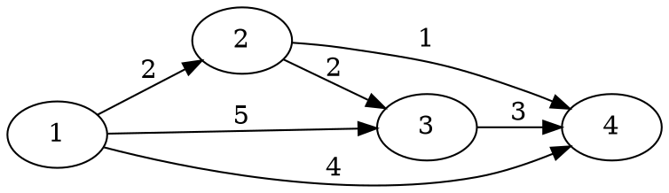

[[TOC]]

## 形式化题目

给定有向图 $G=(V,E)$，$|V| = n$，$|E| = m$，每条边 $(u,v)$ 有非负权 $w$，允许两点间存在多条边。固定起点 $s$，要求

$$dis(v) = \min \{ \textstyle\sum_{(x,y) \in P} w(x,y) : P \text{ 是从 } s \text{ 到 } v \text{ 的有向路径} \}$$

若 $s$ 到 $v$ 不可达，约定 $dis(v) = 2^{31}-1 = 2147483647$。

样例的图：`1 → 2 (2)`、`1 → 3 (5)`、`1 → 4 (4)`、`2 → 3 (2)`、`2 → 4 (1)`、`3 → 4 (3)`。

注意 `1 → 3` 的直连代价 5，而 `1 → 2 → 3` 只要 4；`1 → 4` 的直连代价 4，而 `1 → 2 → 4` 只要 3。这种“绕路更短”正是松弛要处理的情况。

## 正解

### 思路

最短路满足**松弛条件**：只要 `dis[u] + w(u,v) < dis[v]`，就说明 `dis[v]` 还可以更小，必须改成 `dis[u] + w(u,v)`。

Bellman-Ford 的做法是反复对所有边做这件事，做 $n-1$ 轮保证正确，但每轮都要扫过全部 $m$ 条边，总复杂度 $O(nm)$。这里有一个明显浪费：某一轮里，**只有距离刚刚被改小的那些点**，它的出边才有可能继续产生新的更新；其余点的出边再扫一遍一定不会改动任何东西。

于是把“刚刚被改小的点”收集进一个队列：

- 初始只有 $s$ 在队列里（`dis[s] = 0`）；
- 每次取出队首 $u$，清掉它的入队标记，扫描 $u$ 的全部出边做松弛；
- 若某条边让 `dis[v]` 变小，就把 $v$ 入队——除非 $v$ 已经在队列里（已经在排队，不必重复排）。

这就是 SPFA。它把“每轮扫全部边”换成“只扫发生过变化的点的出边”，在随机数据上远快于 $O(nm)$。

队列去重有一个容易写错的地方：**判断“是否已在队列中”只能决定要不要入队，不能决定要不要更新 `dis[v]`**。即使 $v$ 正在队列里，更小的 `dis[v]` 也必须先写进去，否则队列里排着的那个状态已经过期，后面就会用旧距离去松弛，算出的答案偏大。代码里的顺序是“先更新 `dis`、`cnt`，再看 `in_queue`”。

用样例走一遍，可以直观看到队列的作用：

| 步骤 | 出队 | `dis[1..4]` | 队列 | 发生的事 |
| --- | --- | --- | --- | --- |
| 初始 | — | 0, INF, INF, INF | `[1]` | 只有起点可达 |
| 1 | 1 | 0, 2, 5, 4 | `[2,3,4]` | 三条出边全部松弛成功，三点依次入队 |
| 2 | 2 | 0, 2, 4, 3 | `[3,4]` | 3 和 4 都被改小，但已在队列中，不重复入队 |
| 3 | 3 | 0, 2, 4, 3 | `[4]` | $4+3=7 \geqslant 3$，没有更新 |
| 4 | 4 | 0, 2, 4, 3 | `[]` | 没有出边，队列空，结束 |

表格的列依次是出队点、当前距离数组、队列内容和这一步的效果。第 2 步是本题的关键：点 3、4 已经在队列里，如果因为“已在队列中”就跳过写入 `dis`，它们会带着 5 和 4 这两个偏大的旧值出队，输出就错了。

代码里的 `cnt[v] = cnt[u] + 1` 记录的是“当前这条最优路径用了几条边”，不是入队次数。简单最短路最多 $n-1$ 条边，因此 `cnt[v] >= n` 表示存在从 $s$ 可达的负环。本题 $w \geqslant 0$，这个分支不会触发，保留它只是让函数在被复用到负权图时仍然安全。

### 代码

C++ 版：

@include-code(./main.cpp, cpp)

几个实现细节：

- `dis` 用 `long long`，内部 `INF = 1LL << 62`；只有真实可达的点才会进入队列，所以 `dis[u] + e.w` 不会变成溢出的大数。题目保证 $\sum w < 2^{31}$，但仍用 `long long` 更省心。
- 不可达要输出 $2^{31}-1$，所以额外定义 `UNREACH = 2147483647`，不能把内部的 `INF` 直接打出来。
- `init_graph` 清空边、`spfa` 内部用局部队列并重置三个数组，多组数据连续运行时不会带上一组的残留状态。

### 复杂度

- 时间：每条边最坏情况被松弛多次，理论最坏 $O(nm)$；随机数据下实际接近 $O(km)$，$k$ 是很小的常数。本题 $n \leqslant 10^4$、$m \leqslant 5\times 10^5$ 可以通过。洛谷 P4779 会构造数据卡 SPFA，那种场合必须改用堆优化 Dijkstra。
- 空间：邻接表 $O(n+m)$，`dis`、`cnt`、`in_queue` 各 $O(n)$。

## 总结

SPFA 的全部内容就是一句话：**Bellman-Ford 的一轮里，只有距离变小的点值得再扫一次出边**。用一个队列维护这些点，入队前用 `in_queue` 去重，就得到只处理有效边的松弛算法。

两个高频错误值得记住：

1. 用“入队次数”当负环判据。正确判据是路径边数 `cnt[v] = cnt[u] + 1`，入队次数多并不等于有负环。
2. 因为 `v` 已在队列中就跳过 `dis[v]` 的更新。更新的对象永远是距离数组，入队标记只控制“要不要再排一次”。

本题是模板的弱化版，数据随机，SPFA 足够。真正的最短路工程写法在无负权时应优先选 Dijkstra：$O(m \log n)$ 有确定上界，不会被构造数据卡成 $O(nm)$。
