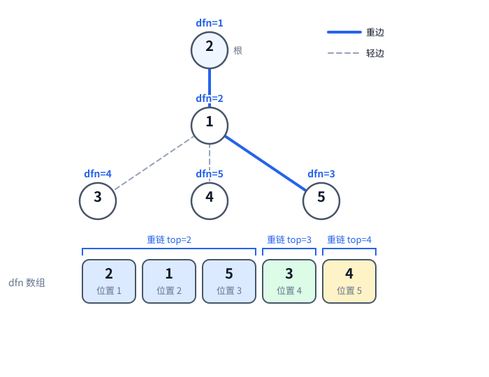
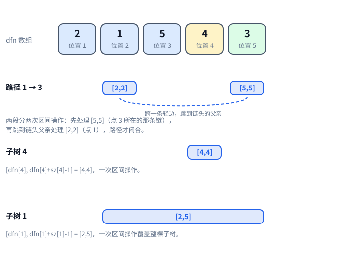

[[TOC]]

## 形式化题目

给定一棵 $n$ 个节点的带权树，根为 $r$，所有结果对 $P$ 取模。依次执行 $m$ 次操作：

1. 路径加：$x$ 到 $y$ 最短路径上所有点权加 $z$；
2. 路径和：输出 $x$ 到 $y$ 最短路径上所有点权之和；
3. 子树加：以 $x$ 为根的子树内所有点权加 $z$；
4. 子树和：输出以 $x$ 为根的子树内所有点权之和。

本质上是要在一棵树上支持“一条路径”与“一棵子树”这两种点集的区间加与区间和。

## 思路

先看一个可以直接验证想法的朴素解：

@include-code(./brute.cpp, cpp)

`brute.cpp` 的思路是最直接的：路径操作让较深的点沿父亲链一步一步爬，相遇即覆盖整条路径，逐点加或逐点求和；子树操作 DFS 枚举子树内所有点。单次操作 $O(n)$，总复杂度 $O(nm)$，无法通过 $10^5$ 的数据。

瓶颈很清楚：**点集有多大，就要访问多少个点**。树上的路径和子树都没有数组那样的“连续区间”表示，无法跳过中间节点整体结算。

关键观察是**重新编号**：用两遍遍历给每个点分配新编号 `dfn`，让两类点集都变成连续区间：

1. **子树天然是连续区间**：任意 DFS 序下，以 $u$ 为根的子树内的点占据区间
   $[\text{dfn}[u],\ \text{dfn}[u] + \text{sz}[u] - 1]$，这是 DFS 序的普通性质。
2. **路径可以拆成 $O(\log n)$ 段**：DFS 编号时**优先走重儿子**（子树最大的儿子）。从链头沿重儿子
   一路走到的点编号连续，形成一条“重链”。重儿子是子树最大的儿子，所以任何轻儿子 $v$ 都满足
   $\text{sz}[v] \leqslant (\text{sz}[u] - 1) / 2$——否则 $v$ 就会是重儿子。也就是说每跨过一条轻边，
   子树大小至少翻倍，从任意点向上最多只能跨 $\log_2 n$ 条轻边，于是任意路径最多拆成
   $O(\log n)$ 条重链上的连续段。

这样四种操作统一退化为线段树的两个基本操作“区间加、区间和”，由懒标记在 $O(\log n)$ 内完成
（P3870 已经建立过 `apply` + `push` 的懒标记模型，本题把“翻转”换成“加值”，下发函数叫 `pushdown`）。

### 样例的链剖分

下图是样例树（$n=5$，根 $r=2$）：粗蓝线是重边，灰虚线是轻边，每个点上方标出它分到的 `dfn`。



图下方把 `dfn` 数组按位置 1 到 5 排开，格子里是原节点编号。同一色的格子属于同一条重链，
所以一眼能看出两条性质：重链 `2-1-5` 的编号连续为 `1,2,3`；子树 1 覆盖位置区间 `[2,5]`，
恰好是 `1,5,3,4` 四个节点。

同一份数组上，路径和子树各自落到哪些位置，看第二张图：



路径 `1 → 3` 不是一段连续区间，它被拆成 `[4,4]`（点 3）和 `[2,2]`（点 1）两段，中间跨一条轻边；
子树不拆段：子树 4 就是 `[5,5]`，子树 1 就是 `[2,5]`。四种操作因此全部归约为区间操作。

图里两个轻儿子的编号顺序是 `3` 在前、`4` 在后，这由 `main.cpp` 的遍历方式决定：`build()` 里
`dfs2` 先递归重儿子（拿到 `dfn=3`），再按邻接表顺序递归各个轻儿子，所以先遇到 3（`dfn=4`）、
后遇到 4（`dfn=5`）。这个顺序完全由实现方式决定，不影响正确性——只要同一条重链的编号连续、
子树仍是连续区间即可。

### 为什么拆段与懒标记能够成立

把上面的结构压缩成三条性质：

- **区间和可合并**：两个不相交区间的点权和可以直接相加，合并运算满足结合律，单位元是 $0$。
- **区间加能在整段上结算**：长度 $\text{len}$ 的区间每个点加 $v$，整段和只增加 $v \cdot \text{len}$，
  所以线段树节点可以在 $O(1)$ 内更新自己的和并打上懒标记，不必下到叶子——这正是 P3870
  懒标记成立的条件，把“翻转”替换为“加值”即可。
- **HLD 提供的是“点集 → 区间”映射**：子树与重链段都映射为连续区间，于是路径操作退化为若干次
  区间操作，线段树可以逐段结算。

以下表为样例操作过程，验证四种操作如何累积：

| 操作 | 点 1 | 点 2 | 点 3 | 点 4 | 点 5 | 输出 |
| --- | --- | --- | --- | --- | --- | --- |
| 初始 | 7 | 3 | 7 | 8 | 0 |  |
| 3 4 2（子树 4 加 2） | 7 | 3 | 7 | 10 | 0 |  |
| 3 2 2（子树 2 加 2） | 9 | 5 | 9 | 12 | 2 |  |
| 4 5（子树 5 和） | 9 | 5 | 9 | 12 | 2 | 2 |
| 1 5 1 3（路径 5-1 加 3） | 12 | 5 | 9 | 12 | 5 |  |
| 2 1 3（路径 1-3 和） | 12 | 5 | 9 | 12 | 5 | 21 |

观察表中两次子树加：`3 4 2` 只改点 4（区间 `[5,5]`），`3 2 2` 改整棵树（区间 `[1,5]`），这正是
“子树 → dfn 连续区间”的体现；最后 `2 1 3` 沿路径 `1→3` 累加 `12 + 9 = 21`，与样例输出一致。

实现上，`main.cpp` 直接沿用 rbook 模板 `hld` 的全局数组加普通函数写法，没有结构体封装。
模板把代码分成两段：sgt 段只维护数组 `base[1..n]` 上的区间加与区间和，hld 段负责把树上路径与
子树翻译成 `base` 上的连续区间。两段共用 `base`：`base[t] = a[rev[t]]`，即按 `dfn` 重排后的点权。

`n` 和 `mod` 直接在 `main` 里读入，不需要额外的 `init`。`build(root)` 做三件事：`dfs1` 递归求
`fa / dep`，回溯时汇总 `sz` 并选出重儿子 `son`；`dfs2` 按“重儿子优先”分配 `dfn` 和链头 `top`；
最后 `seg_build` 把 `base` 建成线段树。线段树的 `range_add` 用四分式骨架——先剪掉完全不相交的
分支，再处理完全包含的分支，最后才递归两侧。

路径操作 `path_add / path_sum` 分两步。第一步，只要两点不在同一条重链（`top[u] != top[v]`），
就比较两边**链头**的深度，让链头更深的那一侧结算 `[dfn[top[u]], dfn[u]]` 这一段，然后跳到链头的父节点。
比的是链头而不是点本身：点本身更深不代表它那一侧该先结算，而链头更深说明这一侧整条链都在
LCA 以下，可以整段丢掉。第二步，循环退出时两点已在同一条重链上，把较浅的点当 $u$
（代码里是 `if (dep[u] > dep[v]) swap(u, v)`），再对 `[dfn[u], dfn[v]]` 做最后一次区间操作——
这一段就是到 LCA 为止的收尾，漏了它路径就不闭合。
子树操作 `subtree_add / subtree_sum` 不需要跳链，直接处理连续区间 `[dfn[u], dfn[u] + sz[u] - 1]`。

## 代码

@include-code(./main.cpp, cpp)

## 复杂度

- 预处理（两遍遍历 + 建树）：$O(n)$。
- 子树加 / 子树和：$O(\log n)$。
- 路径加 / 路径和：$O(\log^2 n)$（$O(\log n)$ 段，每段线段树 $O(\log n)$）。
- 空间：$O(n)$。
- 总时间：$O(n + m \log^2 n)$，$n, m \leqslant 10^5$ 时约 $10^5 \times 289$ 次基本操作。

## 总结

重链剖分的本质是给树重新编号，把“路径”和“子树”这两种树上点集映射成 `dfn` 上的连续区间：
子树一次区间操作，路径 $O(\log n)$ 次区间操作，剩下的区间加、区间和全部交给懒标记线段树。
掌握接口后，树剖题的变化主要在于替换线段树维护的统计量。rbook 的《[树链剖分](https://rbook2.roj.ac.cn/tree-algo/hld/index.html)》讲解了本解使用的模板（`hld`），本题按输入输出改造后沿用它的两遍 DFS：

- `dfs1(u, father)`：往下递归求 `fa` 和 `dep`，回溯时汇总 `sz`、挑出重儿子 `son`。
- `dfs2(u, head)`：先递归重儿子（沿用链头 `head`），再按邻接表顺序递归各轻儿子（各自开新链），
  于是整条重链的 `dfn` 连续。

两遍都是递归写法，递归深度等于树高。$n \le 10^5$ 的链形树最深递归 $10^5$ 层，实测需要约 8 MiB 栈；
判题器的栈上限默认与内存上限相同（远大于此），所以不会爆栈。

## 图示解析

这张 ASCII 图展示整道题的解题路线：

```text
朴素模拟（brute.cpp）
  路径操作沿父亲链逐点爬，子树操作 DFS 逐点枚举   O(n) 每次操作
        |
        | 瓶颈：逐点访问，m 次操作 O(n*m) 太大
        v
关键观察（重新编号）
  子树 u -> dfn 区间 [dfn[u], dfn[u]+sz[u]-1]
  重链 dfs 连续编号；路径拆成 O(log n) 条重链段（轻边让子树大小翻倍）
        |
        v
重链剖分 + 懒标记线段树（main.cpp）
  dfs1(u, father)：递归定 fa/dep，回溯汇总 sz 并选出重儿子 son
  dfs2(u, head)：重儿子优先分配 dfn，记录链头 top，再建线段树
  路径操作：while (top[u] != top[v]) 处理整段 [dfn[top[u]], dfn[u]] 后跳链
  子树操作：直接区间 [dfn[u], dfn[u]+sz[u]-1]
  线段树：区间加 / 区间和，lazy 整段结算
        |
        v
复杂度 O(n) 预处理 + O(log n)（子树）/ O(log^2 n)（路径）每次操作
```

图中四条主线对应“暴力慢在哪”“编号如何让点集变成区间”“两遍 DFS 各自算什么”“四种操作如何映射到线段树”。核心是把“树上的路径”这个非序列对象，变成 $O(\log n)$ 个数组连续区间，难度就从逐点访问降为分段区间操作。
