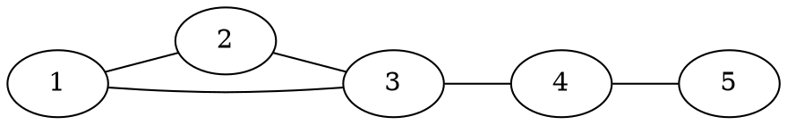
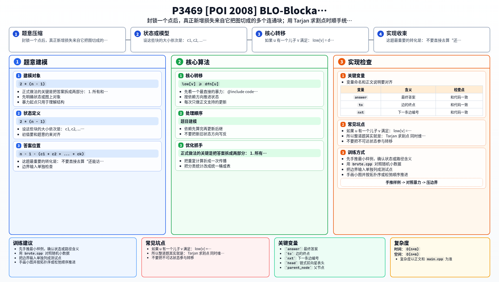

[[TOC]]

### 题意

有一张连通无向图，每个点代表一个城镇，每个城镇里正好有一个居民。

原本一共应该发生：

- `n * (n - 1)` 次访问

因为每个人都想访问其他所有人一次。

现在如果封锁某个城镇 `u`，就会导致：

- 任何和 `u` 有关的访问都不可能发生
- 删掉 `u` 以后，如果图被分成多个连通块，不同连通块之间的人也无法互相访问

题目要求对每个点 `u` 输出：

- 如果封锁 `u`，最终有多少次访问无法进行

#### 样例图

样例图长这样：

从图上就能看出：

- 点 `3` 和点 `4` 是关键位置
- 封锁 `3` 时，图会裂成 `{1,2}` 和 `{4,5}`
- 封锁 `4` 时，图会裂成 `{1,2,3}` 和 `{5}`

所以这两个点的答案会比普通点更大。

把所有点都数一遍，可以得到下面这张对照表：

| 封锁的点 | 删点后的连通块 | 割点带来的额外损失 | 答案 |
| --- | --- | --- | --- |
| `1` | `{2,3,4,5}` 一整块 | 0 | 8 |
| `2` | `{1,3,4,5}` 一整块 | 0 | 8 |
| `3` | `{1,2}` 和 `{4,5}` | `2 * 2 * 2 = 8` | 16 |
| `4` | `{1,2,3}` 和 `{5}` | `2 * 3 * 1 = 6` | 14 |
| `5` | `{1,2,3,4}` 一整块 | 0 | 8 |

表格里“额外损失”一列正是后面要算的东西：只有删点后真的裂成多块时它才不为 `0`，其余情况答案都等于固定损失 `2 * (n - 1) = 8`。

### 思路

先看一个最直接的暴力：

@include-code(./brute.cpp, cpp)

暴力做法是：

1. 枚举封锁哪个点 `u`
2. 真的把 `u` 删掉
3. 重新数删点后的每个连通块大小
4. 统计不同连通块之间一共有多少对访问作废

这个方法容易理解，但每个点都重跑一遍 DFS，复杂度是 $O(n(n+m))$，在 $n = 10^5$ 时完全不可行。

（`brute.cpp` 里 `MAXN` 只开到 25，它只负责在小图上给后文的对拍当标准答案，不是能提交的版本。）

正式做法的关键是把答案拆成两部分：

1. 所有和 `u` 直接有关的访问  
   这部分固定是 `2 * (n - 1)`  
   因为别人去 `u`、以及 `u` 去别人，这两类访问都作废。

2. 删掉 `u` 以后，不同连通块之间的访问  
   这部分只有当 `u` 是割点时才会额外出现。

注意访问是有方向的：`a` 去 `b` 和 `b` 去 `a` 是两次不同的访问，所以后面每一对“分属两个块的点”都要乘 `2`。

所以问题就变成：

- 删掉点 `u` 后，会分出哪些连通块？它们大小是多少？

这正是 Tarjan 割点里 `low[v] >= dfn[u]` 的含义。

如果 `u` 有一个儿子 `v` 满足：

`low[v] >= dfn[u]`

说明删掉 `u` 以后，`v` 这棵子树会单独裂成一个连通块，大小就是 `sub_size[v]`。

于是我们在 DFS 回溯时，把每个这样的“被切下来的块”依次拿出来计数即可。

设这些块的大小依次是：

- `c1, c2, ..., ck`

那么它们和“前面已经切出来的点”之间会新增：

- `2 * c_i * (前面所有块大小之和)`

次作废访问。把同一个块和所有更早的块配对，正好覆盖了块与块之间的全部点对，不会重复也不会漏。

最后还要补上一个“剩余大块”：

- 它的大小是 `n - 1 - (c1 + c2 + ... + ck)`

这块和前面所有被切下来的块之间，也会产生同样的双向损失，总共是

- `2 * S * (n - 1 - S)`，其中 `S = c1 + c2 + ... + ck`

这里容易卡住的一点是：剩下那部分为什么算“一块”？因为删掉 `u` 之后，`u` 的祖先方向、以及那些满足 `low[v] < dfn[u]` 的儿子子树，都还能经过 `u` 的父亲绕回去，彼此之间仍然连通，所以它们合成一个整体。

顺带说明两个看起来要特判、其实不用特判的边界：

- 对非根节点 `u`，如果它不是割点，就没有任何儿子满足 `low[v] >= dfn[u]`，于是 `S = 0`，额外损失 `2 * 0 * (n - 1) = 0`，答案自然退化成 `2 * (n - 1)`。
- 对根节点，它的 `dfn` 最小，每个儿子的子树都满足 `low[v] >= dfn[u]`，于是 `S` 恰好就是全部非根点，`S = n - 1`，剩余大块大小是 `n - 1 - S = 0`，这部分贡献算成 `0`。根只有一个儿子时（`S = n - 1` 且只有一个块），块间配对也是 `0`，答案回到 `2 * (n - 1)`，与“删根后图仍连通”一致。所以这里不需要像模板割点那样额外判断 `u != root` 或子树个数。

把三件事对上号，整道题其实就是：

- Tarjan 求割点
- 同时维护每棵子树大小
- 在回溯时用这些大小直接算贡献

对应到 `main.cpp` 里就是：

| 正文里的量 | 代码里的变量 | 含义 |
| --- | --- | --- |
| 固定损失 `2 * (n - 1)` | `answer[u]` 的初值 | 封锁 `u` 时和 `u` 有关的访问 |
| 已经切出来的块大小之和 `S` | `cut_sum[u]` | 回溯过程中逐步累加 |
| 被切下来的一个块 `c_i` | `sub_size[v]` | `v` 子树的大小 |
| 剩余大块 `n - 1 - S` | `n - 1 - cut_sum[u]` | 不单独存，直接现算 |

一行实现细节：因为 $n$ 可以到 $10^5$，链状数据会让递归深度爆栈，所以 `main.cpp` 用显式栈 `Frame` 手动模拟 DFS，逻辑和递归写法完全一致，`st` 弹栈的位置就是“回溯”。

### 代码

@include-code(./main.cpp, cpp)

### 复杂度

每个点进出栈一次，每条边在两条链式边里各被处理常数次，所以：

- 时间复杂度 $O(n+m)$
- 空间复杂度 $O(n+m)$

### 总结

这题最重要的转化是：

- 不要直接去算“还能访问多少次”
- 而是去算“哪些访问作废了”

一旦改成“作废访问数”，就会自然拆成：

1. 和被封锁点本身有关的固定损失
2. 割点把图切开后，不同块之间的额外损失

于是 Tarjan 的 `low[v] >= dfn[u]` 不再只是“判割点”，而是直接告诉我们：

- 有一个大小为 `sub_size[v]` 的连通块被切下来了

这就是这题的核心。 

### 一图流解析

这张图把本题的建模、关键转移、实现检查和训练方法压缩到一页，适合读完正文后复盘。

