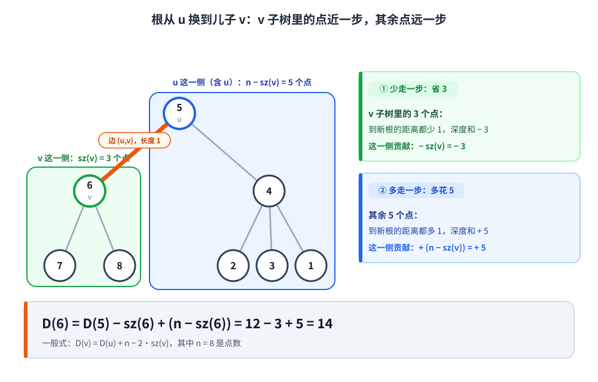

[[TOC]]

## 形式化题目

给定一棵 $n$ 个点的无向树，每条边长度都是 $1$。选定一个点 $r$ 当根之后，点 $x$ 的深度就是它到 $r$ 的边数：

$$\mathrm{dep}_r(x) = \mathrm{dist}(r, x)$$

把以 $r$ 为根时所有点的深度加起来，记为

$$D(r) = \sum_{x=1}^{n} \mathrm{dist}(r, x)$$

要求输出一个使 $D(r)$ 最大的 $r$。若多个点并列最大，输出其中任意一个即可（本题开 Special Judge）。原题把点称为「结点」，下文一律称点。

## 暴力解法

### 思路

最直白的做法是逐个点试一遍：把 $x$ 当根做一次 BFS，层数就是每个点到 $x$ 的距离，累加起来得到 $D(x)$，全部试完之后取最大的那个。

@include-code(./brute.cpp, cpp)

### 复杂度

单个点 BFS 一遍是 $O(n)$，$n$ 个候选点共 $O(n^2)$。本题 $n$ 到 $10^6$，$O(n^2)$ 是 $10^{12}$ 量级，不可能跑完。

### 瓶颈

瓶颈不在单次遍历，而在于「换一个根就重头走一遍」：$D(x)$ 和 $D(y)$ 明明只差一笔账，暴力却把整棵树重新扫了一次。

## 正解：换根 DP

### 思路

先随便挑一个点当根，这里取 $1$。记：

- $\mathrm{sz}(u)$：以 $1$ 为根时 $u$ 的子树点数；
- $D(u)$：以 $u$ 为根时的深度和，也就是题目要最大化的那个量。

**第一步，算出根 $1$ 的答案。** 一次遍历求出每个点的深度，$D(1)$ 就是所有深度之和：

$$D(1) = \sum_{x=1}^{n} \mathrm{dep}_1(x)$$

**第二步，看父子之间怎么挪。** 设 $v$ 是 $u$ 的儿子，把根从 $u$ 挪到 $v$。这次挪动只跨了一条边 $(u,v)$，所以每个点的深度只可能变化 $\pm 1$，具体看它落在边的哪一侧：

拿样例核对这张图。$n=8$，边为 $1\text{-}4$、$4\text{-}5$、$5\text{-}6$、$6\text{-}7$、$6\text{-}8$、$4\text{-}2$、$4\text{-}3$。图里为了让 $u,v$ 落在相邻两层，临时把 $5$ 当根，$6$ 是它的儿子，这只是演示一次挪动，代码里仍然以 $1$ 为根。此时 $6$ 这一侧是 $\{6,7,8\}$，$\mathrm{sz}(6)=3$；另一侧是剩下的 $5$ 个点。

- $v$ 子树里的 $\mathrm{sz}(v)$ 个点，到新根不用再绕经边 $(u,v)$，各少走一步，深度和减少 $\mathrm{sz}(v)$；
- 其余 $n - \mathrm{sz}(v)$ 个点，到新根必须多跨这条边，各多走一步，深度和增加 $n - \mathrm{sz}(v)$。

两边相抵就得到换根公式：

$$D(v) = D(u) - \mathrm{sz}(v) + \big(n - \mathrm{sz}(v)\big) = D(u) + n - 2\,\mathrm{sz}(v)$$

样例里 $D(5)=12$、$\mathrm{sz}(6)=3$，于是 $D(6) = 12 - 3 + 5 = 14$，和逐个 BFS 的结果一致。

**第三步，把整棵树推一遍。** 从根 $1$ 出发沿父子边把公式推下去，就能求出每个点的 $D$，最后扫一遍取最大值。整个过程只走了两遍树。

顺便记下这个式子的含义：$n - 2\,\mathrm{sz}(v) > 0$ 等价于 $\mathrm{sz}(v) < n/2$，也就是「挪进一个不到一半的点的那一侧，深度和一定变大」。所以答案所在的点一定是个叶子（$n=1$ 时只有这一个点，单独算）：如果某个点有至少两个邻居，把树从它这里拆成若干块，这些块的点数加起来是 $n-1$，至少两块，于是必然有一块不到 $n/2$，往那边挪一步就更优，它就不可能是最大值点。这个结论只用来说明答案长什么样，代码并不依赖它，仍然把所有点的 $D$ 都算出来取最大。

### 代码

代码里 `subtree_size` 就是 $\mathrm{sz}$，`dist_sum` 就是 $D$，`parent_node` 记录以 $1$ 为根时每个点的父亲。

@include-code(./main.cpp, cpp)

实现上有两处是冲着 $n \le 10^6$ 来的：

- **不用递归**。链形树的深度能到 $10^6$，递归 DFS 直接爆栈。代码先用一次 BFS 生成遍历顺序 `order_nodes`，正序算深度和，逆序累加子树大小，再正序换根，全程只用一个队列和几个数组。
- **深度和用 `long long`**。链形树上 $D$ 的量级是 $n^2/2 \approx 5 \times 10^{11}$，`int` 装不下。

### 复杂度

- 时间：建图 $O(n)$，BFS 求深度与顺序 $O(n)$，逆序统计子树大小 $O(n)$，换根递推 $O(n)$，扫描取最大 $O(n)$，总 $O(n)$。
- 空间：链式前向星 $O(n)$，加上父亲、深度、子树大小、答案四个数组，共 $O(n)$。实测 $n=10^6$ 的链数据峰值内存约 43 MiB。

## 总结

这题的转折点是承认「相邻两个根的答案只差一笔账」，然后用子树大小把这笔账 $O(1)$ 算出来：

$$D(v) - D(u) = n - 2\,\mathrm{sz}(v)$$

一条边的两侧点数决定了深度和往哪个方向变，于是 $n$ 遍遍历被压成两遍。

两处容易踩的地方：

- **别把「答案是叶子」推成「答案是直径端点」。** 有人看到 $D$ 最大就以为根必须挂在直径的某一端，这不成立。反例是 $13$ 个点的树，边为 $1\text{-}2$、$2\text{-}3$、$1\text{-}4$、$4\text{-}5$、$4\text{-}6$、$2\text{-}7$、$6\text{-}8$、$5\text{-}9$、$9\text{-}10$、$9\text{-}11$、$2\text{-}12$、$9\text{-}13$：最大值点在 $8$，$D(8)=47$，可 $8$ 到最远点的距离只有 $5$，而直径是 $6$（端点有 $3,7,10,11,12,13$）。$8$ 是叶子，但不在直径端点上。真要拿性质剪枝，能用的只有「答案一定是叶子」这一条。
- **规模上去了，实现方式就得跟着换。** 本题 $n$ 比 P1395 大一个量级，递归写法在链数据上会 RE，必须改成 BFS 定序加逆序统计。

如果想继续练换根，可以把 $w_u$ 全部取 $1$ 的加权版对照一遍（P1364、P1395），再回来看这题：公式是同一个，只是问最小还是最大、规模多大不同。
