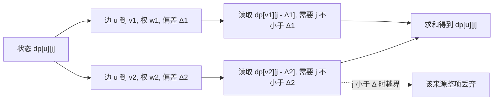

[[TOC]]

## 形式化题目

给定一张包含 $N$ 个顶点、$M$ 条有向边的图，边权均为非负整数（可能包含 $0$ 权边，但无自环与重边）。

设从点 $1$ 到点 $N$ 的最短路径长度为 $d$。需要计算：
从点 $1$ 出发到达点 $N$ 且总路径长度不超过 $d + K$ 的路径条数，结果对给定的整数 $P$ 取模。

若存在无穷多条满足条件的路径，则输出 $-1$。

## 暴力解法

### 思路

最朴素的方法是从起点 $1$ 开始进行深度优先遍历（DFS），沿着出边不断累加路径权值 $cur\_len$。
- 当 $cur\_len > d + K$ 时回溯；
- 当搜索到达终点 $N$ 时，将答案计数加 $1$；
- 针对可能存在的 $0$ 权边，如果在当前搜索路径上多次访问同一个点且权值没有增加，说明进入了由 $0$ 权边构成的环；若从该环出发能到达终点，则判定存在无穷多条合法路线并报告 $-1$。

### 代码

@include-code(./brute.cpp, cpp)

### 复杂度

在图结构稠密或环较多时，搜索树的节点规模呈指数级爆炸，最坏时间复杂度为 $O(M^{d + K})$，仅适用于极小规模图（如 $N \le 6, M \le 12$）的调试与对拍。

### 瓶颈

暴力的核心瓶颈在于：
1. **状态重复计算**：同一对「当前所在点」与「已走距离」会被大量不同的前缀路径多次遍历；
2. **状态值域过大**：路径的绝对长度可达 $N \times \max(c_i) \approx 10^8$，直接以实际距离作为状态数组下标在空间与时间上均不可行。

## 正解

### 思路

#### 1. 状态降维：以「相对最短路的偏差量」作为状态

注意到题目给出了强约束 $K \le 50$，虽然路径的总长度很大，但一条合法路径**相比于理论最短路最多只能多走 $K$ 的距离**。

设各点 $u$ 到终点 $N$ 的最短距离为 $dis[u]$（可以通过在反向图上以点 $N$ 为源点运行堆优化 Dijkstra 算法求得）。
考虑一条从 $u$ 指向 $v$、权值为 $w$ 的有向边 $(u, v, w)$：
- 从 $u$ 沿该边走到 $v$ 再走到终点 $N$，其理论能达到的最小总花费为 $w + dis[v]$；
- 而从 $u$ 到 $N$ 本身的最短路为 $dis[u]$；
- 由最短路的三角不等式性质，显然有 $dis[u] \le dis[v] + w$，即：
  $$\Delta = dis[v] + w - dis[u] \ge 0$$

这里的 $\Delta$ 即为**经过边 $(u, v)$ 相比于走最短路多花出的额外代价**（偏差量）。
既然整条路径从 $1$ 到 $N$ 最多多走 $K$ 的距离，那么整条路径上经过的所有边的 $\Delta$ 之和必须不超过 $K$！

#### 2. 状态定义与转移方程

定义状态：
$dp[u][j]$ 表示从点 $u$ 出发走到终点 $N$，且后续路径相对于 $dis[u]$ **恰好多消耗了 $j$ 的额外偏差**的合法方案数。

- **初始基准**：当 $u = N$ 且 $j = 0$ 时，自身到达终点且无偏差，提供 $1$ 种基础方案。
- **状态转移**：
  遍历点 $u$ 的所有正向出边 $(u, v, w)$，计算 $\Delta = dis[v] + w - dis[u]$。
  若 $j - \Delta \ge 0$，则说明转移可行：
  $$dp[u][j] = \sum_{(u, v, w)} dp[v][j - \Delta] \pmod P$$
- **最终答案**：
  从起点 $1$ 出发，枚举总额外花费 $j \in [0, K]$，累加所有 $dp[1][j] \pmod P$。

下图把这条转移式拆成来源, 说明 $dp[u][j]$ 的每个候选值取自哪条边、以及第二维如何被 $\Delta$ 扣减:

图中两条出边各自把 $j$ 减去自己的 $\Delta$ 后再去读后继状态, 所以 $\Delta$ 越大, 同一个 $j$ 能接续的后继表项就越靠左; 虚线那一路是越界情形, 它对应转移式里的条件 $j - \Delta \ge 0$, 不满足就不能计入求和. 图中也直接暴露了 $\Delta$ 为 $0$ 的特殊之处: 此时读取的是 $dp[v][j]$ 本身, 第二维一个都没减少.

下面用一个 $4$ 个点的小图把这张二维表逐格算一遍. 取终点 $N = 4$, 预算 $K = 3$, 边集为 $1 \to 2\ (w = 1)$、$2 \to 4\ (w = 1)$、$1 \to 3\ (w = 3)$、$3 \to 4\ (w = 1)$、$2 \to 3\ (w = 0)$. 先在反向图上以点 $4$ 为源跑 Dijkstra, 得到 $dis[1] = 2,\ dis[2] = 1,\ dis[3] = 1,\ dis[4] = 0$, 再逐条边算 $\Delta$:

| 边 $(u \to v)$ | $w$ | $dis[v] + w - dis[u]$ | $\Delta$ | 含义 |
| :-: | :-: | :-: | :-: | :-- |
| $1 \to 2$ | $1$ | $1 + 1 - 2$ | $0$ | 与最短路等长 |
| $2 \to 4$ | $1$ | $0 + 1 - 1$ | $0$ | 与最短路等长 |
| $2 \to 3$ | $0$ | $1 + 0 - 1$ | $0$ | 与最短路等长 |
| $3 \to 4$ | $1$ | $0 + 1 - 1$ | $0$ | 与最短路等长 |
| $1 \to 3$ | $3$ | $1 + 3 - 2$ | $2$ | 比最短路多花 $2$ |

四条 $\Delta = 0$ 的边共同构成本图的两条最短路, 只有 $1 \to 3$ 是"绕远"的边. 下表每行是一个出发点 $u$, 每列是剩余偏差量 $j = 0, 1, 2, 3$, 单元格就是 $dp[u][j]$. 取 $P$ 远大于这些数值 (例如 $P = 10^9 + 7$) 时表里就是方案数的原值, 不必取模:

| $u$ | $j = 0$ | $j = 1$ | $j = 2$ | $j = 3$ |
| :-: | :-: | :-: | :-: | :-: |
| $1$ | $2$ | $0$ | $1$ | $0$ |
| $2$ | $2$ | $0$ | $0$ | $0$ |
| $3$ | $1$ | $0$ | $0$ | $0$ |
| $4$ | $1$ | $0$ | $0$ | $0$ |

读表时先看 $u = 1$ 那一行: $dp[1][0] = 2$ 对应 $1 \to 2 \to 4$ 与 $1 \to 2 \to 3 \to 4$ 两条一个偏差都没花的走法, $dp[1][2] = 1$ 对应吃满 $\Delta = 2$ 的 $1 \to 3 \to 4$, 而 $j = 1$ 与 $j = 3$ 整列为 $0$ 是因为本图各边的 $\Delta$ 只有 $0$ 与 $2$, 凑不出奇数偏差, 整行相加得 $2 + 0 + 1 + 0 = 3$.

$\Delta$ 恒 $\ge 0$ 由定义直接给出: $dis[u]$ 已是"从 $u$ 出发的所有走法"中最短的长度, 而 $w + dis[v]$ 只是其中"先走这条边再走最优后续"这一条具体走法的长度, 具体走法不会比最短的更短, 所以这一维记录的是"多花了多少"而不是"少花了多少", 它在每一步转移里只减不增, 这正是 $j$ 能被 $K$ 截断、状态总数只有 $N \times (K + 1)$ 的原因. $\Delta = 0$ 的边危险则是因为它读取的正是 $dp[v][j]$ 本身, $j$ 一点不减: 若干条这样的边首尾相接成环时, 就能停在同一层 $j$ 上无限绕圈, 每绕一圈都是新路线, 方案数变成无穷. 本例的 $2 \to 3$ 就是一条 $\Delta = 0$ 的边, 只因补不出回路才无害; 若再加一条 $3 \to 2\ (w = 0)$ (它的 $\Delta = 1 + 0 - 1 = 0$), 环就成形了, 且点 $1$ 可达它、它可达点 $4$, 答案立刻变成 $-1$, 这正是记忆化搜索必须保留 `in_stack` 的原因.

#### 3. 记忆化搜索与判断无穷解（0 权环）

因为转移存在拓扑关系（第二维 $j$ 在 $\Delta > 0$ 时严格减少；在 $\Delta = 0$ 时 $j$ 保持不变），采用**记忆化搜索**实现最为自然直观。

如何判断是否存在无穷多条路径并输出 $-1$？
当且仅当存在一个由 $\Delta = 0$ 的边构成的环，且该环能从起点 $1$ 走到、并能顺利走到终点 $N$ 时，我们可以在该环上无限绕圈而偏差量不增，从而产生无穷多条合法路线。
在记忆化搜索中，我们维护一个布尔数组 `in_stack[u][j]` 记录当前状态 $(u, j)$ 是否正处于当前的递归调用栈中：
- 若进入 `dfs(u, j)` 时发现 `in_stack[u][j] == true`，说明在相同的额外偏差量 $j$ 下回到了自身（走了一圈 $\Delta = 0$ 的回路）；
- 此时立即标记发现 $0$ 环，整道题直接输出 $-1$。

### 代码

@include-code(./main.cpp, cpp)

### 复杂度

- **时间复杂度**：
  - 反向图 Dijkstra 预处理各点到 $N$ 的最短路：时间复杂度为 $O(M \log N)$；
  - 记忆化搜索：状态总数为 $N \times (K + 1)$。由于每个状态只会被完整展开并记忆化一次，所有状态转移遍历的所有出边总次数为 $\sum_u deg(u) \times (K + 1) = M \times (K + 1)$。
  - 单组数据总时间复杂度为 $O(M \log N + (N + M) K)$。对于 $N \le 10^5, M \le 2 \times 10^5, K \le 50$，总运算量在 $10^7$ 级别，运行耗时约 $0.2 \sim 0.3\text{s}$，能充分在 $2.0\text{s}$ 限制内处理全部数据。
- **空间复杂度**：
  - 链式前向星（正向与反向）：$O(N + M)$；
  - 最短路数组与堆：$O(N)$；
  - DP 记忆化与递归栈标记数组：$O(NK)$，占用内存约 $45\text{MB}$，完全满足空间限制要求。

## 总结

本题的关键在于**将无法直接用于 DP 的绝对距离转化为相对最短路的额外增量**。利用 $K \le 50$ 的极小范围，将原本难以表示的路径计数问题化为两维状态 $(u, j)$。通过反向图 Dijkstra 算出基准距离，并在记忆化搜索中借助搜索栈精准拦截 $0$ 权环，实现了思路简洁、结构严谨的最优解法。
