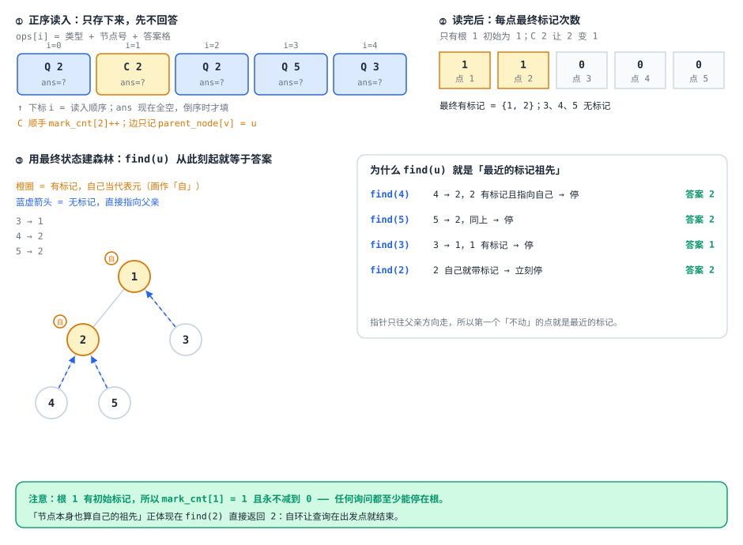

[[TOC]]

## 形式化题目

给定一棵以 $1$ 为根的有根树，维护一个节点标记集合 $M$，初始状态下只有根节点有标记，即 $M = \{1\}$。按时间顺序处理以下两类操作：

1. 标记操作 `C u`：将节点 $u$ 加入集合 $M$（可重复标记，多次标记效果等同于已存在）；
2. 询问操作 `Q u`：查询从节点 $u$ 到根的路径上，距离 $u$ 最近（即深度最大）的已标记节点（$u$ 本身若已标记则为其自身）。

## 解法总览

本题的核心矛盾在于：正向处理时，每次标记会在原有的树连通结构中增加分割点，将连通块进一步打散；而在询问时，需要沿着祖先链向上寻找第一个进入的标记。

根据是否强制在线，本题有两种经典的处理路线：

1. **离线时光倒流 + 并查集（推荐主解，代码极简）**：题目没有强制在线。如果正难则反，记录所有标记后将时间倒流，原问题的「增加标记」就变成了「删除标记」。在并查集中，连通块的合并比分裂容易得多：每个未标记节点直接指向父亲，集合代表元恰好是当前块顶端有标记的祖先；撤销标记时，代表元向其父亲连边合并。单次操作均摊 $O(\alpha(n))$，代码仅约 50 行。
2. **在线重链剖分 + 线段树（经典在线解法）**：若题目要求强制在线，则用重链剖分将树上到根路径拆分为 $O(\log n)$ 段重链区间，利用线段树维护区间内已标记的最大 dfn 序，沿重链跳跃查询。单次操作复杂度为 $O(\log^2 n)$。

下面给出并列解法总览表：

| 解法 | 核心观察 | 复杂度 | 适用场景 | 对应代码 |
| :--- | :--- | :--- | :--- | :--- |
| 解法一（推荐主解）：离线时光倒流 + 并查集 | 正难则反，删标记等价于连通块向上合并 | 时间 $O((n+q)\alpha(n))$，空间 $O(n)$ | 题目允许离线；追求实现极简与极致常数 | `@include-code(./main.cpp, cpp)` |
| 解法二：重链剖分 + 线段树 | 祖先路径拆为 $O(\log n)$ 段区间，重链上「最近」即「dfn 最大」 | 时间 $O(q \log^2 n)$，空间 $O(n)$ | 强制在线或动态加边等扩展场景 | `@include-code(./hld.cpp, cpp)` |

---

## 暴力解法

### 思路

每次询问 `Q u` 时，从节点 $u$ 沿树上的唯一父节点链 `parent[u]` 逐点向上移动，直到遇到第一个被标记的节点即为答案。

### 代码

@include-code(./brute.cpp, cpp)

### 复杂度与瓶颈

- 时间复杂度：标记单次 $O(1)$，询问单次最坏需要向上遍历整条链，最坏时间复杂度为 $O(n)$；总时间复杂度为 $O(nq)$。
- 空间复杂度：$O(n)$。
- 瓶颈：当树退化为一条长链且多次在链底发起询问时，逐点上跳产生大量重复扫描。

---

## 解法一（推荐主解）：离线时光倒流 + 并查集

### 思路

正向过程中，不断加入标记会将一棵树割裂成越来越多的「连通块」（以每个标记节点为连通块的顶部代表元）。在数据结构中，**分裂通常难以在近线性时间内高效维护，而合并却非常适合并查集**。

既然本题全部操作在输入中已经给出，我们采用**时光倒流（逆序处理）**的思想。下面按三块分别讲清，每一块都配一张图。

#### 第一块：离线存操作

正序读入时**只存不答**：把每个操作原样压进 `Operation ops[]` 数组，结构体只有三个字段：类型 `type`、节点号 `u`、以及留给查询答案的格子 `ans`。

$$
\operatorname{ops}[i] = (\operatorname{type}_i,\ \operatorname{u}_i,\ \operatorname{ans}_i),\qquad
\operatorname{type}_i \in \{\text{'C'},\ \text{'Q'}\},
$$

其中下标 $i$ 就是读入顺序，所以数组天然按时间正序排列，倒序只要让 $i$ 从 $q-1$ 走到 $0$。这个数组存在的理由很实际：**正序读的时候并不知道答案，但答案属于某条具体的询问**，必须先把询问连同它的位置一起存下来，倒序算出答案后再按下标填回去，最后正序扫一遍输出 `ans`。顺带在读入时做一件事——只有 `C` 会让标记数变化，所以边读边累加 `mark_cnt[u]`，读完就得到了「全部操作做完后每个点被标记了几次」。

图右下角逐个验证了 `find` 的结果：`find(4)` 走 $4 \to 2$ 停在 2，`find(3)` 走 $3 \to 1$ 停在 1，`find(2)` 因为自环直接返回 2（这正好对应题面「节点本身也算自己的祖先」）。**指针只朝父亲方向指，所以沿指针只会上行，第一个走不动的点就是最近的标记。**

#### 第二块：倒序回溯

倒着走一遍操作序列，两种操作的处理方式完全不同：

- 遇到 `Q u`：此刻树上的标记状态，恰好就是正序执行到这一步时的状态，直接取代表元 `find(u)` 记进 `ops[i].ans`。
- 遇到 `C u`：时光倒流意味着这次标记要**撤销**，所以先 `mark_cnt[u]--`。只有当它减到 $0$ 时才说明「在更早的时刻 $u$ 其实没有标记」，这时以 $u$ 为根的那一整块才需要向上并进父亲所在的块；否则只减计数，指针一动不动。

第三条是理解这套做法的关键，它解释的是**为什么可以只改一个指针、而不用写 `merge`**：撤销 `C u` 的那一刻，$u$ 自身正带着标记，所以它是所在连通块的代表元（没有任何节点指向它以外的位置），把根 `u` 挂到 `parent[u]` 上，效果完全等同于「两块合并」。

![倒序回溯: 标记撤销时连通块向上合并: 顶部是倒着走的时间轴, 四个面板依次是从最终状态出发、处理 Q 3 得 1、处理 Q 5 得 2、处理 C 2 时 mark_cnt[2] 归零并把 dsu_fa[2] 从自环改成指向 1, 最后一个宽面板显示回溯完成后 dsu_fa 全部归位, 并对照同一个 Q 2 先后得到 2 和 1](./p4092-undo-merge.svg)

最后那个宽面板值得多看一眼：样例里 `Q 2` 出现了两次（下标 $0$ 和 $2$），**倒序处理时它们得到的答案并不相同**——先遇到的（$i=2$）时候 2 还带着标记，答案是 2；等走过 `C 2`、标记被撤销之后，再遇到的（$i=0$）的答案就变成了 1。正序读入时这两条询问长得一模一样，正因为答案取决于「当时的状态」，才必须靠倒序让状态自然回退，而不是真的去维护一个支持删除的结构。

#### 第三块：复杂度

- 时间复杂度：
  - 构建树结构与统计总操作：$O(n + q)$；
  - 倒序处理中，共计有 $q$ 次查询和最多 $n$ 次并查集合并，带路径压缩的并查集单次均摊为 $O(\alpha(n))$；
  - 总时间复杂度为 $O((n + q)\alpha(n))$，在百万级数据范围内运行只需几十毫秒。
- 空间复杂度：并查集数组、操作记录均为一维数组，总空间复杂度为 $O(n + q)$。

上面两张图都是定格。想把整个过程一步步走一遍，可以打开 [交互演示：三段各自单步走](./code-lesson.html)：顶部三个开关正好对应上面三块，每段都能单步、回退、自动播放，遇到询问步先让你猜答案再揭示。页面同样按题面输入格式读数据，四个预设分别是题面样例、同一节点标两次、深链、多分支，也可以自己粘一组进去，`dsu_fa` / `mark_cnt` 两个数组的变化在右侧表格里同步显示。

### 代码

@include-code(./main.cpp, cpp)

---

## 解法二：重链剖分 + 线段树

### 思路

若题目要求在线处理，我们可以将树剖分并将路径查询转化为区间极值：

1. **重链连续性**：重链剖分将树上任意节点到根的路径划分为不超过 $O(\log n)$ 段连续的重链区间，重链上深度随剖分后的 dfn 序严格单调递增。
2. **最近与最大 dfn 的等价性**：在同一条重链上，离查询点 $u$ 最近的已标记祖先，正是该段重链区间 $[dfn[top[u]], dfn[u]]$ 内所有打了标记的节点中 **dfn 最大的节点**。
3. **线段树维护**：线段树维护单点标记的 dfn，区间查询最大值。询问时沿重链跳跃：若当前重链区间内存在标记，则取区间内最大 dfn 还原为节点编号即为答案；若无标记，则跨过轻边跳至上一条重链继续查询，直到命中。

### 代码

@include-code(./hld.cpp, cpp)

### 复杂度

- 时间复杂度：预处理 $O(n)$；单次标记为线段树点更新 $O(\log n)$；单次询问最多跳 $O(\log n)$ 条链，每条链区间查询 $O(\log n)$，单次询问 $O(\log^2 n)$；总时间复杂度为 $O(q \log^2 n)$。
- 空间复杂度：线段树及重链剖分相关数组占用 $O(n)$ 空间。

---

## 总结

- **思维模式提升**：面对「加标记分割树结构」且不强制在线的题目，「正难则反 / 倒序时光倒流」能将棘手的「分裂问题」转化为经典优雅的「并查集连通块向上合并问题」，从而在代码量和运行效率上双双超越传统高级数据结构。
- **在线 vs 离线**：离线并查集代码极短（50 行），时间近乎线性 $O((n+q)\alpha(n))$，是竞赛中最优解题选择；重链剖分 + 线段树则是通用的在线树上路径维护工具，理解两种解法的对立统一有助于加深对树上动态问题的整体认知。

---

## 参考与致谢

在解法评估与优化过程中，研读并参考了洛谷公开题解中的精彩解法，特此致谢：

| 来源与作者 | 题解标题 / 链接 | 采纳与参考内容 | 本文独立完成内容 |
| :--- | :--- | :--- | :--- |
| Sleepp (uid: 77743) | [题解 P4092 【[HEOI2016/TJOI2016]树】](https://www.luogu.com.cn/article/y83gvs3d) | 学习了将本题离线倒序、利用并查集维护连通块撤销标记的核心思维 | 严谨证明了代表元直接指向父亲进行路径压缩的拓扑正确性；重写了符合规范的现代 C++17 代码；补充了 500 组随机与极限用例独立对拍验证 |
| 现有本地题解作者 | 本地历史版本 | 保留了重链剖分 + 线段树的标准在线实现作为并列解法二 | 补充并列多解法对比表及解法分析，整理格式规范 |
