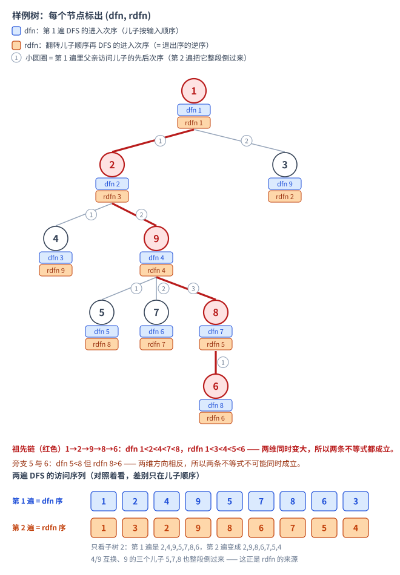
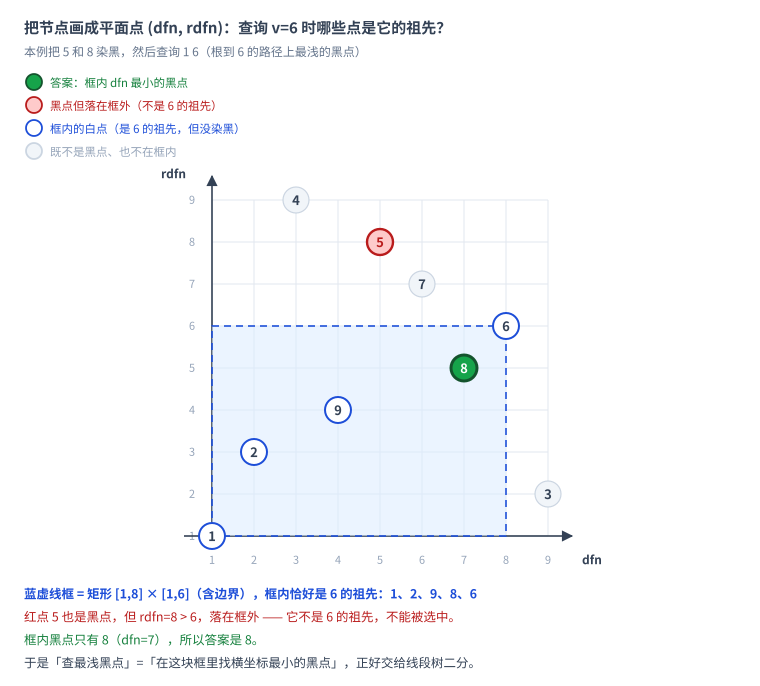
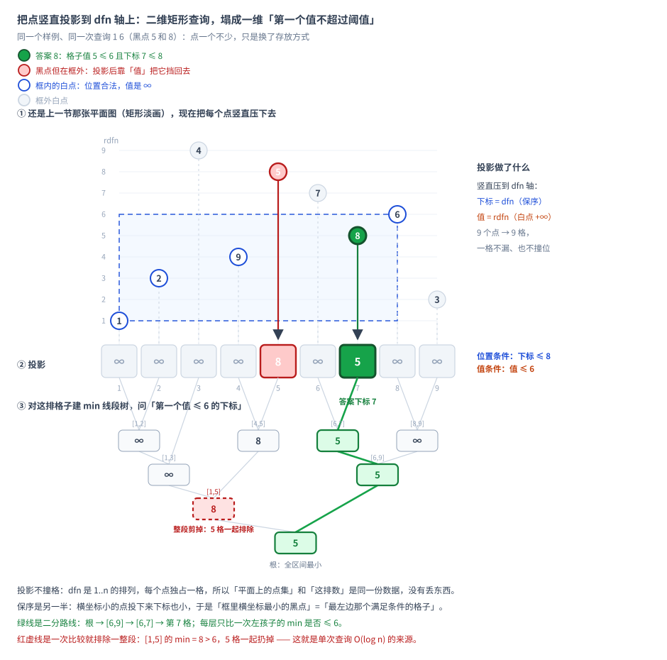

[[TOC]]

## 形式化题目

给定一棵 $n$ 个节点的无根树，以节点 $1$ 为根，每个节点有黑白两色，初始全为白。按顺序处理 $m$ 次操作：

1. 把节点 $i$ 的颜色取反；
2. 查询根 $1$ 到节点 $v$ 的路径上**深度最小**的黑点，输出其编号；若路径上没有黑点，输出 $-1$。

### 关于「第一个」的方向

题面原文是「询问 $1$ 到 $v$ 的路径上的第一个黑点」（SPOJ 原题：*the first black node on the path from node 1 to node v*）。路径是**从 $1$ 往 $v$ 读**的，所以「第一个」指**离根最近、深度最小**的黑点，而不是离 $v$ 最近的那个。

这个区别很容易读反，而且读反后在多数数据上仍然能过（只有当 $v$ 本身和它的某个祖先同时为黑时才暴露）。用题面样例就能确认方向：

| 用例 | 路径 $1\to v$ 上的黑点 | 深度最小（本文采用） | 离 $v$ 最近（不是本题） |
| --- | --- | --- | --- |
| 让 $8$ 与 $6$ 同时为黑，查询 `1 6` | $\{8,6\}$ | $8$ | $6$ |

样例自带的 `1 6` 答案为 $8$（当时只有 $8$ 是黑点），但把 $6$ 也染黑后，题面要求的仍然是 $8$ —— 因为 $8$ 比 $6$ 更靠近根 $1$。本文四个实现与 12 篇公开题解在此用例上均输出 $8$，与题面一致。

另一个常见的混淆点：当 $v$ 本身为黑、且它的某个祖先也为黑时，**答案仍是最浅的那个祖先**，不是 $v$。例如

```
3 3
1 2
1 3
0 2
0 1
1 2
```

节点 $1,2$ 同时为黑，查询 `1 2`：路径 $1\to2$ 上的黑点是 $\{1,2\}$，最浅的是 $1$，所以答案是 $1$（而不是 $2$）。本文四个实现与 11 篇公开题解都输出 $1$。

另外，题面没有把 $v$ 自身排除在外：路径包含 $v$，所以 $v$ 自己是黑点、且它的祖先都不是黑点时，答案就是 $v$ 本身。本文的实现均正确包含了这一点（已用 200 组「只把 $v$ 自己染黑」的数据专项验证，全部输出 $v$）。

> 注意不要和另一道题混淆：P4092 询问的是「离 $u$ 最近的打了标记的祖先」，那是**相反**的方向（深度最大）。两题的题意不能互相套用。

## 解法总览

本题的查询对象不是「路径上的某个值」，而是「路径上满足某条件的、深度最小的那个点」，所以要解决的是**如何把「$u$ 是 $v$ 的祖先」这个条件翻译成数据结构能维护的形式**。围绕这一点有两种独立完整、都可直接提交的正解：

1. **解法一：双 dfs 序 + 线段树二分**。给每个节点两个时间戳，使「$u$ 是 $v$ 的祖先」等价于两个偏序条件同时成立。于是「$v$ 的黑点祖先」变成「下标不超过 $\mathrm{dfn}_v$、值不超过 $\mathrm{rdfn}_v$ 的位置」，用线段树二分一次查询直接得到最小下标。单次操作 $O(\log n)$。
2. **解法二：重链剖分 + 每条重链一个黑点集合**。重链内 $\mathrm{dfn}$ 与深度同序，所以一条链上最浅的黑点就是链内最小 $\mathrm{dfn}$，用有序集合维护即可。查询时从 $v$ 沿链头向上跳，共 $O(\log n)$ 条链，每条链取集合最小元素是 $O(1)$，所以单次查询 $O(\log n)$；取反是一次 `set` 插入/删除，也是 $O(\log n)$。

| 解法 | 核心观察 | 复杂度 | 适用场景 | 对应代码 |
| --- | --- | --- | --- | --- |
| 解法一（正式主解）：双 dfs 序 + 线段树二分 | $u$ 是 $v$ 的祖先 $\iff \mathrm{dfn}_u\leqslant\mathrm{dfn}_v$ 且 $\mathrm{rdfn}_u\leqslant\mathrm{rdfn}_v$，一次线段树二分得到最小 $\mathrm{dfn}$ | 时间 $O((n+m)\log n)$，空间 $O(n)$ | 想用最短代码换到最优常数；不需要剖分 | `@include-code(./main.cpp, cpp)`，另有同一算法的 Python 版 `@include-code(./main.py, python)` |
| 解法二：重链剖分 + 每条重链一个黑点集合 | 重链内 $\mathrm{dfn}$ 随深度递增，链上最浅黑点 = 链内最小 $\mathrm{dfn}$ | 时间 $O(n+m\log n)$，空间 $O(n)$ | 只需要会树链剖分，不需要额外的时间戳技巧 | `@include-code(./hld_set.cpp, cpp)` |
| 解法二的线段树变体 | 同上，但把每条链的集合换成「整棵线段树维护黑点最小 $\mathrm{dfn}$」 | 时间 $O((n+m)\log^2 n)$，空间 $O(n)$ | 想复用树剖 + 线段树这一套模板 | `@include-code(./hld.cpp, cpp)` |

解法一是正式主解，代码最短、复杂度最优，是本题的推荐写法。解法二与它的线段树变体思路相同，区别只在「链内最浅黑点」用一个独立的 `std::set` 维护还是用一棵全局线段树维护：`set` 版本少一个线段树模板、写法更直白；线段树版本则是树链剖分题解里最常见的形态，便于和其它树剖题统一。两者都不依赖额外的时间戳技巧，适合只想复习剖分的读者。

下面先用朴素方法把瓶颈暴露出来，再分别展开两个正解。

## 暴力解法

### 思路

直接维护颜色数组。取反是 $O(1)$ 的单点修改；查询时从 $v$ 沿父指针一路爬到根，遇到黑点就记录，最后一次记录的黑点最靠近根，就是答案。

### 代码

@include-code(./brute.cpp, cpp)

### 复杂度

- 预处理求父亲：$O(n)$。
- 单次取反 $O(1)$，单次查询 $O(\mathrm{depth})$。
- 总时间 $O(nm)$，空间 $O(n)$。

### 瓶颈

链形树上一棵 $n$ 个点的树只有一条路径，从链底查询要爬 $n$ 步。$n=10^5$、$m=10^5$ 时最坏 $10^{10}$ 次操作，必然超时。真正的浪费在于：**每次查询都把整条祖先链重走一遍，而其中绝大多数节点的颜色根本没变**。要消除这个浪费，就需要一个能直接回答「这条路径上最浅的黑点是谁」的结构，而不是逐点检查。

## 解法一（正式主解）：双 dfs 序 + 线段树二分

### 关键观察

对每个节点记录两个时间戳：

- $\mathrm{dfn}_u$：第一次 DFS 进入 $u$ 的时刻，按进入顺序编号；
- $\mathrm{rdfn}_u$：把每个节点的儿子列表**翻转**后再做一遍 DFS 时的进入时刻。

**性质（祖先判定）**：$u$ 是 $v$ 的祖先，当且仅当

$$\mathrm{dfn}_u\leqslant\mathrm{dfn}_v \quad\text{且}\quad \mathrm{rdfn}_u\leqslant\mathrm{rdfn}_v .$$

直观理由：若 $u$ 是 $v$ 的祖先，两遍 DFS 都从 $u$ 走到 $v$，进入时刻自然都是 $u$ 更早。若 $u,v$ 没有祖先关系，设 $l=\mathrm{lca}(u,v)$，则二者落在 $l$ 的两个不同儿子的子树里；第一遍 DFS 谁先被遍历取决于儿子顺序，翻转儿子顺序后这一先后关系必然颠倒，所以两个不等式不可能同时成立。

> 说明：上面的推理是直观论证。本项目另外用独立脚本对 500 棵随机树（链、菊花、完全二叉树、随机树，$n\leqslant 13$）做了**逐点对穷举**验证：祖先判定性质成立，并且 $\mathrm{rdfn}_u$ 确实等于翻转儿子顺序的第二遍 DFS 的先序号。但这不是形式化证明。
>
> 注意 $\mathrm{rdfn}$ **不是**子树区间右端 $\mathrm{out}$ 的翻转：把上面的样例树代进去就能看出，节点 $2$ 的 $\mathrm{rdfn}=3$，而 $n-\mathrm{out}_2+1=9-9+1=1$。可以记成 $\mathrm{rdfn}_u=n-\text{退出计数}_u+1$（退出计数是后序编号），但这个式子的唯一用处是说明「一遍 DFS 也能算出来」，定义本身请按「翻转儿子顺序的第二遍 DFS 的先序号」理解。

$\mathrm{rdfn}$ 不必真的再 DFS 一遍：翻转儿子列表的 DFS 的进入序，正好等于原 DFS **退出序的逆序**。所以在一次 DFS 里，进入时给 $\mathrm{dfn}$ 递增编号，退出时给 $\mathrm{rdfn}$ 从 $n$ 递减编号，就能同时得到两个序。

有了这条性质，把黑点 $u$ 写成平面上的点 $(\mathrm{dfn}_u,\mathrm{rdfn}_u)$，「$u$ 是 $v$ 的祖先且 $u$ 是黑点」就变成「点落在 $v$ 的左下角矩形 $[1,\mathrm{dfn}_v]\times[1,\mathrm{rdfn}_v]$ 里」（后面的平面图画的就是这个矩形的形状）。而路径上最浅的黑点，正是 $\mathrm{dfn}$ 最小的那个 —— 即这个矩形里**横坐标最小的点**。

### 思路

整条思路分三步走：先把两遍 DFS 的编号画回树上和平面，看清「祖先」在坐标系里到底是什么形状；再把二维的矩形条件降成一维线段上的「第一个满足值」；最后把这件事交给线段树二分。

#### 第一步：把编号画回树上和平面，看清「祖先」的形状

以样例树为例，两遍 DFS 得到的两个序如下（第一遍 DFS 的儿子顺序按输入顺序）：

| 节点 | 1 | 2 | 3 | 4 | 5 | 6 | 7 | 8 | 9 |
| --- | --- | --- | --- | --- | --- | --- | --- | --- | --- |
| $\mathrm{dfn}$ | 1 | 2 | 9 | 3 | 5 | 8 | 6 | 7 | 4 |
| $\mathrm{rdfn}$ | 1 | 3 | 2 | 9 | 8 | 6 | 7 | 5 | 4 |

这两行就是 `main.cpp` 跑样例时的实际编号：$\mathrm{dfn}$ 是按输入顺序的先序（$1,2,4,9,5,7,8,6,3$），$\mathrm{rdfn}$ 是翻转儿子顺序后的先序（$1,3,2,9,8,6,7,5,4$）。

用这张表可以直接验证祖先判定：例如 $2$ 是 $9$ 的祖先，$(\mathrm{dfn},\mathrm{rdfn})=(2,3)\leqslant(4,4)$ 成立；而 $3$ 与 $9$ 无祖先关系，$(9,2)$ 与 $(4,4)$ 的第一维、第二维大小关系相反，两个不等式不同时成立。

光看数字不容易建立直觉，下图把这两行编号画回树上：



读这张图只需看两件事。沿红色的祖先链 $1\to2\to9\to8\to6$，两个编号都随深度单调变大（$\mathrm{dfn}$ 是 $1,2,4,7,8$，$\mathrm{rdfn}$ 是 $1,3,4,5,6$），所以「祖先」这一侧永远满足两条不等式；而旁支 $5$ 与 $6$ 虽然 $\mathrm{dfn}_5=5<\mathrm{dfn}_6=8$，却有 $\mathrm{rdfn}_5=8>\mathrm{rdfn}_6=6$，一维大一维小，两条不等式不可能同时成立。图底部的两行访问序列说明 $\mathrm{rdfn}$ 是怎么来的：第 2 遍只是把每个节点的儿子顺序整段倒过来，于是子树 $2$ 内 $4,9$ 互换、$9$ 的三个儿子 $5,7,8$ 倒序，子树 $2$ 内的顺序从 $2,4,9,5,7,8,6$ 变成 $2,9,8,6,7,5,4$。

把这套编号放到平面上，就得到解法一真正依赖的图形：



每个节点是平面上的一个点 $(\mathrm{dfn}_u,\mathrm{rdfn}_u)$，而 $v=6$ 的祖先恰好是左下角虚线框 $[1,\mathrm{dfn}_6]\times[1,\mathrm{rdfn}_6]=[1,8]\times[1,6]$ 里的全部点 —— 也就是 $1,2,9,8,6$（含边界）。框外的点一定不是祖先：$5$ 虽然是黑点，但 $\mathrm{rdfn}_5=8>6$，被挡在框的上方。于是「查最浅黑点」就变成了「在这块框里找横坐标最小的黑点」，问题从树上搬到了平面上，只剩一个二维的框。

#### 第二步：把点投影到 dfn 轴上，二维矩形就塌成一根线段

第一步结束时，问题是在框 $[1,\mathrm{dfn}_v]\times[1,\mathrm{rdfn}_v]$ 里找横坐标最小的黑点。可线段树是一维的：只有一根下标轴，每个下标上再存一个值。所以先要回答一个问题 —— **平面上的点，怎么塞进一根轴里？**

答案是竖直投影：把每个点压到 $\mathrm{dfn}$ 轴上。



投影只做两件事：

- **落点位置** $=\mathrm{dfn}_u$：点 $(\mathrm{dfn}_u,\mathrm{rdfn}_u)$ 落到第 $\mathrm{dfn}_u$ 格；
- **存下来的值** $=\mathrm{rdfn}_u$：竖着压会丢掉高度，于是把丢掉的那一维当作这一格存的内容 —— 黑点存它的 $\mathrm{rdfn}$，白点存 $+\infty$（表示「这格没有黑点」）。

投影不丢东西，因为 $\mathrm{dfn}$ 是 $1..n$ 的一个排列：每个点都有自己的格子，两个点不会压到同一格。于是「平面上的点集」和「轴上的一排数」是同一份数据的两种画法，上图 9 个点正好落满 9 格。

更关键的是投影**保序**：横坐标小的点，落下来格子也更靠左。原来的问题问「框里横坐标最小的黑点」，投影之后就成了「最靠左的格子，它的值不超过阈值」。要不要算进答案，只看两件事：

- 格子够不够靠左：下标 $\leqslant\mathrm{dfn}_v$ —— 原矩形横方向的那条边；
- 存的值够不够小：值 $\leqslant\mathrm{rdfn}_v$ —— 原矩形纵方向的那条边。

两维就这样各归各位：一维当**下标**（决定位置和先后），一维当**值**（只拿去和阈值比较）。矩形塌成一维之后，线段树要回答的就是一句话：

```text
在下标范围 [1, dfn_v] 里，找第一个值 <= rdfn_v 的格子
```

这一步为什么能塌，关键在**两维落在不同的东西上**：一维是格子怎么排，一维是格子存什么。如果两维都得挤在下标上（比如既要 $\mathrm{dfn}$ 落在某段区间、又要 $\mathrm{dfn}$ 满足别的关系），单值投影就无能为力了。

投影之后还剩两个细节要处理。

**细节一：把“区间 $[1,\mathrm{dfn}_v]$ 内第一个”换成“全局第一个 + 事后校验”。**

线段树从根下降时如果每层都先判断“这个结点与 $[1,\mathrm{dfn}_v]$ 相不相交”，代码会多一层递归参数。这里用一个更省事的写法: **干脆在整个 $[1,n]$ 上找第一个值 $\leqslant\mathrm{rdfn}_v$ 的下标**，因为是从最左往右找，拿到的 $i$ 天然是全局最小的。然后单独检查一句:

```text
若 i 不存在，或 i > dfn_v   ->  区间内没有答案，输出 -1
```

$i>\mathrm{dfn}_v$ 就说明全局第一个满足阈值的点落在 $v$ 的右边，它只是别处的黑点，不是 $v$ 的祖先。这一句就是位置边界的全部作用。

**细节二：“整段能不能一次排除”这个判据从哪来。**

这是投影之后真正让复杂度下降的地方。结点存子树内叶子的 $\min$，那么:

- 若 $\min>\mathrm{rdfn}_v$，说明这一段里每个点的 $\mathrm{rdfn}$ 都超过阈值，**整段无解**，直接返回，不用往下走；
- 否则这一段里至少有一个可行点，进入左子树继续找最靠左的。

一个结点被剪掉只花 $O(1)$，不剪的才会把两个孩子带进下一层，所以一次查询只沿 $O(\log n)$ 个结点走。上一张图右下角的红色虚线框就是这个判据在工作：`[1,5]` 这段的 $\min=8>6$，5 个格子一次丢掉。

> 这里和前置题 [[luogu/U502676]] 是同一个骨架。那题查「区间内第一个 $>k$ 的数」，结点存 $\max$，剪枝条件是「$\max\leqslant k$ 就整段无解」；本题查「区间内第一个 $\leqslant Y$ 的值」，结点存 $\min$，剪枝条件是「$\min>Y$ 就整段无解」。方向相反，下降方式完全一样。

#### 第三步：落到代码

把线段树的叶子下标设成 $\mathrm{dfn}$：

- 叶子 $\mathrm{dfn}=i$：若该节点是黑点，存它的 $\mathrm{rdfn}$；若是白点，存 $+\infty$；
- 内部节点存子树内所有叶子值的**最小值**。

于是「$[1,\mathrm{dfn}_v]$ 范围内有没有 $v$ 的祖先变黑」就变成「下标区间 $[1,\mathrm{dfn}_v]$ 内有没有值 $\leqslant \mathrm{rdfn}_v$」。线段树本身有序，可以直接做**线段树二分**：从根往下走，只要左子树的最小值 $\leqslant \mathrm{rdfn}_v$ 就进左子树，否则进右子树，$O(\log n)$ 走到第一个满足条件的位置 $i$。

- 若不存在这样的位置，或者找到的位置 $i>\mathrm{dfn}_v$，说明路径上没有黑点，输出 $-1$；
- 否则 $i$ 就是最浅黑点的 $\mathrm{dfn}$，用 `node_at[i]` 反查编号输出。

注意必须额外判断 $i\leqslant\mathrm{dfn}_v$：线段树二分是在整棵树范围内找最小下标，找到的点可能落在 $v$ 的右侧（此时它只是某个不相关子树里的黑点）。

按样例的操作顺序模拟线段树二分：

| 操作 | 黑点叶子（$\mathrm{dfn}\to\mathrm{rdfn}$） | 二分条件 | 找到的最小下标 | 输出 |
| --- | --- | --- | --- | --- |
| `1 3` | 无 | $\mathrm{rdfn}_3=2$，全为 $\infty$ | 无 | -1 |
| `0 8` | $\mathrm{dfn}=7\to\mathrm{rdfn}=5$ | — | — | — |
| `1 6` | 同上 | $\mathrm{rdfn}_6=6$，$5\leqslant 6$ 成立 | 7（$\leqslant\mathrm{dfn}_6=8$） | 8 |
| `1 7` | 同上 | $\mathrm{rdfn}_7=7$，$5\leqslant 7$ 成立 | 7，但 $7>\mathrm{dfn}_7=6$ | -1 |
| `0 2` | $\mathrm{dfn}=2\to3$，$\mathrm{dfn}=7\to5$ | — | — | — |
| `1 9` | 同上 | $\mathrm{rdfn}_9=4$，$3\leqslant 4$ 成立 | 2（$\leqslant\mathrm{dfn}_9=4$） | 2 |
| `0 2` | 只剩 $\mathrm{dfn}=7\to5$ | — | — | — |
| `1 9` | 同上 | $\mathrm{rdfn}_9=4$，$5\leqslant 4$ 不成立 | 无 | -1 |

对比 `1 6` 与 `1 7` 两行：$8$ 一直是黑点，但查 `1 7` 时 $\mathrm{dfn}_8=7>\mathrm{dfn}_7=6$，$8$ 落在 $7$ 的右边，靠最后那句 $i\leqslant\mathrm{dfn}_v$ 才被挡掉。而 $\mathrm{rdfn}$ 那条不等式管的是另一类漏网者：把 $5$ 也染黑后查 `1 6`（就是上面平面图的用例），$5$ 的 $\mathrm{dfn}=5$ 比 $\mathrm{dfn}_6=8$ 小，位置校验会让它通过，但 $\mathrm{rdfn}_5=8>\mathrm{rdfn}_6=6$ 说明它在框外，于是被「叶子值 $\leqslant \mathrm{rdfn}_v$」这个条件排除，答案仍然是 $8$。两个条件各挡一类，缺一个都会答错。

### 代码

@include-code(./main.cpp, cpp)

同一算法的 Python 实现（线段树改成迭代写法，避免递归开销）：

@include-code(./main.py, python)

### 复杂度

- 预处理：一次 DFS 求两个序，$O(n)$。
- 单次取反：线段树单点更新 $O(\log n)$。
- 单次查询：一次线段树二分，$O(\log n)$。
- 总时间 $O((n+m)\log n)$，空间 $O(n)$。

## 解法二：重链剖分 + 每条重链一个黑点集合

### 关键观察

重链剖分把树拆成若干条从链头往下的重链，并按「先重儿子、后轻儿子」的顺序重新编号。这个编号顺序保证了两件事：

1. **同一条重链上的 $\mathrm{dfn}$ 连续且随深度递增**。所以「链上最浅的黑点」就是「链内 $\mathrm{dfn}$ 最小的黑点」；
2. **根到 $v$ 的路径可以拆成 $O(\log n)$ 段重链区间**，并且从 $v$ 沿链头向上跳时，越往后跳到的链整体越浅。

样例树剖分后的结果（「重儿子」一行中的「—」表示该节点是叶子，没有重儿子）：

| 节点 | 1 | 2 | 3 | 4 | 5 | 6 | 7 | 8 | 9 |
| --- | --- | --- | --- | --- | --- | --- | --- | --- | --- |
| 重儿子 | 2 | 9 | — | — | — | — | — | 6 | 8 |
| 链头 $\mathrm{top}$ | 1 | 1 | 3 | 4 | 5 | 1 | 7 | 1 | 1 |
| $\mathrm{dfn}$ | 1 | 2 | 9 | 8 | 6 | 5 | 7 | 4 | 3 |

重链 $1\to2\to9\to8\to6$ 拿到了连续的 $\mathrm{dfn}=1..5$，另外四条链（链头分别为 3、4、5、7）各只有一个节点。

### 思路

给每条重链开一个有序集合 `chain_black[链头]`，存这条链上所有黑点的 $\mathrm{dfn}$。因为链内 $\mathrm{dfn}$ 随深度递增，集合的最小元素就是这条链上最浅的黑点。

- **取反**：翻转颜色后，把 $\mathrm{dfn}_x$ 插入或从 `chain_black[top[x]]` 删除，$O(\log n)$。
- **查询**：从 $u=v$ 开始，每次看 $u$ 所在链的集合：
  - 若集合非空且最小元素 $\leqslant\mathrm{dfn}_u$，说明这条链上有 $u$ 的祖先变黑，候选答案是它；
  - 否则这条链上没有任何 $u$ 的祖先变黑，整条链跳过。
  
  然后 $u\leftarrow \mathrm{parent}[\mathrm{top}[u]]$ 跳到上一条链。因为越跳越浅，最后记录的候选答案就是全局最浅的黑点。

注意「最小元素 $\leqslant\mathrm{dfn}_u$」这个判断不能省：集合里的最小黑点可能位于 $u$ 的**下方**（同一条链但更深），它不是 $u$ 的祖先。

按样例模拟：

| 操作 | 各链黑点集合（$\mathrm{dfn}$） | 查询过程 | 输出 |
| --- | --- | --- | --- |
| `1 3` | 全空 | 链 3：空；链 1 区间 $[1,1]$：空 | -1 |
| `0 8` | 链 1：$\{4\}$ | — | — |
| `1 6` | 链 1：$\{4\}$ | 链 1 区间 $[1,5]$，最小 $4\leqslant 5$，对应节点 8 | 8 |
| `1 7` | 链 1：$\{4\}$ | 链 7：空；链 1 区间 $[1,3]$，最小 $4>3$ 不成立 | -1 |
| `0 2` | 链 1：$\{2,4\}$ | — | — |
| `1 9` | 链 1：$\{2,4\}$ | 链 1 区间 $[1,3]$，最小 $2\leqslant 3$，对应节点 2 | 2 |
| `0 2` | 链 1：$\{4\}$ | — | — |
| `1 9` | 链 1：$\{4\}$ | 链 1 区间 $[1,3]$，最小 $4>3$ 不成立 | -1 |

`1 7` 一行最能说明问题：黑点 $8$ 与 $7$ 同在链 1，但 $\mathrm{dfn}_8=4>\mathrm{dfn}_7=3$，$8$ 比 $7$ 深，不是祖先，所以答案仍是 $-1$。

### 代码

@include-code(./hld_set.cpp, cpp)

### 复杂度

- 预处理：两次 DFS，$O(n)$。
- 单次取反：`set` 插入或删除，$O(\log n)$。
- 单次查询：跳 $O(\log n)$ 条链，每条链一次 `set` 取值（$O(1)$ 取最小元素），$O(\log n)$。
- 总时间 $O(n+m\log n)$，空间 $O(n)$。

### 同一思路的线段树变体

如果不想为每条链单独开 `set`，可以把「链内最小 $\mathrm{dfn}$」交给一棵覆盖全树的线段树：叶子 $\mathrm{dfn}=i$ 存「黑点 ? $i$ : $+\infty$」，内部节点存最小值。查询时把根到 $v$ 的路径拆成 $O(\log n)$ 段重链区间，**从根侧往 $v$ 侧**逐段查询区间最小值，第一个非 $+\infty$ 的结果就是答案。

这份实现沿用 rbook 模板 `hld` 的全局数组 + 普通函数写法，代码分成两段：

- sgt 段：线段树维护 `base[1..n]`，支持单点改与区间最小值
- hld 段：`fa / dep / sz / son / top / dfn` 描述树结构，`node_at[t]` 把 dfn 反查回原节点

`dfs1` 求 `fa / dep / sz / son`，`dfs2` 按「重儿子优先」分配 `dfn` 与链头 `top`，保证链内 `dfn` 随深度递增；建树时把所有叶子初始化为 `INF`（全白），取反时把 `dfn[x]` 位置写成 `dfn[x]` 或 `INF`。

@include-code(./hld.cpp, cpp)

两种写法本质相同，只差「链内最浅黑点」的存储介质：`set` 版把不同链的数据物理分开，取最小元素是 $O(1)$；线段树版把所有链放在同一个数组里，每次取值要多付一个 $O(\log n)$ 的区间查询。因此 `set` 版常数更小、代码更短，本题目解以它作为解法二的正式实现；线段树版则更容易与其它树链剖分题共用模板。

## 复杂度对比

| 解法 | 单次取反 | 单次查询 | 总时间 | 额外技巧 | 实测（$n=m=10^5$ 随机树，三次取中位） |
| --- | --- | --- | --- | --- | --- |
| 双 dfs 序 + 线段树二分 | $O(\log n)$ | $O(\log n)$ | $O((n+m)\log n)$ | 需要翻转儿子列表的第二遍 DFS | 约 52 ms |
| 重链剖分 + 每链 `set` | $O(\log n)$ | $O(\log n)$ | $O(n+m\log n)$ | 只需标准剖分 | 约 63 ms |
| 重链剖分 + 线段树 | $O(\log n)$ | $O(\log^2 n)$ | $O((n+m)\log^2 n)$ | 只需标准剖分 | 约 69 ms |

三者的实测时间都很小，本题的数据量对任何 $O(\log^2 n)$ 级别做法都足够宽松。选择建议：想要最短代码与最优复杂度就用解法一；正在复习树链剖分、希望把「路径拆段」这一套练熟就用解法二。

**考场策略**：第一次在赛场上见到这类题，优先走解法二。重链剖分是背得下来的模板，从「路径拆成 $O(\log n)$ 段区间」到「每段取最浅黑点」只差一个变形，熟练的话二十分钟能写完并用样例自查；解法一的门槛不在代码（二十行），而在那一步「再造一个与 $\mathrm{dfn}$ 同向的全序」的灵感 —— 只掌握 $\mathrm{dfn}_u\leqslant\mathrm{dfn}_v\leqslant\mathrm{out}_u$ 的选手会自然走向区间包含，凑不出二维支配关系，考场基本不会自发想到，而且想歪了没有任何部分分兜底。所以合理顺序是：先用解法二拿分，赛后回来把解法一当技巧升级。解法一真正可迁移的资产不是这道题本身，而是「把偏序嵌成二维支配 → 投影降维 → 线段树二分」这条链，再遇到「$u$ 是 $v$ 的祖先」这类条件时会反复用到。

## 总结

- 本题的难点不在数据结构，而在**把「是祖先」翻译成可维护的条件**。解法一用两个时间戳把祖先关系变成二维偏序，再用线段树二分取最小下标；解法二用剖分把路径拆成有序区间，再在每条链内取最小 $\mathrm{dfn}$。
- 两种解法都依赖同一个事实：**在「同一段连续编号」内，$\mathrm{dfn}$ 的大小顺序与深度顺序一致**。解法一里这段编号是整个 DFS 序（但要用 $\mathrm{rdfn}$ 排除非祖先），解法二里这段编号是一条重链（天然只含祖先链上的一段）。
- 「查询路径上第一个 / 最浅的某种点」是树剖的典型应用场景；而「两个 DFS 序做二维偏序」是一个适用范围更广的技巧，遇到「$u$ 是 $v$ 的祖先」这类条件时值得优先考虑。

## 图示解析

这张图对比两条正解路线：

```text
                        问题：根到 v 的路径上最浅的黑点
                                    |
              +---------------------+---------------------+
              |                                           |
   解法一：双 dfs 序                              解法二：重链剖分
   祖先判定 -> 二维偏序                          路径 -> O(log n) 段重链区间
   (dfn_u <= dfn_v) 且 (rdfn_u <= rdfn_v)        段内 dfn 随深度递增
              |                                           |
   线段树叶子存 rdfn，内部存 min                 每条链一个 set，存黑点 dfn
   线段树二分找最小 dfn                           取链内最小 dfn，逐链上跳
              |                                           |
        O(log n) 单次查询                            O(log^2 n) 单次查询
              |                                           |
              +---------------------+---------------------+
                                    |
                     都需要：判断「最浅黑点」是否真是 v 的祖先
                     （解法一判 i <= dfn_v，解法二判 min dfn <= dfn_u）
```

图中上半部分展示两条路线的分岔点：解法一把「祖先」变成两个不等式的合取，解法二把「路径」变成有序区间序列。下半部分标出两条路线共同的坑 —— 找到的「最浅黑点」可能并不在 $v$ 的祖先链上，必须额外做一次位置校验，这是本题最容易写错的地方。

## 参考与致谢

本题解法评估阶段阅读了洛谷题解区的公开题解，下表区分「哪些思路来自原题解」与「哪些是本篇自行补的论证、代码与验证」。

| 来源与作者 | 题解标题 / 链接 | 本篇采纳的内容 | 本篇独立完成的内容 |
| --- | --- | --- | --- |
| CYFqwq（uid 1512824） | [题解：P4116 Qtree3](https://www.luogu.com.cn/article/dh7fpjqr) | 解法一的核心技巧：翻转儿子列表的第二遍 DFS 得到 $\mathrm{rdfn}$，把「$u$ 是 $v$ 的祖先」转化为 $\mathrm{dfn}_u\leqslant\mathrm{dfn}_v\land\mathrm{rdfn}_u\leqslant\mathrm{rdfn}_v$，再用线段树二分找最小下标 | 重新推导并写出完整证明思路；补出「$\mathrm{rdfn}$ 等于翻转儿子顺序的第二遍 DFS 的先序号、也就是原 DFS 退出序的逆序」，从而一次 DFS 同时求两序；用独立脚本对 500 棵随机树逐点对穷举验证该性质；重写为符合本仓库风格的 C++17 与 Python 实现，并补「找到的最小下标可能 $>\mathrm{dfn}_v$」这一必需校验的说明 |
| Zcus（uid 33339） | [题解 P4116 【Qtree3】](https://www.luogu.com.cn/article/gn51smps) | 解法二的核心观察：每条重链维护一个黑点集合，集合按深度取最小，查询时沿链头向上跳并检查该黑点是否比 $u$ 浅 | 用 `std::set` 存 $\mathrm{dfn}$ 代替自定义比较器的 `set<节点>`；补写「最小元素可能比 $u$ 深、必须比较 $\mathrm{dfn}$」的证明；重写代码并独立对拍 |
| 81179332_（uid 53994） | [题解 P4116 【Qtree3】](https://www.luogu.com.cn/article/2mqauuds) | 与上篇相同的「每链一个集合」路线，以及「不必维护 $\mathrm{dfn}$ 也能判断链上最浅黑点」的提醒 | 同上；另说明为何本仓库实现仍使用 $\mathrm{dfn}$ 作为集合键（与剖分编号天然同序，省掉自定义比较器） |
| Treaker（uid 153898）、yu__xuan（uid 142110）、wxgwxg（uid 36103） | [7bkhqrs3](https://www.luogu.com.cn/article/7bkhqrs3)、[tkmwuwe9](https://www.luogu.com.cn/article/tkmwuwe9)、[22gbxp0c](https://www.luogu.com.cn/article/22gbxp0c) | 「黑点存 $\mathrm{dfn}$、白点存 $+\infty$、查询区间最小值」这一维护方式 | 作为解法二的线段树变体保留，用于对比 `set` 与线段树两种存储介质的取舍 |
| wrpwrp（uid 139012）、long__long（uid 1164409）、kririae（uid 63667）、what_can_I_do（uid 658973）、starowo（uid 1253524） | [tef0j1u0](https://www.luogu.com.cn/article/tef0j1u0)、[wxn8f28o](https://www.luogu.com.cn/article/wxn8f28o)、[3xzpawuw](https://www.luogu.com.cn/article/3xzpawuw)、[obmpkv47](https://www.luogu.com.cn/article/obmpkv47)、[fio0aqka](https://www.luogu.com.cn/article/fio0aqka) | 无（仅作为解法谱系的横向参考：LCT、树状数组倍增、分块、带修树上莫队） | 本篇未采纳这些路线。评估结论见下 |

**评估结论（本篇自查，供读者参考，不代表对原作者的评判）**：上述 12 篇公开题解中，本篇对每篇都编译后与独立暴力对拍（365 组小数据，$n\leqslant 30$，覆盖随机树 / 链 / 菊花 / 完全二叉树）。其中 10 篇结果与暴力完全一致；`3xzpawuw`（分块）在「`0 2` 两次后再查 `1 3`」这类「同一节点被反复取反」的用例上出错，`fio0aqka`（带修树上莫队）在链形小数据上答案与暴力不符。这两篇的路线实现复杂度也明显高于本篇采用的两个解法，因此未纳入正文。
