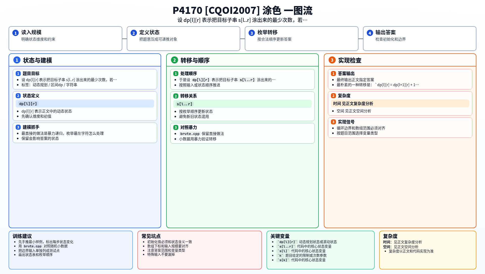

[[TOC]]

## 形式化题目

给定长度为 $n$ 的目标串 $s$（只含大写字母），初始木板为空。一次操作可以选一段连续区间，把该区间内的所有位置都改成同一个颜色（同一次操作里颜色可以任意挑），后一次操作会覆盖前一次的结果。求把木板变成 $s$ 的最少操作次数。

$40\%$ 的数据满足 $1\leqslant n\leqslant 10$，$100\%$ 的数据满足 $1\leqslant n\leqslant 50$。

样例 $2$ 的目标是 $s=\texttt{RGBGR}$，答案 $3$：先把整块涂成 $\texttt{RRRRR}$，再把 $2\sim4$ 号位置涂成 $\texttt{GGG}$ 得到 $\texttt{RGGGR}$，最后把 $3$ 号位置涂成蓝得到 $\texttt{RGBGR}$。

## 暴力解法

### 思路

题目给的不是"目标串长什么样"，而是"反复选区间涂色"这个过程，所以最直接的做法就是**照着过程搜索**。

把一个状态记成一块木板：每个位置要么还是空白（没涂过），要么已经涂了某个颜色。从"整块空白"出发，每次枚举一段连续区间 `[l, r]` 和一种颜色 `c`，把这段刷成 `c`，就得到一个新状态。问"最少刷几次能到目标串"，就是在这个状态图上从起点到终点的最短路，用 BFS 一层层扩展即可。

这里有一个容易被忽略、但对暴力正确性很关键的点：**已经涂对的位置也允许继续被覆盖**。题面允许后涂覆盖前涂，所以搜索时不能把"已经等于 $s_i$ 的位置"冻结起来，否则就漏掉了"先粗涂一大段、再把不该同色的部分改回来"这类方案。样例 $2$ 的 $3$ 步做法正是靠覆盖才成立的。

### 代码

@include-code(./brute.cpp, cpp)

### 复杂度与瓶颈

设状态数为 $V$、颜色数为 $\sigma$。每次扩展要枚举 $O(n^2)$ 个区间和 $\sigma$ 种颜色，每个新区间状态还要 $O(n)$ 或哈希开销去重，整体是 $O(n^3\sigma\cdot V)$，而 $V$ 本身也是指数级的（每个位置有 $\sigma+1$ 种取值）。实测长度 $7$ 以内很快，$n=50$ 时状态爆炸，完全跑不动。

更本质的问题是：这种搜索把"涂色顺序"完整地展开了，但题目只问最少次数，很多不同的涂色顺序其实对应同一批区间的同一组结果。只要能把"顺序"这个无关信息折叠掉，状态数就能从指数级降到 $O(n^2)$。

## 正解

### 关键观察

搜索之所以爆炸，是因为它在枚举"先涂哪段、后涂哪段"。换一个视角：**最终看得到的只有每一笔涂色的区间**，顺序只决定谁覆盖谁。

于是从“位置 $l$ 这一笔往右延伸到哪里”切入。考虑区间 $[l,r]$ 的一个最优方案，把突破口放在最左端：

- **方案 A**：位置 $l$ 是单独被"照顾"的，它最后被一笔只涉及它自己的涂色确定下来。之后 $[l+1,r]$ 怎么涂与它无关，因为 $s_l$ 和右边不再共用任何一笔。代价是 $1+f(l+1,r)$。
- **方案 B**：位置 $l$ 与右边某个位置 $k>l$ 共用同一笔涂色（$s_k=s_l$）。既然这一笔在 $l$ 和 $k$ 上都留下了颜色 $s_l$，而中间 $[l+1,k-1]$ 的最终颜色和 $s_l$ 不同，这一笔必须**先**把 $[l,k]$ 刷成 $s_l$，再让中间部分被后续涂色盖掉。于是这一笔可以"吸收"进 $f(k,r)$ 的最优方案里：先按 $f(k,r)$ 的方案处理 $[k,r]$，并保证 $k$ 上那笔向左延伸到 $l$，中间 $[l+1,k-1]$ 则完全独立地刷成 $f(l+1,k-1)$。

这两类方案覆盖了 $s_l$ 的所有归属方式，因此

$$
f(l,r)=\min\left\{f(l+1,r)+1,\ \min_{\substack{k\in[l+1,r]\\ s_k=s_l}}\left(f(l+1,k-1)+f(k,r)\right)\right\}
$$

下面这张表用样例 $s=\texttt{RGBGR}$（下标从 $1$ 起）列出左侧字符 `R` 与哪些位置配对：

| 位置 | $k$ | $s_k$ 与 $s_1$ 相同 | 候选代价 | 说明 |
| --- | --- | --- | --- | --- |
| 单独成笔 | 无 | — | $f(2,5)+1$ | `R` 自己刷一笔，右边独立处理 |
| 与 5 号共用 | $5$ | 是 | $f(2,4)+f(5,5)$ | 第一笔 $\texttt{RRRRR}$ 跨过 $1..5$，中间 $2..4$ 再单独刷成 `GBG` |

第二行的写法解释了样例 $2$ 的 $3$ 步：$f(2,4)=2$（先把 $2\sim4$ 刷成 `GGG`，再补一笔蓝），那一次跨过 $1..5$ 的大范围涂色与 $f(5,5)=1$ 是同一次，所以总代价是 $2+1=3$。

### 思路

把上面的观察写成区间 DP。设 $f(l,r)$ 表示**把目标子串 $s[l..r]$ 刷成目标样子所需的最少涂色次数**，这里把区间当成一块独立木板，不考虑区间外的位置。

- **边界**：$f(i,i)=1$，单个位置刷一笔。
- **转移**：先用"$l$ 单独成笔"打底 $f(l+1,r)+1$，再枚举 $k$ 使 $s_k=s_l$，用 $f(l+1,k-1)+f(k,r)$ 更新（当 $k=l+1$ 时中间区间为空，取 $0$）。
- **遍历顺序**：所有转移都用到了更短的区间，所以按区间长度从小到大枚举，最后答案就是 $f(1,n)$。

与"最后一步"直觉相呼应，还有一条常用的等价写法：$s_l=s_r$ 时，$l$ 那一笔可以直接向右延伸到 $r$，于是 $f(l,r)$ 可以直接继承 $f(l+1,r)$ 或 $f(l,r-1)$。它本质上是上面转移在 $k=r$ 时的特例，本文以完整的 $k$ 枚举为准，因为这样一条转移式就覆盖了所有长度。

小规模状态表（样例 $s=\texttt{RGBGR}$，只列出对角线附近，行是 $l$、列是 $r$）：

| $f(l,r)$ | $r=1$ | $2$ | $3$ | $4$ | $5$ |
| --- | --- | --- | --- | --- | --- |
| $l=1$ | 1 | 2 | 3 | 3 | **3** |
| $l=2$ | — | 1 | 2 | 2 | 3 |
| $l=3$ | — | — | 1 | 2 | 3 |
| $l=4$ | — | — | — | 1 | 2 |
| $l=5$ | — | — | — | — | 1 |

读法：第 $l$ 行第 $r$ 列是 $f(l,r)$，左下角空区间不算。右上角 $f(1,5)=3$ 就是整个样例的答案。看 $f(1,5)$ 这一格，它由 $f(2,5)+1=2+1=3$ 和 $f(2,4)+f(5,5)=2+1=3$ 取到最小值；后者正是“`R` 在 $1$ 号与 $5$ 号位置共用一笔”的写法，而 $f(4,5)=2$ 也提示 `R` 若单独成笔，右侧还剩两笔要做。

### 代码

@include-code(./main.cpp, cpp)

### 复杂度

状态数 $O(n^2)$，每个状态枚举 $k$ 是 $O(n)$，时间复杂度 $O(n^3)$，$n\leqslant 50$ 时约 $1.25\times10^5$ 次运算。空间是一个 $n\times n$ 的表，$O(n^2)$。

## 总结

这题的关键不是"模拟涂色顺序"，而是注意到：**最终只看得见每一笔涂色的区间**，顺序信息对答案没有用。把最左端字符的归属拆成"单独成笔"和"与右边同色字符共用一笔"两种，顺序就被折叠进区间里的递归，状态数从指数级降到 $O(n^2)$。

这也是区间 DP 的常见套路：先盯住区间端点，再问"端点上的这一笔能不能和内部某处合并"。能和内部同色位置合并时，就把区间拆成"中间"和"右边"两段分别递归。

## 图示解析

这张一图流把本题的建模、关键转移、实现检查和训练方法压缩到一页，适合读完正文后复盘。

