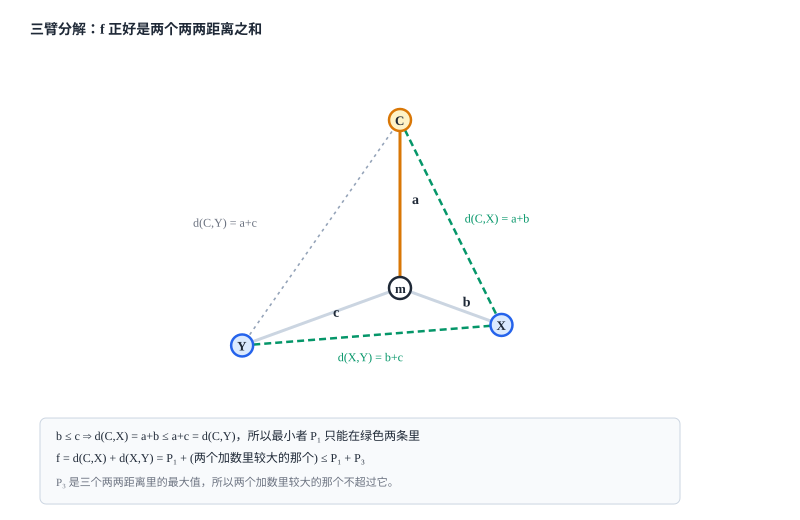

[[TOC]]

## 形式化题目

给定一棵带非负边权的树. 取三个互不相同的节点: 家 $C$、朋友 $A$、朋友 $B$. 父母的路线由规则唯一确定, 先走到离 $C$ 较近的那个朋友家, 再沿唯一道路走向另一个. 所以花的时间是

$$f(C, A, B) = \min\big(d(C,A),\ d(C,B)\big) + d(A,B)$$

求所有三点选取中 $f$ 的最大值. 这里 $d$ 是树上距离, 边权可以是 $0$.

### 样例

样例 `in1` 是一条链 $1-2-3-4$, 每条边权 $1$. 链上有 $3$ 条边, 直径就是两端点 $1$ 和 $4$ 之间长 $3$ 的路径. 下面算出每个位置作为家时的花费, 表格里的 $h(u)=\min\big(d(u,1), d(u,4)\big)$:

| 家 $C$ | $d(C,1)$ | $d(C,4)$ | $h(C)$ | 时间 $= 3 + h(C)$ |
| --- | --- | --- | --- | --- |
| 1 | 0 | 3 | 0 | 3 |
| 2 | 1 | 2 | 1 | **4** |
| 3 | 2 | 1 | 1 | **4** |
| 4 | 3 | 0 | 0 | 3 |

朋友取直径两端 $A=1, B=4$ 时, 家在 $2$ 或 $3$ 都会花 $4$ 分钟. 以 $C=2$ 为例: 先去近的 $1$ 号点用 $1$ 分钟, 再走 $3$ 分钟去 $4$ 号点, 共 $4$ 分钟, 与样例输出一致. 表中也出现了后面要证的形状: 时间恒等于"直径长"加"到两端较近的距离".

## 暴力解法

### 思路

最直接的做法是把定义照抄一遍: 枚举所有三点组合 $(C, A, B)$, 分别求出三段距离, 代入 $f$ 后取最大值.

### 代码

@include-code(./brute.cpp, cpp)

`brute.cpp` 对每组三点各做一次遍历求距离, 完全按定义结算, 不依赖任何还没证明的公式. 它的价值在于给出可信的小数据基准.

### 复杂度

枚举 $O(N^3)$ 组三点, 每组遍历 $O(N)$, 总 $O(N^4)$. $N=2\times 10^5$ 时完全不可行.

### 瓶颈

三点组合太多. 如果能把某两个点固定成与 $C$ 无关的特定节点, 枚举量就能从 $O(N^3)$ 掉到 $O(N)$. 自然的候选是直径的两个端点, 但这必须证明, 而这一步正是本题最容易写错的地方.

## 解法总览

两条路线都是 $O(N)$，差别在于**要不要证明「朋友取直径端点」这条几何结论**。解法一把答案化简成「直径长 + 到两端较近距离的最大值」，代价是先证一条关于直径的上界；解法二直接枚举三叉臂的汇合中心点，用换根 DP 汇总每个点向外的前三条长链，完全不需要直径性质。

| 解法 | 核心观察 | 复杂度 | 适用场景 | 对应代码 |
| --- | --- | --- | --- | --- |
| 一、直径端点 | 先证最优解的两个朋友可以取直径两端，答案化简为 $D + \max_u h(u)$ | $O(N)$ 时间，$O(N)$ 空间 | 需要一次几何上界证明；代码最短，三次遍历加一次扫描 | `main.cpp` / `main.py` |
| 二、树形换根 DP | 不碰直径，在每个节点汇总向外的前三长链 $l_1 \ge l_2 \ge l_3$，取 $l_1 + 2l_2 + l_3$ | $O(N)$ 时间，$O(N)$ 空间 | 不想证贪心结论，只需树形 DP 基本功 | `main2.cpp` |

正式主解是解法一（`main.cpp`，附同算法的 Python 版 `main.py`）：证明虽多一步，但它直接回答了「为什么是直径端点」，并且把求解压成三次遍历加一次扫描，常数最小、最好写。

如果不想碰任何几何论证，解法二是纯机械路线：枚举汇合中心点之后，题目要求的时间恰好是「一条主干道走一次 + 一条支链折返走两次」，于是每个点只需知道向外伸出的前三条独立长链。两条路线互不依赖，不构成前后优化关系。

## 解法一：直径端点贪心（主解）

### 思路

这道解法最核心的问题是：**为什么最优解里的两个朋友，可以固定为树的某条直径的两个端点？**
只要这个结论成立，两个朋友 $A, B$ 之间的距离就直接固定为树的直径 $D = d(A, B)$，剩下只需枚举家 $C$，找到让 $\min(d(C,A), d(C,B))$ 最大的点，一次 $O(N)$ 扫描就能得到全局最优解。

注意：我们**不能靠「一步步贪心拉伸」来论证**（因为向最远点替换某个朋友时，汇合中心点可能漂移，两朋友甚至可能折叠变近，单步替换并不保序）。正确的思路是**为任意三点计算一个全树统一的天花板上界**，并证明选直径端点正好能顶满这个天花板。

整个论证分为清晰的三步：

#### 第一步：三叉臂展开（物理意义）

无论选哪三点 $C, X, Y$，在树结构中它们必然交汇于唯一的中心分叉点 $m$，形成一个「三叉臂」结构。
设三条臂长分别为 $a = d(m, C), b = d(m, X), c = d(m, Y)$。不妨设 $b \le c$，即朋友 $X$ 是离家更近的那个。



按题意，父母先去近的朋友 $X$，再去远的朋友 $Y$：
$$f(C, X, Y) = d(C, X) + d(X, Y) = (a + b) + (b + c) = (a + c) + 2b = (a + b + c) + b$$

仔细观察这个形式 $(a+c) + 2b$ 的物理意义：
- $a+c = d(C,Y)$：这是从家 $C$ 一路直达朋友 $Y$ 的主干路径（**只走一次**）；
- $2b$：是在途经汇合点 $m$ 时，向旁边伸出去看望朋友 $X$，然后原路退回 $m$ 的侧向支链（**走了一个来回折返，即走两次**）。

#### 第二步：树上任意三链的天然上界

设整棵树的直径长度为 $D$（即全树任意两点间距离的最大值），$A \to B$ 为一条直径。记 $h(u) = \min(d(u, A), d(u, B))$，即点 $u$ 到直径两端较近者的距离。

三叉臂中的两条链与单条链有天然的长度封顶：
1. **主干道长度**：$a + c = d(C, Y)$ 是树上的一条简单路径，因此显然：
   $$a + c \leqslant D$$
2. **折返短臂 $b$ 的长度**：
   汇合中心点 $m$ 无论在树的哪个位置，它向外伸出的任意分支长度 $b$，都**不可能超过 $m$ 到直径两端较近者的距离**（即 $b \leqslant h(m)$）。
   *证明*：若不然，假设 $b > h(m) = \min(d(m, A), d(m, B))$。那么不妨设 $d(m, B) \ge d(m, A)$（即 $B$ 是较远端），此时 $m \to B$ 的长度至少为 $D/2$。由于直径是树上最长路径，从 $m$ 沿着伸出 $b$ 的分支走到底，与 $m \to B$ 拼成的新路径长度为 $b + d(m, B) > d(m, A) + d(m, B) \ge d(A, B) = D$，这与 $D$ 是全树直径矛盾！
   因此必有：
   $$b \leqslant h(m) \leqslant \max_{u} h(u)$$

#### 第三步：合并结论（全树天花板）

将主干道与折返支链的上界相加：
$$f(C, X, Y) = (a + c) + 2b \leqslant D + 2 \times \max_{u} h(u)$$

更紧致地，直接看 $f = d(C,X) + d(X,Y)$：
- 因为 $b \le c$，必有 $d(C,X) = a+b \le a+c = d(C,Y)$，所以两两距离的最小值 $P_{\min}$ 只能是 $d(C,X)$ 或 $d(X,Y)$ 之一；
- 因此 $f$ 是最小值 $P_{\min}$ 加上另一个距离（不超过全树最大距离 $D$）；
- 结合短臂上界可直接得到：
  $$f(C, X, Y) \leqslant D + \max_{u} h(u)$$

这个上界对**任意三点组合 $(C, X, Y)$** 都成立！
而当我们把两个朋友直接选在直径两端 $A, B$ 时，$d(A, B) = D$ 直接拉满，家选在让 $h(u)$ 取得最大的点 $u_0$：
$$f(u_0, A, B) = \min(d(u_0, A), d(u_0, B)) + d(A, B) = \max_u h(u) + D$$
**刚好能够完全取满这个理论天花板！**

由此严谨证明：**在全局最优解中，两个朋友一定可以取为直径的两个端点 $A$ 和 $B$**。

#### 警示：一个流传极广的“伪直觉证明”及其致命反例

许多人在初学此题时，常会产生一个看似极其简洁、顺理成章的“直觉证明”：

::: warning 常见直觉伪证
「固定家 $C$ 点不动。路线是先从 $C$ 走到朋友 $B$，再从 $B$ 走到朋友 $A$。
- 为了让第一步尽可能长，从 $C$ 出发显然应该走到离 $C$ 最远的点，由两次 DFS 求直径的定理，这个最远点 $B$ 一定是某条直径的端点；
- 接下来从 $B$ 走到 $A$，为了让第二步尽可能长，显然应该走到离 $B$ 最远的点，也就是直径的另一端点 $A$。
- 综上，两朋友 $A, B$ 必然是直径的两端。」
:::

这个证明非常符合人的直觉，甚至很多博客和讨论区都在使用，但它在逻辑上是**完全错误**的！主要有两大漏洞：

1. **违背规则定义**：
   题目的规则是**先去较近的朋友**（式中为 $\min(d(C, A), d(C, B))$）。如果让 $B$ 成为离 $C$ 最远的点，那只要另一个朋友 $A$ 离 $C$ 稍微近一点，父母根本不会先去 $B$，而是会先去 $A$。此时走的是 $C \to A \to B$，你以为被算入折返的第一步根本没生效。
2. **目标不是单步最大化，局部贪心不保序**：
   总路程是两段的和，为了追求第一步大，可能会导致两朋友之间的距离 $d(A, B)$ 剧烈缩水，导致总和变小。

**精确反例（固定 $C$ 时，选直径端点反而更差）**：
```text
树的边权：
1-2(28)  1-3(45)  2-4(18)  2-5(38)  1-6(21)  1-7(2)  1-8(42)  1-9(25)  4-10(28)  1-11(34)
整棵树的唯一直径是 10 到 3，长 D = 119。两端点为 A = 10, B = 3。
```
若我们**固定家在 $C = 4$**：
- 离 $C = 4$ 最远的点确实是直径端点 $B = 3$（$d(4, 3) = 91$）；
- 离 $B = 3$ 最远的点也确实是直径端点 $A = 10$（$d(3, 10) = 119$）；
- 按直觉伪证选直径端点 $A=10, B=3$：
  $$f(C=4, A=10, B=3) = \min(d(4,10), d(4,3)) + d(10,3) = \min(28, 91) + 119 = 28 + 119 = \mathbf{147}$$
- 但如果不选直径端点，而是选 $X = 3, Y = 5$：
  $$f(C=4, X=3, Y=5) = \min(d(4,3), d(4,5)) + d(3,5) = \min(91, 56) + 111 = 56 + 111 = \mathbf{167}$$

**$167 > 147$！选直径端点反而比非直径端点少了整整 20！**

**核心警示**：
本题成立的命题是**「全树全局最大值可以由直径端点配上某个特定的 $C$ 取到」**，而不是“对每个固定的 $C$，把朋友换成直径端点都不亏”。任何试图通过“固定 $C$ 单步找最远点”的贪心推导都是伪证，必须通过前文的**全树上界放缩法**（或解法二的换根 DP）来证明。

#### 算法步骤

1. 从任意节点（如节点 $1$）出发跑一次 BFS/DFS，找到距离最远的点，记为直径端点 $A$。
2. 从 $A$ 出发跑一次 BFS/DFS，记录每个点到 $A$ 的距离 `distA[]`，距离 $A$ 最远的点即为直径另一端点 $B$（此时直径长 $D = distA[B]$）。
3. 从 $B$ 出发再跑一次 BFS/DFS，记录每个点到 $B$ 的距离 `distB[]`。
4. 扫描所有节点 $u \in [1, N]$，计算 $\min(distA[u], distB[u])$ 的最大值，加上 $D$ 即为答案。

### 代码

@include-code(./main.cpp, cpp)

同一算法的 Python 版, 便于对照阅读:

@include-code(./main.py, python)

Python 版在本机 $N=2\times 10^5$ 的随机树上约 $1.4$ s, 会超出本题时限; 正式主解是 `main.cpp`.

### 复杂度

- 时间: 三次遍历各 $O(N)$, 最后一次扫描 $O(N)$, 共 $O(N)$.
- 空间: 邻接表与两个距离数组, $O(N)$.

## 解法二：树形换根 DP（枚举汇合中心）

### 思路

如果不想证明“两朋友必为直径端点”，有没有更直接暴力的树形结构做法？
答案是：**直接枚举三叉臂的汇合中心点 $m$**。

回忆第一步中的物理拆解：
无论三点选在哪里，它们必定交汇于唯一的中心点 $m$，且总路程为：
$$f = \text{最长臂} + 2 \times \text{次长臂} + \text{第三长臂}$$
（即一条主干道走一次，一条支链折返走两次）。

因此，如果我们将 $m$ 作为根，从 $m$ 出发向不同的子树延伸，我们要找的就是：**在 $m$ 的所有相邻分支中，选出长度排名前三的分支 $l_1 \ge l_2 \ge l_3$**，此时以 $m$ 为中心的最大贡献即为 $l_1 + 2l_2 + l_3$。

由于我们需要考察每个节点作为中心点 $m$ 时的答案，这是一个标准而纯粹的 **树形 DP + 二次扫描换根法（Up-and-Down Tree DP）**：
1. **第一次 DFS（自底向上）**：
   维护每个节点 $u$ 在其子树内部向下走出的前三长链：`down[u][0..2]`，并记录取到这些最值时的直接子节点编号 `best_child[u][0..2]`。
2. **第二次 DFS（自顶向下换根）**：
   将从父节点往上走能走到的最长链 `up[u]` 传递给各个子节点。在每个节点 $u$ 处，汇总向下延伸的前三长链和向上延伸的 `up[u]` 链，挑出全局前三长的独立分支 $l_1 \ge l_2 \ge l_3$，用 $l_1 + 2l_2 + l_3$ 更新全局最大值。

这种做法的好处是：**完全不需要树的直径性质，也不需要证明任何贪心结论**，完全由树的拓扑结构自然驱动。

### 代码

@include-code(./main2.cpp, cpp)

### 复杂度

- 时间复杂度：两次 DFS 各遍历整棵树一次，每个节点只做常数大小的前三链合并与排序，总时间复杂度为严格的 $O(N)$。
- 空间复杂度：存储邻接表与前三长链数组，总空间复杂度为 $O(N)$。

## 复杂度对比

| 方案 | 维护结构 | 时间 | 空间 | 相对特点 |
| --- | --- | --- | --- | --- |
| `main.cpp` / `main.py`（解法一） | 三次 BFS + 两个距离数组 | $O(N)$ | $O(N)$ | 依赖直径性质，代码最短 |
| `main2.cpp`（解法二） | 两次 DFS + 每个节点前三长链 | $O(N)$ | $O(N)$ | 不依赖直径，常数略大 |

两者的复杂度同阶，差别在常数与证明负担：解法一只做三次遍历，但必须先证明「朋友取直径端点」；解法二要做两次 DFS 并在每个节点维护前三长链（含换根时的比较与更新），但跳过了全部几何论证。因此追求代码简短选解法一，追求「不需要任何结论」选解法二。

## 总结

本题提供了两种完全不同视角的 $O(N)$ 优秀解法：

1. **解法一（主解：直径端点贪心）**：
   通过三叉臂展开发现物理本质是「主干道直达走一次 + 侧向支链折返走两次」，即 $f = (a+c) + 2b$。由树的直径性质，主干道长度封顶为 $D$，短臂长度封顶为 $\max_u h(u)$。选择两个朋友为直径两极直接顶满这两个天花板，代码仅需三次简单的 BFS/DFS，非常简洁。
2. **解法二（进阶：树形换根 DP）**：
   完全跳过对“直径端点”的推导证明，直接枚举三叉臂的汇合中心点 $m$。通过树形二次扫描与换根 DP 维护向外延伸的前三长链 $l_1 \ge l_2 \ge l_3$，以 $l_1 + 2l_2 + l_3$ 结算局部最优。思维直接、不依赖特殊图论引理。

实现细节注意点：
- 边权可以为 $0$，解法一的距离数组要用 $-1$ 而不是 $0$ 当未访问标记；
- 答案量级最大可达 $2 \times 10^5 \times 10^9 = 2 \times 10^{14}$，必须用 64 位整数（C++ 中使用 `long long`）。

## 图示解析

这张图把整道题的推导与解法结构串起来：

```text
暴力枚举 (brute.cpp)
  枚举三点 (C, A, B), 每组跑遍历求距离
  f = min(d(C,A), d(C,B)) + d(A,B)             O(N^4)
        |
        | 瓶颈: 三点组合太多，如何降维？
        v
物理拆解: 三叉臂中心视角
  三点必在唯一的中心点 m 汇合，臂长分别为 a, b, c (设 b <= c)
  总路程 = (a + c) [主干道走一次] + 2b [侧向支链走折返]
        |
        +-----------------------------------+
        |                                   |
        v                                   v
【路线 A】全树极值放缩 (解法一: main.cpp)       【路线 B】换根 DP (解法二: main2.cpp)
  1. 主干道 a+c <= 直径长 D                  以 m 为根，找向外前三长链:
  2. 短臂 b <= 端点距离 h(m) <= max h         l1 >= l2 >= l3
  => 上界 D + max_u h(u)                    Ans_m = l1 + 2 * l2 + l3
  => 朋友直接选直径两端 A, B 取满天花板!        树形 DP + 二次扫描换根全局更新
  => 3 次 BFS 线性扫描 (O(N))                 => 两次 DFS 遍历即可 (O(N))
```
