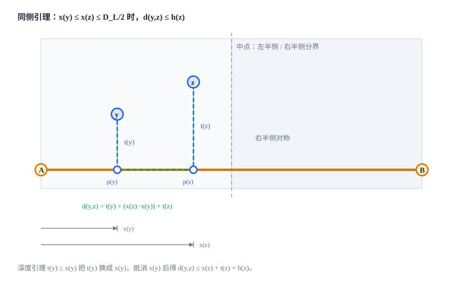

[[TOC]]

## 形式化题目

给定一棵带非负边权的树. 取三个互不相同的节点: 家 $C$、朋友 $A$、朋友 $B$. 父母的路线由规则唯一确定, 先走到离 $C$ 较近的那个朋友家, 再沿唯一道路走向另一个. 所以花的时间是

$$f(C, A, B) = \min\big(d(C,A),\ d(C,B)\big) + d(A,B)$$

求所有三点选取中 $f$ 的最大值. 这里 $d$ 是树上距离, 边权可以是 $0$.

### 样例

样例 `in1` 是一条链 $1-2-3-4$, 每条边权 $1$. 链上有 $3$ 条边, 直径就是两端点 $1$ 和 $4$ 之间长 $3$ 的路径. 下面算出每个位置作为家时的花费, 表格里的 $h(u)=\min\big(d(u,1), d(u,4)\big)$:

| 家 $C$ | $d(C,1)$ | $d(C,4)$ | $h(C)$ | 时间 $= 3 + h(C)$ |
| --- | --- | --- | --- | --- |
| 1 | 0 | 3 | 0 | 3 |
| 2 | 1 | 2 | 1 | **4** |
| 3 | 2 | 1 | 1 | **4** |
| 4 | 3 | 0 | 0 | 3 |

朋友取直径两端 $A=1, B=4$ 时, 家在 $2$ 或 $3$ 都会花 $4$ 分钟. 以 $C=2$ 为例: 先去近的 $1$ 号点用 $1$ 分钟, 再走 $3$ 分钟去 $4$ 号点, 共 $4$ 分钟, 与样例输出一致. 表中也出现了后面要证的形状: 时间恒等于"直径长"加"到两端较近的距离".

## 暴力解法

### 思路

最直接的做法是把定义照抄一遍: 枚举所有三点组合 $(C, A, B)$, 分别求出三段距离, 代入 $f$ 后取最大值.

### 代码

@include-code(./brute.cpp, cpp)

`brute.cpp` 对每组三点各做一次遍历求距离, 完全按定义结算, 不依赖任何还没证明的公式. 它的价值在于给出可信的小数据基准.

### 复杂度

枚举 $O(N^3)$ 组三点, 每组遍历 $O(N)$, 总 $O(N^4)$. $N=2\times 10^5$ 时完全不可行.

### 瓶颈

三点组合太多. 如果能把某两个点固定成与 $C$ 无关的特定节点, 枚举量就能从 $O(N^3)$ 掉到 $O(N)$. 自然的候选是直径的两个端点, 但这必须证明, 而这一步正是本题最容易写错的地方.

## 正解

### 思路

先把定义化简, 再证明"朋友取直径端点"在全局最优处够用.

#### 第一步: 三臂分解

任取三点 $C, X, Y$. 树上存在唯一的汇合点 $m$: 它是三条路径 $C\!-\!X$、$C\!-\!Y$、$X\!-\!Y$ 的公共点, 也即使 $d(C,u)+d(X,u)+d(Y,u)$ 最小的那个节点. 记三条臂长

$$a = d(m,C), \qquad b = d(m,X), \qquad c = d(m,Y)$$

树的路径唯一, 三点的两两距离全部由臂长相加得到:

$$d(C,X) = a+b, \qquad d(C,Y) = a+c, \qquad d(X,Y) = b+c$$

于是目标式变成

$$f = \min(a+b,\ a+c) + (b+c) = a + \min(b,c) + (b+c)$$

把三条臂长排序为 $p \leqslant q \leqslant r$. 此时三个两两距离正好是 $p+q$、$p+r$、$q+r$, 其中最小值 $P_1 = p+q$, 最大值 $P_3 = q+r$.

#### 第二步: $f$ 被最小与最大的两两距离封顶

按"哪条臂最短"分两种情形:

- **$a = p$ (家这一臂最短)**. 此时 $\min(b,c) = q$、$\max(b,c) = r$, 直接得到

  $$f = p + 2q + r = (p+q) + (q+r) = P_1 + P_3$$

- **$a \neq p$ (某个朋友那一臂最短)**. 此时 $\min(b,c) = p$, 而 $a$ 与 $\max(b,c)$ 正好是另外两条臂, 也就是 $q$ 和 $r$. 所以

  $$f = a + 2p + \max(b,c) = 2p + q + r \leqslant (p+q) + (q+r) = P_1 + P_3$$

  最后一步用的只是 $p \leqslant q$.

两种情形都给出 $f \leqslant P_3 + P_1$. 这一步把"三段距离的最值"换成了"三个两两距离的最小与最大", 好处是这两个量都有直接的几何含义.

#### 第三步: 投影坐标与深度引理

取定一条直径 $A \to B$, 记长度 $D_L$. 对每个节点 $z$, 令 $p(z)$ 为 $z$ 到直径路径上距离最近的节点, 称为 $z$ 的**投影点**. 路径唯一保证到路径最近的那一段是唯一的, 所以 $p(z)$ 唯一; 若 $z$ 本身就在直径上, 则 $p(z) = z$. 记坐标与深度

$$x(z) = d\big(A, p(z)\big), \qquad t(z) = d\big(z, p(z)\big)$$

唯一路径把到两端的距离拆开, 得到

$$d(z,A) = t(z) + x(z), \qquad d(z,B) = t(z) + \big(D_L - x(z)\big)$$

所以在两个朋友之间, 家到较近那端朋友的距离是

$$h(z) = \min\big(d(z,A),\ d(z,B)\big) = t(z) + \min\big(x(z),\ D_L - x(z)\big)$$

**深度引理**: $t(z) \leqslant \min\big(x(z),\ D_L - x(z)\big)$. 也就是说, 离开直径的深度不会超过投影点到较近端点的距离.

- 先证 $t(z) \leqslant x(z)$. 假设 $t(z) > x(z)$.
- $z$ 到 $B$ 的唯一路径必须经过投影点 $p(z)$, 所以 $d(z,B) = t(z) + \big(D_L - x(z)\big)$.
- 代入假设即得 $d(z,B) > x(z) + D_L - x(z) = D_L$, 但 $D_L$ 是全树最大距离, 矛盾.
- 交换 $A$ 与 $B$ 的角色, 同理得到 $t(z) \leqslant D_L - x(z)$.

#### 第四步: 同侧引理

按中点把直径分成左右两半. 称 $y$ 与 $z$ **同侧**, 若 $2x(y) \leqslant D_L$ 与 $2x(z) \leqslant D_L$ 同时成立, 或同时不成立.

下面这张图画的是同侧引理用到的全部结构: 直径 $A \to B$ 与中点分界, 左半侧的两个节点 $y, z$, 它们的投影点 $p(y), p(z)$、深度 $t(y), t(z)$ 与坐标 $x(y), x(z)$, 以及从 $y$ 到 $z$ 必须沿直径绕行的那一段.



**同侧引理**: 同侧的 $y, z$ 满足 $d(y,z) \leqslant \max\big(h(y),\ h(z)\big)$.

取左侧情形 $x(y) \leqslant x(z) \leqslant D_L/2$, 图中绿色虚线折线标出 $y$ 到 $z$ 的路径及其长度 $t(y) + \big(x(z) - x(y)\big) + t(z)$:

- 两个投影点都在左半侧, 且 $x(y) \leqslant x(z)$, 所以 $y$ 到 $z$ 必须先下到 $p(y)$、沿直径走到 $p(z)$、再上到 $z$, 即 $d(y,z) = t(y) + \big(x(z) - x(y)\big) + t(z)$.
- 深度引理给 $t(y) \leqslant x(y)$, 代入得 $d(y,z) \leqslant x(y) + x(z) - x(y) + t(z) = x(z) + t(z)$.
- 因为 $x(z) \leqslant D_L/2$, 有 $x(z) = \min\big(x(z),\ D_L - x(z)\big)$, 所以 $x(z) + t(z) = h(z)$.
- 于是 $d(y,z) \leqslant h(z) \leqslant \max\big(h(y),\ h(z)\big)$. 右半侧把 $x$ 换成 $D_L - x$, 推理完全相同.
- 边界 $x(z) = D_L/2$ 时 $x(z) = \min\big(x(z), D_L - x(z)\big)$ 仍然成立, 上述代入不变, 结论不受影响.

#### 第五步: 鸽巢上界

三个节点按左右两半分类, 必有两个同侧 (正好落在中点的节点归任一侧即可). 这一对的距离是三个两两距离中的一个, 所以它不小于最小值 $P_1$; 由同侧引理它又不超过 $\max_u h(u)$. 于是

$$P_1 \leqslant \max_u h(u)$$

#### 第六步: 合并上下界

$$f \leqslant P_3 + P_1 \leqslant D_L + \max_u h(u)$$

其中 $P_3$ 是三点间最大距离, 不会超过全树最大距离 $D_L$.

反过来取 $u_0 = \arg\max_u h(u)$, 家放在 $u_0$, 朋友取直径两端 $A, B$, 则

$$f(u_0, A, B) = \min\big(d(u_0,A),\ d(u_0,B)\big) + D_L = h(u_0) + D_L$$

上界可以取到, 所以

$$\text{ans} = D_L + \max_u h(u)$$

#### 为什么不能写成"逐点替换"

一个常见但错误的写法是: "对任意 $C$, 把朋友换成直径端点不会让答案变小", 即

$$f(C,X,Y) \leqslant f(C,A,B) \quad \text{对每个 } C \text{ 都成立}$$

这个命题是假的. 反例 (朋友取 $X=3, Y=5$, 家取 $C=4$):

```text
边: 1-2(28)  1-3(45)  2-4(18)  2-5(38)  1-6(21)  1-7(2)  1-8(42)  1-9(25)  4-10(28)  1-11(34)
直径端点 A=10, B=3, 直径 D=119
f(C=4, X=3, Y=5)  = min(d(4,3), d(4,5)) + d(3,5)  = min(91, 56) + 111 = 167
f(C=4, A=10, B=3) = min(d(4,10), d(4,3)) + 119    = min(28, 91) + 119 = 147
```

$167 > 147$, 说明固定 $C$ 时直径端点未必最优. 本题需要的只是**全局最大值**相等, 上面的证明正是按这个强度写的.

#### 算法

1. 从任意点遍历求最远点 $A$.
2. 从 $A$ 遍历求最远点 $B$. 这一次的距离写进 `distA[]`, 所以遍历结束后 `distA[]` 是从 $A$ 到各点的距离 (第一次遍历留下的距离已被覆盖).
3. 从 $B$ 遍历得到 `distB[]`.
4. 扫描所有 $u$, 输出 `distA[B] + max(min(distA[u], distB[u]))`.

### 代码

@include-code(./main.cpp, cpp)

同一算法的 Python 版, 便于对照阅读:

@include-code(./main.py, python)

Python 版在本机 $N=2\times 10^5$ 的随机树上约 $1.4$ s, 会超出本题时限; 正式主解是 `main.cpp`.

### 复杂度

- 时间: 三次遍历各 $O(N)$, 最后一次扫描 $O(N)$, 共 $O(N)$.
- 空间: 邻接表与两个距离数组, $O(N)$.

## 总结

本题的骨架是两步化简.

第一步把定义化成 $f \leqslant P_3 + P_1$, 让答案只依赖三个两两距离中的最小与最大. 第二步用直径投影把这两个量各自封顶: 最大的两两距离不超过直径长, 最小的两两距离受"同侧引理 + 鸽巢"限制.

证明时要注意强度的区别. "朋友取直径端点"只对全局最大值成立, 对每个固定的家并不成立, 写成逐点替换会得到假命题.

实现上有两处容易出错: 边权可以为 $0$, 距离数组要用 $-1$ 而不是 $0$ 当未访问标记; 答案量级约 $2\times 10^{14}$, 必须用 64 位整数.

## 图示解析

这张图把整道题的路线串起来:

```text
暴力 (brute.cpp)
  枚举三点 (C,A,B), 每组遍历求距离
  f = min(d(C,A), d(C,B)) + d(A,B)            O(N^4)
        |
        | 瓶颈: 三点组合太多
        v
三臂分解 (第一步)
  汇合点 m, 臂长 a,b,c, 排序 p<=q<=r
  f <= P1 + P3 = 最小两两距离 + 最大两两距离
        |
        | 两个两两距离分别封顶
        v
投影 + 同侧引理 (第三、四步)
  最大的两两距离 P3 <= D_L                (直径是全树最长)
  最小的两两距离 P1 <= max h              (鸽巢 + 同侧引理)
        |
        v
ans = D_L + max_u min(d(u,A), d(u,B))
三次遍历求直径与两个距离数组, O(N) 扫描
```

图中三条主线对应"暴力慢在哪""为什么可以只看两两距离""两个两两距离如何各自封顶". 核心是把三点枚举压成一次直径求解加一次扫描.
