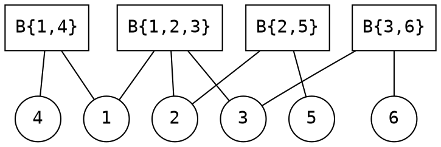

[[TOC]]

## 形式化题目

给定一张 $n$ 个点 $m$ 条边的**无向连通图** $G=(V,E)$（同一对点之间可能有重边），以及一个点集 $S\subseteq V$，$|S|\geqslant 2$。

统计满足下列条件的点 $u$ 的个数：

- $u\notin S$；
- 在 $G$ 中删除 $u$ 及所有与 $u$ 关联的边后，存在 $a,b\in S$，使 $a$ 与 $b$ 不连通。

共 $q$ 次询问，每次给出不同的 $S$，独立作答。

## 暴力解法

### 思路

题面本身就是做法：对每个不在 $S$ 中的点 $u$，真的把它删掉，然后从 $S$ 中的某个点出发做一次 BFS，
看 $S$ 里是否还有走不到的点。若有点走不到，说明删 $u$ 能让 $S$ 分裂，$u$ 计入答案。

这只适合小数据：单次询问要枚举 $O(n)$ 个 $u$，每次 BFS 是 $O(n+m)$，所以每个询问 $O(n(n+m))$。

### 代码

@include-code(./brute.cpp, cpp)

### 复杂度

单次询问 $O(n(n+m))$，整组数据 $O(q\cdot n\cdot(n+m))$；空间 $O(n+m)$。只适用于 $n$ 很小的数据，用来理解题意并作为对拍基线。

### 瓶颈

暴力慢的原因是**重复劳动**：对每个候选 $u$ 都重新扫一遍全图的边。

但从答案的定义可以看出，真正可能成为答案的点并不多：

- 如果删除 $u$ 后图不连通，说明 $u$ 是**割点**；不是割点的点删掉后 $G$ 依然连通，$S$ 更不可能分裂。
- 割点 $u\notin S$ 是否计入，只取决于 $G-\{u\}$ 的各连通块里装了哪些 $S$ 的点。

也就是说，问题实际上是「对每个询问，数一数有多少个割点把 $S$ 切开」。**瓶颈从「枚举点 + 判连通」变成了「一个点是否落在 $S$ 的某两个点之间」** —— 这正是下一步要换掉的东西。

## 正解

### 思路

#### 第一步：把「切开 S」变成「被某条路径经过」

图上的「删一个点」难以批量处理，而**树上两点之间的路径**是很规整的结构：一个点被若干条路径覆盖，就说明它在这些点对的必经位置上。

所以关键是把原图换成一棵**能表达「必经点」的树**，这就是圆方树。

#### 第二步：建圆方树

用 Tarjan 求出原图的所有**点双连通分量**（BCC）：

- 原图每个点保留为一个**圆点**，编号 $1\sim n$；
- 每个 BCC 新建一个**方点**，编号 $n+1,\dots$；
- 方点与它所在 BCC 内的所有圆点连边。

因为原图连通，这样构造出的图一定是一棵树，称为**圆方树**。

建树时有两个必须注意的实现细节，否则会在特殊数据上出错：

1. **重边不能被跳掉**。判断「是否跳过进入当前点的那条边」只能用**边编号**（成对存边，`e == (in_edge ^ 1)`），
   不能用「$v$ 是父亲」来判断。否则两点之间的两条平行边本应构成一个点双（1 个方点、2 个圆点），会被错并成一条树边。
2. **递归深度可达 $O(n)$**。链图上圆方树深度约 $2n$，递归写法实测需要约 16 MiB 栈空间（判题器默认给 64 MiB，安全）。

下面用题目第二个测试数据说明这棵树的形状。原图有边 $1\!-\!2,1\!-\!3,2\!-\!3,1\!-\!4,2\!-\!5,3\!-\!6$，
点双为 $\{1,2,3\}$、$\{1,4\}$、$\{2,5\}$、$\{3,6\}$，对应 4 个方点：

圆点用圆形、方点用方框。原图中那对割点和非割点的区别在这里一目了然：割点（$1,2,3$）挂在多个方点上，
非割点（$4,5,6$）只挂一个方点、成为叶子。

#### 第三步：路径上的圆点 = 必经点

在圆方树上有如下对应关系：

> 原图中两圆点 $x,y$ 之间的**所有简单路径都必须经过的点**，恰好是圆方树 $x\rightsquigarrow y$ 路径上的**圆点**。

为什么？圆方树路径上的每个圆点都是割点（或者端点），删掉它就把 $x,y$ 分到两侧，绕不过去；
而方点代表一个点双，块内任意两点之间总能找到绕开块内其它顶点的走法，所以方点和「块内非路径点」都不是必经点。

于是原来的条件被改写成一句树上的话：

> $u$ 能把 $S$ 中的某两个点分开 $\iff$ $u$ 落在「$S$ 中某两个点的树路径」上。

把所有这样的路径并起来，就是**包含 $S$ 的极小连通子树** $T$（$S$ 的虚树 / Steiner 树）。答案就是 $T$ 中「不该算作 $S$ 自己」的圆点个数：

$$\text{answer}=|T\cap\text{圆点}|-|S|.$$

减 $|S|$ 的合法性来自一个细节：$|S|\geqslant 2$，所以 $T$ 的叶子一定都在 $S$ 里；
而**非割点圆点在圆方树上度数恰为 $1$**，它若出现在 $T$ 中就只能当叶子，于是必属于 $S$。
换句话说，$T$ 中不属于 $S$ 的圆点**全部是割点**，正是要数的那些点。

#### 第四步：用「圆点前缀 + 环巡游」数子树里的圆点

给点赋权：**圆点权 $1$，方点权 $0$**。问题变成求极小连通子树的点权和。

把「点权」下推到「边」上：边 $(p,c)$（$c$ 为儿子）的权取成 $w(c)$。这样路径距离

$$\operatorname{dist}(u,v)=E(u)+E(v)-2E(\operatorname{lca}(u,v))$$

就只累加「路径上除最浅点以外」的圆点数，其中

$$E(x)=\text{根}\rightsquigarrow x \text{ 路径上的圆点个数}$$

是可以在圆方树 DFS 时一趟预处理出来的**前缀和**。

接着把 $S$ 按圆方树的 DFS 序（`tin`）排好，首尾相接环游一圈。经典结论：

$$2\sum_{e\in T}w(\text{边})=\sum_{i=1}^{k}\operatorname{dist}(s_i,s_{i+1}),\qquad s_{k+1}=s_1 .$$

（$T$ 中每条边在环游中被跨过恰好两次：进入子树一次、离开一次。）

而已知 $\sum_{e\in T}w(\text{边})=|T\cap\text{圆点}|-w(\text{root}_T)$，其中 $\text{root}_T$ 是 $T$ 中最浅的点。
$T$ 的最浅点就是 $S$ 全体点的 LCA，而**按 DFS 序排序后，首尾两点的 LCA 恰好等于整个集合的 LCA**。于是

$$\text{answer}=\frac{1}{2}\sum_{i=1}^{k}\operatorname{dist}(s_i,s_{i+1})+w\big(\operatorname{lca}(s_1,s_k)\big)-|S| .$$

整条式子只用到了 $O(1)$ 次 LCA（倍增实现），所以每个询问 $O(|S|\log|S|+|S|\log n)$。

用上面的样例验一遍：$S=\{1,2,6\}$，候选可摧毁点为 $u\in\{3,4,5\}$。虚树 $T$ 含圆点 $1,2,6,3$
与方点 $B\{1,2,3\},B\{3,6\}$，圆点数 $4$，减去 $|S|=3$ 得 $1$。
核对：删 $3$ 后点 $6$ 与 $1,2$ 断开，计入；删 $4$ 或 $5$ 只孤立自己这个叶子，$S$ 仍连通，不计入。所以答案为 $1$。

### 代码

@include-code(./main.cpp, cpp)

### 复杂度

- 建圆方树：$O(n+m)$；
- 圆方树 DFS（`tin`、`depth`、圆点前缀、倍增父亲）：$O(n+m)$；
- 倍增 LCA 表：$O((n+m)\log(n+m))$；
- 每个询问：$O(|S|\log|S|+|S|\log n)$。

整组数据 $O\big((n+m)\log(n+m)+\sum|S|\log n\big)$，空间 $O((n+m)\log(n+m))$。

## 总结

本题的核心是**换模型**：原问题是「删点后 $S$ 是否分裂」，逐点判定只能做到 $O(n(n+m))$；
一旦把「删点」换成「必经点」，再把必经点换成「圆方树上的路径覆盖」，问题就变成了一道树上路径并的计数题，
用「圆点权 $1$ / 方点权 $0$」+ LCA 前缀和 + 按 DFS 序环巡游，每次询问 $O(|S|\log n)$ 即可。

三个容易踩坑的实现点：

1. 重边必须靠**边编号**而不是父节点判断，否则点双会被算错；
2. 圆方树深度可达 $2n$，递归 DFS 的栈需求要先按最深链实测（本题判题器 64 MiB 栈下安全）；
3. 答案是「圆点个数 $-|S|$」，别忘减 $|S|$，也别把 $S$ 自己的点算进去。
