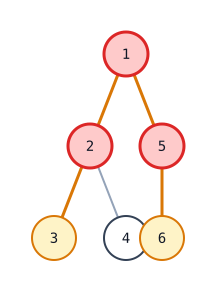
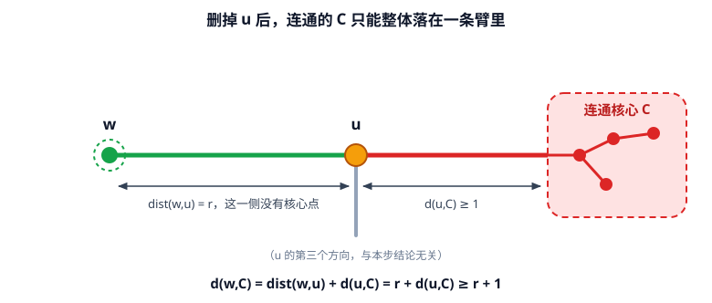
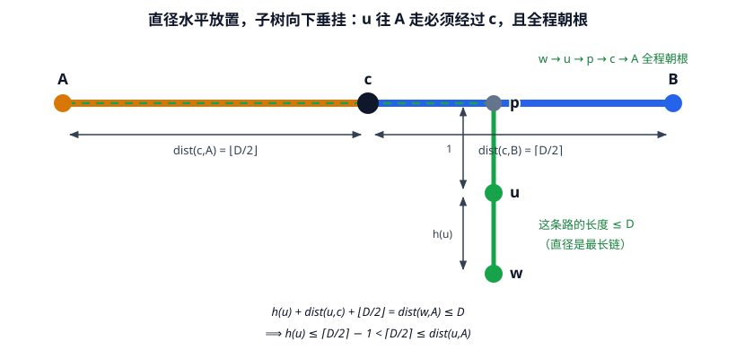

[[TOC]]

## 形式化题目

给定一棵 $n$ 个点的无根树（边权全为 $1$），以及整数 $k < n$。

选一个**恰好 $k$ 个点**、且在树上**连通**的点集 $C$ 作为核心。非核心点 $u$ 到核心的距离是

$$
d(u, C) = \min_{c \in C} \operatorname{dist}(u, c)
$$

拥堵度定义为 $r(C) = \max_{u \notin C} d(u, C)$。求

$$
\min_{\substack{|C| = k \\ C \text{ 连通}}} r(C)
$$

### 样例图

用样例 `in1` 的树看「核心」长什么样。红色是 $k = 3$ 时的最优核心 $\{1, 2, 5\}$，琥珀色是直径上的另外两个点 $3, 6$：

先看形状：这棵树的直径是 `3-2-1-5-6`（长度 $4$），中点是 $1$。核心 $\{1,2,5\}$ 恰好是「从中点 $1$ 往外扩」的一团，剩下三个点 $3,4,6$ 都是它们的孩子，距离核心正好 $1$。这个「核心从中点向外长」的形态就是全文两条解法的共同出发点。

## 解法总览

难点在两个约束互相拉扯：核心既要**恰好 $k$ 个**，又要**连通**，还要让最远的非核心点尽量近。单独看每个约束都很简单，缠在一起才难。

两条主流路线从不同角度切开这团纠缠，都能独立得到答案：

| 解法 | 核心观察 | 复杂度 | 适用场景 | 对应代码 |
| --- | --- | --- | --- | --- |
| 一、直径中点 | 最优核心必含直径中点 $c$；以 $c$ 为根后取「向下高度 $h$」最大的 $k$ 个点，答案是 $h_{k+1}+1$ | $O(n \log n)$ | 解释了「核心为什么长这样」，也复用树的直径模板，正式主解 | `main.cpp` |
| 二、剥叶分层 | 每轮剥掉当前全部叶子，层号 $L(u)$ 就是该点被剥的轮次；答案就是第 $k+1$ 大层号 | $O(n \log n)$ | 不需要求直径，代码更短，且没有「中点例外」 | `main2.cpp` / `main.py` |
| 三、枚举连通核心 | 完全按定义枚举点集、判连通、从每个非核心点单源 BFS 找最近核心 | $O(2^n \cdot n)$ | 只用于小数据对拍 | `brute.cpp` |

两条正解不是「一层优化另一层」的关系，而是**同一目标的两种独立算法**：它们算的是同一个量（每个点的第二长臂长，下面会讲），但一个借「直径中点 + 子树高度」，一个借「剥叶轮次」，谁也不知道对方存在。所以这里并列展示，解法一作为正式主解。

## 关键观察：一切归到「第二长臂长」

先把题目的难度拆掉。对点 $u$，删掉 $u$ 之后树分成若干块，每个块是一个**方向**。定义 $u$ 在一个方向上的**臂长**为「从 $u$ 出发、第一步走这个方向、最远能走多远」。把所有臂长从大到小排成

$$
a_1 \geqslant a_2 \geqslant \cdots
$$

记 $A(u) = a_2(u)$，即**第二长臂长**（叶子只有一条臂，约定 $A(u) = 0$）。

$A(u)$ 正是「$u$ 离树的中心有多远」的度量：$A(u)$ 越大，$u$ 越被两条长链夹在中间，越不能放弃。

### 为什么是第二长臂：下界这一半

核心约束只有一句真正管用的话：

> 若核心 $C$ 连通且不含 $u$，则 $C$ 整体落在「删掉 $u$」后的**同一个**连通块里。

下面这张图把这句话画出来：删掉橙色的 $u$ 之后，树的各个方向被切断，红色的连通核心 $C$ 只能待在其中一个方向里。

图中 $u$ 向左、向右是两条臂，红色虚线框是核心 $C$，它整块落在右侧，所以左侧整条臂上都没有核心点。取离 $u$ 恰好 $r$ 步的点 $w$：$w$ 去核心的任何路径都要先走回 $u$，于是距离至少是 $r + d(u,C) \geqslant r+1$。这正是「第二长臂」为什么不放过 $u$：两条长臂里总有一条会空出来。

于是 $C$ 至多占据 $u$ 的一条臂方向，其余方向都不含核心点。现在假设 $A(u) \geqslant r$ 而 $u$ 不在核心内：$u$ 有两条长 $\geqslant r$ 的臂，至少有一个方向不含 $C$，沿它走 $r$ 步到点 $w$。$w$ 去核心的路必经 $u$，所以

$$
d(w, C) = \operatorname{dist}(w, u) + d(u, C) = r + d(u, C) \geqslant r + 1
$$

也就是说：**只要有 $A(u) \geqslant r$ 的点被排除在核心外，拥堵度就至少是 $r+1$**。等价地

$$
\{u : A(u) \geqslant r\} \subseteq C \quad\text{只要 } r(C) = r
$$

把 $A$ 降序排成 $A_1 \geqslant A_2 \geqslant \cdots \geqslant A_n$。集合 $\{u : A(u) \geqslant A_{k+1}\}$ 至少有 $k+1$ 个点，比核心大小 $k$ 多，所以总有某个这样的点被迫留在外面，套用上式得

$$
r(C) \geqslant A_{k+1} + 1 \qquad \text{对任意连通 } k \text{ 点核心}
$$

**答案的下界就这么出来了。** 于是整道题变成一个问题：如何算出每个点的 $A$，或者只算出第 $k+1$ 大的 $A$。下面两条解法就是这一步的两种算法，它们都同时给出了上界（构造），因此答案精确等于 $A_{k+1}+1$。

## 解法一：直径中点与向下高度

### 思路

「最远距离」这个量纲提示先看树上最长的那条路径。设直径端点为 $a, b$，长度 $D$，$c$ 为直径中点（$D$ 为偶数时唯一，奇数时有两个，取哪个答案相同）。

以 $c$ 为根把树定向，定义

$$
h(u) = \text{从 } u \text{ 向下（不回头走父亲）能走到的最远步数}
$$

叶子 $h = 0$，父亲处 $h(u) = \max_{v \text{ 是 } u \text{ 的儿子}} (h(v) + 1)$，后序 DFS 一遍就能算完。

**为什么中点这么关键**：以中点为根时，「向上走」永远不会比「向下走」近。

> **引理 1**：对每个 $u \neq c$，从 $u$ 沿父亲向上能走的最远距离 $\geqslant h(u)$。

直观理由：删掉 $c$ 后 $a, b$ 分居不同的块，$u$ 只能在一块里，所以至少有一个直径端点 $y$ 在别的块中，$u \to y$ 必须经过 $c$，这是纯向上的路。

图里把这条思路摊开了：橙色是 $A$ 到 $c$ 的半条直径，蓝色是 $c$ 到 $B$（图中直径水平放置、子树向下垂挂，所以「向上」在图上就是沿竖直方向朝直径靠拢）。$p$ 在 $c$ 右侧的直径上，$u$ 是 $p$ 的儿子，$w$ 是 $u$ 子树的最深点。绿色虚线是 $w \to u \to p \to c \to A$，它全程朝根，且因为 $c$ 把 $A, B$ 分在两边，$u$ 想到达 $A$ 就只能这么走。这段路的长度不能超过直径 $D$，于是 $h(u) \leqslant \lceil D/2 \rceil - 1$，而向上走到 $A$ 的路至少有 $\operatorname{dist}(u,A) = 1 + \lfloor D/2 \rfloor = \lceil D/2 \rceil$ 步。

把这段不等式写清：$u$ 子树最深点是 $w$，$w \to y$ 也是树上一条路径，长度不超过直径 $D$：

$$
h(u) + \operatorname{dist}(u,c) + \operatorname{dist}(c,y) = \operatorname{dist}(w,y) \leqslant D
$$

其中 $\operatorname{dist}(u,c) \geqslant 1$、$\operatorname{dist}(c,y) \geqslant \lfloor D/2 \rfloor$，直接推出 $h(u) \leqslant \lceil D/2 \rceil - 1$，而向上的路至少有 $\operatorname{dist}(u,y) \geqslant \lceil D/2 \rceil$。

当 $D = 1$（即 $n = 2$）时中点会落在某个端点上，上面的「$c$ 在直径内部」前提不成立，但结论平凡成立：两个点的 $h$ 分别是 $1$ 和 $0$，从后者向上走到前者正好 $1$ 步，不小于它自己的 $h = 0$。

$u$ 向下可能有多个子树分支，但其中最长的臂长恰为 $h(u)$（取最深的那个儿子），其余向下臂长都 $\leqslant h(u)$；而向上的臂不短于 $h(u)$。于是 $u$ 的一切臂里最长的两条就是「向上的臂」和「最长的那条向下臂」，第二长臂因此取得准确值：

$$
u \neq c \;\Longrightarrow\; A(u) = h(u)
$$

也就是说：**$h$ 就是 $A$**（在根 $c$ 以外处处相同）。于是按 $h$ 降序取第 $k+1$ 大，答案就是 $h_{k+1}+1$。

### 为什么取 $h$ 最大的 $k$ 个点

这里要同时确认三件事，才算把上界做出来。

**（1）连通自动满足。** 沿祖先链朝根的方向，$h$ 严格递增：$h(\text{父}(u)) \geqslant h(u)+1 > h(u)$。所以只要 $u$ 进了前 $k$ 名，它的父亲一定排在它前面，也进了前 $k$ 名。任何核心点沿父亲一路往上都能走到 $c$，核心必然连成一块。这个「父亲必在儿子之前」的单调性，是「取前 $k$ 个」能合法的唯一原因，值得单独记住。

**（2）$c$ 一定在里面。** $h(c)$ 严格大于所有其他 $h(u)$（因为 $\operatorname{dist}(u,c) + h(u) \leqslant h(c)$ 给出 $h(u) \leqslant h(c) - 1$），而 $k \geqslant 1$，所以 $h$ 第一名必然是 $c$。

**（3）拥堵度不超过 $h_{k+1}+1$。** 任取 $u \notin C$，沿 $c \to u$ 这条根链，$h$ 逐点严格递减，所以链上属于 $C$ 的点恰是从 $c$ 开始的一段前缀。设前缀之后第一个不在 $C$ 的点是 $t$，它的父亲 $p$ 在 $C$ 里。那么

$$
d(u, C) \leqslant \operatorname{dist}(u, p) = \operatorname{dist}(u, t) + 1 \leqslant h(t) + 1
$$

（$\operatorname{dist}(u,t) \leqslant h(t)$，因为 $u$ 在 $t$ 的子树里。）又 $t \notin C$ 说明 $h(t) \leqslant h_{k+1}$，否则 $h(t) > h_{k+1}$ 的点不超过 $k$ 个，$t$ 早就进前 $k$ 名了。故

$$
r(C) \leqslant h_{k+1} + 1
$$

下界前面已经证过（$A_{k+1} = h_{k+1}$，见下面「两条解法为什么相等」），上下界夹住：**答案 $=h_{k+1}+1$**。

### 样例推演

样例树以中点 $1$ 为根：$1$ 的孩子是 $2, 5$；$2$ 的孩子是 $3, 4$；$5$ 的孩子是 $6$。向下高度如下：

| 点 $u$ | 1（中点，根） | 2 | 3 | 4 | 5 | 6 |
| --- | --- | --- | --- | --- | --- | --- |
| $h(u)$ | 2 | 1 | 0 | 0 | 1 | 0 |

$h$ 降序是 $2, 1, 1, 0, 0, 0$。$k = 3$，取前 $3$ 个点当核心：$1$（$h=2$）、$2$ 和 $5$（$h=1$），正是 $\{1,2,5\}$。第 $k+1$ 个是 $h = 0$，答案 $0+1 = 1$。剩下的 $3, 4, 6$ 都挂在核心点上，距离都是 $1$。

### 代码

@include-code(./main.cpp, cpp)

实现顺序：任取 $1$ 号点找最远点 $a$（必是直径端点）→ 从 $a$ 找最远点 $b$（$a \to b$ 是直径）→ 沿父亲从 $b$ 上走 $\lceil D/2 \rceil$ 步落到中点 $c$ → 以 $c$ 为根后序求 $h$ → 排序取第 $k+1$ 个。

### 复杂度

3 次 DFS 各 $O(n)$，排序 $O(n \log n)$，空间 $O(n)$。递归深度等于树深，$10^5$ 的链在 8 MiB 栈下实测通过。

## 解法二：剥叶分层

### 思路

换一个完全不同的着手点：既然核心必须连通、且要「吃掉」里面那些被两边夹住的点，那就干脆**从外围一层层往里剥**，剥到只剩 $k$ 个点为止。

定义 $L(u)$ 为点 $u$ 被剥掉的轮次（所有叶子是第 $1$ 轮；每轮删掉当前剩余树的全部叶子）。用队列 + 剩余度数可以在 $O(n)$ 内算出全部层号。

那么层号在度量什么？答案是**它和第二长臂长锁死在了一起**：

$$
L(u) = A(u) + 1
$$

这个等式对**所有**点成立，包括叶子和中心，没有例外。理解它的关键是线性的另一半：

> **引理 2**：$L(u) \geqslant t+1$ 当且仅当 $u$ 有两条长 $\geqslant t$ 的臂。

证明就是一个归纳。剥叶规则可以写成层号形式（$G_t$ 表示层号 $\geqslant t$ 的点诱导出的子图，它是一棵树，所以 $u$ 在其中的度数就是剩余边数）：

$$
L(u) \geqslant t+1 \iff u \text{ 在 } G_t \text{ 里度数} \geqslant 2 \iff \#\{v \sim u : L(v) \geqslant t\} \geqslant 2
$$

基例 $t=1$：$L(u) \geqslant 2$ 即 $u$ 不是叶子，即 $\deg u \geqslant 2$，即 $u$ 有两条长 $\geqslant 1$ 的臂。归纳步：若 $u$ 有两条长 $\geqslant t$ 的臂，第一步是两个不同邻居 $v_1, v_2$；在 $v_1$ 看来，自己那一侧有长 $\geqslant t-1$ 的臂，朝 $u$ 的一侧又能顺着 $u$ 接到 $v_2$ 的长 $\geqslant t-1$ 臂，两条都够长，故 $L(v_1) \geqslant t$；$v_2$ 同理。反过来，若 $v_1, v_2$ 的层号都 $\geqslant t$，它们各有两条长 $\geqslant t-1$ 的臂，其中**至多一条**穿过 $u$，所以每个都至少有一条留在自己那一侧，从 $u$ 望去正好是两条长 $\geqslant t$ 的不同方向的臂。

有了 $L = A+1$，解法二就只剩两句话：

**下界**：前面那条「$\{u : A(u) \geqslant r\} \subseteq C$」用层号写就是「$L(u) \geqslant r+1$ 的点必须进核心」，任何 $k$ 点连通核心都做不到，所以 $r \geqslant L_{k+1}$。

**上界**：令 $S_j = \{u : L(u) \geqslant j\}$，即剥掉 $j-1$ 层后剩下的树，它当然连通。取 $v = L_{k+1}$：

- $|S_{v+1}| \leqslant k$：否则第 $k+1$ 大层号会比 $v$ 大；
- $|S_v| \geqslant k+1$：$L_{k+1} = v$ 意味着至少有 $k+1$ 个点层号 $\geqslant v$。

于是把 $S_{v+1}$ 全收进核心（不超过 $k$ 个、已连通），再从连通的 $S_v$ 里逐个补到 $k$ 个，得到一个连通核心 $C$。对 $u \notin C$，有 $L(u) \leqslant v$；顺着「每层朝内爬一步」的上爬链，$u$ 走 $v+1-L(u)$ 步内必进 $S_{v+1}$，故

$$
d(u, C) \leqslant (v+1) - L(u) \leqslant v = L_{k+1}
$$

上下界相等，**答案就是 $L$ 降序的第 $k+1$ 大**。

### 样例推演

样例树的叶子是 $3, 4, 6$，剥三轮：

| 轮次 | 本轮剥掉的点 | 这些点的层号 |
| --- | --- | --- |
| 第 1 轮 | 3, 4, 6 | 1 |
| 第 2 轮 | 2, 5 | 2 |
| 第 3 轮 | 1 | 3 |

$L = [3, 2, 1, 1, 2, 1]$（下标为点编号），降序是 $3, 2, 2, 1, 1, 1$。$k = 3$，取第 $4$ 个，答案 $1$，与解法一一致。核心是层号 $3, 2, 2$ 的 $\{1,2,5\}$，同样吻合。

### 代码

C++ 版：

@include-code(./main2.cpp, cpp)

Python 版（同一算法）：

@include-code(./main.py, python)

`remain_deg[]`（Python 里是 `remain[]`）存每个点还剩几条边。第一轮把所有叶子入队；之后出队一个点 $u$，把它唯一剩下的邻居的剩余边数减一，减到 $1$ 就成为新叶子、层号 $= L(u)+1$。「已剥掉的邻居」和「当前是叶子」用同一个「剩余边数 $\leqslant 1$」判断，因为剥掉的点剩余边数必然 $\leqslant 1$。

### 复杂度

剥叶时每个点入队一次、每条边被两端各扫一次，$O(n)$；排序 $O(n \log n)$。空间 $O(n)$。要注意这里没有递归，是一条纯 BFS，深度 $10^5$ 的链也不会碰栈。

## 两条解法为什么必然给出同一个数

两条路线看着毫不相干，答案却总相同，原因在两边各自的等式：

- 剥叶侧：$L(u) = A(u)+1$，对所有点成立（引理 2）。
- 直径侧：$u \neq c$ 时 $A(u) = h(u)$（引理 1）；对中点 $c$ 本身，它的两条最长臂就是 $\lceil D/2 \rceil$ 和 $\lfloor D/2 \rfloor$，所以 $A(c) = \lfloor D/2 \rfloor$，而 $h(c) = \lceil D/2 \rceil$，只差 $D$ 为奇数时的那 $1$。

把样例树的三个量摆在一起，差异就一目了然：

| 点 $u$ | 1（中点） | 2 | 3 | 4 | 5 | 6 |
| --- | --- | --- | --- | --- | --- | --- |
| $h(u)$ 向下高度 | 2 | 1 | 0 | 0 | 1 | 0 |
| $A(u)$ 第二长臂 | 2 | 1 | 0 | 0 | 1 | 0 |
| $L(u)$ 剥叶层号 | 3 | 2 | 1 | 1 | 2 | 1 |
| $L(u) - A(u)$ | 1 | 1 | 1 | 1 | 1 | 1 |

表中每一列是一个点。前两行在 $u \neq c$ 时相等；叶子那两列的 $0$ 也对得上，因为叶子只有一条臂，约定 $A = 0$。末行恒等于 1，这就是引理 2。中点 $1$ 那一列刚好也相等，因为本例 $D = 4$ 是偶数，$\lfloor D/2 \rfloor = \lceil D/2 \rceil = 2$；若 $D$ 是奇数，$h(c)$ 会比 $A(c)$ 大 $1$，但那一列已经被 $h(c)$ 的唯一最大值砸住了，不影响第 $k+1$ 位。

关键在于 $h(c)$ 是**唯一的最大值**，且 $A(c)$ 又**不小于**所有 $A(u)\,(u \neq c)$：由引理 1，$u \neq c$ 时 $A(u) = h(u) \leqslant \lceil D/2 \rceil - 1 \leqslant \lfloor D/2 \rfloor = A(c)$，所以 $A(c)$ 在 $A$ 的降序里同样稳居首位。于是把两个序列降序排列后，从第 $2$ 位开始逐项完全相同，而 $k \geqslant 1$ 保证 $k+1 \geqslant 2$：

$$
A_{k+1} = h_{k+1}
$$

所以「第 $k+1$ 大层号」「第 $k+1$ 大向下高度 $+1$」必然相等。反过来也可以这样理解：以直径中点为根，子树高度精确复刻了剥叶层号（差 $1$）；中点就是「向上不再比向下远」的那个临界点，一旦站到它上面，「从中心向外剥」和「从根向下量」就成了同一件事。

## 复杂度对比

| 解法 | 时间 | 空间 | 特点 |
| --- | --- | --- | --- |
| 一、直径中点（`main.cpp`） | $O(n \log n)$ | $O(n)$ | 3 次 DFS，递归深度 $=$ 树深；复用直径模板 |
| 二、剥叶分层（`main2.cpp` / `main.py`） | $O(n \log n)$ | $O(n)$ | 1 次 BFS 剥叶，无递归；代码最短 |
| 三、枚举核心（`brute.cpp`） | $O(2^n \cdot n)$ | $O(n)$ | 只对拍，$n \leqslant 18$ |

两者的排序都只为了取第 $k+1$ 大，换成 `nth_element` 可把期望时间压到 $O(n)$。本机实测（$n = 10^5$ 的链、星、毛毛虫、完全二叉树、随机树）：`main.cpp` 19–35 ms，`main.py` 84–155 ms。`main.cpp` 的递归深度等于树深，$10^5$ 深链在 8 MiB 栈下实测通过。

## 总结

这道题的解法只有一步真正的跳跃：**把「恰好 $k$ 个 + 连通」翻译成每个点的第二长臂长 $A(u)$**。

一旦翻译完成，下界是免费的——「$A(u) \geqslant r$ 的点必须进核心」直接推出答案 $\geqslant A_{k+1}+1$；剩下的全部工作就是找一种算法把这个量算出来，并顺手把上界构造出来：

- **算 $A$ 的一种方式是看直径**。取直径中点当根，「向上不短于向下」，于是 $A$ 退化成子树高度 $h$；而 $h$ 沿父亲严格递增，取前 $k$ 大天然连通、天然含根，上界与连通性同时落地。
- **算 $A$ 的另一种方式是剥叶**。$L(u) = A(u)+1$ 对每个点都成立，连中点的例外都没有；剥叶过程本身就是「从外围朝中心收缩」，所以「取层号最大的 $k$ 个」直接对应「核心吃掉内层」，上界也是免费的。

两条路各自完整，互相独立，最后落到同一个数上。这类「选 $k$ 个连通点、最小化最大距离」的题目，通用套路就是把连通约束换算成「离树中心有多远」的逐点度量，然后一次排序收工。

## 参考与致谢

解法一的路线来自 [Cylete 的洛谷题解](https://www.luogu.com.cn/article/znlj6p35)（用户指定）；本文的「第二长臂长」建模、引理证明、两条解法的独立实现与验证均为独立完成。
