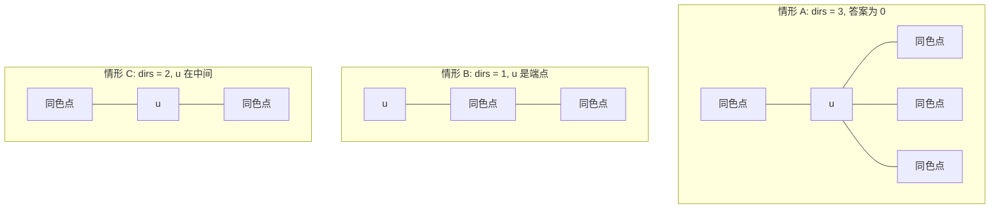
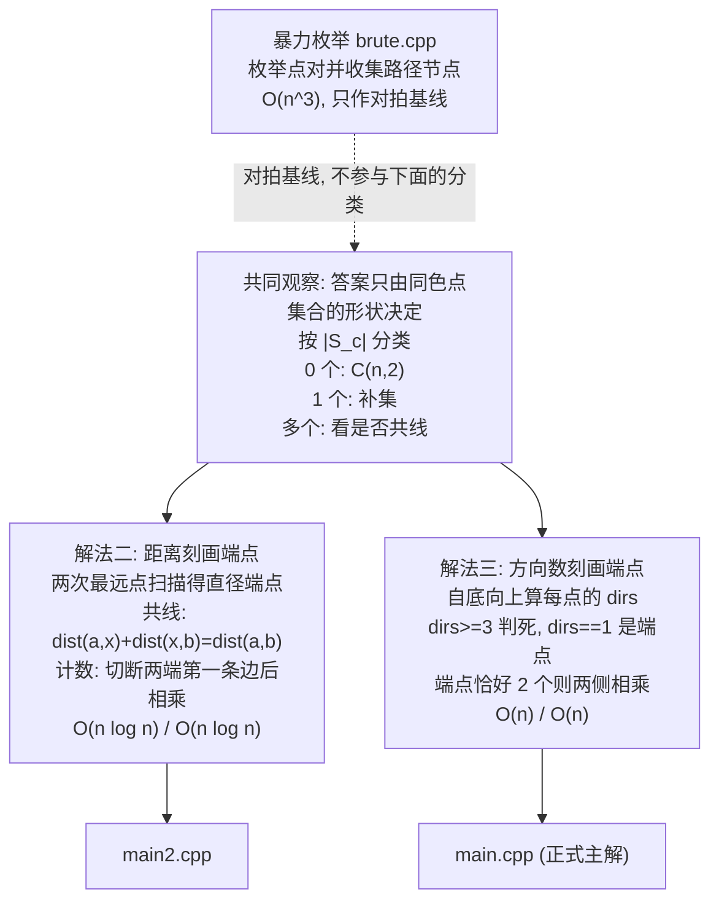

[[TOC]]

## 形式化题目

给定一棵 $n$ 个节点的树, 每个节点有一个颜色 $w_i \in [1,n]$. 对每种颜色 $c$, 统计无序点对 $\{u,v\}$ ($u \neq v$) 的数量, 使 $u$ 到 $v$ 的唯一树上路径经过的节点集合**包含全部颜色为 $c$ 的节点**. 端点 $u$、$v$ 本身也算在路径上, 其他颜色的节点经过与否不限.

记 $S_c$ 为颜色 $c$ 的节点集合, $P(u,v)$ 为路径 $u \to v$ 上的节点集合, 则要求的是满足 $S_c \subseteq P(u,v)$ 的点对数量.

## 解法总览

解法二和解法三按"如何刻画同色点的几何形状"区分; 解法一只是对拍与理解题意的基线, 不参与这层刻画.

| 解法 | 核心观察 | 复杂度 | 适用场景 | 对应代码 |
| --- | --- | --- | --- | --- |
| 一、暴力枚举 | 直接枚举点对并收集路径节点集合 | $O(n^3)$ | 只作对拍基线, 不参与形状分类 | `brute.cpp` |
| 二、倍增 LCA + 直径端点 | 共线 $\iff$ 全部同色点在集合直径路径上, 答案 = 切断两端第一条边后两侧大小之积 | $O(n\log n)$ 时间, $O(n\log n)$ 空间 | 复用已有的 LCA 与子树大小工具, 思路几何直观 | `main2.cpp` |
| 三、数方向 | 在节点 $u$ 处看同色点分布在几个方向: 三个方向判死, 只有一个方向则 $u$ 是端点 | $O(n)$ 时间, $O(n)$ 空间 | 正式主解, 不需要 LCA 与倍增表 | `main.cpp` / `main.py` |

解法三是正式主解. 它把"同色点是否共线"这个几何判断换成一个纯计数条件, 因此既不需要求距离, 也不需要倍增表, 时间和空间都少一个 $\log$ 因子. 解法二的价值在于推导自然: 读者已经会用 LCA 求距离, 从"路径必须包含点集"想到"点集的直径路径"只差一步. 两条路线互不依赖, 所以并列展示, 不构成前后优化关系.

两个正解共用同一层入口: 先按 $|S_c|$ 分成三类, 只有最后一类需要真正的算法.

1. $|S_c| = 0$: 空集含于任何集合, 所有 $\binom{n}{2}$ 个点对都合法.
2. $|S_c| = 1$, 设唯一同色点为 $x$: 路径必须经过 $x$, 等价于两端点落在 $T - x$ 的两个不同连通块里. 用补集算: 总数减去"两端点在同一连通块"的点对数.
3. $|S_c| \geqslant 2$: 一条路径能否同时装下若干点, 取决于这些点是否落在一条链上. 若 $S_c$ 的最小包含子树存在分叉, 任何路径都装不下, 答案为 0.

所以真正的难点只有第三类: 判断 $S_c$ 是否共线, 并在共线时数出合法点对.

## 解法一: 暴力枚举

### 思路

先写下能直接验证题意的朴素解, 后面所有优化都以它为标准答案.

枚举所有点对 $(u,v)$, 收集路径上的全部节点, 再对每种颜色检查它的全部节点是否都在这条路径上. 收集路径的做法是: 先求出 $u$、$v$ 的 LCA, 然后从 $u$、$v$ 分别向上爬到 LCA, 沿途打标记. 注意两端点本身也在路径上.

枚举量是 $O(n^2)$, 每对点收集路径 $O(n)$. 检查颜色那一层看着是"$n$ 种颜色各 $O(n)$", 但各颜色的节点数之和恒为 $n$, 所以每对点实际只花 $O(n)$. 总复杂度 $O(n^3)$. 代码里 `MAXN = 35`, 所以它只用于 $n \leqslant 30$ 的对拍与理解题意.

### 代码

@include-code(./brute.cpp, cpp)

### 复杂度

时间 $O(n^3)$, 空间 $O(n)$. 只用于对拍.

## 解法二: 倍增 LCA + 直径端点

### 思路

要判断 $S_c$ 是否共线, 只需要看这个点集的**直径**. 树上有一个常用性质: 从任意点出发找最远点, 这个最远点一定是点集直径的一个端点. 所以从 $S_c$ 中任取一点出发找最远点 $a$, 再从 $a$ 出发找最远点 $b$, $(a,b)$ 就是 $S_c$ 的直径端点.

有了 $a$、$b$, 判定和计数都用距离表达:

- **共线检查**: $x$ 在路径 $a \to b$ 上, 当且仅当 $\operatorname{dist}(a,x) + \operatorname{dist}(x,b) = \operatorname{dist}(a,b)$. 三角不等式说明左边恒 $\geqslant$ 右边, 取等表示三条路径在 $x$ 处合并. 全部同色点都满足才共线.
- **计数**: 路径要包含整条 $a \to b$, 等价于两端点分别落在"切断 $a$ 朝向 $b$ 的第一条边"后的 $a$ 侧、"切断 $b$ 朝向 $a$ 的第一条边"后的 $b$ 侧. 两侧独立, 答案为两侧大小之积.

下图的树是样例 1 的链 $1\text{-}2\text{-}3\text{-}4$, 取颜色 2, $S_2 = \{2,3\}$. 图中把两个直径端点 $a=2$、$b=3$ 上色, 并标出切断边:

这里有一个容易被忽略的边界情形: $a$、$b$ 在树上相邻, 所以"$a$ 朝向 $b$ 的第一条边"和"$b$ 朝向 $a$ 的第一条边"其实是同一条边 $2\text{-}3$. 切掉它以后, $a$ 侧的连通块是 $\{1,2\}$ 大小 2, $b$ 侧的连通块是 $\{3,4\}$ 大小 2, 两侧仍然互不重叠, 公式照常成立.

合法点对的第一个端点只能来自 $a$ 侧, 第二个只能来自 $b$ 侧, 两侧互相独立, 所以直接相乘. 这与题面样例说明列出的 4 个点对一致.

最后需要"切断 $x$ 朝向 $y$ 的第一条边后 $x$ 侧的大小" $\operatorname{side}(x,y)$, 用 LCA 和子树大小求:

- 若 $\operatorname{lca}(x,y) = x$, 说明 $y$ 在 $x$ 子树内. 把 $y$ 向上跳 $\operatorname{depth}[y] - \operatorname{depth}[x] - 1$ 步得到 $x$ 通往 $y$ 的直接儿子 $t$, 则 $x$ 侧 = $n - \operatorname{subtree}[t]$.
- 否则 $y$ 不在 $x$ 的子树里, $x$ 侧就是 $\operatorname{subtree}[x]$.

树上距离都由倍增 LCA 求出, 每次 $O(\log n)$.

### 代码

@include-code(./main2.cpp, cpp)

### 复杂度

时间 $O(n\log n)$: 建树、子树大小、倍增表加每种颜色的三次链表扫描, 每次距离查询 $O(\log n)$. 空间 $O(n\log n)$: 倍增表约 $n\log n$ 个 `int`, $n = 10^6$ 时约 80MB.

实测 $n = 10^6$(判题环境, 限制 3s / 500MB): 双色链 403ms, 单色链 1012ms, 菊花 1522ms, 随机树 2744ms, 完全二叉树 2693ms, 峰值内存 139--146MB. 都在限内, 但随机树与完全二叉树只剩约 0.3s 余量.

## 解法三: 数方向

### 关键观察

解法二把"共线"表达成了距离等式, 代价是每次判断都要一次 LCA. 换个角度看: 共线与否, 本质上是同色点在各节点处**朝几个方向散开**.

任取一个根. 对颜色 $c$ 和它的一个节点 $u$, 把 $S_c \setminus \{u\}$ 按相对 $u$ 的位置分成两部分:

- **儿子方向**: 某个儿子 $v$ 的子树里含 $c$ 色节点. 这样的儿子可能有多个.
- **父亲方向**: $u$ 的子树之外还有 $c$ 色节点, 即 $|S_c| - \text{inside}_u > 0$, 其中 $\text{inside}_u$ 是 $u$ 子树内(含 $u$)的 $c$ 色节点数.

记 $positive_u$ 为"子树里含 $c$ 色节点"的儿子个数, 定义方向数

$$
dirs(u) = positive_u + [\,|S_c| - \text{inside}_u > 0\,]
$$

下图画出同一个颜色在三个不同位置上的方向数, 对应要区分的三种情形:

图中每条边代表一个"方向": 同色点画在边上, 表示它落在该方向的子树里. 情形 A 中 $u$ 朝三个方向都有同色点, 最小包含子树在 $u$ 处分叉, 不是一条路径(方向再多也只会更糟). 情形 B 中同色点只在 $u$ 的一侧延伸, $u$ 就是最外层的端点. 情形 C 中 $u$ 两侧都有同色点, 它只是路径内部的一个点.

三种情形的含义:

- $dirs(u) \geqslant 3$: 同色点分处三个互不相同的方向, 最小包含子树在 $u$ 处分叉, 一定不是一条路径. 此时颜色 $c$ 的答案为 0.
- $dirs(u) = 1$: 所有同色点都在 $u$ 的一侧. $u$ 只可能朝一个方向延伸, 所以它是同色点集合**最外层**的点, 也就是共线情形下的端点.
- $dirs(u) = 2$: $u$ 两侧都有同色点, 是路径内部点, 不是端点.

当 $|S_c| \geqslant 2$ 时 $dirs(u)$ 恒 $\geqslant 1$: 另一个同色点要么在 $u$ 的某棵子树里, 要么在 $u$ 的子树外. 所以这里不会出现 $dirs(u) = 0$; 那个值只在 $|S_c| = 1$ 时出现, 而那种情况由补集分支单独处理.

这里需要一个能直接对应到"共线"的结论. 记 $T'$ 为 $S_c$ 的最小包含子树. $T'$ 的叶子一定属于 $S_c$: 否则删掉这个叶子后剩下的子树仍包含 $S_c$, 与最小性矛盾. 于是有

$$
dirs(u) = 1 \iff u \text{ 是 } T' \text{ 的叶子}
$$

两个方向各证一次:

- 若 $u$ 是 $T'$ 的叶子, 删掉 $u$ 后剩下的同色点仍在 $T'$ 里且连通, 所以它们全部落在 $u$ 的同一个方向, 得 $dirs(u) = 1$.
- 若 $dirs(u) = 1$, 说明 $S_c \setminus \{u\}$ 全在 $u$ 的同一个方向. 于是 $T'$ 就是把 $u$ 接到 $S_c \setminus \{u\}$ 的最小包含子树上, 接点只有一条边通向 $u$, 所以 $u$ 在 $T'$ 中的度数为 1, 是叶子.

而一棵树是**路径当且仅当它恰好有两个叶子**. 再加上"$S_c$ 落在一条链上 $\Rightarrow$ $T'$ 含于该链 $\Rightarrow$ $T'$ 是路径", 两个方向都通了, 于是

$$
S_c \text{ 共线} \iff leaf\_cnt_c = 2
$$

其中 $leaf\_cnt_c$ 是扫描中数到的 $dirs = 1$ 的点个数. 这一步把"共线"这个几何条件完全换成了计数条件, 不再需要任何距离查询.

代码里另外还维护了一个标记 `too_many[c]`: 一旦发现某个同色点 $dirs \geqslant 3$, 说明 $T'$ 在该点处分叉, 沿三个方向各走到叶子就至少有三个叶子, 不可能恰好两个. 注意它只是额外标记, 并不会中断扫描; 最终判据仍然是 $leaf\_cnt_c = 2$.

端点 $u$ 的外侧连通块大小, 按同色点的位置分两种:

- 同色点全在某个儿子 `only_child` 的子树里($positive_u = 1$): $u$ 这一侧是整棵树去掉那棵子树, 大小 $n - \operatorname{subtree}[\text{only\_child}]$.
- 同色点全在 $u$ 的子树外($positive_u = 0$): $u$ 这一侧就是自己的子树, 大小 $\operatorname{subtree}[u]$.

### 思路

实现只需要一次自底向上的扫描:

1. 从根出发做一次遍历, 进入节点时记下父亲, 等儿子全部处理完再结算该节点, 天然就是自底向上.
2. 对每个 $u$ 算出 $\operatorname{subtree}[u]$、$\text{inside}_u$ 和 $positive_u$. 若 $dirs(u) \geqslant 3$ 就给该颜色打上 `too_many`; 若 $dirs(u) = 1$ 就把 $u$ 记作端点并算出它那一侧的大小.
3. 最后按颜色输出: 无点给 $\binom{n}{2}$, 单点用补集算, 多点时端点恰好两个就相乘, 否则为 0.

判断"某个儿子的子树里是否含父颜色节点"有个省事的写法. 维护 `done_cnt[c]` 表示颜色 $c$ 中已经处理完(子树扫完)的节点数. 父节点在**进入**某个儿子之前记下快照, 该儿子返回后再看 `done_cnt` 是否变化, 就知道这棵子树里有没有同色点. 这样不必额外为每对(颜色, 子树)存计数.

这里有个实现上的坑: 快照必须在进入儿子之前取. 如果取在儿子返回之后, 差值恒为 0, 所有儿子的方向都会漏判.

子树大小也是同一个套路: 每帧用 `sub` 字段累加, 儿子结算后把它加到父亲帧里(`p.sub += sub`), 父节点自己结算时才写进 `subtree[u]`. 所以 `Frame` 里的 `sub` 既是帧字段又是最终的子树大小.

树可能退化成深度 $10^6$ 的链. 递归 DFS 在这种输入上实测需要约 128MB 栈(64MB 会 signal 11), 所以这一版按仓库约定改成显式栈迭代, 把深度从栈上移走.

需要说明的是, `roj-local-judge` 的栈上限**默认等于内存上限**(本题 500MB), 递归版在这个口径下同样能过; 显式栈的收益是不再依赖判题器的栈配置, 也能在内存紧张时少占一份调用栈. 两种写法都对, 这里选迭代是为了让性能结论不挂在一个隐含前提上.

### 代码

C++ 版(正式主解):

@include-code(./main.cpp, cpp)

Python 版(同一算法, 适用范围见下面的复杂度一节):

@include-code(./main.py, python)

### 复杂度

时间 $O(n)$: 建树 $O(n)$, 迭代 DFS 中每个节点进入、离开各处理常数次, 每条边被看两遍, 最后一遍输出 $O(n)$. 没有 $\log$ 因子.

空间 $O(n)$: 迭代栈最多 $n$ 帧, 每帧 6 个 `int` 加 1 个 `long long`(共 32 字节), 约 32MB; 链式前向星 `head` 约 $n$ 个、`to` 与 `nxt` 各约 $2n$ 个 `int`, 合计约 $5n$ 个 `int`, 约 20MB; 按颜色的计数数组与 `color`/`parent`/`subtree` 等约 $8n$ 个 `int`, 约 32MB; 三个 `long long` 数组约 24MB. 合计约 108MB, 与实测峰值 112MB 吻合.

实测 $n = 10^6$(同一判题环境): 双色链 204ms, 单色链 436ms, 菊花 325ms, 随机树 506ms, 完全二叉树 571ms, 峰值内存 64--112MB. 相对解法二最慢的 2744ms(随机树), 时间余量从约 0.3s 变成约 2.4s; 峰值内存也从 139--146MB 降到 64--112MB.

Python 版用 `array` 压内存、一次性读入全部输入, 常数比 C++ 大。按洛谷对 Python 放宽 10 倍时限的口径(3s 题按 30s 计), 它在本机判题环境下跑满 $n = 10^6$ 的五种结构全部通过:

| 结构 | C++ | Python(30s 口径) |
| --- | --- | --- |
| 双色链 | 204ms | 5157ms / 399MB |
| 单色链 | 436ms | 6962ms / 400MB |
| 菊花 | 325ms | 6287ms / 277MB |
| 随机树 | 506ms | 6420ms / 334MB |
| 完全二叉树 | 571ms | 7479ms / 334MB |

最慢一组 7479ms 约为 30s 上限的四分之一, 内存 400MB 也在 500MB 之内, 所以这一版 Python 实现本身可以作为满分提交。如果目标判题站不对 Python 放宽时限, 同一份代码在 3s 下只覆盖 $n \lesssim 2.5\times10^5$, 那时请改用 C++ 版。

## 复杂度对比

| 解法 | 时间 | 空间 | $n=10^6$ 最慢时间(用例) | $n=10^6$ 峰值内存(用例) |
| --- | --- | --- | --- | --- |
| 一、暴力枚举 | $O(n^3)$ | $O(n)$ | 不可用 | 不可用 |
| 二、LCA + 直径 | $O(n\log n)$ | $O(n\log n)$ | 2744ms(随机树) | 146MB(单色链) |
| 三、数方向 | $O(n)$ | $O(n)$ | 571ms(完全二叉树) | 112MB(单色链) |

解法二和解法三都能通过全部数据, 差别在常数和实现负担: 解法二需要倍增表和三种 LCA 操作, 解法三只有一个遍历和几个计数器. 如果已经写过 LCA 模板, 解法二可以很快写出; 如果从头写, 解法三的代码更短, 也少一层需要验证的组件.

## 总结

"路径必须覆盖一组点"这一类问题, 可以固定成两步: 先把这组点压成两个端点(直径端点, 或者数方向得到的两个最外层点), 再把"路径覆盖这组点"翻译成"两端分居两个外侧连通块", 答案就是两个连通块大小的乘积. 中间的分叉情形单独判死.

解法二用距离等式刻画端点, 依赖 LCA; 解法三用方向数刻画端点, 一次自底向上扫描就够. 两者选择的工具不同, 但最后落到同一个乘积式, 这也是本题的核心结论.

## 图示解析

下面的路线图对比两条正解路线从同一个瓶颈出发的不同走向.

两条路线共用最上面的分类, 都终止于"两端外侧连通块大小相乘". 左侧靠距离查询把几何条件写死, 代价是每步一次 LCA; 右侧靠方向计数绕开了距离, 因此少掉 $\log$ 因子. 图中分类层是两种解法都不需要重复推导的部分, 从分类往下才是各自的选择.
