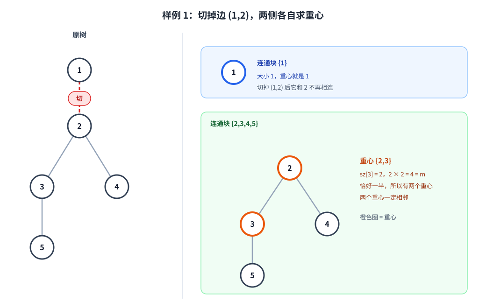
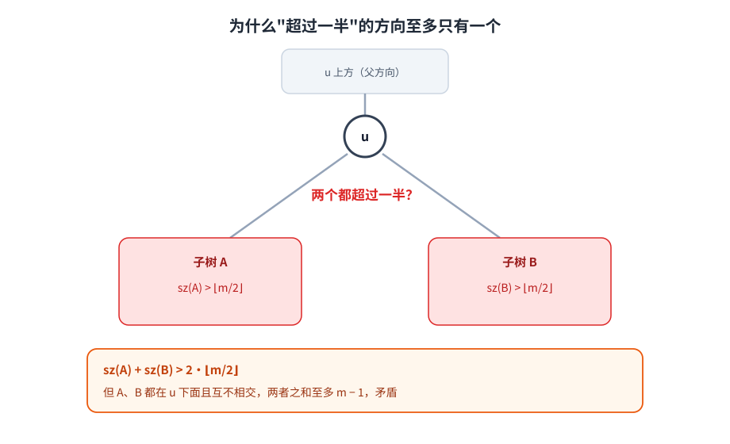
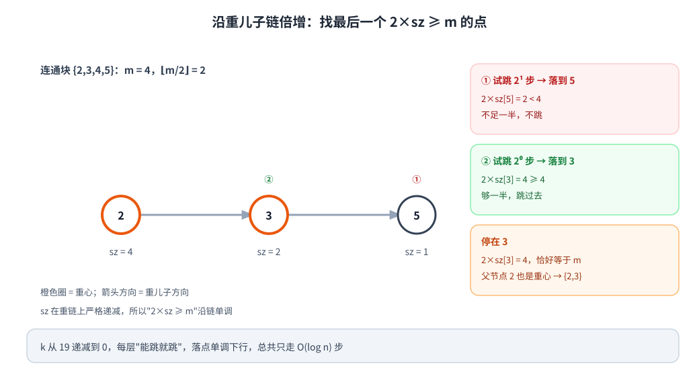
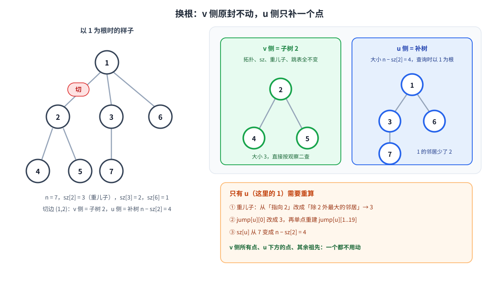
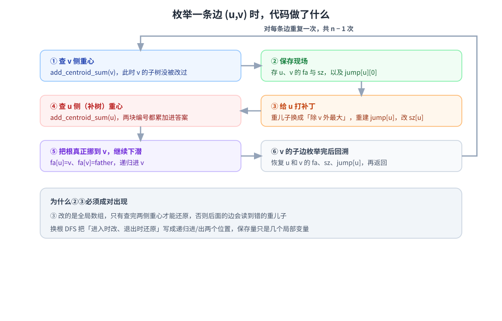

[[TOC]]

## 形式化题目

给定一棵 $n$ 个点的无向树 $T=(V,E)$，$|V|=n$，每条边长度都是 $1$。

对树 $H$，若删去点 $c$ 后 $H$ 分裂出的每个连通块大小都不超过 $\lfloor |H|/2 \rfloor$，称 $c$ 是 $H$ 的**重心**。一个树的重心只有一个或两个。

对每条边 $e=(u,v)$，删去它后 $T$ 分裂为两个连通块 $T_u$、$T_v$。要求

$$\sum_{e \in E}\ \Big(\sum_{c \in \mathrm{Cen}(T_u)} c \;+\; \sum_{c \in \mathrm{Cen}(T_v)} c\Big)$$

其中 $\mathrm{Cen}(H)$ 表示 $H$ 的重心集合。$n \leqslant 3 \times 10^5$，$T \leqslant 5$ 组数据。

先看样例第一组：$n=5$，边为 $(1,2),(2,3),(2,4),(3,5)$。切掉边 $(1,2)$ 后，一侧只剩 $\{1\}$，另一侧是 $\{2,3,4,5\}$。小连通块的重心就是它自己；而 $4$ 个点那一侧有**两个**重心 $2$ 和 $3$，两个编号都要计入答案。

图上标了 $2 \times \mathrm{sz}(3) = 4 = m$，这正是出现两个重心的条件：某个方向的点数**恰好**是一半。后面所有推导都绕这一条判定条件展开。

## 暴力解法

### 思路

最直接的做法是枚举每条边，把两侧连通块各自求一遍重心。

求单个连通块的重心也不必逐点验证定义，可以沿「最大子树」方向走：把连通块内任一点当根，算出各子树的点数；只要存在一个子树点数超过 $\lfloor m/2 \rfloor$，重心就必定在那个子树里，走进去重复；走到没有这种子树为止，停下的点就是重心。

@include-code(./brute.cpp, cpp)

### 复杂度

每条边断一次，两侧各做一次 $O(n)$ 的子树统计与下降，共 $n-1$ 条边，总 $O(n^2)$。$n = 3 \times 10^5$ 时是 $10^{10}$ 量级，跑不完。

### 瓶颈

两个地方重复劳动：

- **统计重复。** 每切一条边都要把两侧的子树大小从头算一遍，而这些信息在相邻两次切边之间几乎没变。
- **下降重复。** 找重心要一步一步走，链状树上单次要潜到 $O(n)$ 深，所有边加起来就更慢。

## 正解：换根 + 重链倍增

先把上一节「沿最大子树方向下降」这条直觉钉死，再看它为什么能吃下倍增和换根两种加速。

### 观察一：下降方向唯一

以大小为 $m$ 的连通块内任一点 $u$ 为根。若某个子树 $A$ 满足 $\mathrm{sz}(A) > \lfloor m/2 \rfloor$，那么这样的子树**至多一个**。

反证：假设子树 $A$、$B$ 都超过一半，则 $\mathrm{sz}(A) + \mathrm{sz}(B) > 2\lfloor m/2 \rfloor$。而 $A$、$B$ 都在 $u$ 下方且互不相交，点数之和至多 $m-1$。两式矛盾。

于是「往最大的那个子树走」是**唯一**的方向，不会分支。从任意起点出发反复这样做，走的是一条确定的链。

### 观察二：沿链倍增，落点就是重心

沿这条链往下走，子树大小严格递减，所以「$\mathrm{sz} \geqslant m/2$」这个条件沿链是单调的：前半段成立，后半段不成立。要的就是**最后一个**满足 $2\,\mathrm{sz}(x) \geqslant m$ 的点。

为什么停在那里就是重心？设落点为 $x$：

- $x$ 的每个子树都不超过 $\lfloor m/2 \rfloor$（否则还能继续往下走，与「最后一个」矛盾）；
- $x$ 上方的部分是 $m - \mathrm{sz}(x) \leqslant \lfloor m/2 \rfloor$（因为 $2\,\mathrm{sz}(x) \geqslant m$）。

两部分都不超过一半，所以 $x$ 是重心。

再看什么时候有两个重心。若 $2\,\mathrm{sz}(x) = m$，则 $x$ 上方的部分也恰好是 $m/2$。此时它的父节点 $p$：以 $p$ 为根时，$x$ 这一侧是 $m/2$，其余部分是 $m - m/2 = m/2$，同样都不超过一半，所以 $p$ 也是重心。两个重心必然相邻，且这条边两侧恰好各一半。

链上既然单调，就可以跳着走。预处理 $\mathrm{jump}[x][k]$ 表示从 $x$ 沿重儿子方向走 $2^k$ 步到达的点，查询时 $k$ 从 $19$ 递减到 $0$，能跳就跳：

图里 $m=4$：先试 $2^1$ 步落到 $5$，$2 \times 1 = 2 < 4$ 不够，不跳；再试 $2^0$ 步落到 $3$，$2 \times 2 = 4 \geqslant 4$，跳过去。停在 $3$ 后正好 $2\,\mathrm{sz}(3) = m$，于是父节点 $2$ 也是重心。整个过程 $O(\log n)$。

### 观察三：换根只需要补一个点

断边 $(u,v)$ 后把 $v$ 临时当根，树分成两半：

- $v$ 这一侧就是原来以 $v$ 为根的子树，内部拓扑、$\mathrm{sz}$、重儿子、跳表**全都没变**，直接按观察二查。
- $u$ 这一侧是去掉那棵子树后的补树，大小为 $n - \mathrm{sz}(v)$。此时 $u$ 变成了 $v$ 的子节点，它的「子节点」集合从「原来的儿子」变成「除 $v$ 以外的所有邻居」。

关键在于改动的范围。$\mathrm{jump}$ 是**单向朝下**跳的：任何点查重心时只会沿自己的重儿子往下走，永远走不回祖先。所以

- $v$ 侧的点：子树没动，重儿子与跳表不用改；
- $u$ 下方的点：它们的下行路径不经过 $u$，不用改；
- $u$ 的祖先：它们的重儿子与 $\mathrm{sz}$ 都没变，不用改。

真正变的只有当前这个端点 $u$ 自己的重儿子，于是只重算 $\mathrm{jump}[u][\cdot]$，$O(\log n)$。

选「除 $v$ 以外最大的邻居」时不能临时扫邻接表：菊花图上 $u$ 的度数是 $O(n)$，扫一遍就退化。做法是预处理每个点的**最大**和**次大**邻居，断开的恰好是最大那个时就取次大，否则取最大，$O(1)$。

### 算法流程

第一遍 BFS 以 $1$ 为根，逆序统计 $\mathrm{sz}$ 与重儿子，再按层建好跳表。第二遍用显式栈做换根 DFS，枚举每条边：

为什么要「保存现场」和「回溯恢复」：第 ③ 步改的是全局数组，必须等两侧重心都查完才还原，否则下一条边会读到错的重儿子。显式栈把这套「进入时改、退出时还原」的配对写成数组，同时避开 $3 \times 10^5$ 深度的递归爆栈。

有一处容易看错：代码在推进到 $v$ 时，为了能继续枚举 $v$ 的子边，真的把整棵树的定向根挪到了 $v$（`fa[u]=v`、`fa[v]=father`、`sz[v] += sz[u]`），所以回溯时要恢复的是 **$u$ 和 $v$ 两个点**的 `fa` 与 `sz`，再加 `jump[u][0]` 与重建的 `jump[u]`。正文说「只改一个点」，指的是**重儿子方向**只有一个点要重选；根指针本身是另一回事。

### 代码

变量与正文的对应：`sz[u]` 是 $\mathrm{sz}(u)$，`jump_table[u][k]` 是 $\mathrm{jump}[u][k]$，`son[u]` 是重儿子，`largest_two` 求最大与次大邻居。

@include-code(./main.cpp, cpp)

三个值得对照代码看的细节：

- `add_centroid_sum` 里 `sz[v] * 2 >= total` 就是观察二的判定，最后一行 `sz[u] * 2 == total` 则补上双重心时的父节点。
- `rebuild_jump` 只重算 $k \geqslant 1$ 的层，第 $0$ 层由调用方直接赋值。
- `largest_two` 在每帧压栈时算一次并存进 `stack_first/stack_second`，之后每次断边都 $O(1)$ 取用。

### 复杂度

- 时间：预处理 $\mathrm{sz}$ 与跳表 $O(n\log n)$；枚举 $n-1$ 条边，每边两次查询、一次单点重建、一次回溯恢复，各 $O(\log n)$。总 $O(n \log n)$。
- 空间：跳表 $O(n \log n)$，邻接表与显式栈 $O(n)$。取 $\log n = 20$ 时约 40 MB。

## 总结

这题把「求重心」拆成了两件可以独立加速的事：

$$c \text{ 是重心} \iff \text{每个方向的点数} \leqslant \lfloor m/2 \rfloor$$

一条判定条件，配上「超过一半的方向至多一个」，就把逐点验证变成了沿唯一链下降；链上 $\mathrm{sz}$ 单调，于是下降能吃倍增；而断边只让一个端点的重儿子失效，于是换根能吃 $O(\log n)$ 的局部修补。

两个容易踩的地方：

- **别在断边时扫邻接表找次大邻居。** 菊花图上单次就退化到 $O(n)$，必须预处理最大与次大。
- **跳表只朝下，所以改一个点不会波及祖先。** 这条是换根能成立的全部理由；如果哪天把跳表改成朝上或双向，这个结论立刻失效。

## 参考与致谢

| 来源 | 借鉴的思路 | 本文自行补充 |
| --- | --- | --- |
| [xht（uid 100544）](https://www.luogu.com.cn/article/p9dqpc9y) | 对比「按点统计贡献」与「按边求两侧重心」两类路线 | 采用换根 + 重链倍增路线；补写唯一方向、双重心论证 |
| [rainygame（uid 804607）](https://www.luogu.com.cn/article/ycqwx4rl) | 以最大子树方向唯一为依据，把找重心转为沿重儿子链下降 | 补充倍增判定与边界说明，对齐本地实现 |
| [TEoS（uid 91534）](https://www.luogu.com.cn/article/n6f4jb83) | 以重心为根、重链与次重儿子切换的线性路线 | 作为复杂度与实现取舍的比较材料 |
| [1gnat2（uid 2508）](https://www.luogu.com.cn/article/yl1u4xod) | 沿子树重心祖先路径推进、批量处理补树重心 | 作为渐进更优的比较路线，未采纳为主解 |
