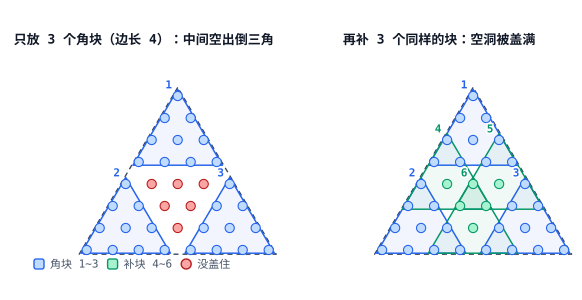

[[TOC]]

### 题意

给定边长为 $n$ 的数字三角形（第 $i$ 行有 $i$ 个数）。对每个边长为 $k$ 的正子三角形求其中数字的最大值，再把所有子三角形的最大值求和。

## 解法总览

两条路线都是倍增 + $O(n^2\log k)$ 时间，差别在于**怎么处理正三角形覆盖留下的中央空隙**，而这个差别直接决定了内存峰值。

| 解法 | 核心观察 | 时间 | 空间 | 适用场景 | 对应代码 |
| --- | --- | --- | --- | --- | --- |
| 一、纯正三角形 + 6 块查询（主解） | 每层用 6 块补空隙，倍增到不超过 k 的最大 2 的幂，查询时用 6 块拼出 k 边长 | $O(n^2\log k)$ | $O(n^2)$，只有 2 层，$n=3000$ 实测 32~65 MB 且与 $k$ 无关 | 大多数情况的首选：易理解、内存稳定 | `main.cpp` / `main.py` |
| 二、正/倒三角形 DAG 分解（备选） | 把「边长 $s$ 的表」当 DAG 节点，用 3 个同向 $p$ 块 + 1 个反向 $t$ 块覆盖，算完即释放 | $O(n^2\log k)$ | $O(n^2)$，常数约 6 个 `int`/格，$n=3000$ 实测约 **242 MB** | 想看清「用倒三角形补空隙」这条路线；$k$ 很小时时间略优 | `main2.cpp` |

两条都正确、复杂度同阶。解法一（纯正 6 块）在内存上始终占优、也更容易理解，是实际提交的首选；解法二（正/倒 DAG）只在 $k$ 很小时时间略好，$k$ 一大大幅落后，内存峰值还会涨到约 242 MB。

## 暴力解法

先看一个直接按题意扫描的朴素解：

@include-code(./brute.cpp, cpp)

暴力对每个子三角形逐行扫一遍取最大值，总复杂度 $O(n^2 k^2)$，$n \le 3000$ 时不可行。

---

## 解法一：纯正三角形 + 6 块查询（主解）

### 思路

**从一维 ST 表说起**

先估一下暴力：边长 $k$ 的子三角形有 $\Theta(n^2)$ 个，每个要扫 $O(k^2)$ 个格子，$n=3000$ 时不可行。

这和一维 RMQ 的结构一样。RMQ 先预处理所有长度为 $2^j$ 的区间最值，查询时拿两块拼出任意长度。搬过来就是把“长度 $2^j$ 的区间”换成“边长 $2^j$ 的三角形”。记 $T_s(i,j)$ 为以第 $i$ 行第 $j$ 列为上顶点、边长为 $s$ 的三角形中的最大值。

这里的“拼”是指拿若干个小三角形把目标三角形**盖住**：块之间允许重叠，只要目标里每个格子至少落在一个块内，这些小三角形的最大值就等于目标三角形的最大值。于是问题变成一句很具体的话：用边长为 $2^j$ 的块，要几块、各自摆在哪儿，才能盖住边长为 $k$ 的三角形？

一维区间两块就够，三角形不够。下面会看到，构建和查询用的是同一套答案：6 个**边长相同**的块，具体位置由目标边长决定。

**为什么 3 个角块不够**

左图是边长 8 的三角形，摆 3 个边长 4 的块，三个角都盖住，中间仍空出一个边长 3 的倒三角（红点）。

补法很直接：再放 3 个块，如右图。这 3 个补块的边长还是 4，和角块完全一样，只是上顶点往中间挪了半个边长。整个算法因此只有一种块尺寸，不需要为补丁另造结构。

想自己核对每个块的落点，可以打开[6 块交互演示](./six-block-interactive.html)：拖动滑块改 $L$，点公式高亮对应的块。

**构建：从边长 $L$ 推到 $2L$**

设已知所有 $T_L$，要算 $T_{2L}$。照上图，6 个块的上顶点是

- 三个角：$(i,j)$、$(i+L,j)$、$(i+L,j+L)$；
- 三个补块：$(i+L/2,j)$、$(i+L/2,j+L/2)$、$(i+L,j+L/2)$。

取这 6 个 $T_L$ 的最大值即可：

$$
T_{2L}(i,j)=\max\begin{Bmatrix}
T_L(i,j),\\
T_L(i+L,j),\\
T_L(i+L,j+L),\\
T_L(i+\tfrac{L}{2},j),\\
T_L(i+\tfrac{L}{2},j+\tfrac{L}{2}),\\
T_L(i+L,j+\tfrac{L}{2})
\end{Bmatrix}
$$

左边是边长 $2L$ 的三角形，右边是盖住它的 6 个边长 $L$ 的三角形，所以取 max 就是 $T_{2L}$。

$L=1$ 时没有 $L/2$ 可用，只有前三个角块有意义。代码里把 $L$ 写作 `half`、$L/2$ 写作 `quarter`，层数 `t == 1` 时跳过补块。

**查询：同一套模板，换个偏移**

表只建到 $L=2^{\lfloor\log_2 k\rfloor}$，也就是不超过 $k$ 的最大 2 的幂，剩下的零头在查询时拼。仍然是 6 块 $T_L$，只把偏移从 $L$ 换成 $k-L$：

- 三个角：$(i,j)$、$(i+k-L,j)$、$(i+k-L,j+k-L)$；
- 三个补块：$(i+\mathrm{cha},j)$、$(i+\mathrm{cha},j+\mathrm{cha})$、$(i+k-L,j+\mathrm{cha})$，其中 $\mathrm{cha}=(k-L)/2$。

$k=2L$ 时 $k-L=L$，退化成构建那一套；$k$ 越接近 $L$，$k-L$ 越小，6 个块重叠得越多，覆盖只会更满。所以这套下标对 $k\in[L,2L]$ 都能用。

两个边界值得单独记一下：

- $k$ 恰是 $2$ 的幂时 $k-L=0$、$\mathrm{cha}=0$，6 个块塌成 1 块，直接读表；
- $k=1$ 时块边长就是 1，没有补块，对应代码里的 `if (lg >= 1)`。

| 代码变量 | 含义 | 值 |
| --- | --- | --- |
| `half` | 构建时的块边长 $L$ | $2^{t-1}$ |
| `quarter` | 构建时的补块偏移 $L/2$ | $2^{t-2}$ |
| `lg`、`block` | 查询时的块边长 | $2^{\lfloor\log_2 k\rfloor}$ |
| `cha` | 查询时的补块偏移 | $(k-\mathrm{block})/2$ |

**为什么只要两层表**

每一层只依赖上一层，所以两层表轮换就够：`f[pre]` 读、`f[cur]` 写，算完 `swap(pre, cur)` 进入下一层。全程内存是恒定的两层 $n\times n$，与 $k$ 无关。

代价是必须先把倍增推到 $L=2^{\lfloor\log_2 k\rfloor}$。$k$ 再小也躲不掉这层固定开销，下面的实测表能直接看到这一点。

### 代码

@include-code(./main.cpp, cpp)

Python 版是同一个 6 块滚动算法，用 `zip` + `map(max, ...)` 把六路取 max 一次写完：

@include-code(./main.py, python)

### 复杂度

- 时间：倍增 $O(n^2\log k)$，查询每个位置 $O(1)$，合计 $O(n^2\log k)$。
- 空间：两张 $n\times n$ 的 `int` 表，$O(n^2)$，$n=3000$ 实测 32~65 MB，与 $k$ 无关。

---

## 解法二：正/倒三角形 DAG 分解（备选）

### 思路

解法一之所以只要 2 层表，是因为它**从没打算把边长 $k$ 的表整张建完**：只推到 $2^{\lfloor\log_2 k\rfloor}$，剩下的零头在查询时临场拼。

反过来想：如果目标就是「一次把边长 $k$ 的表建出来」，那每一个「边长 $s$」都得有一套覆盖所有位置的完整表。此时补中央空隙改用**倒三角形**，块数更少、几何更直接。

设 $s = p + d$，$p$ 是不超过 $s$ 的最大 $2$ 的幂，$d = s - p$。用 3 个边长 $p$ 的正三角形盖住三个角，中间剩下的倒三角空隙用 1 个边长 $t = 2d - p - 1$ 的**倒三角形**补上：

$$
T^{\uparrow}_s(i,j) = \max\Big(T^{\uparrow}_p(i,j),\ T^{\uparrow}_p(i+d,j),\ T^{\uparrow}_p(i,j+d),\ T^{\downarrow}_t(i+d-t,\ j+d-t)\Big).
$$

当 $t \le 0$ 时，三个正块本身已经互相重叠盖满整个大三角形，不需要倒块，代码走只有 3 块的快路径。

倒三角形是正三角形的上下镜像，递推公式形状完全对称，所以代码把形状写成 `type`（$0$ 正 / $1$ 倒），两套递推各写一遍。

**实现要点**

1. **坐标**：位置用 $(x, y)$ 表示（$x, y \ge 0$，$x + y \le n - 1$），每行按行首地址压成一维数组，省掉三角形区域的空白格子。
2. **DAG**：所有会用到的「（形状，边长）」组合构成一张节点图。边长 $1$ 是叶子，直接指向原始数据；其余按边长从小到大递推。
3. **引用计数 + 用完即释**：每个节点记录还有几个父节点会用自己（`use_count`），算完一个节点就把两个子节点的计数减一，归零立刻 `delete[]`。靠这一步，峰值才能压到 $O(n^2)$ 而不是 $O(n^2\log k)$。
4. **求和**：根节点就是边长 $k$ 的正三角形表，把所有位置累加即可。

### 代码

@include-code(./main2.cpp, cpp)

### 复杂度

- 时间：每个节点扫 $O(n^2)$ 个位置，节点数 $O(\log k)$，合计 $O(n^2\log k)$。常数比解法一大，因为每张表都要整张写一遍。
- 空间：同时存活的表最多约 6 张 $n\times n$ 的 `int`，$n=3000$ 实测峰值约 242 MB（$k=3000$ 时）。

---

## 复杂度对比

$n=3000$ 随机权值，同一份数据只改 $k$，两个程序都用 `cin` 读入，本机三次取最好：

| $k$ | 解法一 `main.cpp` 时间 | 内存 | 解法二 `main2.cpp` 时间 | 内存 |
| --- | --- | --- | --- | --- |
| 1 | 463 ms | **32 MB** | 389 ms | 37 MB |
| 7 | 430 ms | 64 MB | 428 ms | 55 MB |
| 512 | 536 ms | **64 MB** | 949 ms | 208 MB |
| 1024 | 662 ms | **63 MB** | 1062 ms | 226 MB |
| 3000 | 646 ms | **65 MB** | 1101 ms | 242 MB |

读这张表要抓住三点：

1. **小 $k$ 时两者几乎打平**。$n=3000$ 时读入本身就要三百多毫秒（450 万个整数），两边都得付这笔钱，剩下的差距被压得很小。解法二省掉了「把倍增推到 $2^{\lfloor\log_2 k\rfloor}$」那几层，所以 $k=1$ 时略快一点，但优势只有几十毫秒。
2. **大 $k$ 时解法二明显落后**。它要把边长 $k$ 的整张表建出来，每张表 36 MB，建表加搬运的写入量远大于解法一的 6 次取 max。$k=3000$ 时慢 70%。
3. **内存始终是解法一的地盘**。解法一只要两层 $n\times n$，实测 32~65 MB 且与 $k$ 无关；解法二随 $k$ 涨到 242 MB，$k\ge 512$ 之后差 3 倍以上。内存限制若是 125 MB，解法二直接 MLE。

### 总结

二维 ST 表不能把一维的“两块覆盖”简单照搬。三角形的特殊形状使得正方向覆盖会出现空隙，补这个空隙有两条路：

- **只用正三角形、用更多块补**（解法一，主解）：6 块就能填满空隙，滚动保留 2 层，内存稳定且与 $k$ 无关，易理解，是大多数情况的首选。
- **引入倒三角形**（解法二，备选）：几何最自然，一次建出 $k$ 边长的表，但递归分解要同时持有好几张 $O(n^2)$ 的表，峰值内存高，在小 $k$ 时最快。

两者时间复杂度同为 $O(n^2\log k)$，但常数和内存峰值都由解法一占优。解法二的价值在思路上：它说明补空隙也可以换成倒三角形，用一个 DAG 一次建出整张表。真要提交，选解法一。
